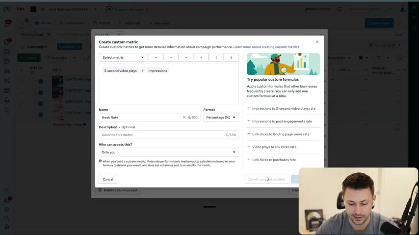
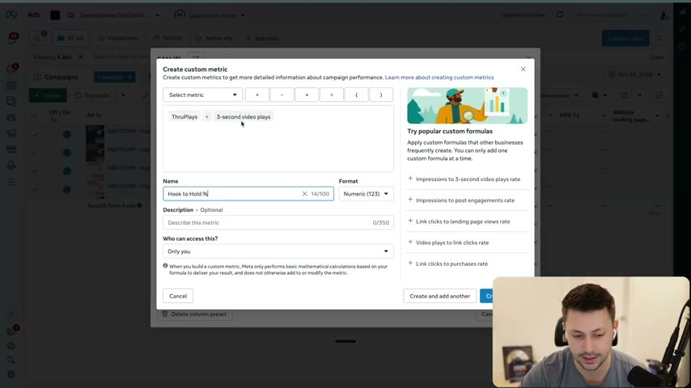
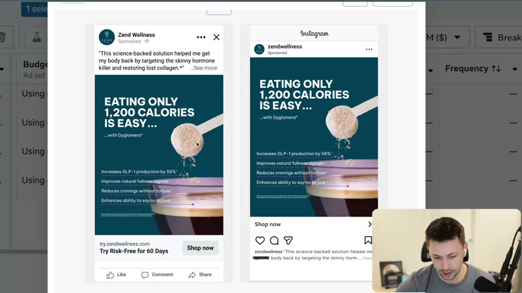
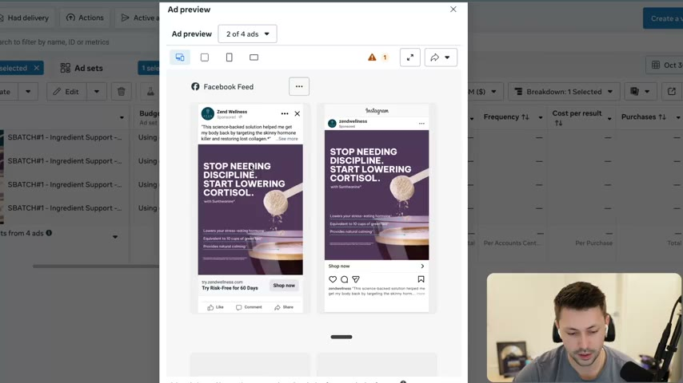
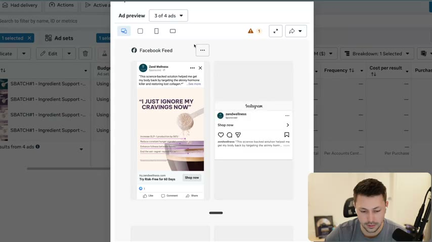
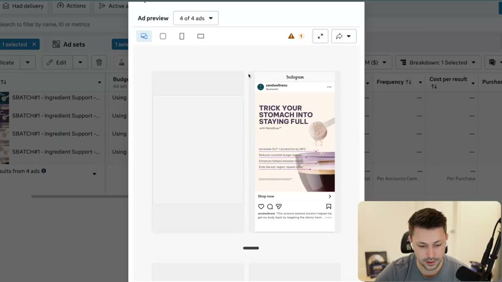
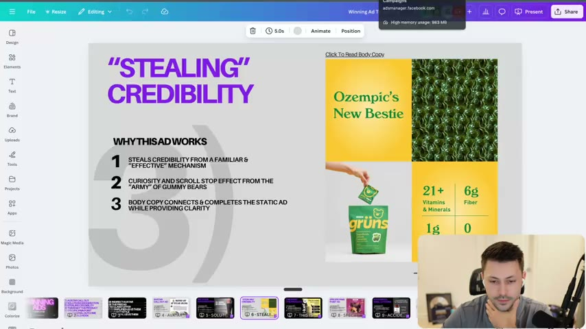
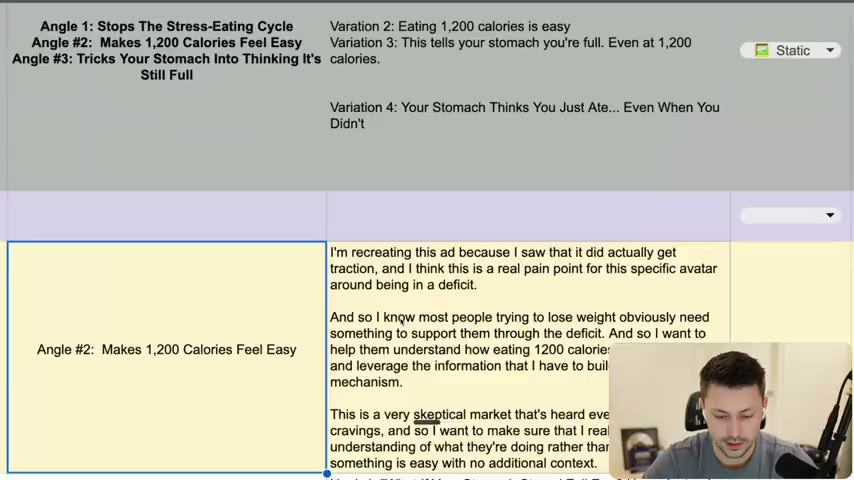
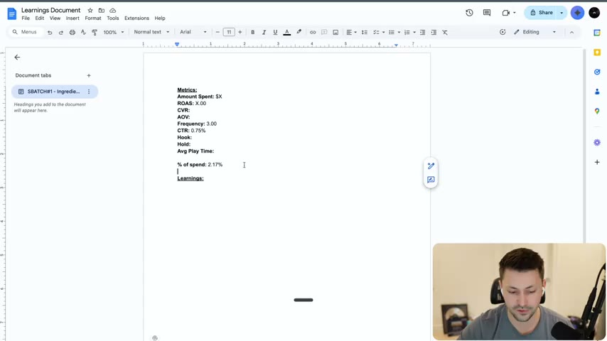

# 124. How To Do Learnings - Part 3 (Losers)
> A live walkthrough of reviewing a losing static-ad concept: pull the right metrics (including the "% of spend" test), find why Meta preferred one variant, compare it to known winners, and turn the result into an action plan while treating every learning as a guess.

## 🤖 Agent use
- **Use when:** a batch of ads has run about 7 days and some concepts got little spend or no sales; writing the "Learnings" entry for a losing ad; deciding whether to iterate on a loser or drop it.
- **Inputs → outputs:** Ads Manager data for every variant of one concept (spend, ROAS/CPA, CTR, frequency, CVR, AOV, hook/hold for video) + the ad creatives + a set of known winning ads → a verdict (winner / loser by % of spend), a ranked list of differences between the top-spend variant and the rest, "educated guess" learnings, and an action plan.
- **Rules:**
  - **DO** judge by share of account spend, not by your taste: "% of spend" = ad (concept) spend ÷ total account spend, over a 7-day window. [05:13–07:54]
  - **DO** start recording metrics in this order of importance: amount spent, ROAS or CPA, then CVR, AOV, frequency, CTR; for video add hook rate, hold rate, average play time. [00:30–02:53]
  - **DO** call a concept a loser when it only gets ~2% of spend. "Early on" aim for ads that get at least 10% of spend; the instructor's team wants 30–50%. [07:04]
  - **DO** let ads run at least 7 days before judging, because "Meta is trying to figure itself out". [07:54]
  - **DON'T** force spend onto the other variants by turning off the top spender; treat the concept as a loser and make a better version. [10:48–11:41]
  - **DO** find the variant with the most spend and ask what is different about it versus the others; use that as the direction. [11:41–13:26]
  - **DO** compare the loser to ads you know are winners when you cannot see why it failed. [19:46–23:12]
  - **DON'T** get excited about learnings from a 2%-of-spend ad: "this is still not a winning ad." [16:29–17:24]
  - **DON'T** write broad learnings like "this image sucks"; look at messaging, framing, what you say, and whether you explain the mechanism. [24:51–25:41]
  - **DO** end every learnings session with an action plan (what we will do as a result), even if the plan is "don't repeat A, B, C, D". [23:12–24:51; 29:17–29:59]
  - **IF** an ad got $0 spend **THEN** you have no data: skip the data review and learn why customers did not care, then try again. [29:59]
  - **DON'T** treat learnings as facts. They are "educated guesses" until a re-test wins. [25:41–28:20]
- **See also:** [122. Learnings Part 1 (Losers)](122-how-to-do-learnings-part-1-losers.md) · [123. Learnings Part 2 (Winning Ads)](123-how-to-do-learnings-part-2-winning-ads.md) · [125. Learnings Part 4 (Winning Ads)](125-how-to-do-learnings-part-4-winning-ads.md) · [6. 13 winning static ad templates](006-13-winning-static-ad-templates.md) · [100. How to see ads performance + our columns](100-how-to-see-ads-performance-our-columns.md) · [Copywriting 48. How to iterate on losing ads](../../copywriting/lessons/48-how-to-iterate-on-losing-ads.md)

Lesson page text: none ("no lesson text on page"). Everything below is from the video. The instructor says he will "include this document for you guys down below" [01:15], but no document is attached to the exported page.

## Key ideas

### 1. Setup: find the ads and record the metrics [00:00–04:27]
- Scope: this is an image-ad example, "but basically the same thing applies to videos." Video review is covered later in the course (see [125](125-how-to-do-learnings-part-4-winning-ads.md)). [00:00]
- In Ads Manager, filter by the date the ads ran, find all variations of the concept, then sort by spend. He hides the client's spend figures out of respect for the client. [00:00–01:15]
- Where learnings live is "totally up to you": a doc, the creative roadmap sheet's learnings section, or the Growth Guide. He drafts in a Google Doc and may copy a cleaned version into the Growth Guide. [01:15] (See [85. The 3.0 Evolve Growth Guide](085-the-3-0-evolve-growth-guide.md).)
- Metrics he says matter most, in order: **amount spent**, then **ROAS or CPA** ("was it positive"), with CVR, AOV, hook, hold and average play time as "more complementary". Video adds hook, hold, average play time; "if you really want to get granular" add conversion rate and AOV. [01:15–02:53]
- The doc template he typed live is reproduced under Prompts / templates below, and the frame at 06:10 shows it (including frequency 3.00, CTR 0.75% and 2.17% of spend for this ad). [06:10 frame]

### 2. Build the custom columns in Ads Manager [02:08–04:27]
How to: Columns menu > Customize columns > create custom metric. Each formula below is as the instructor gives it. [02:08–04:27]
- **CVR** (conversion rate): `Purchases ÷ Link clicks`, format percentage ("I just do link clicks just to be safe"). Name it CVR. [02:08–02:53]
- **AOV**: already a built-in metric; type "average order value" / "average purchase conversion value" in the column search. [02:53]
- **Hook rate**: `3-second video plays ÷ Impressions`, percentage. "The percentage of people that stop and watch the first three seconds." Meta may now offer a ready-made formula. [03:38]
- **Hold rate (all)**: `ThruPlays ÷ Impressions`. ThruPlay = people who watch at least 15 seconds, or the whole video if it is shorter than 15 seconds. [03:38]
- **Hook-to-hold rate**: `ThruPlays ÷ 3-second video plays`: of the people who watched 3 seconds, how many continued to 15 seconds or the end. [04:27]
- **Average play time**: built in ("Video average play time"). [04:27]


*Create custom metric dialog: Purchases + Link clicks (operator hidden; spoken as divide), named "CVR". [02:55]*


*"Hook Rate" = 3-second video plays and Impressions, formatted as percentage. [03:45]*


*"Hook to Hold %" built from ThruPlays and 3-second video plays. [04:35]*

### 3. The % of spend test [05:13–08:37]
- Why: "did this ad actually do much or do anything for the account?" It works at any budget. [05:13–07:04]
- Spend pattern of the example ad over its 7 days: slow start, more spend on days 2–3, peak on day 4, less on days 5–6. To see it, use Breakdown > By day. He prefers doing this at the **ad set** level so the variants' daily spends are not mixed in. [05:13]
- The ad is "still active in the account because it's getting purchases and it's just basically retargeting" and got **2.17% of spend**. [06:09]
- Worked example: total account spend $1,000 in 7 days; the ad got $20; 20 ÷ 1,000 = 2%. "It's just not doing anything." [06:09–07:04] (Illustrative numbers; the real account spent far more, by his statement.)
- Thresholds (instructor's rule of thumb): **early on, get at least 10% of spend** (= $100 of $1,000, "now we're starting to get some data"); his team likes ads at **30–50% of spend** ($300–$500 of $1,000), "that probably means that you've got a winner", depending on KPI. [07:04]
- Scale context: on a $100,000-per-week brand, 2% = $2,000, "not really anything"; they are hunting for ads that can spend **$20,000 a week = 20% of weekly spend**. [07:04–07:54]
- Always look at a **seven-day period**. You can kill an ad after 3–4 days, but he recommends letting ads run at least 7 days "because Meta is trying to figure itself out". [07:54]
- Cadence: one ad per day = about seven ads a week. Each check: which ad from the last 7 days got no spend or poor performance? Turn it off and launch a new one. [07:54–08:37]
- Ad-set count: seven ad sets in a $100 CBO is "not ideal" but "fine"; "you're not going to overwhelm Meta as long as you're not going above seven." He mentions a rule of thumb of five, and "a specific rule based off your CPA" that he does not give here. [08:37]
- Verdict: 2.1% of spend = "the result for this ad is a loser. It did not perform. It did not scale." [08:37–09:34]
- Calibrate the effort: "what success actually looks like and what we're trying to actually aim for." [08:37]

### 4. Find the variant Meta preferred and ask why [09:34–13:26]
- Open Preview to see all variants. UI bug: if you zoom the browser while in the preview, close the preview before you zoom back out, otherwise it "will break your meta". [09:34]
- Variant order on screen: V3, V2, V4, V1. V3 ("Eating only 1,200 calories is easy…") had the most spend ("our most significant spend"). [10:13]
- Do not force-spend the others. "If there was a winner in here, Meta would have spent on it." Turning off the top spender to push budget onto the rest is possible but "99 times out of 100 none of these ads will work for you." Use the top spender "as your direction and move on". [10:48]
- Trust Meta's spend and make something better; over the long run that beats "making sure Meta spends money on every single ad". [10:48–11:41]
- Lens calibration: V3 was his favorite headline, so his lens was "partially correct" (Meta agreed) even though the concept still lost, "a bonus check mark". He has "reviewed so many ads" and usually predicts spend winners. [11:41–12:34]

### 5. What was different about the top-spend variant [13:26–19:46]
Compared headlines: [13:26–15:36]
- V3 "Eating 1,200 calories is easy… with Diaglomera" (screen: "Dyglomera").
- V2 "Stop needing discipline, start lowering cortisol."
- "I just ignore my cravings now."
- "Trick your stomach into staying full" (with MetaGlow).

His learnings (written out loud; "everything that I'm talking out loud, I would actually be writing"):
1. **Easy / contrast / pattern interrupt.** V3 claims something hard is easy. "When you put two things together that don't really belong, that is going to grab attention." Extreme examples: a tiger behind you while filming an e-com video; toothpaste used to make cookies. His "broad learning" and "biggest learning": saying something hard is actually easy grabs attention. [13:57–15:36] (Instructor attributes this to "people way smarter than me that make viral videos".)
2. **Specificity.** "1200 calories is actually like weirdly specific as well" (said in a role-played partner conversation). [15:36–16:29]
3. **A Big Four frame.** "Easy" is one of the "big four power words / frames" taught in copywriting; the other variants do not state easy/big/fast. [13:57–16:29] See [Value words / Big 4](../../copywriting/concepts/value-words-big-4.md).
4. **Product name.** Only V3 names Diaglomera; the others do not. "I wonder if that has something to do with it." [16:29]
5. **Execution, not angle.** The other angles (ignoring cravings, keeping your stomach full) are not proven dead: "probably it means the execution... was just not good." [17:24–18:00]
6. **Congruence.** The image barely supports the headline: "you could take this image and basically put it on any headline." No 1,200-calorie visual. [18:00–19:46]
7. **Brand-name mismatch.** Ad shows Zend Wellness / Diaglomera, the landing page says MetaGlow. Fixes: use the real product name in the ad, or show the product (MetaGlow collagen tub) rather than just the scoop. [18:47–19:46]
8. **Weak cortisol claim.** "Cortisol is something that so many people have talked about... people are just immune to this"; a bad claim for a sophisticated market. [21:27–22:17]
9. **No credibility element.** No borrowed mechanism or credibility in the others. [21:27–22:17]
10. **Cross-check with a partner.** "If you do actually have someone that you can do learnings with... go back and forth." A second reader noticed the brand-name difference and the specificity. [15:36–16:29]


*The top-spend variant: static with "EATING ONLY 1,200 CALORIES IS EASY… with Dyglomera*" and four benefit lines; Try Risk-Free for 60 Days. [18:50]*


*V2: "STOP NEEDING DISCIPLINE. START LOWERING CORTISOL." The instructor later calls the headline weak. [13:50]*


*"I JUST IGNORE MY CRAVINGS NOW" static (third in preview order); named V4 by ad-name order (derived). Shown at [22:40] as he compares it to winners.*


*"TRICK YOUR STOMACH INTO STAYING FULL" static, "with MetaGlow" (fourth in preview order); the only variant that names MetaGlow. [23:05]*

### 6. Compare against winning ads when you cannot see the problem [19:46–23:12]
- "If you're struggling... the number one thing that you can do is... click the 13 winning static ads" and compare. He opens the winning-static deck (see [6. 13 winning static ad templates](006-13-winning-static-ad-templates.md)). [19:46]
- Checks from that deck, applied to the loser:
  - "Mama 15 year": clear and direct avatar callout; supporting claim with a real review; family photo with kids builds trust. Loser: no direct avatar callout. [19:46–20:37]
  - "14+ hours, no swelling": bold numbers callout that stops the scroll, two things that do not go together. This is the ad they replicated for the 1,200-calorie headline; the image is "slightly more congruent" than theirs. [20:37–21:27]
  - "Stealing credibility": none of the loser variants borrow credibility from another mechanism. [21:27]
  - "This is a meal, not a protein shake": clever wordplay; only "trick your stomach into staying full" is "decent", "stop needing" is "terrible". [22:17]
  - "Lose the muffin top for good": offends/targets a very specific pain point; the loser talks about cravings (obvious big pain) and "high cortisol" only. [22:17–23:12]
- Result: comparison lets you "complete the feedback loop": "Actually, this ad really isn't that good", though he was "pretty pumped about these" at launch. [23:12]


*The Canva "Winning Ad Templates" deck used for comparison: slide "Stealing Credibility" with three "why this ad works" bullets (familiar effective mechanism; curiosity/scroll stop; body copy completes the static). [21:45]*

### 7. Turn it into an action plan [23:12–25:41]
- Rule: "make sure that you have one thing: what are we going to do as a result of this new information?" [23:12]
- What he did (shown in the Growth Guide): a **1,200-calorie iteration**, re-making the top-spend direction as a **video** that explains the Diaglomera mechanism, because (a) the static got traction, giving direction; (b) this is "a real pain point for this specific avatar around being in a deficit"; (c) there is no landing page focused on the mechanism; (d) the click-through rate on the static "just wasn't that good". Plan: "double down on the thing that I got the direction on". [23:12–24:51]
- The Growth Guide frame shows three angles (Stops The Stress-Eating Cycle; Makes 1,200 Calories Feel Easy; Tricks Your Stomach Into Thinking It's Still Full) and variations such as "Eating 1,200 calories is easy", "This tells your stomach you're full. Even at 1,200 calories.", "Your Stomach Thinks You Just Ate... Even When You Didn't". [24:00 frame]


*Growth Guide row: Angle #2 "Makes 1,200 Calories Feel Easy" with his reasoning ("I'm recreating this ad because I saw that it did actually get traction... a real pain point for this specific avatar around being in a deficit..."). Webcam overlay hides the end of each line. [24:00]*

### 8. Time, depth and the mindset [24:51–30:46]
- First 10–30 reviews will produce "very broad learnings" (e.g. "this image sucks"); avoid them: "that's probably not the reason why it doesn't work. It's probably something to do with the messaging, how you're framing it, what you're saying... or the fact that you don't actually explain it." [24:51–25:41]
- Time budget: you do not need 30–40 minutes on one ad, "but if it's a winning ad, I definitely would. And for a losing ad... spend 10 or 15 minutes." If you only make one ad per day, use spare time reviewing existing ads, "just like how you take time to make sure that the script that you wrote is the best script." [25:41]
- **Learnings are guesses, not facts.** "The learnings that you make are educated guesses. They are not facts." Do not conclude "two things that don't go together needs to be on every single ad". Apply a guess in a new ad; if it wins, it becomes "slightly more of a fact", then test it again in another version. Otherwise people conclude "e-com sucks". [25:41–27:31]
- Even at his level the learnings are guesses. Example: if the 1,200-calorie video wins, the guess "people really like this hyper-specific, easy way to stay in a deficit" gets validated. [27:31–28:20]
- **How to judge your learnings skill:** "when you do learnings, can you make a winning ad?" World-class people can do learnings on an ad and turn it into a winner; he claims a ~60–70% chance for himself (instructor claim) and names Carlo as someone who does this. [28:20]
- You do not have to act on every learning. If an ad flops with $0 spend, you may note why you think it failed, keep your current direction, and apply "I learned to not do A, B, C, D anymore" to other angles. [28:20–29:59]
- "That's how learnings compound." [29:59]

## Steps / framework

**Losing-ad learnings review (instructor's live process)**

| # | Step | Detail | Time |
|---|---|---|---|
| 1 | Pull the concept's ads | Filter by run date; sort by spend; keep all variants | [00:00–00:30] |
| 2 | Record metrics | Amount spent, ROAS/CPA, CVR, AOV, frequency, CTR, (video: hook, hold, avg play time) | [01:15–04:27] |
| 3 | Compute % of spend | Concept spend ÷ account spend over 7 days; verdict vs 10% / 30–50% | [05:13–08:37] |
| 4 | Identify the top-spend variant | Preview all variants; use Meta's choice as the direction | [09:34–11:41] |
| 5 | List differences | What does the top-spend ad do that the others do not? (claim type, specificity, frames, brand name, avatar callout) | [11:41–16:29] |
| 6 | Check congruence | Does the visual support the headline? Does the ad name match the landing page? | [18:00–19:46] |
| 7 | Compare to winners | Known winning statics: avatar callout, real-review claim, bold numbers, stealing credibility, wordplay, specific pain point | [19:46–23:12] |
| 8 | Reality check | Even the best variant lost, so do not "crack the code" from it | [16:29–17:24] |
| 9 | Action plan | One concrete next ad (iteration of the top-spend direction, or "avoid A, B, C, D") | [23:12–24:51] |
| 10 | Label as guesses; re-test | A win validates; a loss means review again | [25:41–29:59] |

## Examples
- **Zend Wellness / MetaGlow, 4-variant static concept** (supplement; weight-management audience). Result: 2.17% of 7-day account spend, frequency 3.00, CTR 0.75% (frame, not stated aloud); still active only for retargeting. V3 "Eating only 1,200 calories is easy… with Diaglomera" got the most spend. Action: 1,200-calorie video iteration explaining the mechanism. [06:09; 10:13; 23:58]
- **Pattern-interrupt examples the instructor uses for "two things that don't go together":** a tiger behind you in an e-commerce marketing video; toothpaste used to make cookies; "eating 1200 calories is actually easy". [13:57–14:48]
- **Feedback-loop quote:** he was "pretty pumped about these" headlines at launch; after comparing to winners, "this ad really isn't that good." [23:12]

## Structured units

### Ad teardowns
| Brand / product (niche) | Format | Hook / opening | What works | What fails | Fix suggested | Principle | Source |
|---|---|---|---|---|---|---|---|
| Zend Wellness / MetaGlow collagen powder (weight management) V3 | Static | "Eating only 1,200 calories is easy… with Diaglomera" | Easy claim contrasts with "hard" belief; specific number; names the mechanism; most spend of 4 variants | Only 2.17% of spend; image not congruent with headline; brand differs from landing page; no credibility element | Show the product, use real brand name, test video explaining the mechanism | Pattern interrupt + Big Four frame + specificity | [13:26–19:46] |
| Same, V2 | Static | "Stop needing discipline. Start lowering cortisol." | Gives a reason (cortisol) | "Cortisol" is over-used; "bad claim for a sophisticated market"; "kind of ass" | Drop or reframe | Sophisticated market needs new mechanism | [21:27–22:17] |
| Same, V4 (by ad-name order) | Static | "I just ignore my cravings now." | Relatable outcome | Not easy/big/fast; no brand name; "okay" at best | Re-execute the cravings angle with the learnings | Same | [13:57–16:29; 22:17] |
| Same, V1 (by ad-name order) | Static | "Trick your stomach into staying full" (MetaGlow) | Wordplay "decent" | Did not get spend | Re-execute with learnings | Wordplay | [22:17] |

### Rules of thumb
- **DO** use % of spend over 7 days as the first verdict; 2% = loser, ≥10% = early signal, 30–50% = likely winner. [06:09–07:04]
- **DO** write down what the top-spend variant did differently, then re-execute that, not the losers. [11:41; 17:24–18:00]
- **IF** you cannot see why an ad failed **THEN** compare it line by line to ads in the winning-ads deck. [19:46]
- **DON'T** conclude "angle is dead" from one weak execution. [17:24–18:00]
- **DO** restate learnings as guesses and re-test them. [25:41–27:31]

## Prompts / templates (verbatim)

**Learnings doc template** (typed live, frame at 06:10; values are placeholders shown on screen):
```
Metrics:
Amount Spent: $X
ROAS: X.00
CVR:
AOV:
Frequency: 3.00
CTR: 0.75%
Hook:
Hold:
Avg Play Time:

% of spend: 2.17%

Learnings:
```

**Custom metric formulas (as spoken)**
```
CVR              = Purchases / Link clicks            (percentage)
Hook rate        = 3-second video plays / Impressions (percentage)
Hold rate (all)  = ThruPlays / Impressions
Hook-to-hold     = ThruPlays / 3-second video plays
ThruPlay         = watched at least 15s, or the whole video if shorter than 15s
% of spend       = concept (or ad) spend / total account spend, over 7 days
```

## Screenshots

*The Learnings Document: Metrics block (Amount Spent, ROAS, CVR, AOV, Frequency, CTR, Hook, Hold, Avg Play Time, % of spend) above an empty "Learnings:" section. [06:10]*

## How to apply
- [ ] Create the CVR, Hook Rate, Hold Rate and Hook-to-Hold custom columns before the review (see formulas above).
- [ ] After 7 days, compute each concept's % of account spend and label it loser (about 2%), early signal (10%+), or likely winner (30–50%).
- [ ] Identify the top-spend variant; write 3–6 specific differences (claim type, specificity, frame words, avatar callout, product name, credibility).
- [ ] Check visual-to-headline congruence and ad-to-landing-page naming.
- [ ] Compare to 2–3 winning ads from the deck and write which winning elements were missing.
- [ ] Write the action plan as one named next ad (what we double down on and why).
- [ ] Tag every learning "guess" and log whether the re-test validates it.
- [ ] Cap loser reviews at 10–15 minutes; winners get more.

## Related
- Previous: [123. Learnings Part 2 (Winning Ads)](123-how-to-do-learnings-part-2-winning-ads.md) · Next: [125. Learnings Part 4 (Winning Ads)](125-how-to-do-learnings-part-4-winning-ads.md)
- [Copywriting 50. How to iterate on spend winners](../../copywriting/lessons/50-how-to-iterate-on-spend-winners.md) · [Iteration playbook](../../copywriting/frameworks/iteration-playbook.md) · [10-step iteration learnings](../../copywriting/frameworks/ten-step-iteration-learnings.md) · [Pattern disruption](../../../../concepts/heuristics/pattern-disruption.md) · [Specificity](../../../../concepts/heuristics/specificity.md) · [Hero image / copy congruence](../../../../concepts/hero-image-copy-congruence.md)

## Sources and limitations
- Transcript: [124 transcript](<../../../../../raw/evolve/start-here/_transcripts/👣 Evolve (Start Here)/124. How To Do Learnings - Part 3 (Losers) 👣 Evolve (Start Here) Evolve.txt>) · Page text: [124 page text](<../../../../../raw/evolve/start-here/_extracted/👣 Evolve (Start Here)/124. How To Do Learnings - Part 3 (Losers)_👣 Evolve (Start Here)_Evolve.html.md>) (empty).
- Machine transcription (Whisper large-v3-turbo); full recording covered (last segment 30:46 = duration). Whisper writes "Diaglomera" while the ad text on screen reads "Dyglomera"; "Zen Wellness" = Zend Wellness (screen); "Xand" in lesson 126 likely also Zend. Spoken "Aquafy" (voice-to-text tool) is unclear. "Carlo" is a first name only (surname unverified).
- The 10% / 30–50% thresholds, "never above seven ad sets" and the ~60–70% self-estimate are instructor claims without data. The reference to "a specific rule based off your CPA" is not explained in this lesson.
- Spend and ROAS values are deliberately hidden in the video; the only numbers available are frequency 3.00, CTR 0.75% and 2.17% of spend, shown in the doc frame. The 2.17% is the whole concept; the speaker also says "this ad" for it.
- Variant numbering is inconsistent in the audio (V3 was the top spender; V1/V4 mapping to the cravings/stomach ads inferred from the ad-name order on screen at [06:10]).
- Screenshots grabbed from MEGA; frame at 24:00 has a webcam overlay hiding part of the Growth Guide text. Account name "Zend Wellness" is visible in screens; ad-account IDs omitted.
