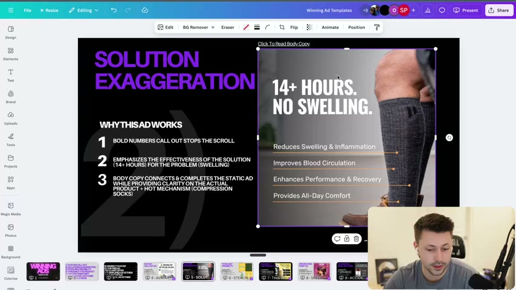
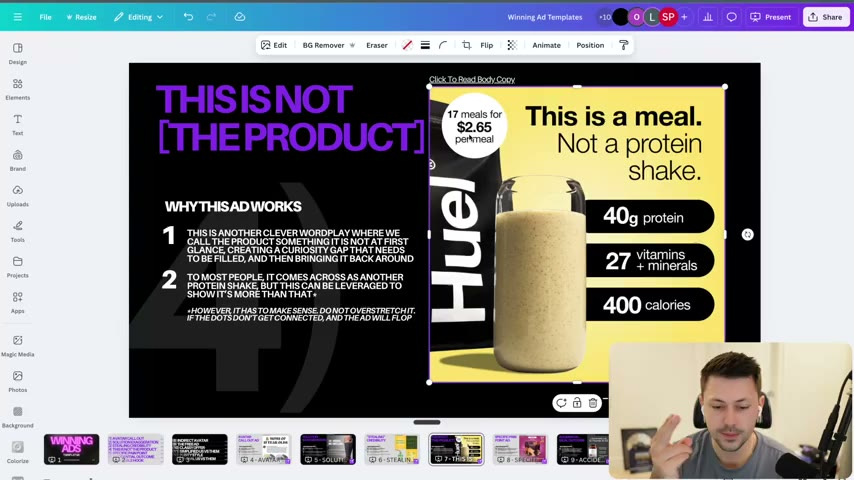
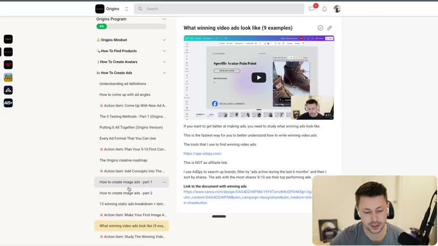
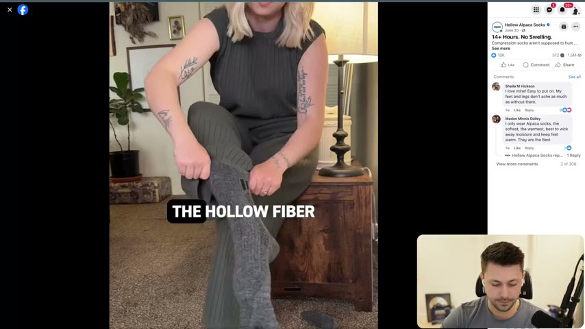
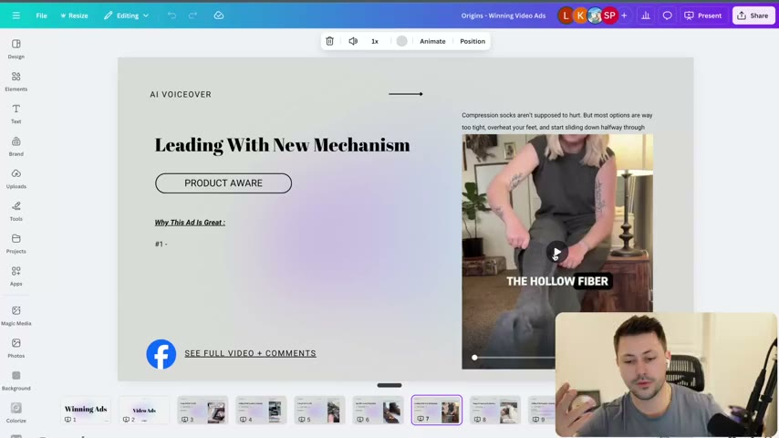
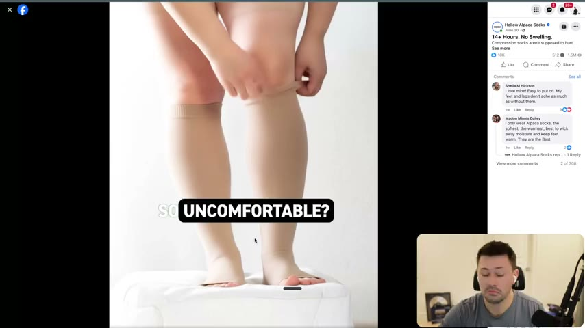
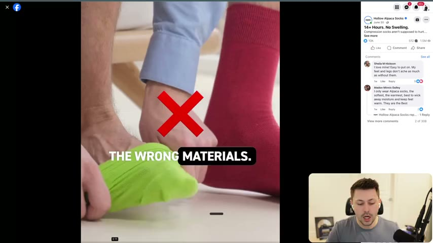
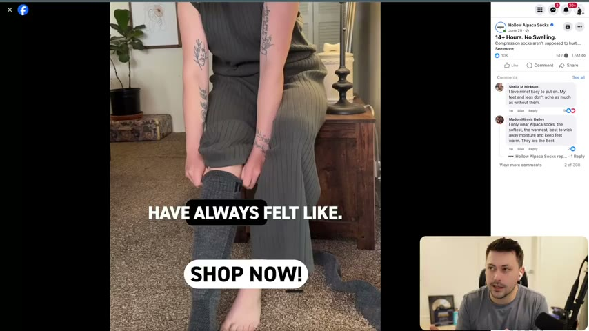

# 125. How To Do Learnings - Part 4 (Winning Ads)
> A live line-by-line breakdown of a winning video ad (Hollow Alpaca Socks) showing how to study the hook, the bridge and the close as a customer first and a marketer second, then hand the learnings to Claude to apply to your own brand.

## 🤖 Agent use
- **Use when:** tearing down a winning competitor or swipe-file video ad; extracting transferable mechanisms (not lines) from a winner; writing the "why it works" for a winning-ads deck; preparing a prompt that applies learnings to our own product.
- **Inputs → outputs:** a winning ad (video + post stats + comments) + the Reddit/comments language that matches it → a line-by-line breakdown: what each line says, what it communicates, how the customer feels, why it holds attention, and a list of ideas to apply to our brand.
- **Rules:**
  - **DO** ask "how is this ad making the customer feel and why is this working for them?" [07:38]; the same instruction is stated in [127](127-how-to-do-learnings-part-5-winning-ads.md) at [00:53].
  - **DO** play and pause the hook many times; analyse it phrase by phrase. The hook is "one of the most important things". [03:11–04:09]
  - **DO** keep asking "why does this matter?" to deepen a learning. [00:37–01:37]
  - **DO** take broader learnings from ads that are not yours ("take a step up") so they can be applied to your brand. [01:37]
  - **DO** separate what the copy says from what it communicates. [11:31–12:30]
  - **DO** check the pain point in the bridge against real customer language (e.g. Reddit threads). [13:00–13:30; 15:47–16:47]
  - **DON'T** define a hook as only stopping the scroll: it must keep the viewer hooked ("fishing" analogy). [09:39–10:37]
  - **DON'T** copy the ad. "We're not stealing this ad. We're stealing the strategies that were used in this ad." [21:41]
  - **DO** write every learning down, revisit it 2 days later, and review with as many team members as possible. [19:23–20:05]
  - **DO** feed the learnings plus your product info to Claude and ask how to apply them to your brand. [19:23]
  - **IF** you notice an open loop the ad never closes (here: "completely by accident") **THEN** make an iteration that completes it. [20:05–21:41]
- **See also:** [4. 100+ Winning Ads Document](004-100-winning-ads-document.md) · [6. 13 winning static ad templates](006-13-winning-static-ad-templates.md) · [124. Learnings Part 3 (Losers)](124-how-to-do-learnings-part-3-losers.md) · [127. Learnings Part 5 (Winning Ads)](127-how-to-do-learnings-part-5-winning-ads.md) · [Copywriting 27. How to write a bridge](../../copywriting/lessons/27-how-to-write-a-bridge.md) · [Authority in ads](../../copywriting/concepts/authority-in-ads.md)

Lesson page text: "In Evolve, you have these 9 videos included in the 60+ winning ads doc" with a link to a classroom page and a Canva short link (`canva.link/vkpkr5fb6smiscr`). The Canva deck itself was not exported (not included in the course files). The Skool classroom page it points to is shown in the video: "What winning video ads look like (9 examples)". [00:45 frame]

## Key ideas

### 1. Where the winning ads come from and how to review them without your own winners [00:00–03:11]
- Goal: "review winning ads, even if you don't have any winning ads", using the Winning Video Ads Canva deck (9 videos) and the winning statics doc. [00:00]
- The classroom page text (frame): use AdSpy to search up brands, filter by "ads active during the last 6 months", sort by shares; "the ads with the most shares 9/10 are their top performing ads." The page says AdSpy link is not an affiliate link. [00:45 frame]
- The deck already holds his learnings per ad. Example from the static "14+ HOURS. NO SWELLING.": bold numbers callout stops the scroll; emphasises the effectiveness of the solution (14+ hours) for the problem (swelling); body copy connects and completes the static while giving clarity on the product and its mechanism. [00:37–01:37; frame 01:40]
- Learnings depth: keep asking "why does this matter?". E.g. the bold numbers call out stops the scroll because it is "a bold claim": something that should happen is not going to happen because of this product. [00:37–01:37]
- **New learning he adds on the spot (static "This is a meal. Not a protein shake."):** "17 meals for $2.65 per meal." Most meals cost him $10; "40 grams of protein for two bucks". The per-meal price framing makes the value tangible even if the site is "probably a lot more expensive". Takeaway question: "how can I show value differently?" [01:37–03:11]


*Deck slide "Solution Exaggeration": "14+ HOURS. NO SWELLING." with why-it-works bullets: bold numbers, effectiveness of the solution for the problem, body copy that connects and completes (compression socks + hot mechanism). [01:40]*


*Deck slide "This Is Not [The Product]": Huel static ("17 meals for $2.65 per meal", "This is a meal. Not a protein shake.", 40g protein, 27 vitamins + minerals, 400 calories). The deck notes that it needs to make sense and must not be overstretched. [02:30]*


*The classroom page "What winning video ads look like (9 examples)" explaining the AdSpy method: last 6 months, sort by shares. [00:45]*

### 2. Metrics to check on a video ad [03:11–04:09]
- The same metrics as for statics: amount spent, ROAS, conversion rate, AOV, frequency, hook, hold, average play time. [03:11]
- **Frequency** = "how many times people see your ad, on average." An example loser: frequency about 3 with only 2% of spend means Meta is showing it to retargeting audiences "ready to click and buy now". [03:11–04:09] (This refers to the losing ad in lesson 124; see its 3.00 frequency frame.)

### 3. The winning ad and its source [04:09; 05:00 frame]
- Ad: Hollow Alpaca Socks, Facebook post "14+ Hours. No Swelling." (caption starts "Compression socks aren't supposed to hurt…"), posted June 20 (year not shown); the page shows about 10K reactions and 1.5M views, and "2 of 308" comments. Comments shown are positive ("I love mine! Easy to put on…"). [05:00 frame; stats read from the screen]
- Format: vertical video of roughly 25 seconds (the player reads 0:21 near the CTA), labelled "AI voiceover" on the deck slide, with clips of people putting on socks, on-screen caption text and stock B-roll (per the instructor, "B-roll 101").


*Facebook post view of the Hollow Alpaca Socks ad at the hook ("THE HOLLOW FIBER"): headline "14+ Hours. No Swelling.", about 10K reactions, 1.5M views. [05:00]*


*Origins "Winning Video Ads" deck slide "Leading With New Mechanism" (Product aware; AI voiceover) for this video. Why-this-ad-is-great list is empty on the slide; the instructor does it live. [03:20]*

### 4. Line-by-line hook breakdown [04:09–11:31]
He plays and pauses; "all we're doing is we're just looking at what the script is saying and we're trying to understand how is this making the customer feel and why is this working for them." [07:38]

Script heard: "The hollow fiber revolution that's making cardiologists trash their own compression socks happened completely by accident." It runs about 7 seconds but "didn't feel like seven seconds" because every line sets up the next ("slippery slope"). [04:09]

| Phrase | What he says it does | Time |
|---|---|---|
| "The hollow fiber revolution" | "Hollow fiber" is unknown to him = a **new mechanism**. "Revolution" is a very bold claim. Together an **open loop**: "what's the hollow fiber revolution? I need to keep watching." Visual: a woman struggling to put on tight socks calls out the compression-sock avatar. | [04:59–05:53] |
| "that's making cardiologists" | **Authority.** "This one word is crucial." Cardiologist = doctor for heart and blood vessels; people with circulation issues see them; shows the brand "understands their customer". | [07:38–09:39] |
| "trash their own compression socks" | The communicated meaning: the mechanism is so good that authorities abandon their own socks. "Does it say hollow fiber is the best fiber? No... what is actually being communicated is the fact that this mechanism is so good that authorities are saying, yeah, it's actually that good." | [11:31–12:30] |
| "happened completely by accident" | A second open loop ("how did it happen by accident?"). Wording "a little bit awkward" but curiosity-driven. | [12:30–13:30] |

- Apply to our brand (his off-the-cuff, self-rated "terrible" and "too wordy"): "the hormone protection revolution", "the DPP-4 enzyme revolution" (Whisper: "DPP for enzyme") for a weight-loss supplement, i.e. replace "hollow fiber" with our own unique mechanism. [05:53–06:40]
- **Hook = keep them hooked, not only hook them.** Fishing analogy: you get a bite, but if the fish falls off before you reel it in, it was pointless. Shirtless-runner style transitions may stop the scroll but "might not keep me watching". "Hooks are about keeping people hooked in, not just hooking them in general." [09:39–10:37]
- **Says vs communicates** ("big shout out to Kyle... copywriting 101"): see [Says vs communicates](../../copywriting/concepts/says-vs-communicates.md). [11:31]


*Bridge: "…so uncomfortable?" over a UGC shot of tight beige compression socks. [13:50]*

### 5. Bridge: earn the right to show you understand the customer [13:00–16:47]
- Line: "Why do most compression socks feel so uncomfortable?" He searches Reddit live ("Does anyone else hate the way compression socks feel?", "I definitely hate the synthetic fabric") and concludes the brand did its research. [13:00–13:30]
- Nothing about the product yet; the audience is already filtered by the word "compression socks". "This is how you keep attention, get attention to then earn the right to show your understanding of the customer." [13:30–14:20]
- "It turns out we've been using the wrong materials." The blame goes to materials, not a named competitor or "nobody makes them as good as we do". It ties back to the opening mechanism: must be the hollow fiber. [14:20–14:50]
- "Alpaca's naturally hollow fibers" ties the product (Hollow Alpaca) to the mechanism; "hollow fibers, what compression has been missing all along". [14:50–15:47]


*"…THE WRONG MATERIALS." with a red X over a bright green synthetic sock. [15:00]*

### 6. Proof/benefit and close [15:47–18:37]
- "Unlike synthetic fibers that trap heat, alpaca's hollow core actively regulates temperature while maintaining perfect pressure." Matches the Reddit comments about overheating ("They make me overheat"). [15:47–16:47]
- "Nature engineered the perfect compression fiber. We just figured out how to use it." He loves it: not claiming "we're the best", crediting nature; stock-footage B-roll ("B-roll 101"). [16:47–17:43]
- Close: "The science of alpaca, the comfort of clouds. Try hollow compression socks and discover what compression should have always felt like. The hollow fiber revolution." A sensory CTA that makes the viewer want to know what it feels like; callback to the first line. [17:43–18:37]
- He barely mentions clips, voiceover or titles: "I just went through this entire thing as a customer and then used my marketer's brain to break it apart." [17:43–18:37]


*End card: "…HAVE ALWAYS FELT LIKE." with a "SHOP NOW!" button. [18:20]*

### 7. Apply it [18:37–22:25]
- Listed transferable moves: new mechanism ("revolution"); authority; "new material / used the wrong material"; show understanding of the customer; the specific material has a specific mechanism (hollow fibers); regulates temperature; nature engineered it. [18:37–19:23]
- Write all of this down; then decide where to "plug and play" it into your brand. You can give Claude "every reason why this is working" and ask "how could we apply this to my brand specifically?" With your product info loaded, Claude returns brand-specific applications. [19:23–20:05]
- Depth he wants: do it alone, then with as many team members as possible, come back two days later and review again, "I probably miss some stuff." [20:05]
- **Missed open loop (his idea for an iteration):** the ad never explains the "accident". He suggests an iteration that completes the loop, e.g. a (made-up, illustrative) story about a farmer who needs socks and uses alpaca; "maybe I could talk about how that's how it came about". He is unsure whether it would improve or hurt. [20:05–20:49]
- Final emphasis: "really study the hook, really understand why someone's interested in watching," then study the whole ad for how it closes; even the last line matters. [20:49–21:41]
- "We're not stealing this ad. We're stealing the strategies... and for the brand that I'm working with, we're not even in the same niche." [21:41]

## Steps / framework

**Winning video ad breakdown (instructor method)**

| # | Step | Detail | Time |
|---|---|---|---|
| 1 | Source ads | AdSpy: brand search, last 6 months, sort by shares | [00:45 frame] |
| 2 | Check data if you have it | Spend, ROAS, CVR, AOV, frequency, hook, hold, avg play time | [03:11] |
| 3 | Play and pause the hook | Phrase by phrase; list every curiosity element | [04:09–10:37] |
| 4 | Name each device | New mechanism, authority, open loop, juxtaposition, specific number | [04:59–09:39] |
| 5 | Separate says vs communicates | Write the implied claim | [11:31–12:30] |
| 6 | Check the bridge | Is it a pain point the customer actually states? Verify on Reddit | [13:00–16:47] |
| 7 | Mark missed loops and weak lines | Candidates for iterations | [20:05–20:49] |
| 8 | Translate to your brand | List which mechanisms you can reuse; ask Claude to apply | [18:37–20:05] |
| 9 | Re-review | Team review; second pass after two days | [20:05] |

## Examples
- **Hollow Alpaca Socks "14+ Hours. No Swelling." (compression socks):** the hook, bridge and close above. Product-aware audience. Same brand appears as a static in [6. 13 winning static ad templates](006-13-winning-static-ad-templates.md) ("Solution Exaggeration", likely the same brand because of the identical headline; derived).
- **Huel static, "This is a meal. Not a protein shake." with "17 meals for $2.65 per meal" and 40 g protein:** per-meal price framing as value. [01:37–03:11]
- **Translation of the hook to a weight-loss supplement (his own throwaway examples):** "the hormone protection revolution"; "the DPP-4 enzyme revolution". [05:53–06:40]

## Structured units

### Ad teardowns
| Brand / product (niche) | Format | Hook / opening | What works | What fails | Fix suggested | Principle | Source |
|---|---|---|---|---|---|---|---|
| Hollow Alpaca Socks, compression socks (health/apparel) | Video (AI voiceover per deck slide; clips + stock B-roll) | "The hollow fiber revolution that's making cardiologists trash their own compression socks happened completely by accident." | New mechanism, authority, two open loops, avatar callout by visual; bridge uses real Reddit pain point; "wrong materials" ties back to mechanism; humility close ("nature engineered it") | The "accident" loop is not completed; hook wording "a little bit awkward" | Add an iteration that tells the accident story | Mechanism + authority + open loops | [04:09–20:49] |
| Huel (meal replacement) | Static | "This is a meal. Not a protein shake." | Per-meal price ($2.65) makes value tangible; 40 g protein | Not stated in lesson (deck: do not overstretch the wordplay) | — | Value framing | [01:37–03:11] |

### Hooks
| Hook (verbatim or near) | Heuristic(s) | Emotion / zone | Self targeted | Why it works | Source |
|---|---|---|---|---|---|
| "The hollow fiber revolution that's making cardiologists trash their own compression socks happened completely by accident." | Authority; new mechanism; open loop (derived) | Curiosity (derived) | — | Each phrase sets up the next question; avatar called out by visual | [04:09–13:00] |

### Templates
| Template | Use for | Example fill | Source |
|---|---|---|---|
| "The [unique mechanism] revolution that's making [authority] [abandon the old way] happened completely by accident" (derived from the ad) | Mechanism-led hook with authority | "The [hormone-protection] revolution that's making [dietitians]…" (derived; not from the instructor) | [04:09–13:00] |
| "Why do most [category] feel so [pain]? It turns out we've been using the wrong [ingredient/material]." | Bridge from hook to mechanism without attacking a named competitor | Compression socks: "…uncomfortable? It turns out we've been using the wrong materials." | [13:00–14:50] |

### Rules of thumb
- **DO** use one authority word early; the claim is communicated, not stated. [07:38–12:30]
- **DON'T** fill the first seconds with unrelated visual gimmicks that stop the scroll but do not retain. [09:39–10:37]
- **IF** the bridge asks a question **THEN** the answer should name the mechanism's cause (materials), not a competitor. [14:20–14:50]

## Prompts / templates (verbatim)
No prompt text is given. He describes the Claude step only: "here's every reason why this is working. Can you apply this to my brand? How could we apply this to my brand specifically?" [19:23]

Ad lines, as heard (Whisper) in order:
```
The hollow fiber revolution that's making cardiologists trash their own compression socks happened completely by accident.
So why do most compression socks feel so uncomfortable? It turns out we've been using the wrong materials.
Alpaca's naturally hollow fibers... hollow fibers, what compression has been missing all along.
Unlike synthetic fibers that trap heat, alpaca's hollow core actively regulates temperature while maintaining perfect pressure.
Nature engineered the perfect compression fiber. We just figured out how to use it.
The science of alpaca, the comfort of clouds. Try hollow compression socks and discover what compression should have always felt like. The hollow fiber revolution.
```

## Screenshots
Embedded above next to the idea they support.

## How to apply
- [ ] Pull 3 winning video ads (AdSpy: 6 months, sort by shares) in our niche or an adjacent one.
- [ ] For each, break the hook into phrases; for every phrase write "feeling created" and "what is communicated".
- [ ] Label devices (mechanism, authority, open loop, juxtaposition, number, label).
- [ ] Check the bridge pain point against Reddit or review language.
- [ ] Note open loops the ad never closes.
- [ ] Write transferable moves, then prompt Claude with the moves + our product facts to produce brand-specific ideas. Never reuse lines.
- [ ] Review again after two days.

## Related
- Previous: [124. Learnings Part 3 (Losers)](124-how-to-do-learnings-part-3-losers.md) · Next: [126. How To Pull Frameworks From Ads](126-how-to-pull-frameworks-from-ads.md)
- [Copywriting 24. The 2 types of hooks](../../copywriting/lessons/24-the-2-types-of-hooks.md) · [Open loops](../../copywriting/concepts/open-loops.md) · [Unique mechanism](../../copywriting/concepts/unique-mechanism.md) · [Bridges](../../copywriting/concepts/bridges.md) · [Competitor ad teardown playbook](../../../../playbooks/competitor-ad-teardown.md)

## Sources and limitations
- Transcript: [125 transcript](<../../../../../raw/evolve/start-here/_transcripts/👣 Evolve (Start Here)/125. How To Do Learnings - Part 4 (Winning Ads) 👣 Evolve (Start Here) Evolve.txt>) · Page text: [125 page text](<../../../../../raw/evolve/start-here/_extracted/👣 Evolve (Start Here)/125. How To Do Learnings - Part 4 (Winning Ads)_👣 Evolve (Start Here)_Evolve.html.md>).
- Machine transcription; full recording covered (22:25). "Origins" appears as a course name on the Canva deck and Skool sidebar (earlier name or sister program of Evolve; unverified). Whisper "DPP for enzyme" is likely "DPP-4 enzyme". The first-person "Spencer" lines come from the instructor referring to himself.
- The Canva deck (60+ winning ads / 9 video ads) and the classroom page it links are not included in the exported course files; only what the frames show is captured.
- Stats on the Facebook post (10K, 1.5M, 308) are read from the frame and could be misread at low resolution.
- The "9/10 top performing ads" claim from the classroom page is an instructor claim.
- The "accident" farmer story and the "hormone protection / DPP-4" lines are the instructor's illustrative inventions, not facts.
