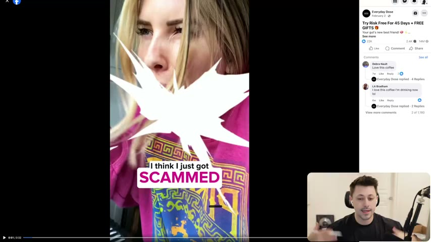
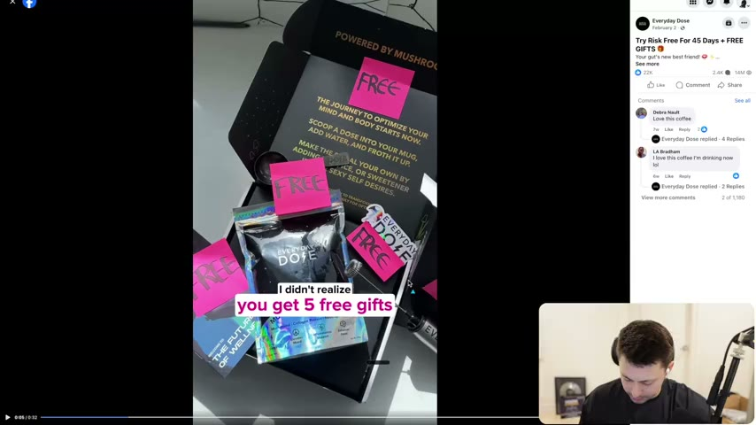
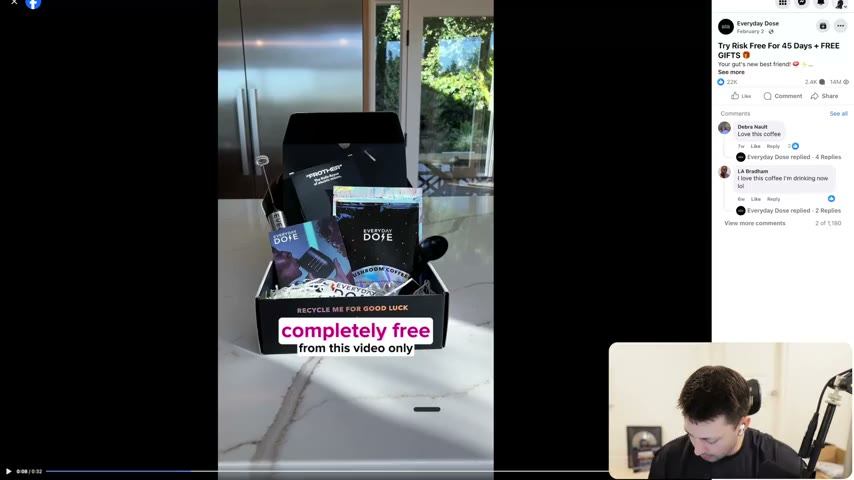
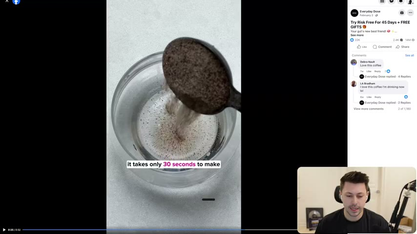

# 126. How To Pull Frameworks From Ads
> Break a very product-aware, offer-led winning video ad into its parts, then "chunk up one level" from the exact words to the underlying framework, so you can recreate the feeling in your own words instead of copying the line.

## 🤖 Agent use
- **Use when:** a hook or script pattern is overused ("I think I just got scammed") and you need a fresh version; remixing a competitor or cross-niche ad; building 3 test variants of one borrowed idea.
- **Inputs → outputs:** a winning ad's hook and bridge (words + visuals) → a framework statement ("I think [negative thing] just happened") + the feeling it creates + 2–3 new hook lines in our brand voice, plus one "control" that stays close to the original.
- **Rules:**
  - **DO** ask: what happens to the person when they hear this line? What feeling and drama does it create? Then write that feeling in new words. [08:26–09:09]
  - **DO** "think in frameworks rather than just copying and pasting". [08:26]
  - **DO** run three cracks per idea: one close-to-original control, two framework-level variants in your own words. [13:45]
  - **DO** prefer stealing from other niches. "If you're going to steal scripts or frameworks, steal them from other niches." [12:47]
  - **DON'T** copy a hook one-to-one inside the same niche. "You're just copying what someone else has copied. And that usually doesn't lead to like massive breakthroughs." [13:45]
  - **DON'T** assume your reworded version is better. "A lot of you might actually make it worse." [13:45]
  - **DON'T** stretch a gag. Extending "I got scammed" into a long story "wasted someone's time"; the original reveals it fast. [02:42–03:29]
  - **DO** keep visuals congruent with the words (free-free-free on screen when saying free). [04:05]
  - **DO** reinforce a strong offer repeatedly ("free", "completely free", "risk-free", "$100 plus"). [04:05–06:14]
  - **IF** the hook phrase is overused in the market ("scam, scam, scam") **THEN** keep the emotion and reword it. [07:46–09:09]
- **See also:** [125. Learnings Part 4 (Winning Ads)](125-how-to-do-learnings-part-4-winning-ads.md) · [127. Learnings Part 5 (Winning Ads)](127-how-to-do-learnings-part-5-winning-ads.md) · [Copywriting 57. 100 hook templates from the winning-ads deck](../../copywriting/lessons/57-100-hook-templates-form-winning-ads-deck.md) · [Copywriting 23. The framework behind great hooks](../../copywriting/lessons/23-the-framework-behind-great-hooks.md) · [Iteration vs variation](../../../../concepts/iteration-vs-variation.md)

Lesson page text: only the same pointer as in lessons 125 and 127 ("In Evolve, you have these 9 videos included in the 60+ winning ads doc") and a link to the Canva design (not exported; not included in the course files).

## Key ideas

### 1. The ad and why it is a useful teardown [00:00–00:53; 14:35]
- It is a "very product-aware ad for those of you that are in very large markets", leaning on a **great offer**, with "not a lot of problem solution". It is "very common ad, very simple ad, very Facebook style ad", yet it "has done very well": the product-aware market is massive and the offer is strong. [00:00; 14:35]
- On-screen post: Everyday Dose, "Try Risk Free For 45 Days + FREE GIFTS", dated Feb 2, about 22K reactions and 14M views, "2 of 1,180" comments (read from the frame). The instructor calls it "functional coffee" (the box on screen reads "Powered by mushroom"); he says his own brand is not in coffee but "kind of in supplement... it's a powder". [00:53 frame]
- He notes the same idea may be in the ad's own headline ("try risk-free 45 days plus free gifts") and that an "ad idea" he suggested in a previous video was already written in the headline copy. [04:05]

### 2. Hook: "I think I just got scammed" [00:00–03:29]
Script: "I think I just got scammed. I ordered a bag of this coffee, but they sent me this entire box." [00:53–01:45]
- **Power word:** "scammed" is a hardcore word, not soft language like "somebody did something bad to me". It raises the stakes ("whoa... what's about to happen?") and the person spitting out her coffee matches it. "Hooks and visuals are congruent." [00:53]
- **Push and pull:** the ad pushes ("I got scammed"), then pulls back at once: she did not get scammed, she got **more** than expected. "That's fun." [01:45–02:42]
- **Don't overplay the joke.** If the ad dragged the story out (how she found the ad, the site, the order) and then said she got more, "you kind of just wasted someone's time" and could "piss people off". Instant payoff is better. He says extended versions "would be interesting to test". [02:42–03:29]
- **Curiosity from an odd setting:** she is outside in a parking lot making coffee, which makes no sense, so "it's creating some curiosity". [01:45]


*Everyday Dose post at 0:01 of the video: "I think I just got SCAMMED" with a burst graphic. The instructor re-plays it while explaining the framework. [09:50]*

### 3. Body: offer reinforcement [03:29–07:11]
Line by line (instructor's reading):
- "I didn't realize you get five free gifts when you order the coffee, completely free from this video only." Visuals show "FREE" notes, congruent with "five free gifts". "People love free." The word "free" is repeated for reinforcement. [03:29–04:48]
- Caveat: people who want free stuff "are not the best customers. That's an LTV thing", but the ad "was working for them, it got them sales". [04:05–04:48]
- "From this video only": urgency/scarcity plus landing-page set-up. "You have to buy it from this video, you can't get anywhere else"; it nudges people to buy now instead of searching later, even if mostly untrue. [04:48–05:29]
- "This viral coffee is top rated with over 100,000 five star reviews": simple social proof. Word choice: "viral coffee", not just "this coffee". Proof shown on screen. [05:29–06:14]
- "...a bunch of gifts valued at $100 plus for completely free": back to the offer. He compares this to a sales pitch ("straight line sales strategy"): detour to social proof, then boom, back to the pitch. [06:14]
- "If you're looking for the best tasting functional coffee that delivers benefits like gut health, mood enhancement, and focus, then this is the coffee for you": benefits are brief because people also just want coffee. [06:14–07:11]
- "It's only 30 seconds to make": effort and sacrifice (see the value equation in [127](127-how-to-do-learnings-part-5-winning-ads.md)). "It tastes like a delicious coffee." [07:11]
- "Hurry up. It's first come, first served, and this deal won't last forever... Good luck": urgency and scarcity; "that's the goal when you're doing these videos". "Good luck" implies others are buying. [07:11–07:46]


*"I didn't realize you get 5 free gifts" over an unboxing full of pink FREE stickers. Visuals reinforce the offer. [04:10]*


*"completely free from this video only": offer repetition plus exclusivity. The page headline reads "Try Risk Free For 45 Days + FREE GIFTS". [05:30]*


*"it takes only 30 seconds to make" with a scoop dropped into water: effort reduction shown, not just said. [07:00]*

### 4. Extracting the framework [07:46–14:35]
Method: "chunk up one level" from the words to the idea the words communicate.
1. **Identify the exact words:** "I think I just got scammed." They are probably overused ("scam, scam, scam. Everybody's saying that"). [07:46–08:26]
2. **State the framework:** "I think [negative thing] just happened (to me)." [09:09]
3. **State what it communicates / the feeling:** something negative happened, a "low valence" feeling and drama; a reaction like spitting out coffee. [08:26–09:09; 10:29]
4. **Generate new lines that keep the feeling but use new words** (his off-the-cuff, "most of them are going to be trash"): [09:09–10:29]
   - "I just realized that most companies are lying to you."
   - "I just found out that most of these companies are lying to you." (first-person perspective rather than the company's)
   - "I think I just figured out why companies are lying to us."
   - Stronger words to try: "chronically lying".
5. **Second framework from the same ad (hook + bridge): "I ordered X product and they sent me this entire thing." → "I thought I was getting this. I got that instead."** [11:03–12:47]
   - Example for a Zend product (he refers to "Xand"): "I thought I was buying this product to fix my skin. But I started losing all of this weight instead." Add emphasis: "I started losing all this weight and I had to stop taking it" (play on words); "This brand lied to me. They said it was only going to help my skin. And now it's helping me lose all this weight." [11:03–11:53]
   - Narrator version rather than first person: "I ordered a bag of this and they tell everyone it's good for the skin… but it's making me lose all this weight instead." [11:53–12:47]
   - It is "not copying word for word": it copies "the feeling it creates in the framework that exists". [11:53]
6. **Cross-niche option:** you can use the concept in another niche, e.g. Pet Lab Co. could do it because it is a different niche. Within the same niche he does not recommend copying. [12:47]
7. **Three cracks:** use "one control if we just want to take this one-to-one. But the other two, you should be trying differently": understand the emotion, what it communicates, and say it in a way unique to you. [13:45]

## Steps / framework

| Step | Action | Output |
|---|---|---|
| 1 | Write the exact hook words | "I think I just got scammed." |
| 2 | Ask what the listener feels | Negative feeling, drama, raised stakes |
| 3 | Abstract to a framework | "I think [negative thing] just happened" |
| 4 | Check overuse | If the phrase is used up, reword it |
| 5 | Generate 3+ variants in your voice | 1 control (close) + 2 framework variants |
| 6 | Look for a second framework in the bridge | "I ordered X, got Y" → "I thought this was for X; it did Y" |
| 7 | Test, remembering you may make it worse | Keep the control to compare |

## Examples
- **Coffee hook → company-lying hook:** "I think I just got scammed" → "I just found out that most of these companies are lying to you" (instructor's quick example; same low-valence drama in new words). [09:09–10:29]
- **"I ordered the bag, they sent the box" → "I thought I was buying it for skin; I lost weight instead":** keeps surprise and a play on words; the instructor links it to ads he made for Zend. [11:03–12:47]

## Structured units

### Ad teardowns
| Brand / product (niche) | Format | Hook / opening | What works | What fails | Fix suggested | Principle | Source |
|---|---|---|---|---|---|---|---|
| Everyday Dose, functional coffee, offer-led (supplements; product-aware) | UGC-style video | "I think I just got scammed. I ordered a bag of this coffee, but they sent me this entire box." | Power word "scammed"; immediate reveal that she got more; congruent visuals; repeated "free"; "from this video only"; social proof; back-to-offer; short effort ("30 seconds"); urgency ("good luck") | Used-up phrase; "free" attracts weaker LTV; parking-lot setting is odd | Reframe, don't copy | Offer + push/pull + framework | [00:53–07:46] |

### Hooks
| Hook (verbatim or near) | Heuristic(s) | Emotion / zone | Self targeted | Why it works | Source |
|---|---|---|---|---|---|
| "I think I just got scammed." (then "I ordered a bag of this coffee, but they sent me this entire box.") | Negative curiosity, pattern interrupt (derived) | Low valence drama (instructor: "low valence feeling") | — | Raises stakes, then flips to a positive surprise | [00:53–02:42] |
| "I just realized that most companies are lying to you." (instructor's new line) | Same framework (derived) | Low valence | — | Keeps the negative-drama feeling in new words | [09:09–10:29] |
| "I thought I was buying this product to fix my skin. But I started losing all of this weight instead." (instructor's new line) | Expectation reversal (derived) | Surprise | — | "I got X, got more Y" framework | [11:03–11:53] |

### Templates
| Template | Use for | Example fill | Source |
|---|---|---|---|
| "I think [negative thing] just happened." | Drama hook | "I think I just got scammed." | [09:09] |
| "I ordered [X], and they sent me [way more than X]." | Offer/bundle ad | "…a bag of this coffee, but they sent me this entire box" | [11:03] |
| "I thought I was buying [this] to [expected result]. But [unexpected extra result] instead." | Surprise-benefit ad | Skin → weight loss | [11:03–11:53] |

### Rules of thumb
- **DO** copy the framework and the feeling, never the words. [11:53]
- **DO** use "free", numbers and "only from this video" to reinforce offers. [04:05–05:29]
- **DON'T** extend a gag past the payoff. [02:42–03:29]
- **IF** you are in the same niche **THEN** make your versions different; **IF** you are in a different niche **THEN** a closer copy is more acceptable. [12:47–13:45]

## Prompts / templates (verbatim)
Ad copy as heard (Whisper), in order:
```
I think I just got scammed.
I ordered a bag of this coffee, but they sent me this entire box.
I didn't realize you get five free gifts when you order the coffee, completely free from this video only.
This viral coffee is top rated with over 100,000 five star reviews.
And now you can try it for yourself with a bunch of gifts valued at $100 plus for completely free.
So if you're looking for the best tasting functional coffee that delivers benefits like gut health, mood enhancement, and focus, then this is the coffee for you.
It's only 30 seconds to make.
Hurry up. It's first come, first served, and this deal won't last forever. Good luck.
```

## Screenshots
Embedded above next to the idea they support.

## How to apply
- [ ] Write down the hook of the ad you are studying, word for word.
- [ ] Name the feeling it creates and the drama it implies.
- [ ] Write the framework with brackets.
- [ ] Generate at least 3 versions in your brand voice: 1 control, 2 reframed.
- [ ] Check each for overused words and swap for stronger ones.
- [ ] Find a second framework in the bridge/body and repeat.
- [ ] Prefer cross-niche sources; keep our claims and proof.
- [ ] Never use another brand's names, prices or claims.

## Related
- Previous: [125. Learnings Part 4 (Winning Ads)](125-how-to-do-learnings-part-4-winning-ads.md) · Next: [127. Learnings Part 5 (Winning Ads)](127-how-to-do-learnings-part-5-winning-ads.md)
- [Copywriting 25. The 2 ways to write great hooks](../../copywriting/lessons/25-the-2-ways-to-write-great-hooks.md) · [Hooks](../../copywriting/concepts/hooks.md) · [Valence](../../../../concepts/valence.md) · [Competitor ad teardown playbook](../../../../playbooks/competitor-ad-teardown.md)

## Sources and limitations
- Transcript: [126 transcript](<../../../../../raw/evolve/start-here/_transcripts/👣 Evolve (Start Here)/126. How To Pull Frameworks From Ads 👣 Evolve (Start Here) Evolve.txt>) · Page text: [126 page text](<../../../../../raw/evolve/start-here/_extracted/👣 Evolve (Start Here)/126. How To Pull Frameworks From Ads_👣 Evolve (Start Here)_Evolve.html.md>).
- Machine transcription; full recording covered (15:13). "Xand" is likely "Zend". "Hocus Walk" in the audio is unclear ("hook"?). The brand "Everyday Dose" is named only on screen, not in the audio. Stats are read from the frame.
- The Canva deck link on the page is not exported; "Origins/Evolve winning ads doc" is not included in the course files.
- The instructor's replacement hooks are throwaway examples he says are mostly "trash"; they were not tested.
- Frame at 09:50 is the hook replayed at 0:01 in the ad; all ad frames are from the same post.
