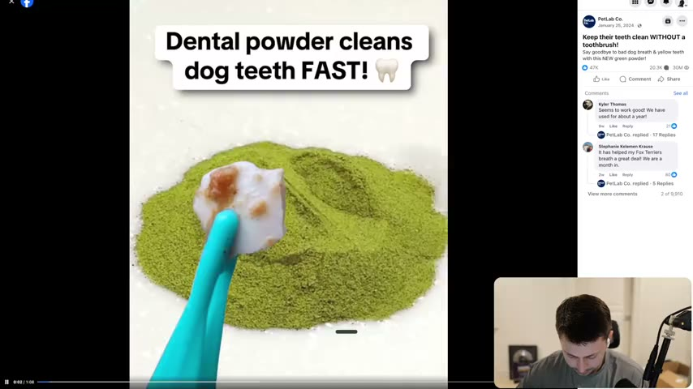
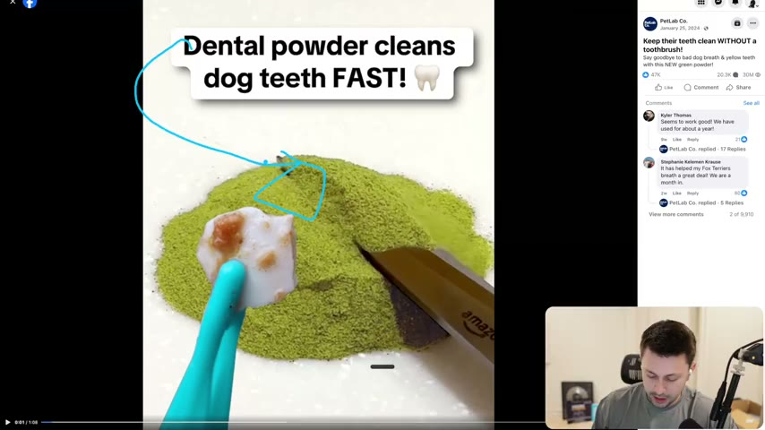
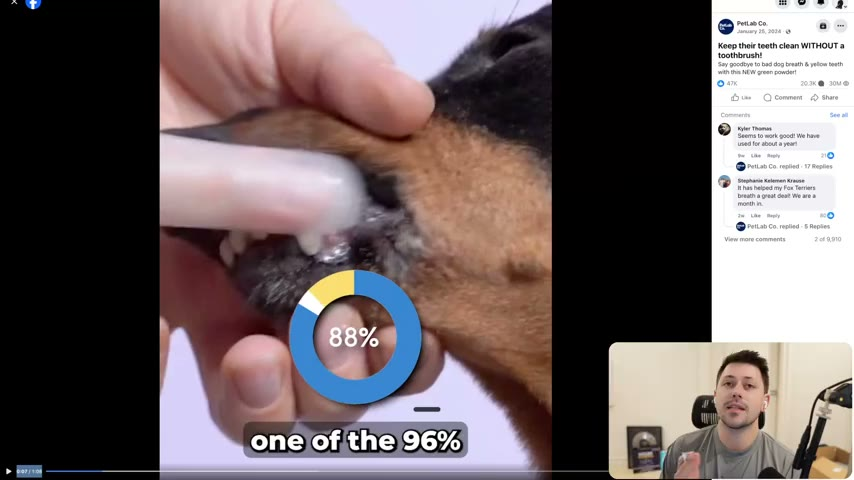
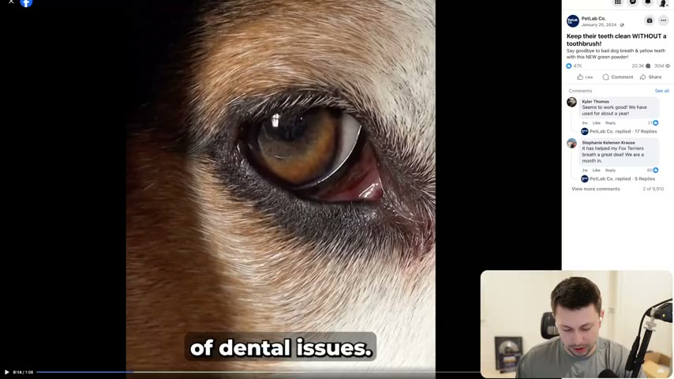
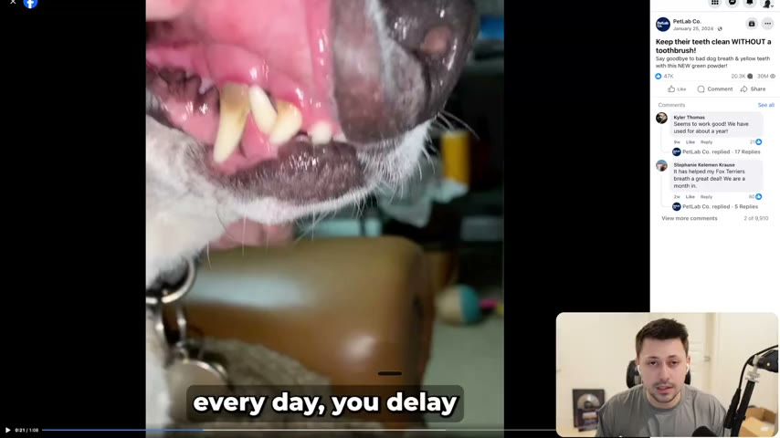
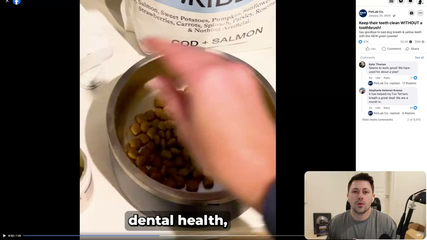

# 127. How To Do Learnings - Part 5 (Winning Ads)
> A second full teardown of a winning video ad (Pet Lab Co dental powder) showing, second by second, how a juxtaposition hook, a stated fact, escalating stakes, symptom-based urgency and "effortless" value framing take a viewer from curiosity to purchase.

## 🤖 Agent use
- **Use when:** analysing a high-share video ad; writing the "why it works" list for a swipe file; designing a hook with a juxtaposition; writing a problem-aware video script that has to build belief and urgency before naming the product.
- **Inputs → outputs:** a most-shared video ad from the last 3–6 months → a timeline of customer thoughts and feelings per line, labelled devices (juxtaposition, open loop, fact, authority, stakes, urgency, value-equation words), and a list of reusable moves.
- **Rules:**
  - **DO** find winning ads by putting a brand into AdSpy, filtering to the last 3–6 months and sorting by **shares**. "There's a much higher likelihood that if an ad is highly shared, it is usually more of a top performer versus an ad that's just been running for a long time." (Not always.) [00:00]
  - **DO** ask "how is this ad making the customer feel?" rather than "why is this ad working?"; if you know the feeling you can recreate it many ways. [00:53]
  - **DO** write a hook with a **juxtaposition**: two things that do not go together (cleaning dog teeth + fast). It creates an itch (open loop) the rest of the ad scratches slowly. [01:51–03:37]
  - **DO** make the hook **sticky**: stop the scroll and keep the viewer engaged. "Some of you have really high hook rates, but it doesn't actually keep them engaged." [05:13]
  - **DO** create curiosity, not confusion. "Confusion is going to make someone scroll. Curiosity is going to keep somebody engaged." [04:25]
  - **DO** turn opinions into facts: "When in doubt, try to turn a matter of opinion into a matter of fact." [06:53]
  - **DON'T** say "you're a bad dog owner"; imply it with a fact ("one of the 96% who don't…"). [06:53–07:48]
  - **DO** raise the stakes in layers (fact → daily gap → lifetime of dental issues → symptoms every day you delay). [10:09–17:14]
  - **DO** create urgency by naming current symptoms that worsen each day, without saying "your dog is at risk". [16:23–17:14]
  - **DO** show effort and speed visually ("effortless", "30 seconds a day", "foolproof", "without a toothbrush"). [19:33–23:32]
  - **DO** handle objections with demo visuals (does it reach all the teeth?). [23:32]
  - **DO** jot down ideas during teardowns; "the reason why you do this is to get new ideas." [20:59]
  - **IF** a competitor's ad is highly shared **THEN** transcribe it and record a team learnings call to extract a framework. [24:25]
- **See also:** [125. Learnings Part 4 (Winning Ads)](125-how-to-do-learnings-part-4-winning-ads.md) · [126. How To Pull Frameworks From Ads](126-how-to-pull-frameworks-from-ads.md) · [128. How To Do Learnings: Questions](128-how-to-do-learnings-questions.md) · [Facts over opinions](../../copywriting/concepts/facts-over-opinions.md) · [Raising the stakes](../../copywriting/concepts/raising-the-stakes.md) · [Open loops](../../copywriting/concepts/open-loops.md) · [Copywriting 50. How to iterate on spend winners](../../copywriting/lessons/50-how-to-iterate-on-spend-winners.md)

Lesson page text: only the pointer "In Evolve, you have these 9 videos included in the 60+ winning ads doc" plus a Canva short link. The deck itself is not included in the course files.

## Key ideas

### 1. Where "winning" ads come from [00:00–00:53]
- He picks brands (e.g. Pet Lab Co.), puts them into AdSpy, filters to the last 3–6 months and sorts by shares. "Usually the ads with the most shares are going to be the ones that are the best performers. Now, not always, but a lot of the times." (instructor claim) [00:00]
- Same method as the page shown in [125](125-how-to-do-learnings-part-4-winning-ads.md).
- He annotates on an iPad with a pencil.
- New perspective: "with everything that's been going on with the new copywriting that I'm working on, I start to see ads a lot differently." (See [Evolve Copywriting](../../copywriting/lessons/01-overview-of-copywriting-program.md).) [00:53]


*The ad as shown in the Facebook post view: PetLab Co., "Keep their teeth clean WITHOUT a toothbrush!", Jan 25 2024, about 47K reactions, 30M views, "2 of 9,910" comments; video length 1:08. Opening frame text: "Dental powder cleans dog teeth FAST!" [01:50]*

### 2. Hook: a juxtaposition that opens an itch [00:53–05:13]
- Opening text and voiceover: "Dental powder cleans dog teeth fast." [01:51]
- **Juxtaposition** = two things that do not go together. Here: cleaning a dog's teeth + fast. "For most people, they know that trying to clean your dog's teeth is a nightmare and it's not a fast thing", it is also not easy, and the brand later hits "easy" too. [01:51–02:47]
- Comparison: "how to make a million dollars fast" is enticing because "you're obviously not supposed to make a million dollars fast" (why make-money pitches use speed). [02:47]
- **Open loop = an itch** (credit given to "Adley", spelling and identity unverified): "it basically creates an itch." Hook: "how is dental powder going to clean?"; the dental powder is also a "kind of new mechanism". "You want to create an itch and then not scratch it." The video runs a full minute (1:08 on the player). [02:47–03:37]
- He would also test "how to clean dog teeth fast" without naming the powder. [03:37]
- **Curiosity vs confusion:** the opening visual (green powder, tweezers lifting a piece of tartar, a knife cutting through the powder) leaves him asking "what is this?" and "why are there these scissors?", but it is congruent with the dental powder. "You don't want to create confusion but you do want to create curiosity." [04:25]
- **Sticky hook:** must stop the scroll **and** keep people engaged; high hook rates with no retention are a problem. [05:13] (See hook/hold metrics in [124](124-how-to-do-learnings-part-3-losers.md).)
- **Result shown early:** a dog with very clean teeth, calm, not crying. It creates a mental association: this powder leads to clean teeth. [05:13–06:05]


*His iPad annotation: a loop from the hook text to the powder, marking the open loop / itch. The knife visual at 0:01 is part of the curiosity. [05:00]*

### 3. Lead: state a fact, not an opinion [06:05–11:39]
- Line: "Are you one of the 96% of dog owners who don't brush their dog's teeth daily?" (Whisper: "the 96 percent of dog owners who don't brush their dog's teeth daily"). [06:05–06:53]
- **Opinions vs facts:** "They are not saying you're a bad dog owner." It could work, but it is an opinion and invites "I'm not a bad dog owner. Screw you." The fact "communicates they're a bad dog owner without saying it" and creates guilt. "Best copywriters know how to tell a story within a story." Credit: "Harry", "one of the smartest copywriters that I've been studying recently" (surname not given). [06:53–07:48]
- Why the fact here: the hook's claim is a big one (two things that do not go together), so viewers will be skeptical; the fact starts building credibility. [07:48–08:33]
- The chart visual "adds that extra bit of... this is a true fact". [08:33]
- **"Daily"** is a second gap: "I don't know if you actually need to brush your dog's teeth daily. I'm pretty sure you don't. Obviously humans do." But once stated, brushing monthly is now not enough. [08:33–10:09]
- **Targeting the bigger market:** the ad speaks to people who do not brush at all, not to the 4% who do, "according to their research. Again, I'm just taking their research as fact. You should always go through and check." [09:24]
- **Gap multiplication:** most people do not clean teeth at all; now they are told they should do it daily. "We're not selling something that cleans your dog's teeth. We're selling keeping your dog healthy and you being a good dog owner." [10:09–10:54]
- Facts build credibility because we associate facts with authority (the doctor analogy: "These patients before took this and saw X result" rather than "I think you should…"); you can build authority "by saying facts", but only facts relevant to the hook. [10:54–11:39]
- Recap he gives: bold claim; strong hope; juxtaposition of fast and cleaning; announced the mechanism ("dental powder"); then facts. [10:09–10:54]


*"one of the 96%" with a donut chart over a dog tooth-brushing shot; the donut graphic looks like it reads 88% in this frame (probably mid-animation). It "adds that extra little bit... we're stating a fact". [06:40]*

### 4. Raise the stakes and the emotion [11:39–17:14]
- "Well, by age three, you could be setting your dog up for a lifetime of dental issues." Now health, "which is what customers care about the most. They don't really care about their dog's teeth. They care about their pet being healthy." [11:39–12:33]
- Careful word choice: "you could be setting your dog up", not "you are". The blame is put on the owner, a little. [12:33–13:16]
- The voiceover emphasises "lifetime"; the visual of a dog staring into the camera. The stakes move from ugly teeth to "your entire dog's life". [13:16–14:11]
- He gives a (instructor claim) explanation for puppy-dog eyes (white of the eye creates an emotional effect); treat as unverified. [14:11]
- "Twisting the knife": hook grabbed attention and kept it; a fact built credibility; now the emotion is lifted and the gap widened: "you don't think it's a big problem, it actually is a big problem". [14:54]
- **Urgency from symptoms:** "While traditional teeth cleaning techniques can be challenging, every day you delay is another day your dog's teeth start to become more yellow and their breath gets worse." "Traditional methods can be challenging" doubles as "here's why you aren't brushing". Naming symptoms (yellow teeth, bad breath) implies worsening health without stating risk. "This is how you create real urgency." If people add to cart or click but do not buy today, "a lot of the times your ads lack urgency." [15:38–17:14]
- The bad-breath visual (a green puff) is relatable. [17:14–17:56]


*Extreme close-up of a dog's eye with the caption "of dental issues." Emotional lift after the fact. [14:20]*


*"every day, you delay" over a close-up of yellowed dog teeth: symptom-based urgency. [16:40]*

### 5. Pivot to the solution [17:56–23:32]
- "But it doesn't have to be that way. Thanks to this effortless new way to support your dog's dental health." This is the "but wait" transition, earned because the viewer is "begging for a solution". [17:56]
- **Open loop continues:** the itch ("how do I clean teeth fast?") is still unscratched. Waiter illustration (instructor claim, study not named): we hold information in mind until the task is complete; the waiter remembers an unwritten order until the bill closes and forgets the next day. (Derived: this is the Zeigarnik effect; the lesson does not name it.) [17:56–19:33]
- **"Effortless"** and the value equation: people value effort and sacrifice; "lay in bed and watch Netflix to get a six pack" vs five hours a day. One word shifts perception. The visual shows it: she only sprinkles powder on food. [19:33–20:26]
- **"It takes just 30 seconds a day to use"** with a clock wind-down: time and speed, matching "fast". He wants to write an ad for the brand on another juxtaposition: "here's how to clean your dog's teeth without brushing it". [20:26–20:59]
- **Brand reveal late:** "Introducing PetLab Co's ProBright" (Whisper: "pet lab codes... probite"; jar on screen reads ProBright), after problem, stakes and solution. The ad went "problem aware" at the start to solution aware with the brand last. [20:59–21:45]
- **"Foolproof"** = perceived likelihood of achievement; "you can't mess this up". "Incredibly easy to use powder": they hammer the core USP of fast and easy. He attributes to "Alex Ramosi" (likely Hormozi) the idea of doing what someone else does "in half the time" (instructor claim, attribution unverified). [21:45–22:41]
- **Show, don't tell:** scooping it on shows it is fast; a dog running from a toothbrush ("all without a toothbrush", the mechanism everyone hates). "Anybody can film this... do you have a dog? Do you have a toothbrush? A phone?" "A lot of times you don't even need to be in it." He compares to Grüns, a "fast and easy way to get your daily greens". [22:41–23:32]
- **Objection handling in the demo:** "Simply sprinkle one scoop over your dog's food and let the powerful ingredients get to work, accessing hard to reach areas, freshening their breath and leaving your dog's teeth feeling squeaky clean. Learn more below." The "hard to reach areas" line answers "does it clean all the teeth?" and the visuals show spreading. He suggests adding FAQs/ad questions here. [23:32]


*"a day to use." with a countdown timer over powder going onto food: speed and effort shown. [18:20]*

### 6. His summary and thought-process frame [24:25–26:09]
- What he pulled: a sticky hook (two things that do not match, itch to scratch); facts not opinions; proof of the facts; digging into the emotion; a bigger gap (not at all → daily); amplified problem; then fast, easy, gets all the spots. [24:25–25:16]
- Journey frame: "think about the journey the customer has just gone on... what are the thoughts that my customer has while watching this?" The ad's order is built to elicit those thoughts. [25:16–25:46]
- He would make a framework from it and transcribe the video; recording learnings calls with the team is valuable. [24:25]
- The pet niche: "phenomenal brand to take inspiration from", but anyone can learn from it. [25:46]

## Steps / framework

**Customer-journey timeline of the Pet Lab Co ad (derived from the instructor's reading)**

| Ad time | Line (heard) | Device | Customer thought / feeling (instructor) | Source |
|---|---|---|---|---|
| 0:00–0:03 | "Dental powder cleans dog teeth fast." | Juxtaposition, new mechanism, itch | "How is that possible?"; curiosity | [01:51–03:37] |
| 0:03–0:06 | (visuals: clean-teeth dog, scissors/knife) | Result visual; curiosity not confusion | Mental link powder → clean teeth | [04:25–06:05] |
| ~0:07 | "Are you one of the 96% of dog owners who don't brush their dog's teeth daily?" | Fact, implied guilt, daily gap | "Ouch, I'm in that group"; credibility | [06:05–10:09] |
| ~0:12–0:14 | "By age three, you could be setting your dog up for a lifetime of dental issues." | Stakes, health | "This is serious" | [11:39–14:11] |
| ~0:18–0:21 | "Every day you delay… more yellow… breath gets worse." | Urgency via symptoms | "I need to act now" | [15:38–17:56] |
| ~0:25–0:35 | "But it doesn't have to be that way… effortless new way… 30 seconds a day." | "But wait", effort/speed | Relief, begging for a solution | [17:56–20:59] |
| ~0:38–0:41 | "Introducing PetLab Co's ProBright… foolproof… without a toothbrush." | Brand reveal, likelihood of achievement | "I can do this" | [20:59–23:32] |
| ~0:51–1:08 | Sprinkle one scoop… hard to reach areas… squeaky clean. Learn more below. | Demo + objection handling | "It covers everything" | [23:32] |

(Ad times are approximate. Anchors read from the video player timer in the frames: 0:07 "one of the 96%", 0:14 "of dental issues", 0:21 "every day you delay", 0:32 "dental health", 0:35 "a day to use", 0:41 "to elevate", 0:51 "Simply sprinkle". Other rows are interpolated.)

## Examples
- **Pet Lab Co (dental powder).** Full ad as above. [01:51–24:25]
- **Juxtaposition examples:** "cleaning dog teeth + fast"; "how to make a million dollars fast". [01:51–02:47]
- **Hook ideas he jots while reviewing:** "here's how to clean your dog's teeth without brushing it" (another juxtaposition); test "how to clean dog teeth fast" without naming the powder. [03:37; 20:26]
- **Grüns** as a similar "fast and easy" claim for daily greens (gummies). [22:41]

## Structured units

### Ad teardowns
| Brand / product (niche) | Format | Hook / opening | What works | What fails | Fix suggested | Principle | Source |
|---|---|---|---|---|---|---|---|
| Pet Lab Co. (ProBright dental powder; pet) | Video, 1:08, UGC/AI-voiceover style | "Dental powder cleans dog teeth fast." | Juxtaposition + itch; sticky hook; fact not opinion; guilt without blaming; "daily" gap; "lifetime of dental issues"; symptom urgency; "effortless", "30 seconds", "foolproof"; demo; objection handling | Mild confusion at opening visual (scissors); "daily" fact may not be strictly true (instructor doubts) | Test "…without brushing" juxtaposition; test hook without naming powder | Facts, stakes, value equation | [01:51–24:25] |

### Hooks
| Hook (verbatim or near) | Heuristic(s) | Emotion / zone | Self targeted | Why it works | Source |
|---|---|---|---|---|---|
| "Dental powder cleans dog teeth fast." | Contrast/juxtaposition, open loop (derived) | Curiosity | — | Two things that don't go together; viewer expects it to be slow and painful | [01:51–03:37] |
| "Are you one of the 96% of dog owners who don't brush their dog's teeth daily?" | Fact-based implied guilt (derived) | Guilt | — | States a number, communicates "bad owner" without saying it | [06:05–07:48] |

### Templates
| Template | Use for | Example fill | Source |
|---|---|---|---|
| "[Mechanism] [does hard thing] FAST." | Juxtaposition hook | "Dental powder cleans dog teeth fast." | [01:51] |
| "Are you one of the [X]% of [people] who don't [task] [frequency]?" | Fact-led lead that implies blame | "…96% of dog owners who don't brush their dog's teeth daily?" | [06:05] |
| "By [age/time], you could be setting [dependent] up for [lifetime consequence]." | Stakes | "By age three… lifetime of dental issues" | [11:39] |
| "Every day you delay is another day [visible symptom 1] and [visible symptom 2]." | Urgency | "…teeth start to become more yellow and their breath gets worse" | [15:38] |
| "But it doesn't have to be that way. Thanks to this effortless new way to [outcome]." | Pivot | as spoken | [17:56] |

### Rules of thumb
- **DO** state a relevant fact; do not state facts "for the sake of saying facts". [11:39]
- **DO** choose a word that carries a lot ("daily", "lifetime", "effortless", "foolproof"). [08:33; 19:33; 21:45]
- **IF** viewers click or add to cart but do not buy **THEN** check the ad for urgency. [16:23]
- **DON'T** state a risk outright when symptoms already imply it. [16:23–17:14]

## Prompts / templates (verbatim)
No prompts are given. Ad lines as assembled from the instructor's playback (Whisper; line breaks added):
```
Dental powder cleans dog teeth fast.
[Are you one of] the 96% of dog owners who don't brush their dog's teeth daily?
Well, by age three, you could be setting your dog up for a lifetime of dental issues.
While traditional teeth cleaning techniques can be challenging, every day you delay is another day your dog's teeth start to become more yellow and their breath gets worse.
But it doesn't have to be that way. Thanks to this effortless new way to support your dog's dental health.
It takes just 30 seconds a day to use.
Introducing PetLab Co's ProBright, designed to be a convenient and foolproof way to elevate their dental routine.
This incredibly easy to use powder [...] tartar buildup and stinky dog breath, all without a toothbrush.
Simply sprinkle one scoop of it onto your dog's food and let the powerful ingredients get to work, accessing hard to reach areas, freshening their breath and leaving your dog's teeth feeling squeaky clean.
Learn more below.
```

## Screenshots
Embedded above next to the idea they support.

## How to apply
- [ ] Source 3 high-share ads (last 3–6 months) via AdSpy.
- [ ] For each, write the thought the customer has at each line.
- [ ] Mark every device: juxtaposition, itch, fact, stakes, symptom urgency, effort/speed word, objection answer.
- [ ] For our product, draft a juxtaposition ("[mechanism] + [hard thing] + fast/easy") and test hooks with and without the product name.
- [ ] Replace opinions in our scripts with facts we can verify; never invent stats.
- [ ] Add a symptom-based urgency line and an effort/speed visual.
- [ ] Log new ideas during the review.

## Related
- Previous: [126. How To Pull Frameworks From Ads](126-how-to-pull-frameworks-from-ads.md) · Next: [128. How To Do Learnings: Questions](128-how-to-do-learnings-questions.md)
- [Copywriting 54. Iteration examples and breakdowns](../../copywriting/lessons/54-iteration-examples-breakdowns-walkthrough.md) · [Copywriting 57. 100 hook templates](../../copywriting/lessons/57-100-hook-templates-form-winning-ads-deck.md) · [Show, don't tell](../../copywriting/concepts/show-dont-tell.md) · [Objection handling](../../copywriting/concepts/objection-handling.md) · [Value words / Big 4](../../copywriting/concepts/value-words-big-4.md) · [Pattern disruption](../../../../concepts/heuristics/pattern-disruption.md)

## Sources and limitations
- Transcript: [127 transcript](<../../../../../raw/evolve/start-here/_transcripts/👣 Evolve (Start Here)/127. How To Do Learnings - Part 5 (Winning Ads) 👣 Evolve (Start Here) Evolve.txt>) · Page text: [127 page text](<../../../../../raw/evolve/start-here/_extracted/👣 Evolve (Start Here)/127. How To Do Learnings - Part 5 (Winning Ads)_👣 Evolve (Start Here)_Evolve.html.md>).
- Machine transcription; full recording covered (26:09). Whisper errors: "Probite" for ProBright; "Alex Ramosi" for (likely) Alex Hormozi; "Adley" unclear; "pet lab codes". "Pet Lab Co." and the "ProBright" jar are named on screen.
- The 96% / 4% figures are the ad's own claims; the instructor says he takes their research as fact and that viewers should verify. The frame at 06:40 shows the donut graphic at about 88% while audio says 96%; likely an animated chart.
- The ad times in the journey table are approximate (from frame timers); the course provides no downloadable breakdown.
- The 60+ winning ads doc and its Canva link are not included in the course files.
- Puppy-dog-eyes and waiter-memory explanations are instructor claims without cited studies.
