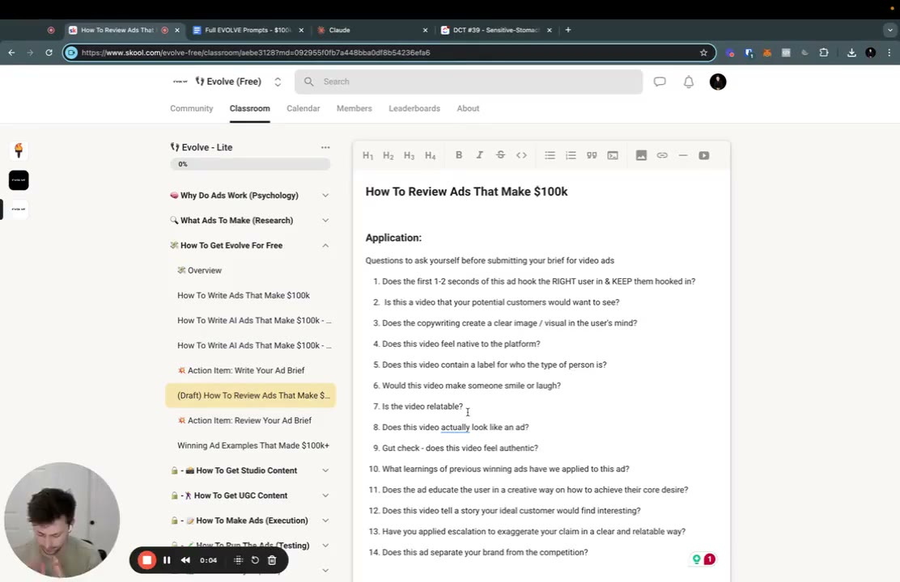

# 128. How To Do Learnings - Questions
> A 14-question checklist (from reviewing ads that spent over $50,000 a day, instructor claim) to run on any video ad brief before launch, or on an ad that failed to scale or convert.

## 🤖 Agent use
- **Use when:** QA of a video ad brief or finished cut before submission; diagnosing a video ad that did not scale or convert; writing the "review" step in an ad pipeline.
- **Inputs → outputs:** a video ad brief or script + the avatar and core desire + the list of learnings from previous winners → a pass/fail (with notes) per question and a list of fixes.
- **Rules:**
  - **DO** run all 14 questions before submitting a video brief, and again after a test that "just didn't scale or didn't convert". [00:00–00:33]
  - **DO** make the first 1–2 seconds hook the right user and keep them hooked. [00:33–01:22]
  - **DO** ask "is this a video my potential customer would want to see?", not whether we like it. [01:22–02:14]
  - **DO** write copy that creates a clear mental image (Shrek earwax example). [02:14–03:06]
  - **DO** make the video native to the platform; avoid TV or Netflix style on Facebook. [03:06–03:49]
  - **DO** include a label for who the person is, to build relatability. [03:49–04:43]
  - **DON'T** expect every ad to pass every question: "your video does not have to pass all of these". [04:43]
  - **DO** make the ad look un-ad-like (camouflaged) and pass a gut check for authenticity. [04:43–05:32]
  - **DO** apply learnings from previous winners, but "be very careful that you don't go into... iteration overload". [05:32–06:22]
  - **DO** teach the core desire in a creative way ("Here's how to get her to never stop texting"), never state the desire flatly. [06:22–07:13]
  - **DO** try a story, escalation, or entertainment if feature-benefit pitching is not working. [07:13–09:39]
  - **DO** separate the brand from the competition; do not clone competitor ads. [09:39–10:37]
- **See also:** [124. Learnings Part 3 (Losers)](124-how-to-do-learnings-part-3-losers.md) · [125. Learnings Part 4 (Winning Ads)](125-how-to-do-learnings-part-4-winning-ads.md) · [127. Learnings Part 5 (Winning Ads)](127-how-to-do-learnings-part-5-winning-ads.md) · [129. Action Item: Review Your Ads](129-action-item-review-your-ads.md) · [Copywriting 70. How to write video ads, part 1](../../copywriting/lessons/70-how-to-write-video-ads-part-1.md) · [Copywriting 38. Why storytelling is so powerful](../../copywriting/lessons/38-why-storytelling-is-so-powerful.md)

## Key ideas

### Context [00:00–00:33]
- Placement: "once you have your brief and once you have it laid out". Use it (1) before you submit or launch, or (2) after the ad was created and tested and "just didn't scale or it didn't convert". [00:00]
- Scope: video specifically, though some questions apply to image ads. The questions come "from reviewing ads that have literally spent over $50,000 a day" (instructor claim), "the questions that we ask ourselves at the agency". There is more in the full Evolve program (a little is "being held back"). The AI-creative part is for the full program. [00:00–00:33; 10:37]
- The on-screen page title is "How To Review Ads That Make $100k" (a draft lesson in a free/lite classroom). [00:05 frame]

### The questions, with the instructor's explanation
Numbered as on the on-screen draft, which matches the spoken order (the exported page text orders 12-13 differently; see Limitations).

1. **First 1–2 seconds hook the RIGHT user and keep them hooked.** Analogy: lighting a firecracker and putting it in your pocket; you would keep watching and wonder what happens. "That feeling... is what a really good hook should do." [00:33–01:22]
2. **Would the potential customer want to see this video?** "A lot of the times we make videos that we like, but we don't think about videos that our customers would want." Ask if it appeared in their feed, would they watch? Do they want to see me put a firework in my pocket? [01:22–02:14]
3. **Does the copywriting create a clear image/visual?** Example: "I've got more earwax than Shrek": anyone who has seen the movie can visualise candles made from his earwax. "If you're selling something that helps with earwax, there you go." [02:14–03:06]
4. **Does this video feel native to the platform?** "Super underrated." If it looks like it should run on Netflix or TV, it probably won't be great on Facebook; Facebook/Instagram have many styles, so ask "is this meant for this platform?" [03:06–03:49]
5. **Does the video contain a label for who the person is?** A label is what people associate themselves with: "marketing nerd", "dropshipper"; deeper ones like "I'm a last-minute kind of person". A label lets others resonate; also builds relatability (item 7). [03:49–04:43]
6. **Would this video make someone smile or laugh?** Not required for every ad ("your video does not have to pass all of these"), but "some of the best ads that we all see and that we really remember are ads that are hilarious... or ads that have deep meaning." [04:43]
7. **Is the video relatable?** (tied to labels). [03:49–04:43]
8. **Does this video actually look like an ad?** "Some of the best strategies for high-performing scaling ads are ads that are camouflaged": they blend in and do not feel like ads. [04:43–05:32]
9. **Gut check: does this feel authentic?** "Is someone going to watch this and be like, gosh, I love this? Yes or no? If... not really, maybe you need to remake it." [04:43–05:32]
   - Camouflage rationale: "people don't want to be sold... I think that's kind of BS. I think people do want to be sold at times." But for a problem-aware or unaware market (see the "Why do ads work" modules), asking for a purchase right now when they do not know you will not work; the more scalable ads "blend in" and feel like learning. [05:32]
10. **What learnings of previous winning ads have we applied?** Do not turn "three reasons why my product does X" into your hook for every ad. Extract the underlying learning: this user likes breakdowns, or "this benefit clearly is something that this user cares about", and apply it. Watch out for "iteration overload". "Certain things work, that doesn't mean that's the only thing that can work." [05:32–06:22]
11. **Does the ad educate the user in a creative way on how to achieve their core desire?** Do not say "we know you want relationships" ("terrible copy"). Instead "Here's how to get her to never stop texting." [06:22–07:13]
12. **Does the ad tell a story the ideal customer would find interesting?** (Spoken order.) If "here's product, benefit, benefit, benefit, buy now" is not working, "try to be more creative, telling stories." People are "story junkies" (Netflix: a "hundred billion dollar company"); stories are also a way to grab attention on social. [07:13–08:05]
13. **Have you applied escalation to exaggerate your claim in a clear and relatable way?** Escalation takes the claim to its highest extent. Example: for an easy-to-clean humidifier, "if Mr. Clean invented a humidifier", film Mr. Clean saying "that thing is so clean... cleaner than me". Another: a hair supplement where taking too many turns you into Chewbacca, who "started losing his hair" and takes it to grow it back. He says the Harmon brothers' big-company ads are funny, relatable and apply escalation. [08:05–09:39]
14. **Does the ad separate your brand from the competition?** "A lot of the times people are ripping ad creatives, copying them one by one... the reason why your competitors are ahead of you is because they're not really looking at that." They are in their own "blue ocean". Build a moat: it should feel like your product is the only one that can deliver what the user wants; unique USPs and unique mechanisms help. "If you can really, really, really dive deep into this and try to find a way to separate yourself, it becomes extremely hard for consumers to feel like, oh, well, I can just get this somewhere else." [09:39–10:37]


*The classroom draft "How To Review Ads That Make $100k", "Application: Questions to ask yourself before submitting your brief for video ads", all 14 questions as read in the video. On screen, 11 = educate, 12 = story, 13 = escalation, 14 = separate from competition. [00:05]*

- Closing line: "hopefully this helps you review any video ads that you make and ultimately helps you create ads that can make over $100,000." [10:37]

## Steps / framework

**Pre-launch video ad QA, grouped (derived grouping; question numbers as on the page)**

| Group | Questions | Fail signal (derived) |
|---|---|---|
| Hook | 1 | Stops scroll but loses viewer by second 3 |
| Customer fit | 2, 5, 7 | Made for us, not for them; no label or relatable situation |
| Clarity | 3, 11 | Abstract language; desire stated flatly |
| Platform feel | 4, 8, 9 | Looks like TV or an ad; gut says "not authentic" |
| Engagement | 6, 12, 13 | Pure feature-benefit pitch; no story, humour or escalation |
| Learning | 10 | Ignores past winners or copies them one-to-one |
| Differentiation | 14 | Could be any competitor's ad |

## Examples
- **Firecracker in the pocket:** exaggerated example of a hook that holds attention. [00:33–01:22]
- **"I've got more earwax than Shrek":** vivid mental image for an earwax product. [02:14–03:06]
- **Labels:** "marketing nerd", "dropshipper", "last-minute kind of person". [03:49–04:43]
- **"Here's how to get her to never stop texting":** the core desire (relationships) taught creatively. [06:22–07:13]
- **Mr. Clean humidifier; Chewbacca hair supplement:** escalation examples (instructor's illustrations, not run ads). [08:05–09:39]

## Structured units

### Hooks
| Hook (verbatim or near) | Heuristic(s) | Emotion / zone | Self targeted | Why it works | Source |
|---|---|---|---|---|---|
| "I've got more earwax than Shrek." | Visual analogy (derived) | Humor (derived) | — | Clear visual from a shared movie reference | [02:14–03:06] |
| "Here's how to get her to never stop texting." | Educate on desire | — | — | Taps a core desire without naming it flatly | [06:22–07:13] |

### Templates
| Template | Use for | Example fill | Source |
|---|---|---|---|
| "If [famous character/brand known for X] invented [our product]" | Escalation of a single claim | "If Mr. Clean invented a humidifier" | [08:05] |
| "[Absurd character] started [problem], so he started taking [product]. That's how effective it is." | Escalation / humor | Chewbacca and hair supplements | [08:05–09:39] |

### Rules of thumb
- **DO** put the avatar's label in the video so people self-identify. [03:49–04:43]
- **DON'T** require all 14 to pass; use them to find the weakest. [04:43]
- **IF** a market is problem-aware or unaware **THEN** prefer camouflaged, educational ads over hard sells. [05:32]
- **IF** feature-benefit ads do not work **THEN** switch to story, humor or escalation. [07:13–09:39]
- **DON'T** copy competitor creatives; find your own "blue ocean". [09:39–10:37]

## Prompts / templates (verbatim)

Page text ("Application: Questions to ask yourself before submitting your brief for video ads"), exactly as exported:
```
1. Does the first 1-2 seconds of this ad hook the RIGHT user in & KEEP them hooked in?
2. Is this an ad that your potential customers would want to see?
3. Does the copywriting create a clear image / visual in the user's mind?
4. Does this video feel native to the platform?
5. Does this video contain a label for who the type of person is?
6. Would this video make someone smile or laugh?
7. Is the video relatable?
8. Does this video actually look like an ad?
9. Gut check - does this video feel authentic?
10. What learnings of previous winning ads have we applied to this ad?
11. Does the ad educate the user in a creative way on how to achieve their core desire?
12. Have you applied escalation to exaggerate your claim in a clear and relatable way?
13. Does this ad either:
    1. Tell a story the avatar would find interesting and be emotionally invested in?
    2. Entertain the avatar and make them smile, laugh, or share it with a friend?
    3. Educate the avatar and introduce them to a new mechanism that is believable?
14. Does this ad separate your brand from the competition?
```

On-screen version (frame at 00:05) differs slightly: question 2 reads "Is this a video that your potential customers would want to see?", question 12 is "Does this video tell a story your ideal customer would find interesting?", question 13 is "Have you applied escalation…", and 14 is the same.

## Screenshots
Embedded above next to the idea they support.

## How to apply
- [ ] Run the 14 questions on every video brief before sending it to a creator/editor.
- [ ] For each "no", write the specific fix; do not require a pass on every item.
- [ ] Add a label line to the script ("As a [label]…").
- [ ] Add one visual comparison/image in the copy (Shrek-style).
- [ ] Decide for each ad: story, humor, escalation, or education of a new believable mechanism.
- [ ] List 1–3 learnings from previous winners applied (and stop at iteration overload).
- [ ] Write one sentence on how this ad differs from the nearest competitor ad.
- [ ] Re-run the list after a test that did not scale; log which question failed.

## Related
- Previous: [127. Learnings Part 5 (Winning Ads)](127-how-to-do-learnings-part-5-winning-ads.md) · Next: [129. Action Item: Review Your Ads](129-action-item-review-your-ads.md)
- [Copywriting 72. Action item: write your video ad briefs](../../copywriting/lessons/72-action-item-write-your-video-ad-briefs.md) · [Native advertising](../../../../concepts/native-advertising.md) · [Humor in ads](../../../../concepts/humor-in-ads.md) · [Labels and customer language](../../copywriting/concepts/labels-and-customer-language.md) · [Iteration vs variation](../../../../concepts/iteration-vs-variation.md)

## Sources and limitations
- Transcript: [128 transcript](<../../../../../raw/evolve/start-here/_transcripts/👣 Evolve (Start Here)/128. How To Do Learnings - Questions 👣 Evolve (Start Here) Evolve.txt>) · Page text: [128 page text](<../../../../../raw/evolve/start-here/_extracted/👣 Evolve (Start Here)/128. How To Do Learnings - Questions_👣 Evolve (Start Here)_Evolve.html.md>).
- Machine transcription; full recording covered (11:04). The video screen is a screen recording with a webcam inset; frame resolution is higher than other lessons.
- The video covers 14 questions in the spoken order educate → story → escalation → separate; the exported page text lists "escalation" as 12 and groups story/entertain/educate under 13 with sub-bullets; the on-screen draft lists story as 12 and escalation as 13. Counting the page text, the 14 are the same ideas; the page's question 13 adds the sub-options "entertain" and "educate with a new believable mechanism", which are not spoken in the video.
- "$50,000 a day" and "ads that can make over $100,000" are instructor claims without evidence.
- "Harmon brothers" and "Mr. Clean" appear as names in the instructor's illustrations (Whisper heard "Harmon brothers"; spelling unverified).
