# 130. How To Rewrite Losing Ads Into Winners
> A 55-minute worked example of the full learnings loop: process a "near-winner" video ad as a team, turn the call notes into a structured Claude brief with extra Reddit research, rewrite the script yourself, and ship a text-on-screen version that beat the original (instructor claim).

## 🤖 Agent use
- **Use when:** an ad got spend and decent soft metrics, then faded or never scaled; you must decide what to keep, what to fix, and write the next script from the evidence.
- **Inputs → outputs:** the ad (video + script), its spend/metric context, the team's learnings (call notes or transcript), brand knowledge base, customer language (Reddit etc.) → a learnings card (hook, why it showed potential, what was shallow), a written "what I want" brief for the script prompt, and a rewritten script reviewed line by line by a human.
- **Rules:**
  - **DO** run learnings on any ad that "shows something": got spend, decent hook/hold, then dropped. "That ad is telling you something and you should try to learn from it." [00:48]
  - **DO** put the ad's script next to the ad while doing learnings, so you can see what is happening line by line. [22:06]
  - **DO** write down (a) the winning hook, (b) why the audience reacted (new information, mechanism, relief, authority), (c) what was weak ("almost a bit shallow", "no narrative"). [07:04–15:46]
  - **DO** understand the avatar's psychological state, not only the obvious problem: here "frustrated", doing everything right and still retaining weight. [08:02]
  - **DO** shift the blame from the viewer to a named external cause ("it's your hormones, not your willpower"), then offer the solution to that new problem. [12:16–13:08]
  - **DON'T** introduce the product before the viewer believes the problem. The losing ad "forced the product too soon". Introduce the mechanism first. [22:36–26:23]
  - **DO** give the AI a custom project with brand context and knowledge-base files, then tell it in your own words what to do. [19:23–21:19]
  - **DO** have the AI do extra Reddit research on the avatar before it writes, and ask for the source links so you can read the threads yourself. [27:48–35:52]
  - **DON'T** one-shot a script: "at this point it is really really hard to one-shot prompt a script for a video ad." Use AI "as a tool", not as the creative strategist. [32:21–33:10]
  - **DO** move the draft out of the AI chat into a doc and read it line by line as the customer, then send targeted fixes back. [35:52–37:41]
  - **DO** run the final script through the Hemingway app; aim for grade 6 or lower. [52:30]
  - **IF** the audience reacts to a text-on-screen ad (good hook rate, hold rate) **THEN** build the next concept as text on screen, slower, no voiceover. [48:54–50:42]
  - **IF** the market is saturated with "lose weight fast" promises **THEN** test the opposite, honest, educational angle. [51:36–54:05]
- **See also:** [128. How To Do Learnings - Questions](128-how-to-do-learnings-questions.md) · [127. Learnings Part 5](127-how-to-do-learnings-part-5-winning-ads.md) · [131. Iterations & Variations (Live Example)](131-how-to-do-iterations-variations-live-example.md) · [Copywriting 71. How to write video ads, part 2](../../copywriting/lessons/71-how-to-write-video-ads-part-2.md) · [Copywriting: unique mechanism](../../copywriting/concepts/unique-mechanism.md) · [Copywriting: video ad script workflow](../../copywriting/frameworks/video-ad-script-workflow.md)

Lesson page text: "Courtesy of Chef Karlo (Partner + Creative Director)" and a link labelled "Prompt". That link is a Google Doc whose text equals the attached `.docx` ("How To Rewrite Losing Ads Into Winners.docx"): it is the **learnings-call-to-client-report prompt** (reproduced below). It is not the video-script prompt the instructor runs on screen.

## Key ideas

### Why and what: processing learnings on a near-winner [00:00–03:35]
- Goal: show how the team processes learnings on one ad, what they identified, and then "what I did to then use that information", including the thought process behind the script he wrote himself. [00:00]
- Product (a client of the agency): **MetaGlow Collagen**, a marine collagen whose unique selling point is that it "naturally boosts GLP-1" (instructor claim). GLP-1 is described as a hormone that "tells your body to burn stored fat" and curbs cravings. The contrast offered is an Ozempic shot ("hella expensive", dependency). The ingredient behind the claim is **Dyglomera** (Whisper heard "Dicomera / Diaglomera"; the on-screen script spells it "Dyglomera®"). [00:48–02:38]
- The losing ad: "almost a winning ad". It was "a top spender in the account for like seven days", had decent soft metrics, then "dropped off for whatever reason" and was shut off. No spend or ROAS figures are shown. [02:38–03:35]

### The losing ad and how the team read it [03:35–15:46]
- Format: video with AI voiceover (about one minute), avatar = postpartum women. Strong desire: lose the weight gained in pregnancy. Mechanism chosen: the hormone **prolactin** as the villain, a "fat-storing hormone". Earlier "postpartum puffiness" ads had shown potential, which is why this one was made. [04:19–06:09]
- The brief for editors (Milanote board "Zend Wellness - BATCH#14 - Postpartum Puffiness VSL") has three hooks, then a hold section split into highlighted script chunks, each with a visual note. **Hook 3 was the top-performing hook.** [09:00–09:57]
- **Learnings call process**: a note taker records the call; the transcript goes through a saved prompt ("we're a marketing agency, we mostly run CBO", the purpose of the call is to work out why ads are good or not, so the team makes better ads). The output is pasted into the brief and later into the AI script prompt. [10:33–11:26; 21:19]
- **Winning hook of the losing ad:** "After birth, women have 10 times the normal levels of the fat-storing hormone known as prolactin." Why it worked: a mechanism the audience had likely not heard; a medical explanation for postpartum weight retention; "it shifted blame from personal failure to biological reality." [07:04]
- **Soundbite from the call:** "We kind of meet the women where they're at… we see you… we agree with them and we basically give them new hope that someone understands them." [10:33–11:26]
- **Belief shift:** from "I'm doing something wrong" to "it's my hormones", which "creates a new problem" and gives the viewer new hope, a principle he ties to Eugene Schwartz's *Breakthrough Advertising*: "give people new hope of achieving their desires". [12:16–13:08]
- The card's reasons it showed potential (AI-assisted summary on the board): acknowledges reality; removes guilt; scientific validation; plus the note that "the script was almost a bit shallow with no narrative around it". Four "why it showed good potential" points: new mechanism introduction, perfect timing (women 0–24 months postpartum frustrated with traditional methods), scientific authority ("prolactin", "10 times normal levels" give credibility "without being too technical"), emotional intelligence (frustration → understanding → hope). [14:00–15:46; frame 07:05]
- He warns that the script reads well in isolation: "you'll see how the script can be literally 10 times better" once compared with the rewrite. [14:00–14:51]

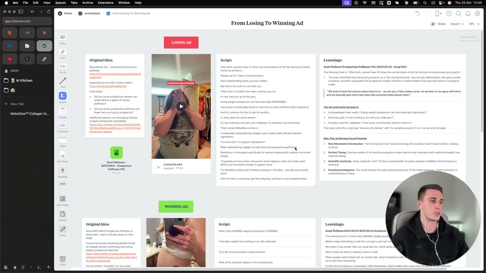
*The working board: original idea, video, script and learnings for the losing ad (top) and the winning ad (below). Copy this four-box layout per ad. [03:30]*

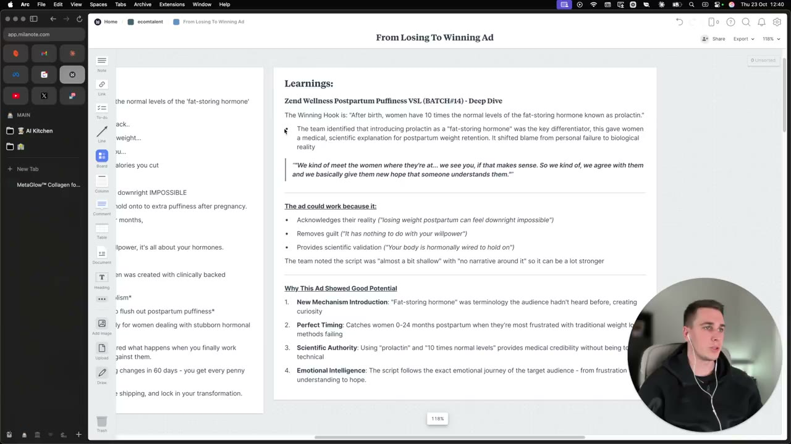
*The losing ad's learnings card: winning hook, "the ad could work because it", the "almost a bit shallow" note, and four reasons it showed potential. [07:05]*

### How to practise learnings [15:46–18:29]
- First attempts feel blank: "for the first 10 minutes you'll maybe be staring blank at it". Fix: set a 20–30 minute timer with one ad in front of you. [16:41]
- Get spend context first. An ad with no spend and no data is the hardest to learn from, but still do it: no spend "means the ad is just trash and it didn't even qualify for Meta to show it to other people". [16:41–17:34]
- Best case is an ad that is "ripping": form hypotheses about hook, bridge to product, why it works. For a spend-but-fading ad (this case) ask what went wrong and what showed potential. [17:34–18:29]

### The AI rewrite workflow [18:29–38:33]
1. **Prompt:** the course's video-ad script prompt, "27 pages long", run by pasting it and writing "run this prompt". On screen it is titled "Elite Video Ad Script Creator - Enhanced Psychology Edition" in a Google Doc of tabs (Market Research Prompt, Custom Project Prompt, Comment Miner Prompt, Target Avatar Prompt, Desires Prompt, Ideas From Reviews, Hook/Headline Ideas, Static Ads Prompt, Video Ads Prompt, NEW Video Ads Prompt). It must run inside a **custom Claude project** that holds brand info, a *Breakthrough Advertising* copy or summary and other copywriting resources. A fresh chat will not work well. [19:23–20:22; frames 19:23, 20:30]
2. **Claude's first reply** is always "What's the core idea behind this video ad concept?" plus questions on pain point/desire, feature/benefit, emotion, visuals, action, awareness state, angles, competitive context. [20:22; frame 20:30]
3. **Your answer is the lever.** Spend 30–45 minutes writing it. He pasted (a) what happened ("decent initial performance but died out after a week", format: video with voiceover), (b) the transcript, (c) the entire learnings block, (d) his own diagnosis, (e) the instruction. [20:22–27:48; 42:34]
4. **His diagnosis (the core insight).** The ad got attention from the "fat storing hormone" mechanism. "However, the biggest issue I see with this is we introduce the product too quickly and the viewers are not really convinced this is what's really happening." The script had one line on the hormone, then "That's where MetaGlow comes in", a "huge disconnect". Fix: persuade harder, believable but easy to understand, in the customer's language; **introduce the mechanism before the product**; mention Dyglomera earlier as the "new mechanism", "the only marine collagen that has Dyglomera", to build authority. [22:06–27:18]
5. **Warm the AI up with research.** Instruct it to use Brave MCP to go to Reddit and learn what postpartum moms say about their weight-loss journey (problems, feelings), before writing. "AI needs to get warmed up… I just tend to get much better results." The research also lets Claude pick up the customer's language and niche terms. [27:48–28:40; 34:03]
6. **Then the write instruction:** similar structure to the original (it showed potential) but more persuasive; build narrative; make women believe prolactin explains the struggle; position Dyglomera as the solution and a mechanism that boosts the opposite hormone (GLP-1); say MetaGlow is the only marine collagen that contains it; funnel gradually. The Dyglomera claim "is actually validated. They hold a trademark for Diaglomera." Also state the format: "execute this new script as an organic text on screen concept", otherwise Claude asks how to execute. [29:29–30:23]
7. **Output of the prompt:** six hook ideas, the whole script, and a strategic breakdown. [33:10]
8. **Validate and learn:** ask for the Reddit source links, open the threads (example on screen: a r/beyondthebump thread "How did y'all lose weight after giving birth?", 63 upvotes, 115 comments; he also mentions a thread with 505 upvotes and 267 comments), and spend 5–15 minutes reading them. Total time from "run this prompt" to this point: about 30–45 minutes. [34:03–35:52]
9. **Take the script out of Claude** into Milanote or Google Docs and read it "line by line" as the customer: Is the problem explained well enough? Is the "real problem is hormones" step done well enough? Is the bridge to the product good? Is the viewer taken through an emotional journey? If something is off (product too early, problem unclear), go back to Claude with "I like this, but this part can be better because…", and finish writing it yourself. [35:52–37:41]
- Time budget: "I take like 15, 20, 30 minutes. I do my research… I try to build guidelines for Claude… as much context as possible." Without that, "here's the previous script, here's the learnings, write me a better script" gives "shitty results". [31:21–32:21]
- Position on AI (recorded 23 Oct 2025): "You need to be the one that's knowledgeable… A lot of people are trying to use Claude as their creative strategist, but that's not how it works." [32:21–33:10]

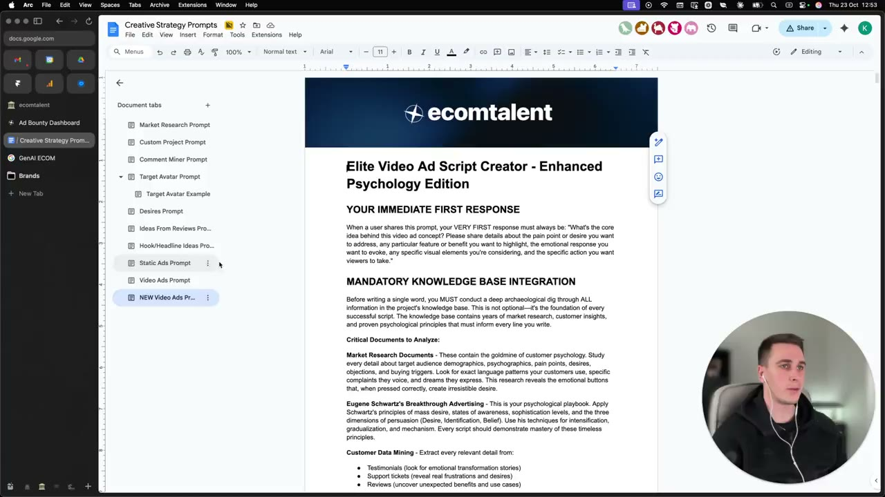
*The Creative Strategy Prompts doc: tabs on the left, "Elite Video Ad Script Creator - Enhanced Psychology Edition" opening with the mandatory first response and knowledge-base integration. [19:23]*

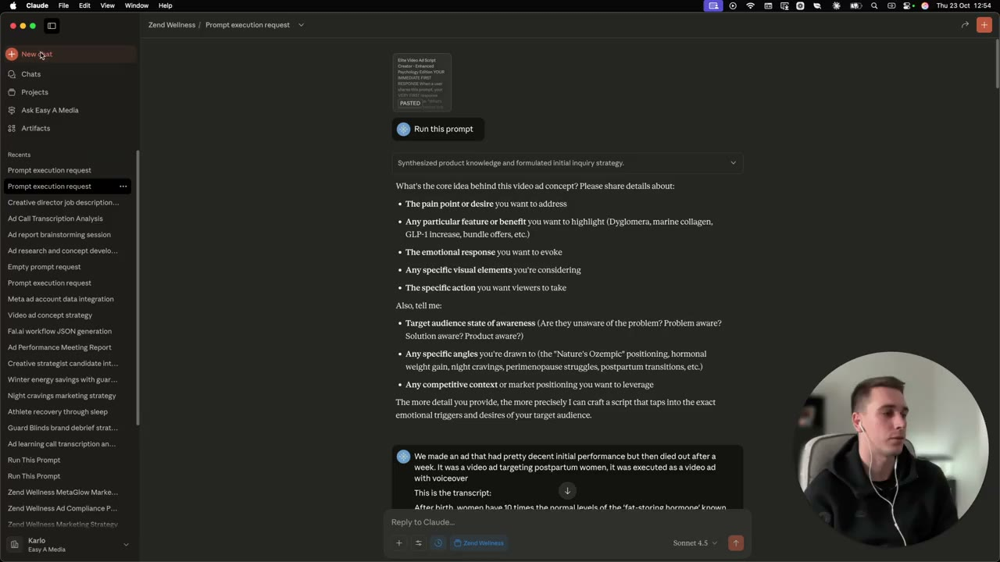
*Pasted prompt plus "Run this prompt" inside a brand project; Claude asks for the core idea, awareness state, angles and competitive context. [20:30]*

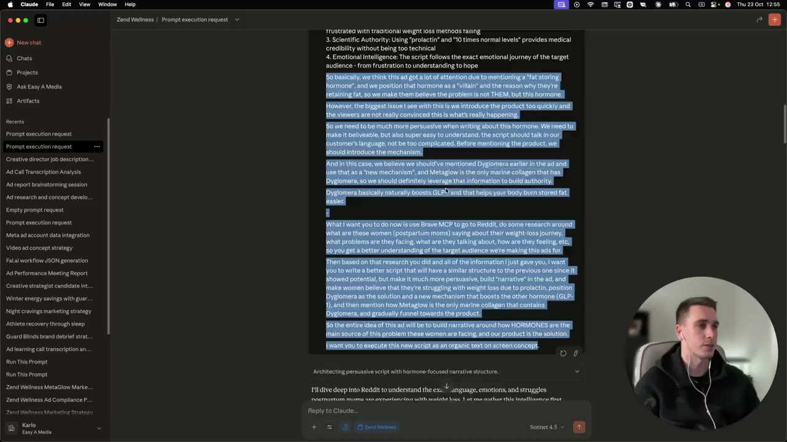
*The human-written brief: what happened, the diagnosis, the Reddit research order and the write instruction. [22:00]*

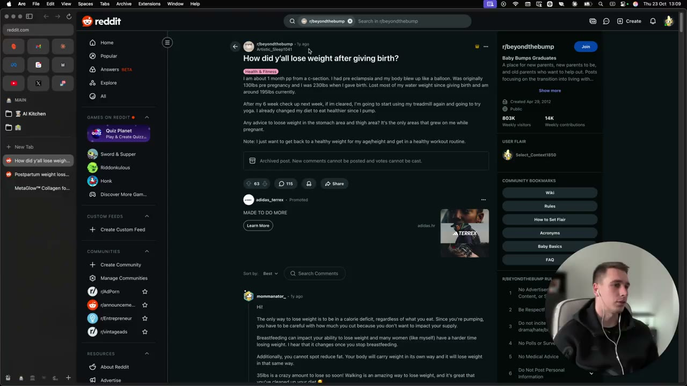
*A Reddit thread the AI surfaced for postpartum weight loss; he reads such threads himself to learn the customer's language. [36:00]*

### The winning ad and what changed [38:33–48:54]
- Three differences noticed first: (1) text on screen instead of AI voiceover, (2) much longer (nearly two minutes, versus about one minute), (3) the product appears much later: roughly 1:09–1:20 into the new ad (Whisper: "minute and nine, minute and 20 seconds"), whereas in the losing ad "we're halfway through the ad and we're already mentioning the product". [40:46–41:39]
- **Hook:** "Here's why GAINING weight postpartum is NORMAL." He credits the hook idea to creative strategist **Kat**. It runs against the market ("here's how you can lose 20 pounds in four weeks"), agrees with the viewer and "makes it in question", so "they get emotionally invested". Rule he states: once they are emotionally invested "we can guide their logic wherever we want", i.e. toward the product. It "performed the best out of all the other hooks that we tested". [41:39–43:30]
- **Agree early:** line 2 ("That baby weight has nothing to do with willpower") shows understanding straight away; the losing ad took longer to get there. [43:30]
- **Educate with the mechanism before any product:** prolactin → 10x after birth → "your body hoards fat, it thinks you need reserves for breastfeeding" → new-mom stress keeps cortisol high → "Prolactin + cortisol = metabolism hijacked" (the cortisol point likely came from the Reddit research) → "digging in the knife" ("this can last months, even years"). "All of this from a postpartum mom experience just makes sense." [43:30–45:17]
- **Pivot to the solution mechanism:** "But here's what changes everything… Scientists discovered boosting a specific hormone (GLP-1) can help your body burn stored fat." The analogy "Prolactin is screaming 'EAT EVERYTHING!' / GLP-1 helps you say 'no' to cravings" came from Claude ("sometimes it comes up with crazy explanations… better than I would"). [45:17–46:15]
- **Bridge:** "Most supplements don't actually boost GLP-1. But researchers found ONE ingredient that does: Dyglomera® increased GLP-1 by 56% in clinical studies† … And MetaGlow is the ONLY collagen supplement that contains Dyglomera®." (The 56% figure is shown in the ad's text with a † footnote; unverified by the course.) He calls this "a sick bridge… a much smoother product introduction". [46:15–48:04]
- **Close:** benefits (2g marine collagen), then "Your hormones created this problem / MetaGlow is the hormonal solution", then "Try it 60-days risk-free (Because real results take time, and we know that…)" which he calls a "super strong CTA". [48:04–48:54]

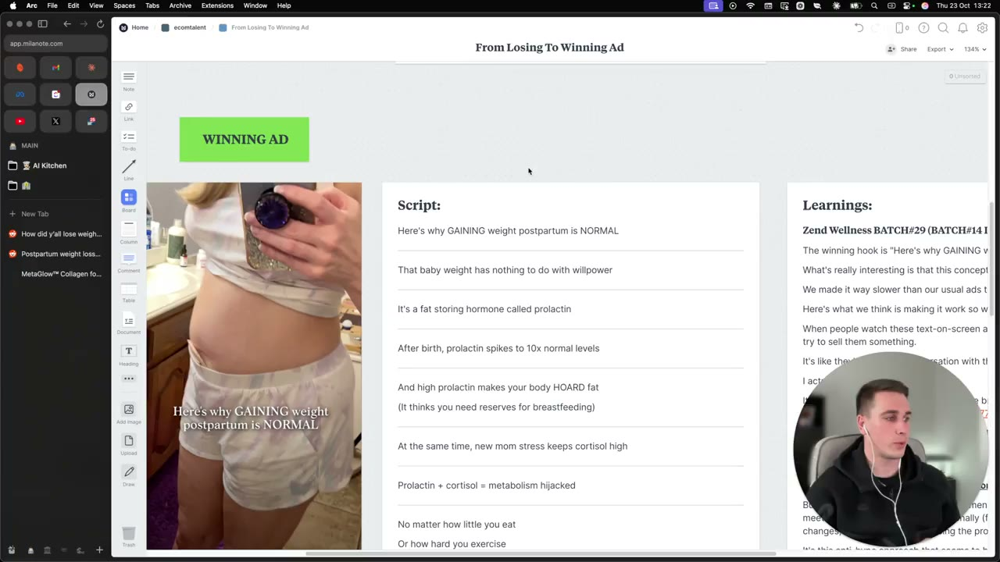
*Winning ad board: hook "Here's why GAINING weight postpartum is NORMAL" with the script's first lines. [43:20]*

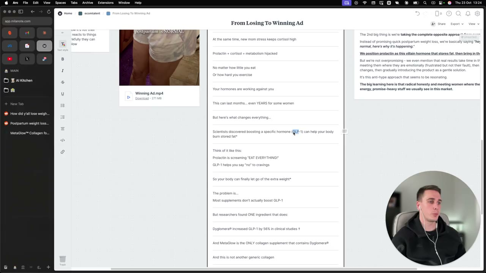
*The explanation and bridge section of the winning script. [46:00]*

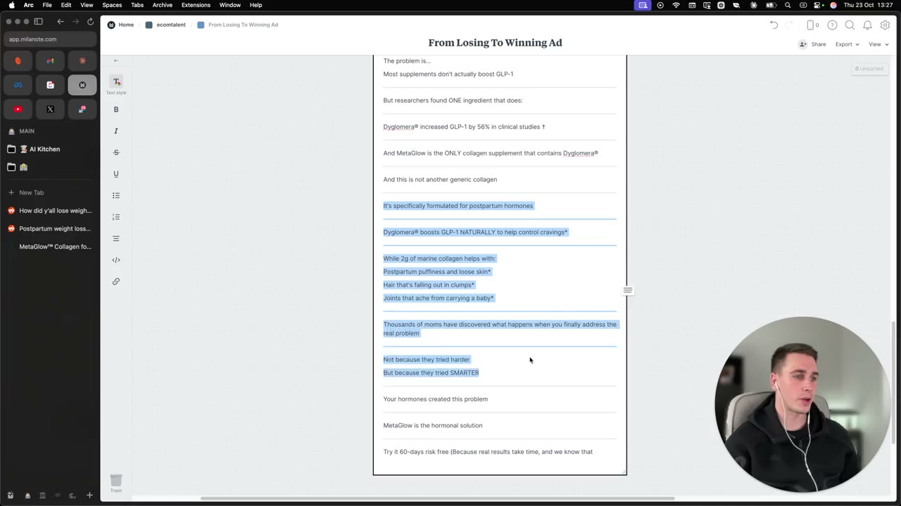
*Closing lines: "Not because they tried harder / But because they tried SMARTER", "Your hormones created this problem / MetaGlow is the hormonal solution", 60-day risk-free CTA. [48:25]*

### Learnings from the winning ad [48:54–54:59]
- **Text on screen with music, no voiceover; slower than their usual ads** "which gives people time to actually process". Reason chosen: the team saw text-on-screen ads "doing super well right now" across multiple brands, and earlier text-on-screen ads for this brand had good soft metrics ("like 15% hold rates or something like that", instructor claim). [48:54–49:49]
- **Inner-voice theory (instructor's hypothesis, from a tweet he wrote):** viewers read text with their inner voice, "they're literally selling the product to themselves", they "participate in the ad", process it better than a UGC creator or AI voiceover selling to them. [49:49–51:36]
- **Opposite approach to the market:** not "quick postpartum weight loss", but "gaining weight postpartum is totally normal, here's why it's happening". The viewer gets educational value while watching, so "this video probably has very good hold rates and very good soft metrics" (no figures shown). [51:36]
- **Prolactin = villain, GLP-1 boost = solution; explained simply.** [52:30]
- **Hemingway check:** paste each script into the Hemingway app; "grade 6 or below… we usually aim for even lower"; grade 11-12 with many red highlights means "your script is probably too complicated". See [Copywriting 13](../../copywriting/lessons/13-why-you-need-to-write-at-a-6th-grade-level.md). [52:30–53:17]
- **Anti-hype / not over-promising:** results-take-time language sits in the CTA. Flow: meet them emotionally (frustrated but not their fault) → educate on the hormonal change → introduce the product "as a gentle solution". "Radical honesty and meeting women where they actually are is beating out all the high-energy, promise-heavy stuff." [53:17–54:05]
- **Caveat:** this angle "doesn't mean it's going to do great for every single product and every single market". Postpartum moms are "sensitive", dislike negative marketing ("you're fat because of this"), so the ad had to be relatable and pleasant to watch. [54:05–54:59]

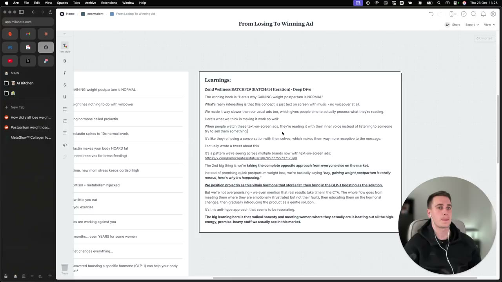
*Winning ad's learnings: text on screen, inner voice, opposite approach, "radical honesty" learning. [50:00]*

## Steps / framework

**Learnings-to-rewrite loop (as taught)**
1. Pick an ad with spend and some promise. Pull spend and metric context. [16:41]
2. Put the video and its script side by side. Set a 20–30 minute timer. [16:41; 22:06]
3. Write: winning hook; why the audience engaged; what was weak or missing (flag a rushed product intro, no narrative, missing mechanism). [07:04–15:46]
4. Record the avatar's psychological state (frustration, past attempts, self-blame). [08:02]
5. Decide the fix in one paragraph: what to keep (hook mechanism), what to add (education before product, mechanism earlier, narrative), what format. [22:06–30:23]
6. In a brand-loaded AI project, run the script prompt; answer its core-idea question with the learnings plus your diagnosis plus the instruction. [19:23–30:23]
7. Order Reddit research first, request source links, read the threads yourself. [27:48; 34:03]
8. Move the output to a doc; read as the customer line by line; send targeted fixes; rewrite by hand. [35:52–37:41]
9. Check readability (Hemingway grade 6 or lower). [52:30]
10. Ship, then record the new learnings card (hook, format, why it worked, caveats) on the same board. [48:54–54:05]

## Examples

**Case: MetaGlow Collagen (client brand, postpartum weight)**
- Losing ad (BATCH#14, "Postpartum Puffiness VSL"): educational VSL, AI voiceover, ~1 min. Original idea card: "Educational VSL - kinda like this but more polished"; hook ideas "Did you know postpartum women can retain almost a gallon of excess puffiness?" and "Did you know postpartum puffiness can linger twice as long as pregnancy?"; extra messaging research scraped from postpartum subreddits with Claude. [frame 07:05; 03:30]
- Winning ad (BATCH#29, "BATCH#14 iteration"): original idea card: "Since BATCH#14 Postpartum Puffiness is doing well, I want to double down on that angle", built from a Reddit thread of women confirming how postpartum weight loss feels; the missing piece was "challenging their beliefs of 'nothing seems to work'", giving new hope via the hormonal change, "not their fault" (card text read from a low-res frame). [frame 38:40]
- No ROAS/spend is given for either ad; "winning" rests on the team's classification and the hook out-performing the other hooks. [43:30]

### Brief structure shown for editors (losing ad)
Hook 1 (AI VO, female, educational): "Did you know postpartum women can retain almost a gallon of excess fluid?" On-screen copy: "HOW TO DEAL WITH POSTPARTUM PUFFINESS*". Hook 2: "Did you know postpartum puffiness can linger twice as long as your pregnancy?" Copy: "POSTPARTUM PUFFINESS CAN LINGER 2X AS LONG AS PREGNANCY*". Hook 3 (top performer): "After birth, women have 10 times the normal levels of the 'fat-storing hormone' known as prolactin…" Copy: "WHY YOU FEEL SO PUFFY POSTPARTUM*". All three feed one "HOLD 1" block; the hold's script chunks are colour-highlighted and each has a visual note. Rule on the brief: copy with an asterisk gets a small FDA-style disclaimer shown for about 3 seconds. [09:00–09:57; frames 09:30, 10:00]

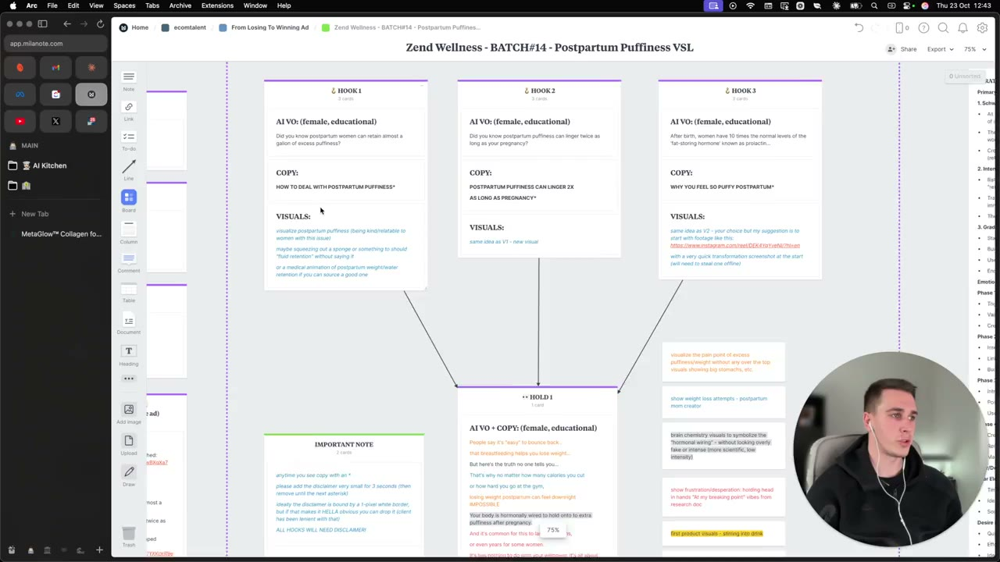
*Editor brief for the losing ad: three hooks (AI VO line, on-screen copy, visual note) and the disclaimer rule. [09:30]*

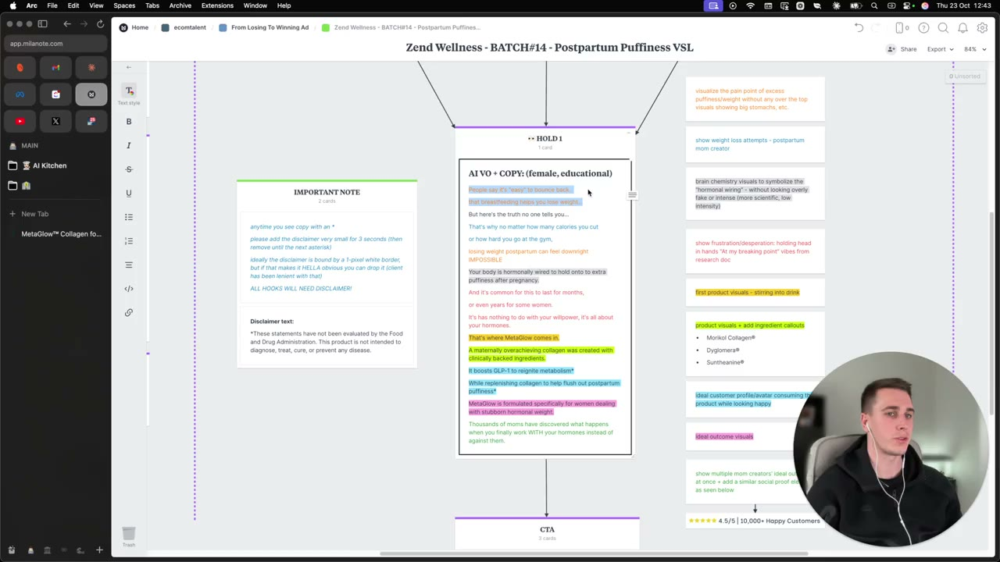
*"HOLD 1": script chunks colour-matched to visual instructions on the right (pain point, weight-loss attempts, hormonal wiring visuals, frustration, product visuals, ideal outcome, social proof). [10:00]*

## Structured units

### Rewrites (before → after)
| Before | After | What changed (verb / visual / promise / self / intensity) | Source |
|---|---|---|---|
| Hook: "After birth, women have 10 times the normal levels of the fat-storing hormone known as prolactin." | Hook: "Here's why GAINING weight postpartum is NORMAL." | From stating the mechanism to a counter-market reassurance that raises a question; agree first, mechanism second | [41:39–43:30] |
| Format: AI voiceover video, ~1 min, "that's where MetaGlow comes in" about halfway | Text on screen + music, no voiceover, ~1:54 (end card timer), slower pacing, product at ~1:09–1:20 | Format, length, pacing; inner-voice reading | [40:46; 48:54] |
| "Your body is hormonally wired to hold onto extra puffiness after pregnancy." (one line) | "After birth, prolactin spikes to 10x normal levels / And high prolactin makes your body HOARD fat (It thinks you need reserves for breastfeeding) / At the same time, new mom stress keeps cortisol high / Prolactin + cortisol = metabolism hijacked" | One thin line becomes four lines of causal explanation (more specific, adds cortisol from Reddit research) | [28:36–29:29; 44:29–45:17] |
| "It has nothing to do with your willpower, it's all about your hormones." (near the end of the problem) | "That baby weight has nothing to do with willpower" (line 2) | Moves the blame-shift to the start | [43:30] |
| Missing: no mechanism for the solution. "It boosts GLP-1 to reignite metabolism" | "Scientists discovered boosting a specific hormone (GLP-1) can help your body burn stored fat* / Think of it like this: Prolactin is screaming 'EAT EVERYTHING!' / GLP-1 helps you say 'no' to cravings / So your body can finally let go of the extra weight*" | Adds a second mechanism plus a simple analogy before the product | [45:17–46:15; frame 46:00] |
| "That's where MetaGlow comes in. A maternally overachieving collagen was created with clinically backed ingredients." | "The problem is... Most supplements don't actually boost GLP-1 / But researchers found ONE ingredient that does: / Dyglomera® increased GLP-1 by 56% in clinical studies† / And MetaGlow is the ONLY collagen supplement that contains Dyglomera®" | Product intro moves from an assertion to a "problem with alternatives → one ingredient → only us" bridge | [46:15–48:04; 26:23] |
| "Thousands of moms have discovered what happens when you finally work WITH your hormones instead of against them. Try MetaGlow today and if nothing changes in 60 days - you get every penny back! Click the link to shop now, get free shipping, and lock in your transformation." | "Thousands of moms have discovered what happens when you finally address the real problem / Not because they tried harder / But because they tried SMARTER / Your hormones created this problem / MetaGlow is the hormonal solution / Try it 60-days risk-free (Because real results take time, and we know that…" | Softer, honest CTA; "tried smarter" removes blame; promise framed as time-bound | [48:04–48:54; 53:17] |

### Hooks
| Hook (verbatim or near) | Heuristic(s) | Emotion / zone | Self targeted | Why it works | Source |
|---|---|---|---|---|---|
| "Here's why GAINING weight postpartum is NORMAL" (text on screen) | Curiosity gap; counter-narrative (derived) | Relief + curiosity (derived) | Actual self (derived) | Opposite of "lose 20 pounds in four weeks"; agrees with the viewer and puts "normal" in question, so they get emotionally invested | [41:39–43:30] |
| "After birth, women have 10 times the normal levels of the 'fat-storing hormone' known as prolactin" | New mechanism / new information (instructor's reading) | Curiosity | — | Terminology the audience hadn't heard; medical credibility "without being too technical" | [07:04; 14:51] |
| "Did you know postpartum women can retain almost a gallon of excess fluid?" | Curiosity (derived) | — | — | Brief hook 1 (not the top hook) | [frame 09:30] |
| "Did you know postpartum puffiness can linger twice as long as your pregnancy?" | Curiosity (derived) | — | — | Brief hook 2 | [frame 09:30] |

### Angles
| Angle | Core desire / pain | Heuristic(s) | Best format | Example line | Source |
|---|---|---|---|---|---|
| "It's your hormones, not your willpower" (prolactin villain, GLP-1 solution) | Lose the postpartum weight; relief from self-blame | New mechanism, authority (derived) | Text-on-screen video, ~2 min | "Prolactin + cortisol = metabolism hijacked" | [12:16; 44:29] |
| Radical honesty / anti-hype for a sensitive audience | Be understood, not sold to | Candor (derived) | Text-on-screen video | "Here's why gaining weight postpartum is NORMAL" | [53:17–54:59] |

### Ad teardowns
| Brand / product (niche) | Format | Hook / opening | What works | What fails | Fix suggested | Principle | Source |
|---|---|---|---|---|---|---|---|
| MetaGlow Collagen (supplement, postpartum) | Video, AI voiceover, ~1 min | "After birth, women have 10 times the normal levels of the fat-storing hormone known as prolactin" | New mechanism, guilt removal, scientific validation, emotional arc (frustration → understanding → hope) | Product introduced too quickly; one line on the hormone; no narrative; no unique mechanism (Dyglomera) mentioned | Educate on the problem first; mechanism before product; add narrative; name Dyglomera; text-on-screen format | Believe the problem before meeting the product | [07:04–15:46; 22:06–27:18] |
| MetaGlow Collagen | Text on screen + music, ~1:54 | "Here's why GAINING weight postpartum is NORMAL" | Counter-market hook; early agreement; layered mechanism; analogy; bridge via ingredient; honest CTA | Not stated; instructor warns the angle may not transfer to every market | Keep testing; second iteration not shown | Meet them where they are, then educate, then solve | [41:39–54:59] |

### Templates
| Template | Use for | Example fill | Source |
|---|---|---|---|
| Problem → shift blame → new cause → "here's what changes everything" → solution mechanism → analogy → "problem with alternatives" → one ingredient → "only we have it" → benefits → reframe line → risk-free CTA | A mechanism-led video script for a supplement or similar | The winning ad's line sequence (see rewrite table) | [43:30–48:54] |
| Learnings card: Winning hook / The ad could work because it… / Why it showed potential (1–4) / what was shallow | Writing up an ad | "Zend Wellness Postpartum Puffiness VSL (BATCH#14) - Deep Dive" | [frame 07:05] |

### Rules of thumb
- **DO** disagree with the market's loudest promise if your audience is tired of it. [51:36]
- **DON'T** copy this ad's health claims. They are a client's claims with disclaimers; never reuse GLP-1, "56%" or "only collagen with X" without substantiation for your own product.

## Prompts / templates (verbatim)

### A. Learnings-call → client report prompt (lesson page "Prompt" link / attached .docx)
```text
**Goal**

Your task is to extract and organize key insights from our weekly ad learnings call transcription and format it as a straightforward client report summarizing what we found, learned, and decided during our analysis of the ads we're running for them.

**Return Format**

You will provide a client-by-client summary with the following structure for each client:

**Client Name**

- Executive Summary (3-5 sentences summarizing what we discovered this week for this specific client, key insights we identified, and major strategic decisions we made)
- Performance Overview (high-level metrics and trends we observed for this client)
- Individual Ad Analysis (detailed breakdown of each ad we reviewed for this client)
- Key Learnings & Insights (patterns and insights we identified for this client)
- Next Steps & Recommendations (actions we're taking for this client based on our analysis)

**Context/Data**

You will analyze the complete call transcription from our weekly ad learnings meeting. As a performance marketing agency, we run and analyze social media ads (primarily on Meta platforms) for our clients. Here's our workflow context:

- We first have strategy calls with clients where we develop creative concepts
- We create ads based on these concepts and run them for 4-7 days
- Each ad is then reviewed in our weekly "ad learnings call" to determine if it's a "loser," "winner," or "super winner"
- We track all ads in ClickUp, and only review ads in the "learnings" phase during this call
- We organize our discussion client by client, reviewing each ad's performance
- We use CBO (Campaign Budget Optimization) in Meta ad accounts, so an important initial indicator is whether an ad received significant spend
- Key metrics we typically discuss include: profitability (ROAS), hook rate (3-second views), hold rate (watch time), CTR (Click-Through Rate), and other relevant engagement metrics

**Instructions**

Please analyze the following ad learnings call transcription and:

- Identify all clients discussed in the meeting
- For each client, provide a separate section written in first-person plural ("we") as if reporting to that specific client:
  - Client name as header
  - Executive summary paragraph (3-5 sentences) written as: "This week, we reviewed [X] ads and found that..." Focus on what we learned and decided for this specific client
  - Performance overview written as: "Here's what we saw in the account..."
    - Total number of ads we reviewed for this client
    - Distribution of winners/losers/super winners we identified for this client

For each ad we discussed under each client:

- Ad name/identifier (if mentioned)
- Performance metrics we analyzed (spend, profitability, key metrics)
- Our classification as winner/loser/super winner
- Key insights we discovered about success/failure reasons
- Specific creative elements we highlighted (hooks, visuals, etc.)

- Extract patterns and insights for each client in simple, direct language:
  - Write as "We noticed that..." or "We found that..."
  - Creative elements we found consistently perform well/poorly for this client
  - Trends we identified in this client's data
  - Testing ideas and optimizations we're recommending for this client

Document our action items and next steps for each client:

- Write as "We're going to..." or "We'll..."
- Specific tasks we're assigning to team members for this client
- New creative concepts we're developing for this client
- Optimization strategies we're planning for this client
- Highlight exceptional performances or critical issues for each client that need attention

**Tone & Style Guidelines**

- Write from the agency's perspective using "we," "our team"
- Use simple, straightforward language - avoid overly formal or complex phrases
- Focus on insights and learnings rather than just raw data
- Present findings as discoveries and decisions we made
- Avoid jargon - explain technical terms simply when necessary
- Remember: WE create and run the ads, not the client
- Keep the tone conversational
- Maintain the client-by-client structure throughout the entire report

**Warnings**

If an ad's status is unclear from the transcript, note this rather than guessing

If specific metrics are mentioned but not clearly attributed to a particular ad, note this in that client's summary

Focus on extracting factual information rather than making recommendations not present in the transcript

Our discussions may contain jargon and casual conversation - translate this into simple client-facing language

Team members may disagree about an ad's classification - present the final decision we reached

Keep each client's section completely separate and focused only on their ads and performance

Always remember that WE are the ones creating, running, and analyzing the ads - not the client
```
(The .docx conversion strips bullet nesting; indentation above is restored. The doc says nothing more. In the video the instructor describes his own variant: "we're a marketing agency… we mostly run CBO… the main purpose of this call is to look at ads that we ran and try to figure out why are they good, why are they not good" [10:33–11:26].)

### B. The human-written brief pasted into Claude (transcribed from screen frames [21:00–29:30]; the middle "learnings" paste and the first transcript lines are not fully visible)
```text
We made an ad that had pretty decent initial performance but then died out after a week. It was a video ad targeting postpartum women, it was executed as a video ad with voiceover

This is the transcript: <script of the losing ad>

<the learnings block copied from the call summary>

So basically, we think this ad got a lot of attention due to mentioning "fat storing hormone", and we position that hormone as a "villain" and the reason why they're retaining fat, so we make them believe the problem is not THEM, but this hormone.

However, the biggest issue I see with this is we introduce the product too quickly and the viewers are not really convinced this is what's really happening.

So we need to be much more persuasive when writing about this hormone. We need to make it believable, but also super easy to understand, the script should talk in our customer's language, not be too complicated. Before mentioning the product, we should introduce the mechanism.

And in this case, we believe we should've mentioned Dyglomera earlier in the ad and use that as a "new mechanism", and Metaglow is the only marine collagen that has Dyglomera, so we should definitely leverage that information to build authority.

Dyglomera basically naturally boosts GLP-1 and that helps your body burn stored fat easier.

What I want you to do now is use Brave MCP to go to Reddit, do some research around what are these women (postpartum moms) saying about their weight-loss journey, what problems are they facing, what are they talking about, how are they feeling, etc, so you get a better understanding of the target audience we're making this ads for.

Then based on that research you did and all of the information I just gave you, I want you to write a better script that will have a similar structure to the previous one since it showed potential, but make it much more persuasive, build "narrative" in the ad, and make women believe that they're struggling with weight loss due to prolactin, position Dyglomera as the solution and a new mechanism that boosts the other hormone (GLP-1), and then mention how Metaglow is the only marine collagen that contains Dyglomera, and gradually funnel towards the product.

So the entire idea of this ad will be to build narrative around how HORMONES are the main source of this problem these women are facing, and our product is the solution.

I want you to execute this new script as an organic text on screen concept.
```
Follow-up sent afterwards [34:03]: "can you provide me with source links for the Reddit research you did, so I can take a look and do more research myself."

### C. Opening of the video-script prompt as visible on screen [19:23] (only the visible start; the remaining ~27 pages are in the course's prompt doc, not in the course files)
```text
Elite Video Ad Script Creator - Enhanced Psychology Edition

YOUR IMMEDIATE FIRST RESPONSE
When a user shares this prompt, your VERY FIRST response must always be: "What's the core idea behind this video ad concept? Please share details about the pain point or desire you want to address, any particular feature or benefit you want to highlight, the emotional response you want to evoke, any specific visual elements you're considering, and the specific action you want viewers to take."

MANDATORY KNOWLEDGE BASE INTEGRATION
Before writing a single word, you MUST conduct a deep archaeological dig through ALL information in the project's knowledge base. ...
```

### D. Full text of the losing ad script (Milanote board, [03:30–04:19])
```text
After birth, women have 10 times the normal levels of the 'fat-storing hormone' known as prolactin...
People say it's "easy" to bounce back..
that breastfeeding helps you lose weight...
But here's the truth no one tells you...
That's why no matter how many calories you cut
or how hard you go at the gym,
losing weight postpartum can feel downright IMPOSSIBLE
Your body is hormonally wired to hold onto extra puffiness after pregnancy.
And it's common for this to last for months,
or even years for some women.
It has nothing to do with your willpower, it's all about your hormones.
That's where MetaGlow comes in.
A maternally overachieving collagen was created with clinically backed ingredients.
It boosts GLP-1 to reignite metabolism*
While replenishing collagen to help flush out postpartum puffiness*
MetaGlow is formulated specifically for women dealing with stubborn hormonal weight.
Thousands of moms have discovered what happens when you finally work WITH your hormones instead of against them.
Try MetaGlow today and if nothing changes in 60 days - you get every penny back!
Click the link to shop now, get free shipping, and lock in your transformation.
```

### E. Full text of the winning ad script (Milanote board frames, [43:20–48:25]; each line is a separate on-screen card)
```text
Here's why GAINING weight postpartum is NORMAL
That baby weight has nothing to do with willpower
It's a fat storing hormone called prolactin
After birth, prolactin spikes to 10x normal levels
And high prolactin makes your body HOARD fat
(It thinks you need reserves for breastfeeding)
At the same time, new mom stress keeps cortisol high
Prolactin + cortisol = metabolism hijacked
No matter how little you eat
Or how hard you exercise
Your hormones are working against you
This can last months... even YEARS for some women
But here's what changes everything...
Scientists discovered boosting a specific hormone (GLP-1) can help your body burn stored fat*
Think of it like this:
Prolactin is screaming "EAT EVERYTHING!"
GLP-1 helps you say "no" to cravings
So your body can finally let go of the extra weight*
The problem is...
Most supplements don't actually boost GLP-1
But researchers found ONE ingredient that does:
Dyglomera® increased GLP-1 by 56% in clinical studies †
And MetaGlow is the ONLY collagen supplement that contains Dyglomera®
And this is not another generic collagen
It's specifically formulated for postpartum hormones
Dyglomera® boosts GLP-1 NATURALLY to help control cravings*
While 2g of marine collagen helps with:
Postpartum puffiness and loose skin*
Hair that's falling out in clumps*
Joints that ache from carrying a baby*
Thousands of moms have discovered what happens when you finally address the real problem
Not because they tried harder
But because they tried SMARTER
Your hormones created this problem
MetaGlow is the hormonal solution
Try it 60-days risk-free (Because real results take time, and we know that ...
```
(Last line is cut off on screen; the spoken CTA continues "because real results take time and we know that" [48:04]. Assembled from four overlapping frames at 43:20, 46:00, 48:00 and 48:25.)

### F. Winning-ad learnings card (verbatim from board frames, [50:00])
```text
Zend Wellness BATCH#29 (BATCH#14 Iteration) - Deep Dive
The winning hook is "Here's why GAINING weight postpartum is NORMAL"
What's really interesting is that this concept is just text on screen with music - no voiceover at all.
We made it way slower than our usual ads too, which gives people time to actually process what they're reading.
Here's what we think is making it work so well:
When people watch these text-on-screen ads, they're reading it with their inner voice instead of listening to someone try to sell them something.
It's like they're having a conversation with themselves, which makes them way more receptive to the message.
I actually wrote a tweet about this
It's a pattern we're seeing across multiple brands now with text-on-screen ads: <link to the instructor's tweet>
The 2nd big thing is we're taking the complete opposite approach from everyone else on the market.
Instead of promising quick postpartum weight loss, we're basically saying "hey, gaining weight postpartum is totally normal, here's why it's happening."
We position prolactin as this villain hormone that stores fat, then bring in the GLP-1 boosting as the solution.
But we're not overpromising - we even mention that real results take time in the CTA. The whole flow goes from meeting them where they are emotionally (frustrated but not their fault), then educating them on the hormonal changes, then gradually introducing the product as a gentle solution.
It's this anti-hype approach that seems to be resonating.
The big learning here is that radical honesty and meeting women where they actually are is beating out all the high-energy, promise-heavy stuff we usually see in this market.
```

### G. Disclaimer text in the editor brief (frame [09:30])
```text
*These statements have not been evaluated by the Food and Drug Administration. This product is not intended to diagnose, treat, cure, or prevent any disease.
```
Brief rule next to it: "anytime you see copy with an *, please add the disclaimer very small for 3 seconds (then remove until the next asterisk)… ALL HOOKS WILL NEED DISCLAIMER!"

## Screenshots
Embedded inline above (13 frames). One more: the winning ad's last frame.

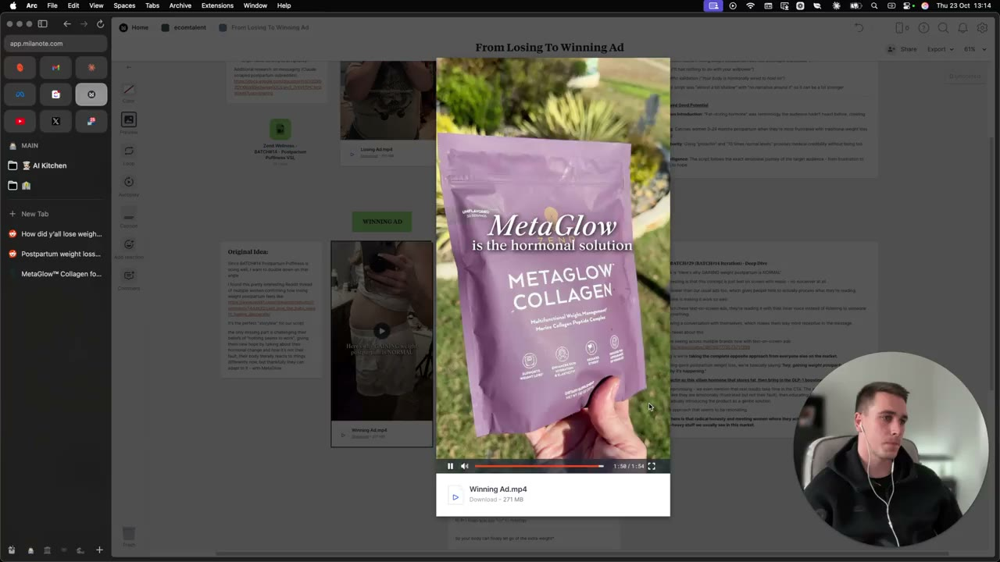
*End card of the winning ad (player timer 1:50 of 1:54): "MetaGlow is the hormonal solution" over a hand-held product shot. Shows the ad runs ~1:54. [40:40]*

## How to apply
- [ ] Pick one ad with spend and decent soft metrics that faded. Write its script next to its video.
- [ ] Fill a learnings card: winning hook, why it worked, what was shallow, avatar's psychological state.
- [ ] Check three failure points the lesson found: product introduced before the problem is believed; mechanism missing or thin; no narrative.
- [ ] Write your own diagnosis and instruction paragraph (what to keep, what to add, format) before opening the AI.
- [ ] Run the script prompt in a brand project that contains research, awareness/desire docs and a *Breakthrough Advertising* summary.
- [ ] Order Reddit research first; request source links; read 5 to 15 threads and note customer phrases.
- [ ] Move the draft into a doc; read it line by line as the customer; send targeted fixes; finish by hand.
- [ ] Run Hemingway: grade 6 or lower.
- [ ] If your category's promises are all "fast results", draft one honest, educational variant and test it against a hype hook.
- [ ] Never reuse the MetaGlow claims. Source or bracket every health/mechanism claim for your own product.

## Related
- Previous: [129. Action Item: Review Your Ads](129-action-item-review-your-ads.md) · Next: [131. How To Do Iterations & Variations (Live Example)](131-how-to-do-iterations-variations-live-example.md)
- Same loop at the account level: [122](122-how-to-do-learnings-part-1-losers.md), [124](124-how-to-do-learnings-part-3-losers.md) (losers); [123](123-how-to-do-learnings-part-2-winning-ads.md), [125](125-how-to-do-learnings-part-4-winning-ads.md), [127](127-how-to-do-learnings-part-5-winning-ads.md) (winners); [126. Pull frameworks from ads](126-how-to-pull-frameworks-from-ads.md).
- Evolve Copywriting: [Iteration playbook](../../copywriting/frameworks/iteration-playbook.md) · [10-step iteration learnings](../../copywriting/frameworks/ten-step-iteration-learnings.md) · [48. How to iterate on losing ads](../../copywriting/lessons/48-how-to-iterate-on-losing-ads.md) · [AI in copywriting](../../copywriting/concepts/ai-in-copywriting.md) · [Bridges](../../copywriting/concepts/bridges.md) · [Compression and plain language](../../copywriting/concepts/compression-and-plain-language.md)
- [007. Evolve Master Prompt Doc](007-evolve-master-prompt-doc.md) (index of the prompts, including the video-script prompt) · [Iteration vs variation](../../../../concepts/iteration-vs-variation.md) · [Test and iterate playbook](../../../../playbooks/test-and-iterate.md)

## Sources and limitations
- Transcript: [130. How To Rewrite Losing Ads Into Winners….txt](<../../../../../raw/evolve/start-here/_transcripts/👣 Evolve (Start Here)/130. How To Rewrite Losing Ads Into Winners 👣 Evolve (Start Here) Evolve.txt>) · Page text: [….html.md](<../../../../../raw/evolve/start-here/_extracted/👣 Evolve (Start Here)/130. How To Rewrite Losing Ads Into Winners_👣 Evolve (Start Here)_Evolve.html.md>) · Attachment: [….docx.md](<../../../../../raw/evolve/start-here/_extracted/👣 Evolve (Start Here)/130. How To Rewrite Losing Ads Into Winners.docx.md>) · Linked doc: [130-document-1Zfc9_Gu2H.docx.md](../../../../../raw/evolve/start-here/_extracted/_linked/google/130-document-1Zfc9_Gu2H.docx.md)
- Machine transcription (Whisper large-v3-turbo). Coverage is complete (last segment 55:31 of 55:32). Silence between 38:33 and 40:46 is the winning ad playing (no audio captured as speech).
- Whisper mishearings fixed using screen text: "Dicomera / Diaglomera / DiGlomera" = Dyglomera®; "Cloud" = Claude; "Millennial" = Milanote (board in the frames); "Hemingway" is correct; "Kat" is the creative strategist's name as spoken (surname unverified). "Zend Wellness" is the board's name for the client; the video says "MetaGlow".
- Whisper wrote the product-mention timing as "minute and nine minute and 20 seconds"; read as about 1:09–1:20 (unverified against the video).
- The attached/linked document is the call-report prompt only. The 27-page video-script prompt, the Reddit research doc and the creative strategist's research doc are not included in the course files; only the visible start of the script prompt is quoted above.
- No spend, ROAS, hook-rate or hold-rate numbers for either ad are shown; "15% hold rates" refers to earlier text-on-screen ads and is an instructor claim. The "56% in clinical studies", "only marine collagen" and trademark statements are the brand's claims, not verified here.
- Frame text for the winning ad's "Original Idea" card and the editor brief comes from low-resolution frames; wording is read as legibly as possible.
