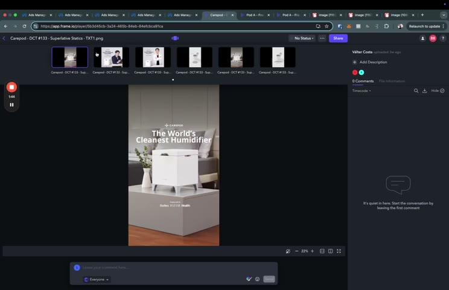
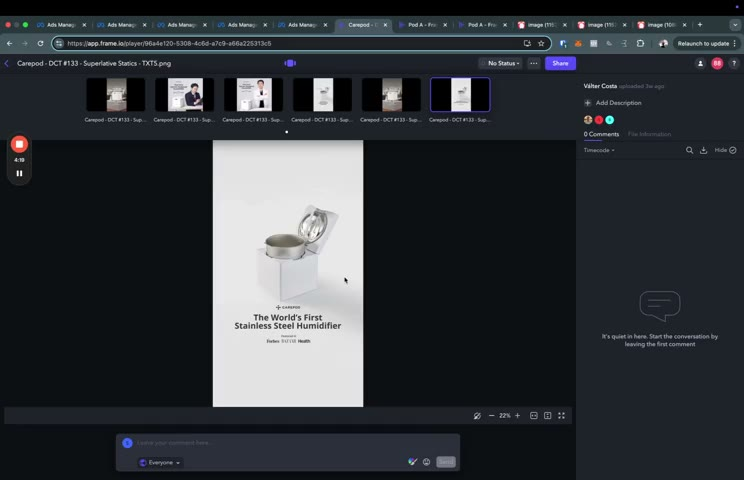
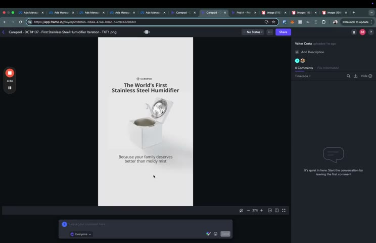
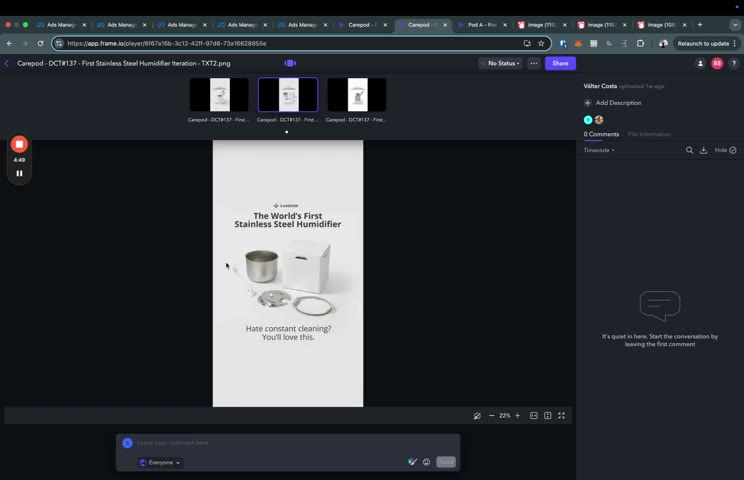
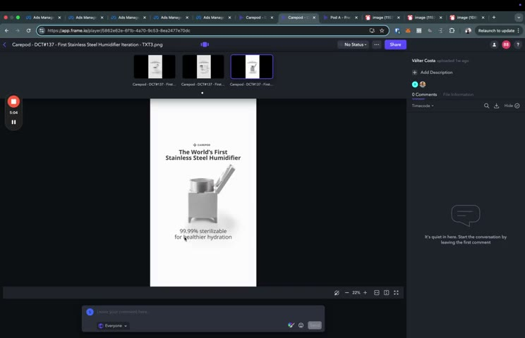
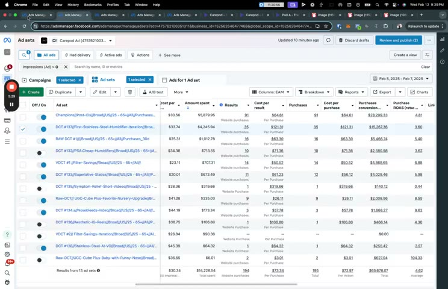
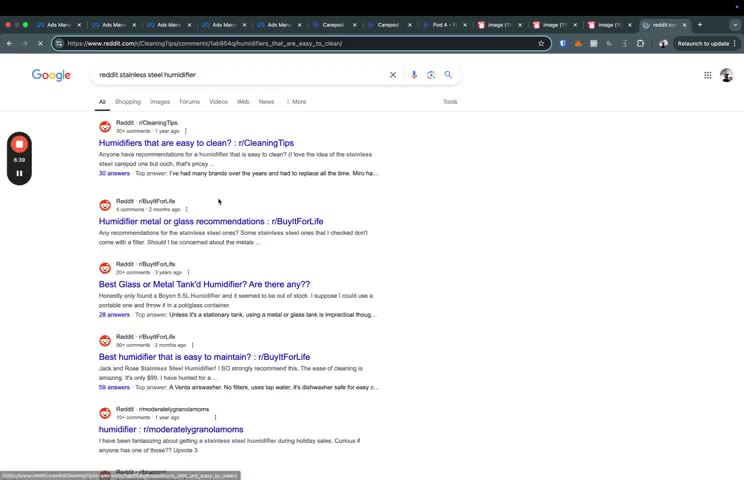
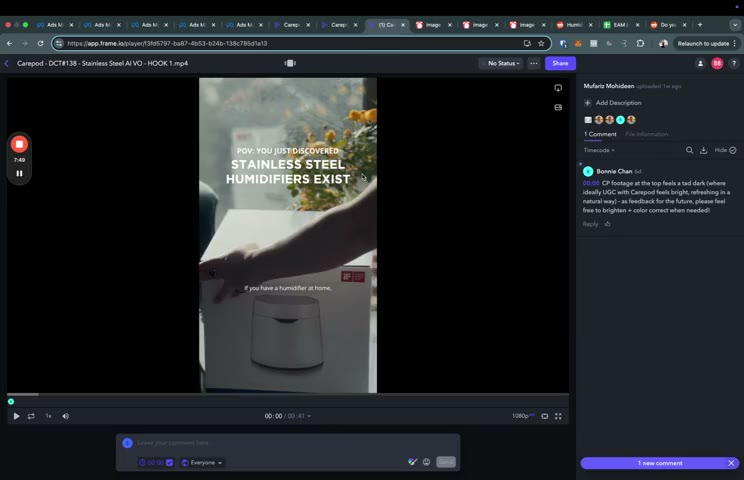
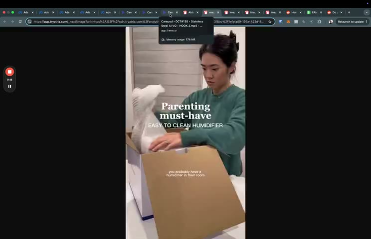
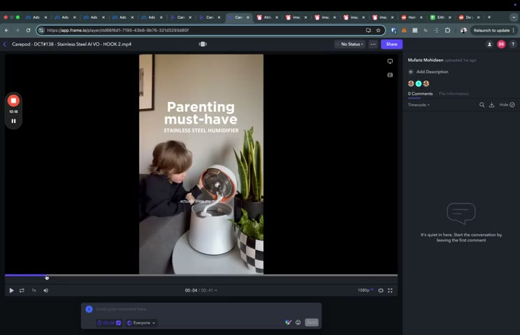

# 131. How To Do Iterations & Variations (Live Example)
> A live walk through three rounds on one concept (superlative statics → stainless-steel statics → AI-voiceover video): spot which concept the algorithm spends on, research why, then iterate in the direction the research points until a variation takes the account from about $4.5K/day to $10K+/day.

## 🤖 Agent use
- **Use when:** a concept in an existing test got spend but only mediocre ROAS, and you must decide whether to drop it, iterate it or vary it; planning the second and third rounds after a "big swing" batch.
- **Inputs → outputs:** ad-set table (spend, ROAS by concept), the creative of the top-spending ad, research on why that element draws spend (Reddit, reviews) and any older UGC winner → a ranked list of iterations (which element changes), new ad sets named by DCT number, and a reading of the spend ramp.
- **Rules:**
  - **DO** let spend pick the concept to iterate. The stainless-steel static was "the one that we didn't even think would get any spend" and got the most. [03:26–04:10]
  - **DON'T** kill a concept because of one ROAS number (about 1.9 here) or because you dislike the angle. "That's where you can make the mistake of not going deeper." [04:10]
  - **IF** a concept spends but the ROAS is soft **THEN** ask "could we make this ad better?" and change the creative direction, not just the words. [04:10–05:23]
  - **DO** make the image and the text agree (congruence): each static's headline matched its visual. [01:40]
  - **DO** keep researching while a concept spends: "the research process never stops". Search Reddit for the winning element (here "stainless steel humidifier"). [06:07–07:40]
  - **DO** port small elements from an older winner into the new creative (the "Parenting must-have" overlay from a year-old UGC winner). [08:31–09:24]
  - **DO** write voiceovers as relatable and a bit skeptical, not as brand claims. "Someone finally made one out of stainless steel" beats "this humidifier is the best". [10:17–10:55]
  - **DO** keep iterating while you still have ideas to make the ad better; if a test says the idea did not help, "reset your lens". [11:30–12:14]
  - **DON'T** use "this image works, let me use it with another headline" as your iteration logic. Understand why it works. [13:41]
  - **DO** change the one thing you believe improves it: in round 2 only the imagery changed. [14:21]
  - **DON'T** expect a minimum budget or a slow ramp: DCT #138 went $64 → $100 → ~$5.7K on days 1, 2, 3. [12:14–13:41]
- **See also:** [133. Winning Humidifier Ad - Learnings (Shaun)](133-winning-humidifier-ad-learnings-shaun.md) · [094. How To Set Up A 3-2-2 Campaign](094-how-to-set-up-a-3-2-2-campaign.md) · [100. How To See Ads Performance + Our Columns](100-how-to-see-ads-performance-our-columns.md) · [Iteration vs variation](../../../../concepts/iteration-vs-variation.md) · [Copywriting 49. How to iterate on KPI winners](../../copywriting/lessons/49-how-to-iterate-on-kpi-winners.md) · [Copywriting 50. How to iterate on spend winners](../../copywriting/lessons/50-how-to-iterate-on-spend-winners.md)

Lesson page text: none ("no lesson text on page"). The transcript says the recording was made to answer questions and would be added to the Skool module. [15:53]

## Key ideas

### Setup: "congruent ads" and bigger swings [00:00–02:31]
- The video is a "visual example of how we're implementing our new strategy of congruent ads" and processing learnings by "taking bigger swings and then progress on those" to scale past $10,000/day at "around 2.4" (Whisper cut-off; ROAS read from the frames, which show 2.45 on the day). [00:00]
- Concept: **"superlative statics"**: "we're making claims". If you are not a product innovator, "you can be an avatar innovator": the same pattern can drive an avatar test. [00:59]
- Round 1 uses the pairing rule: the headline and the visual say the same thing. [01:40]

### Round 1: six superlative statics (DCT #133) [01:40–04:10]
- Statics (instructor's list): "the world's cleanest humidifier"; "the first doctor designed humidifier" (two variations); "the world's easiest to clean humidifier"; "the world's most hygienic humidifier"; "the world's first stainless steel humidifier". [01:40]
- Intended grouping: two ads on the clean angle, two on doctor-designed, one on stainless steel ("let's just throw this in here"). The list has six items, so the spoken counts do not add up; take the six-item list as the batch. [01:40–02:31; frame 01:05 shows six thumbnails]
- It "might take you multiple batches of ads to find a winning ad". Following the 3-2-2 method with six ideas, they ended up with "two different DCTs": the "clean" ads grouped together (from their research the clean angle did well) and "doctor designed" + "stainless steel" grouped together. [02:31–03:26]
- Result: the batch became "one of our actual top spenders", and the **stainless steel static got the most spend** at "about a 1.9X return on ad spend". [03:26–04:10] The Ads Manager frame for Jan 23–27 shows DCT #133 "Superlative-Statics" at about $7.5K spend and ROAS 1.95, against "Champions" at about 2.7 (low-res frame, read approximately). [frame 03:30]


*DCT #133 (frame.io review): one of six superlative statics. Headline "The World's Cleanest Humidifier" with a product-in-bedroom visual. [01:05]*


*The round-1 stainless-steel static (TXT5): the product emerging from its box; no benefit copy. The one nobody expected to spend. [04:20]*


*Ad-set table: DCT #133 Superlative-Statics selected, Champions on top, DCT #131 Mini-Static-Iteration below. Low resolution: figures read as ~$7.5K spend, ROAS ~1.95 for #133. [03:30]*

### Round 2: iterate the statics toward "why stainless steel matters" (DCT #137) [04:10–05:23]
- Diagnosis: round 1's stainless-steel claim was just a claim that "doesn't really do anything". Question asked: "could we make this ad better? And the answer was yes." [04:10]
- New direction: "something that is more driven": tie stainless steel to a reason. Three versions, three different images and lines: [04:10–04:50; frames 04:35–05:05]
  1. "Because your family deserves better than moldy mist."
  2. "Hate constant cleaning? You'll love this." (the parts shown taken apart, "a very simple, easy to put together few-part model")
  3. "99.99% sterilizable for healthier hydration".
- On the frames, the main headline stays "The World's First Stainless Steel Humidifier" on all three; the image and the sub-line change. The instructor says later that the headline stayed across the set and only the imagery changed. [frames 04:35–05:05; 14:21]
- Result after launching it ("DCT 137"): "another top spender" within two days (round 1 had taken about four days to show). The concept (stock issues noted) was at about $5K/day, "by basically the sixth or seventh we were spending about $6K", and the new ad was crushing. [05:23]
- Frame for Feb 5–7 shows DCT #137 "First-Stainless-Steel-Humidifier-Iteration" with about $4.2K spend and ROAS about 3.6, versus Champions about $5.9K at about 4.8 (low-res frame, approximate). [frame 05:30]


*DCT #137 TXT1: same headline, benefit line "Because your family deserves better than moldy mist". [04:35]*


*DCT #137 TXT2: the product disassembled to show the few parts; line "Hate constant cleaning? You'll love this." [04:52]*


*DCT #137 TXT3: "99.99% sterilizable for healthier hydration". [05:05]*


*DCT #137 selected: the iteration became a top spender. Figures approximate (low resolution). [05:30]*

### Round 3: research, then a video (DCT #138) [05:23–10:17]
- As soon as round 2 worked, they did not stop at the iteration: "we went and did more research". [06:07]
- **Research step:** Reddit search "stainless steel humidifier". A thread in a clean-air community (about 15K members; Whisper heard "our air quality") posted a year earlier says heating plastic "will release microplastics and smell terrible" and "there's no high end, full metal steam humidifier on the market". Reading: "a lot of people just didn't realize that there actually is something other than plastic"; "most people don't even consider getting a humidifier because of the harmful plastics". That became the video concept: **discovery that stainless steel humidifiers exist**. [06:07–07:40]
- **Three hooks were tested** and the instructor invites the audience to guess the winner: (1) on-screen "POV: you just discovered stainless steel humidifiers exist" while unboxing; (2) on-screen "Parenting must-have STAINLESS STEEL HUMIDIFIER"; (3) a third not captured. All three share the spoken opener "If you have a humidifier at home, let me show you something that actually blew my mind." [07:40–08:31; frames 07:50, 08:30, 10:20]
- **The winner** is revealed as "this one here" (the transcript does not say which number). Because he immediately points to the "parenting must have easy to clean humidifier" overlay from a UGC creator ad "that has been one of our top performing ads… for almost close to a year", and says "we noticed that this specifically had been working so we decided to implement it onto this video", the winner is most likely hook 2 (derived). [08:31–09:24]
- The team (not a creator) built the ad: "our team piecing UGC videos together and doing AI voiceovers". The voiceover is entirely AI. [14:21; 10:17]


*Google results used for research: Reddit threads on easy-to-clean, stainless steel and non-plastic humidifiers. [06:40]*


*DCT #138 hook 1 in the review tool: on-screen "POV: You just discovered stainless steel humidifiers exist", spoken "If you have a humidifier at home". [07:50]*


*The year-old creator UGC winner (opened from Atria): overlay "Parenting must-have / EASY TO CLEAN HUMIDIFIER". The new video borrows the overlay idea. [09:20]*


*DCT #138 hook 2: "Parenting must-have / STAINLESS STEEL HUMIDIFIER" with a child using the product; probable winner (derived). [10:20]*

### Why the voiceover works [10:17–11:30]
- Skeptical, relatable narrator: "at first I was like, okay, but why though?" then "I realized you can sterilize the full thing". [10:17]
- Brand-neutral framing: "someone decided to make one out of stainless steel" instead of "we have the best thing". "The way that this is framed it's just so chill." [10:55]
- Naive phrasing ("like actual stainless steel") makes the speaker more relatable. [10:55]
- Hook curiosity: you "keep watching" to hear where it goes. [10:17]

### Iteration discipline and ramp numbers [11:30–15:53]
- Even a winning ad gets another iteration if you still have ideas: next, a video that opens "did you guys know there are humidifiers that aren't plastic… I decided to try it; it's a little bit expensive but I literally never have to worry about cleaning it"; also a variation with "the world's first stainless steel humidifier" in the video. [11:30; 14:21]
- On how many iterations: "if you still have ideas of how to make the video better" and "if you test it and it does not make it better, you need to reset your lens… check yourself". [11:30–12:14]
- **DCT #138 ramp:** first day with spend about $64 (7th), the 8th about $100 and three purchases ("no minimum budget"), the 9th about $5,000; the whole account almost $10K on Sunday the 9th at about 2.4 overall; "yesterday" $5.7K on #138 and almost $3K on another, $10.2K total; "today" about $10.7–10.8K. [12:14–13:41]
- Account trajectory: "about 4.5K a day… doubled the ad spend over the last basically two weeks". [15:16]
- Summary of the sequence: concept spent → iteration (statics) → top spender → more research → video variation → "absolutely took off". They moved from big swings to medium swings. [13:41–14:21]


*Feb 9, 2025: DCT #138 about $5.7K spend at ROAS about 2.4; account total about $9.9K at about 2.9 (low-res frame, approximate). [13:20]*


*"Yesterday" view: #138 about $5.7K, Champions about $3.0K, total about $10.3K at ROAS about 2.45. Matches the figures he quotes at [13:20]. [00:30]*

## Steps / framework

**Spend-led iteration ladder (as practised)**
| Round | Move | Variable that changed | Result |
|---|---|---|---|
| 1 | Big swing: six "superlative" statics, image = headline | Claim/angle (clean, doctor, stainless steel) | Stainless steel static got the most spend at ~1.9 ROAS [03:26–04:10] |
| 2 | Iterate the spender: turn claim into reason | Image + benefit line (headline fixed) | DCT #137: new top spender within ~2 days [05:23] |
| 3 | Research (Reddit) → video concept "discovery" + borrowed overlay from an old winner | Format (video, AI VO), hook text | DCT #138: $64 → $100 → ~$5.7K, account to $10K+/day [12:14–13:41] |
| 4 | Next (planned) | "Did you know non-plastic humidifiers exist"; "world's first" in video | Not yet run [11:30; 14:21] |

## Examples
- **Stainless steel humidifier (Carepod, per frame labels):** the round-1 → round-3 sequence above; spoken script of the winning video is in the templates section below.
- **Reference winner:** the year-old creator video "Parenting must-have / easy to clean humidifier": an overlay line reused in the new video. [08:31–09:24]
- **Rule example, "why" before "what":** "Actually understand and be curious of why it works. Okay, well, stainless steel, but how can I learn more about that?" [13:41]

## Structured units

### Rewrites (before → after)
| Before | After | What changed (verb / visual / promise / self / intensity) | Source |
|---|---|---|---|
| Static: product emerging from a box, "The World's First Stainless Steel Humidifier" (claim only) | Static: same headline + "Because your family deserves better than moldy mist" / "Hate constant cleaning? You'll love this." (parts laid out) / "99.99% sterilizable for healthier hydration" | Claim → reason: each version ties stainless steel to one consumer concern (health, effort, hygiene); visuals show the parts | [04:10–05:05; frames] |
| Static (round 2 winner) | Video with AI voiceover: "If you have a humidifier at home, let me show you something that actually blew my mind…" | Format: static → video; claim → discovery story; added the "Parenting must-have" overlay from an old UGC winner | [08:31–09:24] |
| "World's first stainless steel humidifier" (brand-voice claim) | "Well, someone finally made one out of stainless steel, like actual stainless steel." | Voice: brand claim → skeptical, naive peer | [10:17–10:55] |

### Hooks
| Hook (verbatim or near) | Heuristic(s) | Emotion / zone | Self targeted | Why it works | Source |
|---|---|---|---|---|---|
| POV: you just discovered stainless steel humidifiers exist | Curiosity / discovery (derived) | — | — | Based on Reddit finding that people don't know non-plastic humidifiers exist | [07:40; 06:53] |
| Parenting must-have: stainless steel humidifier | Social-proof-style overlay (derived) | — | Ideal self as parent (derived) | Overlay lifted from a UGC winner that ran about a year | [08:31–09:24] |
| "If you have a humidifier at home, let me show you something that actually blew my mind" | Curiosity gap (derived) | Curiosity | — | Spoken opener for all three hooks; continues "You know when your humidifier starts getting all gross…" | [07:40; 09:24] |

### Angles
| Angle | Core desire / pain | Heuristic(s) | Best format | Example line | Source |
|---|---|---|---|---|---|
| Stainless steel instead of plastic | Clean, mold-free air for baby; no filters; no microplastics | Novelty / discovery | AI-VO UGC-style video | "someone finally made one out of stainless steel" | [06:53–07:40; 09:24] |
| Superlatives ("world's cleanest", "first doctor designed", "most hygienic") | Trust in a clean product | Claim congruence | Static | "The World's Cleanest Humidifier" | [01:40] |

### Templates
| Template | Use for | Example fill | Source |
|---|---|---|---|
| "[Because your family deserves better than <problem>]" / "[Hate <chore>? You'll love this.]" / "[<number>% <proof> for <outcome>]" | Benefit lines under a fixed headline | "Because your family deserves better than moldy mist" | [04:35–05:05] |
| Discovery video: opener → "You know when <annoyance>?" → "Well, someone finally made one…" → "At first I was like, but why though?" → reveal → proof of use → personal use case → regret line | AI-VO UGC-style script | Script below | [09:24] |

### Rules of thumb
- **DO** read spend before ROAS when deciding what to iterate. [03:26]
- **IF** you have more than three ideas under one angle **THEN** split them into two ad sets by theme (clean vs. doctor + stainless). [02:31–03:26]
- **DON'T** judge a variation by one metric on day one: the winning video made three purchases on day 2 and $5K on day 3. [12:53]

## Prompts / templates (verbatim)

### Winning video voiceover (AI voice) [09:24–10:17]
```text
If you have a humidifier at home, let me show you something that actually blew my mind.
You know when your humidifier starts getting all gross and you can't really clean it properly?
Well, someone finally made one out of stainless steel, like actual stainless steel.
At first I was like, okay, but why though?
Then I realized you can literally sterilize the whole thing, like fully clean it.
See how it just comes apart? No weird corners or spots you can't reach.
The craziest part is this was invented by a doctor who got tired of throwing away moldy humidifiers.
And look, this is after using it for a month. Still completely clean.
No more filters to buy either.
And this is perfect for my baby girl's nursery.
I honestly wish someone told me about this sooner.
```
The reviewed frames also carry a team comment on the first hook cut: the footage at the top "feels a tad dark (where ideally UGC with Carepod feels bright, refreshing in a natural way)", asking for brightening and colour correction in future edits. [frame 07:50]

### Planned next video concept [11:30]
"Did you guys know that there's also humidifiers that aren't plastic. Like this person decided to make one of stainless steel and I decided to try it. It's a little bit expensive, but oh my gosh, like I literally never have to worry about cleaning it."

## Screenshots
Embedded inline above (13 frames).

## How to apply
- [ ] Group your top-spending ad sets by concept, not by ROAS alone; list the spend and ROAS of the single top ad.
- [ ] For the top spender, write what you think is drawing spend (claim, visual, benefit). Ask "could this be better?"
- [ ] Search Reddit (and reviews) for the exact element ("stainless steel humidifier") and read threads for what people do not know or fear.
- [ ] Write three versions of the next static: same headline, three reasons/visuals.
- [ ] Turn the research gap into a discovery-style video hook; borrow a proven overlay from an older winner in the account.
- [ ] Name each new ad set with the DCT number and concept (see [94](094-how-to-set-up-a-3-2-2-campaign.md)); check day 1–3 spend ramp.
- [ ] After a win, list at least one more iteration idea; stop when you have no idea that you believe improves it.

## Related
- Previous: [130. How To Rewrite Losing Ads Into Winners](130-how-to-rewrite-losing-ads-into-winners.md) · Next: [132. Action Item: Create Some Variations](132-action-item-create-some-variations.md)
- Same product from other angles: [133. Winning Humidifier Ad](133-winning-humidifier-ad-learnings-shaun.md) · [013. Practicing the Core 3 (Carepod example)](013-action-item-practicing-the-core-3.md) · [006. 13 winning static ad templates](006-13-winning-static-ad-templates.md)
- Account view of the same ad sets a week later: [094. 3-2-2 campaign](094-how-to-set-up-a-3-2-2-campaign.md) (week Feb 6–12, DCT #138 $22,940.78 at 2.68 ROAS).
- [Hero image copy congruence](../../../../concepts/hero-image-copy-congruence.md) · [Creative testing system](../../../../frameworks/creative-testing-system.md) · [Copywriting: iteration playbook](../../copywriting/frameworks/iteration-playbook.md)

## Sources and limitations
- Transcript: [131. How To Do Iterations & Variations….txt](<../../../../../raw/evolve/start-here/_transcripts/👣 Evolve (Start Here)/131. How To Do Iterations & Variations (Live Example) 👣 Evolve (Start Here) Evolve.txt>) · Page text: [….html.md](<../../../../../raw/evolve/start-here/_extracted/👣 Evolve (Start Here)/131. How To Do Iterations & Variations (Live Example)_👣 Evolve (Start Here)_Evolve.html.md>) (empty).
- Machine transcription (Whisper large-v3-turbo). Full recording covered (last segment 16:03 of 16:04).
- Whisper wrote "$2.4" cut-off in the first sentence; ROAS is inferred. "DCT" is the course's term for the test ad sets (named "DCT #n" in Ads Manager); the transcript calls them "DCTs".
- The ad-account screens are low resolution (744 px wide); numbers quoted from them are approximate. The ad account ID visible in the tabs is deliberately not reproduced.
- The winning hook is not identified by number in the audio; "probably hook 2" is derived from his follow-on comment. The third hook text was not captured.
- The headline vs. image statements conflict slightly: at [04:10–04:50] he says "three different headlines", at [14:21] "we kept the headline all the way across"; the frames show the main headline fixed and the sub-line changing.
- Counts of round-1 statics are inconsistent in the audio ("two ads … clean, two … doctor, one … stainless steel" versus six listed); frames show six thumbnails.
