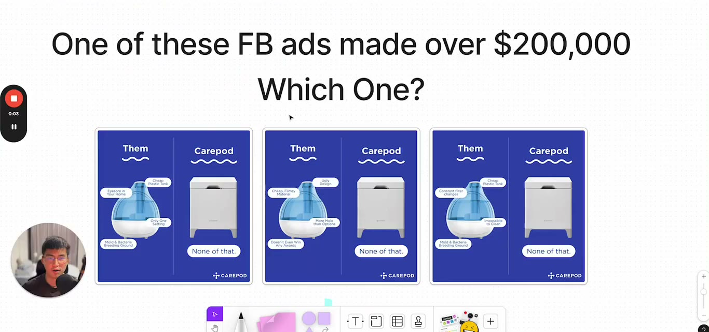
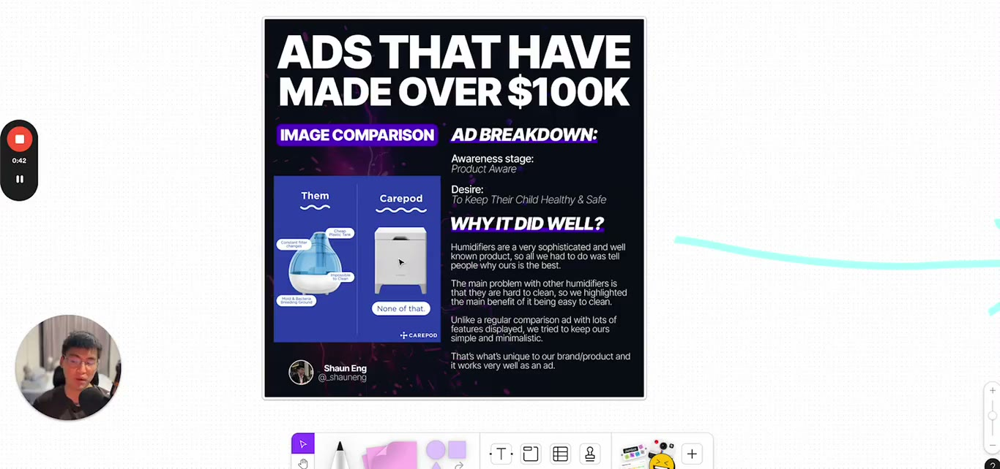
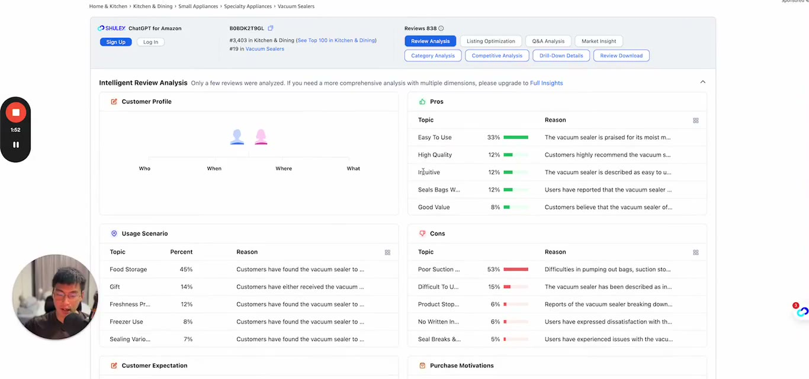
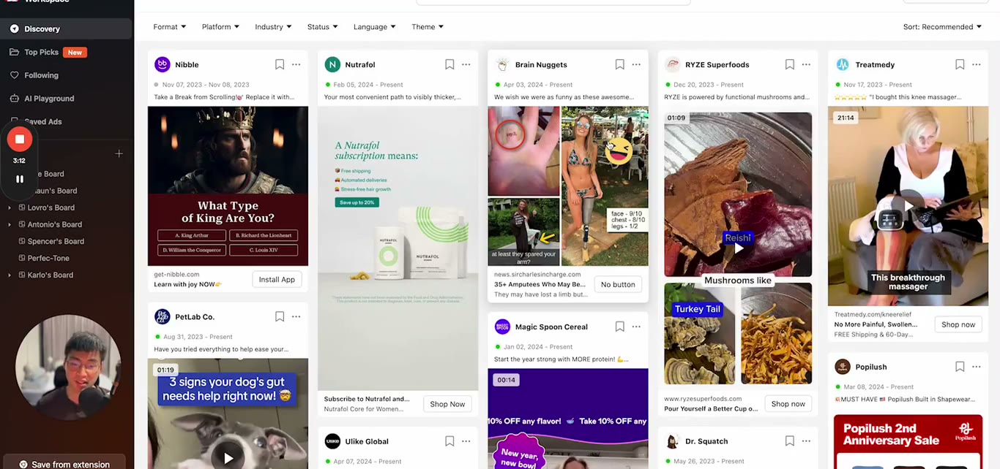
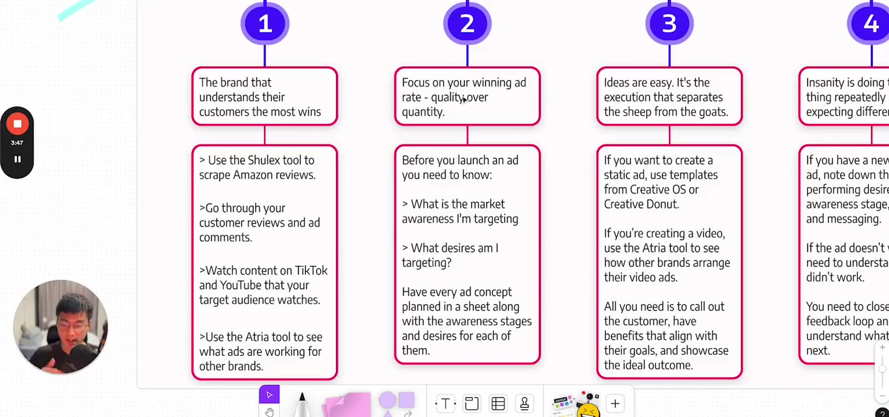
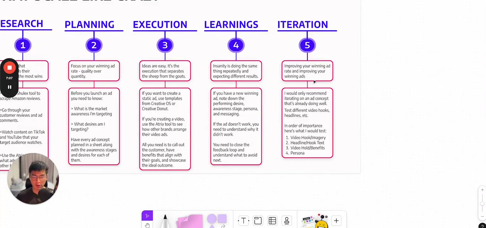
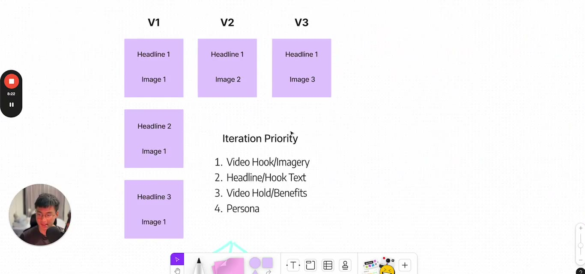

# 133. Winning Humidifier Ad - Learnings (Shaun)
> Shaun walks through the five-step process (research, planning, execution, learnings, iteration) behind a "Them vs Carepod" comparison static that made over $200,000 (instructor claim), and shows that the only difference between three near-identical ads was one line of benefit text.

## 🤖 Agent use
- **Use when:** building a comparison (us vs them) static for a product-aware market; mining Amazon reviews and comments for the benefit text; planning how many variations to test and in what order.
- **Inputs → outputs:** a product-aware category, Amazon reviews, ad comments, TikTok/YouTube comments, competitor ads → a planning-sheet row (concept, awareness stage, desire, why it should win), a comparison static with benefit callouts, and three variations queued by priority.
- **Rules:**
  - **DO** pick the benefit text from the customer's own complaints (reviews, comments). The winner used "constant filter changes / impossible to clean / mold and bacteria breeding ground" because "that's what people actually want". [00:00–00:51; 02:42]
  - **DO** use a comparison ad when the market is product aware: "you just need to tell them why yours is superior to the rest." [00:00–00:51]
  - **DON'T** copy the style of other brands' ads: "the marketing behind it matters more than how you show it." [05:29]
  - **DO** use cons and pros from review analysis as ad ammunition: cons → "ours is better at X"; pros → "talk more about how easy it is". [01:48–02:42]
  - **DON'T** spam test (20 creatives a day). Spend the same time on thinking and research and track your win rate. [03:40; 06:25]
  - **DO** plan every concept in a sheet with the awareness stage, desire and why you expect it to win, before building it. [03:40–05:29]
  - **DO** record why each ad did or did not work, with the desire, so you do not retest the same angle. [05:29–06:25]
  - **DO** iterate only on a concept that already works, and test three variations of it. [07:24–09:17]
  - **IF** testing variations **THEN** change in this order: hook/imagery, headline/hook text, hold/benefits, persona. [08:21; frame 08:20]
- **See also:** [013. Action Item: Practicing the Core 3](013-action-item-practicing-the-core-3.md) (same ad analysed for awareness/sophistication) · [006. 13 winning static ad templates](006-13-winning-static-ad-templates.md) · [131. Iterations & Variations (Live Example)](131-how-to-do-iterations-variations-live-example.md) · [041. Creative research part 1 (Atria)](041-creative-research-part-1-atria.md) · [028. Amazon research part 1](028-amazon-research-part-1.md) · [Copywriting: comparisons](../../copywriting/concepts/comparisons.md)

Lesson page text: none ("no lesson text on page").

## Key ideas

### The quiz: one line of text made the difference [00:00–00:51]
- Three Carepod statics, same layout ("Them" vs "Carepod", product photos, "None of that."), differ only in the benefit text on the competitor side. One "has made over 200,000" (instructor claim; ad spend or revenue not specified). [00:00]
- The winner is the one with **"constant filter changes"** (the other two mention "cheap flimsy material" and "eyesore", Whisper heard "ISO and Yaru"). "Which one do people care about the most? Constant filter changes." [00:00]
- Context: a comparison ad "works very well if you are targeting a more product-aware market" (people already know the product, e.g. hair dryers, mouse, keyboard); you only have to say why yours is better. [00:00–00:51]


*The quiz slide "One of these FB ads made over $200,000. Which One?". Left to right: variant A, variant B, variant C (the winner, "Constant filter changes"). [00:03]*


*Shaun's own breakdown slide "Ads that have made over $100K": awareness stage, desire and why it did well (full text under Prompts / templates). [00:40]*

### Step 1: Research, "the brand that understands their customers the most wins" [00:51–03:40]
- Carepod "was stuck at 200k per month for 6 months straight" and only started scaling once the image comparison ad ran (instructor claim). During those six months they "tested a bunch of different UGC but nothing really converted… we didn't understand our customer well enough." [00:51]
- "It's not about the cool-looking UGC you see from other brands or copying what other brands are doing well… You need to figure out what's unique to your brand, to your customers." [00:51]
- **Tool 1: Shulex** (an Amazon-review analyser): paste the product, open "review analysis", read Pros, Cons, Usage scenario, Customer expectation. Example: a cons row "poor suction" → "talk about how your product has better suction"; a pros row "easy to use" → "talk more about how easy it is to use. Even a grandma can use it". [01:48]
- **Tool 2: comments** on reviews, your ads, and TikTok/YouTube content your audience watches. Example: a TikTok "three reasons to not get a humidifier"; comments say "mold and mildew", "skin looks better" ⇒ both are angles. [01:48–02:42]
- The winning ad's callouts line up with those complaints: "Constant filter changes, impossible to clean, mold and bacteria breeding ground." [02:42]
- **Tool 3: Atria** (ad library; "similar to another tool called 4Play", Whisper; likely Foreplay): see what ads other top brands run. "Take inspiration. Do not copy. Create similar ads." [02:42–03:40]


*Shulex "Intelligent Review Analysis" on an Amazon listing: Customer Profile, Pros, Usage Scenario, Cons (with percentages), Customer Expectation, Purchase Motivations. Example shown on a vacuum sealer; he uses it to find cons to flip into claims. [01:52]*


*Atria Discovery with shared boards: used to see which ads other brands run. [03:10]*

### Step 2: Planning, "focus on your winning ad rate" [03:40–05:29]
- "Less is more": "better creatives instead of having more creatives." Spam testing "maybe 20 creatives a day" is not the way. [03:40]
- Reason: every winning ad can "increase your spend by 50% at KPI. Maybe even double it", so "reading ads matters more than just getting a bunch of ads that might do well at smaller spend. You want it to be able to scale." [03:40]
- Before launch know: **which market awareness** you target and **which desire**. For this ad: humidifier = product aware ("people know about it already", no education needed); desire = "to keep their child healthy and safe", which is why "mold and bacteria breeding ground" lands. [03:40–04:31]
- Put each concept **in a sheet**, including "why you think it's going to do well": writing it out may expose bad ideas and "help you increase your winning ad rates". [04:31–05:29]

### Step 3: Execution [04:31–05:29]
- "Ideas are easy. It's the execution that separates the sheep from the goats." [04:31]
- Static: use templates from **CreativeOS or Creative Donut** (Figma templates "that worked well for other brands"); change text and image. Video: use Atria (Whisper heard "HR tool") to see how other brands structure videos. [04:31]
- The execution recipe: "call out the customer, have benefits that align with their goals and showcase the ideal outcome." [05:29]

### Step 4: Learnings [05:29–06:25]
- Many people "have been testing the same angle over and over again" because they do not track. Keep a spreadsheet of every ad: why you think it did or did not do well, plus the market desires. [05:29]
- "If you close this feedback loop, you can understand what to avoid next and you're going to save a lot more money and time." [06:25]

### Step 5: Iteration [06:25–09:17]
- Recap of why this ad worked: product aware; telling people why yours is best; desire = child's health and safety; found by customer research; main problem = humidifiers are hard to clean, so it shows how easy Carepod is to clean. [06:25–07:24]
- Layout learning: "the traditional way of doing it, left and right, having your actual features there. I haven't seen those do that well." Their version shows problems only, "none of that", very simple and minimalistic "which keeps in line with what the brand looks like". [07:24]
- **Test three variations per concept**: "sometimes it's just your headline that sucks. It could have been a winning ad." [07:24–08:21]
- **What to vary, in this order** (screen shows the same list): [08:21–09:17; frame 08:20]
  1. Video hook / imagery: video = first 3 seconds; image = the imagery.
  2. Headline / hook text: image headline, or the text that appears in the first 3 seconds of a video.
  3. Video hold / benefits: image benefits; video "hold" = the rest of the video after the hook.
  4. Persona: a different person (his example: swap the model's ethnicity).


*The first three columns of the five-step board (columns 1–3 with their instructions). Full text under Prompts / templates. [03:45]*


*All five columns: 1 Research, 2 Planning, 3 Execution, 4 Learnings, 5 Iteration. [07:05]*


*Variation grid (V1/V2/V3 = Headline 1 with Images 1, 2, 3; plus Headline 2 and Headline 3 with Image 1) and the "Iteration Priority" list. Change one thing per variation. [08:20]*

## Steps / framework

| # | Step | Core line (on the board) | What to do |
|---|---|---|---|
| 1 | Research | "The brand that understands their customers the most wins" | Scrape Amazon reviews with Shulex; read reviews and ad comments; watch TikTok/YouTube content of your audience; check Atria for ads that work for other brands |
| 2 | Planning | "Focus on your winning ad rate - quality over quantity" | Before launch, know awareness stage and desire; plan every concept in a sheet with its awareness and desire |
| 3 | Execution | "Ideas are easy. It's the execution that separates the sheep from the goats." | Static: CreativeOS or Creative Donut templates; video: Atria for structure; call out the customer, benefits that match goals, show the ideal outcome |
| 4 | Learnings | "Insanity is doing the same thing repeatedly and expecting different results." | Note desire, awareness stage, persona and messaging of each winner; explain why losers failed; close the feedback loop |
| 5 | Iteration | "Improving your winning ad rate and improving your winning ads" | Iterate only on concepts already doing well; test hooks, headlines etc. in priority order |

## Examples

### The three Carepod comparison statics (full callout text from the slide)
| Variant | Competitor-side callouts ("Them") | Carepod side | Outcome |
|---|---|---|---|
| A (left) | "Eyesore in Your Home", "Cheap Plastic Tank", "Only One Setting", "Mold & Bacteria Breeding Ground" | product shot + "None of that." | Did not win. Whisper's "ISO and Yaru" = "Eyesore" [00:00] |
| B (middle) | "Ugly Design", "Cheap, Flimsy Material", "More Mold than Options", "Doesn't Even Win Any Awards" | same | Did not win |
| C (right) | "Constant filter changes", "Cheap Plastic Tank", "Impossible to Clean", "Mold & Bacteria Breeding Ground" | same | Winner: "constant filter changes" (instructor claim: over $200,000) [00:00] |

(Which three are mapped to A/B/C is read from the slide order; the instructor identifies the winner by its text, "constant filter changes", and the breakdown slide shows variant C.)

## Structured units

### Ad teardowns
| Brand / product (niche) | Format | Hook / opening | What works | What fails | Fix suggested | Principle | Source |
|---|---|---|---|---|---|---|---|
| Carepod (humidifier) | Static, image comparison "Them" vs "Carepod", blue background | Four problem callouts on a generic blue humidifier; Carepod product with "None of that." | Product aware: "tell them why yours is superior"; callouts from real complaints (filters, cleaning, mold); minimal | Variants A/B (looks, flimsiness) are not the one he says made over $200K; no numbers shown for them | Choose callouts the customer cares about most | Comparison works in product-aware markets | [00:00–00:51; 06:25–07:24] |

### Rewrites (before → after)
| Before | After | What changed (verb / visual / promise / self / intensity) | Source |
|---|---|---|---|
| Callouts: "Eyesore in Your Home / Cheap Plastic Tank / Only One Setting / Mold & Bacteria Breeding Ground" | Callouts: "Constant filter changes / Cheap Plastic Tank / Impossible to Clean / Mold & Bacteria Breeding Ground" | Swapped aesthetic/feature complaints for the ownership pain (filters, cleaning) that the reviews and comments surfaced | [00:00; 02:42] |
| Callouts: "Ugly Design / Cheap, Flimsy Material / More Mold than Options / Doesn't Even Win Any Awards" | same winning set as above | Same | [00:00] |

### Templates
| Template | Use for | Example fill | Source |
|---|---|---|---|
| "Them" vs "[Brand]" two-column static: four problem callouts on the left product, one clean product on the right, "None of that." | Product-aware comparison | Carepod humidifier | [00:00; 07:24] |
| Planning-sheet row: concept · awareness stage · desire · why it will win · result · why | Tracking every ad | "Product aware · keep child healthy and safe · mold and bacteria breeding ground · …" | [03:40–06:25] |

### Rules of thumb
- **DO** test each concept with three variations before giving up on it. [07:24]
- **DON'T** judge the concept on a single weak headline or image. [08:21]
- **IF** the market is sophisticated and well-known (humidifiers) **THEN** do not educate; compare. [03:40; frame 00:40]

## Prompts / templates (verbatim)

### Ad-breakdown slide ("Ads that have made over $100K") [frame 00:40, 07:50]
```text
IMAGE COMPARISON
AD BREAKDOWN:
Awareness stage: Product Aware
Desire: To Keep Their Child Healthy & Safe
WHY IT DID WELL?
Humidifiers are a very sophisticated and well known product, so all we had to do was tell people why ours is the best.
The main problem with other humidifiers is that they are hard to clean, so we highlighted the main benefit of it being easy to clean.
Unlike a regular comparison ad with lots of features displayed, we tried to keep ours simple and minimalistic.
That's what's unique to our brand/product and it works very well as an ad.
```

### The five-step board (screen text) [frames 03:45–07:05]
```text
1 RESEARCH
The brand that understands their customers the most wins.
> Use the Shulex tool to scrape Amazon reviews.
> Go through your customer reviews and ad comments.
> Watch content on TikTok and YouTube that your target audience watches.
> Use the Atria tool to see what ads are working for other brands.

2 PLANNING
Focus on your winning ad rate - quality over quantity.
Before you launch an ad you need to know:
> What is the market awareness I'm targeting
> What desires am I targeting?
Have every ad concept planned in a sheet along with the awareness stages and desires for each of them.

3 EXECUTION
Ideas are easy. It's the execution that separates the sheep from the goats.
If you want to create a static ad, use templates from Creative OS or Creative Donut.
If you're creating a video, use the Atria tool to see how other brands arrange their video ads.
All you need is to call out the customer, have benefits that align with their goals, and showcase the ideal outcome.

4 LEARNINGS
Insanity is doing the same thing repeatedly and expecting different results.
If you have a new winning ad, note down the performing desire, awareness stage, persona, and messaging.
If the ad doesn't work, you need to understand why it didn't work.
You need to close the feedback loop and understand what to avoid next.

5 ITERATION
Improving your winning ad rate and improving your winning ads
I would only recommend iterating on an ad concept that's already doing well.
Test different video hooks, headlines, etc.
In order of importance here's what I would test:
1. Video Hook/Imagery
2. Headline/Hook Text
3. Video Hold/Benefits
4. Persona
```
(The board title above the columns is cut off in the frames; the visible fragment ends "…WILL SCALE LIKE CRAZY". The spoken framing is "how we would create Facebook ads that scale like crazy". [00:51])

### Variation grid (screen) [frame 08:20]
```text
V1: Headline 1 + Image 1    V2: Headline 1 + Image 2    V3: Headline 1 + Image 3
Headline 2 + Image 1
Headline 3 + Image 1
Iteration Priority: 1. Video Hook/Imagery  2. Headline/Hook Text  3. Video Hold/Benefits  4. Persona
```

## Screenshots
Seven frames embedded inline above (quiz slide, breakdown slide, Shulex, Atria, board columns 1–3, five-step board, variation grid).

## How to apply
- [ ] Pull cons and complaints from Amazon reviews (Shulex or manual), review/ad comments and TikTok/YouTube comments; rank by frequency.
- [ ] Write the planning row: concept, awareness stage, desire, why it should win.
- [ ] Build a comparison static: four callouts on the competitor-style product, "None of that." on yours; keep it minimal.
- [ ] Make three variations by changing one element (callout set, image, or headline) in priority order.
- [ ] Log each result with the desire and the reason; check the log before testing a repeated angle.
- [ ] Do not copy another brand's look; borrow structure, then apply your own desire and awareness stage.

## Related
- Previous: [132. Action Item: Create Some Variations](132-action-item-create-some-variations.md) · Next: [134. Why Content Is So Important - Part 1](134-why-content-is-so-important-part-1.md)
- Same ad, same account: [013. Practicing the Core 3](013-action-item-practicing-the-core-3.md) · [010. Market awareness](010-market-awareness.md) · [131. Iterations & Variations (Live Example)](131-how-to-do-iterations-variations-live-example.md)
- [Copywriting: market awareness](../../copywriting/concepts/market-awareness.md) · [Copywriting: static ad workflow](../../copywriting/frameworks/static-ad-workflow.md) · [Creative testing system](../../../../frameworks/creative-testing-system.md)

## Sources and limitations
- Transcript: [133. Winning Humidifier Ad - Learnings (Shaun)….txt](<../../../../../raw/evolve/start-here/_transcripts/👣 Evolve (Start Here)/133. Winning Humidifier Ad - Learnings (Shaun) 👣 Evolve (Start Here) Evolve.txt>) · Page text: [….html.md](<../../../../../raw/evolve/start-here/_extracted/👣 Evolve (Start Here)/133. Winning Humidifier Ad - Learnings (Shaun)_👣 Evolve (Start Here)_Evolve.html.md>) (empty).
- Machine transcription (Whisper large-v3-turbo). Full recording covered (last segment 9:23 of 9:24).
- Whisper heard "Carepot" (brand is Carepod), "ISO and Yaru" (= "Eyesore"), "4Play" (likely Foreplay), "HR tool" (the board says Atria), "video home" (= video hold), "Shulex scripts" (= scrapes).
- The $200,000, "stuck at 200k per month for 6 months" and "50% / double spend per winning ad" figures are instructor claims, with no account evidence shown. It is not stated whether $200,000 is spend or revenue.
- This is a recorded explainer; the same ad is treated by another speaker in lessons 6 and 13. Shaun's emphasis on "no spam testing" contrasts with lesson 134, which pushes testing 11x more creatives; the lessons target different bottlenecks (win rate vs. content volume).
- The Shulex example on screen is a vacuum sealer, not the humidifier; the numbers (e.g. cons percentages) are illustrative and not used as evidence.
