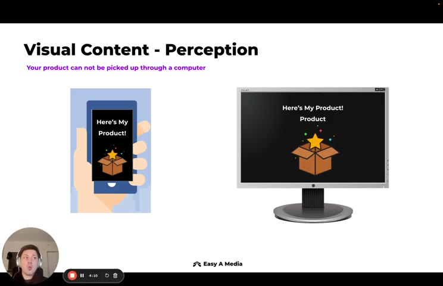
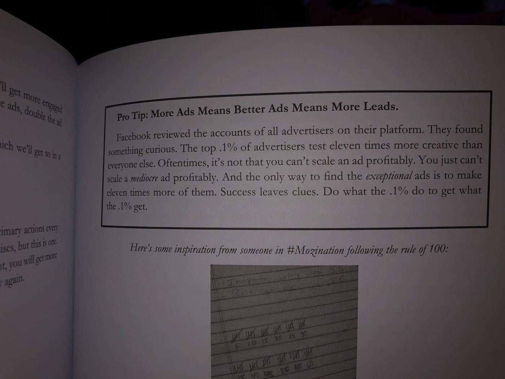
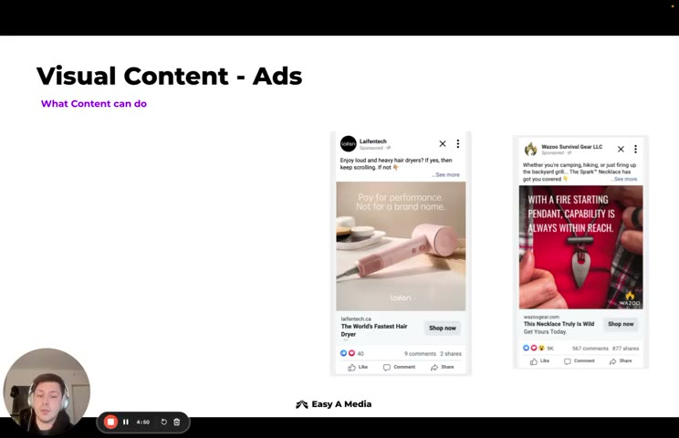
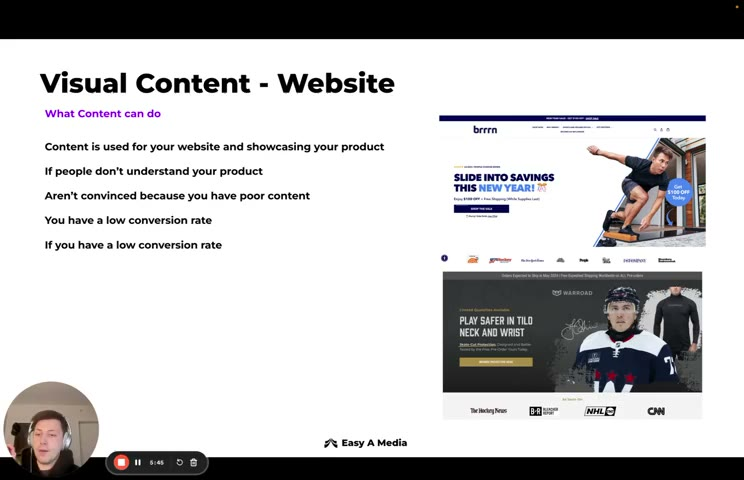

# 134. Why Content Is So Important - Part 1
> Visual content is the raw material for ads, website, email, organic and brand, so a brand without a large supply of good content makes fewer ads, converts less and retains less; the lesson also distinguishes "content" (raw files) from "creative" (edited ad) and cites the "top 0.1% test 11x more creative" claim.

## 🤖 Agent use
- **Use when:** deciding how much raw content to commission before building ads; explaining to a founder why content volume is the bottleneck; setting a weekly creative-test target.
- **Inputs → outputs:** current number of ads tested per week, current content library (photos, UGC clips, studio shots) → a content target (e.g. 11x current ad count) and a list of places the content must serve (ads, site, email, organic, brand).
- **Rules:**
  - **DO** separate the terms: **content** = raw files (a photo), **creative** = the edited ad (photo + headline + logo). [03:08–04:00; 04:52]
  - **DO** size the content pipeline from the test target: to test 11 creatives a week instead of 1 you need "a lot more content", because each piece "is only going to get you so many creatives before you run out of ways to manipulate it". [03:08]
  - **DON'T** sell with "photos that you took in your garage on your phone" or ads that are "not thought out". The instructor blames that for not succeeding. [01:20]
  - **DO** remember that buyers only see pixels: "they are looking at content… You are literally selling content." [04:00]
  - **IF** you have no ads, **THEN** you have no traffic: content feeds ads, website, emails, organic and brand, each with its own revenue consequence (below). [04:52–06:48]
  - **DO** plan three content sources in the next modules: user-generated content, brand ambassadors, studio/professional shoots, built into a "flywheel". [00:00; 06:48]
- **See also:** [135. Why Content Is So Important - Part 2 (the content engine)](135-why-content-is-so-important-part-2.md) · [138. UGC Content Overview Part 1](138-ugc-content-overview-part-1.md) · [090. How To Get A-Players Editors & Content](090-how-to-get-a-players-editors-content.md) · [098. Raw Content Campaign](098-how-to-set-up-raw-content-campaign.md) · [Iteration vs variation](../../../../concepts/iteration-vs-variation.md)

Lesson page text: only a link to the slide deck ("Slides: Google Slides link"). The deck text is captured and equals the PPTX attachment (10 slides, "Easy A Media").

## Key ideas

### What visual content is [00:00–02:11]
- The next modules cover how to generate user-generated content, find brand ambassadors, and get studio/professional content: "probably the most important thing that you can do for your business". Across "all of the success stories that we had, the brands that have an abundance of content are the ones that not only get the best results, but have the easiest time getting those results" (instructor claim). [00:00]
- Two forms of content: written (not this video) and **visual**, "the foundation for your business's perceived value". Visual content "is how you communicate everything that you represent online". It is "the most important first step"; without quality visual content "you will be climbing an uphill battle… going up Mount Everest". [00:37–01:20]
- Anecdote logic: Netflix, Instagram, Facebook, TikTok and YouTube "made probably trillions" using visuals to capture attention. [00:37]


*Slide "Visual Content - Perception": a phone and a monitor both showing "Here's my product!". The product cannot be touched; the customer only sees content. [04:10]*

### More ads, better ads: the 11x claim [02:11–04:00]
- From the book *$100M Leads* (Whisper: "Mr. Homozi", i.e. Alex Hormozi, as heard; he is named by surname only): "more ads means better ads, which means more leads", i.e. "more content and better content means more sales". [02:11]
- The page quoted on the slide (book photo): "Facebook reviewed the accounts of all advertisers on their platform. They found something curious. The top .1% of advertisers test eleven times more creative than everyone else… you just can't scale a mediocre ad profitably. And the only way to find the exceptional ads is to make eleven times more of them. Success leaves clues. Do what the .1% do to get what the .1% get." The instructor first says "1%" then corrects to "0.1%". [02:11–03:08] (a claim from the book, not verified here)
- Worked example of the target: if you test "one ad per week", you need 11 per week. [03:08]


*Slide 3: photo of the book page "Pro Tip: More Ads Means Better Ads Means More Leads". Quoted above. (Slide-deck image, shown on screen around 02:30.) [02:30]*

### Content vs creative [03:08–04:00; 04:52]
- **Content** = raw files ("you take a photo, that is content").
- **Creative** = edited, with headline/logo ("then when you edit that photo and apply a headline… that is called the creative"). Slide 5's example: the photo is content, the headline and logo added make the creative; same for the photo of a man wearing a necklace. [03:08; 04:52]

### Your product cannot be touched [04:00–04:52]
- "Your product is looked at through pixels." People "cannot touch, cannot feel, cannot measure" the product. On ads and the website "they are looking at content". Content is how they understand what the product does, why they should care, "and why I should give you 50, 75, 300, 700 dollars". [04:00]

### Six jobs of content and what happens without it [04:52–06:48]
Each slide ends with the same chain: "…you make less money."
| Job | If content is missing or poor | Consequence |
|---|---|---|
| Ads: capture attention and drive traffic | No ads | "If you have no ads, you make less money" [04:52] |
| Website: showcase the product | People "don't understand your product / aren't convinced" | Low conversion rate [04:52] |
| Emails: retain customers, build relationships | Emails fail to retain or convince | Low lifetime value, unsatisfied customers [05:50] |
| Organic: build an audience | No organic presence, no audience | Customers can't trust or respect the brand [05:50] |
| Brand: resonate and build a real business | No content to build a brand | Fail to resonate with customers [05:50–06:48] |
- Slide 10 closes with "Content is _____" → "Content is King" (burger-king character); "I can't even really explain anymore why content is so important." [06:48]
- Instruction for the upcoming modules: pay attention to "how we generate content, how we find people that can make good content for us, and how we can actually create a flywheel of content". [06:48–07:40]
- The earlier modules told you *what* content you need (desires, avatars, angles); the coming ones show *how* to create it. [07:40]


*Slide "Visual Content - Ads": two Meta ads (a hair-dryer ad "Pay for performance. Not for a brand name." and a fire-starter pendant ad "With a fire starting pendant, capability is always within reach") used to show winning ads that could not exist without quality visual content. [04:50]*


*Slide "Visual Content - Website": two brand sites whose hero images carry the pitch (a slide-board brand and a hockey-gear brand). [05:45]*

## Steps / framework
1. Define the weekly test target: current ads per week × 11 (instructor's reading of the "0.1%" claim). [03:08]
2. Convert to content: how many raw photos/clips per creative, how many creatives per clip.
3. Fill five uses with content: ads, website, email, organic, brand. [04:52–06:48]
4. Source it through the content modules that follow (UGC, brand ambassadors, studio). [00:00]

Slide order in the deck: 1 title · 2 What is visual content · 3 Why important (book page) · 4 Perception · 5 Ads · 6 Website · 7 Emails · 8 Organic · 9 Brand ("Visual Content - Ads" title reused; the text is about building a brand) · 10 "Content Is ___".

## Examples
- **Content vs creative:** photo = content; photo + headline + logo = creative. [03:08; 04:52]
- **Slide 7 (emails):** screenshots of skincare, apparel and subscription-box email layouts, headed "Content is used for your emails to retain customers and build customer relationships." [deck; 05:50]
- **Slide 8 (organic):** a TikTok shop profile (about 189K followers) and an Instagram brand profile (about 85K followers) as organic presence. [deck; 05:50] (follower counts read from deck images)
- **Slide 9 (brand):** a wall of well-known logos. [deck; 06:20]

## Structured units

### Rules of thumb
- **DO** treat content as the first step, before media buying tweaks. [01:20]
- **DO** count content (raw files) and creatives (edits) separately. [03:08]
- **IF** conversion is low **THEN** check website content quality before blaming traffic. [04:52] (derived)
- **DON'T** treat the "11x" as a rule for everyone: it is the instructor's use of a book claim. [02:11]

## Prompts / templates (verbatim)

### Chain on slides 5–9 (deck text)
```text
Content is used in ads and capturing attention. Without content / You have no ads. / If you have no ads. / You make less money.

Content is used for your website and showcasing your product / If people don't understand your product / Aren't convinced because you have poor content / You have a low conversion rate / If you have a low conversion rate / You make less money.

Content is used for your emails to retainer customers and build customer relationships / If your emails fail to retain or convince customers / You will have a low lifetime value & unsatisfied customers / If You have a low lifetime value & unsatisfied customers / You make less money.

Content is used for your organic presence to build an audience / If your organic presence is non-existent and you have no audience / Customers will not be able to trust you & respect your brand / If Customers are not able to trust you & respect your brand / You make less money.

Content is used to build a brand / If you do not have content to build a brand / You will fail to resonate with customers and build a real business / If You fail to resonate with customers and build a real business / You make less money.
```
(Typos are the deck's: "retainer" for "retain".)

### Slide 2 text
```text
What Is Visual Content
Visual content is how you communicate everything you represent online
Visual Content is the most important first step for you to succeed.
If you do not have quality visual content.
You will be climbing an uphill battle.
The foundation for your businesses perceived value
```

## Screenshots
Four frames inline above (perception slide, book-page slide, ads slide, website slide).

## How to apply
- [ ] Count ads tested per week and the raw content available.
- [ ] Set a target creative count per week; derive the content needed.
- [ ] List content gaps by channel (ads, site, email, organic, brand).
- [ ] Queue the content sources: UGC, ambassadors, studio shoots (see following lessons).
- [ ] Track "content" and "creative" as separate counts.

## Related
- Previous: [133. Winning Humidifier Ad - Learnings (Shaun)](133-winning-humidifier-ad-learnings-shaun.md) · Next: [135. Why Content Is So Important - Part 2](135-why-content-is-so-important-part-2.md)
- [136. How to get viral UGC inspo for creators ads](136-how-to-get-viral-ugc-inspo-for-creators-ads.md) · [137. Does Insense still work](137-does-insense-still-work.md) · [138. UGC Content Overview Part 1](138-ugc-content-overview-part-1.md) · [139. UGC Content Overview Part 2](139-ugc-content-overview-part-2.md)
- Tension to note: lesson 133 says "don't spam test, focus on win rate", lesson 134 says test 11x more creatives. Resolve: volume of raw content and quality of each concept are both needed (derived).
- [Creative testing system](../../../../frameworks/creative-testing-system.md) · [Copywriting 22. How to finalize your ad ideas](../../copywriting/lessons/22-how-to-finalize-your-ad-ideas.md)

## Sources and limitations
- Transcript: [134. Why Content Is So Important - Part 1….txt](<../../../../../raw/evolve/start-here/_transcripts/👣 Evolve (Start Here)/134. Why Content Is So Important - Part 1 👣 Evolve (Start Here) Evolve.txt>) · Page text: [….html.md](<../../../../../raw/evolve/start-here/_extracted/👣 Evolve (Start Here)/134. Why Content Is So Important - Part 1_👣 Evolve (Start Here)_Evolve.html.md>) · Deck: [134. Why Content Is So Important.pptx.md](<../../../../../raw/evolve/start-here/_extracted/👣 Evolve (Start Here)/134. Why Content Is So Important.pptx.md>) · Linked deck export: [134-presentation-1kZwaT8ruF.pptx.md](../../../../../raw/evolve/start-here/_extracted/_linked/google/134-presentation-1kZwaT8ruF.pptx.md)
- Machine transcription (Whisper large-v3-turbo). Full recording covered (last segment 8:24).
- Speaker is not named. He says "listen to Spencer and go and get a ton of content" [07:40] while voicing the viewer's thought, so he is likely not Spencer, but this is unconfirmed.
- Whisper: "Homozi" = Hormozi (author of *$100M Leads*); "retainer customers" is the deck's typo. Slide 9's title ("Visual Content - Ads") is a copy-paste in the deck.
- The statement that the top 0.1% test 11x more creative is quoted from the book via the slide; not verified. "Trillions of dollars" and "light years ahead" are rhetorical.
- The instructor says "these two winning ads that we created" about the slide 5 examples [04:52]; their brands are visible on screen but their results are not shown.
