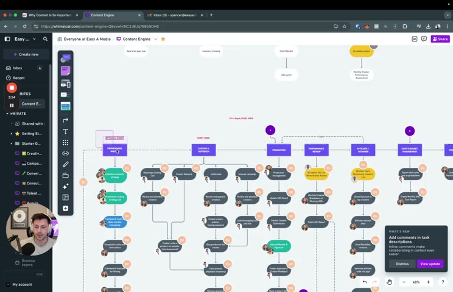
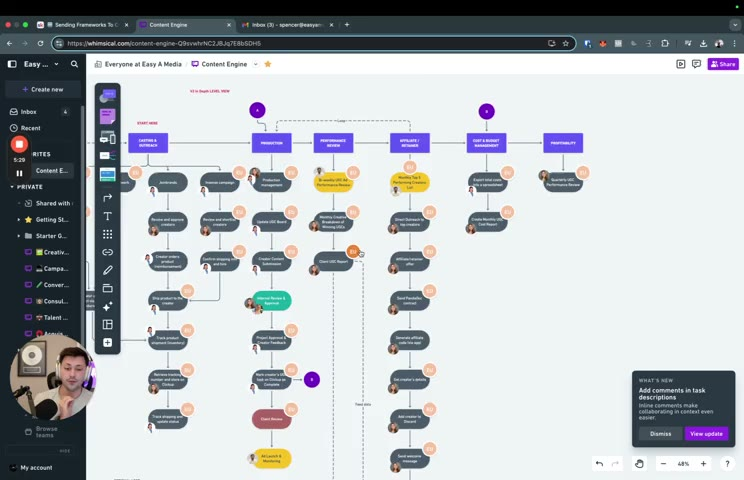

# 135. Why Content Is So Important - Part 2
> The "content engine": a repeatable creator pipeline (framework, casting and outreach, product seeding, production, three cuts per video, performance review, contracts, paid per-video rates) that gives a brand a steady stream of ads to test and scales creative volume without a larger creative-strategy team.

## 🤖 Agent use
- **Use when:** designing the creator/UGC supply side of a DTC brand: how many creators, where to find them, what to send them, how to cut and test their videos, and when to pay them.
- **Inputs → outputs:** brand, product, a creator framework (what creators must know), budget → a creator roster, a weekly flow of raw creator videos each cut three ways, a list of winning creators to contract, and a monthly profitability report (spend on UGC vs winning ads).
- **Rules:**
  - **DO** install a content engine before hiring creative strategists. "If you nail this content engine and you know how to complete feedback loops, you can scale to millions without having to do creative strategy." [02:41]
  - **DO** treat each creator as strategist + copywriter + video editor + filmer in one. The four hires would cost "definitely more than 10K per month", while creators take $100, $150 per video or are free. [00:53]
  - **DO** start with a **framework** for creators (what to know about the brand and product) before casting. [03:19–04:02]
  - **DO** cast on Insense mainly, plus your own creator network; the instructor tested Join Brands but "don't really like it" and moved away from Backstage because creators "don't know how to deliver polished ads". [04:02–04:51]
  - **DO** ship product, track delivery, update statuses, then move to production; submit and launch. [04:51]
  - **DO** cut every returned video **three different ways** (three different timestamps) to get more ads from one shoot. [04:51; 01:44]
  - **DO** review performance for winning and losing creators; send winners a contract; when budget allows pay **$100–$150 per video** instead of only seeding product. [05:26]
  - **DO** review profitability monthly or quarterly: UGC spend, number of winning ads, spend on them; use tags/naming conventions for Meta reports. [05:26]
  - **DO** feed winners back: learn from the winning ad, run creative strategy on it, then share what works with creators. [07:00]
  - **DON'T** run it as an organic play: "we're not doing this for organic. We're doing this for paid ads." [06:23]
- **See also:** [134. Why Content Is So Important - Part 1](134-why-content-is-so-important-part-1.md) · [137. Does Insense still work](137-does-insense-still-work.md) · [138. UGC Content Overview Part 1](138-ugc-content-overview-part-1.md) · [143. How to create an Insense campaign](143-how-to-create-an-insense-campaign.md) · [148. Sending frameworks to creators](148-sending-frameworks-to-creators-part-2.md) · [098. Raw content campaign](098-how-to-set-up-raw-content-campaign.md) · [Creator brief playbook](../../../../playbooks/creator-brief.md)

Lesson page text: "The Importance of the **Content Engine**" (a heading only).

## Key ideas

### Why a content engine [00:00–02:41]
- The speaker was "blind and dumb" to this: he assumed it was "all about creatives… marketers doing all of the ads themselves". A founder who "scaled to over $100 million in two years" credited a content engine. [00:00] (secondhand claim)
- The engine "is super easy to run": it needs "just creators and someone to manage those creators", and "allows you to scale creative strategy teams massively". [00:00–00:53]
- A creator is "the strategist, the copywriter, the video editor, the person that films the content"; hiring all four "would cost definitely more than 10K per month, yet there's people that will do this for $100, $150, and a lot of them for free". [00:53]
- It scales paid ads without quality degrading "as long as you actually pay attention to it", "an extra 30 ads per week without you even having to do anything". [01:44]
- **Client figure:** a client spending **$25,000/day** has **10 creators** making 1–2 videos per week, cut three ways, producing "basically 100 extra ads per month to test", with no extra lift beyond product seeding, onboarding and telling creators what is and is not working. (instructor claim) [01:44]
- **Strong claim:** install the engine before hiring creative strategists. A brand he spoke to "does zero creative strategy" and spends **$150,000/day on Meta at a 3x plus ROAS**, with "hundreds and at this point thousands of creators making videos… almost every single day because they're incentivized to do so". With that volume "it basically becomes impossible to not find winning ads". (secondhand, instructor claim) [02:41–03:19]

### The engine in four steps [03:19–07:36]
1. **Framework.** Decide "what do these creators need to know about our brand and about our product". "You probably shouldn't skip this." There is a link in the module for sending frameworks to creators (covered in later lessons). [03:19–04:02]
2. **Casting and outreach.** Platforms tested: **Insense is the main one**; Join Brands tried ("don't really like it"); **Backstage** used before but "they don't actually know how to deliver polished ads like the people on Insense and potentially Join Brands do"; plus the agency's own creator network. [04:02–04:51]
3. **Review → shortlist → create orders → ship product → track → update statuses → production.** In production the creator with the product follows the framework and makes the video; submit and launch it. [04:51]
4. **Cut three ways, review performance, scale winners.** "Whenever we get a video back from a creator, we just cut it three ways, three different timestamps." Then "review the performance to see if there was any winning or losing creators". For a winner: send a **contract**; with extra budget "put fuel on the fire": stop relying only on seeding on Insense and start **paying $100–$150 per video**. Then repeat. [04:51–05:26]

- **Profit review:** at the end of every month or quarter, "we spent this amount on UGC; how many winning ads did we get and how much were we able to spend on that?" Reports can be built with the tool shown in the course (Whisper: "HRL"; unverified) or inside Meta from "specific tags as long as you have the right naming schemes". [05:26]
- **Staffing:** "the team that you need is basically a VA to help you with finding creators and managing campaigns and following up on Insense. And then from there, you just providing ideas to creators and letting them run with it." [05:26–06:23]
- **Feedback loop:** when the system "produces a winning ad, which it likely will", learn from that ad, do creative strategy off it, then pass information back to creators; "we start that positive feedback loop that allows us to scale and gets you to the million dollar plus months". [07:00]
- **Caveat:** "Is their engine exactly like this? No, it's a little bit different… this is the content engine that we've built internally for ourselves." [07:36]

*The Whimsical "Content Engine" flowchart: column headers (read from the frame) Framework Writing (marked as an optional start), Casting & Outreach (marked "start here"), Production, Performance Review, Affiliate / Retainer, Cost & Budget Management, and Profitability. [03:55]*

*Zoom from Casting & Outreach to Profitability: the later columns of the same flowchart (seeding and tracking, production, performance review, affiliate/retainer, cost and budget reporting). Node text is too small to read in full. [05:30]*

## Steps / framework

| Stage | Actions (as described) |
|---|---|
| 1. Framework | Define what creators need to know about the brand and product; send them a framework |
| 2. Casting & outreach | Post on Insense (main) or use own network; review and shortlist applicants |
| 3. Orders & seeding | Create orders, ship product, track delivery, update status |
| 4. Production | Creator films from the framework; submit and launch |
| 5. Cut | Cut each video 3 ways (three different timestamps) |
| 6. Performance review | Which creators produce winners and which lose |
| 7. Contract & pay | Winners get a contract; $100–$150 per video once budget allows |
| 8. Profit review | Monthly / quarterly: UGC spend, winning ads, spend on them |
| 9. Feedback loop | Learn from the winning ad; share what works with creators |

Staffing stated by the instructor: a VA handles finding creators, managing campaigns and following up on Insense; you supply ideas. [05:26–06:23]

The whiteboard in the video has more stages than the four the instructor lists. [03:55–06:29, frames]

## Examples
- **Content engine at a $25K/day client:** 10 creators × 1–2 videos/week × 3 cuts ≈ 100 extra ads/month. Arithmetic note (derived): 10 × 1–2 × ~4 weeks = 40–80 videos; three cuts each gives ~120–240 cuts, so "100 extra ads" is a conservative or net-of-losers count; the figure is the instructor's. [01:44]
- **Brand with zero creative strategy:** $150K/day, 3x+ ROAS, hundreds to thousands of incentivised creators posting almost daily (secondhand claim). [02:41–03:19]

## Structured units

### Templates
| Template | Use for | Example fill | Source |
|---|---|---|---|
| Creator unit economics: creator video cost ($100–$150, or free via seeding) × videos/week × cuts per video | Planning monthly test volume | 10 creators × 1–2 videos × 3 cuts | [00:53; 01:44; 05:26] |
| Monthly engine report: UGC spend; number of winning ads; spend behind winners | Judging whether the engine pays | "We spent X on UGC, got Y winners, spent Z on them" | [05:26] |

### Rules of thumb
- **DO** use paid distribution for creator content, not only organic. [06:23]
- **IF** a creator makes a winning ad **THEN** contract them and pay per video rather than only sending product. [05:26]
- **IF** quality drops as volume grows **THEN** keep paying attention to it; volume does not degrade quality "as long as you actually pay attention to it". [01:44]
- **DON'T** hire creative strategists before the engine exists (instructor's position). [02:41]

## Prompts / templates (verbatim)
- Not included in the course files. The lesson refers to "a link for this" (the creator framework) and to an updated contract process; neither is attached to this page or shown legibly. [04:02; 05:26]

## Screenshots
Two frames inline above (engine map, zoomed engine).

## How to apply
- [ ] Write the creator framework (brand, product, what to say and show) before posting a casting call.
- [ ] Post on Insense; build a VA task list for shortlisting, ordering, shipping and status tracking.
- [ ] For every video received, produce three cuts (different hook/timestamps) and label them for tests.
- [ ] After the test window, flag winning creators; send contracts; set a paid per-video rate in the $100–$150 range.
- [ ] Add a monthly report: UGC spend, winners, spend behind winners; use naming/tag conventions to pull it from Meta.
- [ ] Feed the winners into your learnings process and send findings to the creators.

## Related
- Previous: [134. Why Content Is So Important - Part 1](134-why-content-is-so-important-part-1.md) · Next: [136. How To Get Viral UGC Inspo For Creators Ads](136-how-to-get-viral-ugc-inspo-for-creators-ads.md)
- [137. Does Insense still work](137-does-insense-still-work.md) · [143. How to create an Insense campaign](143-how-to-create-an-insense-campaign.md) · [145. Process creators / shortlist](145-how-to-process-creators-add-to-shortlist.md) · [147. How to hire approved creators](147-how-to-hire-approved-creators-part-1.md) · [148. Sending frameworks to creators](148-sending-frameworks-to-creators-part-2.md)
- [098. Raw content campaign](098-how-to-set-up-raw-content-campaign.md) · [100. How to see ads performance](100-how-to-see-ads-performance-our-columns.md) · [Playbook: creator brief](../../../../playbooks/creator-brief.md)

## Sources and limitations
- Transcript: [135. Why Content Is So Important - Part 2….txt](<../../../../../raw/evolve/start-here/_transcripts/👣 Evolve (Start Here)/135. Why Content Is So Important - Part 2 👣 Evolve (Start Here) Evolve.txt>) · Page text: [….html.md](<../../../../../raw/evolve/start-here/_extracted/👣 Evolve (Start Here)/135. Why Content Is So Important - Part 2_👣 Evolve (Start Here)_Evolve.html.md>) (heading only).
- Machine transcription (Whisper large-v3-turbo). Full recording covered (last segment 7:58).
- Whisper heard "incense" (= Insense), "joint brands" (= Join Brands), "backstaging / backstage casting" (= Backstage), "HRL" (unclear tool; unverified). "Zero extra left on our end" = zero extra lift.
- The $100M+ founder, "$150,000/day at 3x+ ROAS" and "$25,000/day, 10 creators, 100 extra ads" figures are instructor claims (the first two secondhand); no account evidence is shown.
- The Whimsical diagram text is too small at the frame resolution to transcribe node by node. Column names are read at best-effort from the 3:55 frame; the instructor describes four steps while the diagram shows more stages (affiliate/retainer, cost and budget management, profitability).
