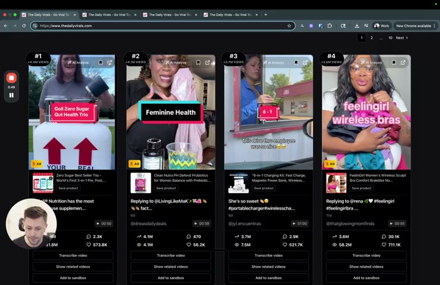
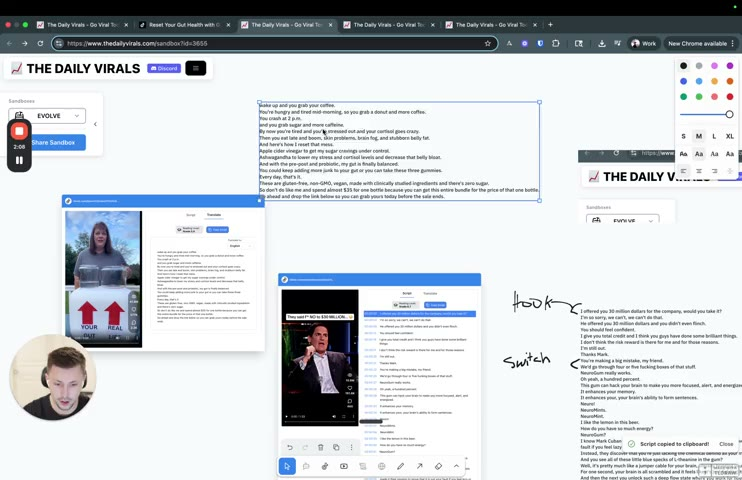
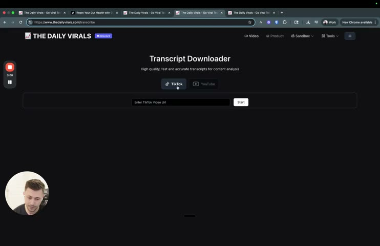
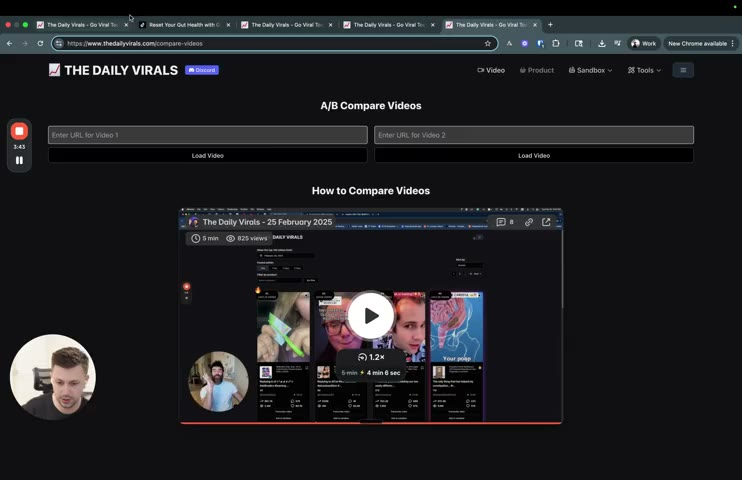
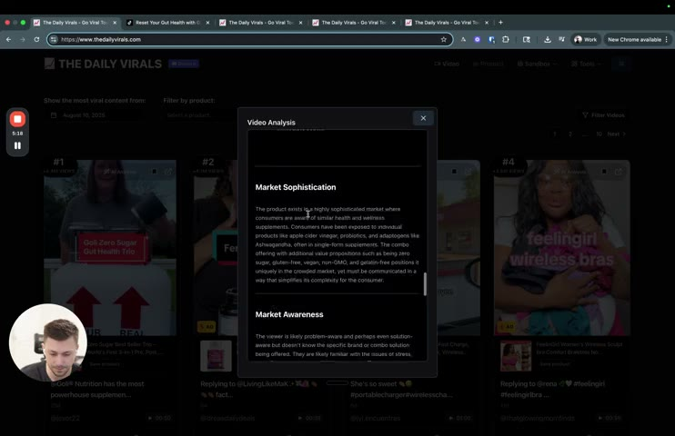

# 136. How To Get Viral UGC Inspo For Creators & Ads
> Use The Daily Virals (a TikTok / TikTok Shop "most viral content of the day" tool) to find what is selling organically, pull transcripts and AI breakdowns, build a swipe file, and hand the pattern (not the lines) to creators or your script rewriter.

## 🤖 Agent use
- **Use when:** you need fresh UGC concepts for a creator framework or a script, want to see which product demos/formats are going viral on TikTok right now, or are building a swipe file of viral UGC to train a rewriter prompt.
- **Inputs → outputs:** a niche/product + a date → a shortlist of viral videos with views/likes/comments, their transcripts, and an AI breakdown (hook, market sophistication, awareness, how to improve) → concepts and framework ideas to send to creators, or a script rewritten for our brand.
- **Rules:**
  - **DO** use viral organic TikTok / TikTok Shop content as inspiration for creators; "a lot of times this is something that can cook for you as an ad as well". [00:00–00:54]
  - **DO** read the comment section of a viral video to see what viewers react to. [00:54]
  - **DO** copy the transcript into a "sandbox" next to the video and annotate it (the demo shows hand-written "hook" and "switch" labels on a pasted script). [01:32–02:06] (see screenshot)
  - **DO** feed a viral transcript (or its AI breakdown) to your rewriter prompt and have it rebuild the script for our product. "I could send to my rewriter for my specific brand inside of Claude." [02:06; 05:07]
  - **DO** recreate a concept, publish it, then compare your video with the original side by side in the A/B tool. [03:38–04:23]
  - **DON'T** just refilm a viral video 1:1 (derived from "copy the mechanism, not the asset"). The A/B tool exists to show why yours underperforms: setting, hook, set-up effort. [04:23]
  - **IF** you want to turn the tool into a recurring system **THEN** collect viral transcripts into a swipe file / collection; the team is doing this "to start automating scripts for our users or for our creators". [02:06; 05:07]
- **See also:** [137. Does Insense Still Work?](137-does-insense-still-work.md) · [148. Sending Frameworks To Creators - Part 2](148-sending-frameworks-to-creators-part-2.md) · [126. How To Pull Frameworks From Ads](126-how-to-pull-frameworks-from-ads.md) · [Playbook: UGC script writing](../../../../playbooks/ugc-script-writing.md)

Lesson page text: the tool link (thedailyvirals.com) and "Use code: **EVOLVE** to get 30 days free."

## Key ideas

### 1. What the tool is [00:00–00:54]
- "It's called the Daily Virals." It shows the most viral content from any specific day on TikTok and TikTok Shop, with views, impressions, comments and likes per video. [00:00]
- Use: see "what content is like ripping when it comes to selling a product organically". The team uses it to get inspiration for creators and shares what it finds with them. [00:00]
- Demo: a video from a given date (the date picker on screen reads August 2025) with a product demonstration and 41 million views. The point: "there's probably something we should pay attention to". [00:54]
- The feed can be filtered by date and by product (UI filters visible on screen). [00:20]

### 2. Sandbox: collect, transcribe, annotate [01:32–03:04]
- "Add to sandbox" puts a video into a free-form whiteboard ("literally a sandbox like you can do whatever you want"). You can paste screenshots, videos, transcripts and YouTube videos and annotate them. [01:32–02:06]
- Copying the transcript gives "the script and the exact prompt" the creator used. The instructor would send this to a rewriter prompt in Claude to produce a script for his brand "using this viral video template". [01:32–02:06]
- Save videos to collections to "build a swipe file". [02:06]

### 3. Transcript downloader [03:04]
- Paste any TikTok URL (YouTube also has a tab) and get the transcript. "There are tons of apps that will do that. But having it inside of Daily Virals is just nice." [03:04]

### 4. A/B compare tool [03:04–04:23]
- Loads a viral video by URL, then your own video beside it so you compare frame by frame. [03:38]
- Instructor's example of what you learn: "clearly this girl is outdoors and I'm indoors", the original opens with a more interesting hook, and the set-up "looks like a science fair project" while yours took less effort. This shows "why your videos are flopping versus the ones that you're trying to imitate". [04:23]
- The instructor says the A/B tool was built by the person shown in the tool's UI (Whisper heard "Paul", unverified), after a mentor told him to copy and paste, to check whether his remake beat the original. [03:04]

### 5. AI analysis [02:06; 04:23–05:07]
- A new "AI analysis" button on each video gives a breakdown the instructor reads aloud: a line-by-line story of the ad (relatability set-up, a common cycle of unhealthy habits as the problem, consequences, escalating urgency), then **Market Sophistication, Market Awareness, Market Resonance** and **how to improve this video**. [04:23–05:07]
- Instructor: "you could copy this entire script breakdown and give this to your rewriter rather than your actual script itself". [05:07]
- The team is "building a swipe file of super viral UGC ads" so they can automate scripts for users and creators as they "get a little bit more into scripting". [05:07]

### 6. Access [06:04–06:41]
- Promo code **EVOLVE** gives 30 days free. After sign-up, "add promo code and type in Evolve". The instructor mixes up the price while speaking: "$55 off for your first month... it's actually $55 a month. Actually, I think it was cheaper. I thought it was $99." [06:41] (price unclear; verify on the site before quoting)
- Suggested use of the free month: rip many videos for inspiration, download transcripts "to then train an AI", cancel after 30 days if you want. [06:04]

## Steps / framework
1. Open the daily feed, pick the date range and product filter closest to our niche. (derived)
2. Open a viral video; note views/likes/comments and read the comments. [00:54]
3. Add it to the sandbox; paste the transcript; mark the hook and the "switch"/turn. [01:32–02:06]
4. Run AI analysis; copy the breakdown. [04:23–05:07]
5. Rewrite as our own script via the rewriter prompt, or turn the pattern into a concept line for the creator framework (see [148](148-sending-frameworks-to-creators-part-2.md)). [02:06; 05:07]
6. After filming, load original + ours in the A/B tool and list the gaps. [03:38–04:23]

## Examples
- **Demo video, 41M views:** a presenter demonstrates a supplement product with an on-screen "your / real" split graphic. Used only to show how to pull comments and a transcript. [00:54]
- **Transcript/AI-analysis example (gut-health supplement ad):** the script walks through a typical day (coffee, donut and more coffee, 2 p.m. crash, sugar and more caffeine) before the product; the AI analysis labels each beat (relatability, problem, consequences, vicious cycle). [04:23–05:07] The structure (day-in-the-life problem loop then product switch) is the transferable mechanism; the lines are not to be reused.

## Structured units

### Rules of thumb
- **DO** study viral UGC for structure (hook, switch, demo) and rebuild it for our product. [02:06; 05:07]
- **DON'T** copy the lines or claims of the source video (rule 3 of the repo).
- **IF** your remake underperforms **THEN** put it next to the original in the A/B tool and compare hook, setting and effort. [04:23]

## Screenshots

*Feed of the most viral videos for a chosen date with views, likes, comments and buttons for "Transcribe video", "Show related videos" and "Add to sandbox". [00:54]*

*The sandbox whiteboard: viral videos, copied transcripts and hand-written "hook" / "switch" annotations. [02:10]*

*Transcript Downloader: paste a TikTok (or YouTube) URL and click Start. [03:10]*

*A/B Compare Videos: one URL field per video, loaded side by side. [03:45]*

*The "Video Analysis" panel with Market Sophistication and Market Awareness sections. [05:20]*

## How to apply
- [ ] Sign up with code EVOLVE and confirm the current price on the site.
- [ ] Pull one day's top videos for our product category and save 5-10 to a collection.
- [ ] For each, copy the transcript and AI breakdown; tag hook type, switch and demo format.
- [ ] Convert 3-4 of them into concept lines (name + sample hook + 1-2 line explanation) for the creator framework.
- [ ] After a recreation is published, run the A/B compare and log the gaps in the next brief.

## Related
- Previous: [135. Why Content Is So Important - Part 2](135-why-content-is-so-important-part-2.md) · Next: [137. Does Insense Still Work?](137-does-insense-still-work.md)
- [Evolve Copywriting: hooks](../../copywriting/concepts/hooks.md) · [Evolve Copywriting: market awareness](../../copywriting/concepts/market-awareness.md) · [Playbook: creator brief](../../../../playbooks/creator-brief.md)

## Sources and limitations
- Transcript: [136… .txt](<../../../../../raw/evolve/start-here/_transcripts/👣 Evolve (Start Here)/136. 🆕 How To Get Viral UGC Inspo For Creators & Ads 👣 Evolve (Start Here) Evolve.txt>) · Page text: [136… .html.md](<../../../../../raw/evolve/start-here/_extracted/👣 Evolve (Start Here)/136. 🆕 How To Get Viral UGC Inspo For Creators & Ads_👣 Evolve (Start Here)_Evolve.html.md>)
- Machine transcription (Whisper large-v3-turbo); full recording covered (last segment 7:09 of 7:09). Whisper writes "Daily Barrels/Vowels" for "Daily Virals"; "Note" appears as "No"; the A/B tool author's name and how he is described ("He's a beauty"?) are unclear. The "Alex Cooper call recording" and the "Claude project / AI program" mentioned at [06:04] are separate course resources not included in these files.
- The price statement at [06:41] is muddled and may be wrong. The speaker is unverified.
