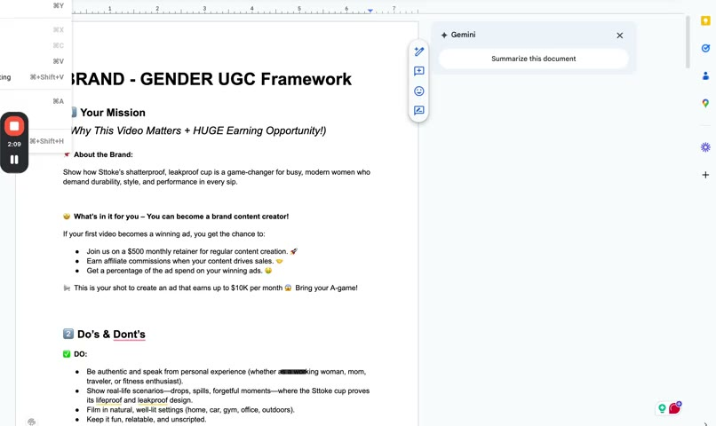
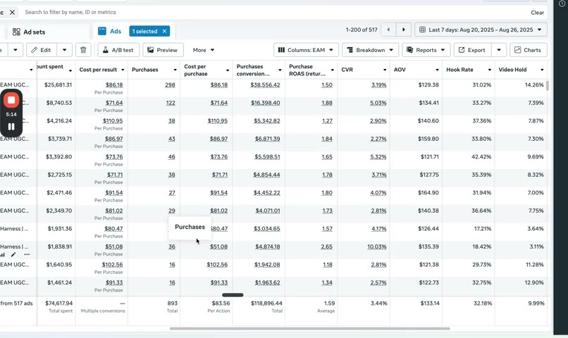

# 137. Does Insense Still Work?
> A 2025 update filmed at the front of the UGC section: Insense (the creator marketplace) still works if you (1) tailor the framework per creator, (2) prefer frameworks over full scripts, and (3) have a large product-aware market, ideally with a unique mechanism.

## 🤖 Agent use
- **Use when:** deciding whether to source creators on Insense, preparing the framework file for a creator, or choosing between freestyle, framework or script.
- **Inputs → outputs:** the master creator framework (see [148](148-sending-frameworks-to-creators-part-2.md)) + a creator's profile/content → a curated copy of the framework with 3-6 concepts picked for that creator.
- **Rules:**
  - **DO** make a copy of the framework per creator and delete concepts, keeping the ones that suit that creator's existing content. [01:36–02:10]
  - **DON'T** send the full framework to every creator: "first pick bias" means creators pick "the easiest to do or they usually pick one of the first two". [00:58–01:36]
  - **DO** keep the number of concepts per creator at about 3-6 ("usually we tell you guys to do like anywhere from four to six"; this example had three). [02:10]
  - **IF** a creator asks "what do I do?" **THEN** you may provide a script, but only if you understand the creator's style and can write for them. [02:56]
  - **DON'T** keep scripting if scripted videos have not been working: "I would recommend let the creators do some of their own ideas". [03:34]
  - **DON'T** let creators fully freestyle "unless they're just a sensational creator". [03:34–04:18]
  - **IF** you have a broad product-aware market, **THEN** Insense "will absolutely crush", and "even more if you have some kind of unique mechanism". [04:18]
  - **IF** your product has nothing unique, **THEN** expect it to be harder. [07:15]
- **See also:** [138. UGC Content Overview - Part 1](138-ugc-content-overview-part-1.md) · [143. How To Create an Insense Campaign](143-how-to-create-an-insense-campaign.md) · [148. Sending Frameworks To Creators - Part 2](148-sending-frameworks-to-creators-part-2.md) · [Evolve Copywriting: unique mechanism](../../copywriting/concepts/unique-mechanism.md) · [Evolve Copywriting: market awareness](../../copywriting/concepts/market-awareness.md)

Lesson page text (verbatim, as three bullets under the question "Is this series of modules still worth my time?"):
1. "Optimize Your Frameworks PER Creator"
2. "If you want to SCRIPT you can... We still do NOT (but some people have success)"
3. "If you have a large Product Aware market, Insense can crush."

Coupon on the page: "**Coupon Code For $100 Off:** EASYA100".

## Key ideas

### 1. Why this video sits at the front [00:00–00:58]
- Viewers will have watched "Why content is so important" (see [134](134-why-content-is-so-important-part-1.md), [135](135-why-content-is-so-important-part-2.md)) and are now entering a dense section "with how we do everything on Insense". Two things matter most: the quality of the framework, and not sending it identically to every creator. [00:00–00:58]

### 2. First pick bias and per-creator frameworks [00:58–02:56]
- The framework's first concept in the demo is "Lost on the roof". Creators "pick the one that is the easiest to do or they usually pick one of the first two". [00:58–01:36]
- Fix: make multiple copies of the framework doc. In each copy, remove some concepts and keep the ones you think suit that creator. "Literally look at the creator and think, okay, what would be a good video for this creator specifically? Look at their existing content." [01:36–02:10]
- The demo framework had three concepts; the normal range is four to six. [02:10]
- Note: lesson 148 gives the maximum of nine concepts per framework; this lesson says to cut down further per creator (derived: master list up to 9, creator copy 3-6).

### 3. Frameworks vs scripts [02:56–04:18]
- If a creator asks for direction you can provide a script. Not recommended in general because many scripts "don't make any sense for the creator". For a script document, see the call recordings: "Alex Cooper did one, and he gave you guys his sheet for that. It's very similar to one that we use" (name as heard by Whisper; the recording is not in these files). [02:56]
- The team still mainly uses frameworks. Scale drawn on screen: **freestyle** (top) - **frameworks** (middle) - **fully scripted** (bottom). "Here you kind of want to be in the middle." [03:34]
- Fully freestyle is "very rare" to allow; full scripting "we haven't seen it work as much", though a strong writer with a specific idea and the right creator can do it. [03:34–04:18]

### 4. Where Insense crushes [04:18–07:15]
- Product-aware products with broad appeal do well; a unique mechanism helps more. [04:18]
- Proof shown on 27 August 2025 (instructor claim, screenshot below): last 7 days "$74,000 on UGC", yesterday "12K ... at a 1.7x"; this is one of several accounts, so "over a hundred K on UGC right now per week... over $400,000 a month just on UGC". [05:10–05:42]
- Creator route: they "found a winning creator", one who "didn't actually make a super winner" first, just a good video; they hired the creator (the process taught in this section), gave feedback, and "on the second video, they made a super winner". [05:42]
- Caveat from the instructor: they do not run media buying for this client; "we just do the UGC only" and the client copies the campaign. [05:42]
- Why this brand: "a very large product-aware market" and "a somewhat unique mechanism... not crazy unique, but there's other brands that have it", marketed well with UGC. [07:15]

### The three takeaways [06:40]
1. Divide the framework and give optimal concepts to each creator based on their profile.
2. A script is allowed, but still recommend frameworks; do not freestyle.
3. Large product-aware market and a mechanism that helps you stand out.

## Steps / framework
1. Build the master framework (up to 9 concepts, see [148](148-sending-frameworks-to-creators-part-2.md)).
2. For each hired creator: open their profile and content; pick 3-6 concepts that fit; copy the doc and delete the rest. [01:36–02:10] (the "4-6" figure is from [02:10]; three is shown in the demo)
3. Name the copy per creator (derived).
4. Send after hiring (see [147](147-how-to-hire-approved-creators-part-1.md)). If the creator asks for direction, offer a script only when you can match their style. [02:56]

## Examples
- **"Lost on the roof"** concept (first in the framework; most likely to be picked first): see the full text in [148](148-sending-frameworks-to-creators-part-2.md). [00:58]
- **Spend example:** 7-day spend about $74.6K on UGC ads in one account (Ads Manager: 517 ads, 893 purchases, $83.56 cost per purchase, purchase ROAS 1.59 for Aug 20-26, 2025; read from the screenshot). The instructor cites 1.7x for yesterday's $12K. [05:10–05:42]

## Structured units

### Rules of thumb
- **DO** curate framework concepts per creator. [01:36]
- **DON'T** send nine concepts to everyone: first-pick bias skews which concept gets made. [00:58–01:36]
- **IF** results from scripted creator videos are poor **THEN** move back toward frameworks. [03:34]

## Screenshots

*The framework doc the creator receives; copies are made and concepts removed per creator. [02:10]*

*Ads Manager, Aug 20-26 2025, 517 ads: total spend $74,617.94, 893 purchases, cost per purchase $83.56, purchase ROAS 1.59, AOV $133.14, hook rate 32.18%, video hold 9.99% (read from screen; instructor claim of results). [05:15]*

## How to apply
- [ ] For each creator, copy the master framework and keep 3-6 concepts that match their existing content.
- [ ] Do not script unless the creator asks and we can write in their style.
- [ ] Check fit: is the product product-aware with broad appeal and a mechanism? If not, plan for fewer applications.
- [ ] Log which concept each creator chose, to see first-pick bias in the data.

## Related
- Previous: [136. How To Get Viral UGC Inspo For Creators & Ads](136-how-to-get-viral-ugc-inspo-for-creators-ads.md) · Next: [138. UGC Content Overview - Part 1](138-ugc-content-overview-part-1.md)
- [Playbook: creator brief](../../../../playbooks/creator-brief.md)

## Sources and limitations
- Transcript: [137… .txt](<../../../../../raw/evolve/start-here/_transcripts/👣 Evolve (Start Here)/137. Does Insense Still Work 👣 Evolve (Start Here) Evolve.txt>) · Page text: [137… .html.md](<../../../../../raw/evolve/start-here/_extracted/👣 Evolve (Start Here)/137. Does Insense Still Work__👣 Evolve (Start Here)_Evolve.html.md>)
- Machine transcription (Whisper large-v3-turbo); last segment 7:44 of 7:44. Whisper writes "incense" for "Insense" and "Alex Cooper call" as "car recordings". The speaker mentions the screen being cut off while demonstrating; the framework doc is shown only partially.
- Spend and ROAS are instructor claims; the client's name and the product are not shown (thumbnail hidden). The ROAS in the screenshot (1.59, 7 days) differs from the 1.7x quoted for one day.
