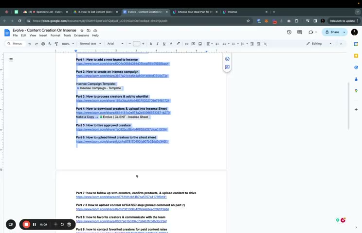
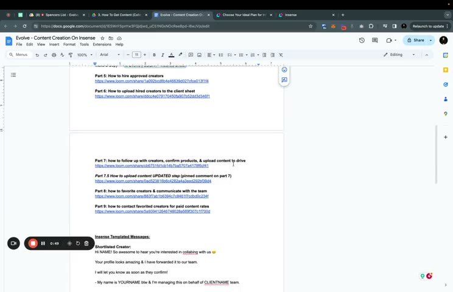

# 138. UGC Content Overview - Part 1
> The goal of Insense product seeding is not a winning ad; it is to meet many creators and find one brand ambassador who will produce ads on an ongoing basis. This page also sets the two operating rules: daily Insense checks and weekly follow-ups.

## 🤖 Agent use
- **Use when:** setting expectations for a creator-sourcing project, deciding whether to run Insense, or scheduling the daily/weekly creator operations.
- **Inputs → outputs:** brand, Insense brand plan, client sheet → a standing routine (daily check, follow-ups every 2-3 days, close-out rules) and a "find the brand ambassador" objective.
- **Rules:**
  - **DO** treat the Insense SOP as if you were working for a client, even for your own brand, "just to keep yourself organized". Do not skip the sheet step. [00:00–00:40]
  - **DON'T** judge the programme on winning ads. "The idea of getting a winning ad from this process is a bonus. It is not the objective." [02:27]
  - **DO** aim to find your own brand ambassador (the instructor names two past ambassadors; names omitted here): a creator who loves the products and the brand and will make content on an ongoing basis. [05:00]
  - **DO** get the **brand plan**: the trial plan no longer includes product seeding (page text).
  - **DO** run a **daily Insense check (5-20 minutes)**: reply to all creator messages, download and upload new content, add new applicants to the Client Insense sheet (page text, Rule #1).
  - **DO** follow up with non-responders every **2-3 days** (page text, Rule #2).
  - **IF** a creator is HIRED but has **not** been sent product and is unresponsive for **10 days after 3-5 follow-ups** **THEN** "COMPLETE" the deal and mark the creator "Unresponsive" in the hired-creators sheet (page text).
  - **IF** a creator is HIRED and **has** been sent product and is unresponsive for **14 days after 3-5 follow-ups** **THEN** contact an Insense support rep (page text).
  - **IF** nobody wants to film your product for free **THEN** rethink the product: "How do I make people want my stuff for free?" [00:40–01:36]
  - **DON'T** assume content is guaranteed: "IT IS NOT GUARANTEED THAT YOU WILL RECEIVE CONTENT IN RETURN FOR PRODUCT BEING SENT." (page text)
- **See also:** [139. UGC Content Overview - Part 2](139-ugc-content-overview-part-2.md) · [140. Action Item: Sign Up For Insense](140-action-item-sign-up-for-insense.md) · [141](141-how-to-add-a-new-brand-to-insense.md) · [143](143-how-to-create-an-insense-campaign.md) · [Playbook: creator brief](../../../../playbooks/creator-brief.md)

## Page text (verbatim)
- "**EVOLVE Students ONLY can save $100 with code: EASYA100** (you can not find this discount anywhere else so keep it in the community)" with an affiliate-style sign-up link (fas.st short link, see source file).
- "You will need to get the brand plan as they've gotten rid of product seeding for the trial plan."
- "**NOTE\* IT IS NOT GUARANTEED THAT YOU WILL RECEIVE CONTENT IN RETURN FOR PRODUCT BEING SENT.**"
- "**Rule #1: Daily Insense Checks (5-20 minutes)** You will be responsible for completing a daily Insense check where you will respond to all messages from creators, download & upload any new content, and add any new applicants to the Client Insense sheet."
- "**Rule #2: Weekly Follow-Up Processes (Creators)** You will be responsible for following up with creators who did NOT respond to your messages every 2-3 days. If a creator is HIRED but has NOT been sent a product, and they are unresponsive for **10 days** after your 3-5 follow-ups, you will 'COMPLETE' the deal and mark the creator as 'Unresponsive' in the hired creators sheet. If a creator is HIRED and HAS been sent a product, and they are unresponsive for 14 days after your 3-5 follow-ups, you will need to contact an Insense support rep."

## Key ideas

### 1. The looms are written as if for a client [00:00–00:40]
- The videos below were "filmed to treat it as if we were working with a client". Do the same: upload creators to the sheet to get them approved, keep "all creators", "selected creators" and "hired creators" separate. "There's certain steps in this process where you might be like, do I really need to do this? I would definitely recommend doing it." [00:00–00:40]
- The Google Doc "Evolve - Content Creation On Insense" lists the SOP parts (screenshots below). Each part links to a Loom. (Mapping to lessons is derived.)

| SOP part (doc) | Lesson in this KB (derived) |
|---|---|
| Part 1: How to add a new brand to Insense | [141](141-how-to-add-a-new-brand-to-insense.md) |
| Part 2: How to create an Insense campaign (+ "Insense Campaign - Template") | [143](143-how-to-create-an-insense-campaign.md) |
| Part 3: How to process creators & add to shortlist | [145](145-how-to-process-creators-add-to-shortlist.md) |
| Part 4: How to download creators & upload into Insense Sheet (Make a Copy: "Evolve \| CLIENT - Insense Sheet") | [146](146-how-to-download-creators-upload-to-sheet.md) |
| Part 5: How to hire approved creators | [147](147-how-to-hire-approved-creators-part-1.md) |
| Part 6: How to upload hired creators to the client sheet | next lessons, [150](150-action-item-hire-creators.md) |
| Part 7: How to follow up with creators, confirm products, & upload content to Drive | [151](151-how-to-follow-up-upload-content-part-1.md), [152](152-how-to-follow-up-upload-content-part-2.md) |
| Part 7.5: How to upload content (UPDATED step, pinned comment on part 7) | [152](152-how-to-follow-up-upload-content-part-2.md) |
| Part 8: How to favorite creators & communicate with the team | [154](154-how-to-contact-winning-creators-affiliate.md) |
| Part 9: How to contact favorited creators for paid content rates | [154](154-how-to-contact-winning-creators-affiliate.md), [155](155-action-item-contact-top-performing-creators.md) |

### 2. This is not about winning ads [00:40–02:27]
- Proof of volume: "we just launched a campaign for a client of ours and we have over 74 applications in the first, I think it was 48 hours". You get a lot of applications "if your product is, in the eyes of customers, worthy of filming for free". [00:40]
- "The goal of this campaign is to basically meet as many content creators as possible." Content does come: the instructor says the Insense route "can actually lead to winning ads" (following the Meta SOP strategy). [01:36]
- Warning: do not buy a licence ("500 bucks for one month" or "$1,200 for the quarter" as stated in the video; the action item page uses $1,500 over three months, see [140](140-action-item-sign-up-for-insense.md)), hire creators, test everything and say "this didn't work". [01:36–02:27]

### 3. The real objective: a brand ambassador [02:27–05:58]
- "The objective of this process is to go through a ton of creator applications of people who already said that they're interested in you in order for you to then find some kind of a brand ambassador that can continue to film content for you on a recurring basis." [02:27]
- Target: brands doing under seven figures ("anybody less than $50,000 or anybody spending less than $10,000 a month on ads"; the sentence is garbled, see limitations). They "do not have the luxury of hiring a professional creative team", so find creators who "can just do it all". [02:27–03:15]
- Why a creator beats a team: "you're hiring a professional copywriter, a professional videographer, a professional photographer, a professional editor, all in one person". "Creators just create. That's what they do. They're not really business people." [04:01]

### 4. Examples shown (instructor claims) [03:15–05:00]
- Creator A (hired for a client; the client later stopped working with her): TikTok videos at **10M and 10.1M views**; others at over **1M, 15K and 3M**. She "generated sales organically" and "gave us content for ads that absolutely crushed". [03:15–04:01]
- Creator B (another client's ambassador): one ad he made got **54,000 organic views**; they then "spent over $30,000 on and made well over six figures from this ad alone". [04:01–05:00]
- Everything after getting content in this section: "how to hire the creators, how to find the creators, and then once you get the content, how to favorite them and how to actually contact them to become a brand ambassador". [05:00]

## Steps / framework
1. Buy the Insense **brand** plan with the Evolve discount (see [140](140-action-item-sign-up-for-insense.md)).
2. Run each SOP part in order (table above).
3. Daily check, 5-20 min: messages, content, applicants. 
4. Every 2-3 days: follow up with non-responders (3-5 follow-ups).
5. Close-out rules: hired, no product sent, silent 10 days after 3-5 follow-ups -> complete deal, mark "Unresponsive". Hired, product sent, silent 14 days after 3-5 follow-ups -> contact Insense support.
6. Favorite creators who deliver good content and invite them to become brand ambassadors (see [154](154-how-to-contact-winning-creators-affiliate.md), [156](156-how-to-onboard-brand-ambassadors.md)).

## Examples
- 74+ applications in ~48 hours on a new campaign for a client; the instructor ties volume to product appeal. [00:40]
- Ambassador economics (instructor claim): one 54K-view video became a $30K+ spend ad with six-figure revenue. [05:00]

## Screenshots

*"Evolve - Content Creation On Insense" Google Doc: Parts 1-6 of the SOP, each with a Loom link, the campaign template and the "Make a Copy" link for the client Insense sheet. [00:10]*

*Parts 5-9 (hire creators, upload hired creators, follow up/upload content, favorite creators, contact favorited creators for paid rates) followed by the "Insense Templated Messages" (see [145](145-how-to-process-creators-add-to-shortlist.md)). [00:50]*

## How to apply
- [ ] Buy the brand plan; set a calendar block for a daily 5-20 min check.
- [ ] Set up the client sheet from the template (see [146](146-how-to-download-creators-upload-to-sheet.md)).
- [ ] Define the objective in writing: find one ambassador, not one winning ad.
- [ ] Add a follow-up reminder every 2-3 days; apply the 10-day / 14-day close-out rules.

## Related
- Previous: [137. Does Insense Still Work?](137-does-insense-still-work.md) · Next: [139. UGC Content Overview - Part 2](139-ugc-content-overview-part-2.md)
- [134. Why Content Is So Important - Part 1](134-why-content-is-so-important-part-1.md)

## Sources and limitations
- Transcript: [138… .txt](<../../../../../raw/evolve/start-here/_transcripts/👣 Evolve (Start Here)/138. UGC Content Overview - Part 1 👣 Evolve (Start Here) Evolve.txt>) · Page text: [138… .html.md](<../../../../../raw/evolve/start-here/_extracted/👣 Evolve (Start Here)/138. UGC Content Overview - Part 1_👣 Evolve (Start Here)_Evolve.html.md>)
- Machine transcription (Whisper large-v3-turbo); last segment 6:01 of 6:03. Whisper writes "Incense" for "Insense", "Insese" appears on the page. The sentence at [02:27] ("brands that are doing sub, basically seven figures ... less than $50,000 ... less than $10,000 a month on ads") is garbled; the threshold is unclear.
- "The YouTube video" the instructor mentions at [00:40] is not included in the files. Creator names in the instructor's examples are not repeated here. Pricing differs between this video ($500/month or $1,200/quarter) and [140](140-action-item-sign-up-for-insense.md) ($1,500 over three months); check Insense's current price.
