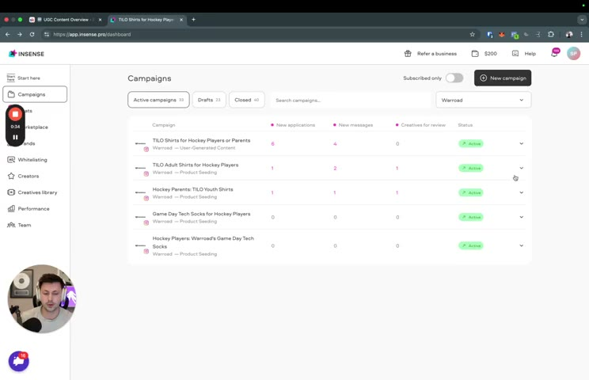
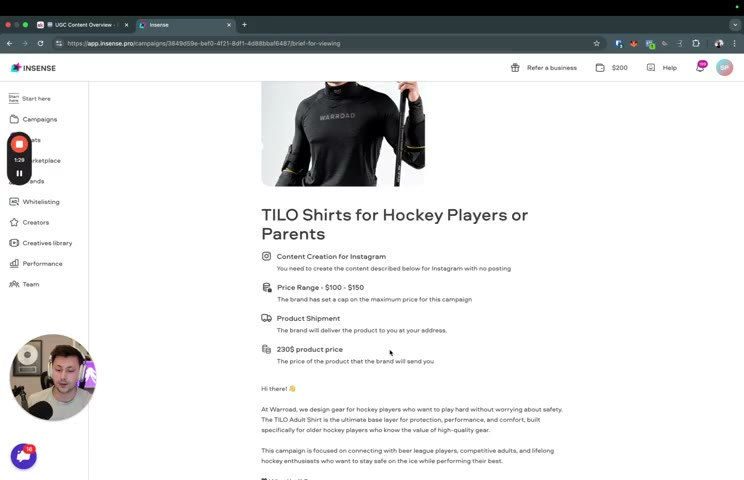
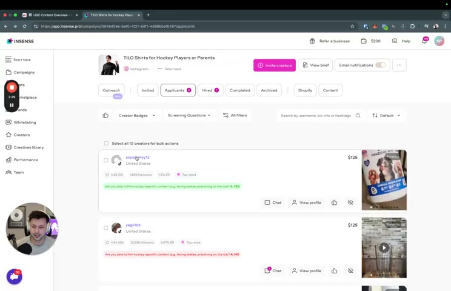

# 139. UGC Content Overview - Part 2
> Paid campaigns on Insense: when you pay creators ($100-$150 per video, never above $200) you get far more applications than with product seeding, but you must be more selective about who you hire.

## 🤖 Agent use
- **Use when:** product seeding yields too few applicants, or you want faster volume and have budget for paid UGC.
- **Inputs → outputs:** budget ($1,000 minimum), product, brief → a paid "user-generated content" campaign beside the product-seeding campaign(s), with a stated price range per video.
- **Rules:**
  - **DO** pay **$100-$150 per video** and **never more than $200** (page text).
  - **DO** have a budget of **$1,000 minimum**, ideally **$2k-$5k** to expedite scaling the creators you find (page text). The instructor says ideal "like a thousand bucks", and $5-6K a month if available. [00:00]
  - **DO** put the product price range in the brief: the demo brief shows a product price of $230 and "we're also now willing to pay $100 to $150 on top of that". [01:27]
  - **DO** be "a lot more selective" in a paid campaign: check each applicant's portfolio and TikTok before hiring. [01:27–02:23]
  - **DO** run several product-seeding campaigns for different customer types and compare. [00:32]
  - **DON'T** launch paid campaigns without budget: "if you do not have budget to do this, then don't do it." [00:00]
  - **IF** your product is very niche **THEN** expect few applicants even with pay (the demo is hockey protective gear). [03:18]
  - **DO** account for a **10% fee** on credits when you buy them. [02:23]
- **See also:** [138. UGC Content Overview - Part 1](138-ugc-content-overview-part-1.md) · [143. How To Create an Insense Campaign](143-how-to-create-an-insense-campaign.md) · [154. How to Contact Winning Creators + Affiliate](154-how-to-contact-winning-creators-affiliate.md)

Lesson page text: the same Evolve-only $100 coupon (EASYA100) and sign-up link as lesson 138, then "**When Launching Paid Campaigns:** $100 - $150 per video. Never pay more than $200. Make sure you have a budget of $1,000 minimum. Ideally $2k-$5k budget for this to expedite the scale of creators you find".

## Key ideas

### 1. Why add paid campaigns [00:00–00:32]
- The strategy was updated "to now launch paid campaigns inside of Insense as well", labelled more advanced. [00:00]
- With product seeding "you're not usually going to get as many applications as if you're willing to properly pay somebody for it". [00:00–00:32]

### 2. The evidence on screen [00:32–01:27]
- A hockey-apparel client's campaign list (screenshot): product-seeding campaigns had **3, 4, 3 and 1** applications; the **user-generated-content (paid)** campaign had **10**, "basically more than we got in the previous four". Reason: "we're willing to actually pay the creators". [00:32]
- The brief ("view brief") shows: content creation for Instagram, price range $100-$150 (the brand's cap on the maximum price), the brand delivers the product, and the product price. [00:32–01:27]
- Always show the product price range: "it's very important to put the product price range inside of here as well". [01:27]

### 3. Vetting applicants when you are paying [01:27–02:23]
- Applicant as example: no profile photo, claims "beautiful video ... high quality and beautiful lighting"; the portfolio looks "a little bit sketchy", the TikTok is food content with the creator never on camera and low views. Verdict: "I'm probably a no ... I'm not going to pay someone that looks a little sus." [01:27–02:23]
- "If you feel like this person is good then that's on you." So the call is yours; the vetting criteria are the portfolio quality, on-camera presence and views. [02:23]

### 4. Fees and budget [02:23–03:18]
- "It's a 10% fee. So whenever you buy credits, it's like a 10% fee on top of that." [02:23]
- With a "two, three thousand dollar budget" and a broad enough product "you will get a ton of applications". [02:23–03:18]
- Niche products (hockey protective gear) struggle; "there will be videos coming out later of what we do in this situation". [03:18] (not included in these files)

## Steps / framework
1. Launch the free product-seeding campaign first (see [143](143-how-to-create-an-insense-campaign.md)).
2. If applications are low, fund Insense credits ($1,000+; 10% fee on top).
3. Create a second campaign with goal for paid UGC, state price per video ($100-$150, hard cap $200) and the product price in the brief.
4. Review applicants more strictly than seeding applicants: check portfolio, face on camera, views.
5. Keep running separate campaigns per customer type (for example one per audience or gender) and compare applications. [00:32]

## Examples
| Campaign type | Applications (screenshot) | Source |
|---|---|---|
| Product seeding campaigns (4 shown) | 3, 4, 3, 1 | [00:32] |
| Paid UGC campaign, $100-$150 per video, product price $230 | 10 | [00:32–01:27] |

## Structured units

### Rules of thumb
- **DO** quote a range and a cap; **DON'T** exceed $200 per video. (page text)
- **DO** vet harder when paying. [01:27]
- **IF** budget is under $1,000 **THEN** stay with product seeding. [00:00]

## Screenshots

*Insense campaign list: four product-seeding campaigns with 0-1 new applications each and one user-generated-content campaign with 6 new applications. [00:35]*

*Brief shown to creators: content creation for Instagram (no posting), price range $100-$150, product shipment, and the product price. [01:30]*

*Applicant list: each applicant shows a $125 ask, followers and engagement, and a green/red screening-answer badge (yes/no to a niche-specific filming question). [02:30]*

## How to apply
- [ ] Decide budget: at least $1,000 (credits) plus the 10% fee; ideally $2k-$5k.
- [ ] Write the brief with price per video and the product price.
- [ ] Add screening questions (see [143](143-how-to-create-an-insense-campaign.md)) and filter on them.
- [ ] Reject applicants with weak portfolios even when they apply for money.

## Related
- Previous: [138. UGC Content Overview - Part 1](138-ugc-content-overview-part-1.md) · Next: [140. Action Item: Sign Up For Insense](140-action-item-sign-up-for-insense.md)

## Sources and limitations
- Transcript: [139… .txt](<../../../../../raw/evolve/start-here/_transcripts/👣 Evolve (Start Here)/139. UGC Content Overview - Part 2 👣 Evolve (Start Here) Evolve.txt>) · Page text: [139… .html.md](<../../../../../raw/evolve/start-here/_extracted/👣 Evolve (Start Here)/139. UGC Content Overview - Part 2_👣 Evolve (Start Here)_Evolve.html.md>)
- Machine transcription (Whisper large-v3-turbo), full recording covered (3:48). Whisper writes "Incense"; "product seating/seeding". The page budget ($1,000 min; $2k-$5k ideal) and the spoken one ("ideally like a thousand bucks", "five or six thousand dollar a month") differ slightly.
- Applicant details are paraphrased; names are not recorded.
