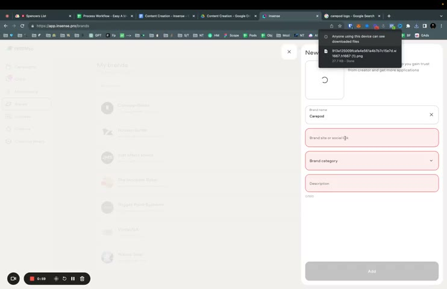
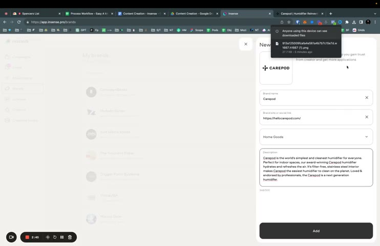

# 141. How To Add a New Brand To Insense
> Creators see your brand profile before they apply, so add the brand with a clean logo, website, category and a short description copied and polished from Google results.

## 🤖 Agent use
- **Use when:** setting up Insense for a new brand (SOP part 1).
- **Inputs → outputs:** brand name, logo, website URL, category, description → a brand profile creators see on every campaign.
- **Rules:**
  - **DO** check the **active-brand limit**: Insense allows a fixed number of active brands (the demo shows "5 of 6 active brands"); contact the Insense management team to increase it. [00:00]
  - **DO** find the logo by Google image search "[brand] logo" and upload it. [00:00]
  - **DO** paste the website URL and remove any tracking "filler" from the end. [00:57]
  - **DO** choose the closest brand category (demo: a humidifier brand "could go under health and wellness and home goods"; picked Home Goods). [00:57]
  - **DO** write the description from the brand's own best copy (Google result snippet or site meta text) and rewrite until it reads well: "we're trying to sell ourselves here to the creators". [00:57–02:40]
  - **DON'T** accept typos or weak copy: "we want to make sure that we spell things correctly and we obviously are explaining it as best as we can". [02:40]
  - **IF** the first Google snippet is awkward **THEN** try another result; "it doesn't need to be absolutely perfect". [01:45–02:40]
- **See also:** [140](140-action-item-sign-up-for-insense.md) · [142. Action Item: Add Your Brand To Insense](142-action-item-add-your-brand-to-insense.md) · [143. How To Create an Insense Campaign](143-how-to-create-an-insense-campaign.md)

Lesson page text: none ("no lesson text on page").

## Key ideas

### Brand list and limit [00:00]
- After login you see active campaigns; the Brands page lists all brands with an on/off toggle. In the demo there are seven brands, five active, "only six that are allowed to be active at once". [00:00]

### The form [00:00–02:40]
Fields in order (screenshots): logo, **Brand name**, **Brand site or social link**, **Brand category**, **Description**, then "Add". [00:00–00:57]
1. Logo: Google "[brand] logo" > Images > save the cleanest. [00:00]
2. Website link: punch in the link, remove filler at the end. [00:57]
3. Category: scroll the list and pick the closest. [00:57]
4. Description: Google the company ("hello [brand]"); copy the snippet; if too weak look at other results; edit down. The example ended as a short factual paragraph: the simplest, cleanest humidifier, filter-free stainless-steel interior, easy to clean, loved and endorsed by professionals. [00:57–02:40]
5. Click **Add a new brand**; the brand now exists. Next step is the campaign ([143](143-how-to-create-an-insense-campaign.md)). [02:40]

## Steps / framework
1. Brands > New brand. 
2. Upload logo; enter name; paste URL (clean); pick category; paste and polish description.
3. Add; confirm it appears and is toggled active.

## Examples
- **Demo brand:** a humidifier brand (client). Category chosen: Home Goods. Description assembled from Google Ads-style snippets: "easiest humidifier to clean on the planet", "fine or boil for 99% sterilization", "loved by professionals" (the instructor jokes the original snippets "are not great by the Google Ads team"). [01:45–02:40] (claims are the brand's, unverified)

## Screenshots

*The "New brand" panel: logo, brand name, brand site or social link, brand category and description, all required before "Add". [01:00]*

*Completed form: logo, name, clean URL, category (Home Goods) and a condensed description ready to add. [02:45]*

## How to apply
- [ ] Check how many active brands your plan allows.
- [ ] Prepare a transparent/clean logo, clean homepage URL, and a 3-4 sentence description in our own words (benefit, mechanism, proof we can substantiate).
- [ ] Re-read for spelling; creators see this text.

## Related
- Previous: [140. Action Item: Sign Up For Insense](140-action-item-sign-up-for-insense.md) · Next: [142. Action Item: Add Your Brand To Insense](142-action-item-add-your-brand-to-insense.md)

## Sources and limitations
- Transcript: [141… .txt](<../../../../../raw/evolve/start-here/_transcripts/👣 Evolve (Start Here)/141. How To Add a New Brand To Insense 👣 Evolve (Start Here) Evolve.txt>) · Page text: [141… .html.md](<../../../../../raw/evolve/start-here/_extracted/👣 Evolve (Start Here)/141. How To Add a New Brand To Insense_👣 Evolve (Start Here)_Evolve.html.md>)
- Machine transcription (Whisper large-v3-turbo); full recording covered (3:17). Whisper writes "Incense", "Carapod/Care Bob" (the brand name on screen is Carepod), "craters" for "creators". The speaker is unverified.
