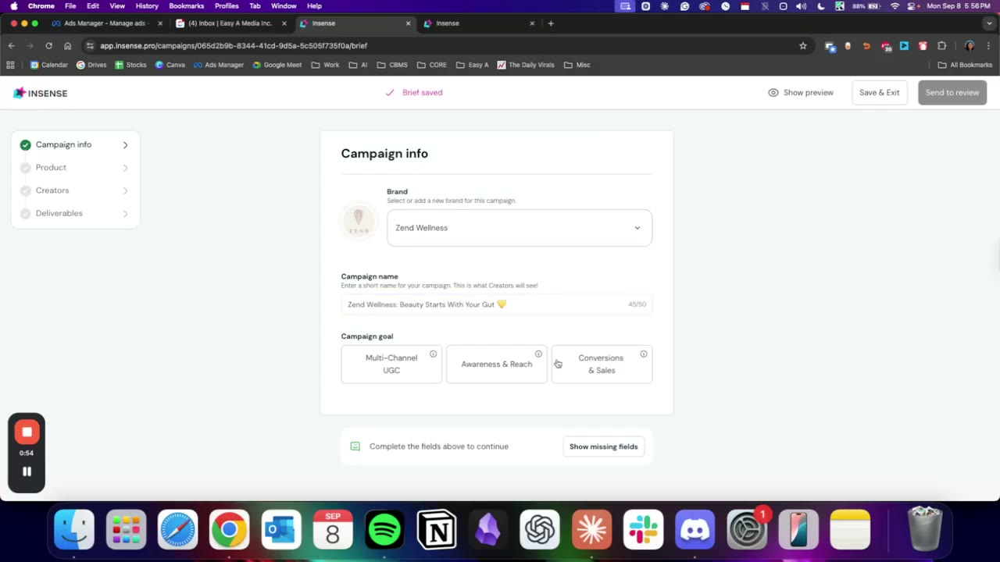
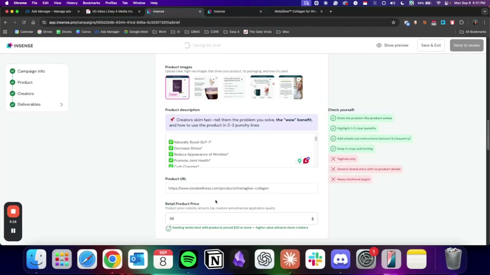
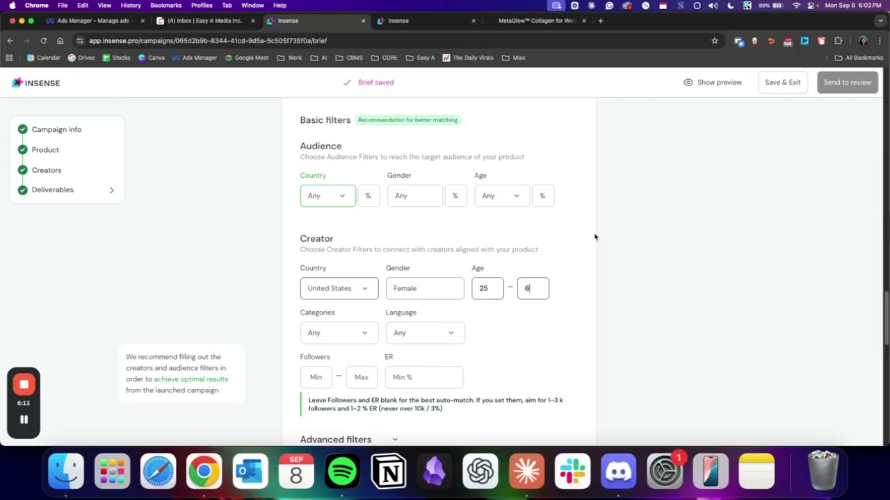
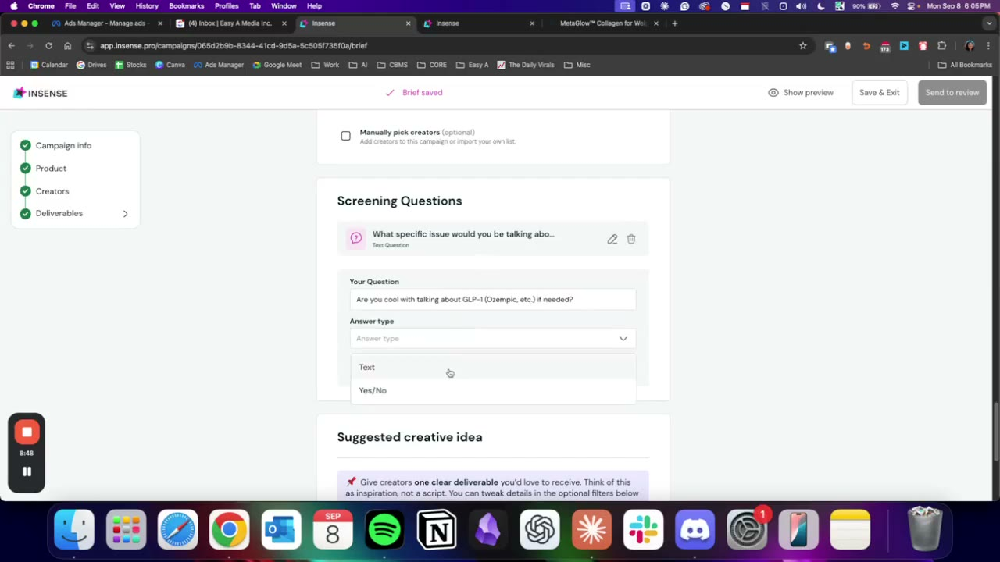
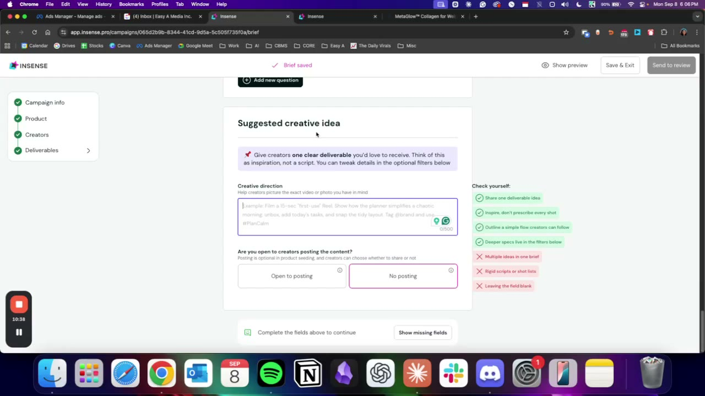
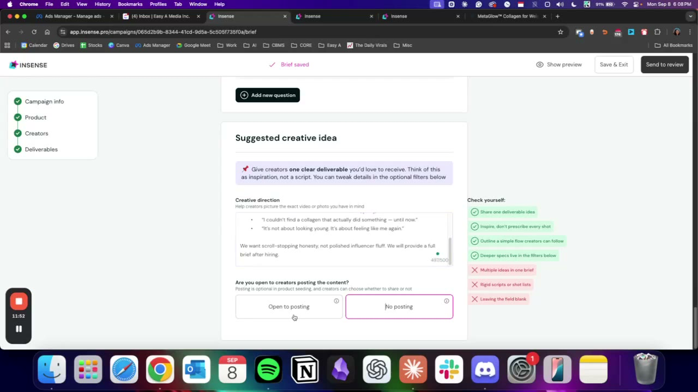
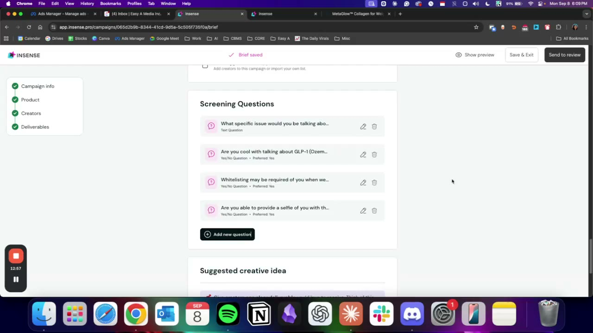

# 143. How To Create an Insense Campaign
> Step-by-step setup of a free product-seeding campaign on Insense: goal, product images and description, creator filters, screening questions and a short creative direction, then send to review.

## 🤖 Agent use
- **Use when:** launching a product-seeding (free product for content) campaign, or writing the campaign brief and screening questions for creator sourcing.
- **Inputs → outputs:** brand (already added, see [141](141-how-to-add-a-new-brand-to-insense.md)), product page/photos/price, target demographic, concepts → a campaign sent to Insense moderation, with screening questions that let you filter applicants later.
- **Rules:**
  - **DO** pick the goal **Awareness & Reach** for product seeding; the other goals "are usually for paid ... this is whitelisted and spark ads". [00:56]
  - **DO** set the number of creators high: "maybe 90 creators. I mean unlimited really. It's product seeding. It's free content." [00:56]
  - **DO** choose mainly Instagram or Facebook (as the delivery platform). [00:56]
  - **DO** state "no commission unless you create a winning ad and then ... we give you a retainer offer". [00:56]
  - **DO** upload up to 5 product photos: it is a new Insense requirement and "gives a very good idea to the creators of what they'll be doing". [01:50–02:22]
  - **DO** make sure product retail value is "probably at least $30 or above"; "you're going to get less applications if the product is very cheap". (Insense's own hint on screen: seeding "works best with products priced $20 or more".) [03:37]
  - **DON'T** use auto-invite unless you want to: "visible to match creators, auto invite. Not really. I don't want to invite anyone." [03:37]
  - **DO** set creator filters from demographics (country, gender, age, categories, language); ignore followers/engagement for seeding when posting is not required. [03:37–05:29]
  - **DO** write **screening questions**: "very, very good if you really want authentic content and ... creators who do care about the product". [05:29–06:27]
  - **DO** add a yes/no "preferred answer" so you can filter applicants by the answers later: "will save you a lot of time". [07:03–07:36]
  - **DON'T** bother with screening questions if you will give a script and the creator's experience is irrelevant. [06:27]
  - **DO** put a short creative direction (concepts, do's and don'ts, angles); "we do provide a full brief after we hire them". [08:55–10:10]
  - **IF** you cannot require a deliverable in seeding (selfie, photo) **THEN** ask it as a yes/no screening question instead. [10:10–11:14]
- **See also:** [137. Does Insense Still Work?](137-does-insense-still-work.md) · [139. UGC Content Overview - Part 2](139-ugc-content-overview-part-2.md) · [144. Action Item: Launch Your First Insense Campaign](144-action-item-launch-your-first-insense-campaign.md) · [145](145-how-to-process-creators-add-to-shortlist.md) · [148](148-sending-frameworks-to-creators-part-2.md)

Lesson page text: none ("no lesson text on page"). The Google Doc "Insense Campaign - Template" referenced in the SOP (see [138](138-ugc-content-overview-part-1.md)) is not included in the course files.

## Key ideas

### 1. Campaign info [00:00–00:56]
- Click **set up a new campaign**; choose the brand. "Usually I use ChatGPT to help me put the copy together for this." For this brand an earlier seeding campaign existed, so the presenter copies much of it. [00:00]
- **Campaign name** (what creators see; 50 characters; the demo uses "[Brand]: [benefit tagline] [emoji]", e.g. "...: Beauty Starts With Your Gut" with a heart emoji; a collagen supplement mainly for women). [00:00–00:56]
- **Campaign goal** options: Multi-Channel UGC, Awareness & Reach, Conversions & Sales. Use Awareness & Reach for seeding. [00:56]
- Number of creators, platform (Instagram or Facebook), compensation notes (no commission unless the creator makes a winning ad; then a retainer offer). [00:56]

### 2. Product [00:56–03:37]
- Product details: physical product; grab photos from the website; product description and URL; retail price (demo: a subscription price around 56-59 USD; Whisper heard "59", screen shows 56). [01:50–03:00]
- Product description guidance (Insense UI "Check yourself" box, verbatim in templates below): lead with the problem, the "wow" benefit, how to use it, in 2-3 punchy lines. [03:00] (screen)
- Price floor: "probably at least $30"; "you're going to get less applications if the product is very cheap". [03:37]

### 3. Creators: filters [03:37–05:29]
- Visible to match creators; no auto-invite. [03:37]
- Audience fields "don't matter that much". What matters is the **creator specifications**. [03:37]
- Demo targeting for a young/postpartum-mom supplement: **US only** (not Canada "because the tariffs are a little bit expensive"), **female**, **age 25 to about 65**, categories **Beauty and Care, Fashion and style ("they will look good"), Health and wellness, Lifestyle**; not Food and drink; **English**. [03:37–04:32]
- **Followers / engagement:** "doesn't really matter that much if you're doing product seeding and you're not requiring them to post on their account. You really just need the content." Insense hint on screen: leave blank for best auto-match; if set, aim for 1-3K followers and 1-2% ER (never over 10K / 3%). [04:32]
- Lookalikes: left empty "unless I really want a specific type of creator". [04:32]

### 4. Screening questions [05:29–08:19]
- Set the target segment in a text question: "What specific issue would you be talking about in your video?" Answer type **Text** because "I want them to tell me what they plan to cover". Expected answers listed: postpartum weight gain, perimenopause, menopause. [05:29–06:27]
- Add topic-comfort questions: "Are you cool with talking about GLP-1 (Ozempic, etc.) if needed?" because "we've had some creators who refuse to cover certain topics". [06:27–07:03]
- Insense asks your **preferred answer** (yes/no); later you "filter by these answers". [07:03–07:36]
- Whitelisting question (truncated on screen): "Whitelisting may be required of you when we run your ad. Are you [cool with it / do you agree to provide access]?" Preferred answer: Yes. [07:36–08:19]
- Seeding cannot require a deliverable, so add: "Are you able to provide a selfie of you with the product that we can feature on our website?" (Yes/No). [10:10–11:14]

### 5. Suggested creative idea [08:55–10:10]
- Field heading: **Suggested creative idea** / "Creative direction" (max 500 characters on screen). Paste video styles you want (unboxing, testimonial, talk about a symptom). [08:55]
- He pastes the do's/don'ts and angles from the paid campaign, noting a full brief is sent after hire. The pasted text shown includes two quote-style lines and a request for "scroll-stopping honesty, not polished influencer fluff" (see templates). [08:55–10:10]
- **Posting:** choose "Open to posting" or "No posting". "We don't require it." [10:10]

### 6. Send to review [11:14–11:53]
- Click **Send to review**; the campaign sits in "moderation" under the brand's campaigns until approved. After it goes live, applications arrive and you "review them and hire the creators" ([145](145-how-to-process-creators-add-to-shortlist.md), [147](147-how-to-hire-approved-creators-part-1.md)). [11:14–11:53]

## Steps / framework
| # | Step | Setting in the demo | Source |
|---|---|---|---|
| 1 | Set up a new campaign; choose brand | Brand added earlier | [00:00] |
| 2 | Campaign name | "[Brand]: [benefit] [emoji]", max 50 characters | [00:00] |
| 3 | Goal | Awareness & Reach (seeding) | [00:56] |
| 4 | Creators wanted | about 90 / "unlimited really" | [00:56] |
| 5 | Platform / compensation | Instagram or Facebook; no commission unless a winning ad, then retainer | [00:56] |
| 6 | Product images | up to 5 photos from the site | [01:50–02:22] |
| 7 | Description, URL, price | Short punchy description; price at least about $30 | [03:00–03:37] |
| 8 | Visibility | visible to match creators, no auto-invite | [03:37] |
| 9 | Creator filters | US; female; 25-65; Beauty, Fashion, Health, Lifestyle; English; no follower/ER limits; no lookalikes | [03:37–05:29] |
| 10 | Screening questions | 1 text + 3 yes/no (below) | [05:29–11:14] |
| 11 | Creative direction | concepts, do's/don'ts, angles (max 500 characters) | [08:55–10:10] |
| 12 | Posting | Open to posting / No posting | [10:10] |
| 13 | Send to review | Moderation until approved | [11:14] |

## Examples
- **Screening-question set used in the demo** (4 questions, final list on screen):
  1. What specific issue would you be talking about in your video? (Text)
  2. Are you cool with talking about GLP-1 (Ozempic, etc.) if needed? (Yes/No, preferred Yes)
  3. Whitelisting may be required of you when we run your ad... (Yes/No, preferred Yes)
  4. Are you able to provide a selfie of you with the product that we can feature on our website? (Yes/No, preferred Yes)
- **Targeting logic:** pick categories from the avatar's interests (health, beauty, fashion, lifestyle); drop food and drink for a supplement. [04:32]

## Structured units

### Rules of thumb
- **DO** keep seeding product value above about $30 (Insense says $20+). [03:37]
- **DON'T** filter by followers/ER for seeding when you only need the content. [04:32]
- **IF** a topic is sensitive (e.g. medication) **THEN** ask a screening question about comfort. [06:27–07:03]

## Prompts / templates (verbatim from the Insense UI)

```
Product description (Insense hint box):
Creators skim fast - tell them the problem you solve, the "wow" benefit, and how to use the product in 2-3 punchy lines
Check yourself:
  [ok] State the problem the product solves
  [ok] Highlight 1-2 clear benefits
  [ok] Add simple use instructions (amount & frequency)
  [ok] Keep it crisp and inviting
  [no] Taglines only
  [no] Generic brand story with no product details
  [no] Heavy technical jargon
Hint under price: Seeding works best with products priced $20 or more - higher value attracts more creators

Creator filters hint: Leave Followers and ER blank for the best auto-match. If you set them, aim for 1-3k followers and 1-2% ER (never over 10k / 3%)

Suggested creative idea (Insense hint box):
Give creators one clear deliverable you'd love to receive. Think of this as inspiration, not a script. You can tweak details in the optional filters below
Check yourself:
  [ok] Share one deliverable idea
  [ok] Inspire, don't prescribe every shot
  [ok] Outline a simple flow creators can follow
  [ok] Deeper specs live in the filters below
  [no] Multiple ideas in one brief
  [no] Rigid scripts or shot lists
  [no] Leaving the field blank
Posting: "Are you open to creators posting the content? Posting is optional in product seeding, and creators can choose whether to share or not" -> Open to posting / No posting
```

Creative direction text visible at the end of the pasted block (partly scrolled out of view):
```
"I couldn't find a collagen that actually did something — until now."
"It's not about looking young. It's about feeling like me again."

We want scroll-stopping honesty, not polished influencer fluff. We will provide a full brief after hiring.
```
(The first part of the block, with the do's/don'ts and angles, scrolls out of frame; its full text is not in the course files.)

Screening questions as typed:
```
What specific issue would you be talking about in your video?   [Text question]
Are you cool with talking about GLP-1 (Ozempic, etc.) if needed?   [Yes/No, preferred: Yes]
Whitelisting may be required of you when we...   [Yes/No, preferred: Yes]  (full wording cut off on screen)
Are you able to provide a selfie of you with the product that we can feature on our website?   [Yes/No, preferred: Yes]
```

## Screenshots

*Campaign info step: brand dropdown, campaign name (what creators see, 50 characters) and the three goals Multi-Channel UGC / Awareness & Reach / Conversions & Sales. [00:56]*


*Product step: five product photos, description with Insense's "Check yourself" do/don't list, product URL, retail price and the "$20 or more" hint. [03:40]*


*Creator filters: country United States, gender Female, age 25-65, categories, language, follower/ER limits with the 1-3K / 1-2% hint. [04:35]*


*Adding a screening question: "Are you cool with talking about GLP-1 (Ozempic, etc.) if needed?" with answer types Text and Yes/No. [07:10]*


*Suggested creative idea field with Insense's do/don't hints and the Open to posting / No posting toggle. [09:00]*


*Creative direction filled in (497/500 characters), ending "We want scroll-stopping honesty, not polished influencer fluff. We will provide a full brief after hiring." [10:15]*


*The four screening questions with answer types and preferred answers, ready for "Send to review". [11:20]*

## How to apply
- [ ] Prepare product photos (3-5), a 2-3 line description, URL and retail price (aim above $30).
- [ ] Choose Awareness & Reach; enter a high creator count; leave followers/ER blank.
- [ ] Set country/gender/age/categories from the avatar; English if content is spoken.
- [ ] Write 3-4 screening questions: topic fit (text), comfort with sensitive topics, whitelisting consent, selfie/photo.
- [ ] Paste one clear creative idea (max 500 characters) and decide posting.
- [ ] Send to review; check the campaign status for moderation.

## Related
- Previous: [142. Action Item: Add Your Brand To Insense](142-action-item-add-your-brand-to-insense.md) · Next: [144. Action Item: Launch Your First Insense Campaign](144-action-item-launch-your-first-insense-campaign.md)
- [Playbook: creator brief](../../../../playbooks/creator-brief.md)

## Sources and limitations
- Transcript: [143… .txt](<../../../../../raw/evolve/start-here/_transcripts/👣 Evolve (Start Here)/143. How To Create an Insense Campaign 👣 Evolve (Start Here) Evolve.txt>) · Page text: [143… .html.md](<../../../../../raw/evolve/start-here/_extracted/👣 Evolve (Start Here)/143. How To Create an Insense Campaign_👣 Evolve (Start Here)_Evolve.html.md>)
- Machine transcription (Whisper large-v3-turbo); full recording covered (11:53). Whisper writes "Incense", "product seating", "Zend" for the client brand name, "beauty starts with your guts". The wording of the Whitelisting question is cut off on screen. Screenshot text is read from low-resolution frames; Insense UI wording may have changed since the recording (the Mac menu bar shows "Mon Sep 8"; year not shown).
- The speaker is unverified (likely a team member rather than the main instructor). The "full brief" sent after hire is covered by [148](148-sending-frameworks-to-creators-part-2.md).
