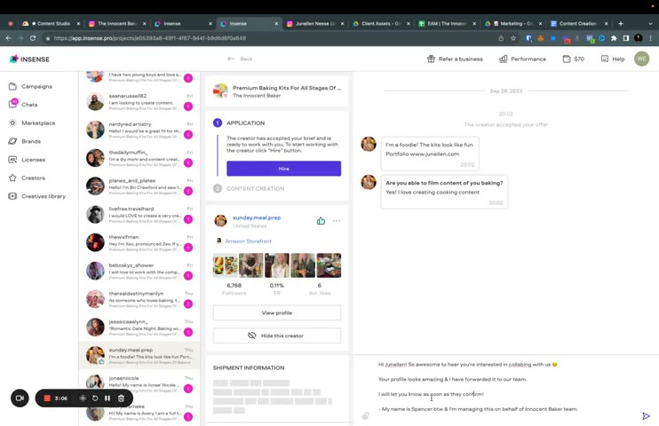

# 145. How To Process Creators & Add To Shortlist
> Review each applicant's message, Instagram and Insense profile; for good fits send a "shortlisted" template message (not a hire), then thumbs-up and add them to the shortlist the client will approve.

## 🤖 Agent use
- **Use when:** a campaign has applications and you must pick which creators to put forward (SOP part 3).
- **Inputs → outputs:** Insense applications/chats, the client's Instagram/website, the templated messages doc → a shortlist (thumbs-up in Insense) and a message sent to each shortlisted creator.
- **Rules:**
  - **DO** open the client's Instagram and website first so you judge fit against the right brand. [00:00]
  - **DO** check each applicant's profile (Instagram/TikTok) and their **Insense profile** (content, reviews). [00:00–01:40; 02:35]
  - **DO** prefer applicants who customised their pitch: "this creator put the extra endeavour in, told us exactly what she's looking for". Template-style pitches are weaker signals. [01:40–03:24]
  - **DON'T** hire at this stage. "You don't hire them. Number one, you just let them know that you're interested. You add them to the shortlist." [01:40]
  - **DO** tell the creator you are managing this on behalf of the brand team: "it's really important to make sure that they know that because obviously there's going to be some time delays". [01:40]
  - **DO** type the creator's name correctly in the template. [03:24–04:11]
  - **IF** you are unsure about a creator **THEN** pass or leave them: "the creator's not going to go anywhere." [02:35]
  - **IF** the Instagram link does not load or the content is thin **THEN** ask them to send their Instagram or TikTok link before deciding. [04:11–05:17]
  - **IF** engagement is low but the content is relevant (e.g. parenting videos for a kids' baking kit) **THEN** check the Insense profile and reviews before deciding. [05:17–06:11]
- **See also:** [143](143-how-to-create-an-insense-campaign.md) · [146. How To Download Creators & Upload To Sheet](146-how-to-download-creators-upload-to-sheet.md) · [147. How to Hire Approved Creators - Part 1](147-how-to-hire-approved-creators-part-1.md) · [138](138-ugc-content-overview-part-1.md)

Lesson page text: only a link to the "Insense Templated Messages Doc" (Google Doc; exported, same content as the attached docx, see templates below).

## Key ideas

### 1. Where the shortlist comes from [00:00–01:40]
- Pull up the client's Instagram and, if they have content, their website, "so we're looking at the right brand". Then work through applicant chats. [00:00]
- Example good fit: a cooking creator whose family-style content suits a baking-kit brand. Send the shortlist message, copy-paste, update with the client name. [00:00–01:40]
- "Inside of here there's going to be some scripts for you, or a link to a separate Google doc with these scripts." [00:41]

### 2. Reading applications [01:40–03:24]
- Templates vs customised: "some people just use template. Other people actually go all in and customise it to us."
- Example read of a customised pitch (baking creator offering a reel showing how to use and make the kit with her daughter): "amazing". Check the profile "to make sure it's not anything crazy": high quality, age of child fits the product. [02:35–03:24]
- Example pass: a very young-looking profile with unrelated content ("I don't know if I'm sold on it"). [01:40–02:35]

### 3. Profile red flags and workarounds [04:11–06:11]
- Instagram profile "not available" is "a little suspicious"; check the Insense profile for reviews too. [04:11]
- If you cannot check their social account, send: "Hey, could you send over your Instagram or TikTok profile? It's not loading for whatever reason here on Insense." [04:11–05:17]
- Low engagement can be fine if the account shows relevant life stage (kids, parenting) and reviews exist; "maybe she's got some good ideas". [05:17–06:11]
- Reviews on the Insense profile show "what the creator looks like" with other brands. [06:11]

### 4. Thumbs up = shortlist [01:40–07:06]
- After messaging, use the thumbs-up to add to the shortlist. "I'm going to thumbs her up." The shortlist feeds the sheet ([146](146-how-to-download-creators-upload-to-sheet.md)). [04:11; 06:11]
- Next step: download and upload to the sheet, then the client confirms. [07:06]

## Steps / framework
1. Open client site + Instagram. [00:00]
2. For each applicant: read pitch -> open social profile -> open Insense profile (content/reviews). [00:00–06:11]
3. Decision: good fit -> send **Shortlisted Creator** message + thumbs-up; unsure -> pass; cannot verify -> ask for Instagram/TikTok link. [02:35; 04:11–05:17]
4. Do not hire yet. Wait for client confirmation (see [146](146-how-to-download-creators-upload-to-sheet.md), [147](147-how-to-hire-approved-creators-part-1.md)). [01:40]

## Examples
- **Shortlist message pasted into a creator chat** (screenshot). [01:50]
- **Pass reason (derived):** content not matching the product or very young profile. [01:40–02:35]

## Prompts / templates (verbatim)
From the attached/linked "Insense Content Creation - Insense Templated Messages" doc (same text in both exports; the lesson 147 doc contains the same content):

```
Shortlisted Creator:

Hi NAME! So awesome to hear you're interested in collabing with us 😊

Your profile looks amazing & I have forwarded it to our team.

I will let you know as soon as they confirm!

- My name is YOURNAME btw & I'm managing this on behalf of CLIENTNAME team.
```

```
Hired Creator:

Hey NAME! Our team is very excited to work with you on this project 🎉

We need 3 things from you!

1. Can you send over your email for tracking?

2. Can you confirm your shipping address?

3. You understand that this is NOT a paid campaign & agree to send content back in exchange for product only

CREATOR SHIPPING

ADDRESS HERE

---

Also let me know the products you would like to receive:

PRODUCT LINK
```

```
Product Sent Message:

Great Choice! Your [PRODUCT] should be shipping within the next 1-3 days!

Please update us once you have received the product.

Our only requirement is to please keep in mind for filming purposes & If you decide to add any text or edits to your video, to PLEASE keep things in the middle of the screen as we will be cropping your video down from 9x16 into a 4x5 format as these videos are for Facebook & Instagram.

We look forward to seeing your content!
```
(The Hired Creator and Product Sent messages are used in [147](147-how-to-hire-approved-creators-part-1.md) and [151](151-how-to-follow-up-upload-content-part-1.md).)

## Structured units

### Rules of thumb
- **DO** reward effort: personalised applications beat copy-paste. [01:40–03:24]
- **DON'T** hire before the client confirms. [01:40]
- **IF** unsure **THEN** pass; more applicants will come. [02:35]

## Screenshots

*Insense chat: the creator's application message on the right, and the "Shortlisted Creator" template pasted into the reply box with the client name filled in. The right-hand panel shows the Hire button, so shortlisting happens before hiring. [01:50]*

## How to apply
- [ ] Open the client's Instagram and site.
- [ ] Work through applicant chats; check social + Insense profile + reviews.
- [ ] Send the Shortlisted Creator template (NAME, YOURNAME, CLIENTNAME filled in); thumbs-up.
- [ ] For unverifiable profiles, ask for a link.
- [ ] Leave unsure creators; do not hire until the client confirms.

## Related
- Previous: [144. Action Item: Launch Your First Insense Campaign](144-action-item-launch-your-first-insense-campaign.md) · Next: [146. How To Download Creators & Upload To Sheet](146-how-to-download-creators-upload-to-sheet.md)

## Sources and limitations
- Transcript: [145… .txt](<../../../../../raw/evolve/start-here/_transcripts/👣 Evolve (Start Here)/145. How To Process Creators & Add To Shortlist 👣 Evolve (Start Here) Evolve.txt>) · Page text: [145… .html.md](<../../../../../raw/evolve/start-here/_extracted/👣 Evolve (Start Here)/145. How To Process Creators & Add To Shortlist_👣 Evolve (Start Here)_Evolve.html.md>) · Attachment: [145 … .docx.md](<../../../../../raw/evolve/start-here/_extracted/👣 Evolve (Start Here)/145. How To Process Creators & Add To Shortlist.docx.md>) · Linked Google Doc: [145-document-1kGfWk4-T-.docx.md](../../../../../raw/evolve/start-here/_extracted/_linked/google/145-document-1kGfWk4-T-.docx.md)
- Machine transcription (Whisper large-v3-turbo); last segment 7:27 of 7:27. Whisper writes "Incense", "clapping" for "collabing", and makes up creator names; creator and client contact details are intentionally omitted. The client in the walkthrough is a baking-kit brand ("The Innocent Baker"); "innocent. Baker team" was the filled-in CLIENTNAME. The "Loom" the instructor is building is referenced but not included.
- The template says "3 things" while the video-era version (lesson 147) says "2 things": the doc has since been updated.
