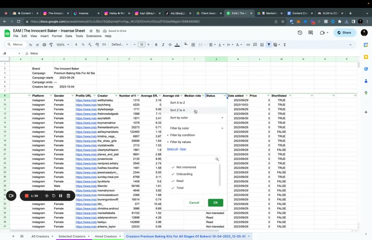
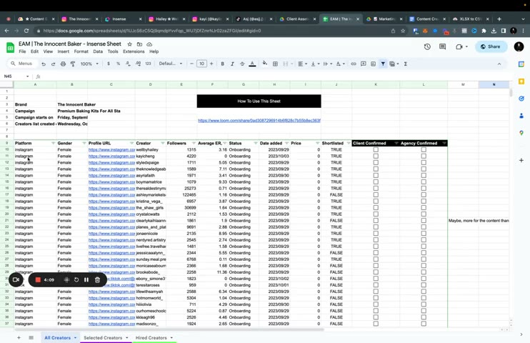

# 146. How To Download Creators & Upload To Sheet
> Export the Insense applicant list, convert it to CSV, import it into the client's Insense Google Sheet, clean the columns, highlight the shortlisted creators and let the client confirm.

## 🤖 Agent use
- **Use when:** a campaign has collected applicants and you must give a client (or yourself) a clean approval list (SOP part 4).
- **Inputs → outputs:** Insense creator-list export (.xlsx) + the Evolve client sheet template → a cleaned "All Creators" tab with shortlisted creators highlighted, ready for client confirmation and for the "Selected Creators" tab.
- **Rules:**
  - **DO** make a copy of the Insense Sheet template (link on page). 
  - **DO** go to the campaign level and download the whole creator list. [00:00–00:38]
  - **DO** convert the xlsx to **csv** (the instructor used CloudConvert "because it was the top link") and import it as a **new sheet** in the client file, not a new spreadsheet. [00:38–01:29]
  - **DO** filter the Status column to the onboarding applicants to count real applicants (demo: 40). [01:29]
  - **DO** keep only the columns the template uses; paste into the "All Creators" tab. [01:29–03:10]
  - **DO** add conditional formatting that highlights shortlisted rows (cell text equals/contains TRUE) so the client sees "these are the creators that we like". [04:07]
  - **DON'T** hire yet; the client confirms first. [04:56]
  - **IF** the client confirms creators **THEN** copy them to the Selected Creators tab and proceed to hiring ([147](147-how-to-hire-approved-creators-part-1.md)). [03:10]
- **See also:** [145](145-how-to-process-creators-add-to-shortlist.md) · [147](147-how-to-hire-approved-creators-part-1.md) · [138](138-ugc-content-overview-part-1.md)

Lesson page text: "Make a copy of the Insense Sheet:" plus the Google Sheets link (exported; three tabs, see below).

## Key ideas

### 1. Starting point [00:00–00:38]
- After processing, replies are already coming in ("Great, awesome ... all these people are interested"). The campaign had "no new applications, no new messages", "over 40 applications ... 40 creators who applied", and about 15 starred (shortlisted). [00:00]
- Go back to the **campaign level** and download "this entire creator list". [00:38]

### 2. Convert and import [00:38–01:29]
- The download is xlsx; "convert to csv" (any free converter; the demo used CloudConvert). [00:38]
- In the client sheet: File > Import > upload the csv; "rather than creating a new spreadsheet, we're just going to insert a new sheet", then "Import data". [01:29]

### 3. Clean up [01:29–03:10]
- Add a filter on the status column; keep only the status that contains the applicants (instructor says "onboarded"; the sheet and screen show "Onboarding"; filter options on screen: Not interested, Onboarding, Read, Total). Count check: 40. [01:29]
- Delete unneeded columns; the final set the instructor wants is in the table below ("data added", "price", "shortlisted"). He deletes two status-type columns and stumbles on the delete-column step. [01:29–02:13]
- Update the header cells: campaign started on / creator list created on (use the real date); brand and campaign names. [02:13]
- Copy the cleaned rows into the "All Creators" tab; pasting over replaces everything, so copy the whole block. [03:10]

### 4. Highlight and hand to the client [03:10–04:56]
- "Make sure you delete this as well ... just keep it clean": remove helper/scratch columns after the paste (the instruction is not fully clear). [03:10]
- Conditional format: "if the text contains true ... highlight". The client then sees the 15 shortlisted creators. The client confirms in the sheet; "once the client then confirms everything inside of here, then we will be able to copy it over into [Selected Creators]". [04:07–04:56]
- The instructor says the sheet functionality may still be updated: "I'm just filming SOPs as we go". [04:56]

## Steps / framework
1. Make a copy of the template sheet ("Evolve | CLIENT - Insense Sheet").
2. Insense: campaign > download creator list (xlsx).
3. Convert xlsx to csv.
4. Client sheet: File > Import > upload > **Insert new sheet(s)** > Import data.
5. Filter Status to applicants; verify the count.
6. Remove extra columns; copy into "All Creators" (below).
7. Fill the header (Brand, Campaign, Campaign starts on, Creators list created on).
8. Add conditional formatting for Shortlisted = TRUE.
9. Share with the client; they tick **Client Confirmed**.
10. Move confirmed creators to **Selected Creators** ([147](147-how-to-hire-approved-creators-part-1.md)).

## Prompts / templates (verbatim sheet structure)
Template tabs: **All Creators**, **Selected Creators**, **Hired Creators**.

```
All Creators (header block)
How To Use This Sheet  [Loom link]
Brand
Campaign
Campaign starts on
Creators list created on

Columns:
Platform | Gender | Profile URL | Creator | Followers | Average ER, % | Status | Date added | Price | Country | Shortlisted | Agency Confirmed
```
The lesson screenshot (later version) shows: `Platform | Gender | Profile URL | Creator | Followers | Average ER, % | Status | Date added | Price | Shortlisted | Client Confirmed | Agency Confirmed`.

```
Selected Creators (title: "... HIRED CREATORS")
Platform | Gender | Profile URL | Creator | Number of followers | Average ER, % | Status | Price | Shortlisted | Hired
```

```
Hired Creators
nickname | name | surname | phone number | email | address | Product To Send | Product Sent | Tracking Number | Content Received
```
(The exported template contains sample applicant rows with creator handles; they are intentionally not reproduced here. "Shortlisted", "Agency Confirmed", "Hired", "Product Sent" and "Content Received" are checkbox columns.)

## Examples
- 40 applicants, 15 shortlisted by the agency, shown with TRUE highlighted green in the sheet; the client ticks Client Confirmed; the agency ticks Agency Confirmed. [00:00; 04:07; screenshots]

## Structured units

### Rules of thumb
- **DO** import as a new sheet in the existing client file. [01:29]
- **DO** highlight shortlisted rows for the client. [04:07]
- **IF** pasting over the old range wipes content or something blocks the paste **THEN** copy the whole block again and paste it in one go ("it shouldn't be that long"). [02:13–03:10]

## Screenshots

*The client Insense Sheet after import: header block (brand, campaign, campaign start/list dates), the creators table and the Status filter (Not interested / Onboarding / Read). [01:40]*


*Cleaned All Creators tab with the "How To Use This Sheet" link, Shortlisted (TRUE/FALSE) and the Client Confirmed / Agency Confirmed checkbox columns. [04:10]*

## How to apply
- [ ] Copy the template; fill Brand/Campaign/dates.
- [ ] Export, convert, import as a new sheet.
- [ ] Keep: platform, gender, profile URL, creator, followers, ER, status, date added, price, shortlisted.
- [ ] Highlight shortlisted rows; share with the client.
- [ ] After confirmation, move rows to Selected Creators.

## Related
- Previous: [145. How To Process Creators & Add To Shortlist](145-how-to-process-creators-add-to-shortlist.md) · Next: [147. How to Hire Approved Creators - Part 1](147-how-to-hire-approved-creators-part-1.md)

## Sources and limitations
- Transcript: [146… .txt](<../../../../../raw/evolve/start-here/_transcripts/👣 Evolve (Start Here)/146. How To Download Creators & Upload To Sheet 👣 Evolve (Start Here) Evolve.txt>) · Page text: [146… .html.md](<../../../../../raw/evolve/start-here/_extracted/👣 Evolve (Start Here)/146. How To Download Creators & Upload To Sheet_👣 Evolve (Start Here)_Evolve.html.md>) · Sheet: [146 … .xlsx.md](<../../../../../raw/evolve/start-here/_extracted/👣 Evolve (Start Here)/146. How To Download Creators & Upload To Sheet.xlsx.md>) · Linked sheet: [146-spreadsheets-17Jopj7oxa.xlsx.md](../../../../../raw/evolve/start-here/_extracted/_linked/google/146-spreadsheets-17Jopj7oxa.xlsx.md)
- Machine transcription (Whisper large-v3-turbo); full recording covered (5:21). Whisper writes "xlx"/"xls" for xlsx and "onboarded" for the Insense status "Onboarding". The delete-columns and "delete that out of the sheet" steps are muddled in the audio. The exported sheet is a template with sample data from a past campaign; the video's sheet is a later version.
