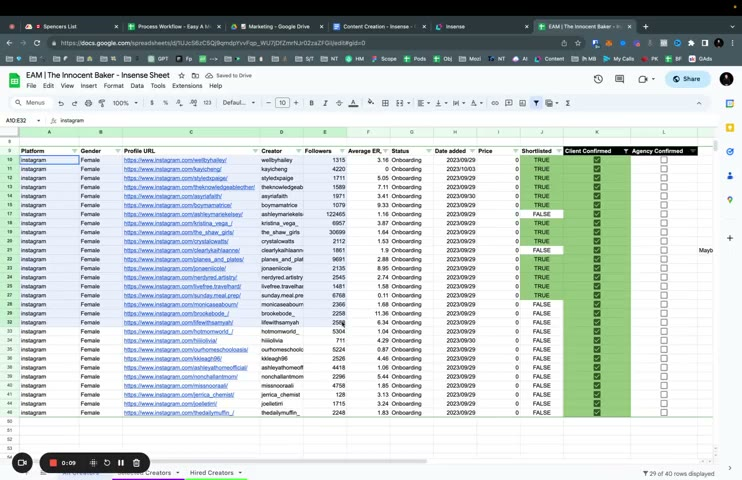
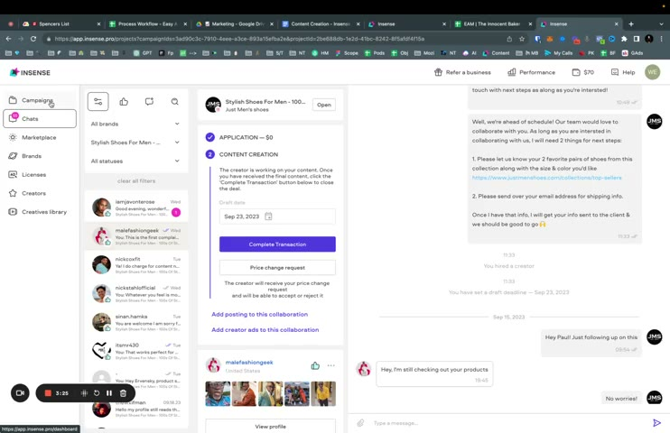
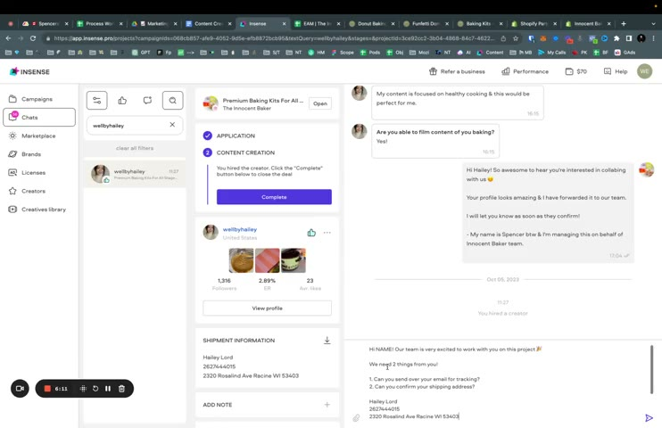

# 147. How to Hire Approved Creators - Part 1
> After the client confirms creators, hire each one in Insense and send the "Hired Creator" message that collects email, confirms the shipping address, lets them pick the product, and gets them to agree the campaign is product-only, not paid.

## 🤖 Agent use
- **Use when:** the client has confirmed creators (SOP part 5) and you must hire and onboard them.
- **Inputs → outputs:** client-confirmed rows (Selected Creators tab), Insense chats, the Hired Creator template, the product link/collection → hired creators in Insense, a customised message per creator, and shipping info ready to download.
- **Rules:**
  - **DO** move the client-confirmed creators to the **Selected Creators** tab first. [00:00]
  - **DO** search the creator's name in Insense chats, click **Hire**; shipping information becomes available. [00:51]
  - **DO** paste the **Hired Creator** template, paste their shipping address into it, and ask them to **confirm email and address**: "we just want to make sure that we're not sending to an old address and we're not sending confirmation to the wrong email either". [01:34]
  - **DO** make the creator confirm this is a **free campaign** with **no payment, only product**. Page text: "PLEASE MAKE SURE YOU ALSO HAVE THE CREATOR CONFIRM THAT THEY UNDERSTAND THIS IS A 'FREE CAMPAIGN' AND THERE WILL BE NO PAYMENT. ONLY PRODUCT. We have had some EVOLVERs fail to mention this before sending the product."
  - **DO** let creators choose the product when the client has several SKUs: "we want to make sure that we aren't sending product that the creator doesn't want, which would obviously lead to poor and unauthentic content". [02:22–03:16]
  - **IF** there is a single product **THEN** only ask for variant preference (colour, etc.). [03:16–03:52]
  - **IF** the client has a messy collection **THEN** build a clean collection of selectable products to send the creator, but "always wait until the client confirms" first. [03:52–04:47]
  - **DO** store the customised template back in the sheet so you do not recopy it each time. [05:36]
  - **DON'T** panic about a wrong message; "if you make mistakes, obviously it's okay". [08:10]
- **See also:** [145](145-how-to-process-creators-add-to-shortlist.md) (templates) · [146](146-how-to-download-creators-upload-to-sheet.md) · [148. Sending Frameworks To Creators - Part 2](148-sending-frameworks-to-creators-part-2.md) · [150. Action Item: Hire Creators](150-action-item-hire-creators.md) · [151](151-how-to-follow-up-upload-content-part-1.md)

## Page text (verbatim)
"**IMPORTANT NOTE:** PLEASE MAKE SURE YOU ALSO HAVE THE CREATOR CONFIRM THAT THEY UNDERSTAND THIS IS A 'FREE CAMPAIGN' AND THERE WILL BE NO PAYMENT. ONLY PRODUCT. We have had some EVOLVERs fail to mention this before sending the product. The script below has also been updated for you:" followed by the link to the Insense Templated Messages Doc.

## Key ideas

### 1. Prepare [00:00–00:51]
- Copy the client-confirmed creator rows to the Selected Creators tab; drop the price column and re-merge the header cells. [00:00]
- Then work from the top of the list, name by name. Insense orders applicants by date applied and message. [00:51]

### 2. Hire in Insense [00:51–01:34]
- Copy the creator's name, use the chat search filter, open the chat, click **Hire**. The confirmation says "thank you for hiring this creator" and the shipping information becomes available (download icon). [00:51]

### 3. The Hired Creator message [01:34–02:22; 05:36–08:41]
- Paste the template; change the greeting if awkward ("hey" -> "hi"); replace NAME. [01:34]
- Video-era version asked for two things (email for tracking, confirm shipping address); the updated doc adds a **third**: agree it is not a paid campaign. [01:34–02:22; page text]
- Copy the address from the Insense shipping panel under "CREATOR SHIPPING ADDRESS HERE" so the creator confirms it matches. [02:22]
- Last block: "Also let me know the products you would like to receive: [PRODUCT LINK]". [02:22]
- Per-creator customisation: after the first send, the presenter personalises further (for example asks which recipe kit the creator wants). [06:06–07:12]

### 4. Product selection by client type [02:22–05:36]
- **Multiple SKUs (shoe client):** message asked for the creator's two favourite pairs from a linked collection plus the email. Verbatim from the screen: "Well, we're ahead of schedule! Our team would love to collaborate with you. As long as you are interested in collaborating with us, I will need 2 things for next steps: 1. Please let us know your 2 favorite pairs of shoes from this collection along with the size & color you'd like [collection link] 2. Please send over your email address for shipping info. Once I have that info, I will get your info sent to the client & we should be good to go" (small emoji at the end). [02:22–03:16] (read from a low-resolution screenshot)
- **Single product:** don't ask them to choose; ask "if there's a variant, if you want a black or a white one". [03:16–03:52]
- **Baking-kit client (live example):** asked the client whether to send one main kit or let creators choose; created a new, clean storefront collection of kits so creators pick which recipe/kit (donut kits shown) they want. The instructor says this is client-specific ("not something you're gonna have to do"); "if you need to chat with senior strategists, please just message them". [03:52–05:36]
- **Why choice matters:** forcing a product on someone leads to "poor and unauthentic content". [03:16]

### 5. Repeat for each creator [06:06–08:41]
- Three more hires are shown in sequence: find, Hire, copy template, paste shipping, customise the product question, send, and move on. "Boom, just like that." [06:06–08:41]
- The next Loom covers exporting the hired creators to the sheet and informing the client. [08:41]

## Steps / framework
1. Client confirms (sheet tick) -> copy those rows to Selected Creators. [00:00]
2. Insense > Chats > search the creator > **Hire**. [00:51]
3. Paste the Hired Creator template; replace NAME; insert shipping address; insert product link or choice text. [01:34–02:22]
4. Ask: email, address confirmation, product-only agreement (and product choice/variant). [page text]
5. Send; wait for the reply; after confirmation, send the Product Sent message and follow the shipping flow ([151](151-how-to-follow-up-upload-content-part-1.md)).
6. Record in the Hired Creators tab ([146](146-how-to-download-creators-upload-to-sheet.md)).

## Prompts / templates (verbatim)
Hired Creator message (current version, from the attached/linked docx):

```
Hey NAME! Our team is very excited to work with you on this project 🎉

We need 3 things from you!

1. Can you send over your email for tracking?

2. Can you confirm your shipping address?

3. You understand that this is NOT a paid campaign & agree to send content back in exchange for product only

CREATOR SHIPPING

ADDRESS HERE

---

Also let me know the products you would like to receive:

PRODUCT LINK
```

Product Sent message (same doc):

```
Great Choice! Your [PRODUCT] should be shipping within the next 1-3 days!

Please update us once you have received the product.

Our only requirement is to please keep in mind for filming purposes & If you decide to add any text or edits to your video, to PLEASE keep things in the middle of the screen as we will be cropping your video down from 9x16 into a 4x5 format as these videos are for Facebook & Instagram.

We look forward to seeing your content!
```

Shortlisted Creator message: see [145](145-how-to-process-creators-add-to-shortlist.md).

Variant-only wording (single product), as described, not shown verbatim: ask the creator to say if they prefer a colour variant, e.g. black or white. [03:52]

## Examples
| Client type | What the message asked the creator | Source |
|---|---|---|
| Shoes (many SKUs) | Two favourite pairs from a collection link, with size and colour; plus email | [02:22–03:16], screenshot |
| Single product | Variant preference only (e.g. colour) | [03:16–03:52] |
| Baking kits | Which recipe/kit to receive, from a new collection | [03:52–07:12; 08:10] |

## Structured units

### Rules of thumb
- **DO** have the creator confirm the campaign is product-only before shipping. (page text)
- **DO** let the creator pick products with multiple SKUs. [03:16]
- **DON'T** hire before the client's confirmation. [04:47]

## Screenshots

*The sheet at the start of the hiring step: Client Confirmed ticked for approved creators, Agency Confirmed column beside it, rows highlighted green. [00:10]*


*Insense chat for a shoe client: the hire is recorded and the message asks for two favourite pairs from a collection link plus the email address for shipping. [03:25]*


*The new storefront collection of kit options sent to creators so they choose the product they want. [06:10]*

## How to apply
- [ ] Copy confirmed rows to Selected Creators.
- [ ] Hire in Insense; paste Hired Creator template with all 3 asks and the shipping address.
- [ ] Decide product choice approach: collection (multi-SKU) vs variant question (single SKU).
- [ ] Wait for the reply; then send the Product Sent message.
- [ ] Update the Hired Creators tab ([146](146-how-to-download-creators-upload-to-sheet.md)).

## Related
- Previous: [146. How To Download Creators & Upload To Sheet](146-how-to-download-creators-upload-to-sheet.md) · Next: [148. Sending Frameworks To Creators - Part 2](148-sending-frameworks-to-creators-part-2.md)

## Sources and limitations
- Transcript: [147… .txt](<../../../../../raw/evolve/start-here/_transcripts/👣 Evolve (Start Here)/147. How to Hire Approved Creators - Part 1 👣 Evolve (Start Here) Evolve.txt>) · Page text: [147… .html.md](<../../../../../raw/evolve/start-here/_extracted/👣 Evolve (Start Here)/147. How to Hire Approved Creators - Part 1_👣 Evolve (Start Here)_Evolve.html.md>) · Attachment: [147 … .docx.md](<../../../../../raw/evolve/start-here/_extracted/👣 Evolve (Start Here)/147. How to Hire Approved Creators.docx.md>) · Linked doc: [147-document-1kGfWk4-T-.docx.md](../../../../../raw/evolve/start-here/_extracted/_linked/google/147-document-1kGfWk4-T-.docx.md)
- Machine transcription (Whisper large-v3-turbo); full recording covered (8:54). Whisper mangles creator names and the word "donut(s)"; creator names and shipping details are deliberately left out. The attachment and linked doc equal the templates doc in lesson [145](145-how-to-process-creators-add-to-shortlist.md).
- The video predates the doc update (it says "two things"); follow the doc. The shoe-client message is read from a low-resolution screenshot and may contain small misreadings.
