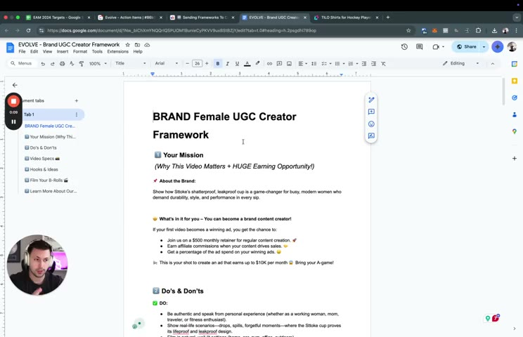
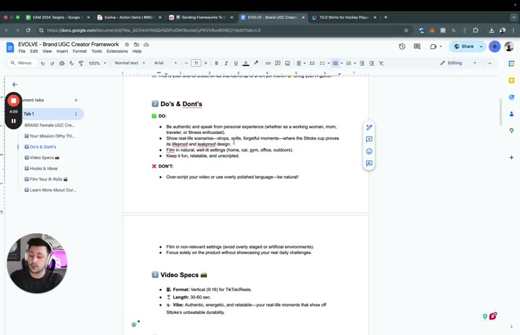
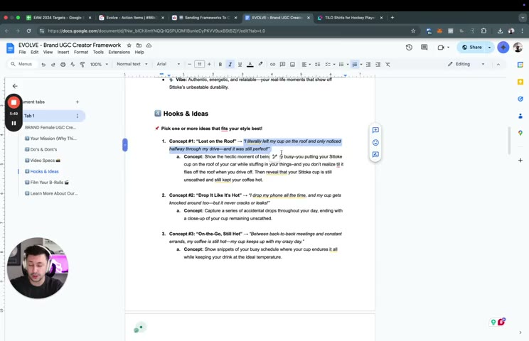
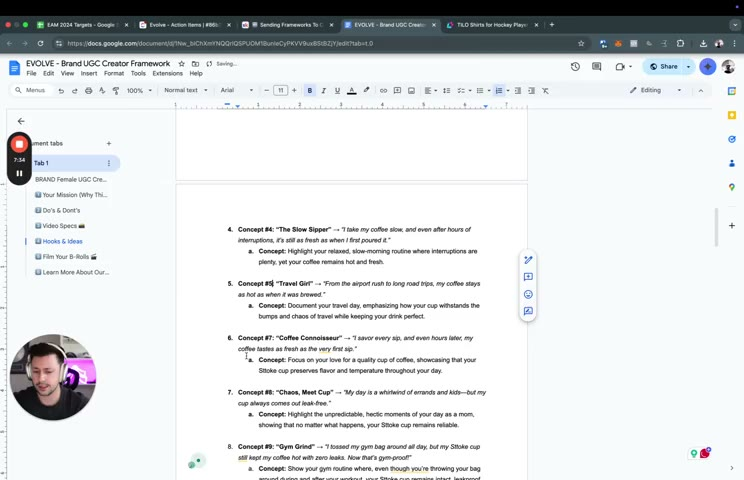
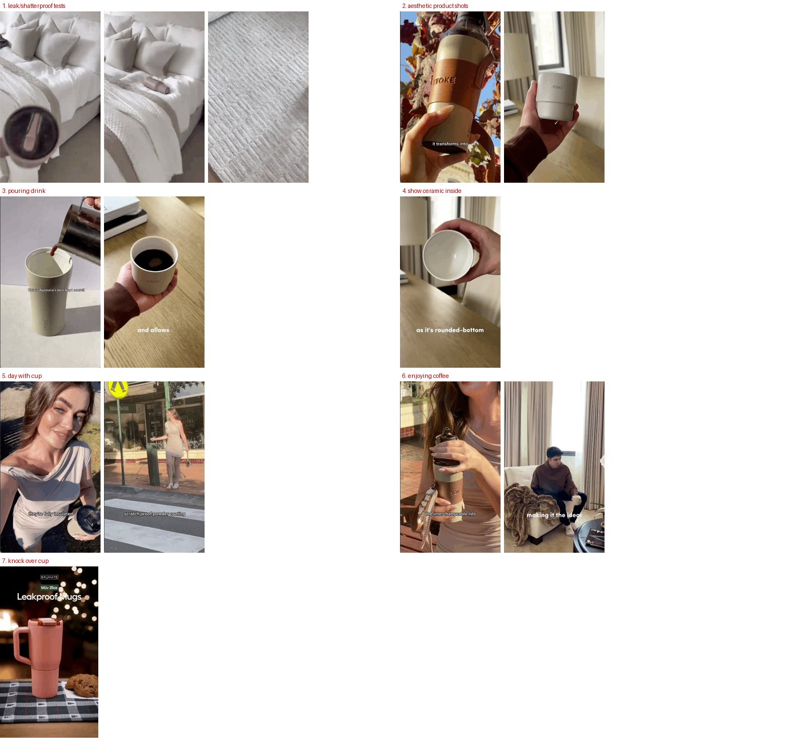

# 148. Sending Frameworks To Creators - Part 2
> Give creators a six-section framework (mission, do's and don'ts, video specs, hooks and concepts, B-roll, brand links) instead of a script: it guides without dictating, so content stays authentic and the ads can scale. "Creators get frameworks. Actors get scripts."

## 🤖 Agent use
- **Use when:** briefing a hired creator (product seeding or paid), writing the creator framework doc, or producing separate male/female versions.
- **Inputs → outputs:** brand facts, offer for the creator (retainer, affiliate, ad-spend share), 3-9 concept ideas with sample hooks, B-roll clip references → a one-doc "BRAND - GENDER UGC Framework" sent after hiring on Insense.
- **Rules:**
  - **DO** use a framework, not a script: "we are leaving this open to the interpretation of the content creator ... we want the content creator to be authentic". [00:00–01:48]
  - **DO** keep the **mission** to 2-3 (maybe 4) lines; "Do not go in and write five paragraphs about your brand. Nobody cares". [02:45–03:34]
  - **DO** include "what's in it for you": the retainer, commissions, ad-spend share and a top-end earning figure to give a reason to try hard "even though it is free". [03:34–04:23]
  - **DO** keep **Do's & Don'ts** and **Video specs** the same for every brand; tweak lightly; vibe can change. [04:23–05:07]
  - **DO** write each concept as: name + one sample hook (literally just the hook) + a "Concept" paragraph describing what to show, not what to say. [05:07–05:59]
  - **DON'T** exceed **nine** concepts: "If you have more than nine total concepts, you have too many." [06:43–07:29]
  - **DO** add B-roll GIF references ("hey, if you aren't sure what to film specifically, here are some ideas"), see [149](149-how-to-make-b-rolls-for-frameworks.md). [07:29–08:15]
  - **DO** end with brand links: product page and Instagram. [08:15]
  - **DO** send the framework **after** hiring a creator in Insense. [08:15–08:55]
  - **DO** split by gender: one campaign/framework for men, one for women, or one open, depending on applicants. Change the ideas, not the structure. [08:55–10:24]
  - **IF** few men apply for a male product **THEN** let women make content for the male avatar ("here's why you need this as a man" / "I wish my man had this"); one of the biggest-spending brands does exactly this. [08:55]
  - **DO** curate concepts per creator ([137](137-does-insense-still-work.md)): first-pick bias.
- **See also:** [137](137-does-insense-still-work.md) · [147](147-how-to-hire-approved-creators-part-1.md) · [149. How To Make B-Rolls For Frameworks](149-how-to-make-b-rolls-for-frameworks.md) · [Playbook: creator brief](../../../../playbooks/creator-brief.md) · [Playbook: UGC script writing](../../../../playbooks/ugc-script-writing.md) · [126. How To Pull Frameworks From Ads](126-how-to-pull-frameworks-from-ads.md)

Lesson page text: "NEW Easy A Media Framework:" with the Google Doc link (exported; same content as the attachment except the B-roll image mapping), then "**Creators Get Frameworks / Actors Get Scripts**".

## Key ideas

### 1. Framework vs script, with the sunglasses analogy [00:00–02:45]
- A framework gives guidance but "we are not telling them exactly what to do because we want the content creator to be authentic". [00:00]
- Analogy: ask someone to sell a pair of sunglasses. You offer three possible reasons (the logo flex, the look, the photo/video feature). They choose what resonates and may find their own ("my favourite functionality is that they're comfortable"). A video "based on what you like best ... is going to be authentic". [00:00–01:48]
- "The idea that you're going to come up with is not always the idea that the creator is going to come up with. And you want the creators to do what they're supposed to do, which is create." [01:48]
- Claim: this "new framework is honestly the best one that we've made", for ads that "can spend tens of thousands of dollars ... per month". (instructor claim) [00:00]

### 2. Section 1: Your Mission [02:45–04:23]
- "Why should somebody care about this?" Used mainly for product-seeding creators or low-paid ones (about $100 if paid); also used for paid campaigns. [02:45]
- About the brand in two to four lines, naming the product and the person it serves. [03:34]
- "What's in it for you": "who do people care the most about? Themselves." Offer in the example doc: if the first video becomes a winning ad, a $500 monthly retainer for regular content, affiliate commissions, and a percentage of ad spend on winning ads, "an ad that earns up to 10K per month". "Change this however you want." [03:34–04:23]
- Purpose: "a reason to actually put effort into this video, even though it is free". [04:23]

### 3. Sections 2-3: Do's & Don'ts, Video Specs [04:23–05:07]
- "Basically the same for every single brand", tweak slightly. DO: be authentic; show real-life scenarios of use; film in natural, well-lit settings; keep it fun, relatable and unscripted. DON'T: over-script or use polished language; film in an irrelevant setting; "focus solely on the product without showcasing your real daily challenges", because the goal is to show the product in use "not just do a stupid basic testimonial that sometimes works, but most of the time doesn't". [04:23–05:07]
- Video specs "stay the same for every brand": vertical 9:16, 30-60 sec, a "vibe" line that you can edit. [05:07]

### 4. Section 4: Hooks & Ideas [05:07–07:29]
- "This is where you now get your chance to be a marketer": think of angles and turn them into concept examples. [05:07]
- Each concept: a name, a sample hook ("literally just the hook") and an explanation of what to show. Example: concept 1 "Lost on the Roof" hook + a concept paragraph describing a hectic morning, cup left on the car roof, the cup surviving. "We're not scripting. We're giving them the idea of it ... now you go and run with it." [05:07–05:59]
- The instructor would "love to just leave the hook there as is", but the team adds context as "the happy medium middle ground". [05:59]
- Overlap check: two concepts that both say "keeps the coffee hot" are fine, but do not exceed nine. [06:43–07:29]

### 5. Sections 5-6: B-rolls and Learn More [07:29–08:55]
- B-roll section: little GIFs, "very easy to make"; tutorial by "our UGC manager" in [149](149-how-to-make-b-rolls-for-frameworks.md). They are suggestions, not shot lists. [07:29–08:15]
- "Learn more about our brand": product page and Instagram. "That is all they need ... very easy for the creator to sift through." [08:15]
- Creator's reading order: why should I care -> do's and don'ts -> specs -> hooks and ideas -> "Ooh, I like this idea. I'm going to go ahead and do this." [08:15]
- Why frameworks: "it just works so much better in getting authentic content". Sent after hiring in Insense. [08:15–08:55]

### 6. Male and female versions [08:55–10:24]
- Name the file "[Brand] [Gender] UGC creator framework". [09:46]
- Run two campaigns (male, female) or one open one. A niche product may attract few applicants. [08:55]
- The reason for splitting is the ideas. The male version changes concepts: "lost it on my truck", "I always forget about my coffee when I'm working construction", "I have to commute so far to the job site". [10:24]
- Aside: "you're dumb if male 35 plus is your avatar" (the instructor's remark on avatars; the split is only for ideas). [09:46]

## Steps / framework
| # | Section | What goes in | Fixed or per brand | Source |
|---|---|---|---|---|
| 1 | Your Mission | About the brand (2-4 lines) + what's in it for the creator | per brand | [02:45–04:23] |
| 2 | Do's & Don'ts | authentic, real scenarios, natural light, unscripted / no over-scripting, no irrelevant setting, don't focus only on the product | same for all, slight tweaks | [04:23–05:07] |
| 3 | Video Specs | format, length, vibe | same for all (vibe editable) | [05:07] |
| 4 | Hooks & Ideas | up to 9 concepts: name, sample hook, concept paragraph | per brand + gender | [05:07–07:29] |
| 5 | Film Your B-Rolls | table of GIF + action | per brand | [07:29–08:15] |
| 6 | Learn More About Our Brand | product page, Instagram | per brand | [08:15] |

## Examples (concepts, verbatim from the example doc)
The example product is a shatterproof, leakproof, insulated cup (brand name in the doc is Sttoke; Whisper heard "Stokes"). Concepts are for a female audience.

| # | Concept name | Sample hook | What to show |
|---|---|---|---|
| 1 | Lost on the Roof | "I literally left my cup on the roof and only noticed halfway through my drive-and it was still perfect!" | Hectic busy moment, cup on car roof while stuffing things in; it flies off when you drive off; reveal it is unscathed and kept the coffee hot |
| 2 | Drop It Like It's Hot | "I drop my phone all the time, and my cup gets knocked around too-but it never cracks or leaks!" | A series of accidental drops through the day, ending on a close-up of the unscathed cup |
| 3 | On-the-Go, Still Hot | "Between back-to-back meetings and constant errands, my coffee is still hot-my cup keeps up with my crazy day." | Snippets of a busy schedule; the cup endures it and keeps the drink at the ideal temperature |
| 4 | The Slow Sipper | "I take my coffee slow, and even after hours of interruptions, it's still as fresh as when I poured it." | Relaxed slow-morning routine with many interruptions; coffee stays hot and fresh |
| 5 | Travel Girl | "From the airport rush to long road trips, my coffee stays as hot as when it was brewed." | Document a travel day; the cup survives bumps and chaos |
| 6 (labelled "#7" in the doc) | Coffee Connoisseur | "I savor every sip, and even hours later, my coffee tastes as fresh as the very first sip." | Love of quality coffee; cup preserves flavor and temperature all day |
| 7 (labelled "#8") | Chaos, Meet Cup | "My day is a whirlwind of errands and kids-but my cup always comes out leak-free." | Hectic mom moments; the cup stays reliable |
| 8 (labelled "#9") | Gym Grind | "I tossed my gym bag around all day, but my Sttoke cup still kept my coffee hot with zero leaks. Now that's gym-proof!" | Gym routine; bag tossed around; cup intact and leakproof (rest cut off on screen) |

Concepts 4-8 are read from the video frame at [07:35] (the linked doc as exported has only concepts 1-3); the doc's numbering skips a number in the video version, which the instructor stumbles over while counting ("I deleted a section just before this"). [02:45; 06:43–07:29] The instructor calls out that concepts 3 and 4 overlap ("keeping the coffee hot"). [06:43]

## Structured units

### Hooks
| Hook (verbatim or near) | Heuristic(s) | Emotion / zone | Self targeted | Why it works | Source |
|---|---|---|---|---|---|
| "I literally left my cup on the roof and only noticed halfway through my drive-and it was still perfect!" | Demonstration / proof by accident (derived) | Surprise / relief (derived) | — | A relatable mishap sets up a product-proof reveal; the instructor is "not the biggest fan" of this exact line but uses it as a placeholder | [05:07–05:59] |
| "I drop my phone all the time, and my cup gets knocked around too-but it never cracks or leaks!" | Show-don't-tell (derived) | — | — | Drop test promised, ends with product unscathed | doc, concept 2 |
| "Between back-to-back meetings and constant errands, my coffee is still hot-my cup keeps up with my crazy day." | Relatability (derived) | — | — | Busy-person pain to product benefit | doc, concept 3 |
| (male version) "lost it on my truck"; "I always forget about my coffee when I'm working construction"; "I have to commute so far to the job site" | Audience swap (derived) | — | — | Same concept, avatar-specific scenario | [10:24] |

### Templates
| Template | Use for | Example fill | Source |
|---|---|---|---|
| Concept = "[Name]" + sample hook + "Concept: show [moment] then reveal [product proof]" | One framework concept | "Lost on the Roof" | doc §4, [05:07–05:59] |
| "[Brand] [Gender] UGC creator framework" | File name | "[Brand] Female UGC creator framework" | [09:46] |

### Rules of thumb
- **DO** show real daily challenges, not just the product. [05:07]
- **DON'T** give 10+ concepts. [06:43]
- **IF** you want a different avatar **THEN** rewrite the scenarios, keep the structure. [10:24]

## Prompts / templates (verbatim)
Full attached framework doc ("Sttoke" example, female version). The B-roll table in the doc holds GIFs; their captions are listed.

```
1️⃣ Your Mission (Why This Video Matters + HUGE Earning Opportunity!)

📌 About the Brand:
Show how Sttoke's shatterproof, leakproof cup is a game-changer for busy, modern women who demand durability, style, and performance in every sip.

🤩 What's in it for you – You can become a brand content creator!
If your first video becomes a winning ad, you get the chance to:
- Join us on a $500 monthly retainer for regular content creation. 🚀
- Earn affiliate commissions when your content drives sales. 🤝
- Get a percentage of the ad spend on your winning ads. 🤑
📢 This is your shot to create an ad that earns up to $10K per month 😱 Bring your A-game!

2️⃣ Do's & Dont's
✅ DO:
- Be authentic and speak from personal experience (whether as a working woman, mom, traveler, or fitness enthusiast).
- Show real-life scenarios—drops, spills, forgetful moments—where the Sttoke cup proves its lifeproof and leakproof design.
- Film in natural, well-lit settings (home, car, gym, office, outdoors).
- Keep it fun, relatable, and unscripted.
❌ DON'T:
- Over-script your video or use overly polished language—be natural!
- Film in non-relevant settings (avoid overly staged or artificial environments).
- Focus solely on the product without showcasing your real daily challenges.

3️⃣ Video Specs 📸
- 🎥 Format: Vertical (9:16) for TikTok/Reels.
- ⏳ Length: 30-60 sec.
- 🗣️ Vibe: Authentic, energetic, and relatable—your real-life moments that show off Sttoke's unbeatable durability.

4️⃣ Hooks & Ideas
📌 Pick one or more ideas that fits your style best!
1. Concept #1: "Lost on the Roof" → "I literally left my cup on the roof and only noticed halfway through my drive—and it was still perfect!"
   a. Concept: Show the hectic moment of being crazy busy–you putting your Sttoke cup on the roof of your car while stuffing in your things–and you don't realize til it flies off the roof when you drive off. Then reveal that your Sttoke cup is still unscathed and still kept your coffee hot.
2. Concept #2: "Drop It Like It's Hot" → "I drop my phone all the time, and my cup gets knocked around too—but it never cracks or leaks!"
   a. Concept: Capture a series of accidental drops throughout your day, ending with a close-up of your cup remaining unscathed.
3. Concept #3: "On-the-Go, Still Hot" → "Between back-to-back meetings and constant errands, my coffee is still hot—my cup keeps up with my crazy day."
   a. Concept: Show snippets of your busy schedule where your cup endures it all while keeping your drink at the ideal temperature.

5️⃣ Film Your B-Rolls 🎬
# | Action
1 | [3 GIFs] You showing how leakproof and shatterproof the cup is through several tests
2 | [2 GIFs] Aesthetic product shots
3 | [2 GIFs] You pouring in your coffee/drink
4 | [1 GIF] Show the ceramic inside of the cup
5 | [2 GIFs] Different shots of you going about your day with your Sttoke cup
6 | [2 GIFs] You enjoying your coffee with your Sttoke cup
7 | [1 GIF] Knock over the cup to show that it's leakproof and does not spill

6️⃣ Learn More About Our Brand!
🔗 Product Page: Product Page Here
🔗 Instagram Page: URL Here
```

## Screenshots

*The "BRAND Female UGC Creator Framework" doc with its six-section outline in the left pane and the Mission block (brand blurb + what's in it for you). [00:10]*


*Do's & Don'ts and Video Specs (vertical 9:16, 30-60 sec, vibe). These stay the same across brands. [05:00]*


*Hooks & Ideas: concept 1 "Lost on the Roof" with its sample hook highlighted, followed by the "Concept:" explanation, then concepts 2 and 3. [05:50]*


*The longer live version of the Hooks & Ideas list: concepts "The Slow Sipper", "Travel Girl", "Coffee Connoisseur", "Chaos, Meet Cup", "Gym Grind". The instructor says nine is the maximum. [07:35]*


*First frame of each B-roll GIF in the attachment's table, grouped by its action row (tests, aesthetic shots, pouring, ceramic inside, day-in-the-life, enjoying coffee, knock-over test). The GIFs are clips from other brands' videos used as references. Treat them as shot types, not assets to copy. [doc §5]*

## How to apply
- [ ] Write the Mission in 2-4 lines; add the real creator offer (only what the brand will honour).
- [ ] Reuse Do's/Don'ts and Specs; adjust the vibe line.
- [ ] Draft 5-9 concepts: name, sample hook, what to show. Cap at nine.
- [ ] Add 5-7 B-roll GIF rows ([149](149-how-to-make-b-rolls-for-frameworks.md)); add product page and Instagram links.
- [ ] Create a female and a male copy; rewrite scenarios for each avatar.
- [ ] Per creator, trim concepts to fit their content ([137](137-does-insense-still-work.md)).
- [ ] Send only after hiring in Insense.

## Related
- Previous: [147. How to Hire Approved Creators - Part 1](147-how-to-hire-approved-creators-part-1.md) · Next: [149. How To Make B-Rolls For Frameworks](149-how-to-make-b-rolls-for-frameworks.md)
- [Evolve Copywriting: hooks](../../copywriting/concepts/hooks.md) · [Evolve Copywriting: show don't tell](../../copywriting/concepts/show-dont-tell.md)

## Sources and limitations
- Transcript: [148… .txt](<../../../../../raw/evolve/start-here/_transcripts/👣 Evolve (Start Here)/148. Sending Frameworks To Creators - Part 2 👣 Evolve (Start Here) Evolve.txt>) · Page text: [148… .html.md](<../../../../../raw/evolve/start-here/_extracted/👣 Evolve (Start Here)/148. Sending Frameworks To Creators - Part 2_👣 Evolve (Start Here)_Evolve.html.md>) · Attachment: [148 … .docx.md](<../../../../../raw/evolve/start-here/_extracted/👣 Evolve (Start Here)/148. Sending Frameworks To Creators.docx.md>) · Linked doc: [148-document-1Nw_bIChXm.docx.md](../../../../../raw/evolve/start-here/_extracted/_linked/google/148-document-1Nw_bIChXm.docx.md)
- Machine transcription (Whisper large-v3-turbo); full recording covered (10:53). Whisper writes "Stokes", "Incense" and "proxy campaigns" (likely "product-seeding campaigns", [10:24]). The attachment has 3 concepts and the video's live doc has up to 9; concepts 4-8 are transcribed from a low-resolution frame and the Gym Grind text is cut off. The brand in the example doc (Sttoke) and the earnings figure ($10K per month) are the course's example, not a verified claim. The attachment is a very large file (65 MB, embedded GIFs).
- The instructor mentions "a UGC manager. She's amazing" for the next lesson. Name and role are unverified.
