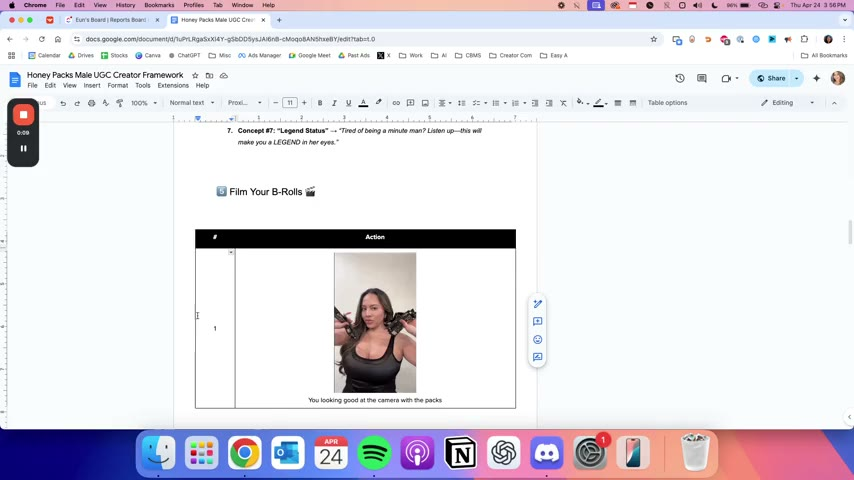
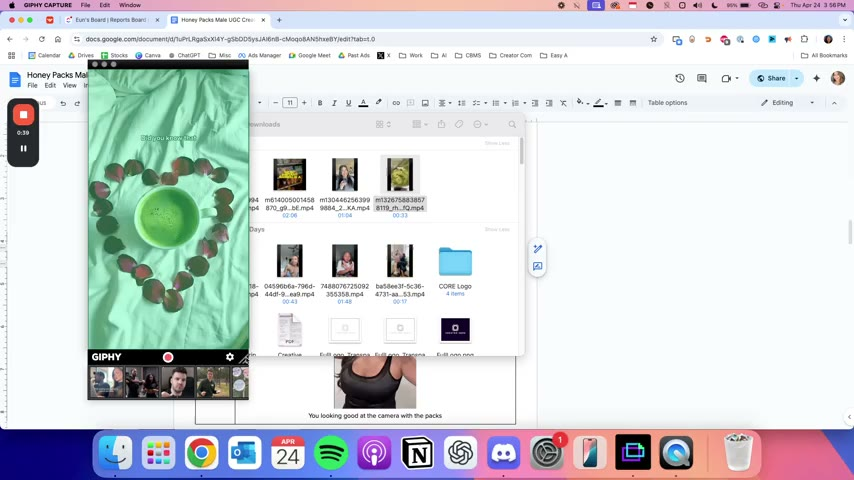
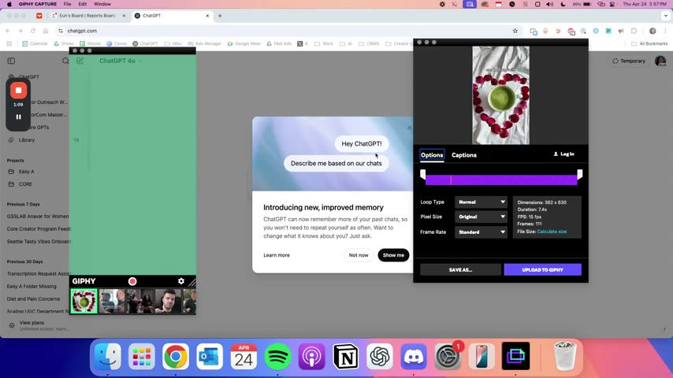

# 149. How To Make B-Rolls For Frameworks
> Record short reference clips from existing videos with Giphy Capture, cut them into GIFs, and paste them into the framework's "Film your B-rolls" table with a one-line description so creators know what shots to film.

## 🤖 Agent use
- **Use when:** finishing section 5 of a creator framework ([148](148-sending-frameworks-to-creators-part-2.md)) and you need visual references for B-roll or hook shots.
- **Inputs → outputs:** reference videos (competitor or own) + the framework template → a numbered table of GIF + action description inside the framework doc.
- **Rules:**
  - **DO** copy the framework template rather than building the table from scratch. [00:00]
  - **DO** add a new numbered row (insert row below) for each B-roll example. [00:00; 02:08]
  - **DO** use **Giphy Capture** to record the screen while a reference video plays, then cut clips from the recording. [00:00–01:04]
  - **DO** put a short description next to each GIF saying what the clip is meant to show (example: "Aesthetic shot of the coffee"). [02:08]
  - **DO** give at least two B-roll examples. [02:44]
  - **DO** grant the app the screen-recording permissions when prompted. [02:44]
  - **DON'T** present the clips as an exact shot list; they are ideas ([148](148-sending-frameworks-to-creators-part-2.md) [07:29]).
  - **DON'T** reuse someone else's footage in the ad. The GIFs show shot types for creators to film themselves (derived from "copy the mechanism, not the asset").
- **See also:** [148. Sending Frameworks To Creators - Part 2](148-sending-frameworks-to-creators-part-2.md) · [147](147-how-to-hire-approved-creators-part-1.md) · [136. How To Get Viral UGC Inspo](136-how-to-get-viral-ugc-inspo-for-creators-ads.md)

Lesson page text: "Tool Shown:" with the Giphy Capture page link (giphy.com/apps/giphycapture).

## Key ideas

### Steps shown [00:00–02:44]
1. Open the framework template (the demo is a male-audience UGC creator framework) and insert a new row at the top, number 1. [00:00]
2. Open Giphy Capture; open any reference video on the computer; resize the capture window over it. [00:00]
3. Hit record and let the video play. [00:00–01:04] (the demo plays a short ad whose hook is about a Japanese matcha latte; used only as source footage)
4. Stop. The app returns the entire recording; make clips from it, e.g. take the hook as clip 1 and a second clip as the B-roll you want creators to copy. Save each (the presenter keeps a "hooks" folder). [01:04]
5. Back in the framework, paste the GIFs into the row. [01:04–02:08]
6. In the description cell write what the clip shows, e.g. "Aesthetic shot of the coffee". [02:08]
7. Insert another row below for number 2; repeat so creators see at least two examples. [02:08–02:44]
8. Download Giphy Capture online and grant permissions. [02:44]

Notes: Giphy Capture is a Mac screen-recording-to-GIF app (the demo is on macOS: derived). The editor shows loop type, pixel size and frame-rate options and an "Upload to GIPHY" or "Save as" button. [01:10 screenshot]

## Steps / framework
| Step | Action | Source |
|---|---|---|
| 1 | Copy the framework template; add a row (#) | [00:00] |
| 2 | Record the reference video with Giphy Capture | [00:00–01:04] |
| 3 | Cut the recording into clips (hook, B-roll); save to a folder | [01:04] |
| 4 | Paste the GIF(s) into the row | [01:04–02:08] |
| 5 | Describe the clip in the Action cell | [02:08] |
| 6 | Repeat for 2+ rows | [02:44] |

## Examples
- **Row description:** "Aesthetic shot of the coffee" attached to a top-down green-tea-in-rose-petals GIF (screenshot). [02:08]
- **Existing table format:** "#" and "Action" columns; each action row shows one or more portrait GIFs above a text line, e.g. "You looking good at the camera with the packs" (shown in the template's first row). [00:10]
- For the full B-roll table with captions, see [148](148-sending-frameworks-to-creators-part-2.md).

## Structured units

### Rules of thumb
- **DO** write what the shot is, not the script. [02:08]
- **DO** keep a library folder of hook clips for reuse. [01:04]

## Screenshots

*The framework template's "Film Your B-Rolls" table: "#" and "Action" columns, a portrait GIF, and a text caption. [00:10]*

*Giphy Capture's small recording window placed over a playing reference video; the red button records. [00:40]*

*The clip editor after recording: trim handles plus Loop type, Pixel size, Frame rate and a Save As / Upload to GIPHY button. [01:10]*

## How to apply
- [ ] Download Giphy Capture; grant screen-recording permission.
- [ ] Choose 5-7 shot types the creator should capture (tests, aesthetic shots, pouring/using, day-in-the-life, enjoying, proof/stress test).
- [ ] Record, clip, and save GIFs; paste each into a numbered row with a one-line action.
- [ ] Check that every row is a shot type to film, not a clip to reuse.

## Related
- Previous: [148. Sending Frameworks To Creators - Part 2](148-sending-frameworks-to-creators-part-2.md) · Next: [150. Action Item: Hire Creators](150-action-item-hire-creators.md)

## Sources and limitations
- Transcript: [149… .txt](<../../../../../raw/evolve/start-here/_transcripts/👣 Evolve (Start Here)/149. How To Make B-Rolls For Frameworks 👣 Evolve (Start Here) Evolve.txt>) · Page text: [149… .html.md](<../../../../../raw/evolve/start-here/_extracted/👣 Evolve (Start Here)/149. How To Make B-Rolls For Frameworks_👣 Evolve (Start Here)_Evolve.html.md>)
- Machine transcription (Whisper large-v3-turbo); full recording covered (3:02). The speaker (addresses the main instructor by first name, described as a UGC manager in [148](148-sending-frameworks-to-creators-part-2.md)) is unverified. The sample ad audio in the demo is a health-claim ad read verbatim by the transcript and is not reproduced here.
