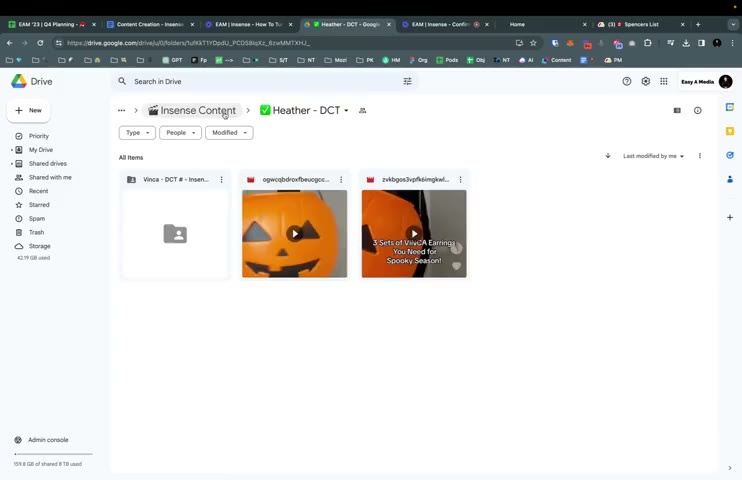

# 152. How to Follow Up & Upload Content - Part 2
> An update to the folder step in Part 1: mark each creator's Drive folder with a check and "DCT" if their raw video can be chopped into three variations as-is, or an X if it cannot, so the team knows what is ready to test.

## 🤖 Agent use
- **Use when:** triaging creator videos that came back from a seeding or Insense campaign, deciding which can go straight into a dynamic creative test (DCT) and which cannot.
- **Inputs → outputs:** a creator's uploaded raw videos → a correctly named Drive folder (check + DCT, or X) and a note to the team.
- **Rules:**
  - **DO** add a check mark (plus "-DCT" in the name) when "you believe you can chop this up into three different variations as is and run it as an ad". [00:00]
  - **DO** add an X when the content is not usable as a DCT, upload it anyway, and tell the team you have not turned it into a DCT. [01:38]
  - **DON'T** expect polish: "we just want to do quick and easy chops". [01:38]
  - **IF** the video has no talking, nothing happening, or is a long clip with the ring light in the way **THEN** mark X. [01:38]
  - **IF** you only upload the folder without the mark **THEN** nobody is notified that a DCT is ready: "once you add the checkmark and do the dash DCT, that will notify us ... and the clients". [00:49]
- **See also:** [151](151-how-to-follow-up-upload-content-part-1.md) · [98. Raw Content Campaign](098-how-to-set-up-raw-content-campaign.md) · [94. How To Set Up a 3/2/2 Campaign](094-how-to-set-up-a-3-2-2-campaign.md) · [153. Action Item: Collect Content](153-action-item-collect-content.md)

## Key ideas

### What the mark means [00:00–00:49]
- DCT = "dynamic creative test". The check mark says the video can become three variations (three hooks / cuts) as-is. [00:00]
- Folders marked this way contain "DCTs ... ready to be tested". How to build the DCT is covered in a later video, not in this one (not included in lessons 150-166). [00:00–00:49]
- The instructor also points ahead to submitting the DCT "into the ad studio" in following videos. [00:49]

### What counts as unusable [00:49–02:15]
- Two examples from one client's seeding campaign: (1) a clip where "there's nobody talking about it" and nothing is happening; (2) a 59-second video "where the ring light is in the way". [01:38]
- Even so: "who knows, it could turn out great ... maybe this would actually convert like crazy". Upload it, mark X, flag it to the team. [01:38]
- Seeding yields mixed-quality content: "it's a product seeding campaign. We might get some content that is not that great." [00:49]

## Steps / framework
1. Download the creator's content (see [151](151-how-to-follow-up-upload-content-part-1.md)).
2. Watch each clip: can it be cut into three variations without new filming?
3. Name the folder with a check mark and "-DCT" if yes; an X if not.
4. Upload the files either way.
5. Let the team know about X folders.

## Examples
- Folder pattern shown in the frame: a green check, then the creator's first name, then " - DCT", inside the client's "Insense Content" folder. [00:50]
- Unusable examples above (59-second clip, no talking, ring light visible). [01:38]

## Prompts / templates (verbatim)
Folder naming (from the lesson description and frame):
```text
✅ <CREATOR FIRST NAME> - DCT      (usable: can be chopped into 3 variations)
❌ <CREATOR FIRST NAME>            (uploaded, not usable as a DCT; tell the team)
```
The check emoji is shown on screen; the X wording is "add the X" [01:38]. The exact X glyph is not visible, so ❌ is an assumption. Confirm against your own convention.

## Screenshots

*Insense Content folder with a creator subfolder named with a green check and "- DCT", holding two raw vertical videos. [00:50]*

## How to apply
- [ ] Review every new creator folder the day content lands.
- [ ] Apply the check/DCT or X naming.
- [ ] Message the team on every X folder.
- [ ] Pass check folders to the DCT build step used in your campaign ([94](094-how-to-set-up-a-3-2-2-campaign.md), [98](098-how-to-set-up-raw-content-campaign.md)).

## Related
- Previous: [151](151-how-to-follow-up-upload-content-part-1.md) · Next: [153](153-action-item-collect-content.md)
- Page text and the docx repeat the Insense templated-message doc from lesson 151 (no new text).

## Sources and limitations
- Transcript: [152 transcript](<../../../../../raw/evolve/start-here/_transcripts/👣 Evolve (Start Here)/152. How to Follow Up & Upload Content - Part 2 👣 Evolve (Start Here) Evolve.txt>) · Page text: [152 page](<../../../../../raw/evolve/start-here/_extracted/👣 Evolve (Start Here)/152. How to Follow Up & Upload Content - Part 2_👣 Evolve (Start Here)_Evolve.html.md>) · [docx](<../../../../../raw/evolve/start-here/_extracted/👣 Evolve (Start Here)/152. How to Follow Up & Upload Content.docx.md>).
- Machine transcription. Whisper writes "DCTs ... turned into an app" where "ad" is meant, and "header" appears where a creator name was spoken (omitted). Last segment 2:27.6 of 2:27.8: complete.
- The "later video" that shows how to build the DCT is not in lessons 150-166.
