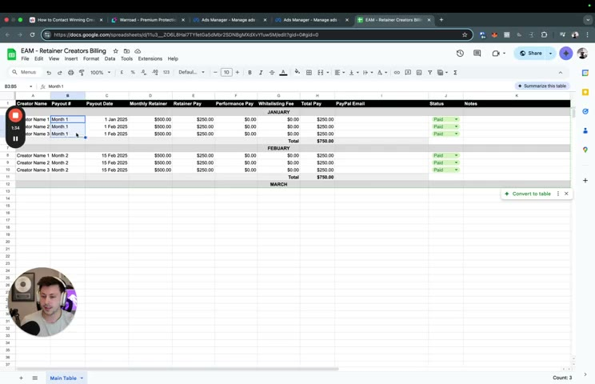
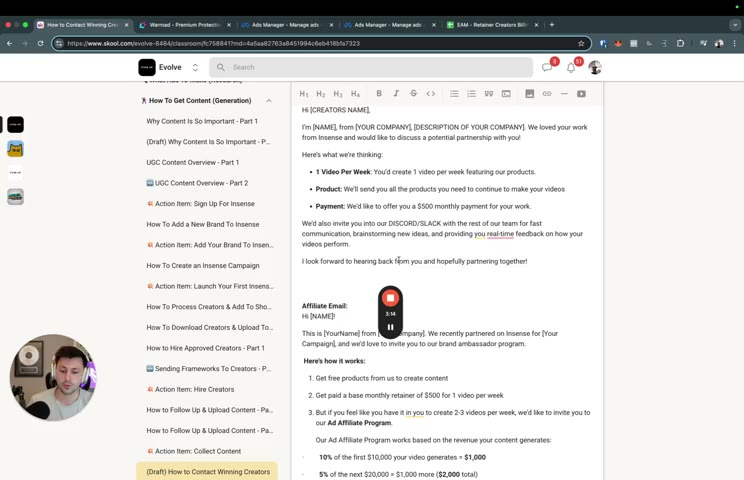
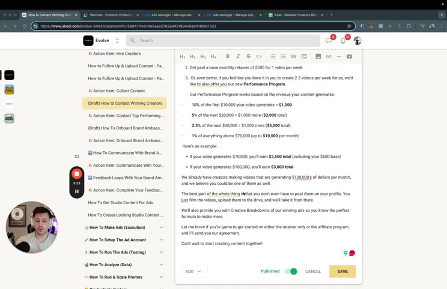

# 154. How to Contact Winning Creators + Affiliate
> Only hire creators whose ads actually got spent on, then offer them either a flat $500/month retainer for one video a week or a tiered performance program that pays a percentage of revenue (or ad spend) for 2-3 videos a week. Exact emails and the payout sheet are included.

## 🤖 Agent use
- **Use when:** you have creator ads with spend data from a seeding or Insense campaign and need to decide whom to keep and what to offer.
- **Inputs → outputs:** per-creator ad spend/ROAS from the raw content campaign → a "winning creator" shortlist, one of two outreach emails, and a retainer tracking sheet row.
- **Rules:**
  - **DO** define a winning creator as one "that actually makes an ad that can scale". [00:00]
  - **DO** hire the creator whose ad took spend over one whose content you merely liked: "for me, good is something that gets spent. Bad is something that doesn't get spent." [00:38]
  - **DON'T** hire creators who, in the instructor's words, are "absolute trash" just because they were cheap. [00:00]
  - **DO** use the retainer-only email if you do not want an affiliate structure. Leave the rate open ("what your rates would be for one video per week") or state $500/month: "500 is simple. It's easy." [03:03]
  - **DO** offer the performance program only to creators who will make 2-3 videos per week: "I don't want to pay people that I could just pay 500 bucks a month for one video per week." [03:55–04:40]
  - **DON'T** lead with scary numbers. Show the tiers and the two worked examples, then say you already have creators generating large monthly revenue. [05:14]
  - **DO** tell creators they do not have to post the videos on their own profile: "film the videos, upload them to the drive, and we'll take it from there". [05:14]
  - **DO** pay on a fixed schedule and track it in a sheet (the lesson pays on the 1st and 15th). [02:14]
- **See also:** [155. Action Item: Contact Top Performing Creators](155-action-item-contact-top-performing-creators.md) · [156. How To Onboard Brand Ambassadors](156-how-to-onboard-brand-ambassadors.md) · [98. Raw Content Campaign](098-how-to-set-up-raw-content-campaign.md) · [160. Feedback Loops](160-feedback-loops-with-your-brand-ambassadors.md) · [162. Whitelisting Overview](162-whitelisting-overview-proof-it-works.md)

## Key ideas

### What a winning creator is [00:00–01:25]
- Many students hire creators that are not worth it. A winning creator "makes an ad that can scale". [00:00]
- Case A (on screen, Insense campaign list, 4 completed creators): one creator's ad took "$30,000 on ... a 2x on ad spend, which for them is actually fairly good". She came out of the product-seeding campaign. [00:00]
- Case B: another creator in the same campaign got "$66 in spend. They got one purchase, but I'm 99.9% sure it was view through", i.e. effectively no purchases. [00:38]
- Decision: hire A, not B. Both had likeable content; only A had an ad that "absolutely ripped". [00:38–01:25]
- Follow-up result for creator A, once on contract: in December "we actually ended up spending $40,000 on her content at a 3.36x" and "generate[d] an extra 130K" (instructor's figures; 40,000 x 3.36 is about 134,000). [06:52]

### Track retainers in a sheet [01:25–03:03]
- Columns: Creator Name, Payout #, Payout Date, Monthly Retainer, Retainer Pay, Performance Pay, Whitelisting Fee, Total Pay, PayPal Email, Status, Notes. (sheet export)
- Each new month, duplicate the block of rows (insert rows, copy, update dates). [01:25]
- Pay on the 1st and 15th; track "did we pay them on this date? Yes or no". [02:14] In the sheet, a $500 monthly retainer shows as $250 retainer pay per payout (500 / 2). [sheet]
- A separate Whitelisting Fee column already exists for the whitelisting add-on (see [162](162-whitelisting-overview-proof-it-works.md)). [sheet]

### Two emails [02:14–06:52]
1. **Retainer only:** 1 video/week, product supplied, $500/month, plus invitation into your Discord/Slack for fast communication, brainstorming and real-time performance feedback. Creators may counter ("I want $750"); "find some middle ground". [03:03]
2. **Performance program ("brand ambassador program"):** free product, $500 base for one video a week, and a tiered program for creators willing to make two to three videos per week. Purpose: "to get this creator to start producing more videos in exchange for the performance program ... double and triple their output". [05:53]
- The instructor frames the incentive logic: if the creator does well, the brand does well too. [05:53]
- Calculations of payouts are done with Atria (shown in a later lesson). [06:52] See [160](160-feedback-loops-with-your-brand-ambassadors.md).
- Page note: "You may also CHANGE the wording from 'your video generates' to 'your video spends' if you would prefer to pay a % of ad spend INSTEAD."

## Steps / framework

### Payout tiers (revenue or ad spend generated by the creator's videos)
| Slice of monthly total | Rate | Payout for slice | Cumulative performance pay |
|---|---|---|---|
| First $10,000 | 10% | $1,000 | $1,000 |
| Next $20,000 (to $30,000) | 5% | $1,000 | $2,000 |
| Next $40,000 (to $70,000) | 2.5% | $1,000 | $3,000 |
| Everything above $70,000 | 1% | varies | capped at $10,000/month total |

- Worked examples from the email: $70,000 generated → $3,500 total including the $500 base; $100,000 generated → $3,800 total. (Check: 3,000 + 1% x 30,000 = 300, plus 500 = 3,800.)
- The contract caps total monthly payout at $10,000 (see [156](156-how-to-onboard-brand-ambassadors.md)). The email says "up to $10,000 per month". It is ambiguous whether the email's cap includes the base; the contract says "maximum total pay out ... in a single month is $10,000".

### Process
1. Pull per-creator ad spend/ROAS from the seeding campaign. Mark creators whose ads scaled.
2. Send retainer-only or performance email (below).
3. On yes, send the agreement and onboarding package ([156](156-how-to-onboard-brand-ambassadors.md)).
4. Add the creator to the retainer tracking sheet; pay on the 1st and 15th.

## Examples
- **Hire vs skip:** creator A ($30,000 spend at 2x; later $40,000 at 3.36x) vs creator B ($66 spend, one purchase, likely view-through). [00:00–01:25; 06:52]
- **Retainer negotiation:** instructor asked what creators charge for one video per week; some said "$400 a month is perfect", so "you don't have to pay the 500". [03:03]
- **Performance math:** see tiers above.

## Structured units

### Templates
| Template | Use for | Example fill | Source |
|---|---|---|---|
| Retainer Only Email | Offer flat monthly pay for 1 video/week | $500/month, Discord/Slack invite | page text |
| Affiliate / Performance Email | Offer tiered % pay to creators who make 2-3 videos/week | tiers above, with $3,500 and $3,800 examples | page text |
| Retainer Tracking Sheet | Track payouts per creator per period | Columns listed above | xlsx |

### Rules of thumb
- **DO** judge creators by spend, not by taste. [00:38]
- **IF** you do not want to run an affiliate structure **THEN** send retainer only. [03:03]
- **IF** a creator will make 2-3 videos/week **THEN** offer the performance program. [03:55]
- **DON'T** put exact big payout numbers up front without the "we already have creators generating hundreds of thousands per month" framing. [05:14]

## Prompts / templates (verbatim)
Page text, copied as written. Replace bracketed fields. The "Affiliate" email in the page and the spoken version differ slightly (see limitations).

```text
Retainer Only Email:

Hi [CREATORS NAME],

I'm [NAME], from [YOUR COMPANY], [DESCRIPTION OF YOUR COMPANY]. We loved your work from Insense and would like to discuss a potential partnership with you!

Here's what we're thinking:

* 1 Video Per Week: You'd create 1 video per week featuring our products.
* Product: We'll send you all the products you need to continue to make your videos
* Payment: We'd like to offer you a $500 monthly payment for your work.

We'd also invite you into our DISCORD/SLACK with the rest of our team for fast communication, brainstorming new ideas, and providing you real-time feedback on how your videos perform.

I look forward to hearing back from you and hopefully partnering together!
```

```text
Affiliate Email for % of Revenue:

NOTE* You may also CHANGE the wording from "your video generates" to "your video spends" if you would prefer to pay a % of ad spend INSTEAD.

Hi [NAME]!

This is [YourName] from [YourCompany]. We recently partnered on Insense for [Your Campaign], and we'd love to invite you to become a brand ambassador for us.

Here's how it works:

1. Get free products from us to create content
2. Get paid a base monthly retainer of $500 for 1 video per week
3. Or, even better, if you feel like you have it in you to create 2-3 videos per week for us, we'd like to also offer you our new Performance Program.

Our Performance Program works based on the REVENUE/AD SPEND your content generates:

· 10% of the first $10,000 your video generates = $1,000
· 5% of the next $20,000 = $1,000 more ($2,000 total)
· 2.5% of the next $40,000 = $1,000 more ($3,000 total)
· 1% of everything above $70,000 (up to $10,000 per month)

Here's an example:

* If your video generates $70,000, you'll earn $3,500 total (including your $500 base)
* If your video generates $100,000, you'll earn $3,800 total

We already have creators making videos that are GENERATING/SPENDING $100,000's of dollars per month, and we believe you could be one of them as well.

The best part of the whole thing is that you don't even have to post them on your own profile. You just film the videos, upload them to the drive, and we'll take it from there.

We'll also provide you with Creative Breakdowns of our winning ads so you know the perfect formula to make more.

Let me know if you're game to get started on either the retainer only or the performance program, and I'll send you the agreement.

Can't wait to start creating content together!
```

Sheet columns and sample rows (xlsx, sample data only, placeholders):
```text
Creator Name | Payout # | Payout Date | Monthly Retainer | Retainer Pay | Performance Pay | Whitelisting Fee | Total Pay | PayPal Email | Status | Notes
Creator Name 1 | Month 1 | 2025-01-01 | 500 | 250 | 0 | 0 | 250 | (blank) | Paid | (blank)
Creator Name 2 | Month 1 | 2025-02-01 | 500 | 250 | 0 | 0 | 250 | (blank) | Paid | (blank)
Creator Name 3 | Month 1 | 2025-02-01 | 500 | 250 | 0 | 0 | 250 | (blank) | Paid | (blank)
[Total row: 750 per payout]; Month 2 rows dated 2025-02-15
```

## Screenshots

*The retainer billing sheet: one row per creator per payout, $500 retainer paid as $250 on the 1st and 15th, Whitelisting Fee column, Paid status dropdown. [01:40]*


*Retainer Only Email: 1 video per week, product, $500 monthly payment, Discord/Slack invite. [03:20]*


*Affiliate/performance email after the instructor's live edits: "Performance Program", the 10% / 5% / 2.5% / 1% tiers, and the $70,000 and $100,000 examples. [05:30]*

## How to apply
- [ ] Rank creators by spend and ROAS in the seeding campaign; shortlist only ads that scaled.
- [ ] Choose retainer-only or performance program per creator.
- [ ] Fill the email with your company, campaign and rate. Keep the "no need to post on your profile" line.
- [ ] If using ad-spend share, change "generates" to "spends" and use the ad-spend contract ([156](156-how-to-onboard-brand-ambassadors.md)).
- [ ] Copy the retainer sheet. Pay on 1st and 15th and log each payout.

## Related
- Previous: [153. Action Item: Collect Content](153-action-item-collect-content.md) · Next: [155](155-action-item-contact-top-performing-creators.md)
- [147. How to Hire Approved Creators - Part 1](147-how-to-hire-approved-creators-part-1.md) · [158](158-how-to-communicate-with-brand-ambassadors.md)

## Sources and limitations
- Transcript: [154 transcript](<../../../../../raw/evolve/start-here/_transcripts/👣 Evolve (Start Here)/154. How to Contact Winning Creators + Affiliate 👣 Evolve (Start Here) Evolve.txt>) · Page text: [154 page](<../../../../../raw/evolve/start-here/_extracted/👣 Evolve (Start Here)/154. How to Contact Winning Creators + Affiliate_👣 Evolve (Start Here)_Evolve.html.md>) · Sheet: [xlsx extraction](<../../../../../raw/evolve/start-here/_extracted/👣 Evolve (Start Here)/154. How to Contact Winning Creators + Affiliate.xlsx.md>).
- Machine transcription. Whisper writes "Incense" for Insense, "a two extra" for "2x", and "I'm named from your company" for "I'm [NAME] from [YOUR COMPANY]". Last segment 7:28 of 7:28: complete.
- The spoken text says the program name is "ad affiliate program" in one place and "brand ambassador program" in another. The page's final text calls it "Performance Program". The spoken "hundreds of thousands of dollars per month" differs from the page's "$100,000's".
- Creator names and handles on screen are deliberately not repeated. The Insense creator-list frame is not kept because it shows handles.
- Instructor claims, not verified: the $30,000 at 2x case, the $40,000 at 3.36x / $130K case, and "creators making videos that are generating hundreds of thousands". The brand shown is not named by the instructor as his biggest brand ("I can't actually show you that brand").
- Not legal or tax advice: the course says its contracts are templates only (see [156](156-how-to-onboard-brand-ambassadors.md)).
