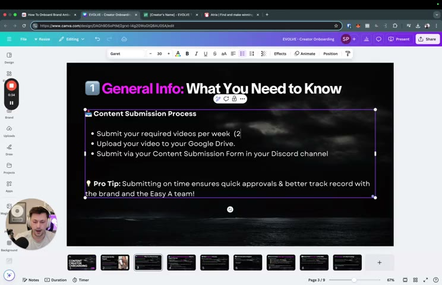
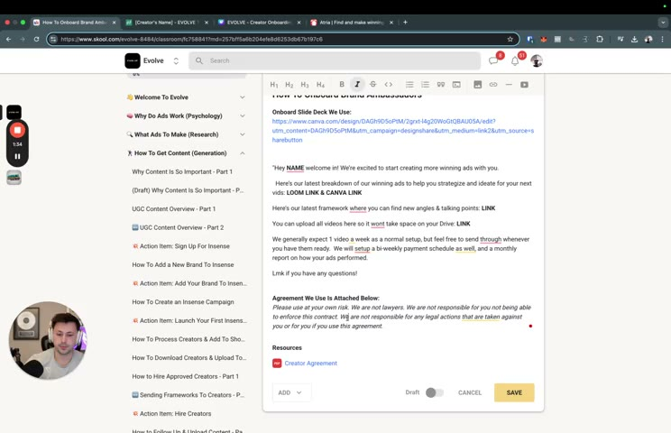
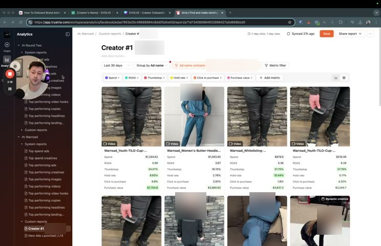
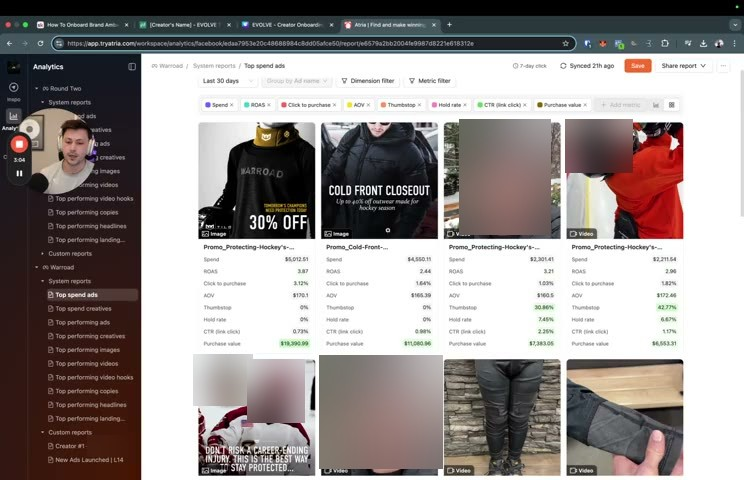

# 156. How To Onboard Brand Ambassadors
> Once a winning creator says yes, send an onboarding deck, a basic agreement, a welcome message and a first Atria "what's working" report with three ready-to-film ideas, then keep sending per-creator performance notes. Includes the three contract variants verbatim.

## 🤖 Agent use
- **Use when:** a creator has accepted a retainer or performance offer ([154](154-how-to-contact-winning-creators-affiliate.md)) and needs onboarding.
- **Inputs → outputs:** accepted creator, top-spend ads for the brand, agreement choice (revenue vs ad spend vs ad spend + whitelisting) → onboarding deck, signed agreement, welcome message with links, first report + three video ideas, Drive upload link.
- **Rules:**
  - **DO** send an onboarding deck covering: welcome, content submission process, payment and performance reports, review feedback and timeline, communication support, winning video formula, and "let's start creating". [00:00–00:36]
  - **DO** set "two videos per week" in the deck for performance creators, or adjust it for retainer-only. [00:00–00:36]
  - **DO** send an agreement and keep it simple. "Very, very basic": two videos per week if on performance; if not, delete that and keep a $500/month base. [01:33]
  - **DO** make sure the agreement you send matches the email you sent (page note: one contract is for ad spend, the other for revenue; "Our agency is still split-testing this").
  - **DO** make a first Loom from an Atria "top spending ads, last 30 days" report and give three concrete ideas (two sale videos, one reaction video) so nobody has to write a script. [02:22–04:11]
  - **IF** the creator is on a flat retainer **THEN** be less open with numbers: remove purchase conversion value and show spend, thumbstop and hold rate: "they're going to want more". [02:22]
  - **IF** the creator is on performance **THEN** you can be open with numbers. [02:22]
  - **DO** keep reporting after content lands: share a creator board, say which ad is working, ask for another, and give fixes. [04:55–05:37]
  - **DON'T** use these contracts as legal protection: "We are not lawyers"; "use it at your own risk". [01:33; page text]
- **See also:** [157. Action Item: Onboard Brand Ambassador](157-action-item-onboard-brand-ambassador.md) · [158. How To Communicate](158-how-to-communicate-with-brand-ambassadors.md) · [160. Feedback Loops](160-feedback-loops-with-your-brand-ambassadors.md) · [162. Whitelisting Overview](162-whitelisting-overview-proof-it-works.md) · [41. Creative Research Part 1 (Atria)](041-creative-research-part-1-atria.md) · [126. How To Pull Frameworks From Ads](126-how-to-pull-frameworks-from-ads.md)

## Key ideas

### The onboarding deck [00:00–01:33]
- A Canva "Creator Onboarding" deck (9 slides in the frame) is sent first. Copy: "Welcome to the team ... You're now part of an exclusive content creator team. We're excited to help you create high-performing ads that convert so that you, the brand, and our team can all win. The guide will walk you through everything you need to maximize your earnings." [00:00]
- Sections named aloud: Payment and performance reports (monthly retainers; "on the last day of the month, you'll receive a performance report"), review feedback and timeline ("the faster you get videos approved ..."), communication support (who to contact; a UGC manager's email), winning videos "video formula: hook ... why this matters", and "Let's start creating". [00:00–00:36]
- "Let's start creating": join the Discord, review the concept ideas in the creator framework, submit the first video on time. [00:36]
- Slide 3 on screen, General Info: "Content Submission Process": submit required videos per week; upload your video to your Google Drive; submit via your Content Submission Form in your Discord channel; Pro Tip: submitting on time ensures quick approvals and a better track record. [00:40]
- Replace the agency name in the deck with your own: "This should say company". [00:36]

### The agreement [01:33]
- "Very, very, very basic agreement." Two videos per week for performance creators, otherwise delete and use a $500/month base. [01:33]
- The page ships three PDFs (text in Prompts / templates below): % of revenue, % of ad spend, and % of ad spend + whitelisting (adds a clause requiring Facebook and Instagram page access).

### The welcome message and first report [01:33–04:55]
- Message template is in the page text (below). It contains placeholders for a Loom link, a Canva link, a framework link and an upload link. Expect 1 video a week as a normal setup; bi-weekly payments; monthly performance report. [page text]
- First report: in Atria, open **Top spend ads**, last 30 days, "Save, share report"; anyone with the link can open it (tested in an incognito window). [02:22; 04:11]
- Walkthrough of ideas the instructor would give a creator from that report: [03:21–04:11]
  1. A sale video, because two sales are live.
  2. Language that is working, for example "tomorrow's champions need protection today", so the creator can talk about protecting their son.
  3. A closeout-sale video, plus "by the way, we should send you product for this" (collect sizes).
  4. A reaction video to the founder's winning ad ("hockey mom reacts to [founder]'s video"). [03:21]
- "That would be three ideas for them to just rip right away. You didn't have to write a script." [04:11]
- Also send the current framework (or make a new one for that creator). [04:11]

### Keep feeding performance back [04:55–06:14]
- Once content arrives, share the creator's board: e.g. "this hoodie video is doing really great, can you do another one of these?" [04:55]
- "The same way that you process learnings on ads, you process learnings for the creator." Share via Loom or notes; can focus on one ad. [04:55]
- Example feedback (spoken): "the thumb stop on this is really, really good, but we've noticed the hold rate is a little bit weaker ... keep the suspense going ... it's at a 6x return on ad spend in the last 30 days (Whisper: 'Aspen') ... try a different video focusing on the same product, but make sure you keep the suspense." [05:37]
- Closing: "the most important thing is that you onboard them smoothly, you get your agreement and you get them locked in and you get them focused on creating content." [06:14]

## Steps / framework
1. Creator says yes ([154](154-how-to-contact-winning-creators-affiliate.md)).
2. Send the onboarding deck (customised: company name, videos per week, contact person). [00:00]
3. Send the agreement matching your offer (revenue / ad spend / ad spend + whitelisting).
4. Send the welcome message (links: winning-ads breakdown Loom + Canva, framework, upload folder).
5. Record a Loom from the Atria 30-day top-spend report. Give three ideas. Send the product if a sale needs it.
6. Pay bi-weekly (the contract: 1st and 15th); send a monthly performance report on the last day of the month.
7. When content comes in, send a creator-board link with what to repeat and what to fix.

## Examples
- **Ideas from one report (instructor's example brand: hockey protective gear):** sale video; "closeout sale" video; reaction video to the founder's testimonial. [03:21–04:11]
- **Feedback example:** high thumbstop, weaker hold → "keep the suspense going". [05:37]
- **Report numbers visible on screen (30-day top spend ads, one brand):** first static ad $5,012.51 spend at 3.87 ROAS; closeout sale static $4,550.11 at 2.44; two video ads at $2,301.41 (3.21 ROAS) and $2,211.54 (2.96 ROAS). [frame 03:10]

## Structured units

### Templates
| Template | Use for | Example fill | Source |
|---|---|---|---|
| Onboarding deck (Canva, 9 slides) | First message after "yes" | Videos per week, payment schedule, performance report, contact | [00:00] |
| Welcome message | Starts the relationship, links the resources | NAME, Loom/Canva, framework, upload folder | page text |
| Creator Retainer Agreement (3 variants) | Legal-ish basics | Revenue / ad spend / ad spend + whitelisting | PDFs |
| First "what's working" Loom | Idea starter | Top-spend ads, 30 days | [02:22] |

### Rules of thumb
- **IF** retainer-only **THEN** hide purchase value; **IF** performance **THEN** show it. [02:22]
- **DO** give ideas, not scripts. [04:11]
- **DO** keep the agreement congruent with the offer email. (page note)

## Prompts / templates (verbatim)

Welcome message (page text):
```text
Hey NAME welcome in! We're excited to start creating more winning ads with you.

Here's our latest breakdown of our winning ads to help you strategize and ideate for your next vids: LOOM LINK & CANVA LINK

Here's our latest framework where you can find new angles & talking points: LINK

You can upload all videos here so it wont take space on your Drive: LINK

We generally expect 1 video a week as a normal setup, but feel free to send through whenever you have them ready. We will setup a bi-weekly payment schedule as well, and a monthly report on how your ads performed.

Lmk if you have any questions!
```

Agreement disclaimer (page text):
```text
Agreement We Use Is Attached Below:
Please use it at your own risk. We are not lawyers. We are not responsible for you not being able to enforce this contract. We are not responsible for any legal actions that are taken against you or for you if you use this agreement.

NOTE* There are 2 agreements one is for AD SPEND, and the other is for REVENUE. Our agency is still split-testing this. Just make sure the one you send is CONGRUENT with your email.
```

Creator Retainer Agreement (PDF text, 5 pages; reading order reconstructed from the two-column extraction. The PDF cover and title use the agency's own name in the document title, replace with yours; "COMPANY"/"YOUR COMPANY" are placeholders in the file):
```text
Content Creation Partnership
Prepared by: [Sender.FirstName] [Sender.LastName] [Sender.Company]
Prepared for: [Client.FirstName] [Client.LastName]

Creator Retainer Agreement
This Creator Contract (hereinafter referred to as the "<AGENCY> Content Creation Contract") is entered into and shall be effective as on [date: 2025-02-06 in the file]
By and Between YOUR COMPANY collectively referred to as the "Client," and; [Creator's Name] (hereinafter referred to as the "Creator").
YOUR COMPANY and the Creator are collectively referred to as the "Parties" and individually as a "Party."
WHEREAS the Client desires to promote its Brands and increase sales through various social media outlets and requires an Creator to provide the aforesaid services
AND WHEREAS, the Creator agrees to render the services to the Client.
NOW, THEREFORE, in consideration of the mutual covenants and commitments contained herein, the Parties do hereby agree as follows.

Terms and Conditions

1. Project Description
The Client is engaged in promoting brands through social media and digital marketing. The Creator agrees to create content featuring COMPANY products, as specified in this Agreement, to meet the Client's marketing objectives.

2. Creator's Obligations
The Creator agrees to:
• Produce a minimum of two (2) videos per week featuring COMPANY products, following the Client's guidelines and instructions.
• Use COMPANY products as provided exclusively for the agreed content.
• Deliver high-quality videos aligned with the Client's identity and marketing goals.
• Communicate with the Client's performance marketing team for review and approval of content.
• Participate in the Client's designated communication platforms for seamless collaboration.
• [ONLY IN THE "% AD SPEND + WHITELISTING" VERSION] Provide the COMPANY with Facebook Page & Instagram Page access for the COMPANY to run the Creator's ads via Whitelisting.

3. Compensation.
The Creator will receive:
• A monthly base payment of $500, payable in 2 split-payments on the 1st and 15th of each month.
• A performance incentive structure as follows:
  • 10% of the first $10,000 [REVENUE VERSION: "revenue generated by the video" | AD SPEND VERSIONS: "ad spend generated by the video" / "Ad Spend generated by the video"] = $1,000.
  • 5% of the next $20,000 [revenue | ad spend] = $1,000 more ($2,000 total).
  • 2.5% of the next $40,000 [revenue | ad spend] = $1,000 more ($3,000 total).
  • 1% of all [revenue generated | ad spend generated | Ad Spend] above $70,000.
The performance incentive applies to [REVENUE: "revenue generated from all Creators videos in the same calendar month"] [AD SPEND: "ad spend within the same calendar month" / "the ad spend on all Creators videos in the same calendar month"], and the calculation resets at the start of each new month.
The maximum total pay out for the Creator in a single month is $10,000.

4. Affiliate Opportunity
The Creator agrees to:
• Handle COMPANY products with care and ensure their appropriate use in the creation of content.
• Return the products in their original condition at their own expense within 14 days if deliverables are not provided as agreed, or reimburse the retail value, including shipping costs, if the products cannot be returned.

5. Confidentiality
The Creator shall not disclose any proprietary or confidential information provided by the Client, including strategies, product information, and campaign details, to any third party without prior written consent.

6. Rights and Ownership
All content created under this Agreement shall be owned by the Client. The Client retains the right to use, modify, and distribute the content across all channels for marketing purposes.

7. Relationship of Parties
The Creator is an independent contractor and not an employee, agent, or representative of the Client. This Agreement does not create any partnership, joint venture, or agency relationship.

8. Indemnification
Each Party shall indemnify and hold the other Party harmless against any claims, damages, or liabilities resulting from their actions or breach of this Agreement.

9. Term and Termination
This Agreement shall remain effective on a month-to-month basis starting on [START DATE]. Either Party may terminate the Agreement with 14 Days written notice. Upon termination, the Creator must fulfill any outstanding obligations, including the return or reimbursement of products.

10. Entire Agreement
This document constitutes the entire agreement between the Parties. Any amendments must be made in writing and signed by both Parties.

Acceptance and Signature
The Parties signing this Contract represent and warrant that they are duly authorized and have the legal capacity to execute and deliver this Contract.
[signature blocks: Sender / Client, dated 02/06/2025 in the file]
```

Variant differences (diff of the three PDFs):

| Clause | % of Revenue | % Ad Spend | % Ad Spend + Whitelisting |
|---|---|---|---|
| Performance base | revenue generated by the video | ad spend generated by the video | Ad Spend generated by the video |
| Pay window | revenue from all Creator videos, same calendar month | ad spend within the same calendar month | ad spend on all Creator videos, same calendar month |
| Whitelisting access obligation (section 2) | absent | absent | present: Facebook Page and Instagram Page access to run the Creator's ads via Whitelisting |
| Tiers, base, cap, termination | same | same | same |

## Screenshots

*Onboarding deck slide 3 "General Info: What You Need to Know", the content submission process (videos per week, upload to Drive, submit via the Discord form). [00:40]*


*The welcome message (Loom + Canva links, framework, upload folder, 1 video a week, bi-weekly payments, monthly report) and the "use at your own risk" agreement note. [01:40]*


*Atria custom report: filter "Ad name contains ..." with metrics Spend, ROAS, Thumbstop, Hold rate, Click to purchase and Purchase value; this is the per-creator board. [02:25]*


*"Top spend ads", last 30 days: the report shared with a new ambassador to show what is working (sale statics and talking-head videos). [03:10]*

## How to apply
- [ ] Customise the Canva-style deck (company name, 2 videos/week, who to contact).
- [ ] Choose the agreement variant that matches your offer email. Have it checked by a lawyer; the course template is not legal advice.
- [ ] Send the welcome message with working Loom, framework and upload links.
- [ ] Record the first Loom from the 30-day top-spend report: two sale or promo ideas, one reaction idea. Hide purchase value for flat-retainer creators.
- [ ] Set pay dates (1st and 15th) and a monthly report on the last day of the month.

## Related
- Previous: [155](155-action-item-contact-top-performing-creators.md) · Next: [157](157-action-item-onboard-brand-ambassador.md)
- [154](154-how-to-contact-winning-creators-affiliate.md) · [158](158-how-to-communicate-with-brand-ambassadors.md) · [160](160-feedback-loops-with-your-brand-ambassadors.md) · [162](162-whitelisting-overview-proof-it-works.md)

## Sources and limitations
- Transcript: [156 transcript](<../../../../../raw/evolve/start-here/_transcripts/👣 Evolve (Start Here)/156. How To Onboard Brand Ambassadors 👣 Evolve (Start Here) Evolve.txt>) · Page text: [156 page](<../../../../../raw/evolve/start-here/_extracted/👣 Evolve (Start Here)/156. How To Onboard Brand Ambassadors_👣 Evolve (Start Here)_Evolve.html.md>) · PDFs: [revenue](<../../../../../raw/evolve/start-here/_extracted/👣 Evolve (Start Here)/156. Contract For % of Revenue.pdf.md>) · [ad spend](<../../../../../raw/evolve/start-here/_extracted/👣 Evolve (Start Here)/156. Contract For % Ad Spend.pdf.md>) · [ad spend + whitelisting](<../../../../../raw/evolve/start-here/_extracted/👣 Evolve (Start Here)/156. % Ad Spend Contract + Whitelisting.pdf.md>).
- Machine transcription. Whisper writes "EZA Media" where the agency's own name is spoken, "Asia" and "Aspen" for Atria and "ad spend", and "Snapchat" for what is likely "save, share report". Last segment 6:48 of 6:48: complete.
- The PDF text is extracted from a two-column layout; I reconstructed reading order, and the three versions differ only where marked. Page-image renders live in `_work/ecomtalent/evolve-start/media/156-*` (not copied to the wiki).
- The page links to the Canva deck and an Atria sign-up link (affiliate link). Deck slides other than slide 3 were not captured, so their contents are known only from what the instructor reads.
- Creator names appear on screen in the demo and are omitted. The $500 base, tiers and $10,000 cap come from the template and are the instructor's own offer, not a benchmark.
- Contradiction to note: the contract says the base is $500 for a minimum of two videos per week, whereas the [154](154-how-to-contact-winning-creators-affiliate.md) email pays $500 for one video per week and asks for 2-3 videos only for the performance program. Choose one and keep the email and contract consistent.
