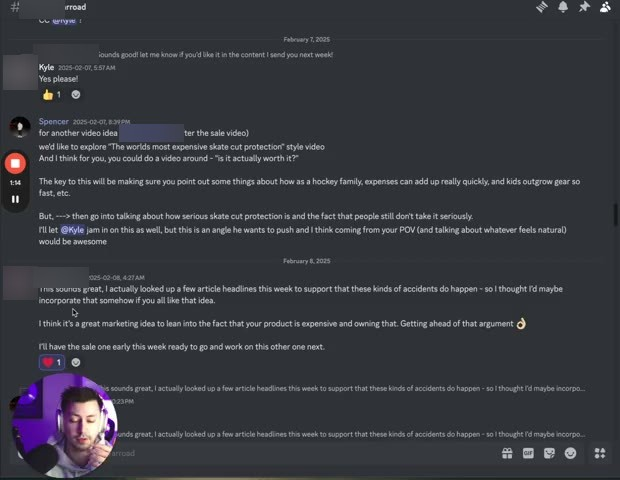

# 158. How To Communicate With Brand Ambassadors
> Talk to ambassadors in a shared Discord or Slack channel the way you would message a teammate: give them sale dates and the next video idea with the avatar angle, and let them run with it.

## 🤖 Agent use
- **Use when:** briefing an onboarded creator on an upcoming promo or a new video concept, without writing a full script.
- **Inputs → outputs:** sale dates and offer PDF, a concept idea with its angle and avatar → a short channel message the creator can act on, plus the creator's own additions.
- **Rules:**
  - **DO** keep a chat channel per creator (Discord or Slack) and keep it casual: "it's literally as simple as like sending a Slack to your team". [01:26]
  - **DO** tell creators about upcoming sales early, even if they are not live yet, and attach the offer PDF. [00:00]
  - **DO** give the idea plus the avatar context. The example names the concept, a sceptical framing ("is it actually worth it?") and the audience facts the video should hit. [00:45]
  - **DO** let the creator add their own proof and angle. The example creator proposed using news headlines about real incidents. [00:45]
  - **IF** the product is expensive **THEN** own it and "get ahead of the argument" in the video. [00:45]
  - **IF** a creator needs more direction (for instance, less naturally on-camera) **THEN** give "a lot more guidance". [01:26]
  - **DON'T** hand-hold: "you want someone who can execute things without you having to tell them every single thing". [01:26]
- **See also:** [159. Action Item: Communicate With Your Ambassadors!](159-action-item-communicate-with-your-ambassadors.md) · [156](156-how-to-onboard-brand-ambassadors.md) · [160. Feedback Loops](160-feedback-loops-with-your-brand-ambassadors.md) · [playbook: creator brief](../../../../playbooks/creator-brief.md)

## Key ideas

### Casual, constant communication [00:00–00:45]
- "It's literally just as casual as this." Some brands have "up to 10 plus creators inside of our actual chat channels". [00:00]
- Example 1: on February 6 the instructor told a creator about an upcoming sale and attached the offer PDF ("not sure if [client] shared this with you"). She asked whether to include it in next week's content. Answer: "it's not live yet ... we're going live in 7-10 days", but yes include it. She replied "Sounds good! let me know if you'd like it in the content I send you next week". The instructor tagged the client contact. [00:00]
- Value: "right now we don't have to go through the process of finding a creator and paying them. We already have a creator that we trust who is going to make content for us." [00:45]

### Idea briefing example [00:45–01:26]
- The follow-up idea for the next video after the sale video: a "world's most expensive skate-cut protection" style video, with the framing "is it actually worth it?". The key: point out that a hockey family's expenses add up quickly and "kids outgrow gear so fast", then go into how serious cut protection is and the fact people still do not take it seriously. The founder wants this angle pushed; it should come from the creator's own POV in whatever feels natural. [00:45; frame 01:20]
- Creator response: she looked up article headlines that week to support that these incidents happen and offered to work them in; she liked leaning into "the fact that your product is expensive and owning that", "getting ahead of that argument". [00:45–01:26; frame]

### Why it works [01:26–02:19]
- Treat creators like team members with ownership: "you give them the idea and they run with it and they absolutely crush it". [01:26]
- Trust is the model: "you wouldn't have hired them if they didn't know how to create content on their own accord". [01:26]
- Result claim (instructor claim): "one of the best ways that we've been able to optimize the ROI from this creator"; she "is just pumping out winning ads for us consistently, even on products I didn't even think we could sell". [01:26–02:19]

## Steps / framework
1. Open a channel per creator.
2. Post sale dates and the offer PDF ahead of time, tag the client contact.
3. Post the next concept: working title, avatar facts to include, the objection to own, who at the brand can help.
4. Read the creator's reply; accept good additions (proof, headlines, framing).
5. Close the loop with metrics ([160](160-feedback-loops-with-your-brand-ambassadors.md)).

## Examples
- **Sale heads-up:** "We're going live in 7-10 days I believe." Creator: "let me know if you'd like it in the content I send you next week". Reply: "I'd say so for sure." [00:00; frame 00:10]
- **Concept brief:** "the world's most expensive skate cut protection style video" / "is it actually worth it?". Creator adds news headlines on injuries. [00:45]

## Prompts / templates (verbatim)
Messages are read from the on-screen Discord frames (creator and client names replaced by placeholders).

```text
Also @CREATOR not sure if [CLIENT CONTACT] shared this with you for the upcoming sale
[attachment: Special Offer.pdf]
```
```text
for another video idea @CREATOR (after the sale video)
we'd like to explore "The worlds most expensive skate cut protection" style video
And I think for you, you could do a video around - "is it actually worth it?"

The key to this will be making sure you point out some things about how a hockey family, expenses can add up really quickly, and kids outgrow gear so fast, etc.

But, ---> then go into talking about how serious skate cut protection is and the fact that people still don't take it seriously.

I'll let @[CLIENT CONTACT] jam in on this as well, but this is an angle he wants to push and I think coming from your POV (and talking about whatever feels natural) would be awesome
```

### Templates
| Template | Use for | Example fill | Source |
|---|---|---|---|
| Sale heads-up | Pre-sale briefing | date, offer PDF, "go live in 7-10 days" | [00:00] |
| Concept brief ("for another video idea ...") | Next video idea | title, avatar facts, objection to own, framing question | frame [01:20] |

## Screenshots

*The idea message in the ambassador's Discord channel (concept title, "is it actually worth it?" framing, avatar facts) and the creator's reply offering supporting headlines. [01:20]*

## How to apply
- [ ] One channel per creator with the brand's decision maker inside.
- [ ] Post the next promo date and the offer PDF the day you know it.
- [ ] Brief each new concept in 4-6 lines: framing question, avatar facts, objection to own.
- [ ] Ask the creator for proof they find (articles, reviews) and incorporate it.

## Related
- Previous: [157](157-action-item-onboard-brand-ambassador.md) · Next: [159](159-action-item-communicate-with-your-ambassadors.md)
- [156](156-how-to-onboard-brand-ambassadors.md) · [160](160-feedback-loops-with-your-brand-ambassadors.md)

## Sources and limitations
- Transcript: [158 transcript](<../../../../../raw/evolve/start-here/_transcripts/👣 Evolve (Start Here)/158. How To Communicate With Brand Ambassadors 👣 Evolve (Start Here) Evolve.txt>) · Page text: "(no lesson text on page)" ([158 page](<../../../../../raw/evolve/start-here/_extracted/👣 Evolve (Start Here)/158. How To Communicate With Brand Ambassadors_👣 Evolve (Start Here)_Evolve.html.md>)).
- Machine transcription. Whisper writes "skate cut" and "careers" for "creators" ("when you have careers like this ... "), and a misheard creator first name (omitted). The Discord messages are read from video frames; wording is exact where legible.
- Creator, client-contact and brand-channel names are on screen in the frames and are not repeated in this text. The screenshot shows a channel with real names; treat as internal reference.
- Last segment 2:37.6 of 2:37.6: complete. In [156](156-how-to-onboard-brand-ambassadors.md) [06:14] the instructor calls this lesson one part of a pair with the onboarding lesson.
