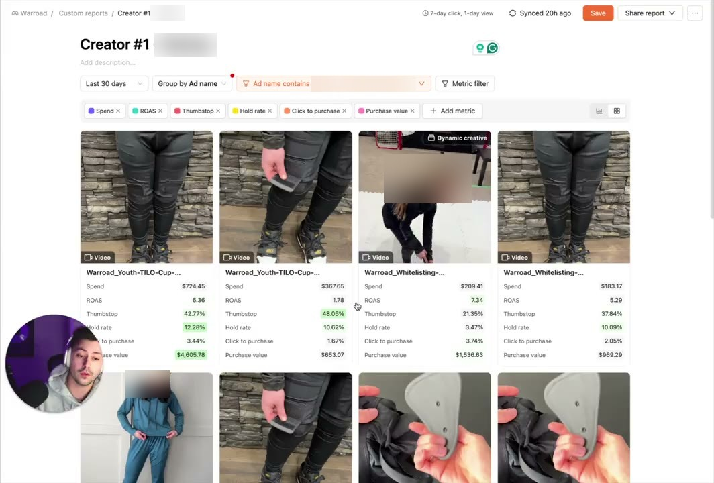
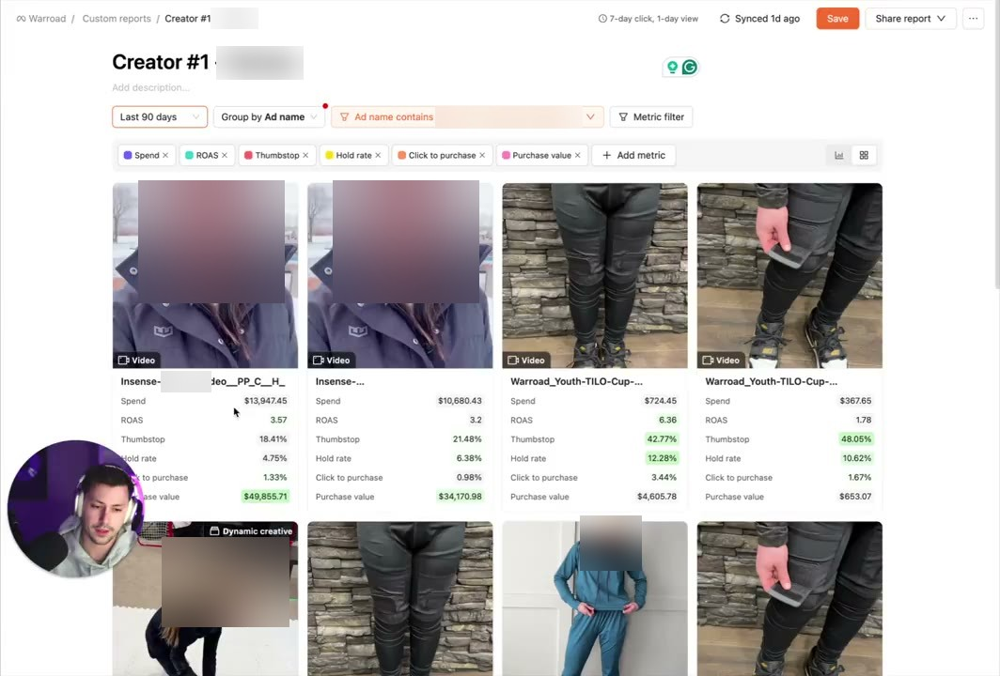
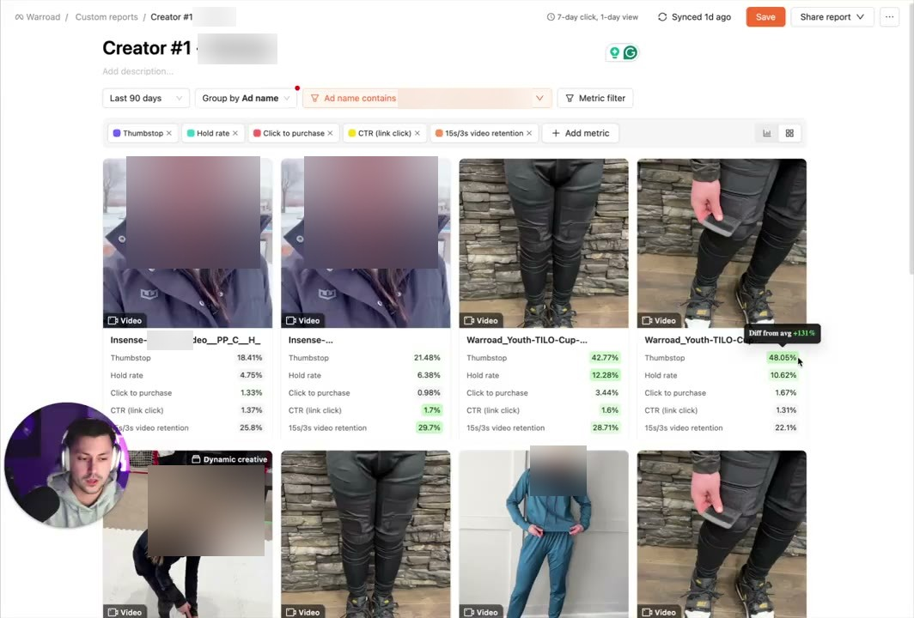

# 160. Feedback Loops With Your Brand Ambassadors
> Build one Atria report per creator (filtered by ad name) and send it with commentary on thumbstop, hold, CTR, retention and comments, so creators learn what makes ads work and generate more of it. It is how a creator's output turns into winning ads.

## 🤖 Agent use
- **Use when:** you have creators with live ads and want them to make more of what converts, or you need to diagnose a creator's ads by hook, hold and conversion.
- **Inputs → outputs:** ad account data with creator names in ad names + Atria (or any reporting tool) → a shared report, a short note per ad ("repeat / fix"), and new video ideas mined from comments.
- **Rules:**
  - **DO** tell creators what is working. "Most people tell creators to just make content and then they don't actually tell them what does well and what doesn't." [00:46]
  - **DO** put the creator's name in the ad name so a report can filter on "ad name contains <creator>". [01:27]
  - **DON'T** assume organic performance predicts ad performance: creators think what does well organically does well as an ad, "most of the time it's actually not". [00:46]
  - **IF** the creator is not on a revenue or ad-spend share **THEN** hide spend, ROAS and purchase value and show only soft metrics. [03:15; 04:14]
  - **DO** share thumbstop, hold rate, click-to-purchase (conversion), CTR (link click), engagement and shares, average play time, and 15s/3s retention. [02:20–06:30]
  - **DO** compare thumbstop vs conversion: a hook with a similar thumbstop can convert at double the rate if it attracts the right buyer. [03:15]
  - **DO** mine the ad's Meta comments for new video ideas and hand them to the creator. [06:30–08:05]
  - **DON'T** hand-wave: "give them your marketing brain and help them understand". [07:15]
- **See also:** [156. How To Onboard Brand Ambassadors](156-how-to-onboard-brand-ambassadors.md) · [161. Action Item: Complete Your Feedback Loops](161-action-item-complete-your-feedback-loops.md) · [41. Creative Research Part 1 (Atria)](041-creative-research-part-1-atria.md) · [100. How To See Ads Performance + Our Columns](100-how-to-see-ads-performance-our-columns.md) · [123. How To Do Learnings Part 2 (Winning Ads)](123-how-to-do-learnings-part-2-winning-ads.md) · [Iteration vs variation](../../../../concepts/iteration-vs-variation.md)

## Key ideas

### Why feedback loops [00:00–01:27]
- Atria is not only the research tool; "it is also our tool for ... doing reports for our creators". The instructor sends readers back to the research stage for Atria and to the learnings lessons for "feedback loops" (telling creators what works and what does not). [00:00]
- Problem: a creator may post videos that "don't really do anything on their personal profile, but they ... murder it as ads". They must see what is crushing it in the account. [00:46]

### How to build the report [01:27–02:20]
1. Put the creator's name in each ad name inside the ad account.
2. In Atria, left side: **Custom report** → create new report.
3. Add the filter "Ad name contains <creator's name>" (or "... contains <ad name>") and click Apply. [01:27]
4. Group by ad name; pick the date range (30 or 90 days).
5. Add metric chips: Spend, ROAS, Thumbstop, Hold rate, Click to purchase, Purchase value (frame). Later also CTR (link click) and 15s/3s video retention. [frame 00:20; 06:00]

### What to say about the numbers [02:20–06:30]
- Example creator ad that "absolutely ripped" in Nov/Dec: from the on-screen 90-day report, two ads at $13,947.45 and $10,680.43 spend, 3.57 and 3.2 ROAS, $49,855.71 and $34,170.98 purchase value. The spoken figures ("$13,020 ... $23,000 ... 75K") do not match the screen. The report on screen is the safer source. [02:20; frame 02:30]
- Thumbstop: "18 to 21 is really not that great whereas this one over here is 42, this one over here is 48." The on-screen low pair is 18.41% and 21.48%; the high pair is 42.77% and 48.05%. [02:20; frame]
- Hook vs buyer: a kid skating around the rink stops many hockey-interested viewers. A hook of a mom tying the kid's skates had almost as high a thumbstop "but double the conversion rate because that's actually going to attract more of the parents". [03:15]
- Soft metrics to share: CTR (link click); engagement such as post shares ("this is getting a ton of shares, so ... people are really relating with this content"); video average play time (example: 7.36 seconds on one ad vs people dropping after four seconds on another). [05:09–05:45]
- 15s/3s retention ("percentage of videos viewed for at least three seconds that went on to be played for at least 15 seconds"): "kind of like an optimized hold rate". Example: 48% thumbstop but only 22% of the stoppers watched to 15 seconds, vs 29%. [05:45–06:30; frame 06:40]
- Hide money from non-share creators: "if you do not have a creator on a revenue share program or an ad spend share program ... you definitely do not want to show them all the money that you're making from their ads because they're probably going to ask more." [03:15] Atria's shared link shows metrics unless hidden, so check before sharing. [04:14]
- The minimum: "very bare minimum, either in some kind of Google slide report or Atria report or just a Loom". [05:09]

### Mine comments for ideas [06:30–08:05]
- Pull the ad up in Meta and read the comments (the ad was off because of stock). [06:30]
- Examples read aloud: "Love this [coat] as a Christmas gift. My husband bought one for me"; "just bought one for my wife"; plus a customer-service complaint ("I've been trying to get in touch with customer service for weeks"). [07:15] (Whisper wrote "Coke"; likely "coat".)
- Idea derived live: a creator video on "gifts my husband got me that I actually love", "something that could now turn into an ad that absolutely crushes even further". [07:15–08:05]

### Per-creator ROI and pay [08:05–09:03]
- Report scrolled down: about "$26,000 over the last 90 days" on this creator's content generated "almost 100K" (instructor figures, spoken). The creator is paid $500 per month "and ... now on more of a structured program". [08:05]
- Close: "you build one of these reports for every single one of our creators". [08:05]

## Steps / framework
1. Add the creator's name to every ad name.
2. Create the custom report: filter on the name, group by ad name, date range 30/90 days, metrics as above.
3. Decide visibility: share money metrics only for revenue/ad-spend-share creators.
4. Save, Share report (or a Loom / slides). Check the public link in an incognito window. [04:14]
5. Send notes per ad: what to repeat, what to fix (thumbstop vs hold vs conversion).
6. Pull comments, convert themes into new ideas, post in the channel ([158](158-how-to-communicate-with-brand-ambassadors.md)).
7. Repeat monthly; a monthly report is promised in [156](156-how-to-onboard-brand-ambassadors.md).

## Examples
Metrics on screen in the 90-day creator report (one hockey-protective-gear brand; Atria, 7-day click / 1-day view). Rounded as displayed.

| Ad (description) | Spend | ROAS | Thumbstop | Hold rate | Click to purchase | Purchase value | Source |
|---|---|---|---|---|---|---|---|
| Insense-sourced talking video A (smiling creator outdoors) | $13,947.45 | 3.57 | 18.41% | 4.75% | 1.33% | $49,855.71 | frame 02:30 |
| Same style video B | $10,680.43 | 3.2 | 21.48% | 6.38% | 0.98% | $34,170.98 | frame 02:30 |
| Youth cut-protection demo, standing in pants | $724.45 | 6.36 | 42.77% | 12.28% | 3.44% | $4,605.78 | frame 02:30 |
| Youth cut-protection demo, hand on pants | $367.65 | 1.78 | 48.05% | 10.62% | 1.67% | $653.07 | frame 02:30 |

- Learning the instructor draws: low-thumbstop ads (18-21%) carried the big spend and revenue; the two high-thumbstop ads (42-48%) had small spend. This shows why they pair thumbstop with conversion and with retention, not thumbstop alone. (derived reading of the screen; the instructor focuses on the thumbstop comparison)
- 15s/3s retention on screen: A 25.8%, B 29.7%, standing demo 28.71%, hand demo 22.1%. CTR (link click): 1.37%, 1.7%, 1.6%, 1.31%. [frame 06:40]

## Structured units

### Rules of thumb
- **DO** send each creator a report of their own ads. [01:27]
- **IF** thumbstop is high but hold is weak **THEN** ask for more suspense/open loops in the video. [from 156 05:37]
- **IF** thumbstop is similar across hooks **THEN** prefer the hook with the higher conversion; it attracts buyers rather than watchers. [03:15]
- **DON'T** show spend/ROAS/purchase value to non-share creators. [03:15]
- **DO** read ad comments for gift, objection and customer-service themes and turn them into videos. [07:15]

### Templates
| Template | Use for | Example fill | Source |
|---|---|---|---|
| Creator custom report | Per-creator results board | Ad name contains <creator>; Spend, ROAS, Thumbstop, Hold, Click to purchase, Purchase value | [01:27] |
| Soft-metric report | Creators not on revenue share | Thumbstop, Hold, CTR, 15s/3s retention, shares, avg play time | [05:09] |
| Comment-to-idea | New concept source | "my husband got me this as a gift" → "gifts my husband got me that I actually love" | [07:15] |

## Screenshots

*The custom report: filter "Ad name contains ..." and metric chips Spend, ROAS, Thumbstop, Hold rate, Click to purchase, Purchase value, with green highlights on the best values. [00:20]*

*90-day view: the top-spend Insense-sourced ads at $13.9k and $10.7k, ROAS 3.57 and 3.2, versus small high-thumbstop demo ads. [02:30]*

*Soft-metric version: Thumbstop, Hold rate, Click to purchase, CTR (link click) and 15s/3s video retention, with a tooltip "Diff from avg +131%". [06:40]*

## How to apply
- [ ] Rename ads so the creator name is in every ad name.
- [ ] Build the custom report per creator; save and share the link.
- [ ] Hide spend/ROAS/purchase value unless the creator is on revenue or ad-spend share.
- [ ] Write 3 notes per creator: best ad and why, weakest metric and fix, one new idea from comments.
- [ ] Review monthly and feed ideas into the creator channel.

## Related
- Previous: [159](159-action-item-communicate-with-your-ambassadors.md) · Next: [161](161-action-item-complete-your-feedback-loops.md)
- [156](156-how-to-onboard-brand-ambassadors.md) · [158](158-how-to-communicate-with-brand-ambassadors.md) · [154](154-how-to-contact-winning-creators-affiliate.md) · [126. How To Pull Frameworks From Ads](126-how-to-pull-frameworks-from-ads.md)

## Sources and limitations
- Transcript: [160 transcript](<../../../../../raw/evolve/start-here/_transcripts/👣 Evolve (Start Here)/160. Feedback Loops With Your Brand Ambassadors 👣 Evolve (Start Here) Evolve.txt>) · Page text: [160 page](<../../../../../raw/evolve/start-here/_extracted/👣 Evolve (Start Here)/160. Feedback Loops With Your Brand Ambassadors_👣 Evolve (Start Here)_Evolve.html.md>) (only the Atria link).
- Machine transcription. Whisper writes "Coke" for a likely "coat", "hole rate" for hold rate, "Winnie Nuts" for "winners" at the close, and several spoken dollar figures that disagree with the report on screen. Last segment 9:03 of 9:06: complete.
- Creator names on screen are not repeated in text. The screenshots show a creator's name in the report title.
- Instructor claims (unverified): the $13,020/$23,000/75K figures, "$26,000 over 90 days generated almost 100K", the ad "that just absolutely ripped".
- The Atria link on the page is an affiliate link. Atria is not required (lesson 161).
