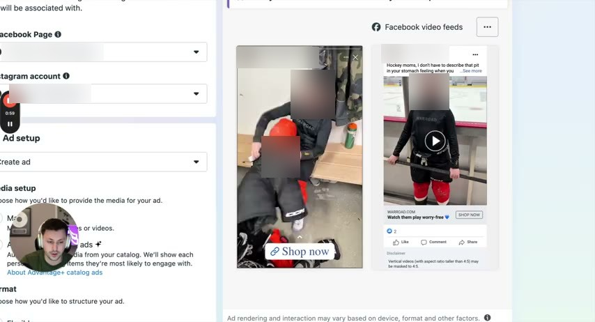
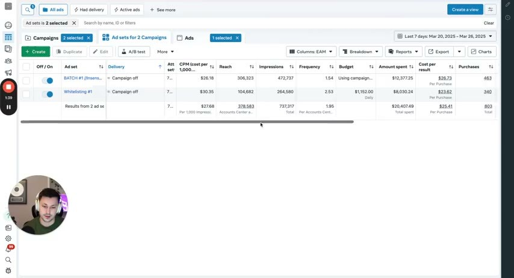

# 162. Whitelisting Overview + Proof It Works
> Whitelisting lets you run ads from a creator's Facebook Page and Instagram account instead of the brand's. It can lift ROAS, but only do it with winning creators, pay about $100-250 a month for access, have an agreement, and never rely on it alone.

## 🤖 Agent use
- **Use when:** deciding whether to run a creator's ad from the creator's own profile, what to pay for access, and how to protect the account from the creator pulling access.
- **Inputs → outputs:** creators on retainer with winning ads → a go/no-go for whitelisting, a price to offer, an agreement clause, and a risk plan (separate test campaign).
- **Rules:**
  - **DO** whitelist only creators "we bring onto retainer who have WINNING ads". [03:11; page text #1]
  - **DO** budget $100-$250+ per month per creator for access: "anything more - not worth it". [page text #2; 05:22]
  - **DON'T** pay big: when a creator who agreed then wanted $1,200, "no you don't ... don't pay for it", unless it is "an insane creator". [03:46]
  - **DON'T** rely solely on whitelisting. "You can get cooked if the creator removes access." [page text; 05:58]
  - **DO** have a whitelisting agreement. Consider a non-compete clause so the creator does not whitelist for the same product elsewhere. [06:57–07:34]
  - **DON'T** run ads on a creator's page that they did not make: "super shady". [05:22]
  - **DO** warn creators that all comments land on their page; "if you are running some sus shit, they will see it and likely revoke access". [07:34]
  - **DON'T** use whitelisting to find winning ads: "we are not trying to find winning ads by whitelisting creatives". [04:24]
  - **IF** you ask after onboarding **THEN** do it after a good month: "your ads are doing really well. If you want better performance, would you be open to doing whitelisting with us?" [04:24]
- **See also:** [163. How To Setup Whitelisting (Creators)](163-how-to-setup-whitelisting-creators.md) · [164. How To Test Whitelisted Ads](164-how-to-test-whitelisted-ads.md) · [165. Partnership Ads (Updated Strategy)](165-partnership-ads-updated-strategy.md) · [156. How To Onboard Brand Ambassadors](156-how-to-onboard-brand-ambassadors.md) · [154](154-how-to-contact-winning-creators-affiliate.md)

## Key ideas

### What whitelisting is [00:00–01:28]
- "Whitelisting ... allows you to run ads from another profile." Your ad shows another page's name (creator profile, theme page, or another brand's Instagram). [00:00]
- It is "camouflaged ... to the ultimate extent": the viewer sees a real person, not a brand, then sees "Sponsored". [00:40]
- Why it can work: "clearly this person is willing to run ads from their own profile", so it reads as an endorsement. [00:40]
- Disadvantages: people may click through and ask who the person is; "you get less clicks to your Instagram" (the brand's). [00:40]

### Proof (instructor data, Mar 2025) [01:28–03:11]
- Same ads, last 7 days (Mar 20-26, 2025 on screen): a whitelisted ad set vs the non-whitelisted batch. On screen: whitelisted ad set $8,030.24 spent, 340 purchases, $23.62 cost per purchase, CPM $30.35, frequency 2.53, daily budget $1,152. Non-whitelisted batch $12,377.25 spent, 463 purchases, $26.73, CPM $26.18, frequency 1.54. [frame 01:40]
- Instructor: "although it is spending about 4K less, [CPA] is around $23, but our overall return on ad spend is actually a lot higher. So the AOV is actually a little bit higher as well." ROAS and AOV are not visible in the frame, so they are instructor statements (instructor claim). [01:28]
- They had tested whitelisting "for about a couple of months". [01:28]
- Second example (counter-case, "Maximum" date range on screen): a women's-hoodie ad set run from the brand page vs the same video whitelisted. On screen the brand-page ad set shows $5,461.41 purchase value at 3.74 ROAS with 36 results; the whitelisted ad set shows $0.00 and no ROAS. Instructor: "it didn't obviously take off and rip", with ad errors as a possible reason it stopped spending. [02:12; frame 02:30]
- Limits stated: "this isn't ... going to save your ad account, but this actually can help nudge performance because we've been able to spend an extra $8,000 on this specifically." [02:12]

### Things to consider [03:11–08:22]
1. **Only with winning-ad creators on retainer.** [03:11]
2. **Pay $100-$250+/month.** In practice, the agreement offers $500/month for four videos plus a request for whitelisting access. Some creators say yes for $0; others research and ask for more. "We, if anything, are going to pay $100 to $250 extra per month. And $250 is even on the high end ... we're paying these creators $125 per video." [03:46]
3. **Ways to ask:** (a) put it in the original agreement: "we would love you to create ads for us. And we would also love to run ads from your profile"; (b) if they say they charge extra, offer a bump (the speaker says "I'll throw in 600"; (derived) a small raise to the monthly fee, wording unclear); (c) ask after a good first month. Reported results: $0 or $100-$150 per month. [04:24]
4. **Never over-leverage.** Run whitelisted ads in a separate traditional campaign so a top CBO ad is not whitelisted unless "we're very confident in that creator". Trusted creators get "dripped" into Champions. [05:58]
5. **Agreement + optional non-compete.** Contracts are "terrible" templates, "never legal advice". [06:57–07:34]
6. **Comments live on the creator's page.** Be clear what is going on; shady behaviour will get access revoked. [07:34]
- "We only run the creator's specific ads on the creator's profile." [05:22]
- Theme pages and other brand pages are teased as a later topic; they are not covered in this lesson. [00:40; 08:22]

## Steps / framework
1. Check eligibility: winning ad + on retainer ([157](157-action-item-onboard-brand-ambassador.md)).
2. Add a whitelisting clause to the agreement (the "% Ad Spend + Whitelisting" contract in [156](156-how-to-onboard-brand-ambassadors.md) includes: "Provide the COMPANY with Facebook Page & Instagram Page access for the COMPANY to run the Creator's ads via Whitelisting").
3. Offer $0-$250/month for access. Decline above this unless the creator is exceptional.
4. Get access via [163](163-how-to-setup-whitelisting-creators.md).
5. Test in a separate or raw-content campaign ([164](164-how-to-test-whitelisted-ads.md)).
6. Monitor comments on the creator's page.

## Examples
- **Case 1 (worked):** 7-day comparison, same creative, whitelisted vs brand page. See Proof. [01:28]
- **Case 2 (did not take off):** same videos run from the brand page and from a whitelisted page; the whitelisted ad set recorded no purchase value on screen; "it didn't obviously take off and rip", with an ad error as a possible cause. [02:12]
- **Pricing story:** a creator wanted $1,200 after "research"; instructor refused. [03:46]

## Structured units

### Rules of thumb
- **DO** only whitelist creators who already have a winning ad. [03:11]
- **DON'T** exceed ~$250/month for access. [05:22]
- **IF** a creator removes access mid-test **THEN** you lose the ad's social proof (likes, comments), so keep your top ad non-whitelisted too. [05:58–06:57] (derived)
- **DON'T** whitelist your whole account's ads on one creator.

## Prompts / templates (verbatim)
Page text (considerations list, as written):
```text
Things to Consider:

#1 - We only do this with creators we bring onto retainer who have WINNING ads

#2 - Expect to pay $100-$250+ per month to creators for whitelisting access (anything more - not worth it)

#3 - If you solely rely on Whitelisting, you can get cooked if the creator removes access

#4 - Have an agreement for whitelisting access (see this agreement here, but please use at your own risk. Adding a "non-compete clause" is also a smart thing to do)

#5 - All comments happen on THAT user's page. So, if you are running some sus shit, they will see it and likely revoke access.
```
The numbering on the page shows #2 twice in an earlier frame and was corrected to #1-#5 in a later edit; the extracted page text is #1-#5.

Contract clause (from the "% Ad Spend + Whitelisting" PDF, section 2):
```text
Provide the COMPANY with Facebook Page & Instagram Page access for the COMPANY to run the Creator's ads via Whitelisting.
```

Ask lines (spoken):
```text
"hey, we would love you to create ads for us. And we would also love to run ads from your profile."
"hey, by the way, your ads are doing really well. If you want better performance, would you be open to doing whitelisting with us?"
```

## Screenshots

*Ads Manager ad-level Identity: the Facebook Page and Instagram account fields are set to a creator's page, so the preview shows the creator as the sponsor name with the brand's shop link below. [01:00]*


*Mar 20-26, 2025: the whitelisted ad set spent $8,030.24 at $23.62 per purchase against $12,377.25 at $26.73 for the batch. [01:40]*

## How to apply
- [ ] List creators with winning ads who are on retainer.
- [ ] Add the whitelisting clause (and a non-compete) to their agreement and agree a monthly access fee in the $0-$250 range.
- [ ] Keep at least one non-whitelisted version of each top ad.
- [ ] Brief creators on comments on their page.
- [ ] Use [163](163-how-to-setup-whitelisting-creators.md) for access and [164](164-how-to-test-whitelisted-ads.md) for campaign placement.

## Related
- Previous: [161](161-action-item-complete-your-feedback-loops.md) · Next: [163](163-how-to-setup-whitelisting-creators.md)
- [165. Partnership Ads (Updated Strategy)](165-partnership-ads-updated-strategy.md) shows the later shift to partnership ads. [98](098-how-to-set-up-raw-content-campaign.md) · [94](094-how-to-set-up-a-3-2-2-campaign.md)

## Sources and limitations
- Transcript: [162 transcript](<../../../../../raw/evolve/start-here/_transcripts/👣 Evolve (Start Here)/162. Whitelisting Overview + Proof It Works 👣 Evolve (Start Here) Evolve.txt>) · Page text: [162 page](<../../../../../raw/evolve/start-here/_extracted/👣 Evolve (Start Here)/162. Whitelisting Overview + Proof It Works_👣 Evolve (Start Here)_Evolve.html.md>) · PDF clause: [156 whitelisting contract](<../../../../../raw/evolve/start-here/_extracted/👣 Evolve (Start Here)/156. % Ad Spend Contract + Whitelisting.pdf.md>).
- Machine transcription. Whisper writes "Incense" for Insense, "such shit" for "sus shit", "per career" for "per creator", and the speaker says "number two here, I should say number three" while reordering the list. Last segment 8:37.39 of 8:37.42: complete.
- The page's linked agreement ("see this agreement here") points to the 156 contracts; I used the whitelisting variant.
- The ROAS and AOV claims are spoken; only spend, purchases, CPM, frequency and CPA are visible. The second comparison frame (not embedded) uses a "Maximum" date range (Feb 27, 2022 to Mar 27, 2025); I read the whitelisted row as $0.00 purchase value, but the instructor attributes it to ad errors, so it is not clean evidence against whitelisting.
- The brand shown is a hockey-gear brand; the creator's name is on screen and not repeated. The campaign being compared is "off" because stock was an issue, per the instructor. Results are instructor data from one account; no controlled test.
