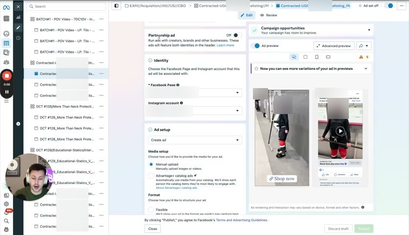
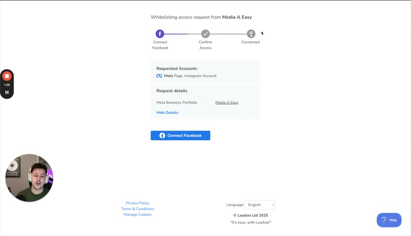
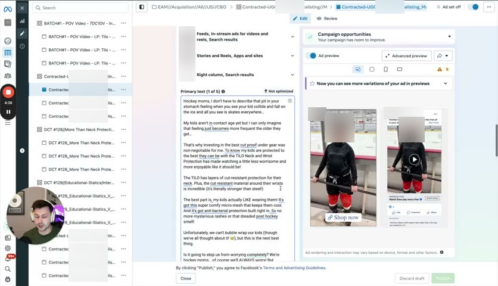

# 163. How To Setup Whitelisting (Creators)
> Use Leadsie to send a creator one link that grants your business portfolio access to their Facebook Page and Instagram account in three clicks, then pick their page and Instagram as the ad identity in Meta, and ask them to write the copy in their own voice.

## 🤖 Agent use
- **Use when:** you have a creator who agreed to whitelisting ([162](162-whitelisting-overview-proof-it-works.md)) and need the technical access and ad setup.
- **Inputs → outputs:** a creator, a Meta Business portfolio, a Leadsie account → a reusable "Whitelisting" custom request link, the creator's Page and Instagram connected, and ads running with the creator's identity.
- **Rules:**
  - **DO** use a tool (Leadsie) rather than explaining Meta sharing steps by Loom: "most creators aren't going to know how to do that ... most clients can't even do that". [00:00]
  - **DO** create the access request once as a **Custom Request** named "Whitelisting" and reuse its link for every creator. [01:46]
  - **IF** a creator has no Facebook Page **THEN** tell them to create one; if they cannot, send a YouTube tutorial. [01:46]
  - **DO** have the creator write or rewrite the primary text in their own voice: "write copy ... like it's coming from the content creator". [04:08]
  - **IF** the creator has multiple pages or a personal Instagram **THEN** ask for the one they actually use. [04:08]
  - **DON'T** pay for Leadsie before you need it: 14-day free trial; for one or two creators sign up when ready, then pause. [02:44; 05:42]
- **See also:** [162. Whitelisting Overview + Proof It Works](162-whitelisting-overview-proof-it-works.md) · [164. How To Test Whitelisted Ads](164-how-to-test-whitelisted-ads.md) · [165. Partnership Ads (Updated Strategy)](165-partnership-ads-updated-strategy.md) · [156](156-how-to-onboard-brand-ambassadors.md)

## Key ideas

### Why Leadsie [00:00–01:46]
- Manual route: Loom the creator through logging into Facebook/Instagram and sharing with your Business Manager ID; "if they know, then they're probably gonna charge you more". [00:00]
- Leadsie: "stupidly simple for the content creator provide access". The creator's flow on screen: **Connect Facebook** → **Confirm Access** → **Connected**. The page displays "Whitelisting access request from <your company>", requested accounts "Meta Page, Instagram Account", and "Meta Business Portfolio <yours>". [00:59–01:46; frame 01:40]
- Pricing (page text): 14-day trial, then $99/month. Speaker: the link may give about 15% off (to be confirmed). [00:00; page text]

### Create the request [00:59–02:44]
1. Sign up (14-day free trial).
2. Settings → Integrations → connect your Meta ads account; the tool prompts for this first. [00:59]
3. Create **Custom Request**. Access level: **Whitelisting**. Name it (default "Whitelisting"). Pick your business portfolio and the people to give access to. Create. [01:46]
4. Copy the custom request link and send it to each creator. Dashboard shows the request: assets Facebook Page and Instagram Account, access level "Whitelisting Request". [frame 02:28]
- Bottleneck: many Instagram creators lack a Facebook Page; solve as above. [01:46]

### Use the page in Meta [03:30–05:04]
- Once access is granted, in Ads Manager at ad level, change the Facebook Page and Instagram account to the creator's. "It's literally as simple as just going in and changing the page." [03:30]
- Frame: Ad > Identity: Facebook Page and Instagram account fields; "Partnership ad" toggle is Off for whitelisting. Preview shows the creator as sponsor. [frame 00:10; 03:30]
- Once the pages are in your BM "you'll be able to use those pages on any ads that you set up". [05:04]

### Copy in the creator's voice [04:08–05:04]
- Ask creators (via Discord) for their own copy; give them your top-performing copy as a reference. One creator "went above and beyond and ... wrote all of this copy herself because she wanted to tell a story". [04:08]
- Frame shows that copy opening: "Hockey moms, I don't have to describe that pit in your stomach feeling when you see your kid collide and fall on the ice and all you see is skates everywhere…" and continuing in first person ("My kids aren't in contact age yet but I can only imagine that feeling just becomes more frequent the older they get…"). [frame 04:40]

## Steps / framework
1. Agree whitelisting ([162](162-whitelisting-overview-proof-it-works.md)), put it in the agreement.
2. Leadsie: sign up, connect Meta, create the "Whitelisting" custom request.
3. Send the link; the creator completes the 3 steps (create a Page first if needed).
4. In Ads Manager, create the ad and set Identity to the creator's Page and Instagram account.
5. Ask the creator for a self-written primary text; paste it in.
6. Place the ad per [164](164-how-to-test-whitelisted-ads.md).

## Examples
- **Creator-voiced copy (instructor example, hockey-gear brand):** first-person story starting "Hockey moms, ..." with product benefits (cut-resistant layers, micro-mesh, anti-bacterial) in her own words. Instructor: "this is the way that you guys can also make this feel even more real". [04:08; frame 04:40]
- **Identity swap:** brand page → creator page and creator's Instagram, two selections. [03:30]

## Prompts / templates (verbatim)
Leadsie custom request settings as shown or described:
```text
Access level: Whitelisting
Name: Whitelisting (editable)
Business portfolio: <your business portfolio>
Assets requested: Facebook Page + Instagram Account
Link: copy the custom request link; send to every creator
Creator flow: 1) Connect Facebook  2) Confirm Access  3) Connected
Cost: 14-day trial, then $99/month (page text)
```
Ask to creators (derived from spoken guidance, paraphrased): "Here's our top performing copy, but if you want to make this sound like yourself, please go ahead and write some." [04:08]

## Screenshots

*Meta Ads Manager at ad level: Partnership ad is Off; Identity shows the creator's Facebook Page and Instagram account; the preview shows the creator as sponsor. [00:10]*


*What the creator sees: Connect Facebook, Confirm Access, Connected, with requested accounts "Meta Page, Instagram Account". [01:40]*


*Primary text written in the creator's voice: story opener to hockey parents, cut-resistance claim, comfort details. [04:40]*

## How to apply
- [ ] Sign up to Leadsie and connect the Meta ads account.
- [ ] Create the "Whitelisting" custom request and copy the link.
- [ ] Send the link to each agreed creator; help them create a Facebook Page if needed.
- [ ] Set ad identity to the creator's Page and Instagram.
- [ ] Ask the creator for a version of the copy in their voice.
- [ ] Log the access in the retainer sheet ("Whitelisting Fee" column, [154](154-how-to-contact-winning-creators-affiliate.md)).

## Related
- Previous: [162](162-whitelisting-overview-proof-it-works.md) · Next: [164](164-how-to-test-whitelisted-ads.md)
- [165](165-partnership-ads-updated-strategy.md) for the newer partnership-ad route. [156](156-how-to-onboard-brand-ambassadors.md)

## Sources and limitations
- Transcript: [163 transcript](<../../../../../raw/evolve/start-here/_transcripts/👣 Evolve (Start Here)/163. How To Setup Whitelisting (Creators) 👣 Evolve (Start Here) Evolve.txt>) · Page text: [163 page](<../../../../../raw/evolve/start-here/_extracted/👣 Evolve (Start Here)/163. How To Setup Whitelisting (Creators)_👣 Evolve (Start Here)_Evolve.html.md>).
- Machine transcription. Whisper writes "Leazy"/"LeadSee" for Leadsie, "a way better way" and "white listings". Last segment 5:51.55 of 5:51.55: complete. Page text: only the sign-up link and "$99/month after the 14-day trial" (the link is a bit.ly/affiliate-style link).
- Frames showing a Leadsie admin screen with the agency's email and client lists are not embedded. The creator's name appears in Page/Instagram fields on screen.
- The "I think it's 99 bucks a month" and "15% off" statements are hedged by the speaker; the page text confirms $99/month.
- "There is one bottleneck" refers to creators without Facebook Pages (inferred from context [01:46]).
