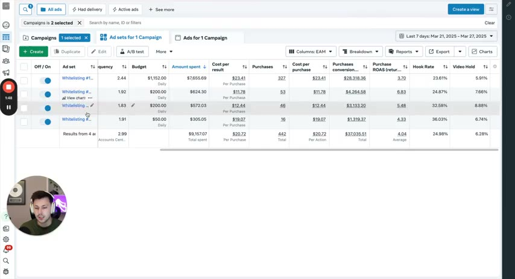
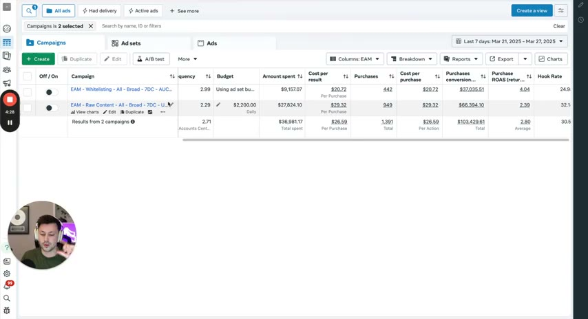

# 164. How To Test Whitelisted Ads
> Under about $2k/day, drop whitelisted creator ads into your main 3:2:2 or raw content campaign; over that, run a separate whitelisting campaign so you get clean data and are not over-leveraged on one creator's page.

## 🤖 Agent use
- **Use when:** you have whitelist access for a creator ([163](163-how-to-setup-whitelisting-creators.md)) and need to decide which campaign the ad goes in.
- **Inputs → outputs:** daily account spend, existing campaigns, creator ads → a campaign placement (main/raw vs separate whitelisting campaign), budget type, and a risk plan.
- **Rules:**
  - **IF** spending **less than $2k/day** **THEN** put whitelisted ads in the main 3:2:2 campaign or the raw content campaign: "you need all the performance you can to scale things up". [00:00–00:48; page text #1]
  - **IF** spending **more than $2k/day** **THEN** run a separate objective: a whitelisting-only campaign with creator ads. CBO preferred, ABO works too. [page text #2; 01:33]
  - **DO** keep the budget logic simple: "the way that you test the ad doesn't really matter". [02:24]
  - **DON'T** assume ABO caused the strong ROAS: "it's because the ad and ... the whitelisting is working well". [01:33]
  - **DON'T** over-leverage on one creator: keep a separate campaign so a creator pulling access does not break your main spend. [03:59]
  - **IF** you want a clean read **THEN** run the ad on its native page and whitelisted, side by side. [00:48]
  - **DO** put new creator ads into the raw content campaign as whitelisted ads once you see whitelisting helps. [02:24]
  - **DON'T** switch every ad if you want your own Instagram to grow: the creator gets the comments, follows and profile visits. [03:13]
- **See also:** [94. 3/2/2 Campaign](094-how-to-set-up-a-3-2-2-campaign.md) · [98. Raw Content Campaign](098-how-to-set-up-raw-content-campaign.md) · [162](162-whitelisting-overview-proof-it-works.md) · [163](163-how-to-setup-whitelisting-creators.md) · [165. Partnership Ads (Updated Strategy)](165-partnership-ads-updated-strategy.md) · [100. How To See Ads Performance](100-how-to-see-ads-performance-our-columns.md)

## Key ideas

### Under $2k/day [00:00–01:33]
- Example: a client whose main campaign is "below $100 a day. It's super, super slow". No budget to run separate tests, so "just run them inside of your main campaign and let that be it". [00:00]
- "We're doing this for basically all of our brands that ... are spending less than 2k per day just ... throw it in here." [00:48]
- Optional: test the same ad on its native page and on the whitelisted page to isolate the effect. "But for us, we would just recommend ... run the creative for that creator inside of there." [00:48]
- The raw content campaign ("this campaign specifically is just raw content") also works; "it doesn't really matter". With CBO it is "likely going to get spend, likely going to perform". [00:48]

### Over $2k/day [01:33–03:59]
- Test separately for the sake of "not being over leveraged". The test campaign was an ABO "to force spend to see if Facebook could figure it out ... and Facebook is fine". [01:33]
- Spoken threshold: "if you're spending more than two or three K per day" you can set up a whitelisting-only campaign with all top creator ads on their pages, "almost like a second raw content campaign". [02:24; 03:59] The page text says $2k.
- The brand in the example was spending "about like three and eight ... about 4K per day just on the raw content campaign" (computed as 27k/7). [03:59]
- After whitelisting proves itself: "any of our content creator ads [go] into the raw content campaign as a whitelisted ad". For new creatives, once whitelisting works "you could probably just merge the two", but stay un-leveraged on one creator. [02:24; 03:59]
- "There is no best way to do this." [02:24; 03:59]
- Instructor's note on their testing style: they deliberately try to "break the strategy" and have not managed to. [01:33]

### Side effects [03:13]
- The creator receives all comments, follows and profile visits, so heavy conversion of all your ads to whitelisted ads can stunt your own Instagram growth. "At the end of the day, if it gives you better performance, then it's definitely worth it." [03:13]

## Steps / framework

| Account daily spend | Where to run whitelisted ads | Budget type | Notes |
|---|---|---|---|
| Under $2k/day | Main 3:2:2 campaign or raw content campaign | CBO as in those campaigns | Optionally A/B native vs whitelisted. [00:00–00:48] |
| Over $2k/day (spoken: "two or three K") | Separate whitelisting campaign; or still the raw content campaign | CBO preferred (instructor), ABO acceptable | Keeps data clean; limits dependency on one creator. [01:33–03:59] |
| After proof | Raw content campaign as whitelisted ads | per that campaign | Merge once confident. [02:24; 03:59] |

## Examples
Numbers read from the on-screen Ads Manager frames (7 days, Mar 21-27, 2025; one hockey-gear brand):

| Campaign | Budget | Spend | Purchases | Cost per purchase | ROAS | Source |
|---|---|---|---|---|---|---|
| Whitelisting - All - Broad - 7DC (ABO) | ad-set budgets $1,152, $200, $200, $50 daily | $9,157.07 | 442 | $20.72 | 4.04 | frame 04:30 |
| Raw Content - All - Broad - 7DC (CBO) | $2,200 daily (shown) | $27,824.10 | 949 | $29.32 | 2.39 | frame 04:30 |
| Totals for the 2 campaigns | - | $36,981.17 | 1,391 | $26.59 | 2.80 | frame 04:30 |

- Whitelisting campaign ad sets (4): ROAS 3.70, 6.83, 5.48 and 4.33; cost per purchase $23.41, $11.78, $12.44, $19.07; hook rate 23.61%, 24.87%, 32.58%, 36.03%. [frame 01:50]
- The instructor shows these as proof, with the caveat that the ABO structure is not the cause. Caution (derived): these two campaigns contain different ads and spend levels (the whitelisting campaign holds the top creators' ads), so the ROAS gap is not a controlled comparison. The instructor's own claim is that "the whitelisting is working well". [01:33]

## Structured units

### Rules of thumb
- **IF** daily spend < $2k **THEN** whitelist inside the main or raw campaign. [00:00–00:48]
- **IF** daily spend > $2k **THEN** separate whitelisting campaign (CBO). [01:33]
- **DO** keep a native-page twin of your best creator ad. (derived from 162 [05:58])
- **DON'T** treat ABO as required: "you guys do not need to run ABO". [01:33]

## Prompts / templates (verbatim)
Page text:
```text
#1 - If you are spending LESS than $2k/day, just test your ads inside of your MAIN 3:2:2 campaign or inside of your raw content campaign

#2 - If you are spending MORE than $2k/day, we currently are running this as a separate objective and taking creator ads and putting them in their own campaign with CBO (you can also use ABO, it doesn't matter, we prefer CBO). That said, if you want to send them in your main raw content or 3:2:2 campaign, you can do that as well.

Get Whitelisting Acess Easily With Leadsie (14-day trial) - After the 14-day trial, it is $99/month
```
Campaign-name pattern seen in the frame: `<BRAND ACRONYM> - Whitelisting - All - Broad - 7DC - AUC...` and `<BRAND ACRONYM> - Raw Content - All - Broad - 7DC - U...` (see [109. Naming templates](109-how-to-set-up-naming-templates.md)).

## Screenshots

*The whitelisting-only campaign (ABO): four "Whitelisting #" ad sets with $1,152, $200, $200 and $50 daily budgets, $9,157.07 spent at 4.04 ROAS. [01:50]*


*Whitelisting campaign vs raw content campaign, 7 days: $9,157.07 at $20.72 and 4.04 ROAS vs $27,824.10 at $29.32 and 2.39 ROAS. [04:30]*

## How to apply
- [ ] Check daily spend. Under $2k: add whitelisted ads to the main or raw campaign.
- [ ] Over $2k: create a "Whitelisting" campaign (CBO), name it using your naming template, copy 3/2/2 targeting and UTMs.
- [ ] Keep a native copy of the top creator ad running.
- [ ] Review monthly. If whitelisting keeps winning, route new creator ads into the raw content campaign as whitelisted ads.
- [ ] Remember the creator's profile gets the engagement.

## Related
- Previous: [163](163-how-to-setup-whitelisting-creators.md) · Next: [165](165-partnership-ads-updated-strategy.md)
- [162](162-whitelisting-overview-proof-it-works.md) · [156](156-how-to-onboard-brand-ambassadors.md)

## Sources and limitations
- Transcript: [164 transcript](<../../../../../raw/evolve/start-here/_transcripts/👣 Evolve (Start Here)/164. How To Test Whitelisted Ads 👣 Evolve (Start Here) Evolve.txt>) · Page text: [164 page](<../../../../../raw/evolve/start-here/_extracted/👣 Evolve (Start Here)/164. How To Test Whitelisted Ads_👣 Evolve (Start Here)_Evolve.html.md>).
- Machine transcription. Whisper writes "Spanish" for "spend", "ultimate chat" for something unclear near [02:24], and "ABO" is spoken correctly. Last segment 4:47 of 4:47: complete.
- Threshold mismatch: page says $2k; the video also says "two or three K". Use $2k as the written default.
- The linked "reminder" on the page points to the 3:2:2 lesson in Skool (see [94](094-how-to-set-up-a-3-2-2-campaign.md)).
- The frame at 00:20 (ad-set list with creator names) is not embedded; the 04:30 numbers are read from the frame. CBO budget "$2,200 daily" for the raw campaign appears in the frame; the instructor says about $4K/day spend over the week. These may refer to different settings at different times.
- Instructor claims, not independently verified: all ROAS and hook-rate figures.
