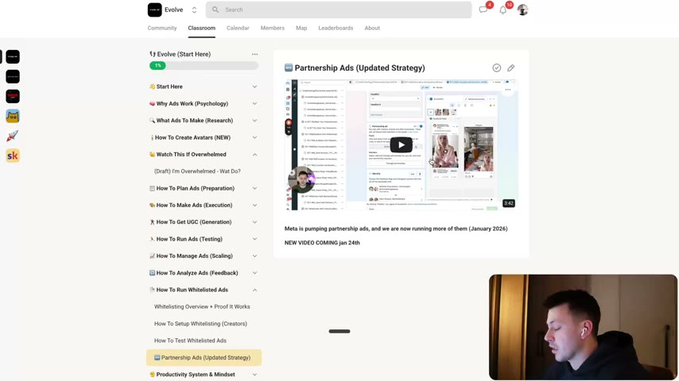

# 165. Partnership Ads (Updated Strategy)
> As of January 2026 the instructor team reversed their earlier stance: they now run partnership ads more than whitelisted ads, because Meta appears to favour them, and they ask creators for 30-day partnership access up front.

## 🤖 Agent use
- **Use when:** running creator content as ads on Meta and choosing between whitelisting (creator's profile as identity) and partnership ads (brand page + creator, "Partnership ad" toggle).
- **Inputs → outputs:** creators (new and winning), your brand page, raw-content/main campaigns → partnership-ad setup with Dynamic identity, creator-access requests, placement in campaigns.
- **Rules:**
  - **DO** test partnership ads, especially with "high intent creators" and brand ambassadors' top creatives. [00:00–00:32; 02:10]
  - **DO** place them either in a segmented raw content campaign or straight in the main campaign, depending on volume. [00:32; 02:10]
  - **DO** leave the identity on **Dynamic identity**, which "will pick and choose for you". [00:32]
  - **DON'T** assume the old rule holds. An earlier video in this module (not named) said "we only run whitelisted ads now and we don't run partnership ads ... that has actually flipped". [00:00]
  - **DO** ask new Insense creators up front for 30-day partnership access and promise to remove it after 30 days. [01:29–02:10]
  - **DO** pitch it as a benefit to the creator: it raises the odds the ad wins and so the odds of a long-term retainer/performance deal. [02:10–03:02]
  - **DO** send creators a screenshot of how the partnership ad will look. [02:10]
- **See also:** [162. Whitelisting Overview](162-whitelisting-overview-proof-it-works.md) · [163. Setup Whitelisting](163-how-to-setup-whitelisting-creators.md) · [164. Test Whitelisted Ads](164-how-to-test-whitelisted-ads.md) · [98. Raw Content Campaign](098-how-to-set-up-raw-content-campaign.md) · [94. 3/2/2 Campaign](094-how-to-set-up-a-3-2-2-campaign.md) · [143. How to Create an Insense Campaign](143-how-to-create-an-insense-campaign.md)

## Key ideas

### The flip [00:00–00:32]
- Page text: "Meta is pumping partnership ads, and we are now running more of them (January 2026)". The Skool page in the frame also reads "NEW VIDEO COMING jan 24th" (not in the extracted text). [page; frame 00:20]
- In an earlier video (not named; the on-page link in lesson 162 does not cover it) "we only run whitelisted ads now and we don't run partnership ads". Now "we've actually started pushing partnership ads a lot more". [00:00]
- Used for "high intent creators". "We are essentially seeing Meta favor the partnership ads way more." [00:00–00:32]
- Exact ad accounts are not shown because of brand confidentiality. Evidence is the instructor's observation only (instructor claim): "we are noticing that partnership ads are crushing". [00:32]

### Whitelisting vs partnership ads [00:32–01:29]
- Whitelisting: you select the creator's profile as the identity. [00:32]
- Partnership ad: you "turn this on" (the Partnership ad toggle), then select your brand page and the creator you work with. [00:32]
- Identity choice: leave on **dynamic identity**. Both identities can be selected; the instructor says there is "1.3 lower cost" for it (Whisper: "you get 1.3 lower cost but so we just leave it on dynamic"; the figure is unclear). [00:32]
- "This is what we're actually running now is partnership, I'd say more than whitelisting. You guys should still test this." [00:32–01:29]

### Getting access from new creators [01:29–03:02]
- Using Insense UGC creators: "we are asking creators to give us access in the beginning". Pitch: "if you want to give us partnership access for 30 days ... we'll obviously remove it after 30 days". [01:29]
- Why they accept: creators are told in briefs they can work long-term on retainer and performance; "if you want to improve the odds of that happening, Meta is actually pushing partnership ads right now". Send a screenshot of what it will look like. [02:10]
- Not only for winners: "we're actually getting a lot of our creators to ... start initially giving us partnership access as well, not just with winning creators". [02:10]
- For ambassadors: test partnership with their top creatives, or all their ads. [02:10]
- For new creators testing in raw content or the main campaign: "the odds that your ad actually does really well is going to increase if we run it as a partnership ad on your page as well". [02:10–03:02]
- Teasers: a new content strategy and "a new software that is insane" are coming (not named or shown). [01:29]

## Steps / framework
1. In the creator brief or first message, ask for 30-day partnership access ([143](143-how-to-create-an-insense-campaign.md) covers Insense briefs). Include a screenshot of the partnership-ad look.
2. For creators you already pay, test partnership with their top creatives.
3. In Ads Manager, at ad level: turn on **Partnership ad**, select your brand page and the creator, keep **Dynamic identity**.
4. Place in the raw content campaign (segmented) or main campaign depending on volume ([98](098-how-to-set-up-raw-content-campaign.md), [94](094-how-to-set-up-a-3-2-2-campaign.md)).
5. Remove access after 30 days unless extended.

## Structured units

### Rules of thumb
- **IF** Meta favours the format **THEN** test it against whitelisting rather than trusting an old rule. [00:00–00:32]
- **IF** the creator is new **THEN** ask for 30-day access, with a benefit framing. [01:29–02:10]
- **DON'T** wait for a winning ad before asking: ask at the start. [02:10]

### Comparison (derived from [162](162-whitelisting-overview-proof-it-works.md) and this lesson)
| | Whitelisting | Partnership ads |
|---|---|---|
| Identity shown | Creator's Page + Instagram only | Brand page + creator (Dynamic identity) |
| Setup | Page/IG access via Leadsie ([163](163-how-to-setup-whitelisting-creators.md)) | Access request for a limited period (30 days) |
| Typical cost to creator | $0-$250/month fee ([162](162-whitelisting-overview-proof-it-works.md)) | not stated in this lesson |
| Where tested | Main/raw or separate campaign ([164](164-how-to-test-whitelisted-ads.md)) | Raw content campaign or main campaign |
| Instructor stance | Earlier: "only whitelisted" | Jan 2026: run partnership "more than whitelisting" |

## Screenshots

*The lesson page: "Meta is pumping partnership ads, and we are now running more of them (January 2026)" and "NEW VIDEO COMING jan 24th", inside the course section "How To Run Whitelisted Ads". The embedded video thumbnail on the page shows 3:42, while the file transcribed here is 3:19. [00:20]*

## How to apply
- [ ] Add "30-day partnership access" to the creator brief/first message with a screenshot.
- [ ] Test the same creator ad as a partnership ad against the whitelisted version.
- [ ] Keep Dynamic identity on.
- [ ] Put results in the raw content campaign segment; compare cost per purchase and ROAS.
- [ ] Remove access at day 30 unless the creator joins a retainer.

## Related
- Previous: [164](164-how-to-test-whitelisted-ads.md) · Next: [166. How To Find Time And Get Shit Done](166-how-to-find-time-and-get-shit-done.md)
- [162](162-whitelisting-overview-proof-it-works.md) · [156](156-how-to-onboard-brand-ambassadors.md)

## Sources and limitations
- Transcript: [165 transcript](<../../../../../raw/evolve/start-here/_transcripts/👣 Evolve (Start Here)/165. 🆕 Partnership Ads (Updated Strategy) 👣 Evolve (Start Here) Evolve.txt>) · Page text: [165 page](<../../../../../raw/evolve/start-here/_extracted/👣 Evolve (Start Here)/165. 🆕 Partnership Ads (Updated Strategy)_👣 Evolve (Start Here)_Evolve.html.md>).
- Machine transcription. Last segment 3:18.87 of 3:18.87: complete. The "1.3 lower cost" phrase is garbled; do not rely on it. "Incense" in the audio means Insense.
- No data or account screens are shown in this video; all performance claims are instructor observations. The "new video coming jan 24th" is on-screen text only.
- The page text (and frame) place the update in January 2026; the transcript does not state a date.
