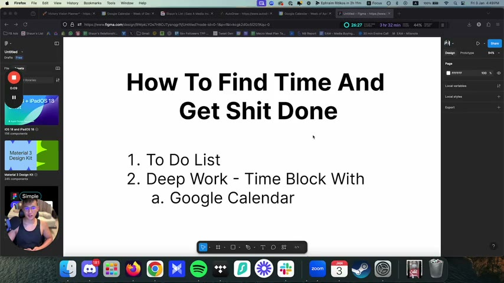
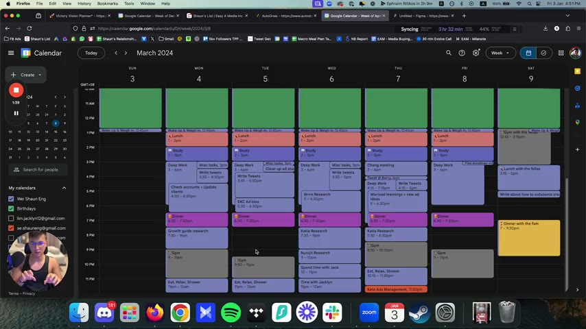

# 166. How To Find Time And Get Shit Done
> First video of the Productivity module: turn a growing to-do list into scheduled work by time-blocking every hour of the day in Google Calendar, with deep-work blocks of at least an hour and the most important task first.

## 🤖 Agent use
- **Use when:** planning a human operator's (or an agent-run pipeline's) working week so that research, analysis and ad creation actually happen.
- **Inputs → outputs:** a to-do list of high-priority tasks plus fixed commitments → a calendar with every hour allocated, deep-work blocks, and tracked time.
- **Rules:**
  - **DO** put tasks in a to-do list, then schedule each one in Google Calendar with a time length: "if you can set it for every hour, it makes sure that you're always on top of something". [02:44–03:41]
  - **DO** plan the next day the day before so you "already know what you need to be doing exactly" on waking. [01:46]
  - **DO** put the most important task at the start of the day (the instructor's is a 3-hour deep-work session). [02:44]
  - **DO** make each deep-work block at least an hour with no distractions: "phone elsewhere, I'm on do not disturb". [03:41]
  - **DON'T** multitask a block: if you want to check the phone or play games, schedule it as a separate task. [03:41]
  - **DO** track everything: "if you're not tracking, you're slacking". [00:57]
  - **IF** you "can't find time" **THEN** break the day down; free pockets become visible. [00:57–01:46; 04:34]
  - **IF** your job needs calls **THEN** leave blank space for them. [04:34]
- **See also:** [167. How To Focus & Quiet Your Mind](167-how-to-focus-quiet-your-mind.md) · [165. Partnership Ads (Updated Strategy)](165-partnership-ads-updated-strategy.md) · [Evolve Copywriting 04: Schedule your writing development block](../../copywriting/lessons/04-schedule-your-writing-development-block.md)

## Key ideas

### To-do lists pile up [00:00–00:57]
- Starting point: you know the work in e-com is "research, analyzing, creating ads". Tasks pile into a list "and nothing really gets done". The instructor uses ClickUp; pen and paper or any list is fine. [00:00]

### Deep work needs time blocking [00:57–01:46]
- "You only get it done through time blocking with Google Calendar" (Apple Calendar works, but "Google Calendar is the best"). [00:57]
- "The whole productivity module is going to emphasize very heavily on tracking." [00:57]

### Plan every hour, the day before [01:46–02:44]
- Dedicate time so work "actually gets done". Do not follow intuition: "every hour there is something that you need to be doing". [01:46]
- Instructor's morning (no "crazy routine"): weigh in, supplements. Then lunch first (because of his time zone; he does not recommend eating right after waking). One hour of study at 2 p.m. every day. [01:46–02:44]
- Then three hours of deep work on the highest-priority tasks from the list. [02:44]

### Give each task a length [02:44–03:41]
- Example tasks: "productivity evolve module filming" first, "writing tweets" for an hour, "check accounts / update clients". Each has a set length as a deadline: "instead of daily deadlines ... it breaks it down by the hour". If time runs out, "you need to move on to the next task already". [02:44–03:41]
- Deep work means "no distractions at all. Phone elsewhere, I'm on do not disturb. Only thing I focus on is just writing tweets." [03:41]

### Everything goes in the calendar [03:41–04:34]
- Dinner, gym, showering, time with friends: all in. "If not, you won't know how much time you really have." Spare blocks can then be allocated to to-do items. [03:41–04:34]
- His agency work needs calls, so he keeps blank space. Most students "can fill this up to the brim". [04:34]
- Tools: Google Calendar and any to-do list (page text); time tracker named on the page: Rize (referral link).

## Steps / framework
1. Write the high-priority to-do list (research, analyzing, creating ads).
2. Block the week in Google Calendar: fixed items first (meals, gym, sleep, calls).
3. Place a daily study hour and a 3-hour deep-work block early.
4. Assign each task a time length (for example 1 hour).
5. Treat distractions as scheduled tasks.
6. Track time (Rize or calendar labels) and review where time went.

## Examples
- **Calendar week (frame 01:40):** blocks labelled Lunch, Study, Deep Work, Misc tasks, Write tweets, "Check accounts + Update clients", Dinner, "Growth guide research", Gym, "Eat, Relax, Shower", and client research blocks, each hour-sized, across Mon-Sat. [frame 01:40]
- **Slide outline (frame 00:10):** "How To Find Time And Get Shit Done: 1. To Do List 2. Deep Work - Time Block With a. Google Calendar". [00:00]

## Screenshots

*Opening slide with the two-part method: a to-do list, and deep work scheduled in Google Calendar. [00:10]*

*One working week in Google Calendar: deep-work, tweet-writing, research, study, meals and gym blocks, with almost no empty hours. [01:40]*

## How to apply
- [ ] List your 5 highest-priority ad-growth tasks.
- [ ] Block tomorrow in Google Calendar tonight; fixed items first.
- [ ] Put a 1-3 hour deep-work block first in the day with phone on Do Not Disturb.
- [ ] Give every task a duration; when the block ends, move on.
- [ ] Track the week and adjust.

## Related
- Previous: [165](165-partnership-ads-updated-strategy.md) · Next: [167](167-how-to-focus-quiet-your-mind.md)
- Compare: Evolve Copywriting's protected daily block in [04. Schedule your writing development block](../../copywriting/lessons/04-schedule-your-writing-development-block.md).

## Sources and limitations
- Transcript: [166 transcript](<../../../../../raw/evolve/start-here/_transcripts/👣 Evolve (Start Here)/166. How To Find Time And Get Shit Done 👣 Evolve (Start Here) Evolve.txt>) · Page text: [166 page](<../../../../../raw/evolve/start-here/_extracted/👣 Evolve (Start Here)/166. How To Find Time And Get Shit Done_👣 Evolve (Start Here)_Evolve.html.md>).
- Machine transcription. Whisper writes "this whole month hour" where "this whole hour" is meant. Last segment 5:19.25 of 5:19.57: complete.
- This is a mindset lesson with little ad-specific content. Personal items (morning routine, supplements, time-zone meals) are the instructor's own habits and are not recommendations.
- The presenter is not introduced; "unverified" is used. The calendar sidebar and the page's Rize referral link both show "Shaun" as a first name.
