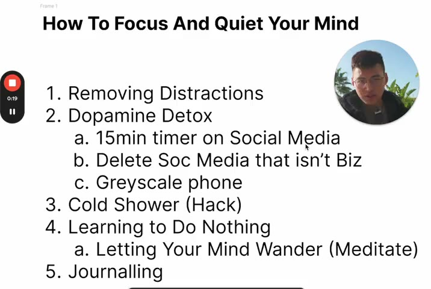

# 167. How To Focus & Quiet Your Mind
> A five-step routine (remove distractions, dopamine detox, cold shower, learn to do nothing, journal) that makes the work you scheduled in your time blocks the most interesting thing in your day, so deep work on research and creatives actually happens.

## 🤖 Agent use
- **Use when:** a human operator (media buyer, creative strategist, founder) says they cannot focus, start tasks and drift, or miss output targets; or when you are building a daily deep-work routine around research, creative execution or analysis blocks.
- **Inputs → outputs:** the person's distractions (phone, apps, noise, people, Discord) and the time blocks they already scheduled → a short pre-block checklist and a weekly "dopamine budget" the person can run without you.
- **Rules:**
  - **DO** treat time blocking as the main fix and this routine as the support layer: "the time locking should solve most of this already" (Whisper says "locking"; the final line says "pair that with time blocking") [00:00, 06:31]. See [166. How To Find Time And Get Shit Done](166-how-to-find-time-and-get-shit-done.md).
  - **DO** remove distractions first: phone out of reach ("throw it out. If you can't, like you live without it"), noise-cancelling headphones, move rooms, agree uninterrupted hours with housemates or parents [00:00–00:47].
  - **DO** set Discord to Do Not Disturb so "there's nothing coming in except what you're doing" [00:47].
  - **DO** make work the most interesting thing in the day by making everything else less interesting (cut games, social media, party time) [00:47–01:42].
  - **DON'T** rely on "moderation" for a high-stimulation habit: "if you play say an hour a day that's still... the most interesting part of your day", so go cold turkey [01:42].
  - **IF** you cannot focus right now **THEN** take a cold shower, then return to the task [03:04–03:33].
  - **IF** you hit free time between calls or tasks **THEN** do nothing for about five minutes instead of scrolling [03:33–04:35].
  - **DO** meditate on the breath to train "diverting your focus back" to the task; focus is "a skill" [05:01–06:00].
  - **DO** journal at the start of the day to dump random thoughts, then start work "with a clear mind" [06:00–06:31].
- **See also:** [166. How To Find Time And Get Shit Done](166-how-to-find-time-and-get-shit-done.md) · [168. Endless Motivation](168-endless-motivation-rewiring-pain-pleasure.md) · [169. Planning & Achieving Goals](169-planning-achieving-goals-important.md) · [170. Never Stop Growing YoY](170-never-stop-growing-yoy-face-off-with-devil.md)

Lesson page text on Skool: none ("no lesson text on page").

## Key ideas

### Step 1: remove distractions [00:00–01:42]
- The lesson sits after time blocking: "after you've done the time locking, which is the most important thing, you need to obviously remove any distractions" [00:00].
- Named distractions: audio distractions and the phone; the fix is to get rid of the phone, wear noise-cancelling headphones, change room, and for people living with parents "move out or at least set some time with them where they can't contact you" [00:00–00:47].
- "If you do deep work, you need to be uninterrupted": anything that breaks flow has to go. Set Discord to DND [00:47].

### Step 2: dopamine detox [00:47–03:33]
- Diagnosis: you cannot focus because "the task at hand is boring to you" relative to everything else. His comparison: a monk who only meditates would find a computer the most interesting thing; someone who plays games and goes out partying finds work "the least interesting part of your day" [00:47–01:42].
- Remedy: go "cold turkey". He quit gaming himself ("stop piloting, stop playing video games") and credits that with finally getting things done [01:42–02:37]. (Whisper wrote "piloting"; the meaning is unclear, possibly a game or habit name.)
- Social media rules from the slide and audio [01:42–03:04]:
  - Delete all social media that is not related to business. His own set: Twitter only, because "I met all of you guys through Twitter"; no Instagram or TikTok unless used for business.
  - Put a timer on the apps you keep ("15min timer on Social Media" on the slide), because "doom scrolling is real".
  - Turn the phone grayscale: "makes everything less interesting. That's the main part of it."

### Step 3: cold shower (hack) [03:04–03:33]
- "When you do a cold shower, it sucks. And when you make something suck, everything else you do becomes more interesting." Use it when you "really can't focus", then go straight back to work [03:04–03:33]. He pre-empts the objection that it is gimmicky: "People say gimmicky. It does work."

### Step 4: learn to do nothing, then meditate [03:33–06:00]
- Many people fill every gap between calls with scrolling, which makes work less interesting [03:33–04:04].
- "If you can sit in solitude for yourself for like five minutes", you notice real to-dos (laundry, a message to send) [04:04–05:01].
- Meditation instruction: close your eyes, breathe, focus on how the breath feels entering the nose; when you drift, divert focus back. Link to work: "Imagine when you work and you just started thinking of a lot of random... things... How can you divert your focus back to the task you're currently doing? That is a skill." [05:01–06:00]. He adds the diving analogy: breathing only through the mouth forces single focus [05:01].
- He says these five are "the only ones I've tried that has actually been beneficial" among guru tips [04:35].

### Step 5: journal [06:00–06:31]
- Journal at the start of the day (some people do it first thing) to get "random thoughts" out of your head. Sequence in the lesson: meditate, then journal, so you have "quieted your mind", then do the task "give it your all" [06:00–06:31].
- Close: "Pair that with time blocking and your productivity will be crazy." [06:31] (instructor claim, no data given)

## Steps / framework
| # | Step | Concrete action (source) | Cite |
|---|---|---|---|
| 1 | Removing distractions | Phone away, noise-cancelling headphones, change room, set no-contact time with others, Discord on DND | [00:00–00:47] |
| 2 | Dopamine detox | 2a 15 min timer on social media; 2b delete social media that is not business; 2c grayscale phone; also quit games cold turkey | [00:47–03:04] |
| 3 | Cold shower (hack) | Do it when focus will not come, then return to work | [03:04–03:33] |
| 4 | Learning to do nothing | 4a let your mind wander (meditate): about 5 min of solitude or breath focus | [03:33–06:00] |
| 5 | Journalling | Dump thoughts on paper before starting the work block | [06:00–06:31] |

## Prompts / templates (verbatim)
The on-screen checklist (slide titled "How To Focus And Quiet Your Mind"):
```
1. Removing Distractions
2. Dopamine Detox
   a. 15min timer on Social Media
   b. Delete Soc Media that isn't Biz
   c. Greyscale phone
3. Cold Shower (Hack)
4. Learning to Do Nothing
   a. Letting Your Mind Wander (Meditate)
5. Journalling
```

## Screenshots

*The single slide used for the whole lesson: five numbered steps with sub-bullets for the dopamine detox and meditation. Same slide throughout; the speaker is a circular webcam in the corner. [00:20]*

## How to apply
- [ ] Before each deep-work block (research, creative execution, learnings), put the phone out of reach, headphones on, Discord on DND.
- [ ] Delete non-business social apps; set a 15 minute timer on the ones you keep; switch the phone to grayscale.
- [ ] Pick one high-stimulation habit (games, scrolling) to remove completely for a trial period instead of "moderating" it.
- [ ] If focus fails mid-block, take a cold shower, then restart the block.
- [ ] In dead time between calls, sit with no input for 5 minutes (no phone).
- [ ] Do 5 minutes of breath meditation, then journal, then start the task. (Derived: the instructor gives the order meditate, then journal, but no durations beyond "five minutes" of doing nothing.)
- [ ] Review after a week whether the blocks scheduled in lesson 166 were actually completed (derived).

## Related
- Previous: [166. How To Find Time And Get Shit Done](166-how-to-find-time-and-get-shit-done.md) · Next: [168. Endless Motivation - Rewiring Pain & Pleasure](168-endless-motivation-rewiring-pain-pleasure.md)
- The same list is recapped as "solutions" in [170. Never Stop Growing YoY](170-never-stop-growing-yoy-face-off-with-devil.md) [13:11–14:12]; the daily tracking sheet is in [169. Planning & Achieving Goals](169-planning-achieving-goals-important.md).
- Same Evolve mindset idea for copywriters: [Evolve Copywriting 03. How to guarantee you get better at copywriting](../../copywriting/lessons/03-how-to-guarantee-you-get-better-at-copywriting.md) (protected daily block plus app blocker).

## Sources and limitations
- Transcript: [167. How To Focus & Quiet Your Mind… .txt](<../../../../../raw/evolve/start-here/_transcripts/👣 Evolve (Start Here)/167. How To Focus & Quiet Your Mind 👣 Evolve (Start Here) Evolve.txt>) · Page text: [….html.md](<../../../../../raw/evolve/start-here/_extracted/👣 Evolve (Start Here)/167. How To Focus & Quiet Your Mind_👣 Evolve (Start Here)_Evolve.html.md>) (empty of lesson text).
- Machine transcription (Whisper large-v3-turbo). Full recording covered (last segment 6:58 of a 7:00 video). Whisper heard "time locking" where "time blocking" is meant; "throw a phone" is likely "throw out the phone"; "Christian media, even for some timers" at [02:37] is likely "certain media" (apps he keeps get timers), which matches the slide's "15min timer on Social Media".
- The instructor is not named in the audio. The name comes from the on-screen X post in lesson 169; treat as inferred.
- Health claims (cold showers, grayscale, dopamine detox) are the instructor's personal experience, not evidence. No numbers, studies or durations were given except "five minutes" and the "15min" timer on the slide.
- Only one slide exists; there are no other screenshots worth keeping (the rest is a webcam bubble).
