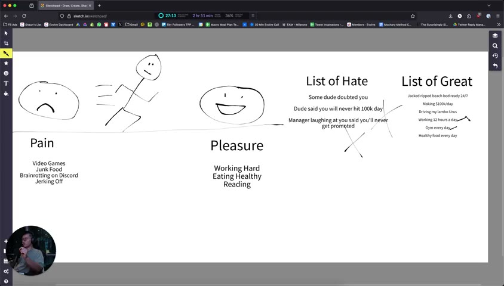

# 168. Endless Motivation - Rewiring Pain & Pleasure
> Write a "list of hate" (everyone who doubted you) and a "list of great" (your ideal self and its daily behaviours), read both every morning, and use them to flip what feels painful (hard work) and pleasurable (distraction) so consistency stops depending on mood.

## 🤖 Agent use
- **Use when:** a founder, buyer or creative lead says motivation fades after early wins, or they procrastinate on research and creative work; also when writing a daily-ritual section of an operating plan (pair with the tracking sheet in lesson 169).
- **Inputs → outputs:** the person's past put-downs and doubts, ideal-self outcomes (income, body, lifestyle) and the daily behaviours that produce them → two written lists plus a morning read-through routine.
- **Rules:**
  - **DO** write both lists "with pen and paper for more effect" (Skool page text, not in the audio).
  - **DO** build the list of hate from "anytime someone's ever [wronged] you in your life": a person who doubted you, someone who said you would never hit $100k/day, a manager who said you would never be promoted [01:56–03:00].
  - **DO** build the list of great from your ideal self, including behaviours, not just outcomes: "Working 12 hours a day, gym every day, healthy food every day" next to "making $100k/day" [03:00–04:01].
  - **DO** read both lists every morning [04:01, 07:00].
  - **DO** link the lists to action: if you do not do the list-of-great behaviours, "the haters will win" [04:01].
  - **DON'T** use the lists to hate on people: "we're not trying to use this to hate on people or to have negative energy, to channel it into something that we can use" [08:29].
  - **IF** you feel lazy on a work day ("I'm not going to do product research today / creative research today") **THEN** read the lists and do the task so you do not "prove my haters right" [07:00].
  - **IF** you hit a big goal (50k/day, 100k/day) **THEN** keep re-reading the lists, because the instructor says people who stop re-wiring "fall off" when pleasure shifts back to indulgence [07:00–08:29] (instructor claim, anecdotal).
- **See also:** [167. How To Focus & Quiet Your Mind](167-how-to-focus-quiet-your-mind.md) · [169. Planning & Achieving Goals](169-planning-achieving-goals-important.md) · [170. Never Stop Growing YoY](170-never-stop-growing-yoy-face-off-with-devil.md) (recaps the lists at [20:49–21:48])

Lesson page text (Skool): "I recommend writing down the list of hate and list of great with pen and paper for more effect." The page also lists four takeaways: transform negative energy into motivation; turn what is painful (and good for you) into pleasure and what is pleasurable (and bad for you) into pain; create feedback loops by acting in line with your ideal self, with a "healthy amount of self-hate" when you fail to; build self-confidence by keeping promises to yourself.

## Key ideas

### 1. Motivation is pain avoidance plus pleasure chasing [00:00–00:55]
- "In life, we are doing two things. Either we are running away from pain or we're chasing pleasure." [00:00] He says most students started e-commerce for one of two reasons: escaping pain ("you don't want to be broke anymore") or a big outcome ("your lambos") [00:00–00:55].
- Goal: move from "current identity" to "ideal self" by using those two motivators [00:00–00:55].

### 2. Most people have pain and pleasure backwards [00:55–01:56]
- Associated with pain (good for you): working hard, eating healthy instead of junk food, reading [00:55–01:26].
- Associated with pleasure (bad for you): video games, junk food, "brain rotting on Discord" ("you feel like you're productive when you're doing actually nothing"), masturbation [01:26–01:56].
- The tool exists to swap the two columns.

### 3. The list of hate and the list of great [01:56–04:01]
- **List of hate:** everyone who has doubted or wronged you. His examples on the whiteboard: "Some dude doubted you", "Dude said you will never hit 100k day", "Manager laughing at you said you'll never get promoted" [02:28]. He pre-empts the objection ("that's a bad mentality") and says "how you feel will not change", so redirect the feeling into energy [03:00].
- **List of great:** things you want to achieve and the ideal self, including non-material parts: "jacked, ripped, beach body ready 24/7", "making $100k/day", "driving my Lambo Urus", then behaviours: "working 12 hours a day, gym every day, healthy food every day" [03:00–04:01].
- Use: "imagine every single morning you wake up, you look at this list... if you don't hit the list of great, the haters will win" [04:01]. He paraphrases a line attributed to "Luke Bauma" (Whisper spelling, unverified): "Do you want to be a... loser? You don't. So stop doing loser shit." [04:01]


*The finished diagram. Left: "Pain" now holds Video Games, Junk Food, Brainrotting on Discord, Jerking Off; "Pleasure" holds Working Hard, Eating Healthy, Reading (he swapped them while drawing). Right: List of Hate (three doubters) and List of Great (six items incl. "Working 12 hours a day", "Gym every day"). [05:30]*

### 4. The feedback loop [04:36–06:29]
- Goal of the lists: "re-wire what we feel as pleasure to pain and pain to pleasure" [04:36].
- Loop: act in line with the ideal self (e.g. 12 hours of work) → feel good because "you didn't let the haters win" → closer to ideal self → easier next time. "You looking at this list every day will pretty much give you endless motivation." [04:36–05:37]
- Self-confidence claim: confidence comes from acting in line with the ideal self every day; to a student afraid their brand will die he says the fear is reduced by that daily acting [05:37–06:29]. Gym analogy: hard at first, after a few years you like it and "it's hard to stop" [05:37].
- Inverse loop: you should feel bad when you play games, eat junk, brain-rot, or miss the daily list-of-great. "A little self-hate is not a bad thing... you will channel it into energy." [06:29–07:00]

### 5. Why it matters after you win [07:00–09:31]
- Student pattern he says he has seen "in Evolve": people scale to 50k or 100k/day "and everything falls off there because they couldn't stay consistent anymore. The high life got to them." [07:00] (instructor claim; no count given)
- If you stop reminding yourself, pleasure "shifts again": indulgences become the reward and business declines [07:58].
- His own use of haters: he gets accused of being a scammer or faking screenshots ("sue this guy" is Whisper's rendering of something unclear). "I'm not subscribing to that. That just proves to me I need to work harder." Stated long-term aim: a "super clean, super compliant" public brand exit "just to stand on these haters" [08:29–08:59]. When people hate on him now, "it just becomes energy" [08:59].

## Steps / framework
1. Draw two columns: Pain (what currently feels painful but is good for you) and Pleasure (what currently feels good but hurts you) [00:55–01:56].
2. Write the List of Hate (doubters, put-downs) [01:56–03:00].
3. Write the List of Great (outcomes plus daily behaviours of the ideal self) [03:00–04:01].
4. Read both every morning; treat each List-of-Great behaviour you skip as a win for the haters [04:01, 07:00].
5. After each day, note which behaviours you did; feel good when you did them and bad (briefly) when you did not [05:07–07:00]. Tracking template: [169. Planning & Achieving Goals](169-planning-achieving-goals-important.md).

## Examples
| Item | Content (from the whiteboard) | Source |
|---|---|---|
| List of Hate | "Some dude doubted you" / "Dude said you will never hit 100k day" / "Manager laughing at you said you'll never get promoted" | [02:28], screenshot |
| List of Great | "Jacked ripped beach bod ready 24/7" / "Making $100k/day" / "Driving my lambo Urus" / "Working 12 hours a day" / "Gym every day" / "Healthy food every day" | [03:00], screenshot |
| Pain (good for you) | Working Hard, Eating Healthy, Reading | [00:55], screenshot |
| Pleasure (bad for you) | Video Games, Junk Food, Brainrotting on Discord, Jerking Off | [01:26], screenshot |

## Prompts / templates (verbatim)
```
LIST OF HATE (everyone who doubted or wronged you)
- Some dude doubted you
- Dude said you will never hit 100k day
- Manager laughing at you said you'll never get promoted

LIST OF GREAT (ideal self: outcomes and daily behaviours)
- Jacked ripped beach bod ready 24/7
- Making $100k/day
- Driving my lambo Urus
- Working 12 hours a day
- Gym every day
- Healthy food every day
```
These are the instructor's example entries; each person writes their own.

## How to apply
- [ ] Write the two lists by hand today. Include at least three doubters and at least three daily behaviours (not only outcomes).
- [ ] Tape or keep the lists where you see them first thing in the morning; read them before opening Ads Manager or the research doc.
- [ ] On a day you want to skip research or creative work, read the lists first, then start a timed block.
- [ ] After a milestone (a new revenue level), re-read the lists and reset the standards (see [170](170-never-stop-growing-yoy-face-off-with-devil.md) for the "standards" version).
- [ ] Keep the framing as fuel, not hostility toward people (derived from the instructor's own caveat at [08:29]).
- [ ] (Derived) For a team, do not ask staff to publish their haters list; the lesson is a personal ritual.

## Related
- Previous: [167. How To Focus & Quiet Your Mind](167-how-to-focus-quiet-your-mind.md) · Next: [169. Planning & Achieving Goals (Important)](169-planning-achieving-goals-important.md)
- Concept link (different course, adjacent idea of an aspirational self): [Ideal self](../../../../concepts/ideal-self.md) is about the buyer's self-image in ads, not the operator's identity. Do not conflate them.

## Sources and limitations
- Transcript: [168. Endless Motivation… .txt](<../../../../../raw/evolve/start-here/_transcripts/👣 Evolve (Start Here)/168. Endless Motivation - Rewiring Pain & Pleasure 👣 Evolve (Start Here) Evolve.txt>) · Page text: [….html.md](<../../../../../raw/evolve/start-here/_extracted/👣 Evolve (Start Here)/168. Endless Motivation - Rewiring Pain & Pleasure_👣 Evolve (Start Here)_Evolve.html.md>)
- Machine transcription (Whisper large-v3-turbo). Full recording covered (last segment 9:30 of 9:31). Some phrases are garbled: "anytime someone's ever around you" at [01:56] is likely "wronged you"; "Luke Bauma" is an uncertain name; "I'm an ex, bro" at [08:29] is unclear; "sue this guy" at [08:29] is unclear.
- Motivational and psychological claims (self-confidence from keeping promises, lists giving "endless motivation", students falling off after wins) are instructor claims with no data. The video contains crude language about masturbation as a "pleasure"; kept only in the list as stated.
- Instructor name is inferred from the on-screen X post in lesson 169, not from this video.
