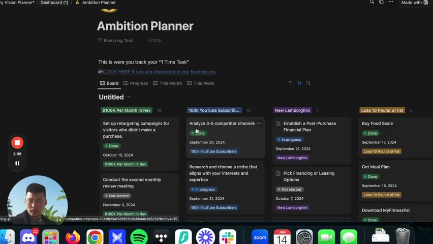
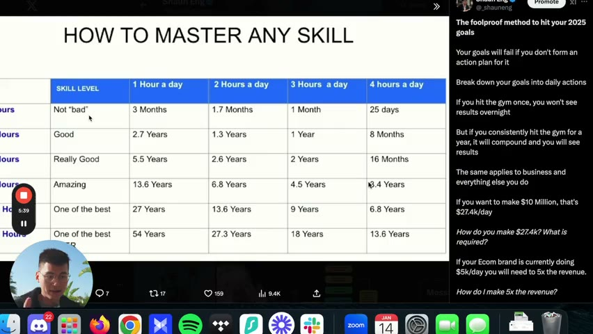
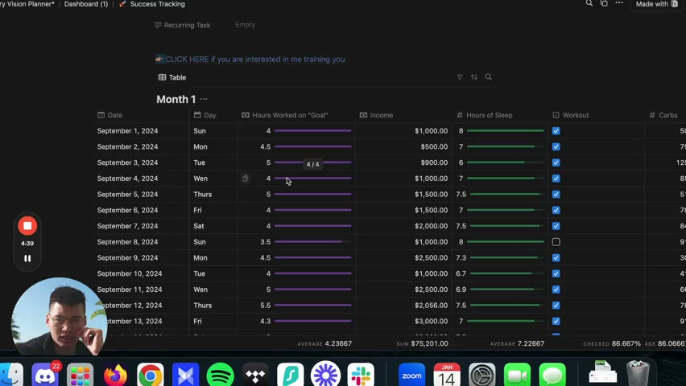
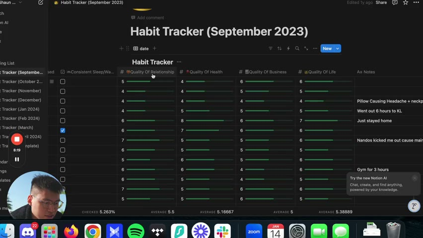

# 169. Planning & Achieving Goals (Important)
> Break a yearly goal into monthly and daily actions in an Ambition Planner, log the hours and inputs you actually did every day in a Success Tracking sheet, and read the skill-mastery table to set realistic timelines; consistency on the inputs makes the goal inevitable.

## 🤖 Agent use
- **Use when:** setting a founder's, buyer's or creative team's goals; turning a revenue target into daily inputs (research hours, creative output); building a recurring tracker; explaining why results lag effort.
- **Inputs → outputs:** a yearly target (e.g. $100k per month in revenue) → monthly goal, daily hour budgets per activity (e.g. 3 hours research + 2 hours creatives), a daily log, and a weekly review of the log.
- **Rules:**
  - **DO** track the actions that lead to the goal, not only the goal itself: "We don't just track the goal. You want to be tracking the actions that lead to the goal." [01:00–01:58]
  - **DO** break goals down: yearly → monthly → (weekly) → daily, with deadlines, in the Ambition Planner [01:58–03:53].
  - **DO** log every day: date, hours worked on the goal task, income, hours of sleep, workout, plus any body and habit metrics you care about [04:23–07:51].
  - **DO** rate life areas out of 10 (relationship, health, business, life) with notes, and do "learnings on your life" the way you do learnings on ads [07:51–08:45].
  - **DO** put the planned daily hours into the calendar as time blocks; focus tools make you finish them [08:45]. See [166](166-how-to-find-time-and-get-shit-done.md) and [167](167-how-to-focus-quiet-your-mind.md).
  - **IF** you cannot hire good people or produce good creatives **THEN** check the hours you have put in against the skill table before blaming the market: "Is it a problem with the market or is it a problem with your skill level?" [05:23–06:21]
  - **DON'T** judge a skill after two weeks: "you practice for like two weeks, you're not going to be very good at it" [05:23].
- **See also:** [168. Endless Motivation](168-endless-motivation-rewiring-pain-pleasure.md) · [170. Never Stop Growing YoY](170-never-stop-growing-yoy-face-off-with-devil.md) (uses this planner every day to avoid panic cycles) · [122. How To Do Learnings Part 1 (Losers)](122-how-to-do-learnings-part-1-losers.md) (the ad-learnings habit he compares this to) · [Iteration playbook (Evolve Copywriting)](../../copywriting/frameworks/iteration-playbook.md)

Lesson page text (Skool): "Link to Victory Vision Planner (Credit to Brandon Carter)" with a Notion template link ("Evolve Victory Vision Planner"); "The time tracker tool I use is" Rize (rize.io, referral link); "You can use this to track your hours worked to log it in" (the sentence ends there). Neither link was fetched into the course files (Notion page not in the linked-doc index), so the template contents below come from the on-screen walkthrough only.

## Key ideas

### 1. Consistency is what separates fast results from slow ones [00:00–00:56]
- Opens with a gym analogy: people with "crazy results" are assumed to be on steroids; he says the real differentiator, in business as well, is consistency [00:00–00:56].
- This video "will tie in everything that we've gone through so far" (focus, motivation, time blocking) [00:56].

### 2. The Ambition Planner: goal breakdown [00:56–03:53]
- Two parts in the Notion template, credited on screen and in his speech to "Brendan/Brandon Carter" (page text spells it Brandon): an **Ambition Planner** (set and break down goals) and **Success Tracking** [00:56].
- Method: take the yearly goal, ask what must be hit monthly, then daily. His example: "a million a month" yearly goal → what action steps (work on creatives, spend time on research) → how many creatives or research hours per month → "every day I need to spend three hours on research, two hours on making creatives" [00:56–03:53].
- Put "whatever goals you want" in the top row, business and personal: "100k per month revenue, 100k [YouTube] subscribers, you want to buy a Lambo, lose 10 pounds of fat", then list the steps for each and set deadlines by month and week [02:57–03:53].
- Key claim: "as long as you finish your daily tasks that need to be done every day, your goals will be hit" [01:58] (instructor claim).


*Notion "Ambition Planner" board (tabs Board, Progress, This Month, This Week). Goal columns: "$100K Per Month In Rev" (18 tasks), "100k YouTube Subscribers" (12), "New Lamborghini" (7), "Lose 10 Pound of Fat" (5). Tasks carry status and due date, e.g. "Set up retargeting campaigns for visitors who didn't make a purchase" (Done), "Conduct the second monthly review meeting" (Not started), "Analyze 3-5 competitor channels" (Done), "Buy Food Scale" (Done). These are the template's sample tasks. [02:10]*

### 3. How long skills really take [04:23–06:21]
- Before opening the tracking sheet he explains time to mastery: "if you spend an hour a day or something, you need three months" to be "not bad" [05:23]. At one hour a day it takes "almost three years to be good at hiring", so failing to hire well early is a skill-hours problem [05:23–06:21].
- "If you do it [creatives] four hours a day, you can be good at it in months" [05:23–06:21]. Evolve access can "boost" that further [06:21].
- Slide shown on screen: "HOW TO MASTER ANY SKILL" with skill level by daily hours. The left column labels (cumulative hours per level) are cut off in the frame; the values below are read from the screen.

| Skill level | 1 hour/day | 2 hours/day | 3 hours/day | 4 hours/day |
|---|---|---|---|---|
| Not "bad" | 3 months | 1.7 months | 1 month | 25 days |
| Good | 2.7 years | 1.3 years | 1 year | 8 months |
| Really Good | 5.5 years | 2.6 years | 2 years | 16 months |
| Amazing | 13.6 years | 6.8 years | 4.5 years | 3.4 years (cursor covers the digit; derived from the pattern) |
| One of the best | 27 years | 13.6 years | 9 years | 6.8 years |
| One of the best (next row) | 54 years | 27.3 years | 18 years | 13.6 years |

- (Derived) The rows are consistent with about 100, 1,000, 2,000, 5,000, 10,000 and 20,000 cumulative hours, e.g. 25 days at 4 hours is 100 hours. The row-hour labels are not legible, so treat this as an inference.
- Closing remark [09:41]: "if you spend eight hours a day working on e-comm, maybe in like six, seven years, you'll be one of the best"; garbled transcript lines nearby also say three years and seven years. By the table, 4 hours/day reaches "one of the best" in 6.8 years, so 8 hours/day would be about 3.4 years (derived). Treat the spoken numbers as approximate.


*Skill-mastery table on the left; on the right an X post by the instructor titled "The foolproof method to hit your 2025 goals" ("Break down your goals into daily actions"; "If you want to make $10 Million, that's $27.4k/day"; "If your Ecom brand is currently doing $5k/day you will need to 5x the revenue."). [05:40]*

### 4. Success Tracking sheet [04:23–07:51]
- Why track: "If you track everything you eat, the calories behind them, you'll lose weight anyways because you're aware of what's going on. Same thing with your life." [04:23]. He links it to tracking ads: add win/weight, do learnings, find why ads don't work [04:23].
- Daily rows (sample "Month 1", September 2024): Date, Day, **Hours Worked on "Goal"** (bar to a daily target, e.g. "4/4"), **Income**, **Hours of Sleep**, **Workout** (checkbox), then Carbs, Protein, Fat, Calories, Calories Burned, Calorie Deficit / Surplus, Weight [06:21–07:51]. The sheet auto-averages (sample footer: average hours worked 4.24, income sum $75,201, average sleep 7.23, workout checked 86.7%). These are template sample values, not the instructor's results.
- Planning rule: decide the daily hours (e.g. 3 hours a day on the goal task) and log whether you spent them ("Did I spend four hours of it? Just put three, four, whatever it is") [06:21–07:20].
- He tracks calories and macros personally; the point is "there's no surprises of why you didn't hit your goal" [07:20–07:51].


*"Success Tracking" table inside the Victory Vision Planner: Date, Day, Hours Worked on "Goal", Income, Hours of Sleep, Workout, Carbs ... (more nutrition columns to the right). Sample data for September 2024. [04:40]*

### 5. Habit Tracker: score life areas and write learnings [07:51–08:45]
- Second template: Habit Tracker. Columns on screen: a consistent sleep/wake checkbox, **Quality of Relationship**, **Quality of Health**, **Quality of Business**, **Quality of Life**, and **Notes**. Each is a number out of 10: "You can read it out of 10 and then you can put it in here" [07:51–08:45].
- Use it for "learnings on your life", like ad learnings: "Oh, my quality of health today went down. Why? Because this pillow is causing me headaches. What can I do about that? Change pillows." Another example: quality of life dropped after hanging out with a friend, "probably time to replace the girl" (his words) [08:45].
- Sample notes shown in the template: "Pillow Causing Headache + neckpain", "Went out 6 hours to KL", "Just stayed home", "Gym for 3 hours".


*"Habit Tracker (September 2023)" template: four 1-10 quality scores per day plus a Notes column. [08:20]*

### 6. The system as a chain [08:45–09:41]
Goal in the Ambition Planner → break it down → log hours daily on the sheet → "learn how to focus" → schedule the hours as time blocks in the calendar. "It's how this system all works together. Pretty short module, but very, very high impact." [08:45]

## Steps / framework
1. Write each goal (yearly) as a column or database in the Ambition Planner, including non-business goals [02:57].
2. Ask: "to hit this, what do I need monthly? what do I need daily?" List the action steps; set deadlines [01:58–03:53].
3. Convert to daily hour budgets per activity (e.g. 3 h research, 2 h creative execution) [02:57].
4. Schedule those hours as calendar blocks [08:45].
5. During the day, use the focus routine from [167](167-how-to-focus-quiet-your-mind.md).
6. Each day, log hours worked on the goal, income, sleep, workout, and optional body metrics in Success Tracking [06:21–07:51].
7. Each day, score relationship, health, business and life out of 10 with a note; investigate drops like ad learnings [07:51–08:45].
8. Judge progress by whether the daily inputs were done, not by the goal figure: "You don't even look at the goal" [01:58].

## Examples
- **Revenue goal to daily inputs:** "a million a month" → work on creatives + research time → "every day I need to spend three hours on research, two hours on making creatives" [01:58–02:57].
- **X post math (on screen, [05:40]):** $10M a year is "$27.4k/day"; an e-commerce brand at "$5k/day" needs "5x the revenue", then ask "How do I make 5x the revenue?" ($10M / 365 = $27.4k, checked.)
- **Hiring as a skill-hours problem:** one hour a day of practice takes "almost three years to be good at hiring", so poor hires may reflect low practice rather than the market [05:23].
- **Pillow learning:** quality of health score drops, note says pillow causes headaches, action: change pillows [08:45].

## Prompts / templates (verbatim)
Success Tracking column list (as seen on screen):
```
Date | Day | Hours Worked on "Goal" | Income | Hours of Sleep | Workout |
Carbs | Protein | Fat | Calories | Calories Burned | Calorie Deficit / Surplus | Weight
```
Habit Tracker column list (as seen on screen):
```
Consistent Sleep/Wake (checkbox) | Quality of Relationship | Quality of Health |
Quality of Business | Quality of Life | Notes
```
Ambition Planner views: `Board | Progress | This Month | This Week`. Planner goal columns in the sample: `$100K Per Month In Rev | 100k YouTube Subscribers | New Lamborghini | Lose 10 Pound of Fat`.

## How to apply
- [ ] Write the yearly revenue target, then divide to monthly and daily numbers (e.g. $10M/yr = $27.4k/day).
- [ ] List the input activities that drive it (product and creative research, creative production, testing, reviews) and give each a daily hour budget.
- [ ] Block those hours on the calendar; use a time tracker (he uses Rize) to log hours worked.
- [ ] Create a daily log with: hours on goal task, income, sleep, workout; add health columns only if relevant.
- [ ] Add 1-10 ratings for business and life areas with a one-line note and review notes weekly for causes.
- [ ] Before concluding "I can't hire" or "my creatives don't work", compare your accumulated hours to the skill table.
- [ ] Review monthly; compare actual hours with the plan (the planner has a "second monthly review meeting" task as its example).

## Related
- Previous: [168. Endless Motivation](168-endless-motivation-rewiring-pain-pleasure.md) · Next: [170. Never Stop Growing YoY - Face Off With Devil](170-never-stop-growing-yoy-face-off-with-devil.md)
- Calendar and block setup: [166. How To Find Time And Get Shit Done](166-how-to-find-time-and-get-shit-done.md)
- Ad-side equivalent of "tracking and learnings": [122. How To Do Learnings Part 1 (Losers)](122-how-to-do-learnings-part-1-losers.md) · [123. How To Do Learnings Part 2 (Winning Ads)](123-how-to-do-learnings-part-2-winning-ads.md)
- Copywriting course version of a protected daily block: [Evolve Copywriting 03](../../copywriting/lessons/03-how-to-guarantee-you-get-better-at-copywriting.md)

## Sources and limitations
- Transcript: [169. Planning & Achieving Goals… .txt](<../../../../../raw/evolve/start-here/_transcripts/👣 Evolve (Start Here)/169. Planning & Achieving Goals (Important) 👣 Evolve (Start Here) Evolve.txt>) · Page text: [….html.md](<../../../../../raw/evolve/start-here/_extracted/👣 Evolve (Start Here)/169. Planning & Achieving Goals (Important)_👣 Evolve (Start Here)_Evolve.html.md>)
- Machine transcription (Whisper large-v3-turbo). Covered to 10:13 of 10:15. Whisper errors: "Brendan Carter" (page: Brandon Carter), "100,000,000 a month" at [01:58] is garbled (the planner and surrounding talk say $100k or "a million a month"), "100k tips subscribers" is YouTube subscribers (planner column), "a CR to make money" is unclear.
- The Notion "Evolve Victory Vision Planner" link and the Rize link were not downloaded; template structure comes only from the screen recording. The Notion template is credited to Brandon Carter by the instructor.
- Skill-mastery table: left-hand hour labels are cut off; one cell (3.4 years) is partially covered by the cursor. The last two rows both read "One of the best" on screen (the sixth row is the longer-hours tier; I could not read its label).
- All numeric claims in the table and the "three months for not bad" statement are the instructor's; no source for the table is given.
