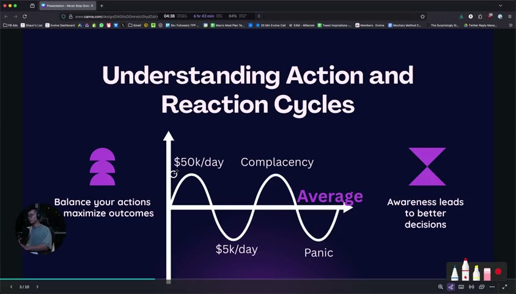
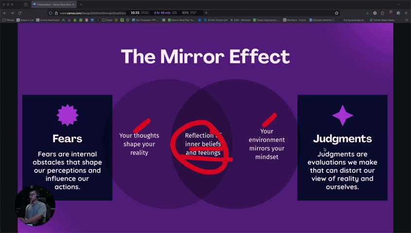
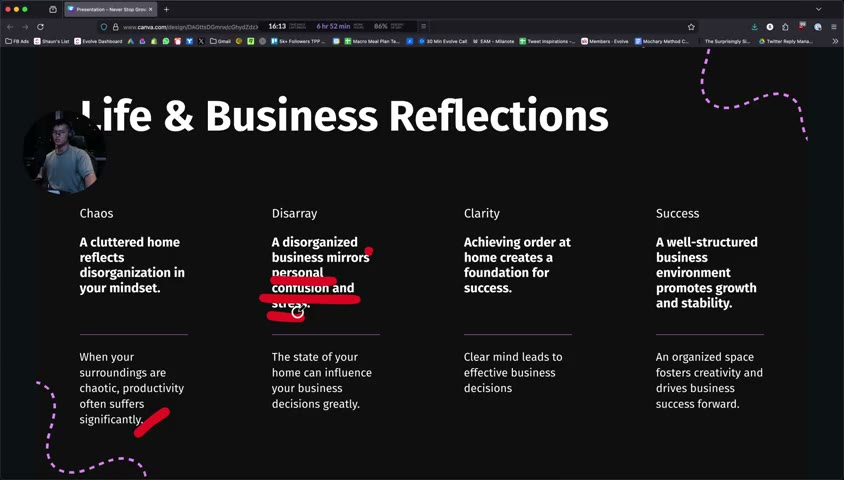
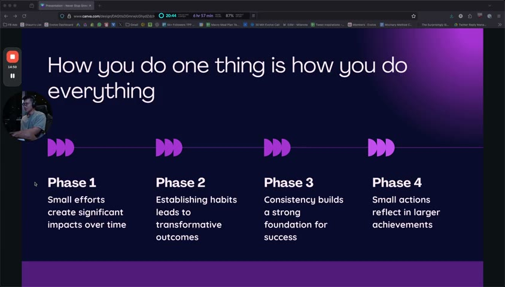
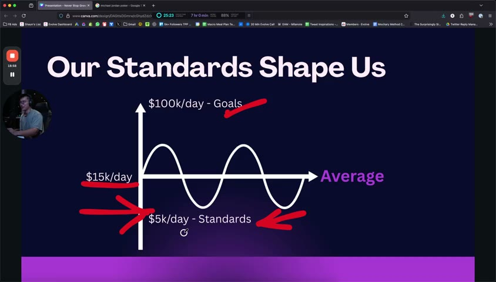
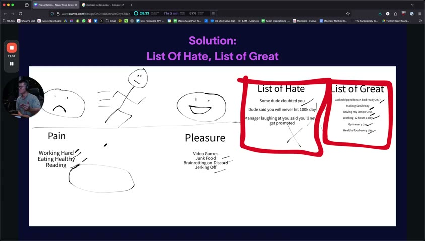

# 170. Never Stop Growing YoY - Face Off With Devil
> Businesses and people swing between "confident" highs and "panic" lows and fall back to their average; to get higher highs and higher lows, keep doing the daily inputs, clean up the personal issues that leak into the business, apply one standard of excellence everywhere, and raise your standards (not just your goals).

## 🤖 Agent use
- **Use when:** advising a founder or team whose revenue or output swings up and down; designing minimum daily operating standards; diagnosing why a team stalls after a big win; finishing the mindset module with a recap of which routine to run.
- **Inputs → outputs:** the operator's current "confident" and "panic" revenue numbers, current daily inputs, and distractions → a minimum-standards list, a calendarised input plan and a named trigger list (what to do when numbers hit the confident number).
- **Rules:**
  - **DO** define two numbers: a confident number (example: $50k/day) and a panic number (example: $5k/day), and notice that "you only fall to your average" between them [00:30–02:29].
  - **DO** replace reactive work (working hard only after a crash) with consistent inputs: "the Victory Vision Planner every single day" and scheduled calendar blocks, aiming for "higher highs and higher lows" [02:29–04:02].
  - **DON'T** reward a high number with a distraction binge (watches, travel, partying); the instructor says that stops "the things that got you there in the first place" and leads to the next crash [01:01–01:58] (instructor claim).
  - **IF** the business is stuck **THEN** look at personal causes first (avoidance, procrastination, mess, discipline) before hunting for a new strategy: "the business problem often solves itself if you solve your personal problems" [11:09–12:40].
  - **DO** keep one standard across all areas: "How you do one thing is how you do every single thing" [14:12–17:14]. Do the dishes now, ship the creative properly.
  - **DO** raise your standards, not just your goals: "You do not fall to the level of your goals. You fall to the level of your standards." [17:45]
  - **IF** you hit a goal **THEN** make it the new minimum: "stop treating your goals as just your dreams. This should be the new standard" [19:16–20:49].
  - **DO** keep the list of hate and list of great as the daily reframe [20:49–22:21]. See [168](168-endless-motivation-rewiring-pain-pleasure.md).
- **See also:** [166](166-how-to-find-time-and-get-shit-done.md) · [167](167-how-to-focus-quiet-your-mind.md) · [168](168-endless-motivation-rewiring-pain-pleasure.md) · [169](169-planning-achieving-goals-important.md) · [171. How To Make Any Product Work](171-how-to-make-any-product-work-brand-building-pt-1.md)

Lesson page text (Skool): "Shoutout Sam Ovens for this video idea. The main learning from this video: Winning and growing consistently come from managing your downside. We don't want high and low swings. But higher highs, and higher lows." The page lists: putting all the productivity modules together; top reasons people and their businesses spiral down; what to know and avoid to keep growing YoY for decades.

## Key ideas

### 1. Action and reaction cycles: confident number vs panic number [00:00–04:02]
- Framing: last video of the productivity series; an old presentation by Sam Ovens (Whisper: "Sam Arvins"), titled "Face Off Your Inner Devil", not about theology but about "the few top reasons why people... their business spiral down" [00:00]. He says the presenter's company was bought by "Iman" (Whisper's rendering) so he is comfortable reusing it; the identification is unverified [00:00].
- Newton analogy: every action has an equal and opposite reaction, applied to behaviour, mindset and results [00:30].
- Definitions: "When you hit 50k per day, that's your confident number. When you hit 5k per day, that's your panic number." [01:01] At the confident number people ease off ("buy a watch", "go to Dubai... party"), stop doing what got them there, the business falls, and at the panic number they lock in again [01:01–01:58]. He says he has seen "so many dudes in Evolve" go to Thailand and "side quests" after a goal and crash months later [01:58] (instructor claim, no counts).
- It is not only money: "every single thing you do, to your health, to your relationships, to your businesses" [02:29]. "You only fall to your average. You don't fall to your goal." [02:29]
- Remedy: awareness, then consistent action. If you rely on the panic number to work hard "at that point it's going to be way harder" [02:29–03:31]. Use the Victory Vision Planner daily (see [169](169-planning-achieving-goals-important.md)) and put actions in the calendar so they are inevitable; the aim is "higher highs and higher lows" [03:31–04:02].


*Wave chart: peaks at "$50k/day" labelled Complacency, troughs at "$5k/day" labelled Panic, with the "Average" line between. Side captions: "Balance your actions, maximize outcomes" and "Awareness leads to better decisions". [01:10]*

### 2. The mirror effect (Sam Ovens' framing) [04:02–08:34]
- Statement: the way you perceive the world and people is "a direct reflection of your own internal state, your own beliefs, and your own behaviors" [04:02].
- Examples:
  - Constantly judging others for their decisions suggests you are afraid of being judged: the judgment is "a projection of your fear" [04:34].
  - If you hesitate to invest in yourself (a course, a coach, your health), prospects will hesitate to invest in you: "You have to be willing to do what you're asking others to do." [04:34–05:31]
  - People who post and get help on X versus those who do not: "If you constantly help people, people want to help you back." "If you want to attract high-value clients, you must first be a high-value individual. If you want trust, you must be trustworthy." [05:31]
  - Hiring: "Why can't you hire top-tier talent? Are you a top-tier talent?" Would you pay yourself $2k a month to work for someone else? Top talent also cares about culture fit, not only pay [06:37–07:08].
- Clip shown (a YouTube video whose title on screen includes "Made $500M in 3 Years (and Became #1 Clothing Brand on TikTok Shops)"; Whisper heard "Hudson from Comfort", likely the apparel brand Comfrt): a founder says a former waitress earning "$25,000 a year" now makes ">$100,000" a month after following their training, and he coaches ChatGPT/Claude-generated hooks. The instructor's point: the founder states a long-term vision (5 and 10 years out) and his actions match, so employees believe him: "If you have the same amount of belief, conviction, vision, you can project it out to your employees as well. It's how you attract top tier talent." [07:08–08:34] (the instructor says he could not find the exact clip; audio of the clip is partly garbled).
- Naming note: this "mirror effect" is Sam Ovens' self-reflection idea, different from the Tether Lab ad-writing concept of the same name ([Mirror Effect (Put the Shame on a Story Character)](../../../../concepts/mirror-effect.md)). Do not treat them as the same.


*Venn-style slide. Left card "Fears: internal obstacles that shape our perceptions and influence our actions"; right card "Judgments: evaluations we make that can distort our view of reality and ourselves"; overlaps "Your thoughts shape your reality", "Reflection of inner beliefs and feelings", "Your environment mirrors your mindset". [06:40]*

### 3. Life and business go hand in hand [08:34–12:40]
- "Your business will be a symptom of your life." People who separate "personal life" from business ("I can go party as hard as I want... and then my business will be fine") are wrong, in his view [08:34–09:08]. He cites a news story of that week (a company CEO caught cheating on his wife at a concert) as an example of personal character showing up in business trust [09:08]; the story is outside the course files and not verified.
- Messy house example (from Sam Ovens): a cluttered home reflects disorganisation in the mind; the state of the home influences business decisions; Ovens' simple office is cited. He says that when he cannot think, he notices trash in the kitchen and clears it first [09:08–11:09].
- Bigger version: "unresolved issues... lack of discipline... confrontation, procrastination" become business bottlenecks. Examples: afraid of a personal confrontation → hard to fire an employee; procrastinate on dishes → miss deadlines [11:09–12:40].
- "The solution isn't to find any crazy new strategies... the business problem often solves itself if you solve your personal problems." [11:40]


*Four columns: Chaos ("A cluttered home reflects disorganization in your mindset"), Disarray ("A disorganized business mirrors personal confusion and stress"), Clarity ("Achieving order at home creates a foundation for success"), Success ("A well-structured business environment promotes growth and stability"). Sub-lines: "Clear mind leads to effective business decisions"; "An organized space fosters creativity and drives business success forward." [10:40]*

### 4. The solution: "facing the music" [12:40–14:12]
- Journaling (awareness is step one: "If you don't know what's going on, you can't fix anything"), remove distractions, dopamine detox, learn to do nothing [12:40–14:12]. These are the routines from [167](167-how-to-focus-quiet-your-mind.md).
- Specific fixes he gives: if distraction comes after a big number, remove it (even "move to a different country"); if the house is a mess, "get cleaners" [13:11–13:42].
- When bored after deep work, people indulge in "destructive behaviors, side questing", which sinks the business; so plan the idle time [13:42–14:12].

### 5. How you do one thing is how you do everything [14:12–17:45]
- Habits and patterns: "how you approach any single task is indicative of how you approach all tasks" (instructor's coaching experience) [14:45]. Dishes left in the sink or a cut-corner workout reinforces "a pattern of behavior that accepts mediocrity", which shows up as "this is good enough" creatives [15:16].
- Reverse is also true: making your bed or finishing a workout strengthens resolve in other areas [15:16].
- Link to the planner: "Two hours of creative research per day. Two hours of creative execution per day... At the current moment, it won't feel like much. And it's hard to do at the start. You'll be [bad] at it... Now you do it more, it becomes habits." Consistency → stronger foundation and skill → "better creatives... more of your ads hit" → "100k days" [16:16].
- "Stop thinking that you can be disciplined in your business, but lazy in your life... it just doesn't work." He cites Kobe Bryant and Michael Jordan as examples of the same competitiveness on and off the court (poker is mentioned as a possible destructive habit; the Jordan story is garbled) [16:16–17:45].


*Phases: 1 "Small efforts create significant impacts over time"; 2 "Establishing habits leads to transformative outcomes"; 3 "Consistency builds a strong foundation for success"; 4 "Small actions reflect in larger achievements". [15:00]*

### 6. Your standards shape you [17:45–22:21]
- "You do not fall to the level of your goals. You fall to the level of your standards." [17:45] "Your standard is going to be the minimum level you accept... a line that you will not cross." [18:15]
- Illustration (slide values): goal $100k/day, standard $5k/day, a "$15k/day" level in between. If your standard is $5k/day and you reach $15k/day, you drift back toward $5k/day [18:15] (the on-screen slide labels the line "$100k/day - Goals" at the top and "$5k/day - Standards" at the bottom).
- Hunger: when you fall to the standard you "work super hard" like someone broke who has to pay rent; the aim is to keep moving the standard up so that falling back is not an option [18:15–19:16].
- Reframe goals as standards: if $100k/day is your standard "and at 100k per day, you're panicking... my team needs to put up more creatives" [19:16]. Some people hear "doing 100k per day" and feel sad because it is their baseline [19:16].
- Reverse case: people who suddenly get wealth borrow to keep up a standard (luxury cars) and "hit the fan" [19:48]. Non-money version: "You don't even hope to be healthy. Your standard is that you eat well and exercise regularly." [19:48–20:49]
- "If you want to grow, you don't raise your goal, you raise your standards." [20:49]
- Tie-back to [168](168-endless-motivation-rewiring-pain-pleasure.md): the list of great "is how you reframe your standards. Every day you look at it" and the loop makes the behaviours "a self-fulfilling prophecy" [20:49–22:21]. Example: to be a $100k/day person do the required actions, "8 hours of creatives a day, for example"; if you can't do the full amount yet, build up (the numbers spoken at [21:48] are garbled) [21:48].
- Sign-off: "I've given you all the tools that you need to succeed. I've given you the warnings that you need to know as well." [22:21]


*"Our Standards Shape Us": the same wave, now with "$100k/day - Goals", "$15k/day" (mid-line) and "$5k/day - Standards"; red arrows mark the standards line as where you fall back to. [19:10]*


*Closing slide reuses the whiteboard from lesson 168 as the "Solution". [22:10]*

## Steps / framework
| Problem (slide order) | Mechanism | Fix named in the lesson | Cite |
|---|---|---|---|
| Action and reaction cycles | Big win → relax → crash → panic work | Know your confident and panic numbers; daily planner; calendar blocks; aim for higher highs and higher lows | [00:30–04:02] |
| Mirror effect | Inner beliefs shape what you attract (clients, talent, help) | Awareness; become the person you want to attract; hold and project a long-term vision | [04:02–08:34] |
| Life and business hand in hand | Personal mess becomes business bottlenecks | Journaling, remove distractions, dopamine detox, learn to do nothing, clean the home | [08:34–14:12] |
| How you do one thing... | Small habits generalise | One standard of excellence everywhere | [14:12–17:45] |
| Standards | You fall to your standards, not your goals | Make goals the new minimum; list of hate / list of great | [17:45–22:21] |

## Examples
| Case | What happened (as told) | Lesson | Cite |
|---|---|---|---|
| Evolve students after a goal | Reach 20k/50k per day, travel and party, crash months later, panic again | Cycles; use the planner every day | [01:58] |
| Hiring top talent | "Would you pay 2k per month to work for someone else?" | Mirror effect: be the talent you want | [06:37] |
| Comfrt clip | Waitress at $25k/yr now >$100k/month after the founder's training | Vision plus consistent action attracts and develops people | [07:08–08:34] |
| Messy kitchen | Notices trash when he cannot think, cleans first | Clear environment, clear decisions | [10:10] |
| Fear of confrontation | Cannot fire an employee if you avoid personal confrontation | Personal avoidance becomes business bottleneck | [11:40] |
| Creative inputs | 2 h creative research + 2 h creative execution per day | Small daily inputs compound to 100k days | [16:16] |

## Prompts / templates (verbatim)
Slide text, "Life & Business Reflections":
```
Chaos     - A cluttered home reflects disorganization in your mindset.
            When your surroundings are chaotic, productivity often suffers significantly.
Disarray  - A disorganized business mirrors personal confusion and stress.
            The state of your home can influence your business decisions greatly.
Clarity   - Achieving order at home creates a foundation for success.
            Clear mind leads to effective business decisions.
Success   - A well-structured business environment promotes growth and stability.
            An organized space fosters creativity and drives business success forward.
```

## How to apply
- [ ] Write your confident number and panic number for revenue (derived: also for daily output such as creatives shipped).
- [ ] Decide in advance what you will do at the confident number (keep the same daily inputs; no reward binge).
- [ ] List the three personal avoidance habits that most plausibly leak into the business (procrastination, avoiding hard conversations, clutter) and fix one this week.
- [ ] Apply one quality bar to small and large tasks, e.g. do not ship "good enough" creative.
- [ ] Define minimum standards as daily inputs (hours, creatives shipped), not as outcomes; raise them when a goal is hit.
- [ ] Read the list of hate and list of great daily ([168](168-endless-motivation-rewiring-pain-pleasure.md)); log inputs in the tracker ([169](169-planning-achieving-goals-important.md)).
- [ ] Re-run the focus routine from [167](167-how-to-focus-quiet-your-mind.md) when bored after deep work, so idle time does not become side quests.

## Related
- Previous: [169. Planning & Achieving Goals (Important)](169-planning-achieving-goals-important.md) · Next: [171. How To Make Any Product Work (Brand Building) Pt 1](171-how-to-make-any-product-work-brand-building-pt-1.md)
- Hiring and creator sourcing (the mirror-effect talent example applies): [150. Action Item: Hire Creators](150-action-item-hire-creators.md)

## Sources and limitations
- Transcript: [170. Never Stop Growing YoY… .txt](<../../../../../raw/evolve/start-here/_transcripts/👣 Evolve (Start Here)/170. Never Stop Growing YoY - Face Off With Devil 👣 Evolve (Start Here) Evolve.txt>) · Page text: [….html.md](<../../../../../raw/evolve/start-here/_extracted/👣 Evolve (Start Here)/170. Never Stop Growing YoY - Face Off With Devil_👣 Evolve (Start Here)_Evolve.html.md>)
- Machine transcription (Whisper large-v3-turbo). Full recording covered (last segment 22:44). Whisper errors: "Sam Arvins / Sam Evans" for Sam Ovens (page text); "Concerning.com... Iman" (likely Consulting.com; person unverified); "Hudson from Comfort" (likely Comfrt); "Astronomer's CEO" news example not verified; the Michael Jordan poker story and the numbers at [21:48] are garbled; some sentences in the Comfrt clip are partly inaudible.
- The talent, hiring and "falling to your standards" claims are the instructor's (and, for the framework, Sam Ovens'); the course gives no data. The "average" in the cycle chart is a conceptual midpoint, not a calculated figure.
- The confident, panic and standards numbers ($50k/day, $5k/day, $15k/day, $100k/day) are illustrative slide values, not benchmarks.
