# 171. How To Make Any Product Work (Brand Building) Pt 1
> Any product can work if it clears a few numeric criteria (AOV over $60, at least 3x markup, trend not declining) and you can stand out through a new mechanism or an underserved avatar, judged through magnitude of desire, market awareness and market sophistication; so product research is a thinking exercise, not a spy-tool hunt.

## 🤖 Agent use
- **Use when:** judging whether a product or niche is worth testing; auditing a competitor's position; deciding what angle, mechanism or avatar to lead with for an existing, saturated product; writing the "why we will win" section of a product brief.
- **Inputs → outputs:** a candidate product, its price, COGS plus shipping, five-year Google Trends curve, competitor claims and avatars → a go/no-go against the criteria, a sophistication and awareness read, and one chosen differentiator (new mechanism, renamed feature, or underserved avatar).
- **Rules:**
  - **DO** require AOV of $60+ after bundles: US ad costs are effectively fixed, so a cheap item cannot absorb them ("selling something... $10, but your cost to advertise is $20, there's zero chance") [08:13–09:12]. Slide: "Aim for an AOV of $60+ after bundles".
  - **DO** require at least 3x markup on COGS plus shipping, "ideally more", 5x also good; with $10 of COGS and shipping to the US the price must be at least $30 [09:12–09:42].
  - **DO** check Google Trends (US, past five years). Skip "consistently down" categories (his examples: keto, newspaper); flat or rising is fine: "The money is made in stagnant and trending markets, but not in declining ones." [09:42–10:47]
  - **DO** prefer lightweight items as a beginner (supplements, skincare); avoid heavy goods that complicate shipping and customs (his example: generators sold to the EU) [10:47–11:42].
  - **DON'T** chase LTV or subscriptions as a beginner "as long as the AOV profit margin makes sense, trend is not dying, product is not super heavy" [11:42].
  - **DON'T** spam-test: "If you're relying on spam testing to find winning products, that basically means your entire success is based off luck." Test with intent and record why you are testing [01:53–02:50, 06:17].
  - **DO** prefer solution-aware or product-aware angles as a beginner; "if you look at products... you feel like you need to do unaware to scale, I wouldn't do it at all" [16:11–16:42].
  - **DO** pick the strongest desire available and a product that serves it better than existing solutions [13:44–15:40].
  - **IF** the market is saturated **THEN** do not abandon it: saturation means a big audience. Stand out by (a) a new or renamed mechanism or (b) an underserved avatar [18:14–19:46].
  - **IF** you cannot create a unique mechanism or find an underserved avatar **THEN** avoid the product [17:13].
  - **DO** sell only products you believe work; sanity-check with an AI model ("Largely ineffective... Probably wouldn't sell it then") [26:37–27:08].
  - **DON'T** assume a new mechanism automatically resets sophistication to level 1; see the Skool-page correction below.
- **See also:** [9. Market Desires](009-market-desires.md) · [10. Market Awareness](010-market-awareness.md) · [12. Market Sophistication](012-market-sophistication.md) · [65. Understanding Market Sophistication - Part 1](065-understanding-market-sophistication-part-1.md) · [66. How To Find & Apply New Mechanisms](066-how-to-find-apply-new-mechanisms-part-2.md) · [172. Live Product Research w/ Kalodata (Pt 2)](172-live-product-research-w-kalodata-pt-2.md) · [Copywriting: Unique mechanism](../../copywriting/concepts/unique-mechanism.md) · [Copywriting: Avatars and angles](../../copywriting/concepts/avatars-and-angles.md) · [Copywriting: Market awareness](../../copywriting/concepts/market-awareness.md)

Lesson page text (Skool), verbatim: "**Note:** If you haven't watched the modules on Market Desire and Sophistication, watch that first. If not, you will not get it. If you try to shortcut success, you will never be successful. And yes, there will be a follow up live prod research video part 2. To clarify: Changing the mechanism does not automatically mean it gets reset to level 1 sophistication, if you frame it as something entirely different it can be level 1, else same product new mechanism would be level 3."

The note corrects the video: at [21:22] and [28:36] he speaks of a new mechanism resetting sophistication "all the way to level one" (Shilajit gummies, Stanley, True Classic). Follow the page text: a new mechanism for the same product is level 3 unless it is framed as something entirely different (or aimed at a new avatar nobody addresses).

## Key ideas

### 1. Be a brand builder, not a copy-paste dropshipper [00:00–03:21]
- Opening: "one of the most important modules and one of the most gatekept ones" (Whisper: "gatecapped") [00:00]. Brand building "is what allows you to scale to big numbers to the $100 million per year" [00:00] (instructor claim).
- He says gurus with "100k days" in fashion dropshipping have offered "tens of thousands" to learn this because they are afraid to enter competitive niches like supplements [00:00–00:57] (instructor claim, unverified).
- Myth-busting slide ("Common Misconceptions / Spam Test Is BS / Instant Success"): there is no magical product research method; "You can make any product work regardless of where you found it, if it fits a few criteria"; "There is no winning niches, I've helped people in various niches hit $100k days"; spam testing "is based off LUCK"; success takes "time and persistence", and "You can be unprofitable the first week, hit a winning ad on the 2nd, and take off. If you're a complete beginner however, it might be better to shorten that time horizon." [00:57–03:21]
- Audio: unprofitable for "two, three weeks" before hitting a winning ad is normal [03:21].

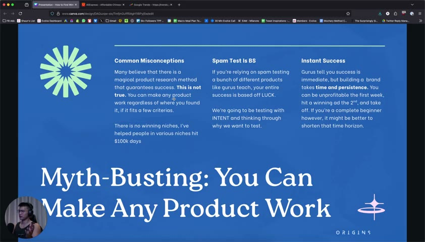
*Three misconceptions: a magical research method guarantees success; spam testing; instant success. Includes "We're going to be testing with INTENT and thinking through why we want to test." [02:00]*

### 2. Mindset: what to expect [03:21–08:13]
- **Expect to fail.** First 100 hours "you're going to suck": "after the 100 hours, suddenly you start to see success" [04:19–05:16].
- **Cash flow matters.** He started with "$100 in my bank account" in Southeast Asia, had a profitable product but no cash flow, so he did other work; "$2,000, $3,000 down" is not enough on its own, keep a part-time job or Uber [03:21–04:19].
- **Chase high-intent reps, not perfection.** Timer rule: "I'm going to find this product and build out a store in 8 hours. 8 hours is the limit... I'm going to launch it." [05:16–06:17]
- **Intent.** "If you're doing the same thing over and over again, you're still [stuck]." Check every product and creative you test and why you want to test it [06:17]. Slide: "Track every product and creative you test, and list why you want to test it."
- **Feedback loops.** "E-commerce is one of the businesses where you have a 100% success guarantee" (instructor claim). Start with a 1% product hit rate (could be lower); "test it 100 times, you're guaranteed to succeed"; if you repeat the same thing the hit rate stays at 1%; review results so it rises to 2%, 3%, 4% [06:17–08:13]. He notes 10,000 tests would burn "five, six figures", so reviewing is what makes it feasible [07:17].
- End state: success is "guaranteed" with enough hours, reps and feedback loops, but "it may take you a few months, a few weeks, or even a year or two" [07:17–08:13].

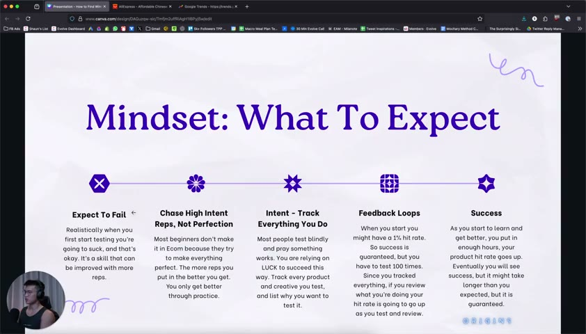
*Expect to Fail / Chase High Intent Reps, Not Perfection / Intent - Track Everything You Do / Feedback Loops ("might have a 1% hit rate... test 100 times") / Success. [05:00]*

### 3. Key criteria for product success [08:13–12:13]
- **AOV and margin:** AOV above $60 after bundles; a higher AOV lets you outspend competitors as CPMs rise and competition grows [08:13–09:12]. He says you can see "early success" below that but "in the long term... it's very, very hard" to scale a brand [09:12].
- **Markup:** minimum 3x on COGS plus shipping, "ideally more"; 5x "good as well"; low margins create scaling problems [09:12–09:42].
- **Trends:** "I don't care if it's a hot product or not. What I care about is the trend dying or not." Tool: free Google Trends, US, past 5 years. Keto and newspaper trend down; "gym" is up [09:42–10:47]. Search several niche-related terms (his examples: colostrum, probiotics) [10:47].
- **Product weight:** beginners should avoid heavy items [10:47–11:42].
- **LTV and subscriptions:** ignore at first [11:42].

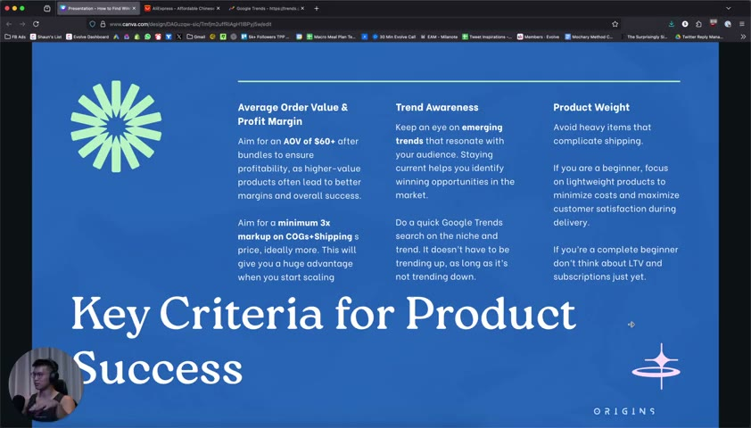
*Three columns: Average Order Value & Profit Margin ("AOV of $60+ after bundles"; "minimum 3x markup on COGs+Shipping"), Trend Awareness (quick Google Trends search; "doesn't have to be trending up, as long as it's not trending down"), Product Weight (lightweight for beginners; ignore LTV and subscriptions). [08:20]*

### 4. What a winning product is [12:13–13:44]
- Top-10-product YouTube videos "are all bullshit": they point you to a sourcing tool or affiliate offer. "A winning product is a product that satisfies a mass desire." Fashion can too [12:13–13:14]. The mass-desire lesson is a prerequisite ([9. Market Desires](009-market-desires.md)).
- Not all desires are equally easy: "you can make any product work, but the difficulty of each product will vary" [13:14].

### 5. What affects how easy or hard a product is [13:44–19:46]
1. **Magnitude of desire** [13:44–15:40]. Weak desire ("I'd like my desk to look more organized"): desktop organizers ($15-30), cable management clips ($10), decorative pen holders ($20). Cheap products "only pop up in TikTok organic, where they don't have ad costs, but you'll never be able to scale it far" [13:44]. Strong desire ("I need to lose 30 pounds before my wedding in 3 months"): high-ticket weight-loss coaching ($2,000-5,000), specialty meal delivery ($300-500/month), personal training packages ($1,000-3,000), medical weight-loss procedures ($5,000-15,000) [14:41]. The product opportunity: something cheaper but better than those solutions; his example on screen is a weighted "Infinity Hoop" ("a weight loss [product] that supposedly makes it fun") [14:41–15:40]. "Always pick the one that has the strongest desire", and fashion's desire (attracting a partner, loneliness) can also go deep [15:40].
2. **Market awareness** [15:40–17:13]. "The higher the stage of awareness, the harder it is to work." Beginners should pick solution-aware or product-aware. Slide: "We scaled to our $800k day with product aware ads"; so the product "doesn't need to do something revolutionary... find a product that solves something existing better". He says he knows "dudes doing eight figures a month" on solution and product aware [16:42].
3. **Market sophistication** [17:13–18:14]. The more sophisticated the market, the harder to stand out, but you can win by one of two moves without being new to the market. If you "cannot create a unique mechanism from the product or find it under the underserved avatar, I would avoid it".

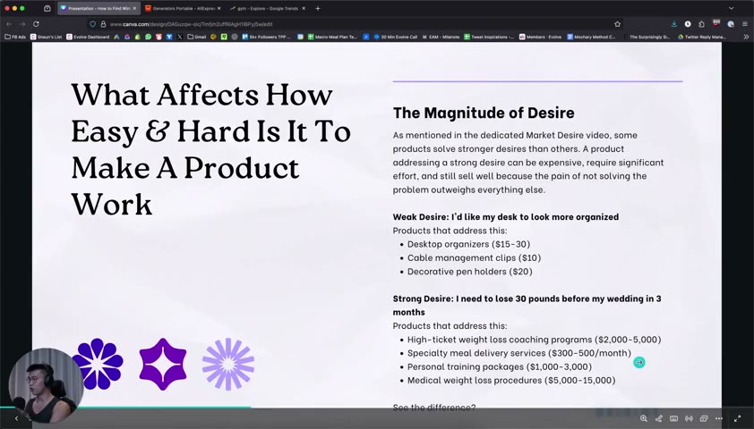
*Weak desire ("I'd like my desk to look more organized": desk organizers $15-30, cable clips $10, pen holders $20) vs strong desire ("I need to lose 30 pounds before my wedding in 3 months": coaching, meal delivery, training, procedures at $300 to $15,000). [15:00]*

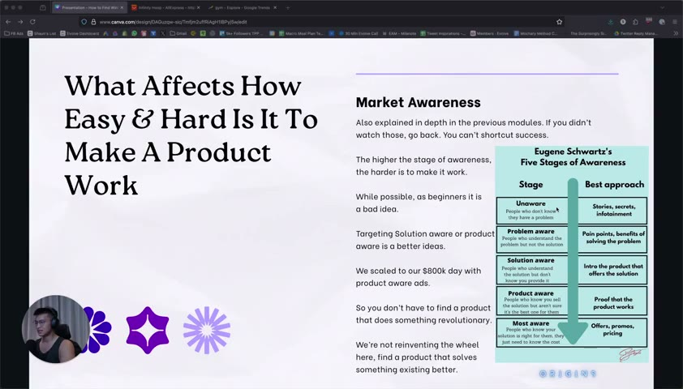
*Awareness stages on the slide: Unaware (stories, secrets, infotainment), Problem aware (pain points, benefits of solving the problem), Solution aware (intro the product that offers the solution), Product aware (proof that the product works), Most aware (offers, promos, pricing). [16:40]*

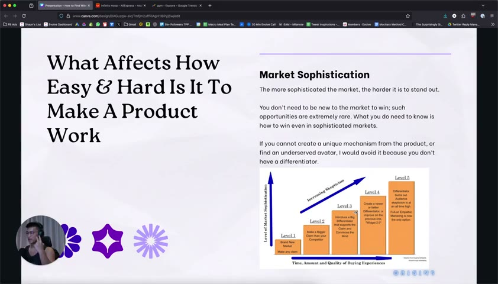
*Sophistication ladder (Level 1 to Level 5) used as the lens for the case studies; text: "The more sophisticated the market, the harder it is to stand out. You don't need to be new to the market to win." [17:40]*

### 6. How to deal with competition and saturation [18:14–19:46]
- "Saturation = big audience. Don't be afraid of competition." Copy-paste gurus win only by being first to market, which is "extremely rare" [18:14–18:44].
- Beginners: do not buy stock or customise products first; "pick existing products, drop ship it from China, test it for traction. Eventually, if it works out, then we can talk about branding it further out" [18:44–19:15].
- Two ways to stand out: "Either you innovate on the product or you innovate on the avatar." If you don't know how you will stand out before testing, "you're going to fail" [19:15–19:46].

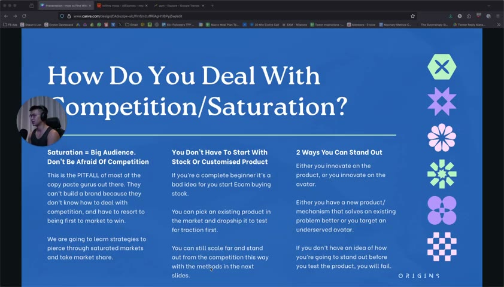
*Three columns: Saturation = Big Audience; You Don't Have To Start With Stock Or Customised Product; 2 Ways You Can Stand Out (new product/mechanism that solves an existing problem better, or target an underserved avatar). [19:40]*

### 7. Case studies [20:19–32:05]
- **Shilajit (new mechanism, then product-aware repositioning)** [20:19–23:27]. "We've helped over five brands in Shilajit... scale... over a million a month" (instructor claim, no named brands). Early market: resin form, easy claims ("get more energy and pp hard" on the slide); claims escalated until "cures cancer", at which point nobody believes you [20:19–20:51]. Move 1: gummies, a new delivery form, "it's a new mechanism now", reported at seven figures a month [20:51–21:52]. Move 2 (no new product): when everyone makes solution-aware claims, position as the best: "our product has been lab tested to have more certain ingredients than the rest" = product-aware messaging, "all it took for us to win" [21:52–23:27].
- **Astronaut Projector (new avatar)** [23:27–25:06]. A product older than five years that still produced "like 10 million in one year" for a store (his claim, brand identity not stated in audio; the store on screen is Pleshy "SpaceBuddy"). The lever was avatar: TikTok-trend, Gen Z content recreating viral organic videos aimed at "super trendy Gen Z" that nobody targeted. It descends from the earlier Starlight Projector (about ten years old); the astronaut form was a new mechanism, then the Gen Z store was an underserved avatar [23:27–25:06].
- **Stanley (new avatar)** [27:08–28:36]. Originally "made for construction workers". Same product, new avatar: Gen Z girls. Slide: old market (stage 5): "Keeps ice 2 hours longer than YETI", "Double-wall vacuum insulation with copper lining"; new market (stage 1): "The cup that makes you drink more water", "Your emotional support water bottle".
- **True Classic (new avatar and new mechanism)** [29:08–31:35]. Everyone else targeted hypebeasts (Supreme), gym bros (Gymshark), bargain hunters (Hanes) and athletic guys (Cuts); True Classic targeted the underserved "Dad Bod" (age 30-55): regular guys with realistic bodies, before/after in the same moment (just changing shirts), office and date-night scenarios. Previous sophistication stage 5 ("softest", "highest quality", "best fit"). In the dad-bod market: stage 1, "first to acknowledge this avatar exists, first to offer a solution, no competition speaking to this pain". Mechanism: body-optimising fit that "hides your gut, enhances your shoulders" ("from dad bod to daddy" is his paraphrase of their marketing).
- **Personal factors / conviction** [25:06–27:08]. Choose products you are passionate about (you can film content yourself), and sell only products you believe in: conviction is key; "DON'T SELL BS GIMMICKY PRODUCTS" (slide). Test: ask ChatGPT/Claude whether the product works. His example: chin slimmers, which the AI called "largely ineffective" ("probably wouldn't sell it then"); body shapers "do actually work" [26:37–27:08]. Customers will not be happy and "your brand won't ever compound" otherwise [27:08].

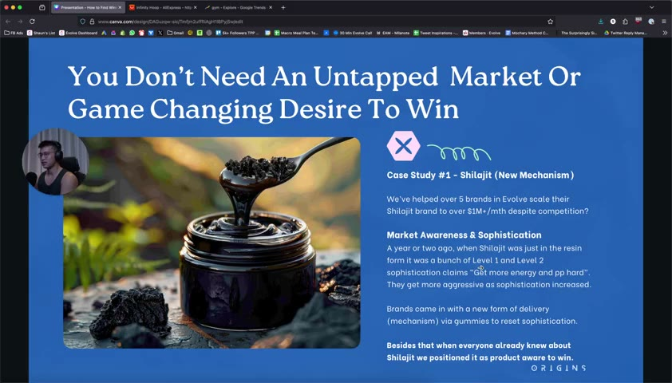
*Shilajit case: level 1 and 2 claims in the resin era ("Get more energy and pp hard"), sophistication rising, then gummies as a new delivery form to reset sophistication, plus "when everyone already knew about Shilajit we positioned it as product aware to win". [20:30]*

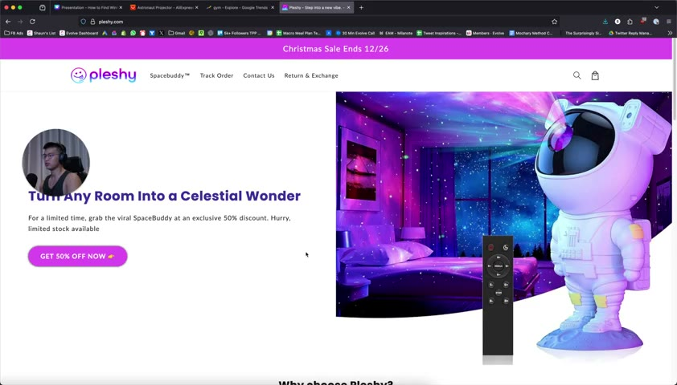
*Store on screen while he discusses the astronaut projector: "Turn Any Room Into a Celestial Wonder", "viral SpaceBuddy", 50% off Christmas sale. The slide-less demo of an old product sold to a new avatar. The audio does not name the store; whether this is the $10M store is not confirmed. [24:00]*

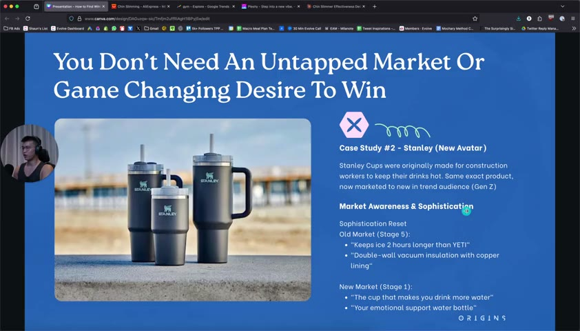
*Old market (stage 5) claims vs new market (stage 1) claims for the same product: "The cup that makes you drink more water", "Your emotional support water bottle". [28:20]*

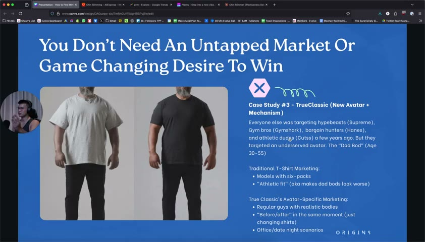
*TrueClassic targeted the "Dad Bod" (30-55) with regular guys, same-moment before/after and office/date-night scenarios. [29:50]*

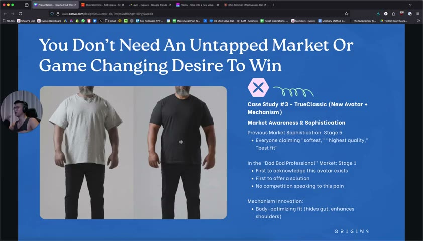
*Previous market: stage 5 ("softest", "highest quality", "best fit"). Dad-bod professional market: stage 1; mechanism: body-optimizing fit. [31:20]*

### 8. Name features to create a mechanism [32:05–33:38]
- A new mechanism "doesn't even need to be a custom product". "You can also name features in your product." Example: rename Stanley's "double wall vacuum insulation" as a branded feature and tie it to a new purpose: it "keeps your water cool" so it becomes "your emotional support water bottle". "Same exact feature, but with a new mechanism, it's just renamed it to a different purpose." Use AI for naming ideas [32:05–33:38].
- (Derived) This is the practical method for stage 3 in [66. How To Find & Apply New Mechanisms](066-how-to-find-apply-new-mechanisms-part-2.md).

### 9. It all comes back to customer research [33:38–34:41]
- "That's not how you build a brand" is his verdict on "secret spy tool to find your product"; if such tools worked, bots would scrape and do it. Research targets: pain points, stage of awareness, sophistication, underserved avatars [33:38–34:41].

### 10. Compounding: stick to one vertical or avatar [34:41–37:15]
- RXBAR: founded 2013, Walmart distribution 2016, acquired by Kellogg's 2017 (slide); the founder (Peter Rahal) "exited... I think, for $600 million" after "four years" (the transcript says four to five years; the slide's own timeline is 2013 to 2017) [34:41–35:14]. After a five-year non-compete he launched a new protein bar brand ("David Protein"); the slide says "David Protein's 1st Year: $725 Million Valuation"; Whisper wrote "700ml" [35:14–35:45]. Lesson: "Skills compound, learning is compound" [35:45].
- Advice: pick "one avatar" or very few; "You can get to $1M/mth with just 1-2 avatars" (slide). Going deeper on one avatar compounds learning "to create better ads, products, and brands around this avatar" [35:45–36:16]. His second example: a friend exiting multiple pet brands for "60 to 100 mil" built around the same pet-owner avatar, starting from the avatar rather than the product [36:16–37:15] (instructor claim, unverified).
- Curve context: the success graph is exponential, so early effort looks flat [34:41].

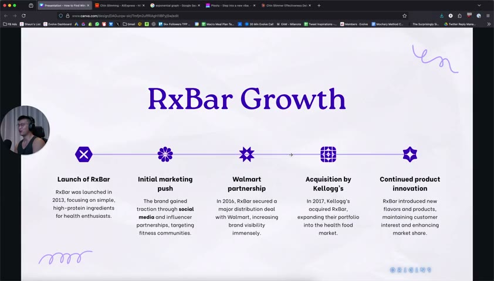
*RxBar timeline: Launch 2013 (simple high-protein ingredients), Initial marketing push (social media and influencer partnerships targeting fitness communities), Walmart partnership 2016, Acquisition by Kellogg's 2017, continued product innovation. [34:50]*

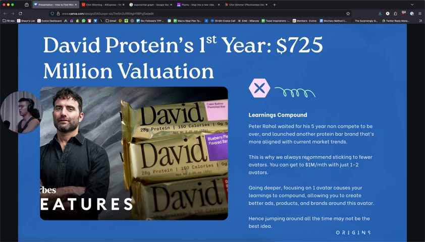
*"Peter Rahal waited for his 5 year non compete to be over, and launched another protein bar brand that's more aligned with current market trends." "We always recommend sticking to fewer avatars. You can get to $1M/mth with just 1-2 avatars." [36:20]*

### 11. Recap [37:15–39:02]
- Spoken recap: AOV ideally over $60; minimum 3x markup on COGS and shipping; trend not dying; "I would avoid high-ticket items for beginners"; choose something aligned with your interests; "all comes down to market research... There's no secret trick, there's no secret tools, there's no AI you can use that will replace this" [37:15–38:14, 38:14–39:02]. The recap slide adds "steer clear of heavy and high-ticket items".
- He tells students to rewatch this and the prerequisite modules several times because it "will not really click to you the first watch" [37:15]. Part 2 is the live walkthrough of tools and product research [38:14–39:02] ([172](172-live-product-research-w-kalodata-pt-2.md)).

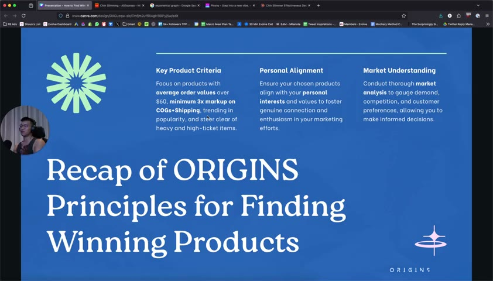
*Three recap columns: Key Product Criteria (average order values over $60, minimum 3x markup on COGs+Shipping, trending in popularity, steer clear of heavy and high-ticket items), Personal Alignment, Market Understanding (market analysis of demand, competition and customer preferences). [38:30]*

## Steps / framework
Product screen in order (all items from the lesson):

| Step | Check | Pass rule | Cite |
|---|---|---|---|
| 1 | AOV after bundles | $60+ | [08:13] |
| 2 | Markup on COGS + shipping | 3x minimum (5x good) | [09:12] |
| 3 | Google Trends, US, 5 years | Not consistently declining | [09:42] |
| 4 | Weight | Lightweight if beginner | [10:47] |
| 5 | Desire | Mass desire; strongest available magnitude | [12:13–15:40] |
| 6 | Awareness | Start solution-aware or product-aware | [15:40–17:13] |
| 7 | Sophistication | Know the stage; need a way to stand out | [17:13] |
| 8 | Differentiator | New mechanism (or renamed feature) or underserved avatar; else skip | [19:15, 32:05] |
| 9 | Conviction | You believe it works (ask an AI model; film it yourself if possible) | [25:06–27:08] |
| 10 | Setup limit | Product and store in 8 hours, then launch | [05:16] |
| 11 | Track | Log every product and creative tested with the reason | [06:17] |

## Examples
| Brand / product | Lever | Before (market) | After (move) | Source |
|---|---|---|---|---|
| Shilajit brands (Evolve clients, unnamed) | New mechanism | Resin; claims of energy and "pp hard" escalated to "cures cancer" | Gummies as a new delivery form; seven figures a month claimed | [20:19–21:52] |
| Shilajit brands | Awareness shift (no product change) | Everyone made solution-aware claims | "Lab tested to be better than the rest" (product aware) | [21:52–23:27] |
| Astronaut Projector | New avatar | Older Starlight Projector, no one targeting Gen Z | TikTok-trend content to Gen Z; claimed about $10M first year | [23:27–25:06] |
| Stanley cup | New avatar | Stage 5: "Keeps ice 2 hours longer than YETI" | Stage 1: "The cup that makes you drink more water", "Your emotional support water bottle" | [27:08–28:36], slide |
| True Classic | New avatar + mechanism | Stage 5: "softest", "highest quality", "best fit" | Dad bod (30-55) with fit that hides gut and enhances shoulders | [29:08–31:35], slide |
| Peter Rahal (RXBAR, David Protein) | Skill compounding | RXBAR took years to a Kellogg's deal | David Protein valued at $725M in its first year (slide) | [34:41–35:45] |
| Chin slimmers vs body shapers | Conviction test | AI says chin slimmers "largely ineffective" | Body shapers "do actually work" | [26:37–27:08] |

## Structured units

### Angles
| Angle | Core desire / pain | Heuristic(s) | Best format | Example line | Source |
|---|---|---|---|---|---|
| Hydration identity for Gen Z (Stanley) | Drink more water; emotional comfort | — | Lifestyle UGC (derived) | "Your emotional support water bottle" | [28:36], slide |
| Dad-bod-fit professional (True Classic) | Look better in a shirt; confidence on a date or at the office | — | Same-moment before/after | "from dad bod to daddy" (paraphrase of their marketing) | [30:39–31:35], slide |
| Lab-tested best-in-category (Shilajit) | Trust that the supplement is real and potent | Authority via testing (derived) | Claim plus proof | "Our product has been lab tested to have more certain ingredients than the rest" (paraphrase) | [22:23] |
| Gen Z trend room (astronaut projector) | A cool aesthetic room | — | TikTok-native recreations of trending content | "Turn Any Room Into a Celestial Wonder" (store headline on screen) | [23:27], screenshot |

### Rules of thumb
- **DO** write out how you will stand out (mechanism or avatar) before you spend on a test [19:15–19:46].
- **DON'T** go unaware just because you think scaling needs it [16:11].
- **IF** a market's claims have all been heard **THEN** change mechanism, rename a feature, or find an underserved avatar [20:51, 32:05].
- **DON'T** treat a mechanism change as an automatic reset to level 1 (page text).
- **DO** go deeper on one avatar or vertical to compound learning [35:45].

## Prompts / templates (verbatim)
Slide text, "Key Criteria for Product Success":
```
Average Order Value & Profit Margin
Aim for an AOV of $60+ after bundles to ensure profitability, as higher-value
products often lead to better margins and overall success.
Aim for a minimum 3x markup on COGs+Shipping's price, ideally more. This will
give you a huge advantage when you start scaling

Trend Awareness
Keep an eye on emerging trends that resonate with your audience. Staying
current helps you identify winning opportunities in the market.
Do a quick Google Trends search on the niche and trend. It doesn't have to be
trending up, as long as it's not trending down.

Product Weight
Avoid heavy items that complicate shipping.
If you are a beginner, focus on lightweight products to minimize costs and
maximize customer satisfaction during delivery.
If you're a complete beginner don't think about LTV and subscriptions just yet.
```
Slide text, "Mindset: What To Expect": `Expect To Fail | Chase High Intent Reps, Not Perfection | Intent - Track Everything You Do | Feedback Loops | Success`.

Slide text, "Recap of ORIGINS Principles for Finding Winning Products": Key Product Criteria ("average order values over $60, minimum 3x markup on COGs+Shipping, trending in popularity, and steer clear of heavy and high-ticket items"); Personal Alignment ("align with your personal interests and values"); Market Understanding ("thorough market analysis to gauge demand, competition, and customer preferences").

## How to apply
- [ ] For each candidate product, record price after bundles, COGS plus shipping, markup multiple and the five-year US Google Trends shape; reject if AOV is under $60, markup under 3x or trend consistently down.
- [ ] Record desire (weak or strong, with price anchors of existing solutions), awareness stage and sophistication stage using lessons 9, 10 and 12.
- [ ] Decide the differentiator before testing: new mechanism, renamed feature, or underserved avatar. If none, drop it.
- [ ] For a new avatar, write the old market's claims and the new market's claims side by side (Stanley format) and check the new claims are genuinely unaddressed.
- [ ] Ask an AI model whether the product actually works; skip products with a "largely ineffective" verdict.
- [ ] Set an 8-hour cap for product plus store; launch, then log intent for every product and creative tested.
- [ ] After tests, review why they failed or won to lift the hit rate (feedback loop).
- [ ] Stick to one or two avatars per vertical for compounding.
- [ ] Next: watch [172. Live Product Research w/ Kalodata](172-live-product-research-w-kalodata-pt-2.md) for the tool workflow.

## Related
- Previous: [170. Never Stop Growing YoY - Face Off With Devil](170-never-stop-growing-yoy-face-off-with-devil.md) · Next: [172. Live Product Research w/ Kalodata - Pt 2](172-live-product-research-w-kalodata-pt-2.md)
- Desire, awareness and sophistication foundations: [9](009-market-desires.md) · [10](010-market-awareness.md) · [12](012-market-sophistication.md) · [65](065-understanding-market-sophistication-part-1.md) · [66](066-how-to-find-apply-new-mechanisms-part-2.md) · avatars: [74. How To Build Core Avatars](074-how-to-build-core-avatars.md)
- Playbooks: [Competitor landscape audit](../../../../playbooks/competitor-landscape-audit.md) · [Customer research to angles](../../../../playbooks/customer-research-to-angles.md)
- Mindset module that sets up the "100 hours" and feedback-loop ideas: [169. Planning & Achieving Goals](169-planning-achieving-goals-important.md)

## Sources and limitations
- Transcript: [171. How To Make Any Product Work… .txt](<../../../../../raw/evolve/start-here/_transcripts/👣 Evolve (Start Here)/171. How To Make Any Product Work (Brand Building) Pt 1 👣 Evolve (Start Here) Evolve.txt>) · Page text: [….html.md](<../../../../../raw/evolve/start-here/_extracted/👣 Evolve (Start Here)/171. How To Make Any Product Work (Brand Building) Pt 1_👣 Evolve (Start Here)_Evolve.html.md>). No attachments, linked docs or Skool-embedded images exist for this lesson; slide text is read from video frames of the Canva deck (branded "ORIGINS").
- Machine transcription (Whisper large-v3-turbo). Full recording covered (last segment 39:01). Whisper errors fixed in prose: "reading products" = winning products; "gatecapped" = gatekept; "Sean" (self-address) vs the on-screen name Shaun Eng; "700ml" = $700M or the slide's $725 Million; "pp hard" is from the slide. Several sentences about the gurus, the Starlight/astronaut history and the transcript line "we scaled to 800k a day with that product to where ads" are garbled; the slide reads "We scaled to our $800k day with product aware ads".
- Instructor claims, unverified: Evolve clients scaling five Shilajit brands past $1M a month; $10M first year for an astronaut-projector store; True Classic as nine-figure; RXBAR sold for about $600M; friend's pet brands exit at $60-100M; "100% success guarantee" with enough tests. Brand and exit numbers should be verified before reuse.
- The spoken recap says avoid "high-ticket items for beginners" while the earlier desire section shows high-ticket items as evidence of strong desire; read the recap rule as a beginner-sourcing rule (a $60+ AOV, not $1,000+ products).
- Skool page text overrides the spoken statement that a new mechanism resets sophistication to level 1 (see above).
