# 172. Live Product Research w/ Kalodata - Pt 2
> A live screen-share of the one product-research method the instructor says "people usually get results with": pull trending TikTok Shop products from Kalodata, screen out brands and trademarks, sanity-check demand, price and competition, then decide whether you can stand out with a new mechanism or an underserved avatar.

## 🤖 Agent use
- **Use when:** shortlisting or vetting a product for a DTC test, or sanity-checking a product a human already picked (trademark risk, price and margin, seasonality, saturation, whether an angle gap exists).
- **Inputs → outputs:** a Kalodata product list (7-day window) and a candidate product → a go / no-go with reasons, an estimated store revenue, an expected price range, a list of angle / mechanism / avatar gaps to test, and (course method) a test plan that runs own creatives alongside borrowed ones.
- **Rules:**
  - **DO** filter Kalodata at the product level: dates = last 7 days, average unit price above $15, sales growing rapidly. [00:58] (page text, checklist step 2)
  - **DO** drop any product that belongs to a big brand or has a patent or active trademark you cannot work around. Examples rejected on air: Goli, Shark, MediCube, Comfrt, Halara. [02:53–04:41; 40:00]
  - **DO** check the brand with a Google search and its social following; an established brand can easily afford litigation. [04:41–07:03] (page text step 4)
  - **DO** check trademarks on the registry of the country you will sell in (US: USPTO, free) or ask GPT/Claude. A trademark does not stop you selling the product; it stops you using the name and certain phrases on site and in ads. [04:41–07:50; 32:55] (page text step 5)
  - **DO** estimate store revenue as website visitors x conversion rate x AOV, and always be conservative. [10:16; 14:47] (page text step 6)
  - **DO** treat SimilarWeb traffic as secondary for this method: big TikTok Shop stores can be huge on TikTok and tiny on their own site, and the product can still sell through Facebook ads. [48:53] (page text step 6)
  - **DO** read the top TikTok Shop videos and their comments, Reddit, Amazon and the Facebook Ad Library to learn the current angle, the audience and the market sophistication before deciding. [07:50–08:55; 54:30] (page text steps 7–8)
  - **DO** require at least one of: a new mechanism, or an underserved avatar. "If I cannot find any of these two, then I wouldn't run it." [23:00; 26:18]
  - **DO** price by the 3x rule: selling price should be about 3x COGS + shipping and still sit inside the price range buyers expect (check Amazon, Claude or GPT). Example: $20 total cost, $60 price, $40-60 expected range. [42:00–43:08; 44:38; page text step 10]
  - **DON'T** recommend a $100+ product to a brand-new beginner. Start with products you can sell for roughly $40-80 (page text note) and prefer a lower ticket so you get more purchases from the same spend. [22:49–28:22]
  - **DON'T** rely on ripped creatives long term. "You're pretty much running on borrowed time." Treat them as proof of traction and urgently build your own winners. [34:07–36:39; page text note]
  - **DON'T** pick heavy, bulky products (lawn sweepers), battery products you cannot verify, seasonal products unless you accept a Q4-only window, or a niche you feel repelled by. [26:18–27:19; 45:54; 47:39–49:53]
  - **IF** a trend line in Google Trends spikes and falls (the kojic acid example) **THEN** stay away; flat or rising is acceptable. [19:26; 32:55–34:07]
  - **IF** the market already knows the product category (people know self-cleaning litter boxes) **THEN** stop educating and run product-aware ads: comparison, price, ease of use. [16:59–26:18]
- **Course method vs repo rule (read before acting):** the instructor teaches downloading top TikTok Shop videos and running them as your own ads after clearing metadata [54:30–59:30]. This repository's rule 3 is "copy the mechanism, not the asset", and re-uploading someone else's creator video carries takedown and copyright-strike risk that the instructor himself names [34:07–36:39]. An agent should reuse the research steps and the angle-gap logic here, and produce original creative instead of ripping.
- **See also:** [171. How To Make Any Product Work (Brand Building) Pt 1](171-how-to-make-any-product-work-brand-building-pt-1.md) · [12. Market sophistication](012-market-sophistication.md) · [66. How to find and apply new mechanisms](066-how-to-find-apply-new-mechanisms-part-2.md) · [76. How to build sub-avatars](076-how-to-build-sub-avatars.md) · [31. Reddit research](031-reddit-research.md) · [Competitor ad teardown playbook](../../../../playbooks/competitor-ad-teardown.md)

## Key ideas

### 1. Which method this is and why [00:00–02:53]
- The instructor says this is "the most basic product research method that people usually get results with" and "how did you set a brand so fast" is answered by it. He covers only this method. Part 1 (the theory of how you plan to stand out) "is most important". [00:00] (Part 1 is most likely lesson 171; the audio does not say so. Derived.)
- Tools: Kalodata (paid), Facebook Ad Library (free), SimilarWeb (free), a trademark search (free). Atria "is not really that needed", skip it and use Ad Library. [00:00]
- Kalodata cost, as heard: "I think it's like $45, nine for starter, $100 per month for professional plan." Whisper garbled the starter price (likely about $45-49). He uses the professional plan and says starter is fine. [00:00] Discount code **evolve10** for 10% off (page text, step 1). The page text link is a sign-up page for Kalodata with that code.
- The popular approach is ripping from TikTok Shop; "most gurus will teach you that. I still think that is the most effective method." But "if you only rely on that, you will never be able to grow it long term." Rip to start, then invest in your own product, content and branding once traction appears. [00:58–01:57]
- The trap: if you rip mindlessly "it is really just a VA game", copy-paste fastest, against people with huge or automated teams. To stand out, create your own creatives alongside the ripped ones; that is how you find a winner beyond what was ripped. [01:57–02:53]

### 2. Kalodata filters and reading the list [00:58–04:41]
- Open the **Product** tab. Filters on screen: Dates = last 7 days (10/19 to 10/25 in the recording), Avg. Unit Price ($) 15 to infinity. Columns on the list: Revenue (with a 7-day sparkline), Revenue Growth Rate, Item Sold, Avg. Unit Price, Commission Rate, Highest Revenue Videos, Creator Number, Launch Date. [00:58] (screen)
- Why above $15: "I don't like to sell things that are too low ticket. Some people do… my personal preference is not." [00:58]
- Recorded 27 October; he notes the top listing is a decorative pillow set. [02:53]
- Print-on-demand "does extremely well during Q4 gifting season" but "drops off very, very hard" the rest of the year; "it's literally just a copy-paste game" and needs custom designs. He would not run it unless he has personal affinity. [02:53–03:41]

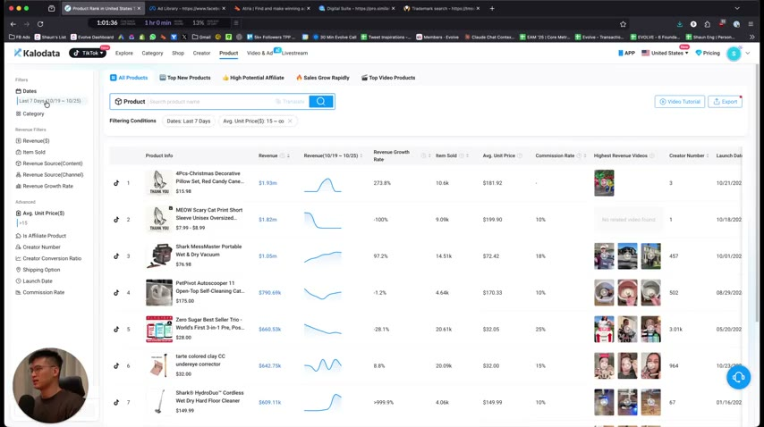
*The Product tab with the filters the checklist asks for (last 7 days, average unit price from $15). The list shows 7-day revenue, growth rate, items sold, price, commission and creator count; rows 1-2 are print-on-demand pillows, row 3 a Shark vacuum, row 4 the PetPivot litter box, row 6 the Tarte under-eye corrector. [01:05]*

### 3. Screening out brands and patents [03:41–07:50]
- Shark MessMaster (a vacuum): "we can't sell this… patented product from Shark." Shark has existed since 1994, "you think you have the resources to come after you legally? Yes, they do." [03:41; 07:03]
- Check method: search the product name in the trademark search, then Google the brand and find its Instagram and TikTok. If the following is large, it is probably a real brand. [04:41]
- If you rip a patented or trademarked product anyway, "you will get into a lot of issues later down the line", unless the plan is to find traction and then switch product name and brand entirely. [04:41]
- He cannot view TikTok Shop listings from Malaysia; people buy US TikTok Shop accounts just to view listings. [05:49]
- PetPivot US: about "3 mil" over the last 30 days, "which is crazy". On the product detail page (screen): PetPivot Autoscooper 11, $175.00, last 7 days revenue $790.69k, 4.64k items sold, average unit price $170.33, creator conversion ratio 25.70%, rating 4.6 (4,704 reviews). [05:49] (screen)
- He first sees a large Instagram and TikTok following, then cannot find any real branding behind "PetPivot" and notes the YouTube channel has about 1K subscribers: "we found a product that I would potentially sell". Treat these two observations as mixed; he concludes the name is trademarked but the brand is thin. [04:41; 07:03–07:50]

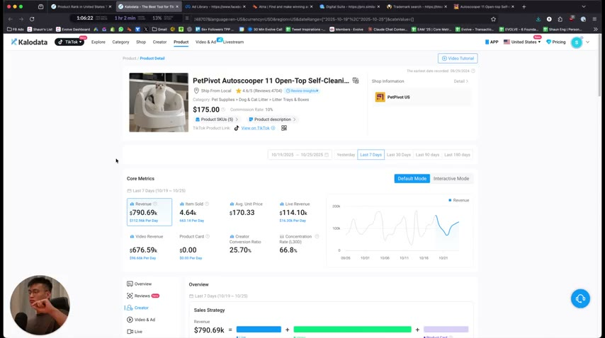
*Kalodata product detail for the self-cleaning litter box: price, 7-day revenue, items sold, average unit price and the creator conversion ratio, plus the sales-strategy split by channel. [05:50]*

### 4. Estimating how big the store is [08:55–10:16; 14:47]
- Searching the product in the Facebook Ad Library finds many copycat stores selling the same video; finding the "original brand" is hard. [08:55]
- SimilarWeb gives only an estimated traffic number. For the PetPivot store it showed "30,000 visits". At 1% conversion that is about 300 purchases (he says "309"); at about $170 that is "like 50k a month. It's actually very small on the site itself". [10:16]
- Copycat store: 28k visits, assumed 0.9% conversion, so about 280 purchases a month times about $160 AOV. "It's all assumption." Find AOV by looking at the product page price; bundles raise it, so being conservative means using only the product price. [13:48–14:47]
- Small site traffic does not kill the idea: "just because it doesn't show up doesn't mean that it's not a good opportunity." Other stores "are all copying the TikTok Shop videos", so a better angle can still win. [12:43; 15:59]
- Rule: "There's not going to be one specific criteria… It's going to be multiple data points you draw from." [14:47]

### 5. Market research on a candidate: self-cleaning litter box [07:50–27:19]
Sequence the instructor runs, in order:
1. Google the product and brand; check Reddit for the current stage of sophistication ("what are people saying about it?"). [07:50]
2. Facebook Ad Library for the category keyword ("self cleaning litter box") to see what competitors run; everyone sells the same product, "that's still fine. You're never going to be first to market." The goal is to find underserved avatars or new mechanisms. [11:21]
3. Reddit reviews of the specific product (pros and cons). [16:59]
4. Google Trends, US, past 5 years, for "self cleaning litter box", "cat litter box" and "automatic litter box". Result: pretty flat, "going up a bit" recently. "As long as trends are flat or not declining, it can work out pretty well." [19:26–20:42]
5. Competitor price check: the market leader Litter-Robot is about $650 ("This costs a lot more than a cat"). [22:49]

What the research suggested (instructor's reasoning, "maybe" language throughout):
- No reviews found that are not ads, so a **review-style ad** angle may be open. [16:59]
- Reddit pros: works, cleans, user-friendly, "no glitching apps", beat a $750 competitor "in every way". Cons: waste bag design, bags barely fit, hard to close latches; a mention that a competing litter box maker was sued for $3 million. [16:59–18:12]
- Competitor's units break after a year or two (Litter-Robot 3 owner comment). A buyer says they want to switch from Litter-Robot to PetPivot. [19:26]
- Product-aware angle: compare your unit with the leader without naming the brand ("You can get sued for that. Litter-Robot is an actual brand with resources to come after you legally"): yours is cheaper, equally safe, easy to clean. [24:04–25:05]
- The market already knows these devices, so skip the "why you need one" education and tell people you are the best: "You highlight the thing that people actually care about", for example price or maintenance. [25:05–26:18]
- Alternative path: find an underserved avatar. "Both can work." [26:18]
- He rates it personally runnable but not his pick for a big brand, and notes he has no affinity for cats. Affinity matters mainly in that you should not be repulsed by the niche; his tarot-cards-for-a-super-religious-seller example is "probably not a good idea". [26:18–27:19]

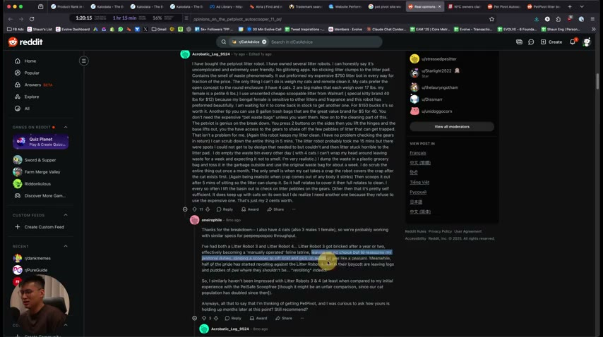
*A Reddit review thread used as customer-language research: a long owner review with pros and cons, and a reply from a Litter-Robot owner asking about switching. [19:40]*

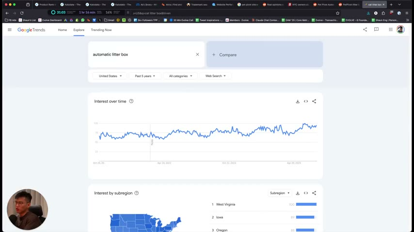
*Google Trends, US, past 5 years, "automatic litter box": mostly flat with a late rise, which the instructor accepts as "niche-wise it's not bad". [20:45]*

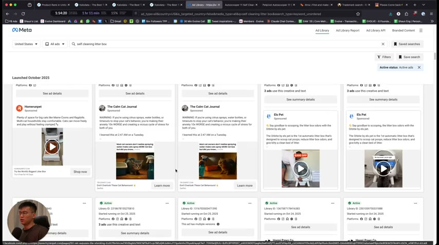
*Facebook Ad Library for "self cleaning litter box": several brands run the same product with warning-style and product-demo ads. He checks each advertiser's traffic in SimilarWeb to see who is actually doing volume. [13:45]*

### 6. Why not for a beginner: the ticket-size maths [20:42–23:00; 27:19–28:22]
- At $170 selling price he sets "2x ROAS to be 20% net margins", meaning (as garbled) break-even needs about $85 of spend per purchase. At $100 a day Facebook "isn't very consistent": "you might get no purchases one day, two days… and then you're profitable again". A new seller "may not have the capital to run it". [20:42–21:49]
- If you have already run dropshipping stores, a $170 product is not much of an issue. He would test it after finding an underserved avatar or mechanism. [21:49–22:49]
- For brand-new beginners: sell something cheaper, which means a lower cost per purchase and more purchases. "At the very start, you guys might struggle to get even like one purchase." The goal is to get profitable fast, then optimise. [27:19–28:22]
- Page text note: the first product in the video at $100+ is not recommended for brand-new beginners; $40-80 products are good to start with.

### 7. Product 2: Tarte under-eye corrector, trademark and sourcing [28:22–36:39]
- He opens the videos tab first to understand what the product does (a creator video: a breakout, then the product hides it). The brand is Tarte (on the list "tarte colored clay CC undereye corrector", $32, row 6). 7-day revenue near $642.75k ("almost 2 mil" is how he describes the brand's last-7-day total). [28:22] (screen)
- Sourcing caveat: skincare is competitive; a supplier may not replicate the effectiveness. "You can ask if they can replicate the effectiveness of the product, then you can run it", always under a different brand name. [30:06]
- Store-size estimate: SimilarWeb gives 18,000, worldwide not US only; at $32 he computes about $576,000 (his calculator reads 18,000*32 = 576,000) and says about $600k a month on this one product. It is unclear whether the 18,000 is visits or orders; no conversion rate is applied, so treat the figure as an upper bound. [30:06–31:20] (screen; flagged)
- Because AOV can be raised: "if you add on bundles and offers, you can make it above 60." [31:20]
- Trademark check: the registry search failed, so he asked Claude. Reply (on screen): Tarte has registered between 251 and 312 trademarks; examples include "TARTE", "BIG EGO" and "POWER FLEX". Conclusion: the brand name and some product names are protected; the product type is not. "As long as you don't use the name Tarte, if your supplier can source it, it will actually be a good opportunity." [32:55]
- Google Trends caveat: skincare stays flat or up unless tied to a viral ingredient. Kojic acid peaked on TikTok Shop, then fell; if you run it after the peak "you might have a pretty hard time… I would stay away from things like that." [32:55–34:07]
- Comment mining on a Tarte creator video: "What setting powder do you use?", "What shade is this?", and an older buyer: "Don't worry if you're over 40… It really settles in fine lines". Hypothesis: the product could be pointed at a different (older) audience. [35:23]

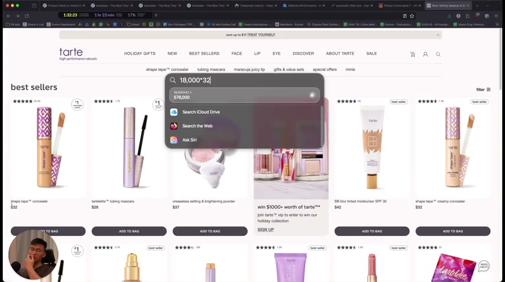
*Tarte's best-sellers page ($32 concealer, $28 mascara) with the instructor's Spotlight calculation 18,000*32 = $576,000, used to size how much a branded store sells. [31:30]*

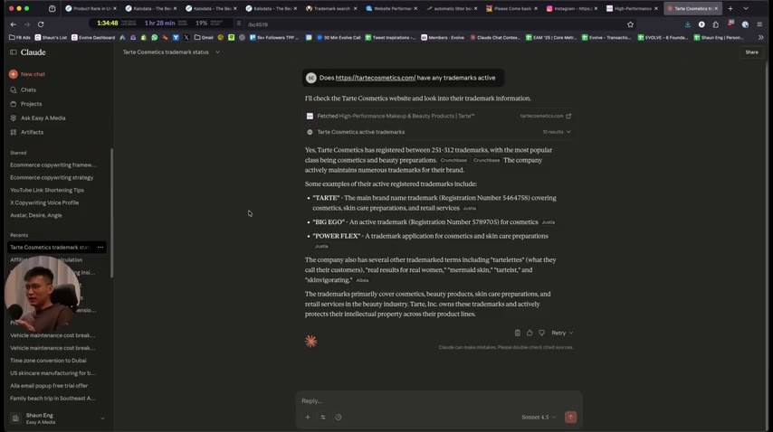
*Claude is asked whether the brand's site has active trademarks; the answer lists the brand name and product names as registered. Use this as the fallback when the official registry is down; verify on the registry itself. [33:10]*

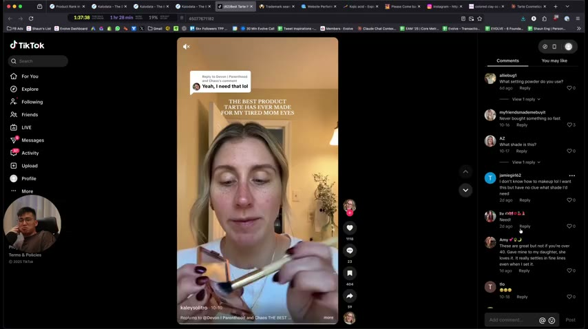
*TikTok comment thread on a Tarte creator video: questions (shade, setting powder) and an over-40 buyer's comment, used to spot an alternative avatar. [36:00]*

### 8. Rapid verdicts on other listings [35:23–51:04]
| Listing | Verdict and reason | Source |
|---|---|---|
| Decorative pillow sets, themed gifts (print-on-demand) | Skip unless affinity; Q4 gifting spike then falls off hard | [02:53–03:41] |
| Shark MessMaster vacuum | No: patented, large corporation | [03:41; 07:03] |
| PetPivot self-cleaning litter box ($170-175) | Potentially yes for an experienced seller; needs an angle gap; not for a beginner | [07:50; 22:49] |
| Goli, MediCube, Comfrt, Halara | No: established brands | [40:00] |
| Tarte under-eye corrector ($32) | Yes if a supplier can match it, with a new brand name | [32:55] |
| Tarte concealer pore brush, similar items | Possibly similar process; "maybe you can run it" | [36:39] |
| Blush (copyrighted) | No | [36:39] |
| Electric bike (about $600) | No: too high ticket | [36:39] |
| Fleece-lined compression leggings | Seasonal Q4 only; find a new mechanism; ads are the same everyone runs | [37:49–39:53] |
| Portable car jump starter with air compressor | Test for seasonality only; battery risk | [41:06–49:53] |
| Lawn sweeper | No: heavy and low priced; dropship shipping can cost double what bulk 3PL shipping does | [49:53] |
| NeoCell collagen bio-peptides powder | Yes, if the supplier can really supply the formulation; price needs a 28-day supply or bundle | [51:04–56:38] |

### 9. Seasonal product and the "new mechanism" example [36:39–39:53]
- Fleece-lined "leggings that look like nothing is underneath" are run every Q4; seasonal products just need seasonal ads. [37:49]
- **Mechanism idea (instructor's, unverified in market):** a comment said "Mine are so warm, but I wish you could see all my leg tattoos through them still". If the supplier can make a version that stays warm but shows tattoos, "that's literally just your mechanism"; target people with tattoos. He says verify with more research. [37:49–39:53]
- **Clothing example (instructor claim):** a brand he calls "Udi" (Whisper; likely "The Oodie", an oversized hooded blanket; not verified) sold oversized hoodies and stood out only by making the product about 10-20% longer so it covers the knees. "It's literally the same product", scaled to "a multi-nine-figure brand now". He does not recommend this for beginners because it needs stock investment; instead highlight the mechanism without investing right away. [36:39–38:48]

### 10. Portable car jump starter with air compressor [39:53–49:53]
- Ad type seen: fear-mongering. The creator says it is one of the most dangerous things to keep in a car because it can damage a car's sensors, computer and battery, then shows a green-light-ready unit with USB charging and a flashlight that blinks red and blue. "Fear-mongering, which serial works really well. Not that you should go away from it." [41:06; 42:00]
- Reality check on cost: TikTok Shop price can be far lower than your selling price. Search AliExpress (reverse image search the product photo), then get an agent quote. He found about $150 for some types and $28 for a similar one; Amazon comparables about $40-47. [43:08–45:54]
- Rule: you must sell at about 3x product cost; if source cost is near the marketplace price, there is no room. "If let's say the source price is too close to this, it's like $30, $40. It's something that I would sell [only if] you need to be selling something for 3x." Garbled: keep the rule, not the quote. [44:38]
- Claude check: prices for this product run about $60-200. If you can source at $20 and sell at $60, "this is honestly not too bad" because it is in the average range. [45:54]
- Angle: Reddit mechanics' view on what is good or bad, and a women-focused angle: "do they really know how to hook up a jump starter? Not really", so ease of use for women instead of only men. [46:52–47:39]
- Seasonality: Google Trends shows "it peaks during December"; flat after. He would run it for gifting season only. [47:39–48:53]
- Website traffic of these stores is low even if TikTok Shop revenue is high; Chinese stores can compete on price and product but often cannot make creatives for their own sites, so an own-site opportunity may exist. Verify the product is legit first. [48:53–49:53]
- Safety: battery products have defect-rate risk ("if something goes wrong, it goes boom"). "If you're not comfortable with that, don't run it. If you can verify that it's legit, test it out yourself first." [49:53]

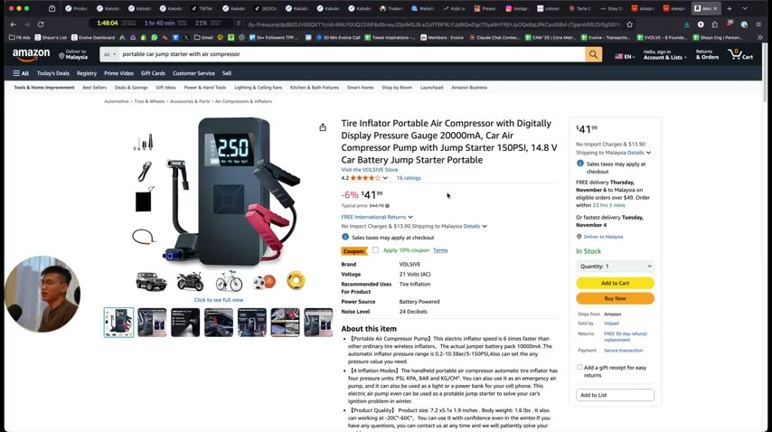
*Amazon listing for a portable jump starter with air compressor at $41.99, used to learn the price buyers expect before deciding the selling price. [45:50]*

### 11. Collagen: a "new mechanism" product [49:53–56:38]
- Top Kalodata video for NeoCell collagen is Spanish; the second is a long unaware-style ad. The instructor's description: "The style of TikTok ads are literally just unaware VSLs in just a different format." It runs about two minutes and is viral: "Your ads are never too long. It's just too boring." [51:04–52:16]
- The ad's mechanism, as spoken: hydrolyzed collagen (small peptides) with a higher absorption rate versus "regular" collagen, plus a requirement to show the amino acid profile. Treat the biological claims as the creator's (instructor says "I'm not sure if it's true or not"). [51:04]
- Product page (screen): "NeoCell Grassfed Collagen Bio-Peptides, 20 oz powder, 28-day supply" at $31.99 buy once (or $28.50 subscribe and save); a 10 oz 14-day option also exists. [53:26] (screen)
- Pricing logic: do not sell the 14-day pack (too low ticket). Sell the 28-day pack, or a buy-one-get-one offer around $50 so AOV starts at $50+; add free gifts or add-ons to raise AOV further. [53:26]
- Economics: source around $10 including shipping from China (a rough guess, "supply with the quote"); 3x = $30; with two units at about $15 shipped sold for $50, "there's a 3X margin". Check typical market price with Claude first; if buyers expect $20 and you cannot undercut, do not run it. [53:26–54:30]
- Supplier risk: "some of them will just give you the same packaging but they give you some shit product." Ask whether the supplier can truly include the new ingredients before ripping any ads. [54:30]
- Angle gaps: do a direct product comparison (your collagen against the rest; only this form is effective; people lose "50%" of what they spend on lesser forms) instead of educating "why collagen". Check the Ad Library; if few run product-aware comparison ads, "that's your way to push through". [55:33–56:38]

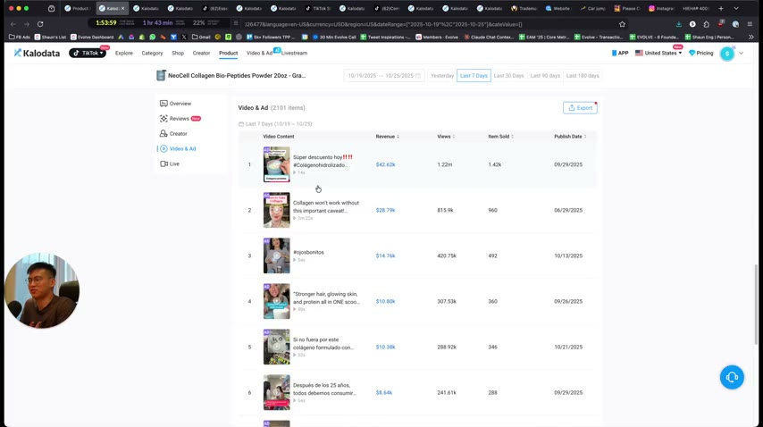
*Kalodata's Video & Ad tab for the collagen product (2,101 items, last 7 days): revenue, views, items sold and publish date per video; the top ad is Spanish, the second is a 2-min "Collagen won't work without this important caveat" unaware-style video. [51:10]*

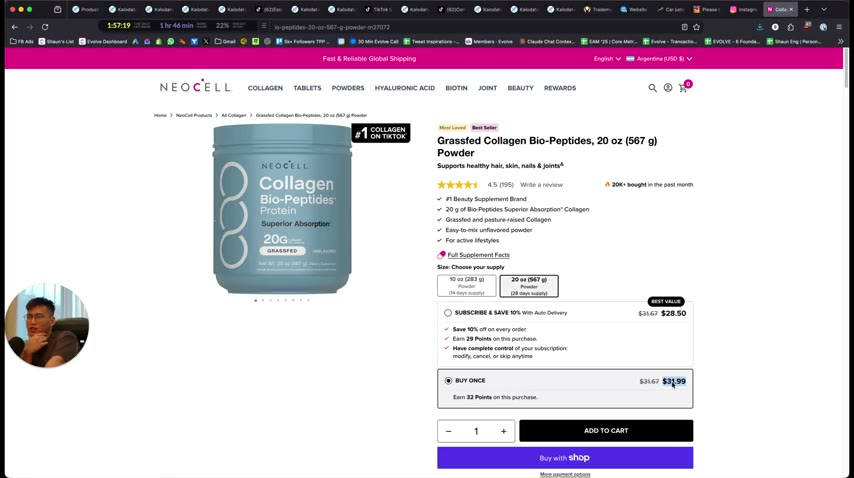
*The brand's own product page: 28-day vs 14-day sizes, $31.99 buy once, subscribe-and-save price. Used to size the economics of a bundle. [54:30]*

### 12. How to "rip" videos and clear metadata (course method) [57:34–59:30]
- Product page in Kalodata, then **Video & Ad**; the videos can be downloaded. He picks the top 10-20 (by revenue; last 7 days while it is trending). Choose ones that do not mention the brand name. [57:34–58:33]
- Quantity depends on budget: "If you're spending like $200 a day, usually $100 a day, usually it's up to 20." [57:34]
- Clear metadata before upload: search "clear metadata" for a tool, or re-export in Premiere Pro, CapCut or Canva, then clean the metadata again. Reason given: "Facebook obviously can see that you're copying someone else… it won't reach the right option." [58:33–59:30]
- Put your own creatives, built from the research, in the same campaign beside the ripped ones. [59:30]
- Page text note: "you can't rely on the ripped creatives to scale long term. Treat it as borrowed time… treat it with urgency."
- (Derived) For this repo: do not reproduce the ripping or metadata-clearing steps; keep only "test your own research-backed creative from day one".

## Steps / framework
Checklist from the lesson page, with where it is demonstrated:

| # | Step | Where shown |
|---|---|---|
| 1 | Paid tool: Kalodata (code evolve10 for 10% off); pulls best-performing TikTok Shop products | [00:00] |
| 2 | Filter product level: last 7 days, avg unit price over $15, sales growing rapidly | [00:58] |
| 3 | Any product not attached to a big brand (page lists Goli, Shark, Comfrt as big brands) has potential to be sold | [02:53–07:03] |
| 4 | Verify brand size: Google search and social following; a big brand can afford litigation; bootleg versions are not worth it | [04:41; 07:03] |
| 5 | Trademark check on each country's registry (US: USPTO) or GPT/Claude. If every TikTok video says the product name (page example "Blood Elixir"), reusing those clips with the name mentioned raises takedown risk; use a different brand and product name. Trademarked does not mean you cannot sell it | [32:55] |
| 6 | SimilarWeb (free): visitors x CVR (assume about 1%) x AOV (from selling price) = estimated revenue; be conservative; less important for this method | [10:16; 48:53] |
| 7 | Basic product research: top Kalodata TikTok Shop videos and comments: current angle, target audience, comments | [51:04; 35:23] |
| 8 | Facebook Ad Library, and optionally Atria (paid), for what competitors run | [11:21] |
| 9 | Avatar research later: Google, YouTube, Instagram reels, TikTok. "Only 2 ways to win if you're not first to market: a new mechanism or an underserved avatar." Know competitor angles and the current market sophistication level | [26:18] |
| 10 | Supplier price sanity check: use Claude/GPT/Amazon for the expected price; 3x COGS + shipping must still fall in the expected range | [42:00; 45:54] |
| 11 | After finding a product, take the top 10-20 videos by revenue and run them alongside your own research-based creatives | [57:34] |

## Examples
- **Self-cleaning litter box (PetPivot), $170-175:** passes the brand and trademark screen (name trademarked, brand thin), niche flat or rising, big TikTok Shop revenue, small own-site traffic. Gaps: review-style ads, price against the $650 leader, ease of cleaning, product-aware comparison without naming brands. Verdict: runnable for an experienced seller; too high ticket for a beginner. [07:50–28:22]
- **Tarte under-eye corrector, $32:** brand name and product names trademarked; the product type is not; viable under a new brand if a supplier can match effectiveness; possible older avatar from comments. [28:22–36:39]
- **Fleece leggings, compression wear:** seasonal Q4; mechanism idea: stay warm but let tattoos show through. [37:49–39:53]
- **Car jump starter with compressor:** fear-based ads; AliExpress source about $28 vs Amazon $40-47; peaks in December; women-focused ease-of-use angle. [41:06–49:53]
- **NeoCell collagen powder:** new-mechanism product (hydrolyzed peptides), 28-day pack at $31.99, BOGO about $50, source about $10 shipped (guess). [51:04–56:38]

## Structured units

### Ad teardowns
| Brand / product (niche) | Format | Hook / opening | What works | What fails | Fix suggested | Principle | Source |
|---|---|---|---|---|---|---|---|
| Portable car jump starter with air compressor (auto accessories) | TikTok Shop creator video | "This is one of the most dangerous things that you can keep in your car" (creator, spoken) | Fear-based claim, then demo of the safe unit, USB charging, flashlight, free-shipping offer (as heard) | Ad content is a TikTok Shop clip; product claims about damage are unverified; battery safety risk | Verify the product, test a women-focused ease-of-use angle | Fear / loss framing (derived) | [41:06–42:00; 46:52–47:39] |
| NeoCell collagen bio-peptides (supplement) | About 2-minute TikTok Shop video | A cancer-researcher-style explainer on why collagen matters ("glue that holds everything together") (as heard) | Unaware-style VSL format in short-form; a mechanism (hydrolyzed peptides absorb better) | Health claims unverified; instructor unsure if true | Do direct product-comparison ads if rivals do not | Unaware ad, new mechanism (see [lesson 66](066-how-to-find-apply-new-mechanisms-part-2.md)) | [51:04–52:16; 55:33] |
| Tarte under-eye corrector (skincare/makeup) | Creator video | "I have this breakout that hurts so bad, I honestly didn't even want to leave the house, but then… I remembered I had this" (as heard) | Problem to product to visible result; creator demo | Brand trademarked; supplier may not match effect | Same product, different brand name and avatar | Before-after problem-solution (derived) | [28:22–30:06] |
| Self-cleaning litter box ads (various competitors) | Facebook Ad Library ads | Not captured in transcript; one on-screen ad starts with a "WARNING" about citrus sprays and water bottles increasing cat anxiety (screen) | Fear/warning angle on common cat deterrents (screen) | Same product everywhere; small site traffic | Review-style and product-aware comparison ads | Crowded category, differentiate by angle | [11:21–15:59] (screen at [13:45]) |

### Angles
| Angle | Core desire / pain | Heuristic(s) | Best format | Example line | Source |
|---|---|---|---|---|---|
| Price/maintenance comparison vs category leader (litter box) | Own the automatic box without the $650 price; easy cleanup | — | Product-aware comparison, no brand names | "Yours is cheaper. Yours is equally as safe." (paraphrase) | [24:04–26:18] |
| Review-style ads (litter box) | Trust: "can't find any reviews that aren't ads" | — | Review / testimonial video | — | [16:59] |
| Easy to clean | Reddit says cleaning is simple | — | Demo | — | [18:12] |
| Ease of use for women (jump starter) | Women who don't know how to jump a car | — | Demo | — | [46:52–47:39] |
| Older avatar (Tarte corrector) | Over-40 buyers with fine lines | — | Creator video | — | [35:23] |
| Tattoos show through (fleece leggings) | Show tattoos while staying warm | — | Product demo | — | [37:49–39:53] |
| Direct product comparison (collagen) | Absorption: ineffective collagen wastes money | — | Product-aware comparison ad | — | [55:33] |

### Rules of thumb
- **DO** decide on multiple data points (trend, trademark, traffic, price, competition, angle gap), not one. [14:47]
- **DON'T** pick a product after its viral peak (kojic acid). [33:07]
- **IF** buyers already know the product **THEN** run product-aware ads. [15:59]
- **IF** source cost is close to the marketplace price **THEN** there is no markup room; pass. [44:38]

## Prompts / templates (verbatim)
Lesson page text, steps 5, 7, 9 and 10 verbatim excerpts, labelled as the instructor's text:

```
Check the trademark websites on wherever you plan to sell to verify if the brand/product name has a trademark. For example in the US you may use https://tmsearch.uspto.gov/search/search-information (Free) or GPT/Claude to find out. If the product is called "Blood Elixir" and all the TT videos mention it, if you reuse those clips with product name mention there's a higher risk of getting taken down. In that case obviously use a different brand name and also different product name. Trademarked doesn't mean you can't sell the product, just means you can't use certain phrases on the site and ads.
```

```
Use https://pro.similarweb.com/ (Free) to estimate how much the store is doing. Always be more conservative. Let's say the average is 1% conversion rate (CVR). Estimate the AOV based on product selling price. Website visitors x CVR x AOV = Estimated Revenue.
```

```
Check with supplier if the pricing they can get makes sense. You want to use tools like Claude, GPT or Amazon to check what is the average price for the product you're going to sell so it's reasonable and within expectation. If you're selling super premium prices but only sell cheap low quality products it won't go well. After getting a quote or checking on AliExpress, see if you 3x'd the COGS (cost of goods) + Shipping, if the product still falls under the expected price range. E.g. $20 COGs total, $60 selling price, $40-60 is expected price based on Claude/Amazon.
```

Claude trademark prompt as shown on screen at [33:10] (typed): "Does [brand site URL] have any trademarks active". (derived template: "Does [brand website] have any active trademarks? List the registered names and product names.")

## How to apply
- [ ] Open Kalodata, Product tab: last 7 days, average unit price above $15; sort by revenue and note the growth rate.
- [ ] For each of the top 20 listings, mark: big brand / patented / trademarked name / heavy / battery / seasonal / above $100.
- [ ] For survivors, run the brand Google + social check and a trademark search; write down which names and phrases you must avoid.
- [ ] Estimate store revenue (visitors x 1% x price) and write down that it is an assumption.
- [ ] Read the top Kalodata videos' comments, Reddit and Amazon reviews; list pros, cons, objections and avatars in customer language.
- [ ] Search the Ad Library for the category keyword; list the angles competitors run and the sophistication stage.
- [ ] Check Google Trends (5 years, target country): reject spike-then-fall, accept flat or rising; note seasonality.
- [ ] Get a supplier quote; check 3x COGS + shipping vs expected price range (Amazon, Claude).
- [ ] Write the gap: new mechanism or underserved avatar. If neither is found, no-go.
- [ ] Plan own creatives from the research and test them from day one; (course method, optional: borrowed clips only as proof of traction, per the repo rule 3 caution above).

## Related
- Previous: [171. How To Make Any Product Work (Brand Building) Pt 1](171-how-to-make-any-product-work-brand-building-pt-1.md) · Next: [173. How Brands Actually Scale to 8 Figures](173-how-brands-actually-scale-to-8-figures.md)
- Concepts used: [Market sophistication](012-market-sophistication.md) · [Market awareness](010-market-awareness.md) · [Understanding your product](022-understanding-your-product-part-1.md) · [Competitor research](035-competitor-research-part-1.md) · [Facebook research](038-facebook-research-part-1.md) · [TikTok research](044-tiktok-research.md) · [Reddit research](031-reddit-research.md) · [Unique mechanism (Copywriting)](../../copywriting/concepts/unique-mechanism.md) · [Unaware ads (Copywriting)](../../copywriting/concepts/unaware-ads.md)
- Scale and revenue-stage context: [175. What To Focus On To Scale To 10M/mth](175-what-to-focus-on-to-scale-to-10m-mth-by-rev.md)

## Sources and limitations
- Transcript: [172 transcript](<../../../../../raw/evolve/start-here/_transcripts/👣 Evolve (Start Here)/172. Live Product Research w Kalodata - Pt 2 👣 Evolve (Start Here) Evolve.txt>) · Page text: [172 checklist](<../../../../../raw/evolve/start-here/_extracted/👣 Evolve (Start Here)/172. Live Product Research w_ Kalodata - Pt 2_👣 Evolve (Start Here)_Evolve.html.md>)
- Machine transcription (Whisper large-v3-turbo); complete (last segment 59:44 of 59:45). Whisper heard "Kilo data", "Kato Data", "Atra", "Pad Pivot", "Hee-ha", "Udi"; read as Kalodata, Atria, PetPivot, a brand the screen shows as "Heeha/HEEHA"-like (unverified), and probably "The Oodie". Kalodata starter price is garbled. Several timestamps were cross-checked against on-screen frames.
- Numbers to treat as the instructor's estimates, not data: PetPivot "3 mil" over 30 days, 30,000 visits, 1% conversion, Tarte "18,000" and about $600k a month, collagen source cost "$10". The Tarte "18,000" is ambiguous (visits or orders) and has no conversion rate applied.
- Product, brand and claim names shown are research examples, not recommendations. Ad claims (collagen absorption, jump starter damage) are not verified; do not reuse them.
- Frames were grabbed from MEGA at 854x478; text on screen is small. Screenshots omit the browser bookmarks bar and personal details.
- The instructor's name is taken from on-screen text (Claude sidebar) and the slide credit in lesson 175; he never introduces himself in this video.
