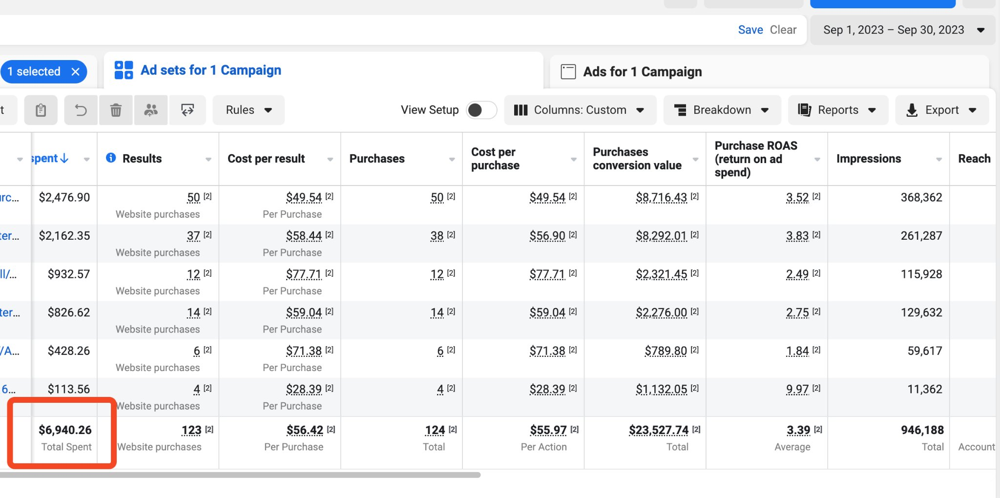
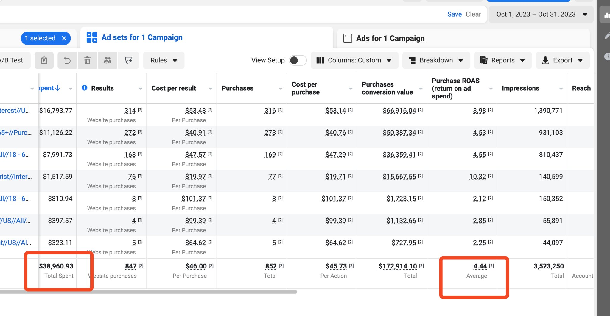

# 173. How Brands Actually Scale to 8 Figures
> Success at scale is market understanding times product understanding times execution skill, but the product is what creates most of the result: a superior product lets weak ads work, and a mediocre product caps strong ads.

## 🤖 Agent use
- **Use when:** a brand has solid research and creative execution but results are stuck; diagnosing whether the ceiling is the product; briefing a founder on what to improve before scaling spend.
- **Inputs → outputs:** research on the market (desires, awareness, sophistication) and the product (physical and functional) → a written product-vs-market audit with strengths, weaknesses, uniqueness and a verdict on whether the product is superior in a way the market cares about.
- **Rules:**
  - **DO** break a stuck result into three suspects: you do not understand the market, you are not executing properly, or you do not understand the product. [00:58]
  - **DO** run the four-question product audit, based on research, not opinion (see Prompts / templates). [05:29; slide 8]
  - **DO** judge the product by the market's view: "Your opinion DOES NOT MATTER. The Markets Opinion is what matters." [06:26; slide 8]
  - **DO** state strengths the market actually cares about. "Don't just say, oh, the strength of my product is that I make it myself. People don't care." [08:14–09:04]
  - **DON'T** treat creative and strategy fixes as the only lever. Case: same agency strategy, 5x spend with a better ROAS after a new product. [01:55–02:48]
  - **IF** the product is not superior **THEN** either build a better one using what customers complain about, or brand so strongly that the identity does the work (the Liquid Death example), which the instructor says is "a whole other discussion" and not his specialty. [05:29–08:14]
  - **IF** you have no competition **THEN** that may signal a blue ocean market (instructor's reading). [08:14]
- **See also:** [22. Understanding your product part 1](022-understanding-your-product-part-1.md) · [57. Understanding your product part 1 (organizing insights)](057-understanding-your-product-part-1.md) · [12. Market sophistication](012-market-sophistication.md) · [171. How To Make Any Product Work (Brand Building) Pt 1](171-how-to-make-any-product-work-brand-building-pt-1.md) · [172. Live Product Research w/ Kalodata Pt 2](172-live-product-research-w-kalodata-pt-2.md)

Lesson page text: only a link to the slide deck (Google Slides); the same 8 slides were exported from a PPTX attachment (credit "Easy A Media", "8 Figure Blueprint").

## Key ideas

### 1. What creates success (slide 2) [00:00–01:55]
- Success relies on executing your combined knowledge of: **your market** (desires, awareness, sophistication) and **your product** (physical and functional). [00:00; slide 2]
- Then, "the depth at which your skills allow you to take that understanding to": generate content, craft winning ad creatives, optimize your messaging. That lets you channel desire, build believability, and identify with potential customers. [00:00; slide 2]
- "If you need to boil it down to one sheet, what creates success, this is it." Failing means you do not understand the market, you do not execute properly, or you do not understand the product. [00:58]
- "Most importantly, your product is what will create the majority of your success." [00:58] (slide 3: "But Most Importantly", slide 4: "Your Product…")

### 2. The client case: Product A vs Product B [01:55–03:46]
- Client "advertised through September" with Product A, "basically version one of this product". Results at the time: above 3x, but spend only about $7,000 a month. [01:55]
- The agency kept executing and researching; so did the client. The client developed a new product (Product B). "Within the next 30 days we were literally able to go from spending $7,000 a month to $40,000 a month. We were able to 5x our spend, even a little bit more than that, while actually increasing our returns." [01:55–02:48] (instructor claim, supported by two Ads Manager screenshots below)
- "We did not change our strategy. We continue to test creatives… the one thing that really exploded sales was the development of a new superior product." [02:48]


*Slide 5: Ads Manager for Sep 1-30, 2023 (Product A). Total spend $6,940.26, 123 website purchases, cost per purchase $56.42, purchase conversion value $23,527.74, average purchase ROAS 3.39. Spend is the highlighted number. [01:55–02:48]*


*Slide 5: Ads Manager for Oct 1-31, 2023 (Product B). Total spend $38,960.93, 847 website purchases, cost per purchase $46.00, purchase conversion value $172,914.10, average purchase ROAS 4.44. Spend and ROAS are highlighted. [02:48]*

| | Period | Spend | Purchases | Cost per purchase | Conversion value | ROAS |
|---|---|---|---|---|---|---|
| Product A | Sep 1-30, 2023 | $6,940.26 | 123 | $56.42 | $23,527.74 | 3.39 |
| Product B | Oct 1-31, 2023 | $38,960.93 | 847 | $46.00 | $172,914.10 | 4.44 |

Source: slide 5 screenshots (sums as shown in each totals row). The spoken "$7,000 to $40,000 a month" and "above 3x" match the figures. The instructor's "within the next 30 days" matches the Oct window. Ad-account identifiers are not in the frames.

### 3. The iPhone vs BlackBerry argument [02:48–04:36]
- Compare the iPhone to the BlackBerry. "What is the superior product… based on what customers actually want and the functionalities and what's capable? It was obviously the iPhone." [02:48]
- "The iPhone didn't even need to out-market BlackBerry. All they needed to do was just show their product and say, this is our product and it's better." [02:48–03:46] (slide 7: "Apple did not even have to 'out market' the blackberry. They just made a better product.")
- "If you want to succeed on easy mode, just make the best product that you can." He admits it is not easy; but if research tells you what customers want and what they complain about, you can stand out by building a superior one. [03:46–04:36]

### 4. "Your product can be better" [04:36–05:29]
- "If you have ever been burned by an agency… or you feel like you've gone through this entire program and you got burned… it just means that your product can be better." [04:36] (slide 7: "If you have ever been burned by an agency or a marketer… It means your product can be better.")
- Observation: "We have seen ads, websites, and strategies that are TERRIBLE… but they STILL work. Why? Product." Even a link-click-optimised campaign with a white-background photo and "buy this" works if the product is good enough. [04:36–05:29] (instructor claim)

### 5. The product audit [05:29–09:04]
- Ask, based on research: weaknesses of my product; strengths of my product; is there anything that really makes it unique; after looking at other options, what is the superior product? [05:29] (slide 8)
- Competing with huge product-development budgets (example: AG1) is tough; find a way to position yourself so you can build something superior or different. [05:29–06:26]
- His call experiences: "really, what makes your product unique? Well, nothing really." He says that is common. [06:26–07:20]
- "It doesn't need to be superior in all ways, but it needs to be superior in some kind of way, or it needs to be branded extremely well." [07:20]
- **Branding as the alternative:** Liquid Death, "a brand that sells water in a can", a commodity product made distinct by identity ("What are you drinking?" "Liquid Death." "It's just water."). Building an incredible brand is "a very, very hard thing to do", and he says he is not a brand specialist; more brand content follows in the course. [07:20–08:14]
- If you cannot brand it, find a way to make the product superior. Study the brands crushing it in your market; if you have no competition it may be a blue ocean market. Strengths must be things the market cares about, and big enough for the market to believe the product is superior. [08:14–09:04]
- Closing: "The eight-figure brand blueprint really is about having a superior product." [09:04]

## Steps / framework

| Step | Action | Evidence |
|---|---|---|
| 1 | Diagnose: market understanding, execution, or product | [00:58] |
| 2 | Write the product strengths, weaknesses, unique points, and the superior alternative in the market | [05:29]; slide 8 |
| 3 | Source each answer from research (reviews, complaints, wants), not opinion | [06:26]; slide 8 |
| 4 | If not superior, choose: build a better product (fix what customers complain about) or build an identity brand | [05:29–08:14] |
| 5 | Keep executing research, creative and messaging while the product improves; expect step-change gains when the product improves | [02:48] |

## Examples
- **Product A to Product B (client):** same strategy and creative testing; spend moved from $6,940 to $38,961 monthly and ROAS from 3.39 to 4.44 after the client launched a new product. See table above. [01:55–03:46]
- **iPhone vs BlackBerry:** a better product beat the incumbent without out-marketing it. [02:48–04:36]
- **Liquid Death:** a commodity (water) made distinctive through identity and branding. [07:20–08:14]
- **AG1:** an example of a competitor with large product-development spend; hard to out-product. [05:29–06:26]

## Structured units

### Rules of thumb
- **DO** write the product audit from research. [05:29]
- **DON'T** trust your own opinion on product quality; the market's opinion decides. [06:26]
- **DON'T** list "I make it myself" as a strength; the market cares about outcomes. [08:14]
- **IF** results stall after good research and execution **THEN** treat the product as the likely constraint. [04:36]

## Prompts / templates (verbatim)
Slide 8 ("Success will rely on your Product", 8 Figure Brand Blueprint, Easy A Media):

```
Ask Yourself BASED ON my research…
What are the weaknesses of my product?
What are the strengths of my product?
Is there anything that really makes my product unique?
After looking at other options on the market, what is the superior product?
Your Opinion DOES NOT MATTER.
The Markets Opinion is what matters.
```

Slide 2 ("What Creates Success"):

```
Success will rely on your ability to execute your combined knowledge of:
Your Market (desires, awareness, sophistication)
Your Product (physical & functional)
The depth at which your skills allow you to take that understanding to:
Generate content
Craft winning ad creatives
Optimize your messaging
That as a result: channel desire, build believability, & identify with potential customers … Will determine your success.
```

Slide 7 ("Success will rely on your Product"):

```
Apple did not even have to "out market" the blackberry.
They just made a better product.
If you want to succeed on "Easy Mode" … Make the best product you can
If you have ever been burned by an agency or a marketer… It means your product can be better.
We have seen ads, websites, and strategies that are TERRIBLE… But they STILL work. Why?
Product
```

## Screenshots
The two Ads Manager frames above are the key evidence. The iPhone image on slide 6 and the "Winner" badge show only a first-generation iPhone (front, side, back) and a WINNER banner; no text content. Slides 1, 3, 4 are title slides.

## How to apply
- [ ] Before asking for more creative volume, write the four-question product audit from research.
- [ ] For each strength, add the evidence (review, complaint, comparison) that shows the market values it.
- [ ] List what customers complain about in competitor products; check whether your product fixes any.
- [ ] If nothing differentiates, escalate to the founder as a product or positioning problem, not an ad problem.
- [ ] After a product change, keep creative strategy constant for a controlled comparison (as in the Sep vs Oct client case) and log spend, ROAS and cost per purchase.

## Related
- Previous: [172. Live Product Research w/ Kalodata - Pt 2](172-live-product-research-w-kalodata-pt-2.md) · Next: [174. I'm Overwhelmed /Stuck - Wat Do/](174-im-overwhelmed-stuck-wat-do.md)
- [9. Market desires](009-market-desires.md) · [10. Market awareness](010-market-awareness.md) · [175. What To Focus On To Scale To 10M/mth](175-what-to-focus-on-to-scale-to-10m-mth-by-rev.md) · [Positioning (Copywriting)](../../copywriting/concepts/positioning.md)

## Sources and limitations
- Transcript: [173 transcript](<../../../../../raw/evolve/start-here/_transcripts/👣 Evolve (Start Here)/173. How Brands Actually Scale to 8 Figures 👣 Evolve (Start Here) Evolve.txt>) · Page text: [173 page](<../../../../../raw/evolve/start-here/_extracted/👣 Evolve (Start Here)/173. How Brands Actually Scale to 8 Figures_👣 Evolve (Start Here)_Evolve.html.md>) · Slides: [173 pptx text](<../../../../../raw/evolve/start-here/_extracted/👣 Evolve (Start Here)/173. How Brands Actually Scale to 8 Figures.pptx.md>) (also exported from the linked Google Slides as `173-presentation-1B8BaoZSMY.pptx.md`, identical text).
- Machine transcription (Whisper large-v3-turbo); full recording covered (last segment 9:19 of 9:20).
- The client is not named. The ROAS and spend figures come from the two slide screenshots; the instructor's wording "Product A through September" and "within 30 days" is consistent with them.
- Video frames were not grabbed; the slides were taken from the PPTX instead. The video's speaker is not named on screen; "Spencer" comes from the instructor's own rhetorical quote at 03:46 and is likely Spencer Pawliw (not stated).
- The lesson promises "more information that we cover talking about brand" later; lesson 171 ("Brand Building Pt 1") is the nearest brand-building lesson, but whether it is the follow-up was not checked here.
