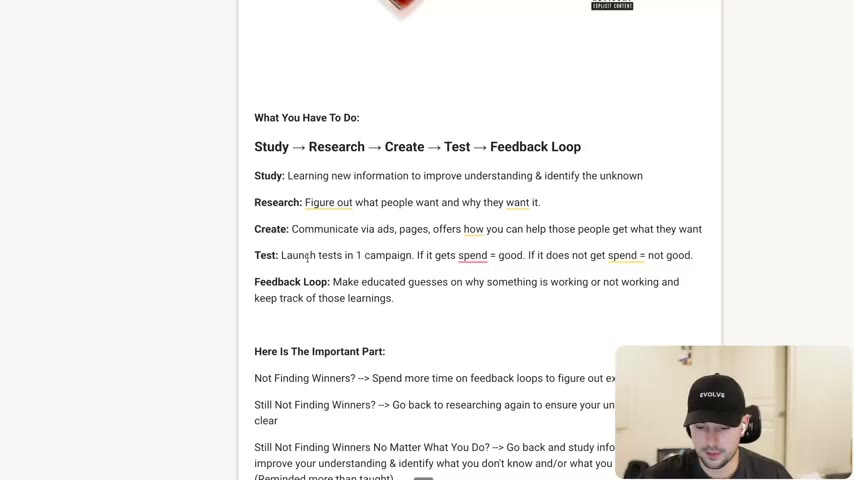

# 174. I'm Overwhelmed /Stuck - Wat Do/
> The whole Evolve system compresses to five steps (Study, Research, Create, Test, Feedback Loop) plus a three-level escalation for when winners do not appear: more feedback loops, then more research, then go back and study.

## 🤖 Agent use
- **Use when:** a brand or account has no winning ads, pages, offers or products and the agent must decide where the problem sits; also when a human asks what to do next while overwhelmed by the program.
- **Inputs → outputs:** recent test history (what was created, what got spend, what learnings were logged) → a diagnosis of which loop step is failing and the next action (feedback loop, re-research or re-study).
- **Rules:**
  - **DO** describe the system as Study → Research → Create → Test → Feedback Loop and place the current problem on it. [01:46]
  - **DO** define a test result by spend: "Launch tests in 1 campaign. If it gets spend = good. If it does not get spend = not good." [02:42; page text]
  - **IF** no winners (ads, pages, offers, products) **THEN** first spend more time on feedback loops to find the execution flaws. [02:42–03:30]
  - **IF** still no winners **THEN** go back to research: check you understand what people actually want, who the buyer is, and whether other products or channels beat yours. [03:30–05:07]
  - **IF** still no winners "no matter what you do" **THEN** go back and study again to identify what you do not know ("the unknown"). [05:07–06:51]
  - **DON'T** run create → test → create → test with no feedback loop; "A lot of you guys aren't doing feedback loops… That's your problem." [04:17]
  - **DON'T** assume the problem is media buying: "I can probably tell you for 99% of you guys, it's not media buying." [07:53] (instructor claim)
  - **DO** re-study material you think you know ("reminded more than taught") and add outside sources (Twitter threads, YouTube videos) for a different perspective. [07:53–08:49]
  - **DO** hunt the unknown: check the offer, copywriting and market awareness. Example: he could not get pages to convert until he tested the offer, which "was completely broken". [06:00–06:51]
- **See also:** [122. How to do learnings part 1 (losers)](122-how-to-do-learnings-part-1-losers.md) · [123. How to do learnings part 2 (winning ads)](123-how-to-do-learnings-part-2-winning-ads.md) · [128. How to do learnings: questions](128-how-to-do-learnings-questions.md) · [85. The 3.0 Evolve growth guide](085-the-3-0-evolve-growth-guide.md) · [Iteration playbook (Copywriting)](../../copywriting/frameworks/iteration-playbook.md)

## Key ideas

### 1. Overwhelm is normal and means change [00:00–01:46]
- Overwhelm happens "at every single stage" (new to e-com, a few hundred thousand a month to a million, five million to ten, ten to a hundred million). "What overwhelm means is essentially you're going through change." Bodies reject change because they feel safe in specific areas. [00:00]
- Definition on the page: "Bury or drown beneath a huge mass." The lesson's own definition: "Give too much of a thing to (someone)…", linked to a video; the page image is the cover of the song "Too Much Sauce". [00:50] (page text; image)
- You feel overwhelmed "because you currently aren't the person that can do a million dollars a month in profit… which is why you feel overwhelmed because you're going through change". [01:46]


*The lesson page text on screen: the five-step loop with each step's definition and the three escalation rules under "Here Is The Important Part". [03:05]*

### 2. The system in five steps [01:46–03:30]
- "I could honestly summarize the entire program with just these five steps." [01:46]
- Definitions (verbatim from the page text, spoken the same way):
  - **Study:** learning new information to improve understanding and identify the unknown.
  - **Research:** figure out what people want and why they want it.
  - **Create:** communicate via ads, pages, offers how you can help those people get what they want (he adds that products can fit here). [02:42]
  - **Test:** launch tests in one campaign; spend = good, no spend = not good.
  - **Feedback loop:** make educated guesses on why something is working or not working and keep track of those learnings.
- "Once you do research, you then go and create ads, offers, LPs… and once you test them, you do a feedback loop to figure out, did this give me the outcome that I want or not?" The loop's answer is usually "create more", but sometimes "do more research or… study". [01:46]

### 3. Escalation ladder when you are not finding winners [02:42–07:53]
1. **Not finding winners → spend more time on feedback loops to figure out execution flaws.** "The number one thing that I have seen consistently from people who scale very hard… it's just feedback loops." Cracking why something works "usually" gives massive growth because you exploit it. [02:42–03:30] (instructor claim)
2. **Still not → go back to researching** to ensure your understanding is clear. You might have perfect execution and "this ad is really good", but still be missing something. Questions he lists: are there other products that are way better than mine; who is the buyer and why do they not care; am I going after the right person; am I advertising in the wrong medium (his joke: running ads in newspapers and magazines when Facebook ads exist). [03:30–05:07]
3. **Still not, no matter what → go back and study** to identify what you do not know. "You don't know what you don't know." Example: copywriting; "you don't even know it because you don't know what good copywriting looks like". [05:07–06:00]
- Personal examples: when he learned about offers he realised the offer was horrendous, tested the offer, and "sure enough, I found success". Re-reading *Breakthrough Advertising* a year later "was a completely different book" because he now had experience (Whisper wrote "it's not behind me, it's over there"; the book is Eugene Schwartz's, which the speaker names by first name). [06:51–07:53]
- "Reminded more than taught" (he attributes it to "a Moseyism", Whisper; probably Hormozi, unverified): sometimes you need to be reminded, and rewatching Evolve may show you were using market awareness wrongly. [07:53]

### 4. Where most people sit [04:17–05:07]
- "Most of you… create, test, feedback loop, create, test, feedback loop. And a lot of you guys aren't doing feedback loops. A lot of you guys are just creating, testing, creating, testing." [04:17]
- If you are actually completing all three and still failing, step back and research (see ladder). [04:17–05:07]

### 5. Study beyond Evolve [07:53–09:34]
- Outside material is fine: Twitter threads, other YouTube videos, "a different perspective". But "this is not meant to send you down the cope path of 'it's got to be media buying'". [07:53]
- You usually do not need new strategies: "we know the strategy works. It's just new things within that strategy. New ways to do research, new ways to create, new ways to complete feedback loops." [09:34]

### 6. Reframe: overwhelm as development [10:21–11:30]
- Listing the content that causes overload: "marksman and desire calendars and angles and definitions and concepts and growth guides". His point: "overwhelm is good. Lean into it because… that probably means you're developing". [10:21]
- He admits the course has little mindset content, since members "just want tactical, you just want sauce", and plans a separate "watch this if you're overwhelmed" module (this video). [10:21–11:30]

## Steps / framework
| Symptom | Where the problem likely is | Action | Source |
|---|---|---|---|
| Creating and testing, no logged learnings | Feedback loop skipped | Write learnings for every test: why did it work or not; track them | [04:17] |
| Loops complete, still no winner | Research is wrong or incomplete | Re-research the buyer, desire, awareness, competing products, channel | [03:30–05:07] |
| Research and loops done, still stuck | Knowledge gap | Re-study the program; add outside sources; test unthought-of parts like the offer, copy, awareness | [05:07–08:49] |
| Feeling buried by the volume of material | Normal change response | Use the five-step loop to pick the next action | [01:46] |

## Examples
- **The offer was broken:** the instructor could not get pages to convert, assumed pages and ads were the issue, then tested the offer and found success. A problem he had not thought of because he did not know it was a problem. [06:00–06:51]
- **Wrong medium:** "Am I writing ads for newspapers… or am I running ads in newspapers and magazines when Facebook ads exist?" (illustrative joke for missing something fundamental). [04:17–05:07]
- **Breakthrough Advertising reread:** same book, "completely different" a year later; knowledge changes what you see. [06:51–07:53]

## Structured units
### Rules of thumb
- **IF** no winners **THEN** feedback loops, then research, then study (in that order). [02:42–05:07]
- **DO** treat spend as the test outcome for a launch. [02:42]
- **DON'T** blame media buying first. [07:53]
- **DO** use overwhelm as a signal of growth, not a stop sign. [10:21]

## Prompts / templates (verbatim)
Lesson page text:

```
Study → Research → Create → Test → Feedback Loop

Study: Learning new information to improve understanding & identify the unknown

Research: Figure out what people want and why they want it.

Create: Communicate via ads, pages, offers how you can help those people get what they want

Test: Launch tests in 1 campaign. If it gets spend = good. If it does not get spend = not good.

Feedback Loop: Make educated guesses on why something is working or not working and keep track of those learnings.

Here Is The Important Part:

Not Finding Winners? --> Spend more time on feedback loops to figure out execution flaws

Still Not Finding Winners? --> Go back to researching again to ensure your understanding is clear

Still Not Finding Winners No Matter What You Do? --> Go back and study information again to improve your understanding & identify what you don't know and/or what you are missing (Reminded more than taught)

That's It.
```

## How to apply
- [ ] Place the current problem on the five-step loop before suggesting any change.
- [ ] Check that every test in the last cycle has a written learning (why it worked or not).
- [ ] If learnings exist and nothing wins, list research gaps: buyer, desire, awareness, competing products, channel, offer.
- [ ] If research is complete, list knowledge gaps and the lessons to re-study (offer, copywriting, awareness, sophistication).
- [ ] Do not change media buying settings as the first response.

## Related
- Previous: [173. How Brands Actually Scale to 8 Figures](173-how-brands-actually-scale-to-8-figures.md) · Next: [175. What To Focus On To Scale To 10M/mth](175-what-to-focus-on-to-scale-to-10m-mth-by-rev.md)
- [10. Market awareness](010-market-awareness.md) · [123. Learnings part 2](123-how-to-do-learnings-part-2-winning-ads.md) · [Iteration vs variation](../../../../concepts/iteration-vs-variation.md) · [Creative testing system](../../../../frameworks/creative-testing-system.md)

## Sources and limitations
- Transcript: [174 transcript](<../../../../../raw/evolve/start-here/_transcripts/👣 Evolve (Start Here)/174. 🆕 I'm Overwhelmed Stuck - Wat Do 👣 Evolve (Start Here) Evolve.txt>) · Page text: [174 page](<../../../../../raw/evolve/start-here/_extracted/👣 Evolve (Start Here)/174. 🆕 I'm Overwhelmed _Stuck - Wat Do__👣 Evolve (Start Here)_Evolve.html.md>) · Image: [174-img01.png](../../../../../raw/evolve/start-here/linked/skool-images/174/174-img01.png) (the "Too Much Sauce" single cover, decorative).
- Machine transcription (Whisper large-v3-turbo); full recording covered. Whisper garbles: "Moseyism/Hermosey" (probably Hormozi), "it's not behind me, it's over there" (Breakthrough Advertising), "marksman" (probably "market sophistication" or a course item; unverified), "sign information" (study information).
- The "winners" claims (feedback loops as the top scaling factor, "99% not media buying") are instructor assertions without data.
- The embedded YouTube link ("In other words…") was not fetched.
