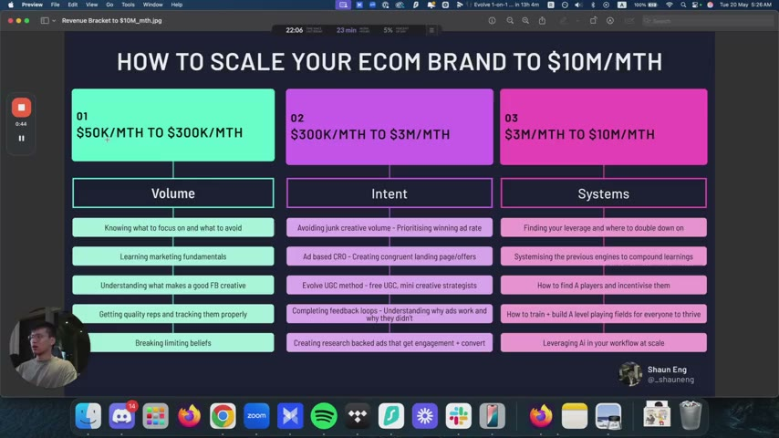

# 175. What To Focus On To Scale To 10M/mth (By Rev)
> Three revenue buckets, three different bottlenecks: volume up to about $300k a month, intent (winning ad rate, congruent landing pages, free UGC, feedback loops) up to about $3M, and systems (leverage, compounding learnings, A players, AI) up to about $10M; revisit this video each time you enter a new bucket.

## 🤖 Agent use
- **Use when:** deciding what an ad account or brand should prioritise given its monthly revenue; planning the next scaling lever; deciding whether to push creative volume or quality; building a hiring or team plan.
- **Inputs → outputs:** current monthly revenue, creative hit rate, creative tracking sheet status, team set-up → the revenue bucket, the 5 focus items for it, and a list of what to stop doing.
- **Rules:**
  - **DO** match work to the revenue bucket: $50k-$300k/mth = volume, $300k-$3M/mth = intent, $3M-$10M/mth = systems. [00:00]
  - **DO** go through the whole program top to bottom regardless of bucket; return to this video every time you enter a new bucket. [00:00; 21:12] (page text)
  - **DO** track every creative (why you made it, who it targets, name) in the growth guide from product test to creative test. [03:48–04:49]
  - **DO** prioritise **winning ad rate** over raw volume in the second bucket. "If you had a 20% hit rate on 30 creatives a month, that's 6 winning ads a month. Or if you had 100 creatives per month, 1% hit rate. That's only 1 winning ad per month." [06:47] (instructor's example)
  - **DO** reduce creative volume if your hit rate drops. "Winning ads per month is all we care about." [07:46]
  - **DO** pair every winning ad with a congruent landing page (same angle, same stage of awareness, same customer journey). [08:46–09:44]
  - **DO** complete feedback loops: record why previous winners worked and losers did not. [11:39–12:37]
  - **DO** build creatives from research with intent: engagement format taken from organic content in the niche plus your own messaging that targets the right desire and persona. [12:37–13:36]
  - **DO** (third bucket) identify your unique leverage and double down; systemise so learnings flow between media buying, CRO and UGC teams. [14:33–16:28]
  - **DON'T** equate ripping creatives or AI copy-paste scripts with marketing: "That's not how business works." [01:50]
  - **DON'T** run split tests that raise on-site revenue but do not raise ad-account ROAS; they do not help you scale. [08:46]
  - **DON'T** pay creators about $100 a video as the main UGC model; get product-seeded UGC and turn good seeders into mini creative strategists. [10:41]
  - **DON'T** assume you need a big hire list to reach the next stage ("Not true"). [05:49]
  - **IF** you cannot hire good people **THEN** work on how you position and sell yourself and what you offer beyond money. [16:28–18:27]
- **See also:** [85. The 3.0 Evolve growth guide](085-the-3-0-evolve-growth-guide.md) · [112. Winning ad definitions $0/mo to $1M/mo](112-winning-ad-definitions-0-mo-1m-mo.md) · [95. How to test landing pages (3-2-2-2)](095-how-to-test-landing-pages-3-2-2-2.md) · [90. How to get A players, editors, content](090-how-to-get-a-players-editors-content.md) · [156. How to onboard brand ambassadors](156-how-to-onboard-brand-ambassadors.md)

Lesson page text: "Regardless of which revenue bucket you're in, you should still go through the program top to bottom. You will come back to this video every time you've entered a new revenue bucket to realign your focus." Timestamps given on the page: 0:42 $0 to $300k/mth, 6:28 $300k/mth to $3M/mth, 14:12 $3M to $10M/mth.

## The slide: three buckets

*The instructor's "Revenue Bracket" slide: three columns (Volume, Intent, Systems), each with five focus items. Verbatim text in the table below. [00:45]*

| Bucket | Theme | Five focus items on the slide (verbatim) |
|---|---|---|
| 01 $50K/MTH TO $300K/MTH | **Volume** | Knowing what to focus on and what to avoid · Learning marketing fundamentals · Understanding what makes a good FB creative · Getting quality reps and tracking them properly · Breaking limiting beliefs |
| 02 $300K/MTH TO $3M/MTH | **Intent** | Avoiding junk creative volume - Prioritising winning ad rate · Ad based CRO - Creating congruent landing page/offers · Evolve UGC method - free UGC, mini creative strategists · Completing feedback loops - Understanding why ads work and why they didn't · Creating research backed ads that get engagement + convert |
| 03 $3M/MTH TO $10M/MTH | **Systems** | Finding your leverage and where to double down on · Systemising the previous engines to compound learnings · How to find A players and incentivise them · How to train + build A level playing fields for everyone to thrive · Leveraging AI in your workflow at scale |

## Key ideas

### Bucket 1: $50k to $300k a month, keyword "volume" [00:00–06:28]
(The speaker and the slide say $50k to $300k; the lesson page lists this bucket as "$0 to $300k/mth". See limitations.)
- If you earn less, there is a separate Evolve training on going from 0 to 100k a month (what matters, what does not); "highly recommended to go through this training first". [00:00] (that training is not part of the lessons covered here)
- "If you do enough work, if you test enough products, test enough creatives, something is going to stick." Finite time: decide what to spend more volume on and what to avoid. [00:51]
- **1. Knowing what to focus on and what to avoid.** The masterclass covers it; Evolve is the team's internal training, "always updated", "what our team does every single day… everything outside of this is not really things that we spend too much time on". Search the Discord first for questions such as bid caps or cost caps, then ask. "Success comes down to doubling down on what matters and not doing the things [that don't]." [00:51–01:50]
- **2. Marketing fundamentals.** You can rip enough creatives to reach this stage, but "if I ask you how do you actually market, you can just tell me, oh, rip creatives, use AI to copy-paste scripts. That's not how it works." The first section ("why do ads work") covers fundamentals that apply to creatives, landing pages, emails and CRO: market awareness, market desires, plus the psychology section. [01:50–03:00] See [10. Market awareness](010-market-awareness.md), [9. Market desires](009-market-desires.md).
- **3. What makes a good creative.** Creative strategy "is not ripping stuff… It's all about understanding your customer… just research. What do my customers actually like? I'll do more of that." Focus on fresh ideas, not copying what competitors do, "because why will then people buy from you?" [03:00–03:48]
- **4. Quality reps and tracking.** "Practice doesn't make perfect. Perfect practice makes perfect." Volume of ripped creatives is not a good rep. Use the growth guide (how-to-make-ads section) to track "all the creatives you're doing, why you want to create them, who you want to target, and then doing their names on them". Analogy: weigh your food to lose weight. Track from product test to creative test. [03:48–04:49] (instructor's advice) See [85. The 3.0 Evolve growth guide](085-the-3-0-evolve-growth-guide.md).
- **5. Break limiting beliefs.** "I didn't know it was possible to hit 100k per day until I saw someone else do it." The member base spans $50k a month to eight figures a month; you can see what big brands do and how simple the strategies are. Evolve's Wins chat: "200k per day. So just hit 100k per day today. And it took like three months to hit it" (claim, "very, very rare"). You do not need to hire a team to reach the next stage. [04:49–06:28]

### Bucket 2: $300k to $3M a month, keyword "intent" [06:28–14:12]
- "After you're putting enough volume, you need more intent… It's avoiding junk creative volume." [06:28]
- **1. Winning ad rate over volume.** Example numbers: 30 creatives at 20% = 6 winners; 100 creatives at 1% = 1 winner. Gym analogy: junk sets add no growth. "If you are pushing so much volume that your hit rate drops, probably a good idea to just tone down the creative volume to prioritize the hit rate." Know when to push volume and when to push intent, which requires tracking. [06:47–07:46]
- **2. Ad-based CRO (landing pages for creatives).** Beyond creatives, "people are too one-dimensional". Evolve's CRO program takes a different approach from site split-testing: A/B tests on cards and the like raised site revenue or profit "on paper" but ad-account ROAS did not rise, so scale did not follow. Conclusion: build landing pages per creative, "congruent customer journeys from your ad to the lander": a winning ad gets a winning landing page matching angle and stage of awareness. "You can get a winning ad that doubles your spend. You can also get a winning landing page that doubles your spend. So you go at twice the growth rate." The CRO program used to be free for some members and is now paid so people pay attention; free-access members who did not build landing pages saw little; those who did "scaled their brands much further" (instructor claim). [07:46–09:44] See [95. How to test landing pages (3-2-2-2)](095-how-to-test-landing-pages-3-2-2-2.md).
- **3. Evolve UGC method (free UGC, mini creative strategists).** Paying creators about $100 per video is "not going to be sustainable, isn't going to be the best method". Get UGC free through product seeding and turn the best seeders into creative strategists, then small teams. Module location: "How to Get Content". Think of the brand as teams: media buying, CRO, UGC, working in one loop. [09:44–11:39] See [90. How to get A players, editors, content](090-how-to-get-a-players-editors-content.md), [138. UGC content overview](138-ugc-content-overview-part-1.md), [156. How to onboard brand ambassadors](156-how-to-onboard-brand-ambassadors.md).
- **Hit-rate claim:** "Last year, our hit rate on images and videos were 5%. Our hit rate on this raw content was 15%. That's three times higher" because the UGC "was actually very authentic and not like the Twitter style". Winning creators become brand ambassadors to retain them. (instructor claim, no data shown) [11:39]
- **4. Completing feedback loops.** More creatives means more losers; "creating a winning ad just comes down to understanding why the previous winners did work and why your previous losers didn't work. You just stop making the same mistakes." "Sounds simple in theory. Almost no one does it." The growth guide holds creatives and learnings; there are modules on the learnings and on the questions to ask. [11:39–12:37] See [122. How to do learnings part 1](122-how-to-do-learnings-part-1-losers.md), [128. Learnings: questions](128-how-to-do-learnings-questions.md).
- **5. Research-backed creatives that get engagement and convert.** Each creative needs intent. Research customer wants and problems; also check the social platform where the audience lives (e.g. Instagram for 30+): in that niche, organically, what gets engagement and spend? Reuse that format with your own messaging aimed at the right desire and persona, so it both gets engagement (spend) and converts: "That's what creates scale." [12:37–14:12]

### Bucket 3: $3M to $10M a month, keyword "systems" [14:12–21:12]
- Goal: mix volume with intent at scale through systems. [14:12]
- **Leverage example (Comfrt):** "In their three years of business, they did $500 million. In January 2025, they just did 40 million." He credits leverage: the number one TikTok Shop merchant in the States; 10,000 creatives per week is impossible to out-produce. (instructor claim) [14:12–14:33] The page spells the name "Comfrt" in lesson 172; the transcript has "Comfort".
- **1. Find your own leverage.** Double down on what you do best: creatives, UGC, getting creators in. If good at script writing, outsource everything else; or hire a whole creative team so you can focus elsewhere. "Every person's needs, every person's skill set is very different." [14:33–15:30]
- **2. Systemise the previous engines to compound learnings.** Teams as parts: media buying, CRO, UGC. Loop: a UGC video wins; the creative team makes a new winner from its learnings; the CRO team builds a landing page congruent with the ad from both sets of learnings; "it all works in one whole loop and it all compounds." [15:30–16:28]
- **3. Find A players and incentivise them.** The biggest stuck point: "They just can't hire someone who's good. Oftentimes it's not because good talent doesn't exist. They just don't work with you." Learn to sell yourself, your company and your vision; most readers have spent years on marketing, not hiring. Resource: Evolve's team-and-hiring chat, pinned messages, includes a hiring guide and tips for incentivising creative strategists and video editors. [16:28–17:27]
- **Incentives beyond money.** "If they were so good at doing creative strategy, they can sign their own brand very easily. Why should they work with you?" Ask what incentivises them and their goals. If money: percentage of ad spend (his example of a performance-based pay structure) is an option. Beyond money: be the best at something, access to connections, learnings, paid consulting calls. A big company (Whisper "Rise", unverified) can pay "double what you can pay them". [17:27–18:27]
- **Mindset change:** dropshipping backgrounds think in quick ROI ("I hire this person for 5k, they need to start making 10k"). Instead, you may lose money the first month and gain long term; "don't be cheap about it". [18:27–19:26]
- **4. Train people and build level playing fields.** If you can turn B players into A players via coaching, teaching and systemising, you remove the burden of only hiring A players. Comfrt example: he has many TikTok Shop creators; holds weekly calls on what works and what does not; has systems for top creators to train juniors, so it compounds. Hire for culture fit: ROI may not appear in month one; with good training "it's going to be exponential". [19:26–21:12]
- **5. Leverage AI at scale.** If you cannot build that flywheel, find other leverage; "for us nowadays, it's AI": automating creative strategy or assisting training. The Evolve AI chat shares automations for landing pages and creative learnings; pinned messages hold examples. [20:21–21:12]
- Closing: Evolve is "not one and done". Revisit as you move buckets. [21:12]

## Steps / framework
| If revenue is… | Priority | Do | Stop | Source |
|---|---|---|---|---|
| Under $50k/mth | Fundamentals | Take the 0 to 100k training first (not in these lessons) | — | [00:00] |
| $50k–$300k/mth | Volume with quality reps | Learn fundamentals; research-based creative; track every creative in the growth guide; read the Wins chat | Ripping and AI copy-paste as a strategy; unfocused experiments | [00:51–06:28] |
| $300k–$3M/mth | Intent | Win-rate focus; landing page per winning ad; seeded UGC and creative strategists; written learnings; research-based creative using native engagement formats | Junk volume that lowers hit rate; site split tests that do not move ROAS | [06:28–14:12] |
| $3M–$10M/mth | Systems | Own leverage; connected teams; hire and incentivise A players; train B players up; AI automation | Doing every role yourself; being cheap on talent | [14:12–21:12] |

## Examples
- **Hit-rate arithmetic:** 30 creatives x 20% = 6 winners per month; 100 creatives x 1% = 1 winner per month. [06:47]
- **Evolve raw UGC vs polished:** hit rate 5% for images and videos vs 15% for raw UGC content last year. [11:39]
- **CRO, "on paper" vs account:** testing tools (names heard: "IntelliGems", "Convert", Whisper) showed higher revenue and profit but no ROAS lift in the ad account, so scale did not follow; the fix was ad-matched landing pages. [08:46]
- **Comfrt:** $500M in three years and $40M in January 2025 (instructor claim); #1 TikTok Shop merchant in the US; weekly creator calls; top creators train juniors. [14:12; 19:26]
- **Scrolling-format borrow:** use an organically high-engagement format from Instagram in your niche and put your own researched message on it. [12:37–13:36]

## Structured units
### Rules of thumb
- **DO** measure winning ads per month, not creatives per month. [07:46]
- **DO** build one landing page per winning angle. [08:46–09:44]
- **DON'T** run only create → test cycles; record learnings. [11:39]
- **IF** hit rate falls as volume rises **THEN** cut volume and raise intent. [07:46]
- **IF** you cannot hire A players **THEN** train B players with systems, and sell the vision and incentives. [16:28–19:26]

## How to apply
- [ ] Find the current monthly revenue and the bucket; read the matching section above.
- [ ] Compute last month's hit rate (winners / creatives); log it with the growth guide.
- [ ] If the hit rate fell while volume rose, cut weak concepts and increase research per concept.
- [ ] Pair each winning ad with a landing page that matches its angle and awareness stage; track ROAS in the ad account, not only on-site revenue.
- [ ] Set up product seeding to source UGC; mark top creators as ambassadors.
- [ ] Write learnings for every winner and loser (see lessons 122-128).
- [ ] For hiring: write the vision pitch, ask candidates what motivates them, list non-money incentives, and write a training doc.
- [ ] Revisit this lesson when revenue crosses $300k or $3M a month.

## Related
- Previous: [174. I'm Overwhelmed /Stuck - Wat Do/](174-im-overwhelmed-stuck-wat-do.md) · Next: none (last lesson in the course export)
- [173. How Brands Actually Scale to 8 Figures](173-how-brands-actually-scale-to-8-figures.md) · [172. Live Product Research w/ Kalodata Pt 2](172-live-product-research-w-kalodata-pt-2.md) · [2. Win the 100k day award](002-win-the-100k-day-award.md) · [3. 90 seconds tip to hit 1M/month](003-90-seconds-tip-to-hit-1m-month.md) · [Creative testing system](../../../../frameworks/creative-testing-system.md)

## Sources and limitations
- Transcript: [175 transcript](<../../../../../raw/evolve/start-here/_transcripts/👣 Evolve (Start Here)/175. What To Focus On To Scale To $10M mth (By Rev) 👣 Evolve (Start Here) Evolve.txt>) · Page text: [175 page](<../../../../../raw/evolve/start-here/_extracted/👣 Evolve (Start Here)/175. What To Focus On To Scale To $10M_mth (By Rev)_👣 Evolve (Start Here)_Evolve.html.md>)
- Machine transcription (Whisper large-v3-turbo); full recording covered (last segment 22:03 of 22:03). Whisper heard "Comfort" (the brand is "Comfrt" per the page text of lesson 172), "Rise" (unverified), "IntelliGems"/"Convert" (testing tools; may be Intelligems and Convert), "Evolve Seattle program" (likely the Evolve CRO program).
- **Discrepancy:** the page timestamp label says "$0 to $300k/mth" for the first bucket; the instructor and the slide say "$50k to $300k" and refer to a separate 0 to 100k training for lower revenue.
- Claims about hit rates (5% vs 15%), 100k-a-day wins, Comfrt revenue and CRO outcomes are instructor assertions; no data shown except the slide.
- The 0 to 100k masterclass, the hiring guide in the Discord, the CRO program and the AI chat are mentioned but not included in the course files for this lesson.
- Tension with lesson 172: lesson 172 teaches ripping TikTok Shop videos as a start; lesson 175 says that ripping and copy-paste are not marketing and do not scale beyond the first bucket.
