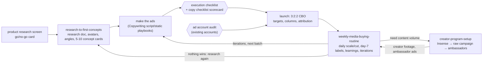

# Evolve Start Here playbooks hub
> Four end-to-end agent workflows that run the Evolve growth loop (Study → Research → Create → Test → Feedback): research a brand into 5-10 test-ready concepts, launch a product end to end, run the account day to day and week to week, and build a creator supply. Each playbook names its gates and hands a YAML artifact to the next.

## 🤖 Agent use
- **Use when:** starting any Evolve-method job; find your situation in [entry points](#entry-points) and open that playbook only.
- **Inputs → outputs:** whatever you have (a product idea, a brand with no research, a live account, a creator budget) → the matching playbook → its artifact → the next playbook.
- **Rules:**
  - **DO** place every problem on the loop: Study → Research → Create → Test → Feedback Loop. [L174 01:46](../lessons/174-im-overwhelmed-stuck-wat-do.md)
  - **DO** finish the research gates before making ads: "The effort that you put in prior to making the ad is the difference between the ad usually winning and the ad flopping." [L56 01:18](../lessons/056-organizing-insights-overview-must-watch.md)
  - **DO** judge tests by spend inside one CBO: "If it gets spend = good. If it does not get spend = not good." [L174 02:42](../lessons/174-im-overwhelmed-stuck-wat-do.md)
  - **DON'T** blame media buying first: "for 99% of you guys, it's not media buying" (instructor claim). [L174 07:53](../lessons/174-im-overwhelmed-stuck-wat-do.md)
  - **DON'T** fabricate proof, testimonials, stats or scarcity, and don't rip competitor or TikTok Shop videos (taught in L98 and L172: describe, don't execute). Copy the mechanism, not the asset.
  - **DO** list missing inputs (reviews, margins, account access) instead of guessing.
- **See also:** [Rubrics hub](../rubrics/README.md) · [Libraries hub](../libraries/README.md) · [Evolve growth loop](../concepts/evolve-growth-loop.md) · [KPI thresholds](../libraries/kpi-thresholds.md) · Copywriting: [playbooks hub](../../copywriting/playbooks/README.md) · Tether Lab: [playbooks hub](../../../../playbooks/README.md)

## Pipeline

Text version: product screen → [research to first concepts](research-to-first-concepts.md) → make the ads → [execution checklist](../rubrics/execution-checklist.md) → launch (after the [ad account audit](../rubrics/ad-account-audit.md) on existing accounts) → [weekly media buying routine](weekly-media-buying-routine.md) → iterations back to make-the-ads, or back to research when nothing wins; [creator program setup](creator-program-setup.md) feeds content volume into the routine. [Launch a new product end to end](launch-a-new-product-end-to-end.md) wraps the whole chain.

## Entry points
| You have | Start at | Output artifact | Then |
|---|---|---|---|
| A new product or brand, a 30-60 day launch to plan, or a stalled brand to locate on the loop | [Launch a new product end to end](launch-a-new-product-end-to-end.md) (12 phases + creators, gate per phase, escalation when nothing wins) | Phase plan with owners, outputs, gates (launch plan template) | Phases 0-5 → research playbook; 8-12 → weekly routine; 13 → creator playbook |
| A brand with product access but no research, avatars or concepts | [Research to first concepts](research-to-first-concepts.md) (10 gated steps) | Research doc, product overview, desire sheet, core + sub-avatars, ranked angles, 5-10 concept cards, Growth Guide Batch #1 (YAML deliverable) | Copywriting [ad idea to brief](../../copywriting/playbooks/ad-idea-to-brief.md) → script/static playbooks |
| A live Meta account: daily budget calls, day-7 reads, learnings call, roller-coaster results, promo days | [Weekly media buying routine](weekly-media-buying-routine.md) | Daily log rows; weekly report YAML (labels, routing, learnings, next batch) | Iterations → Copywriting [iterate on test results](../../copywriting/playbooks/iterate-on-test-results.md); account problems → [ad account audit](../rubrics/ad-account-audit.md) |
| A creator budget (or none), a need for more content, or winning creators to keep | [Creator program setup](creator-program-setup.md) (fit check → Insense → raw campaign → creator verdict → ambassadors → partnership ads) | Framework doc, Insense campaign, creator verdict table, offer emails, monthly engine report | Creator ads tested in the routine's raw/main campaign |
| An inherited account with history | [Ad account audit](../rubrics/ad-account-audit.md) (rubric, not a playbook) | `ad_account_audit` YAML | Launch phase 8 → weekly routine |

## Shared artifacts
| Artifact | Produced by | Consumed by | Defined in |
|---|---|---|---|
| Go/no-go card | product research screen | launch playbook phase 0 | [product research screen](../frameworks/product-research-screen.md) |
| Research doc | research playbook step 2 | every later step; Copywriting truth sheet | [research doc](../concepts/research-doc.md) · [research stack workflow](../frameworks/research-stack-workflow.md) |
| Core + sub-avatar records | research playbook steps 6-7 | angles, briefs, creator frameworks | [core and sub-avatars](../concepts/core-and-sub-avatars.md) |
| Concept cards + Growth Guide rows | research playbook steps 9-10; routine W8 | make the ads; day-7 status | [concept planning and growth guide](../frameworks/concept-planning-and-growth-guide.md) |
| Targets (breakeven, scaling ROAS, CPA, minimum daily spend) | launch phase 7 | routine D1, audit G1 | [KPIs and columns](../frameworks/kpis-and-columns.md) · [KPI thresholds §3](../libraries/kpi-thresholds.md) |
| Campaign spec | launch phase 8 | routine; audit S-checks | [campaign structure 3:2:2](../frameworks/campaign-structure-322.md) |
| Day-7 label | routine | learnings, iteration, ABO/zombie routing | [winning-ad labels](../concepts/winning-ad-labels.md) |
| Learnings card | routine W2-W5 | iteration plan | [learnings review](../frameworks/learnings-review.md) |
| Iteration plan | routine W6 | make the ads | [rewrite losers and iterate](../frameworks/rewrite-losers-and-iterate.md) |
| Creator framework + verdict table | creator playbook | raw content campaign; ambassador offers | [creator frameworks vs scripts](../concepts/creator-frameworks-vs-scripts.md) · [Insense creator pipeline](../frameworks/insense-creator-pipeline.md) · [brand ambassador program](../frameworks/brand-ambassador-program.md) |

## How the three course groups divide the work
| Stage | Evolve Start Here (this course) | Evolve Copywriting | Tether Lab (shared) |
|---|---|---|---|
| Research | 14-source research stack, desire hunt, belief levers, Core 5 avatars | avatars and angles, positioning exercise | [customer research to angles](../../../../playbooks/customer-research-to-angles.md), [competitor landscape audit](../../../../playbooks/competitor-landscape-audit.md) |
| Concept | angle prompt, Marksman/Sniper, concept cards, Growth Guide | memo and Ad Roadmap, ad idea to brief | [angle remix](../../../../playbooks/angle-remix.md), [competitor ad teardown](../../../../playbooks/competitor-ad-teardown.md) |
| Make | execution checklist; creator frameworks | video script and static workflows, copy scorecard | [UGC script writing](../../../../playbooks/ugc-script-writing.md), [static ad creation](../../../../playbooks/static-ad-creation.md), [creator brief](../../../../playbooks/creator-brief.md) |
| Test and scale | one CBO 3:2:2, labels by spend tier, +20%/24 h scaling, zombie/ABO/promo, attribution, account audit | iteration outcomes | [test and iterate](../../../../playbooks/test-and-iterate.md) |
| Feedback | learnings review, rewrites, variations | ten-step learnings, iteration playbook, issue codes | test-and-iterate decision table |
| Content supply | Insense pipeline, raw campaign, ambassadors, partnership ads | — | [creator brief](../../../../playbooks/creator-brief.md) |

Where the courses disagree (scale step, test packaging, single-variable testing, framework vs script briefs), each playbook's cross-course notes give the agent default; all conflicts are logged for the global [contradictions page](../../../../contradictions.md).

## Related
[Rubrics hub](../rubrics/README.md) · [Libraries hub](../libraries/README.md) · [Scaling rules](../frameworks/scaling-rules.md) · [Revenue-stage focus](../concepts/revenue-stage-focus.md) · [Marksman/Sniper testing](../concepts/marksman-sniper-testing.md)
