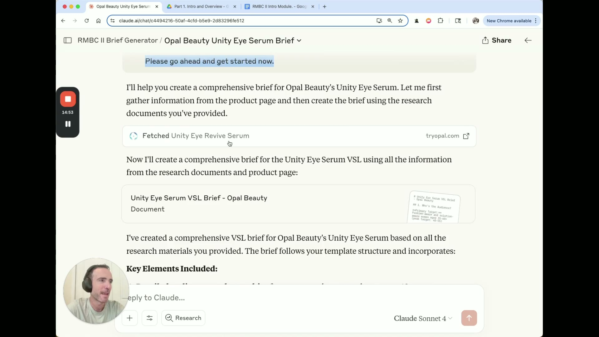
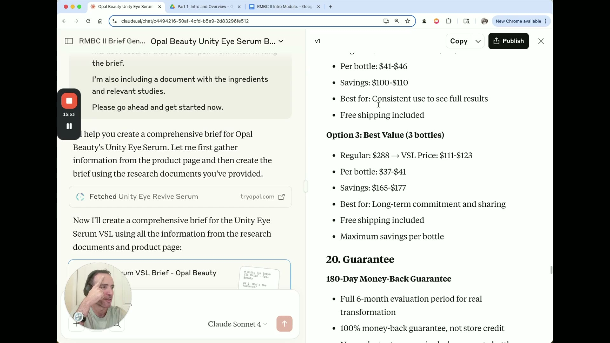
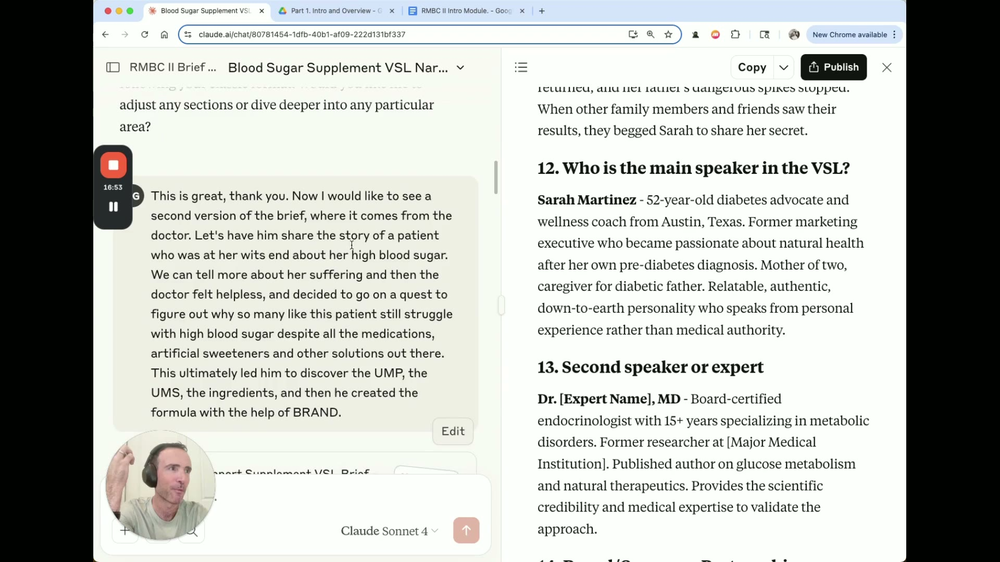
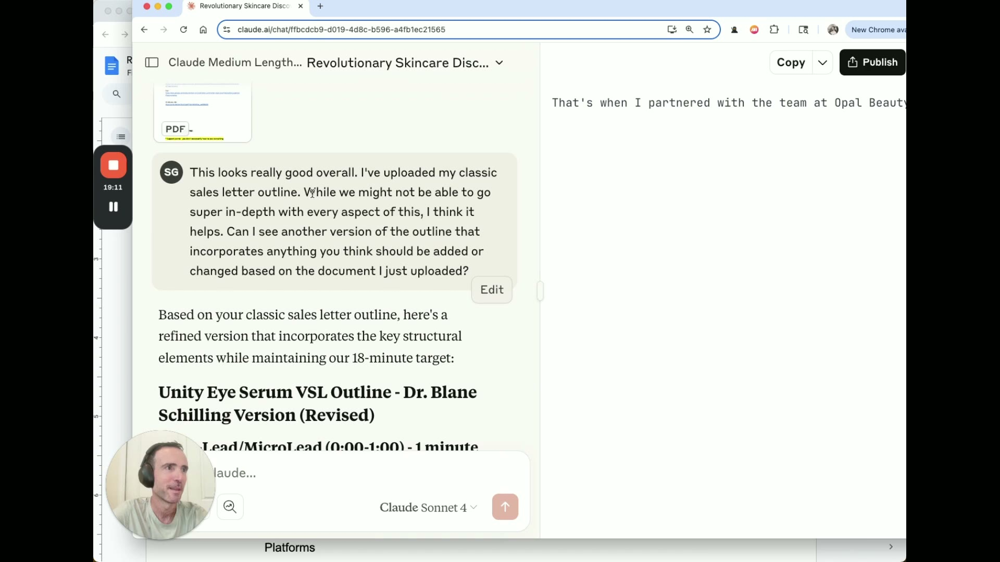
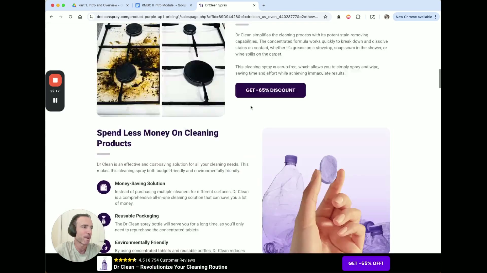
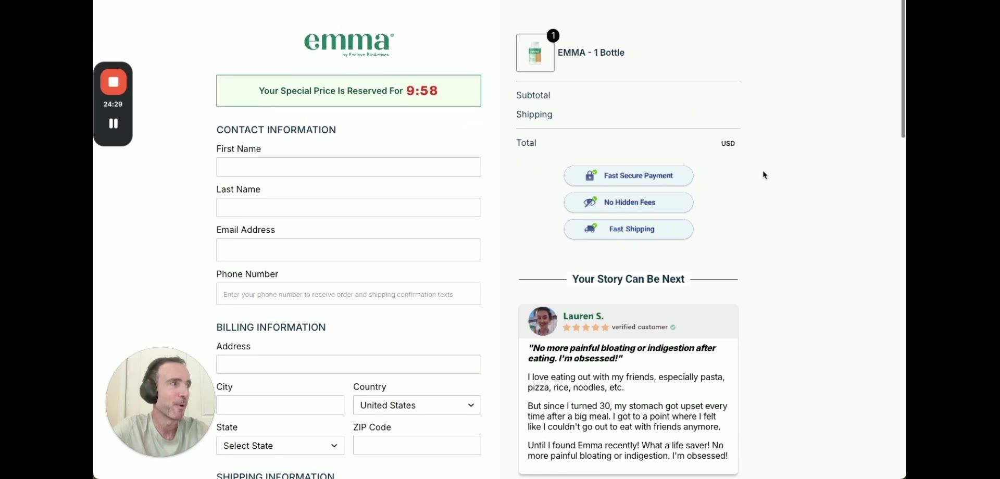

# 1.1 Welcome to RMBC II and In-Depth Course Overview
> A roadmap of the whole course: research, then unique mechanism, then a 25-point brief, then Claude Projects that write every funnel asset (VSLs, advertorials, PDPs, checkouts, ads, upsells, emails), with the human acting as "copy chief" and "copy thinker" instead of typist.

## 🤖 Agent use
- **Use when:** orienting on how RMBC II is organised; deciding which RMBC II lesson to open for a task (research, mechanism, brief, a VSL, advertorial, PDP, checkout, ad, upsell or email); or setting up the order of work for a new product ("research, mechanism, brief, copy").
- **Inputs → outputs:** a product/offer and a target page type → the correct pipeline order (research docs → one unified research doc → mechanism → Brief 2.0 → page-specific Claude Project → copy-chief feedback loop) and the lesson to open for each step.
- **Rules:**
  - **DO** run the stages in order: research first, then mechanism, then brief, then copy. Each later stage takes the earlier output as an input document. [04:40–06:33; 11:29–13:54]
  - **DO** build one "ultimate" research document by combining three separate deep-research outputs (product/market awareness, competitor, psychographic) into one doc before writing any copy. The combining prompt is just "combine them into one". [06:33–07:24]
  - **DO** feed the brief generator: a product page URL (if one exists), the unified research doc, ingredient research (if relevant) and the mechanism (UMP/UMS). [13:54–14:49]
  - **DO** treat the first LLM output as a draft and act as copy chief: ask for an outline first, give feedback, revise, then write. [18:30–19:44]
  - **DO** learn how each page type works before prompting for it. "The brief is only valuable and the projects for [content] VSLs is only valuable if you really understand how VSLs work." [10:58–11:29]
  - **DON'T** use one funnel template for everything. Which page follows the ad depends on platform, price and awareness; the course gives a 15-factor criterion for choosing. [20:52–22:56; 27:34–28:30]
  - **DON'T** copy the demo briefs' invented people, doctors or claims. The demo briefs contain Claude-made placeholder personas and credentials; we may only use real, verified speakers and proof. (derived; KB rule "never invent proof")
  - **IF** you sell a supplement **THEN** also run the ingredient-research prompt (Perplexity or another LLM) to get studies, claims and citations. [07:24] (Substantiation of any health claim is still required. Derived.)
  - **IF** the brief has no story yet **THEN** tell the writing project what the story should be, as the instructor did when "we didn't have one". [18:30–19:13]
- **See also:** [1.2 Foundational Knowledge and the State of DTC Marketing in 2025](01-02-foundational-knowledge-and-the-state-of-dtc-marketing-in-202.md) · [Product-Market Awareness](02-01-product-market-awareness.md) · [Unique Mechanisms Overview](03-01-unique-mechanisms-overview.md) · [The Old Brief vs. The New Brief](05-01-the-old-brief-vs-the-new-brief-overview.md) · [Evolve: Market awareness](../../../evolve/copywriting/concepts/market-awareness.md)

## Key ideas

### The pitch and how to use the course [00:06–02:05]
- Stefan opens with "I am Stefan, I am so happy you are here" and says he will not list superlatives: "rather than tell you, I'll just let you see it". [00:06–00:36]
- The video was recorded "a couple days before the launch", before the members area existed, so it shows the planned outline; the outline "changed a little bit as I was creating the course and I think for the better". [00:36–01:33]
- He recommends going through "as much of it as you can", claiming this gives a better grasp of "direct response marketing, direct consumer marketing, e-com, and just selling online" than nearly anyone who skips it (instructor claim). [01:33–02:05]
- The resource page lists a lesson doc, transcript SRT, lesson PDF and a private RMBC II Facebook group "for questions, suggestions and networking" (page text of `01-Welcome ... Overview.pdf`). The "pdf" companion file is an 8-page auto-generated slide summary of this video.

### Part 1 Foundations: context is king [01:33–04:09]
- Foundations covers "what is copywriting, what is direct response copywriting, what sales funnels look like in 2025, why context is king, and then sort of a broad overview of the RMBC2 approach". [00:36–01:33] The full lesson is [1.2](01-02-foundational-knowledge-and-the-state-of-dtc-marketing-in-202.md).
- Context has two frames: **platform-specific** (the journey from unaware to buyer "looks kind of different on Meta and native" and with the product and price) and **product/market awareness** (selling to someone who knows the product exists or is actively searching is different from selling to someone "vaguely aware that they have a problem"). [02:05–04:09]
- He calls context "one of the key things when it comes to writing great copy and effectively converting people from prospects to customers online". [03:12–04:09]

### Part 2 Deep research: four steps plus ingredients [04:09–07:24]
- Four core research documents/steps (the "R"):
  1. **Product/market awareness**: what it is, why it matters, and a deep-research process for any product or service. [04:09–04:40]
  2. **Competitor research**: a deep-research process that outputs a competitor-analysis doc: who the competitors are, what claims they make, what your prospects at their awareness level like and dislike about competitor products. Useful because prospects who don't know your product still know competitors "at a broad level". [04:40–05:43]
  3. **Psychographic research**: "really what the original R was in the original RMBC"; the deep psychological drivers of the target customer, by awareness level. [05:43–06:33]
  4. **Unified research document**: feed the three docs to Claude, "combine them into one". Goal: one "perfect document that is all the kind of research information we would need to write great copy" (what they like, dislike, psychological drivers, hopes and dreams). [06:33–07:24]
- **Ingredient research** (supplement writers): a deep-research prompt, run mostly in Perplexity, for studies, claims and citations on any formulation: "It used to take hours... takes less than five minutes to solve." (instructor claim) [07:24]
- Research is the first thing after the intro module and "will flavor a lot of what we do, especially for all copy, but especially on the kind of VSL side". [05:43–06:33]

### Part 3 Unique mechanisms: ideate, evaluate, expand [07:24–09:55]
- Stefan says he "popularized" the mechanism concept (instructor claim). The course gives an overview of unique mechanisms, then "AI processes for coming up with unique mechanisms". [07:24–08:22]
- Ideation with LLMs, including "deep research" for mechanism ideas. Worked examples named: **eye serum (skincare)**, **Airbnb arbitrage** (a hypothetical high-ticket coaching offer), supplements, plus "a couple other examples". [07:24–08:54]
- Evaluation: "a process to use LLMs to evaluate them". For newer people or when you are "between a couple of mechanisms", it is "a pretty consistent reliable process". Experienced marketers "don't need to depend on LLMs". [08:54–09:55]
- Expansion: turn a chosen mechanism idea "into kind of copy format", with a Claude Project that writes the mechanisms out. Aim: understand mechanisms well, generate many ideas, pick the one you are happiest with. [08:54–09:55]
- Existing KB view of mechanism for comparison: [Evolve unique mechanism](../../../evolve/copywriting/concepts/unique-mechanism.md).

### Part 4 VSL training before the brief (why B and C are split) [09:55–11:29]
- Why VSL training sits before the brief: "before we got to the brief and then generating copy, it made sense to put a pretty long core training on sales copy and especially sort of video sales letters." [09:55–10:27]
- Lengths now: original RMBC VSLs were "20 to 50-minute, hour-long"; today "a lot of them are going to be 6 to 18 minutes" and run in-feed as Meta ads; others 3–7 minutes; and many "a minute and a half, two minutes" so "VSL and video ads sort of start to get... kind of interchangeable". [10:27]
- **ADHD hook video ads**: 3–7 minute, hook-heavy VSL-like videos. "Nobody talks about this publicly to my knowledge"; the course shows breakdowns from **vShred** and **Svelte** (Whisper writes "Svelte"; the lesson PDF also says "V Shred and Svelte"). [10:27–10:58]
- Also: a module on **in-feed vs on-page VSLs**, "actually very important". [10:58–11:29]

### Part 5 Brief 2.0: the command center [11:29–16:51]
- **RMBC1 brief**: about a page: target market, product, mechanism; you followed an outline while writing the VSL yourself. **Brief 2.0** is "a dramatically expanded version". [11:29–11:59]
- In RMBC II "pretty much all the writing... the heavy writing, is done by AI. And then we are more of the commander... the boss, we're the copy chief". LLMs other than Claude can be used; you tell it "this is pretty good, but what about this". [11:59–12:56]
- "You're a copy thinker, not a copywriter." Stefan says he had the insight while recording ("Thanks for the $9.97 or $8.97 or whatever the hell I charged" is a joke about price, not a stated price). [11:59–12:56]
- The brief is "a 25 point document" built from the mechanism, the research and product details (ingredients etc.), which the LLM then uses to write "VSLs, ads, advertorials, email sequences, everything else". A Claude Project generates it. [12:56–13:54] (The lesson PDF p.6 repeats "25-point".)
- **Live demo (Claude Sonnet 4 shown on screen, Project "RMBC II Brief Generator"):** he asks for a new brief for the brand "Opal Beauty" Unity Eye Serum, gives a product page URL, the unified research doc, ingredient research and the UMP/UMS; Claude fetches the product page and creates a "Unity Eye Serum VSL Brief - Opal Beauty" document. [13:54–15:48] (The transcript's "UDI serum" and "ump and ums" are Whisper errors for Unity Eye Serum and UMP/UMS; confirmed by screen text.)
- What the generated brief covers (read aloud, in this order) [14:49–15:48]:
  - audience: demographics, psychographics, pain points
  - big promises; what life looks like with the pain solved; emotional empowerment
  - what solutions exist and what they did not like about them
  - unique mechanism and its nicknames; main ingredients and their studies (the studies came from the Perplexity ingredient research)
  - bold claims; emotional/transformational claims
  - product, key benefits and fascinations, what makes it unique
  - background story; main speaker and secondary expert; brand details
  - testimonials; credibility builders; medical endorsements; industry recognition
  - normal retail price; actual price; multi-option savings; guarantee; bonuses; scarcity elements
  - future pacing; what results look like; objections and answers; specific hooks to test
  (The on-screen version is numbered, e.g. "12. Who is the main speaker in the VSL?", "13. Second speaker or expert", "20. Guarantee"; the full 25-point template is taught in module 05.)
- **Second demo (no website):** a blood-sugar supplement, given only ingredient research and "use placeholders for now". First brief was "ClickBank style" (a mother of two with bad blood sugar meets an expert). He then asked for a second version told by a doctor. Claude "even created a unique mechanism that wasn't bad". [15:48–16:51]


*The brief-generator demo: Project name "RMBC II Brief Generator", chat "Opal Beauty Unity Eye Serum Brief", model "Claude Sonnet 4"; Claude fetches the product page and outputs a brief document. [15:00]*


*The artifact is a numbered brief: bundle pricing (regular vs VSL price, per-bottle, savings, "best for") and "20. Guarantee". Prices and guarantee come from the product page, not invented. [16:00]*


*Iteration prompt (full text under Prompts). The right pane shows a Claude-made persona and "Dr. [Expert Name], MD" placeholder; these are demo placeholders, not real people. [17:00]*

### Part 6 Claude Projects write the VSLs; you copy-chief [16:51–19:44]
- Separate Claude Projects exist for **long VSLs, medium (6–18 min), 3–7 minute and short VSLs**. You give the Project the brief and say "here's a brief. Write a VSL". [16:51–18:30]
- Demo workflow (Project "Claude Medium Length..."; chat "Revolutionary Skincare Disc..."): message 1 gives the brief and asks for a story direction ("we didn't have one... here's the story we could do"); Claude returns an **outline first**; he gives feedback; he uploads his "classic sales letter outline" PDF and asks for a revised outline; then "Let's go ahead and write it" for an 18-minute target. [18:30–19:44]
- Claim: "the copy's quite good" but "copy-chiefing, feedback, tweaking, all of that" is essential: "you're copy-chiefing too". [19:13–19:44] (Instructor claim on quality; no sample copy shown to judge.)


*Medium-length VSL Project: the outline-revision prompt (verbatim in Prompts). The outline names "Dr. Blane Schilling" as the speaker; that is a Claude-generated demo character, not a real endorser. [19:18]*

### Part 7 Mid-course recap and the "hell to heaven" picture [19:44–20:52]
- A mid-course recap restates the processes and how they fit together. He warns: "you kind of go through hell to come back out the other side to heaven"; it may feel like "a lot going on", but "when we zoom out, it's a pretty simplified process". The diagram is in [1.2](01-02-foundational-knowledge-and-the-state-of-dtc-marketing-in-202.md). [19:44–20:52]
- "You're using LLMs. It's actually way more efficient. It's way faster. And you can create any type of copy with this sort of setup process." [20:18–20:52]

### Part 8 Advertorials [20:52–21:50]
- Each module follows the same pattern: case studies, purpose, "why long ones, why short ones", common elements, where the traffic comes from (the ad) and where it goes next (PDP, checkout, VSL). "Why does one advertorial go right to a checkout page? Another one goes to a VSL. Another one goes to a short product page." [20:52–21:50]
- Ends with a Claude Project for "endless advertorials of any length for whatever platform". [21:50] See [Advertorials Overview and Examples](09-01-advertorials-overview-and-examples.md).

### Part 9 PDPs and Part 10 checkouts: same product, very different page lengths [21:50–25:40]
- PDP examples: an at-home cleaning spray brand with "a great e-com product page", very long and highly formatted; **Clarifion Odorex** whose advertorial recurs later, but whose product page is "basically like a checkout/product page" ("a little above the fold thing: product selection, pay, FAQs"). Why the difference is answered in the module. [21:50–23:59] (The first brand's name is garbled in both our transcript and the platform captions; the long page open in the browser at 22:24 carries the tab title "DrClean Spray", so it may be the page he means, but he never says so. See Screenshots.)
- Covered product types: supplements, devices, high-ticket "book a call" funnels. A Claude process turns "winning PDP structures" into outlines and then new PDPs. [22:56–23:59] Open [PDP Overviews](10-01-pdp-overviews-and-claude-processes-for-writing-new-ones.md).
- **Checkouts**: compares Emma's checkout (goes straight to contact info) with the Dr. Clean checkout (a lot before product selection, repeated product selection). "Turns out there's really good reasons for why the checkouts are different", answered "within the context of the whole customer journey"; mobile is also shown. [23:59–25:40] Open [Checkouts Walkthrough Part 1](11-01-checkouts-walkthrough-part-1.md).


*A long, highly formatted PDP shown as the "sexy e-com page" end of the length spectrum: benefit blocks with icons, before/after photo, reviews, sticky bar with rating and discount button. [22:24]*


*The short end: Emma checkout goes straight to contact information, with a "Your Special Price Is Reserved For" countdown, three trust badges and a customer story panel. (Top strip cropped to remove a contact address.) [24:36]*

### Part 11 Ads and the guest specialists [25:08–27:34]
- Order logic: "how do we get them to start the journey?" The ad is followed by advertorial/landing page/PDP/VSL, then checkout. "When are we doing what?" is answered module by module. [25:08–25:40]
- **Meta**: taught by Stefan with examples across niches, video and static, and where the ads go. Why a short ad often goes to an advertorial or VSL, while a long ad may not. [25:40]
- **Native**: "Din" (surname not given; "an incredible media buyer on Native", formerly part of a large agency, buys Native for some of Stefan's businesses). [25:40–26:38]
- **Google**: **David O'Connell** of the O'Connell Agency: Pmax, Demand Gen, AdWords. [26:38]
- **TikTok**: **Maxwell Finn**: "all things TikTok ads and psychology and copy". [26:38]
- **YouTube**: **Tom Clayson** (spelled "Clason" in the captions, "Clasen" in the lesson PDF) of **Tried and True**, which runs YouTube for Emma. [26:38] (The lesson map for this KB lists Meta, Native, Google and TikTok lessons only. A separate YouTube lesson is not in the course files we have. Derived from `lesson_map.json`.)
- AI processes for generating winning ads fast, "especially on Meta", via Claude Projects: "by this point you should understand and be like a master of Claude projects so you can set them up for anything". [26:38–27:34]

### Part 12 The 15 factors that determine your funnel structure [27:34–28:30]
- Stefan made it for another program ("CA Pro") and has not done it since; it is a checklist for evaluating "the offer, the product, the psychology, the consumer, their product market awareness... the pricing" and outputs the likely best funnel structure. "Not written in stone", but a way to decide where to start. Claim: "I don't think everyone's ever done anything like this before besides me" (instructor claim). It sits late "because you need to understand everything else first". [27:34–28:30] See [Hidden Factors for Optimal Funnel Structure](13-01-hidden-factors-for-optimal-funnel-structure.md).

### Section II: from B to C (and D, E, F...) [28:30–33:06]
- **Upsells** (part 13): psychology, funnel economics, purposes, messaging. "What are we selling? Better results, faster results, an improved version, new problems, expanded problems." Walkthroughs: cleaning products (Dr. Clean spray), protein bars (brand garbled as "David"), supplements (Emma, Happy Mammoth) and biz-opp/info products; plus a Claude Project for "endless upsells or cross-sells", more of the same or a different product. [28:30–30:38]
- **Email** (part 14): abandoned carts (psychology, economics, "why people really don't buy"; flows for supplements and a book-a-call funnel); welcome series (e-com supplement, high-ticket consumption, digital course); promotional sequences (4th of July, Thanksgiving/Black Friday for supplements; 24-hour flash sale for a biz-op SaaS tool one-time purchase); reorder sequences and winbacks (taken from his telemedicine platform and applied to supplements, plus a SaaS resubscribe example for a hypothetical Airbnb-arbitrage tool); and a Project for "endless email sequences of any type". [30:38–33:06]

### Bonuses and the promise of more [33:06–34:55]
- Statement: "I feel like I've solved copywriting entirely... I don't know what someone else could really create about copywriting after RMBC 2" (instructor claim). [33:06–34:02]
- Bonuses listed at launch: CRO best practices (Ethan of an agency he pronounces "48A"/"48 Marketing", written "4080 Marketing" in the course outline; the lesson-map file is "4080 CRO Intensive"); e-com and Amazon with **Eddie Maalouf**; funnel economics with Stefan; high-ticket webinars with **Dylan Vanas**; and a "???" slot. [33:06–34:55] The written outline (`01-0 RMBC II Course Outline.docx`) adds **Patrick Stiles** (founder of Vidalytics) on VSL benchmarks; the older outline copy at the end of the 1.2 docx instead ends with "And ????? (RMBC I Story)". Launch date given: July 7th. More bonuses promised; RMBC I "launched with like five or six bonuses" and had 20-something within months. [34:02–34:55]

### Wrap-up: what you can generate [34:55–36:32]
- By the end: research, mechanisms, briefs, then "any type of copy": long, medium, 3–7 minute, hook-heavy and short VSLs; in-feed or on-page; short or long PDPs; short or long advertorials; Meta, native and YouTube ads; video scripts; upsells; emails. "And it'll keep getting better." [34:55–36:32]
- Next lesson is the "opening context setter": what is copy in 2025 and platform specifics. [35:33–36:32]

## Steps / framework

### The RMBC II pipeline (as laid out here)
| Stage | What you produce | Tool/input | Taught in |
|---|---|---|---|
| R: Research | Product/market awareness doc, competitor doc, psychographic doc → one unified research doc; ingredient research for supplements | Deep-research prompts; Perplexity for ingredients | Module 02 |
| M: Mechanism | Several UMP/UMS ideas → evaluated winner → expanded copy-format mechanism | LLM ideation + evaluation prompt + Claude Project | Module 03 |
| (sales-copy theory) | Understanding of long/medium/short VSLs, hooks, ADHD hook ads, in-feed vs on-page | Examples and breakdowns | Module 04 |
| B: Brief 2.0 | ~25-point brief | "RMBC II Brief Generator" Claude Project + research docs + product page | Module 05 |
| C: Copy | VSLs (4 lengths), advertorials, PDPs, ads, upsells, emails | One Claude Project "recipe" per asset type | Modules 06–07, 09–12, 14–15 |
| Recap + strategy | Mid-course recap; 15 factors for funnel structure | Checklist | Modules 08, 13 |
| Journey 2 (B to C...) | Upsells, emails | Claude Projects | Modules 14–15 |
| Bonuses | CRO, e-com/Amazon, funnel economics, webinars, VSL benchmarks | Guest trainings | Module 16 |

### Outline part numbers vs module folders
| Outline part (docx / video) | Module folder |
|---|---|
| Part 1 Foundations | 01 Intro and Overview |
| Part 2 Deep Research | 02 |
| Part 3 Unique Mechanisms | 03 |
| Part 4 VSL Copy I | 04 |
| Part 5 Brief 2.0 | 05 |
| Part 6 VSL Copy II | 06 and 07 |
| Part 7 Mid-Course Recap | 08 |
| Part 8 Advertorials | 09 |
| Part 9 PDPs | 10 |
| Part 10 Checkouts | 11 |
| Part 11 Ads | 12 |
| Part 12 15 Factors | 13 |
| Part 13 Upsells | 14 |
| Part 14 Email | 15 |
| Part 15 Bonuses | 16 |
(derived mapping from the outline docx and the folder names; the video says "part 10, checkouts" at 23:59.)

## Examples
| Example shown | What it illustrates | Source |
|---|---|---|
| Opal Beauty Unity Eye Serum brief (from a product page + unified research + ingredient research + UMP/UMS) | Brief generator with an existing website as input | [13:54–15:48] |
| Blood-sugar supplement brief from ingredient research only, with placeholders; v1 "ClickBank style" mother-of-two story, v2 doctor-led patient story | Briefs from thin inputs; one brief, several narrative framings | [15:48–16:51] |
| Medium-length VSL project: story direction, outline, feedback, classic sales-letter outline upload, 18-minute target | Outline-first, copy-chief loop | [18:30–19:44] |
| At-home cleaning spray (long PDP) vs Clarifion Odorex (advertorial with a very short checkout-like product page) | Why PDP length varies | [21:50–23:59] |
| Emma checkout (straight to contact info) vs Dr. Clean checkout (long, product selection repeated) | Why checkouts vary | [23:59–25:40] |
| Upsell case studies: Dr. Clean, protein bars, Emma, Happy Mammoth, biz-op/info products | Upsell variety across niches | [29:34–30:38] |

Note: the supplement, eye-serum and edema/biz-op examples in this course often involve aggressive health or income claims. Record them as examples of structure; copy structure, never the claims (derived, Meta/FTC substantiation rules).

## Structured units

### Rules of thumb
- **DO** build one unified research doc from product/market, competitor and psychographic research before writing. [06:33]
- **DO** give the brief generator both the page and the research when a page exists; with no page, give research and tell it to use placeholders. [13:54; 15:48–16:51]
- **DO** ask for several narrative framings of the same brief (e.g. customer story vs doctor story). [16:51]
- **DON'T** let the LLM invent the speaker, expert or credentials for use in live copy; placeholders in the demo must be replaced with real, verifiable people. (derived)
- **IF** you are unsure between mechanisms **THEN** run the LLM evaluation process rather than guessing. [08:54–09:55]
- **IF** you need to choose a funnel structure **THEN** score the offer with the 15 factors; don't default to a VSL. [27:34–28:30]

### Templates
| Template | Use for | Source |
|---|---|---|
| Brief generator input bundle: [product page URL] + [unified research doc] + [ingredient research (if supplement)] + [UMP/UMS] + "Please go ahead and get started now." | New brief | [13:54–14:49] and on-screen text |
| Narrative-variant request: "a second version of the brief, where it comes from the doctor..." | Re-framing a brief's story | on-screen at [17:00] |
| Outline-revision request after uploading your classic outline | Upgrading an LLM outline against your own structure | on-screen at [19:18] |

## Prompts / templates (verbatim)
These are the only prompt texts legible on screen in this video (the full Project instructions are shown in later modules). Brackets mark my fill-ins.

Brief generator, second-version follow-up (on-screen at ~17:00; "BRAND" is literal placeholder text in the prompt):
```text
This is great, thank you. Now I would like to see a second version of the brief, where it comes from the doctor. Let's have him share the story of a patient who was at her wits end about her high blood sugar. We can tell more about her suffering and then the doctor felt helpless, and decided to go on a quest to figure out why so many like this patient still struggle with high blood sugar despite all the medications, artificial sweeteners and other solutions out there. This ultimately led him to discover the UMP, the UMS, the ingredients, and then he created the formula with the help of BRAND.
```

Brief generator, closing lines of the first request (on-screen at ~16:00; the start of the message is cut off in the frame):
```text
I'm also including a document with the ingredients and relevant studies.

Please go ahead and get started now.
```

Medium-length VSL project, outline revision (on-screen at ~19:18):
```text
This looks really good overall. I've uploaded my classic sales letter outline. While we might not be able to go super in-depth with every aspect of this, I think it helps. Can I see another version of the outline that incorporates anything you think should be added or changed based on the document I just uploaded?
```

Paraphrased (not verbatim; from his spoken description) Unified research combiner [06:33]:
```text
(derived) Here are three research documents: product/market awareness, competitor research, and psychographic research. Combine them into one unified research document that contains everything needed to write great copy: awareness level, what customers like and dislike about existing solutions, psychological drivers, hopes and dreams.
```

Paraphrased brief request [13:54] (derived):
```text
(derived) Write a new brief for [brand] [product]. Pull inputs from this product page: [URL]. Use the attached unified research document, the ingredient research and the UMP/UMS. If any detail is missing, use placeholders.
```

## Screenshots
Embedded above in the order they occur: brief generator project [15:00], brief document pricing/guarantee [16:00], doctor-version prompt [17:00], outline revision prompt [19:18], Dr Clean PDP [22:24], Emma checkout [24:36]. The Google Doc outline frames (13:59, 18:29, 20:17, 29:41) duplicate the outline docx and were not kept.

## How to apply
- [ ] For a new product, list which of the three research docs and which of the ingredient/mechanism inputs already exist; create the missing ones first.
- [ ] Merge the research docs into one unified doc and store it as a Project file or attachment.
- [ ] Generate the brief from product page + unified doc + mechanism; replace every placeholder speaker, credential, testimonial and statistic with real facts or leave it bracketed.
- [ ] Ask the brief generator for 2 narrative variants before writing copy.
- [ ] In the copy Project: request an outline, review it, add your own structure document, revise, then write.
- [ ] Pick the funnel shape (ad to advertorial/VSL/PDP/checkout) using module 13 before choosing which Project to run.
- [ ] Run the output through the AI-in-copywriting caution below before shipping.

## Related
- Next: [1.2 Foundational Knowledge and the State of DTC Marketing in 2025](01-02-foundational-knowledge-and-the-state-of-dtc-marketing-in-202.md).
- Forward links: [Brief generator and Unity Eye Serum example](05-02-the-brief-generator-with-claude-project-unity-eye-serum-exam.md) · [Blood sugar supplement example](05-04-blood-sugar-supplement-example.md) · [Mid-course recap](08-01-rmbc-ii-mid-course-recap.md) · [Upsells overview](14-01-upsells-overview.md) · [Funnel economics with SPG](16-03-funnel-economics-with-spg.md)
- Existing KB: [Evolve: What about AI](../../../evolve/copywriting/lessons/36-what-about-ai.md) · [Evolve: AI in copywriting (operator model)](../../../evolve/copywriting/concepts/ai-in-copywriting.md) · [Evolve: Market awareness levels](../../../evolve/start-here/concepts/market-awareness-levels.md)
- **Disagreement to carry forward (derived):** Evolve Copywriting says AI should never be "your sole strategy" and withholds copy-paste prompts; RMBC II has AI do "pretty much all the writing, the heavy writing" from detailed briefs and treats first drafts as often "basically a final draft" (see 1.2), with the human as copy chief. Both put judgment on the human; they differ on how much drafting to delegate and whether to hand out prompts.

## Sources and limitations
- Transcript: [01-Welcome to RMBC II and In-Depth Course Overview.txt](<../../../../../raw/stefan-georgi/rmbc-ii/_transcripts/Stefan Georgi - RMBC II (1)/01-INTRO AND OVERVIEW/01-Welcome to RMBC II and In-Depth Course Overview.txt>) (Whisper large-v3-turbo; full video covered, last segment 36:35 of 36:40). Platform captions used for names: [01-0 Welcome ... Important.srt](<../../../../../raw/stefan-georgi/rmbc-ii/originals/Stefan Georgi - RMBC II (1)/01-INTRO AND OVERVIEW/01-0 Welcome to RMBC II In-Depth Overview of Whats Inside Important.srt>).
- Documents: [Course outline docx](<../../../../../raw/stefan-georgi/rmbc-ii/_extracted/Stefan Georgi - RMBC II (1)/01-INTRO AND OVERVIEW/01-0 RMBC II Course Outline.docx.md>) (the same outline text appears at the end of 1.2's docx); the 8-page [lesson PDF summary](<../../../../../raw/stefan-georgi/rmbc-ii/_extracted/Stefan Georgi - RMBC II (1)/01-INTRO AND OVERVIEW/01-Welcome to RMBC II and In-Depth Course Overview pdf.pdf.md>) (an AI-style slide recap; used only to confirm "25-point", "copy thinker", guest names); and the one-page [resources PDF](<../../../../../raw/stefan-georgi/rmbc-ii/_extracted/Stefan Georgi - RMBC II (1)/01-INTRO AND OVERVIEW/01-Welcome to RMBC II and In-Depth Course Overview.pdf.md>).
- Whisper fixes: "RBC2/Rmbc2" = RMBC II; "quad/cloud" = Claude; "UDI serum" = Unity Eye Serum; "ump and ums" = UMP and UMS; "Opal Beauty's" confirmed on screen; "copyrighting" = copywriting; "Din" and "Tom Clason" are caption spellings (outline: "Tom Clayson"). Spellings of "Din", the at-home spray brand, "David protein bars" and "48A/4080 Marketing" could not be confirmed; I used the outline and file names where they exist.
- The video says the launch is "July 7th" without a year; the course titles say 2025.
- All timing, speed and quality claims (hours saved, "copy's quite good", "solved copywriting") are the instructor's; no measured results are shown in this lesson.
- The Claude brief and outline shown are demo outputs with invented personas and placeholder credentials; they must not be reused as proof.
- Frames were captured from MEGA at the keyframe times listed; I viewed every frame before keeping it. No frames show personal data except one crop noted above.
