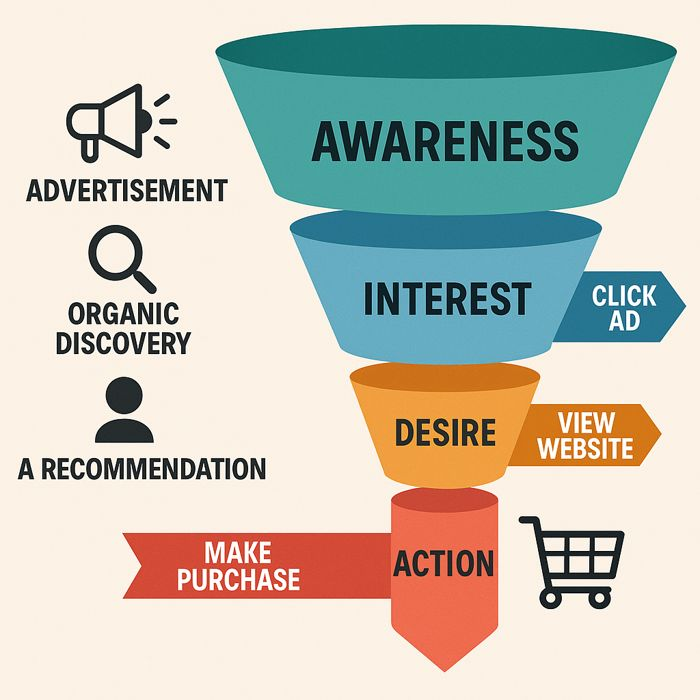
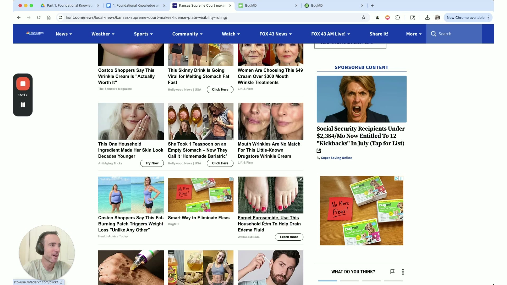
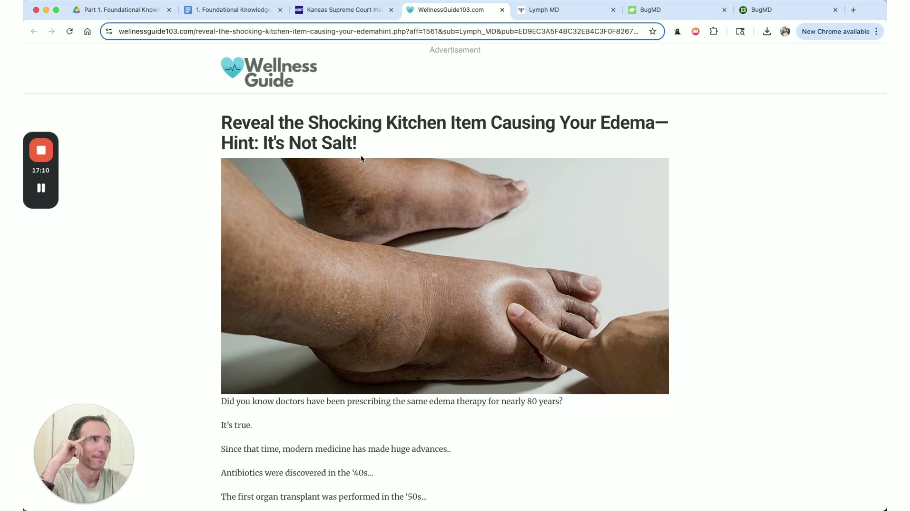
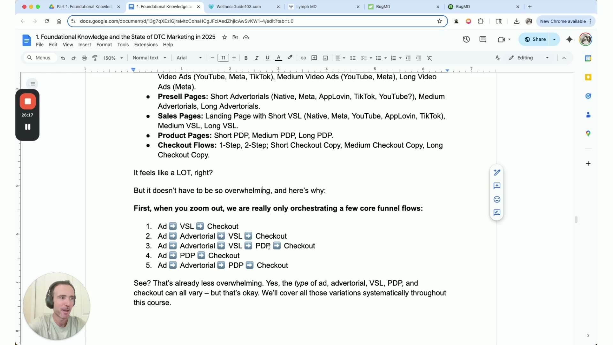
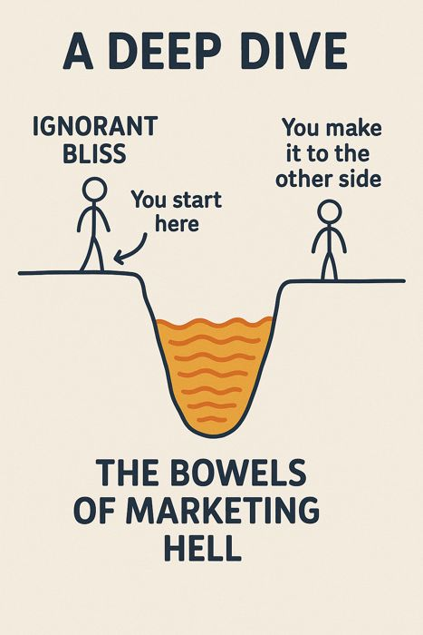

# 1.2 Foundational Knowledge and the State of DTC Marketing in 2025
> Direct-response copy only works in context: judge an ad by whether the right people take the action, match each page to the platform the person came from and their awareness level, choose among a few core funnel shapes by testing, and use LLM processes to produce assets in hours so your own value is thinking and editing.

## 🤖 Agent use
- **Use when:** choosing which page should follow a given ad (advertorial, VSL, PDP, checkout); explaining or checking congruence between an ad and its landing page; auditing a funnel in an ad account; or setting the "definition of good" for any copy task.
- **Inputs → outputs:** platform + ad type + product price + landing-page type + target-customer awareness → a congruent next step (page type and length) and a hypothesis to test, not a fixed answer.
- **Rules:**
  - **DO** judge ads only by "its ability to get the right kind of people to consistently take that desired action". [06:53–07:48; docx "Effectiveness" line]
  - **DO** define the "right person" before writing: coffee example, not "eight-year-olds" or non-coffee drinkers, but the coffee lover who drinks too much and wants fewer negative effects (also acceptable: people actively searching for "coffee without the crash"). [07:48–09:27]
  - **DO** match the landing experience to the ad platform: video platforms to video pages, article-style native ads to advertorials. This is **congruence**: "maintaining a consistent feeling experience for a prospect throughout their journey from point A to point B". [11:23–13:05; 15:52]
  - **DO** orchestrate a few core flows, not endless combinations: Ad > VSL > Checkout; Ad > Advertorial > VSL > Checkout; Ad > Advertorial > VSL > PDP > Checkout; Ad > PDP > Checkout; Ad > Advertorial > PDP > Checkout. [25:40–27:20; docx]
  - **DO** model what already works: "the simplest way to write effective copy for any product or service is to just model what other successful brands selling similar products or services are already doing." [26:19–27:20]
  - **DON'T** assume a long on-page VSL is the default. "Often not the move" now; it "can work", but "there is no like single right way to sell". Test long advertorial > PDP against short advertorial > VSL. [19:27–21:38; 21:38–22:39]
  - **DON'T** treat "direct response" as only old-school hard-sell. It covers "extremely branded, super clean e-com" through aggressive formats. The instructor adds that he is not advocating deepfakes (his example was a deepfake celebrity). [10:31–11:23]
  - **IF** the advertorial is long (docx: ~1,000–2,000+ words) and the product is cheap (docx: under $50) **THEN** test sending it to a PDP. **IF** the advertorial is short (transcript: "less than like 200 words"; docx: 200–400) and the product is pricier (docx: over $50) **THEN** test sending it to a VSL page. [17:52–19:27; docx Scenarios A/B]
  - **IF** the traffic is YouTube **THEN** expect educational/entertaining video ads and a landing page that features another video. [11:23–13:05]
  - **IF** you use an LLM draft **THEN** judge it as a strategist: ask for missing big ideas and hooks, point out what doesn't make sense, then revise. [31:21–32:51]
- **See also:** [1.1 Welcome and Overview](01-01-welcome-to-rmbc-ii-and-in-depth-course-overview.md) · [Product-Market Awareness](02-01-product-market-awareness.md) · [Advertorials Overview and Examples](09-01-advertorials-overview-and-examples.md) · [Hidden Factors for Optimal Funnel Structure](13-01-hidden-factors-for-optimal-funnel-structure.md) · [Native advertising concept](../../../../concepts/native-advertising.md)

## Key ideas

### Scope: beginner-friendly and holistic [00:06–03:26]
- This is Part I of the course ("Copywriting and the State of Direct Response in 2025"), written so beginners and "seasoned vets" both gain. Agenda: what copywriting is, the two customer journeys, 2025 funnels, the true purpose of direct response, context (product/market awareness and platform), and the RMBC II approach with AI. [00:06–01:35] (docx list)
- **Copywriting** = "the art and science of writing advertisements... there's no magic thing for copywriting. It's just like it's writing ads." [01:35–02:05]
- What differs from RMBC I: "copywriting doesn't exist in a vacuum". He says RMBC I "wasn't holistic enough"; since 2020 he has "scaled more businesses", and worked with "thousands of copywriters and hundreds of business owners" (instructor claims). Freelancers who only "write emails/VSLs/sales pages/advertorials" and in-house writers told "write us emails" miss the picture: "that doesn't work. You really need to understand the holistic picture." [02:05–03:26]

### The two journeys [03:26–04:54]
- **Journey 1 (focus here): prospect to purchaser**: Point A (not a customer) to Point B (paying customer) through your efforts. [03:26–04:23; docx]
- **Journey 2: customer to repeat champion**: after buying (Point B) the person goes to Point C: upsell right after purchase, email "over the course of weeks, months, or years", SMS, "call set", content. It is covered later (upsells and email modules). [03:26–04:54; docx]

*Journey 1 as a funnel: Awareness (ad, organic discovery or recommendation) > Interest (click the ad) > Desire (view website; desire rises for the solution to their pain point, not only the product) > Action (purchase). Image from the lesson docx, shown in the video at about 04:53.*

### Funnel as AIDA; where ads appear [04:54–06:53]
- "A classic ADA framework": **A**wareness, **I**nterest, **D**esire, **A**ction. They see an ad (aware); curiosity, emotional connection or speaking to the pain point earns the click (interest); the website increases desire "to solve their pain point"; they buy. [04:54–05:53]
- Discovery can be an ad, organic (Google/SEO, Amazon browsing, in-store), or a friend's recommendation, but "RMBC II will concentrate primarily on creating powerful advertisements". [05:53; docx]
- Placements the docx lists: Facebook, Instagram, native networks (Taboola, Outbrain), TikTok, YouTube, Google Display, Google Search, in-app (AppLovin), Shopify app ecosystem ("ShopApp"), Amazon (Sponsored Products/Brands/Display), email, plus radio and TV. "Ads will typically look, feel, and be written differently depending on the platform." [05:53–06:53]

### What "direct response" means; the right person [06:53–10:31]
- Direct-response copywriting: "writing ads and other marketing materials designed to get a prospective customer to take an immediate measurable action": call a number, click a link, buy, share a post, sign up for a newsletter. [06:53–07:48]
- The "sole criterion" for whether an ad is good: it gets "the right kind of people to consistently take the desired action". [06:53–07:48; docx, which sets this in bold italics]
- "The right person" ties to product/market awareness (next module). Example: coffee that "gives you energy without the caffeine crash". Wrong clickers: 8-year-olds, people who don't drink coffee. Right: the coffee lover who feels they drink too much and "kind of doesn't like the negative effects"; also OK: someone actively looking for "coffee without the crash" products, but ask "where are most people going to be?" [07:48–10:31]
- Ultra-simple journey: click ad > website > add to cart > checkout. "It can be that simple, actually. But realistically, it rarely is." [09:27–10:31]

### Context part 1: platform changes the ad and the journey [10:31–17:18]
- "A customer's journey will also often be different depending on the platform." [10:31–11:23; docx]
- **YouTube:** people go "for education or entertainment". So: ads are mostly video (congruent); educational/entertaining video ads "will tend to outperform those that are just aggressively hard-sell"; after the click, "a lot of times" a page that features another video, because they are "already in video-watching mode". A short video ad sent to a plain landing page is "a very obvious advertisement. The spell is broken". The video page may be a VSL or an e-com landing page with prominent video. [11:23–13:05]
- **Native:** people are reading articles (news, celebrity gossip, how-tos, sports, interest content). The ad is "designed to look and read like a link to an interesting news story"; the click usually goes to an **advertorial**, "an advertisement that's crafted to look and feel like an editorial piece or a news story because it maintains congruence". [13:05–15:52]
- Live demo on a Topeka, Kansas local news site (Stefan's habit: he always uses Topeka news): headlines "Kansas Supreme Court makes license plate visibility ruling" and a sponsored-content grid. He says the ads "kind of look ridiculous, turns out they work". [13:05–15:22] Clicking a BugMD item shows a product page styled like an article; clicking an edema item lands on an article-style page with a video. [14:44–17:18] The congruence test: if you are reading the Kansas ruling and the ad drops you on a hard-sell page, you think "what the fuck? Why am I reading this ad?"; an article-style landing page "still more congruent". [15:52–17:18]

*Native "Sponsored Content" widgets under a local-news article (Stefan clicks the BugMD flea item and the WellnessGuide edema item). Note how headlines read as article titles with a small source label. Many carry aggressive health claims; study the format, don't copy claims. [15:24]*

*Landing page after the native click: publication-style header ("Wellness Guide", "Advertisement" label), a headline with an open loop ("Hint: It's Not Salt!"), a symptom photo, and an opener built on "doctors have been prescribing the same ... therapy for nearly 80 years" followed by medical-progress milestones. A medical-claim page: copy the structure, not the claims. [17:18]*

### Context part 2: product/market awareness [17:18–17:52]
- Second context element, "one of the most important parts of RMBC II", only previewed here: "the way you sell to somebody who knows your product... is different than somebody who is vaguely aware that they have a problem" (stated in 1.1). The research module covers it. [17:18–17:52] See [Product-Market Awareness](02-01-product-market-awareness.md) and for the existing KB view, [Evolve: market awareness levels](../../../evolve/start-here/concepts/market-awareness-levels.md).

### After the advertorial: it depends [17:52–21:38]
- Advertorial then **???**: "paths can diverge, and there isn't always one single 'correct' answer". [17:52–18:22; docx]
- **Scenario A** (long advertorial, cheaper product): to a PDP. The long advertorial "educated the prospect, built desire, sold them on the value"; the lower price is an easier "impulse" purchase; the PDP gives specifics, confirms it solves pain points and adds social proof, FAQs. Demo: BugMD advertorial then PDP with single bottle price "$34" and a lower per-unit price ("24 each" with a one-time-purchase toggle). [18:22–18:52; docx]
- **Scenario B** (short advertorial, pricier product): to a landing page with a **VSL** ("an online infomercial"). Short copy "just want[s] to get them curious", then a long VSL does the selling. [18:52–19:27; docx]
- Which one? "Both probably work". Fewer do long on-page VSLs now "though they still work". "You will never have perfect information... all you're doing is hypothesizing, guessing, and testing." Suggested tests: long advertorial > nice product page vs short advertorial > VSL. A training later (he says "part 12 or 13") gives a baseline for the optimal funnel; "you have to experiment". [19:27–21:38]

### The state of marketing in 2025 [21:38–23:40]
- Old model: "basically any ad goes to a video sales letter, goes to checkout and print". Many struggling brands and business owners are "still trying to make that model work... not mentally adjusting". New reality: "a lot of different things work and often the video sales letter on landing page isn't one of them." (instructor claim) [21:38–22:39]
- "Marketing changes, technology changes, platform change, consumer habits change, psychology changes... You have to change too." [21:38–22:39]
- **What a VSL does** (on a page; in-feed VSLs are similar but differ and are covered later): hooks in "the first five seconds", creates curiosity, builds rapport and credibility, usually uses a **hero's journey story** (reluctant hero, suffering, "called to action", finds the real reason people suffer = the unique mechanism, finds or creates the best product manifestation of the solution), builds high perceived value ("should cost a lot more than it does"), reveals price as a great deal, and tells them to buy. [22:39–23:40; docx list also names UMP (Unique Mechanism of Product) and UMS (Unique Mechanism of Solution)]

### Checkout and the overwhelm problem [23:40–27:20]
- After the landing page: select product, add to cart, **checkout**: personal info, card details, "mentally prepare to part with their money", click Place Order. "Even the copy and the style of the checkout page can vary dramatically", from very short to "surprisingly long". [24:39; docx]
- "DAMN, Marketing Can Be HARD." The combinations (docx inventory): ad types (static for Native, Meta, Amazon, Instagram, ShopApp, Google; short video for YouTube/Meta/TikTok; medium video for YouTube/Meta; long video for Meta); presell pages (short/medium/long advertorials for Native, Meta, AppLovin, TikTok, "YouTube?"); sales pages (landing page with short/medium/long VSL); product pages (short/medium/long PDP); checkout flows (1-step, 2-step; short/medium/long checkout copy). [24:39–25:40; docx]
- Cure for overwhelm: "when you zoom out, we are really only orchestrating a few core funnel flows" (five listed in the Rules and table below). [25:40–26:19]
- He says the Ad > Advertorial > ... > PDP > Checkout pattern is "probably the most common one used by most people I know doing eight figures in DTC" (instructor claim). **Ambiguity:** in the audio the phrase follows his reading of "add advertorial product page to checkout" (flow 5); the lesson PDF summary instead attaches it to flow 3 (Ad > Advertorial > VSL > PDP > Checkout). The docx makes no such claim. Treat as unverified. [26:19; PDF p.7]
- "The ad might be a video sales letter ad, it might be something else." [26:19]

*The lesson doc at ~26:24: the "endless combinations" inventory (ad types, presell pages, sales pages, product pages, checkout flows) above the five core flows: Ad>VSL>Checkout; Ad>Advertorial>VSL>Checkout; Ad>Advertorial>VSL>PDP>Checkout; Ad>PDP>Checkout; Ad>Advertorial>PDP>Checkout. [26:24]*

*"A deep dive": "Ignorant bliss ... You start here ... The bowels of marketing hell ... You make it to the other side." The same picture is referenced in the overview as the "hell to heaven" metaphor. Docx image, introduced in the audio at about 26:19.*

### Transparency, swiping and the AI step-change [26:19–31:21]
- The big advantage: "transparency into what already works". Don't "reinvent the wheel... you shouldn't. You just need to model off of what's working." "I talk about swiping a lot in RMBC2, and it's also really the foundation of all of the copy generation stuff." The course dissects effective copy "across every stage of the sales funnel". [26:19–27:20]
- AI step-change (instructor claims, no demonstration in this lesson):
  - 2020 RMBC I: long VSL in "a week instead of eight weeks"; "12 to 16 hours" for him. Now "dinosaur time". [27:20–28:46]
  - Now: he "could write two to four high quality VSLs in a single day" (docx: about 2 hours each); a beginner "definitely no more than five days". [28:15–28:46; docx]
  - Other outputs per docx and audio: 5–10 advertorials/day (he says "you could do like 100 advertorials in a day, honestly"), 20–40 "good ads" in a day, "hundreds of promising angles and hooks" at a time (docx: 100+), an upsell in about an hour ("more like 15 minutes"), a 7- or 14-day email sequence in an hour ("really like 10 minutes"), 5–10 PDPs in an afternoon, deep research for unique mechanisms, ingredient benefits and big ideas. [29:17–30:51; docx] The lesson PDF (p.8) lists "100+ Ad Photos" in a day instead of "angles/hooks"; the docx and audio say angles/hooks, so the PDF is likely a summary error.
  - "This is all proven. You put my money, I'll put my money where my mouth is." [30:51]
- RMBC II "is not really about VSLs"; it is about "the whole holistic marketing journey for direct-to-consumer utilizing direct response copywriting elements and other direct response marketing elements". [29:17]
- Tool names in the docx: Claude, ChatGPT, Perplexity "and other LLMs". [docx]

### Deconstruct, accelerate, master; copy thinker [31:21–34:25]
- Three-part teaching plan (docx): **Deconstruct** each copy type (theory, structure, essential elements; "what makes a piece of copy great versus merely good, mediocre, or downright bad"); **Accelerate with AI** with specific AI-first processes producing "killer first drafts (often... close to final drafts)"; **Master the craft**: "think and edit like a top-tier copywriter" to move "B or A- copy into A+". [31:21–32:18; docx]
- Editing is mostly conversational: "this doesn't make sense", "we're missing a big idea here. Let's come up with some big ideas, some hooks", "we said this, I think it would be better if we did this". [32:18]
- "Copy thinker, not a copywriter... it frees you to think." He recommends working on how to think, books on thinking, and may add a bonus module. [32:18–33:25]
- The lesson ends by pointing to the outline (identical to 1.1) and "from B to C and D and E and F" for upsells, email and bonuses; more bonuses to be added as he goes. [33:25–34:25]

## Steps / framework

### Choosing the page after the ad (derived decision helper from the lesson's logic)
| Step | Question | Source |
|---|---|---|
| 1 | Which platform and what is the person doing there (watching, reading, scrolling, searching)? | [11:23–15:52] |
| 2 | What is the matching ad format and landing style (video ad > video page; article-style native ad > advertorial)? | [11:23–15:52] |
| 3 | How aware is the right person of the problem/product (see module 02)? | [07:48–10:31; 17:18] |
| 4 | Price and desired information load: cheap + long presell > PDP; pricier + short presell > VSL (a hypothesis, not a law) | [17:52–19:27; docx] |
| 5 | Pick the flow among the five; build the cheapest-to-test version; test against one alternative | [19:27–21:38; 25:40–27:20] |
| 6 | Make the checkout congruent (copy and style vary from short to long) | [24:39] |
| 7 | Plan Journey 2 (upsell, email, SMS) | [03:26–04:54] |

### The five core funnel flows
| # | Flow | Notes from the lesson |
|---|---|---|
| 1 | Ad > VSL > Checkout | "classic model still can work" [25:40–26:19] |
| 2 | Ad > Advertorial > VSL > Checkout | short advertorial to VSL (Scenario B) |
| 3 | Ad > Advertorial > VSL > PDP > Checkout | PDF says "most common 8-figure" (see ambiguity above) |
| 4 | Ad > PDP > Checkout | direct to product page |
| 5 | Ad > Advertorial > PDP > Checkout | long advertorial to PDP (Scenario A); plausibly the one he calls "most common" |

## Examples
| Example | Lesson takeaway | Source |
|---|---|---|
| Coffee without the crash | Define the right clicker (coffee lover, not kids or non-drinkers) | [07:48–10:31] |
| YouTube ad > video page | Platform congruence: video to video | [11:23–13:05] |
| Local news site sponsored content > advertorial pages (BugMD flea item; edema article) | Native ad looks like a news link; the landing page reads like an article | [13:05–17:18] |
| BugMD long advertorial > PDP with FAQs and a single-bottle price | Long presell + cheap product | [18:22–18:52] |
| Hypothetical short (<200-word) advertorial > VSL (he only guesses the edema page leads to a VSL; the page has an embedded video) | Short presell + pricier product | [16:48–19:27] |
| Hero's-journey VSL arc | What a VSL does | [22:39–23:40] |

## Structured units

### Hooks
These are native-ad headlines visible on screen at 15:24 (read as examples of the format). I did not add heuristics the instructor never named; "(derived)" marks my labels.

| Hook (verbatim from screen) | Heuristic(s) | Emotion / zone | Self targeted | Why it works | Source |
|---|---|---|---|---|---|
| "Costco Shoppers Say This Wrinkle Cream Is "Actually Worth It"" (The Skincare Magazine) | Social proof via trusted retailer (derived) | — | — | Reads like a consumer story, not an ad | [15:24] screen |
| "Women Are Choosing This $49 Cream Over $300 Mouth Wrinkle Treatments" (Lift & Firm) | Price contrast (derived) | — | — | Specific prices, "choosing" implies switching | [15:24] screen |
| "Mouth Wrinkles Are No Match For This Little-Known Drugstore Wrinkle Cream" | Hidden-secret / curiosity (derived) | — | — | Unknown item plus familiar place | [15:24] screen |
| "Reveal the Shocking Kitchen Item Causing Your Edema. Hint: It's Not Salt!" | Open loop; counter-belief (derived) | — | — | Names the culprit category but withholds it; "Not Salt" breaks the expected answer | [16:48–17:18] and screen at 17:18 |
| "Smart Way to Eliminate Fleas" (BugMD) | Practical benefit | — | — | Blends with how-to content | [15:24] screen |

Compliance: several visible headlines ("melting stomach fat fast", "homemade bariatric", "Forget Furosemide", "kickbacks" for Social Security recipients) make unsubstantiated medical, drug or government-benefit claims. Do not reproduce them; copy only the format (source label under a headline, curiosity gap). (derived)

### Templates
| Template | Use for | Example fill | Source |
|---|---|---|---|
| "[Retailer/crowd] say this [product category] is actually worth it" | Native headline mimicking consumer news | Only with verifiable reviews or a real retailer quote (derived) | screen [15:24] |
| "Reveal the [surprising object] causing your [problem]. Hint: it's not [expected cause]." | Curiosity headline for an advertorial/native ad | Only if the claim is true and substantiated (derived) | [17:18] screen |
| Hero's-journey VSL: reluctant hero > calling > search for real cause (UM) > product as best manifestation > value > price > CTA | Skeleton for any VSL | Detailed in module 04 | [22:39–23:40] |

### Rules of thumb
- **DO** write for "the right person", not for everyone. [07:48–10:31]
- **DO** keep the feeling consistent from ad to page ("congruence"). [15:52]
- **DO** test funnel shapes. "Both probably work." [19:27]
- **DON'T** expect "ad > long on-page VSL > checkout" to be the safe default. [21:38–22:39]
- **IF** you feel overwhelmed by variants **THEN** reduce to the five core flows. [25:40–26:19]
- **IF** you can swipe a proven structure **THEN** start there rather than from scratch. [26:19–27:20]

## Prompts / templates (verbatim)
No LLM prompts are given or shown in this lesson. The prompt processes begin in module 02. (The only "template" text is the outline and funnel-flow lists reproduced above.)

## Screenshots
Embedded above: AIDA funnel diagram (docx image, ~04:53), native sponsored widget [15:24], native advertorial landing [17:18], funnel inventory and five flows [26:24], "bowels of marketing hell" diagram (docx image, ~26:19). Not kept: the YouTube ad image in the docx (not legible as a lesson example) and the Google Doc scroll frames at 0:53 and 11:17 (they duplicate the docx text).

## How to apply
- [ ] Before writing an ad, state in one line who the "right person" is and what awareness level they're at.
- [ ] Record the platform, what users are doing there, and the matching ad and landing-page format.
- [ ] Write down the planned flow (one of the five) and the competing alternative to test.
- [ ] For native/article-style traffic, make the landing page read like an article; for video traffic, put a video above the fold.
- [ ] Check length/price fit: long presell + low price > PDP; short presell + higher price > VSL (as hypotheses).
- [ ] For each competitor funnel, screenshot or log every step (ad, advertorial, VSL, PDP, checkout) and note its length and price.
- [ ] After every LLM draft, write a "what's missing" feedback prompt (big idea, hooks, contradictions) before accepting.
- [ ] Remove any health, drug, income or benefit claim you cannot substantiate before using a structure from the examples.

## Related
- Previous: [1.1 Welcome to RMBC II and In-Depth Course Overview](01-01-welcome-to-rmbc-ii-and-in-depth-course-overview.md). Next module: [Product-Market Awareness](02-01-product-market-awareness.md).
- Forward: [VSLs Section Overview](04-01-vsls-section-overview.md) · [VSLs on Landing Pages vs VSLs as In-Feed Ads](04-11-vsls-on-landing-pages-vs-vsls-as-in-feed-ads.md) · [PDP Overviews](10-01-pdp-overviews-and-claude-processes-for-writing-new-ones.md) · [Checkouts Walkthrough Part 1](11-01-checkouts-walkthrough-part-1.md) · [Native Ads](12-02-native-ads.md)
- Existing KB: [Evolve: The current state of copywriting](../../../evolve/copywriting/lessons/02-the-current-state-of-copywriting.md) · [Evolve: Unaware ads](../../../evolve/copywriting/concepts/unaware-ads.md) · [Hero image and copy congruence](../../../../concepts/hero-image-copy-congruence.md) · [Native advertising](../../../../concepts/native-advertising.md) · [Evolve: AI in copywriting](../../../evolve/copywriting/concepts/ai-in-copywriting.md)
- **Disagreement (derived):** Evolve Copywriting warns that AI-only copy "sounds like everyone else" and keeps the human as operator who writes the strategy; RMBC II claims LLM output is often "close to final drafts" when driven by deep research and a detailed brief. Both stress that the human's thinking is the differentiator. Loosely related: Evolve's "write in the environment" lesson and RMBC II's congruence across the journey both ask copy to fit where the person is (derived comparison; not stated by either instructor).

## Sources and limitations
- Transcript: [02-Foundational Knowledge and the State of DTC Marketing in 2025.txt](<../../../../../raw/stefan-georgi/rmbc-ii/_transcripts/Stefan Georgi - RMBC II (1)/01-INTRO AND OVERVIEW/02-Foundational Knowledge and the State of DTC Marketing in 2025.txt>) (Whisper large-v3-turbo; full video covered, last segment 34:25 of 34:33). Captions for checking: [02-1 ... .srt](<../../../../../raw/stefan-georgi/rmbc-ii/originals/Stefan Georgi - RMBC II (1)/01-INTRO AND OVERVIEW/02-1 Foundational Knowledge and the State of DTC Marketing in 2025.srt>).
- Documents: [lesson docx](<../../../../../raw/stefan-georgi/rmbc-ii/_extracted/Stefan Georgi - RMBC II (1)/01-INTRO AND OVERVIEW/02-1 Foundational Knowledge and the State of DTC Marketing in 2025.docx.md>) (the read-along; the video follows it closely but he adds spoken numbers and demos) and [PDF summary](<../../../../../raw/stefan-georgi/rmbc-ii/_extracted/Stefan Georgi - RMBC II (1)/01-INTRO AND OVERVIEW/02-RMBC-2-Copywriting-and-Direct-Response-in-2025.pdf.md>) (an auto-generated recap; two discrepancies noted above: the "most common" flow and "100+ Ad Photos").
- Whisper fixes: "RBC2/RMBC2", "copyrighting/copyright" = copywriting, "DECOM" = DTC e-com context ("direct-to-consumer" in the docx), "cloud projects" = Claude Projects, "CA Pro", "Kansas Supreme Court" checked on screen. Product names (BugMD, Wellness Guide, Lymph MD tabs) come from screen text.
- The scenario thresholds differ between audio ("less than like 200 words") and docx ("200-400 words"; PDP for "$50"): both reported; none are tested rules.
- All speed, volume and "proven" claims are the instructor's with no evidence shown in this lesson. The "better than 99% of people" remark ([29:48–30:51], about 5–10 minute outputs) is also an instructor claim.
- The native-ad examples contain health and benefit claims that would not pass typical platform or FTC substantiation; they are shown only for format.
- Screenshots grabbed from MEGA keyframes; frames not used were viewed and rejected as duplicates of the docx.
