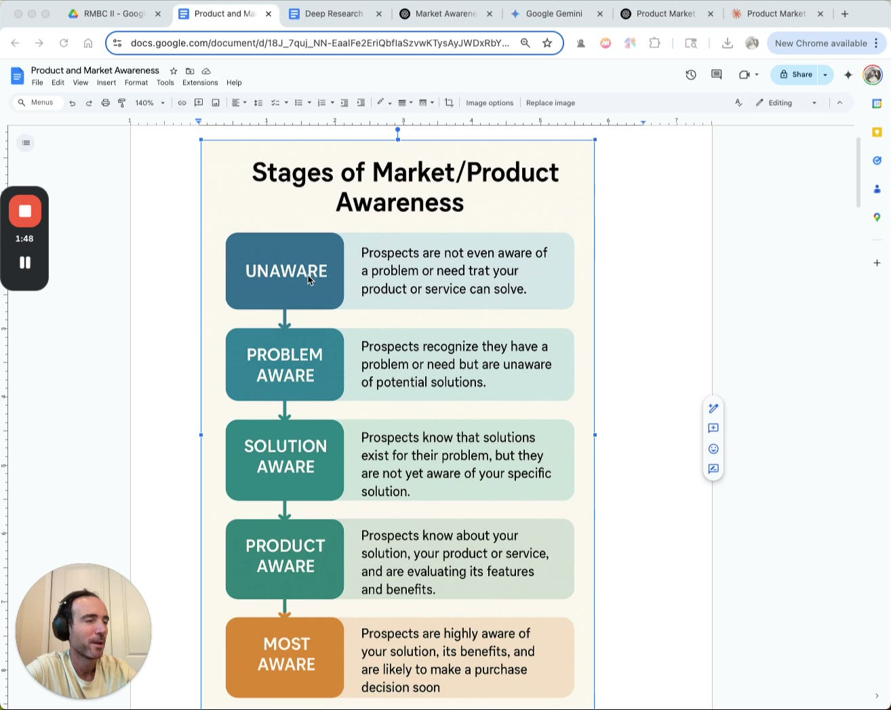
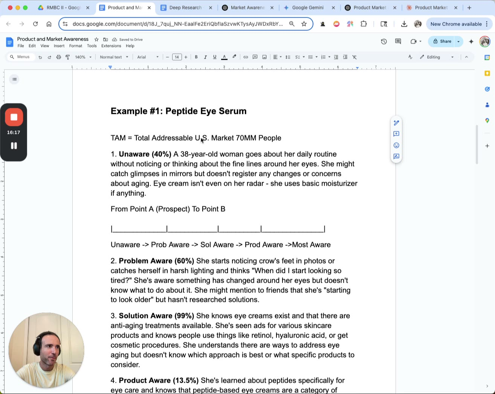
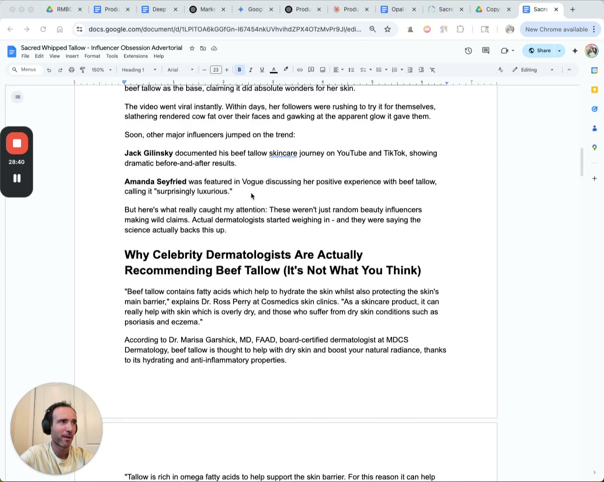
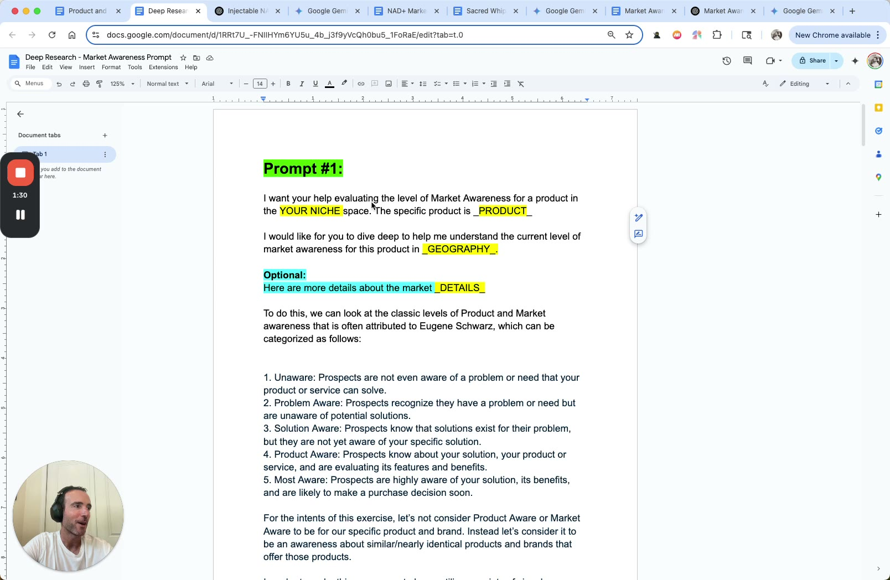
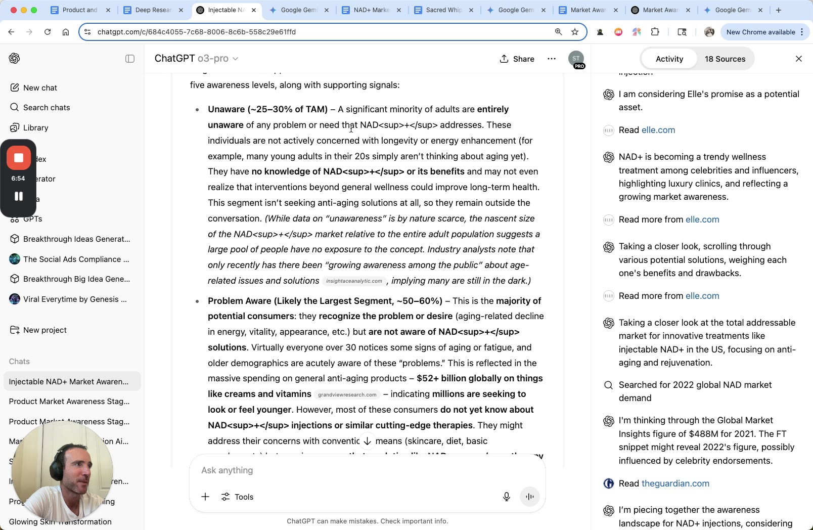
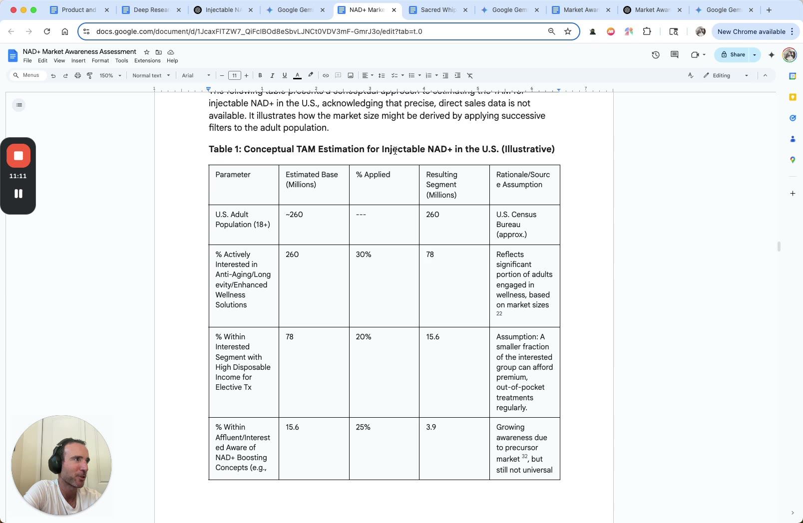

# 2.1 Product-Market Awareness
> Before writing any ad, VSL, advertorial or page, find out which Schwartz awareness stage most of your target market sits in (with a deep-research prompt that estimates TAM and a percentage per stage), because that stage decides what you must educate, how long the copy must be and which funnel format you need.

## 🤖 Agent use
- **Use when:** starting research for a new product or offer; choosing which awareness level an ad, advertorial or VSL should open at; deciding funnel length (static ad + landing page vs advertorial vs VSL); diagnosing ads that "should work" but only trickle sales.
- **Inputs → outputs:** niche, specific product, geography, optional demographic details → a deep-research report with TAM, a rough % of TAM per awareness stage and a "majority stage" verdict → a decision on (a) who the copy speaks to, (b) what must be educated, (c) how much copy/funnel is needed. This output is the first of three research documents that later get merged (see [2.4 Unified Research Process](02-04-unified-research-process.md)).
- **Rules:**
  - **DO** define "product aware" and "most aware" at category level, not brand level, when assessing a DTC market: "it's not that they're aware of our product, it's just that they're aware that this category of product exists and they're close to buying." [v2 02:59–03:22] (Instructor's modification of the classic version, because most DTC brands are small. [02:49–03:48])
  - **DO** run the awareness prompt (below) in at least two LLMs and compare. Numbers differ by model but "you'll still have a general gauge." [v2 21:18–22:59]
  - **DO** read only the TAM estimate, the % per stage and the final verdict in the report. "You don't need to read all this." [v2 09:40, 10:45]
  - **DO** aim cold-traffic copy at problem-aware and solution-aware people; they are the biggest reachable groups. [17:01–19:29; v2 27:49–28:20]
  - **DON'T** write direct-response copy for unaware people unless you are in a market where they already want the outcome (biz-opp, money, freedom). Moving someone from unaware to problem-aware "is a whole extra step" and "a lot of work". [19:29–20:38; 50:13]
  - **DON'T** assume your audience knows why your category or ingredient works. If people are solution-aware but not product-aware, the copy "needs to educate them on why your product is the best solution for their problem." [26:58–27:28]
  - **IF** nearly everyone is already product-aware (e.g. GLP-1 meds) **THEN** a static ad plus a simple landing page is enough; no VSL needed. [34:02–36:28]
  - **IF** the market is mostly problem-aware / unaware of your category (e.g. injectable NAD+) **THEN** expect longer assets: unique mechanism, big idea, long advertorial or VSL. Paid-social ads without that education cost "$1,000, $2,000 to make a sale" in the instructor's account (instructor claim). [37:26–38:52]
  - **DON'T** reuse one message across stages. Problem-aware, solution-aware and product-aware prospects need different messaging. [41:17–44:00; 50:13–50:42]
  - **DON'T** trust the percentages as measurements. They are LLM estimates built from search, social and sales signals. (derived; instructor treats them as a gauge.)
- **See also:** [2.2 Competitor Research Walkthrough and Examples](02-02-competitor-research-walkthrough-and-examples.md) · [2.3 Psychographic Research](02-03-psychographic-research.md) · [2.4 Unified Research Process](02-04-unified-research-process.md) · [3.1 Unique Mechanisms Overview](03-01-unique-mechanisms-overview.md) · [Evolve: Market awareness](../../../evolve/copywriting/concepts/market-awareness.md)

## Key ideas

### Why awareness matters more now [00:00–02:49]
- The module covers "market and product awareness", usually credited to Eugene Schwartz's Breakthrough Advertising. He admits he only started consciously paying attention "in the last maybe year"; before that he applied it intuitively. [00:00–00:59]
- "These days, and especially in 2025, I actually feel as though this is really crucial." [00:59–01:27]
- Process promised: examples of each stage, then a deep-research process that assesses awareness for any product category. [01:27]
- He had ChatGPT make the five-stage infographic (a typo remains in it). [01:54–02:19]


*The course doc's infographic: Unaware, Problem Aware, Solution Aware, Product Aware, Most Aware, each with its one-line definition (the same definitions used inside the research prompt). [01:48]*

### The five stages (as taught) [01:27–02:49]
- **Unaware:** not aware of a problem or need your product can solve.
- **Problem aware:** knows they have a problem or need, does not know of solutions.
- **Solution aware:** knows solutions exist, not yet aware of "your specific solution."
- **Product aware:** knows about your solution/product/service and is evaluating features and benefits.
- **Most aware:** highly aware of your solution and benefits, likely to buy soon.

### Instructor's modification: product-aware means "knows the category" [02:49–03:48]
- Classic reading: product-aware = knows your product. In DTC, "the vast majority of people don't know about your product, but they might know about the category," even for brands doing $20-30M a year. [03:18]
- So when assessing a market, treat product aware and most aware as awareness of "similar, nearly identical products and brands," not your brand. This is written into the research prompt. [v2 02:29–03:22; doc 01-2]

### Worked example: peptide eye serum for women 35+ [03:48–19:29]
- Illustrative TAM: 70 million US people. He stresses these numbers are for the example only and will be replaced by deep-research output. [12:20; 12:58]

| Stage | Mindset (his example) | Share he assigns | Source |
|---|---|---|---|
| Unaware | 38-year-old woman not noticing fine lines; "Eye cream isn't even on her radar." | 40% | [03:48–04:21; 15:40] |
| Problem aware | Notices crow's feet in photos or harsh light: "when did I start looking so tired?"; no idea what to do | 60% | [04:21–04:51; 15:06] |
| Solution aware | Knows eye creams, retinol, hyaluronic acid, procedures exist; unsure which is best | ~99% | [04:51–05:15; 14:34] |
| Product aware | Knows peptide eye creams are a category; researching peptide creams in general | ~13.5% (about 10M of 70M) | [05:15–05:42; 12:20–12:58] |
| Most aware | Knows your specific brand and is ready to compare and buy | about 1% or less | [05:42; 13:27] |

- Percentages do not sum to 100. They overlap: everyone problem-aware is also solution-aware, and "more women are solution-aware than are actually problem-aware" because almost every woman 18+ knows eye creams exist but not all think they have a problem. [14:34–16:21]
- Even the best-known direct-response brands are low on most-aware. "At least 8 out of 10, if not 9 out of 10" people outside the core segment say they don't know vShred, so he estimates it at 1-2%. [13:27–14:03]
- (Math check, derived: 10M/70M = 14.3%, not 13.5%. He calls the figure illustrative.)


*The eye-serum example with percentages added (Unaware 40%, Problem Aware 60%, Solution Aware 99%, Product Aware 13.5%) on a 70M US TAM. [16:18]*

### Why unaware is usually not a direct-response target [08:30–11:46; 19:29–21:14]
- "Unaware is typically not a segment you're trying to speak to in direct response." [08:30]
- The journey is Point A (prospect) to Point B (buyer). Most-aware are closest to buying, but "in the real world though most people aren't here"; they are mostly people already retargeted or exposed to constant advertising. [11:02–11:46]
- Selling a serum to someone who does not think they have a problem means telling them "you look like shit," which is unlikely to work. [16:21; v2 17:02–17:31]
- The gap from unaware to problem-aware is "way bigger than any of the other gaps." That job usually belongs to branding, billboards, radio and educational content: "not impossible, but … a long journey" and "typically not going to be very desirable." [19:29–21:14]
- Sweet spot: problem-aware/solution-aware prospects, taken from there to product-aware, then most-aware, then buy. In his count the path is four steps. [17:33–19:29]

### The mistake: product-aware copy to a solution-aware market (whipped tallow) [21:14–32:10]
- Case: Meta ad caption for his skincare brand's whipped beef tallow (a first-person "I'm obsessed with this product" story told with nostalgia, sensory detail, a 180-day money-back guarantee and "64% off"). He says the ad is true (he wrote it from a customer email he sent; he and his wife fight over the jar). [21:51–24:38]
- Result: "that ad plus those captions has made sales, but it hasn't crushed." [25:11]
- Diagnosis: the ads speak to product-aware people, but "the vast majority of women in my market, my TAM, do not know that you can use whipped tallow." TikTok awareness is "still pretty niche." The missing piece is "the educational component." [25:46–26:58]
- Fix: educate. An advertorial (still untested at recording) explains why tallow is worthwhile: the headline "Beef tallow is the number one skincare trend on TikTok, but is it a legit miracle moisturizer or just a gross and greasy fad?", then dermatologist quotes about fatty acids, skin barrier and vitamins A, D, E, K. [28:08–30:07]
- Principle: the copy must take readers from solution-aware to product-aware, "almost doing two things at the same time" (making them product-aware and then selling). [30:38–32:10]
- Why the original ad misfires: a product-aware reader already accepts that "of course tallow can make my face glow", "it's got fatty acids and all that." The ad "assumes these things that turns out aren't true" for most of the market. [31:41–32:10]


*The educational advertorial draft: influencer trend, then "Why Celebrity Dermatologists Are Actually Recommending Beef Tallow", with expert quotes. It is the "education" layer the ad lacked. [28:42]. The quotes are from the course author's draft and have not been verified by us.*

### Funnel length follows awareness: GLP-1 vs NAD+ [32:10–39:25; v2 13:55–14:54]
- **GLP-1 (Ozempic and similar) in telemedicine:** "everyone … has heard of Ozempic." They are already product-aware, so the path is "one, two steps" rather than four. His team tested advertorials, a VSL and video ads, but "what often works the best is … a simple static ad," e.g. "get GLP-1 medication, save like a hundred bucks off your first month," plus a landing page. The buyer questions are price, trust and convenience. [32:40–36:28] (instructor claim)
- **NAD+ injectables:** "the fact that some of you are asking that question is exactly where I effed up." Funnels built as if people knew NAD+ did not sell. Only Google Search gave "a good CPA" (around $250 in v1, "$300" in v2), because searchers are already aware. Paid social would have cost "$1,000, $2,000" per sale. The real solution is a VSL and long advertorials, which he deprioritised. [36:28–39:25; v2 13:55–14:54] (instructor claim)
- He estimates doing this research first would have saved "$100,000 plus, $150,000 plus" in NAD+ testing. [v2 13:55] (instructor claim)
- Rule of thumb: the further from product-aware, the more you must educate ("unique mechanisms, big ideas, more copy, whether it's advertorials or VSLs"), but it can all be done in one funnel, not over weeks. [37:26; v2 09:07–09:40]

### Messaging changes at every level [39:25–50:42]
- **Eco-friendly cleaning products** (TAM about 150M, problem-aware about 30%, which is 45M): the copy for each stage differs. [39:25–44:00]
  - Problem aware: causes of symptoms ("hey, what's actually in your household cleaner? … it causes all these issues"; allergies, a child's rash, brain fog). [41:49–42:22]
  - Solution aware: "Do they really work? Aren't they expensive?" The reader knows green cleaners exist but is not sold. [42:22–42:51]
  - Product aware: "Here's why ours is the best … Other eco-friendly cleaners have this problem. Ours doesn't have it." [42:51–43:24]
  - Another problem-aware variant: "there's a surprising reason your allergies have gotten worse. You're feeling tired. Your kids have skin issues." [43:24]
- **Personal branding mastermind** for 9-5 professionals (assumed split: problem aware 30%, solution aware 10%, product aware 5%): problem-aware copy says "you're working hard, but it's not enough"; solution-aware copy points at the colleague who suddenly gets invited to speak, then says personal branding sounds hard but is "actually really easy." [44:26–48:34]
- **Biz-opp scale:** many biz-opp offers sell to people who have already tried Amazon FBA and coaching. To go mass market "you have to go over here, problem aware", and unaware can be tapped because "people want more freedom and money." [49:13–50:42]
- Hook for the VSL lessons: in a good VSL you take the reader through the journey: noticed the problem, searched, tried solutions that did not work, found the specific one. [v2 26:18–27:49]
- Cold traffic = problem aware; warm traffic, prior buyers or retargeting = higher awareness. [v2 27:49–28:20]

### The deep-research process [v2 00:00–09:40]
- Run the prompt in Gemini deep research (ChatGPT works too). He prefers Gemini "for this prompt" because it adds tables and charts, but "you don't need" the $200/month Ultra plan; you get close outputs from ChatGPT; Grok is a little worse; Perplexity is fine; o3 Pro, o3 and o4-mini all work. Don't treat model access as an excuse. [v2 04:21–05:57]
- Read selectively. In the NAD+ run he skipped the reports' background and went to the TAM section and stage percentages. [v2 05:57; 10:45–11:48]
- Remember the audience: "You're not the target market. Think about the average person … at the grocery store, Walmart." They are less sophisticated than a copywriter, so expect large unaware shares. [v2 06:56–07:26] (Whisper wrote "Murray, you're not the target market"; the platform caption reads "remember".)


*"Prompt #1" with highlighted fill-ins (YOUR NICHE, PRODUCT, GEOGRAPHY, optional DETAILS) above the five stage definitions. [v2 01:30]*

### Results from the saved reports (what the course shows) [v2 05:57–25:11]

**Injectable NAD+ (US adults 18+):**

| Model | Unaware | Problem aware | Solution aware | Product aware | Most aware | Verdict |
|---|---|---|---|---|---|---|
| ChatGPT (o3 Pro) | 25-30% | 50-60% | 10-15% | ~5% | <1% | Problem aware largest [v2 06:28–08:41] |
| Gemini 2.5 Pro | 40-50% | 30-35% | 15-20% | 5-10% | 1-2% | Targetable market sits at late problem aware / early solution aware [v2 11:48–13:22] |

- Gemini's conceptual TAM filter chain: about 260M US adults, 30% interested in longevity (78M), 20% with disposable income (15.6M), 25% aware of NAD-boosting ideas (3.9M), 15% willing to consider injectables (about 585,000). [v2 10:45–11:48; NAD+ report Table 1]
- He reads this as: "both agree, very few people are over here" (product/most aware). [v2 12:52]

**Airbnb arbitrage coaching:** Gemini and ChatGPT split the market differently but the unaware + problem-aware + solution-aware total is about 70% in both (ChatGPT 10% + 40% + 20%; Gemini 30% + 25% + 15%). [v2 21:18–22:59] Gemini adds a "chasm" between problem-aware and solution-aware: people want more income but rarely stumble on "rental arbitrage," so "considerable educational marketing is required." [v2 18:42–19:41; Airbnb report §4.2]


*ChatGPT's deep-research estimate for injectable NAD+: Unaware about 25-30% of TAM, Problem Aware "likely the largest segment" about 50-60%. [v2 06:54]*


*Gemini's conceptual TAM table (260M adults, 30% interested, 20% with disposable income, 25% aware). He says this table is the part he cares about. [v2 11:12]*

**Beef tallow (US women 35+):** the first run had no percentages, so he added the TAM and percentage requests to the prompt. The report concluded most women are problem-aware or solution-aware; product-aware and most-aware are small. [v2 22:59–24:33; Beef Tallow report §VII] The saved report only gives qualitative sizes ("Very Large", "Small to Moderate").

**Personal branding mastermind:** saved Gemini report estimates unaware 35-45%, problem 25-35%, solution 15-20%, product 5-10%, most 1-5%; dominant stage is problem aware. [Personal Branding report §5-6; v2 24:33–25:11]

**Files in the course zip that the video does not walk through:** a golf-driver report (Unaware 5%, Problem 25%, Solution 50%, Product 15%, Most 5%; majority solution aware) and a peptide eye serum report (TAM 23.66M US women 35+; Unaware 5%, Problem 25%, Solution 45%, Product 20%, Most 5%; majority solution aware). Note the peptide report differs sharply from his illustrative 40% unaware. Use fresh research, not the illustration. [Golf Driver report §6.1; Peptide report "Final Market Awareness Distribution"]

## Steps / framework
1. **Name the inputs.** Niche, specific product (one line), geography, optional demographics (age, gender, income, ethnicity matter). [05:42–08:07]
2. **Run the prompt** (below) in Gemini deep research and in ChatGPT deep research. Answer ChatGPT's clarifying questions (geography first). [v2 01:34–05:23]
3. **Extract only three things:** TAM overview, % of TAM per stage, the model's final "majority stage." [v2 09:40–10:45]
4. **Compare models.** Add up unaware + problem + solution; if both land near the same total, trust the gauge even when the splits differ. [v2 21:51–22:59]
5. **Choose the target stage** for cold traffic: usually late problem aware / solution aware. Warm traffic can start higher. [v2 27:49–28:20]
6. **List what must be educated** to move readers to product-aware (why this category, why this mechanism). Put it in the ad, advertorial or VSL. [26:58; 30:38–32:10]
7. **Size the funnel to the gap:** product-aware-heavy = static + landing page; solution/problem-aware heavy = advertorial/VSL with a mechanism. A full funnel-selection framework is promised later ("we'll give you a whole framework later"). [35:32–36:28]
8. **Write different messages per stage** rather than one message. [41:17–44:00]
9. **Save the report** for the later merge into one research document. [v2 28:20; 2.4]

## Examples
- **Opal Beauty whipped tallow Meta ad (author's brand):** product-aware copy to a solution-aware market; fix = educational advertorial (see teardown below). [21:14–32:10]
- **GLP-1 vs NAD+ in telemedicine:** same company, opposite awareness, opposite funnel needs. [32:10–39:25]
- **Other stage ladders in the course doc (docx 01-1):** eco-friendly cleaning, personal branding mastermind, meditation program for anxiety, tax preparation for freelancers. Each has all five stage descriptions. Only cleaning and personal branding are narrated. [39:25–50:42; docx 01-1]

## Structured units

### Ad teardowns
| Brand / product (niche) | Format | Hook / opening | What works | What fails | Fix suggested | Principle | Source |
|---|---|---|---|---|---|---|---|
| Opal Beauty Sacred Whipped Tallow (skincare, author's brand) | Meta ad: image plus first-person caption | "I'm obsessed with this product. If I'm being honest, at first I didn't know what to expect." | Nostalgia image; sensory detail (golden spoon, vanilla scent, whipped texture); personal story; 180-day guarantee; 64% off | Assumes the reader already believes tallow works. Sales but "hasn't crushed" | Add the education layer (advertorial on why tallow helps skin) and take readers from solution-aware to product-aware first | Match the asset to the stage; educate before you sell the specific product | [21:51–32:10] |
| Telemedicine GLP-1 plans (weight loss, DTC telehealth) | Static ad plus simple landing page | "Get GLP-1 medication, save like a hundred bucks off your first month" (his paraphrase) | Fits an already product-aware market: price, trust, convenience | n/a | None; simple funnel is the right size | Short funnel when awareness is high | [32:40–36:28] |

(Compliance, derived: GLP-1 and NAD+ ads, health benefit claims and the derm quotes need substantiation and platform/FTC review before any use; copy the funnel-length lesson, not the claims.)

### Angles (messaging by awareness stage)
| Angle | Core desire / pain | Heuristic(s) | Best format | Example line | Source |
|---|---|---|---|---|---|
| Hidden cause of symptoms (problem aware, cleaning products) | Child's rash, allergies, tiredness | Curiosity / reframing (derived) | Cold ad, advertorial | "Hey, what's actually in your household cleaner? It causes all these issues." | [42:22] |
| Do green cleaners really work? (solution aware) | Doubt about price and effectiveness | Objection handling (derived) | Advertorial / comparison | "Do they really work? Aren't they expensive?" | [42:51] |
| Why ours beats other green cleaners (product aware) | Choosing the best of the category | Comparison / differentiation (derived) | Landing page | "Other eco-friendly cleaners have this problem. Ours doesn't have it." | [43:24] |
| Being passed over at work (problem aware, mastermind) | Recognition, promotion | Social comparison (derived) | VSL / ad | "You're working hard, but it's not enough." | [46:31] |
| Colleague who got visible (solution aware, mastermind) | Wants the same but unsure how | Social proof / ease (derived) | VSL | "Have you ever had a colleague who suddenly has a media rise …?" "It's actually really easy." | [46:31–48:01] |

The study-guide PDF 01-11 adds written lines for cleaning (e.g. "The surprising reason your child's skin rashes keep coming back"). Those are not spoken in the video.

### Rules of thumb
- **DO** state the awareness stage at the top of every research doc and brief. (derived)
- **DO** assume the buyer is less informed than you. [v2 06:56]
- **IF** results are "some sales, no scale" **THEN** check whether the copy assumes beliefs the audience does not hold. [25:11–26:58]
- **IF** a biz-opp has plateaued at "$1 to $3 million a year" **THEN** the instructor says the next growth step is the larger problem-aware/unaware pool (instructor claim). [v2 19:41–20:10]

## Prompts / templates (verbatim)

**Deep Research prompt #1, from `01-2 Product-Market Awareness Deep Research Prompt Examples.docx`** (as written in the file; it spells "Schwarz" and says "Product Aware or Market Aware" where "Most Aware" is clearly meant. Placeholders are bracket-highlighted in the original):

```
I want your help evaluating the level of Market Awareness for a product in the YOUR NICHE space. The specific product is _PRODUCT_

I would like for you to dive deep to help me understand the current level of market awareness for this product in _GEOGRAPHY_.

Optional:
Here are more details about the market _DETAILS_

To do this, we can look at the classic levels of Product and Market awareness that is often attributed to Eugene Schwarz, which can be categorized as follows:

1. Unaware: Prospects are not even aware of a problem or need that your product or service can solve.

2. Problem Aware: Prospects recognize they have a problem or need but are unaware of potential solutions.

3. Solution Aware: Prospects know that solutions exist for their problem, but they are not yet aware of your specific solution.

4. Product Aware: Prospects know about your solution, your product or service, and are evaluating its features and benefits.

5. Most Aware: Prospects are highly aware of your solution, its benefits, and are likely to make a purchase decision soon.

For the intents of this exercise, let's not consider Product Aware or Most Aware to be for our specific product and brand. Instead let's consider it to be an awareness about similar/nearly identical products and brands that offer those products.

In order to make this assessment please utilize a variety of signals including social media chatter, articles and blog posts, influencer content, search trends, any available sales data on the product category (and its growth), and so on.

Additionally:

1. Please provide an overview of the estimated TAM (total addressable market) for this product.

2. Please provide a rough estimate of what percentage of the TAM falls into each category of product/market awareness.

3. At the end of your review, please give me a FINAL selection for which stage of Product/Market Awareness the majority of individuals within the market fall.

Thanks!
```

**Fill-ins used in the course (Examples 1-6):**

| # | Niche | Product | Geography | Details |
|---|---|---|---|---|
| 1 | longevity and anti-aging | injectable NAD+ | The U.S | "Focus on men and women who are aged 18+ as we would not be offering this to anyone under that age." |
| 2 | air BNB arbitrage | a coaching program and community that shows people how they can leasing a property long-term and then managing it as a short-term rental (with the property owner's consent) | The U.S | none |
| 3 | beauty and skincare | beef tallow as a balm or moisturizer | the U.S. | "The market is primarily women 35+ in age in the U.S." |
| 4 | personal branding | a mastermind that helps 9-5 workers grow their personal brand and reputation in order to get more opportunities at work, promotions, recognition, and accelerate their career path | the U.S. | none |
| 5 | skincare | a peptide eye serum | The U.S | "Focus on women 35+." |
| 6 | golfing | special new driver that promises to fix a golfer's slice, give them a draw, and add 30+ yards to their drive | The U.S | none |

Notes: the doc stores each run's output as a Google Docs / ChatGPT share link (the linked pages are not in the course files); the saved Gemini reports in the zip cover the six examples. In the docx, Examples 3 and 4 drop the "To do this, we can look at..." sentence, and Example 3 leaves a stray `_DETAILS_` placeholder above its real details. Keep the full template text for every run.

## Screenshots
Six frames are embedded above: the infographic, the annotated eye-serum percentages, the educational advertorial, the prompt template, ChatGPT's NAD+ estimates and Gemini's TAM table. Frames were taken from keyframes near the cited timestamps (video 1: 01:48, 16:18, 28:42; video 2: 01:30, 06:54, 11:12).

## How to apply
- [ ] Fill niche, product, geography, details; run the prompt in two LLMs.
- [ ] Record TAM, % per stage and the majority stage for each model in the research doc.
- [ ] Add up unaware + problem + solution for each model; check they roughly agree.
- [ ] Decide the cold-traffic target stage and write it at the top of the brief.
- [ ] List the beliefs a solution-aware reader must hold before buying (why this category, why this mechanism) and put them in the asset.
- [ ] Size the funnel: static + landing page only if most buyers are product-aware; otherwise plan an advertorial or VSL with a mechanism.
- [ ] Draft separate messages for problem-aware, solution-aware and product-aware segments.
- [ ] For health/finance/biz-opp categories: log which claims in the reports need substantiation before copy is written.

## Related
- Next: [2.2 Competitor Research Walkthrough and Examples](02-02-competitor-research-walkthrough-and-examples.md) · [2.3 Psychographic Research](02-03-psychographic-research.md) · [2.4 Unified Research Process](02-04-unified-research-process.md)
- Where the awareness result gets used: [3.1 Unique Mechanisms Overview](03-01-unique-mechanisms-overview.md) · [1.1 Welcome to RMBC II](01-01-welcome-to-rmbc-ii-and-in-depth-course-overview.md)
- Evolve overlap: [Market awareness (Evolve Copywriting)](../../../evolve/copywriting/concepts/market-awareness.md) · [Market awareness levels (Evolve Start Here)](../../../evolve/start-here/concepts/market-awareness-levels.md) · [Evolve L21: Being aware of market awareness](../../../evolve/copywriting/lessons/21-being-aware-of-market-awareness.md)
- Agreement: both courses say copy is longest for unaware and shortest for most aware. Difference: Evolve teaches writing dedicated unaware ads ([L35](../../../evolve/copywriting/lessons/35-how-to-write-unaware-ads-hooks.md)); this lesson says direct response generally targets problem/solution aware and treats unaware as "a whole extra step" (except biz-opp). Evolve stresses people move between levels "in 10 minutes"; this lesson measures a market's share per level with TAM estimates. Both usages can coexist: use the TAM research to choose the level, then apply the Evolve ad craft.
- Shared KB: [Customer research stack](../../../../frameworks/customer-research-stack.md) · [Customer research to angles](../../../../playbooks/customer-research-to-angles.md)

## Sources and limitations
- Transcripts: [Product-Market Awareness (video 1)](<../../../../../raw/stefan-georgi/rmbc-ii/_transcripts/Stefan Georgi - RMBC II (1)/02-DEEP RESEARCH/01-Product-Market Awareness.txt>) (51:14) · [video 2](<../../../../../raw/stefan-georgi/rmbc-ii/_transcripts/Stefan Georgi - RMBC II (1)/02-DEEP RESEARCH/01-Product-Market Awareness video2.txt>) (28:46). Full recordings were read.
- Documents read: docx 01-1 (stage ladders for five products), docx 01-2 (prompts), PDFs 01-11 and 01-12, and the six saved Gemini reports in `01-2 Gemini Deep Research Reports`.
- Whisper mishearings fixed (platform captions checked where they exist; some corrections are from context): "beef towel", "Talo/TAL" = tallow; "NID" = NAD; "Murray" = "remember"; "underwear / problem wear / solution wear" = unaware / problem aware / solution aware; "Gozempic" = Ozempic. The platform captions themselves also contain errors (e.g. "Beef towel", "Simoglutite").
- PDFs 01-11 and 01-12 are AI-written study guides ("the presenter"), not Stefan's words. They disagree with the audio in places (NAD+ 2034 market $808M vs $884M spoken; Airbnb ChatGPT split shown as 30/40/20/10; spoken sums are 10/40/20). Prefer the audio where they differ.
- The Gemini and ChatGPT outputs are LLM estimates, not measured data. The saved tallow report gives only qualitative segment sizes. The linked ChatGPT/Gemini share pages named in docx 01-2 are not in the course files.
- Revenue, CPA and "saved $100,000" statements are instructor claims without proof.
- Screenshots: all six taken from the on-screen docs and chats; no personal data shown.
