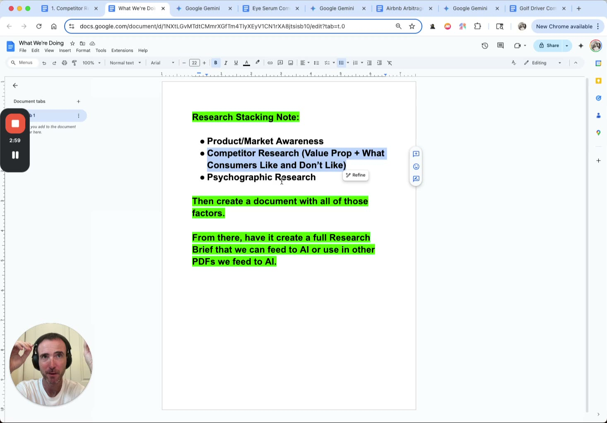
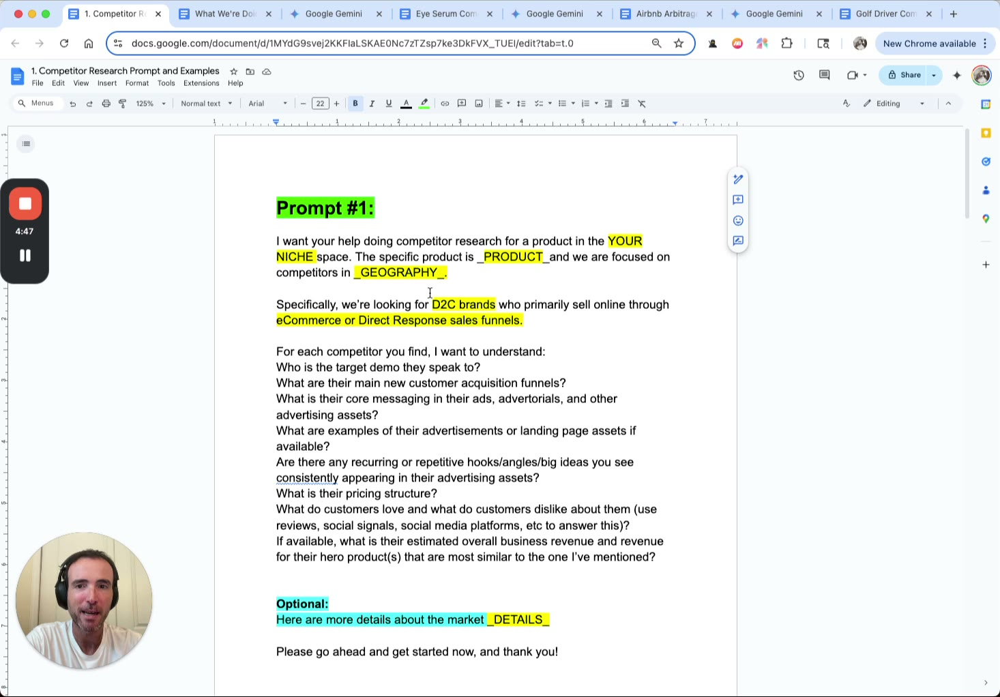
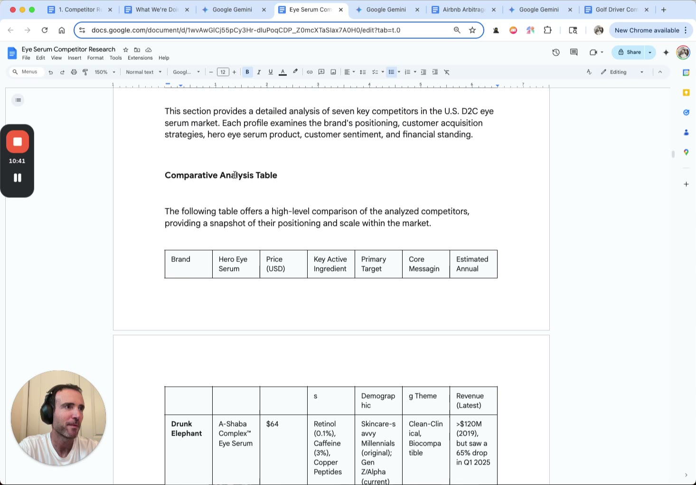
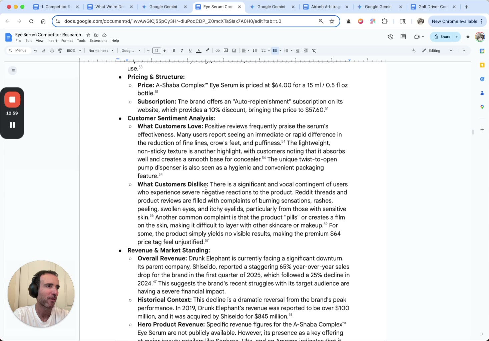
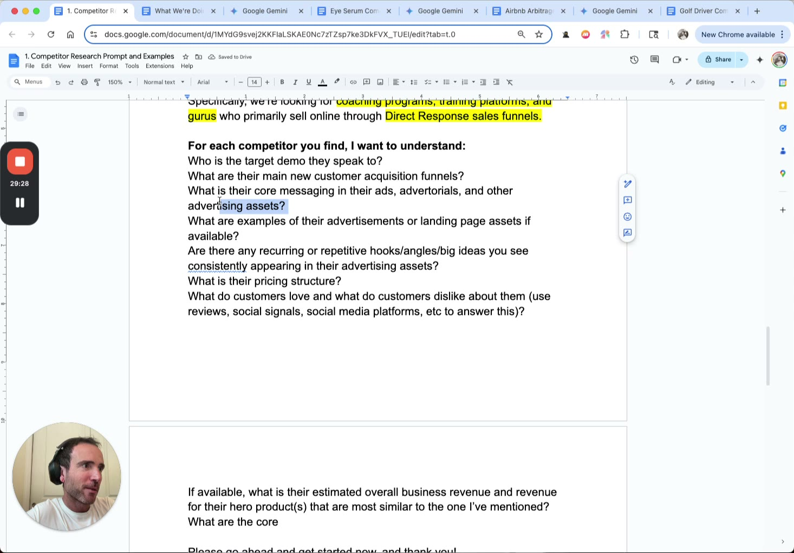
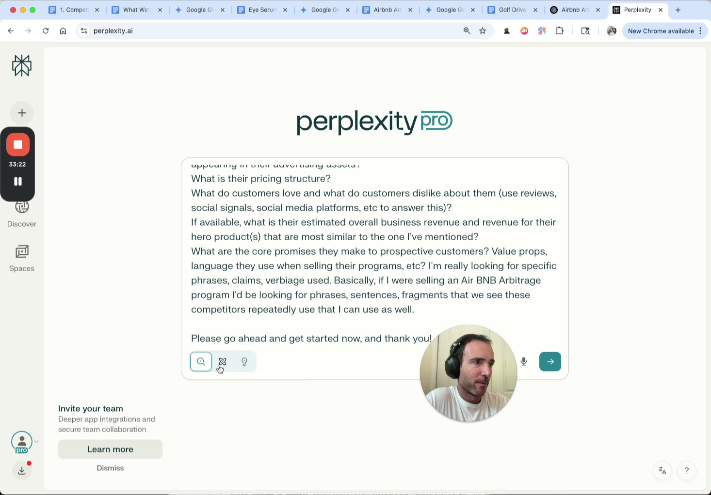
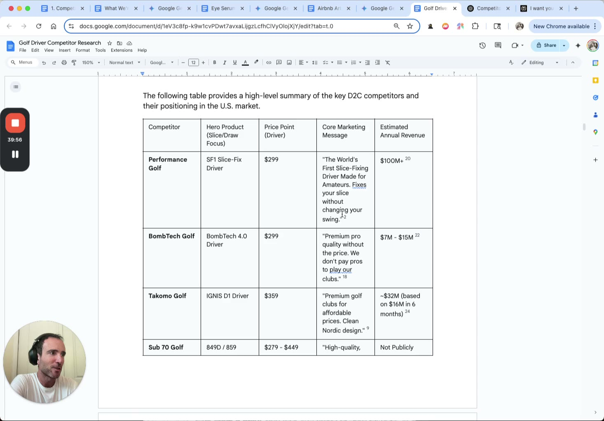
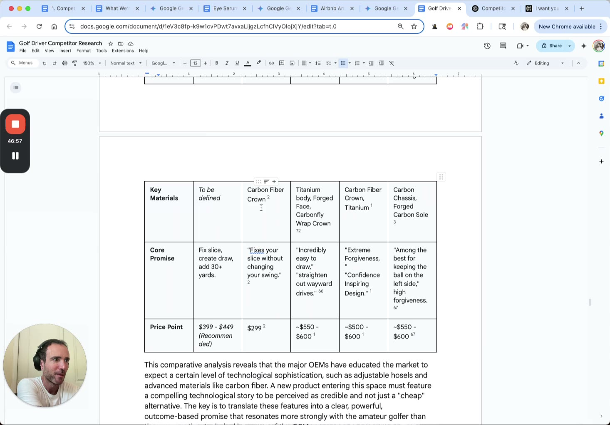
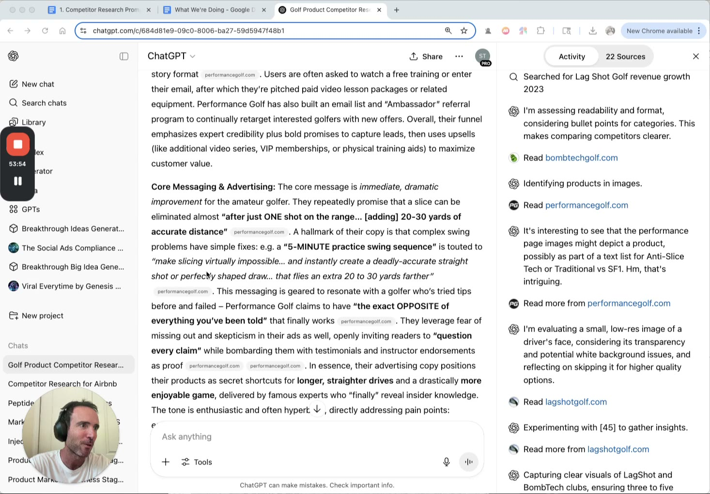

# 2.2 Competitor Research Walkthrough and Examples
> One reusable deep-research prompt that returns each competitor's target demo, funnel, core messaging, hooks, pricing, customer likes and dislikes and revenue, plus a phrase-mining add-on and a rule to switch LLMs when a report misses what you need. The output becomes the second of three research documents that later feed Claude.

## 🤖 Agent use
- **Use when:** you need the claims, promises, hooks, prices and objections in a market before writing a brief, a mechanism or copy; or you need a library of the phrases competitors repeat.
- **Inputs → outputs:** niche, specific product, geography, type of competitor (D2C brands vs coaching programs/gurus), optional market details → per-competitor profiles (demo, funnel, core messaging, hooks, price, customer love/dislike, revenue) and, with the add-on, verbatim competitor phrases. Feeds the research doc (see [2.4 Unified Research Process](02-04-unified-research-process.md)).
- **Rules:**
  - **DO** treat this as one of three stacked inputs: product/market awareness, competitor research ("value prop + what consumers like and don't like") and psychographic research, then "create a document with all of those factors." [00:28–01:51; frame 03:00]
  - **DO** prioritise three things in each report: core messaging (the claims and promises), pricing, and what customers love and dislike. "I don't even care about the philosophy." [13:14–14:21]
  - **DO** rewrite the competitor-type line to fit the market: "D2C brands … eCommerce or Direct Response sales funnels" for products, "coaching programs, training platforms, and gurus … Direct Response sales funnels" for info offers. [18:10–18:37]
  - **DO** add the phrase-mining question when a report lacks specific language: "I'm really looking for specific phrases, claims, verbiage used … phrases, sentences, fragments that we see these competitors repeatedly use." [29:34–31:31; 47:30–48:12]
  - **IF** one LLM does not give what you need **THEN** run the same prompt in another. "When I hit a roadblock, usually I just go try a different LLM." [33:04–33:51; 50:10–50:37]
  - **DO** mine competitor complaints as objections and positioning gaps. Looking at the Performance Golf complaints, he says these are things "we could talk about … addressing these things as objections." [44:55–45:30]
  - **DON'T** read every citation: "The fact finder is going to want to go look at all of this stuff. My personal feeling is you don't need to." [16:57–17:40]
  - **DON'T** accept first-pass numbers: price, revenue and guarantee data differed across the three models for the same brand (see "LLM disagreement" below). Verify before using. (derived)
  - **DON'T** copy competitor claims. They are a vocabulary of what the market responds to; for health, finance and biz-opp they are often unsubstantiated. Reuse structure, never lines or unsupported numbers. (derived; KB rule)
- **See also:** [2.1 Product-Market Awareness](02-01-product-market-awareness.md) · [2.3 Psychographic Research](02-03-psychographic-research.md) · [2.4 Unified Research Process](02-04-unified-research-process.md) · [Competitor ad teardown playbook](../../../../playbooks/competitor-ad-teardown.md) · [Evolve Start Here: Competitor research part 2](../../../evolve/start-here/lessons/036-competitor-research-part-2.md)

## Key ideas

### What the research is for [00:00–04:19]
- The sequence: product/market awareness (done), competitor research (this module), psychographic research (next; "the deeper pain points … hopes and dreams … the original RMBC 'R'"). [00:28–01:24]
- Competitor research answers: "What's the value proposition for competitor products? And what do consumers like and don't like?" [00:56]
- The goal is a single document holding "all the research context that we could give to a large language model": a Claude Project, a bot, or one prompt. [01:24–02:21]
- He uses Claude "for copy for the most part in Claude Project" and has done so "a year plus," but says he constantly tests other LLMs. Advice: "be willing to use different LLMs and see what gets you the best outputs and results"; use the one you can afford. [02:21–03:52]


*"Research Stacking Note": Product/Market Awareness, Competitor Research (Value Prop + What Consumers Like and Don't Like), Psychographic Research, then "create a document with all of those factors" and "a full Research Brief that we can feed to AI." [03:00]*

### The prompt and why you modify it [04:19–07:43]
- Competitor research simply means: who else sells something similar, how do they speak to the market, what do they promise, and what does the market like or dislike about them. [04:19–04:47]
- The prompt bullets seven questions plus an optional revenue question (full text below). [04:47–06:11]
- "With everything I'm teaching, you can always experiment … I'm never going to give you the perfect thing for exactly what you're doing. I'm going to give you very damn close … it's going to be incumbent upon you to modify and experiment." Changing "D2C" to "hardcore direct response" gives "a different report." [06:11–07:43]


*Prompt #1 as it appears in the course doc, with the fill-ins highlighted (YOUR NICHE, PRODUCT, GEOGRAPHY, D2C brands, eCommerce or Direct Response sales funnels, optional DETAILS). [04:48]*

### Eye serum run: what to keep from a 100+ KB report [07:43–17:40]
- Run in Gemini: "skincare … an eye serum … competitors in the U.S.", D2C brands, "let's focus on skincare for women here." He may also have run ChatGPT ("I don't think I even liked it as much"); Claude's deep-research feature is untried because he is "so happy with Gemini." [07:43–08:45]
- The report has background funnel/market sections he considers optional. "Is that really helpful for what we're looking for?" Messaging pillars (science vs nature, transparency and affordability, community and authenticity) are "interesting … but we'll probably see them again later on." [09:14–10:47]
- Tables are the best snapshot. The comparison table lists seven brands with hero serum, price, key active, primary target, core messaging and estimated annual revenue. [10:47–11:49]
- What he reads per competitor: core messaging, price and love/dislike. Core messaging = "what are the claims that they're making." [11:49–13:53]
- Pattern spotting: with a physical product and a physical pain point, claims converge ("lightweight … refresh and firm … tired eyes"), so you "essentially get all the claims you can make right here." [14:21–15:55]
- Love/dislike answers the original RMBC question "what does the market like about existing solutions and what do they dislike." Deeper version comes in the psychographic module. [16:23]


*Gemini's "Comparative Analysis Table": brand, hero eye serum, price, key active ingredient, primary target, core messaging, estimated annual revenue (first row Drunk Elephant A-Shaba Complex, $64). [10:42]*


*Per-competitor "Pricing & Structure", "Customer Sentiment Analysis" (What Customers Love / Dislike) and "Revenue & Market Standing" sections: the parts he says matter most. [13:00]*

### Competitor research vs awareness research [20:02–21:35]
- Awareness research looks at the whole market from "everybody who could buy an eye serum" down to people looking at "specific peptide eye serums." Competitor research is "zoomed in more": we don't care about awareness level here, only about specific products similar to ours (peptide eye serums, Airbnb arbitrage coaching). [20:02–21:35]

### Airbnb arbitrage: changing the competitor type and filling gaps [17:40–37:35]
- Prompt variation: competitors are "coaching programs, training platforms, gurus" selling through direct-response funnels. [18:10]
- The Gemini report (summarised in his words): central narrative "financial freedom … without … property ownership"; a "guru sales funnel" of free YouTube content, free webinar, high-pressure sales call, programs of about $2,500 to $10,000+. [19:08–19:55]
- Co-hosting pivot: "an observable trend among more sophisticated competitors" is moving from pure rental arbitrage to co-hosting, because arbitrage needs about "$10,000 to $15,000" per unit and compresses margins as the market saturates; co-hosting needs little upfront capital and shifts risk to reputation. He treats this as "a strong indicator that the market is maturing." [22:09–23:55]
- Profile highlights read aloud: "more free value than any course in existence" (YouTube-led guru); "Most courses sell you ideas. 10X BNB sells you execution"; "nine tax secrets to wealth" plus a named "bridge method" (Preston Seo); a glow-up story from physician assistant with $900,000 debt to entrepreneur (Calvin Tran). [24:53–27:35]
- Gap: this report "didn't really" give the specific promises that the eye-serum one did. [27:35]
- Fix attempt 1: ask in the same chat for the phrases; result stayed close to the report ("still taking things from the report"). Fix attempt 2: new deep-research run with the extra question; "I'm not getting what I want on this, and that's okay." [29:34–32:27]
- Fix attempt 3: same prompt in ChatGPT o3 Pro deep research and Perplexity deep research. ChatGPT first asks clarifying questions (price range of your program, include gurus and platforms, general STR coaching OK, US only?). He answers: both individuals and platforms; yes general short-term-rental coaching is fine. Perplexity returns claims quickly but is "weak on the customer feedback." [33:04–36:33]
- Result: the ChatGPT output gave the best list of repeated lines (below). "Gemini was decent at an overview, but you could argue there's better stuff from ChatGPT … test different LLMs and even run the same prompt in different LLMs. I do that constantly." [49:33–50:37]


*The Airbnb version of the prompt after the added "What are the core promises they make to prospective customers? ..." question. [29:30]*


*The same prompt pasted into Perplexity with deep research toggled on. [33:24]*

### Golf driver: specificity beats general quality messaging [37:35–47:30]
- Prompt: "special new driver that promises to fix a golfer's slice, give them a draw, and add 30+ yards", D2C brands, plus the optional detail "let's focus on amateur golfers; the market is not for professionals here." The docx version of the golf prompt includes the phrase question; on screen the first Gemini run did not, and he adds it for the Perplexity and ChatGPT reruns. [37:35–38:46; 47:30–48:12; docx Example 3]
- Report framing: two pains dominate amateur golf, lack of distance and "the persistent confidence-destroying slice"; personas are "frustrated slicer, value-seeking improver, casual lifestyle golfer". He says this is interesting but "we already do psychographic research." [38:46–39:32]
- Core messaging snapshot on screen: Performance Golf "world's first slice-fixing driver made for amateurs, fixes your slice without changing your swing"; BombTech "premium pro quality without the price. We don't pay pros to play our clubs"; Takomo "premium golf clubs for affordable prices, clean Nordic design"; Sub 70 "high quality handcrafted clubs at a fair price by cutting out advertising and retail markups"; Stix "sleek minimalistic modern clubs at a good price making golf more accessible." [39:32–40:30; frame 40:00]
- His insight, aimed at people who dismiss direct response: the brand with a "super specific direct response promise" is over $100 million in revenue, while the quality/price/design brands sit far below (the others are listed at $4M to about $32M on screen). "Do you see why direct response wins?" [40:30–41:29] (Revenue figures are LLM estimates. Devil's-advocate caveat, derived: one data point; Performance Golf also runs a subscription app, so revenue is not only the driver's message.)
- Performance Golf playbook as read from the report: target persona = "the frustrated slicer seeking a magic bullet"; promise = "instantly fix your slice," "go from weak slices to hitting flush straight shots and even baby draws after just one shot"; mechanism = "square face technology"; plus authority, social proof, pricing, guarantee and bonus stack. [41:29–43:36]
- Complaints (second half of the profile): the driver does not work, poor durability (face caving in), distance loss, and the "Trojan horse" suspicion that the club is a lead magnet for the subscription app. "Obviously we're not doing a beauty product here. This is a physical product, like a tool. But … we got big ideas, core promises … what people like and dislike." [43:36–45:30]
- BombTech: generally positive feedback, but the "cowbell" impact sound and build-consistency complaints. [45:30–46:21]
- Legacy brands' table (core promise row): "Fixes slice, creates draw, adds 30 yards"; "fixes your slice without changing your swing"; "incredibly easy to draw"; "straighten out wayward drives"; "extreme forgiveness"; "confidence inspiring design"; "among the best for keeping the ball on the left side"; "high forgiveness." [46:21–47:30]


*Gemini's D2C golf competitor table: hero product, price point, core marketing message, estimated annual revenue (Performance Golf $100M+, BombTech $7M-$15M, Takomo about $32M). [40:00]*


*The "Core Promise" row of Gemini's claim matrix: "To be defined" for the user's own product versus competitor and legacy promises. [47:00]*


*ChatGPT deep research for golf: repeated claims such as "after just ONE shot on the range" and "5-MINUTE practice swing sequence." [54:00]*

### Which LLM for what (his experience) [47:30–55:32; 36:33–37:35]
- Default order: start with Gemini; if it does not return the claims you want, go to ChatGPT. Perplexity was "okay"; after seeing ChatGPT's golf output he said he would "skip perplexity and go right to ChatGPT." [36:33–37:35; 54:56–55:32]
- ChatGPT's quirk: it always asks follow-up questions, which he finds annoying; answer them. [33:51–35:10; 52:01–53:36]
- The study-guide PDF (not Stefan's words) adds that Gemini suits overviews, ChatGPT phrase-finding, Perplexity extra competitors and Claude copy-pattern analysis; the Claude role is not in the video. [PDF 02-2 p.4]

### Wrap-up and scope [55:32–57:09]
- Next modules: psychographic research, then "stacking everything together" to a full research brief. Later bonus research modules cover existing customer data. [55:32–56:02; 57:04]
- He says you don't have to do all of this; "lazy shortcut secret ways" come later. But: "I honestly would not skip the product market awareness thing unless you really know … the answer. I think this is a big mistake I've been making recently that … since correcting, I've seen better results." [56:02–56:36] (instructor claim)

## Steps / framework
1. **Set inputs.** Niche, one-line product, geography, competitor type, optional details (e.g. "amateur golfers; not for professionals"). [04:47–06:11; 38:08]
2. **Run the base prompt** in Gemini deep research. Export to a doc. [07:43–09:14]
3. **Skim, then extract.** Per competitor capture: core messaging/claims, price, love/dislike, revenue if given. Skip background, strategy and philosophy unless needed. [13:14–14:21]
4. **Check for specific language.** If you have no repeated phrases/claims, run the phrase question in the same LLM (in a new deep research run, not only in chat). [29:34–32:27]
5. **If still thin, change LLM:** ChatGPT (answer its clarifying questions), then Perplexity. [33:04–36:33; 52:01–55:32]
6. **Merge:** claims table + objections list + price ladder into the research doc, next to the awareness and psychographic outputs. [03:52; 55:32–56:02]
7. **Use** the competitor objections as copy objections and the repeated promises as a vocabulary check (derived): list what the market already hears, then differentiate via the mechanism ([3.1](03-01-unique-mechanisms-overview.md)).

## Examples

### Eye serum (US, women), from the Gemini report in the course zip
| Brand | Hero serum | Price | Core messaging | Top complaints |
|---|---|---|---|---|
| Drunk Elephant | A-Shaba Complex Eye Serum | $64 (10% off with subscription) | "Smooth. Depuff." 0.1% vegan retinol, 3% caffeine, copper peptides; "97% showed improvement in undereye bags, crow's feet, and dark circles" after 8 weeks | Burning, rashes, peeling, swollen eyes; pilling; premium price for no visible results |
| The Ordinary | Multi-Peptide Eye Serum | $25 | "Multiple peptide technologies" for crow's feet, wrinkles, bags, puffiness, dark circles; openly explains price by "high concentration of actives" | Stinging, burning (anecdotally linked to niacinamide); some prefer cheaper caffeine serum |
| Tula | Instant De-Puff Eye Renewal Serum | $58 | "Potent & lightweight formula … refresh & firm the look of tired eyes" | Fails to deliver long-term results; dryness or chalky residue; some burning |
| Glossier | Full Orbit Entire-Eye Brightening Cream (gel-cream) | $28 | Hydrates up to 24 hours, depuffs, brightens, safe for eyelids, less likely to cause milia | Nice moisturizer, little brightening or wrinkle effect |
| Sunday Riley | 5 Stars Retinoid + Niacinamide Eye Serum | $65 | "Wrinkle-fighting serum powered by a 6% retinoid complex" | "Significant burning," swelling, peeling; "not for sensitive skin" |
| Beauty of Joseon | Revive Eye Serum: Ginseng + Retinal | about $17 | 10% ginseng root extract, 2% retinal liposome "11 times more effective than retinol" (report's wording) | Rare burning or dry patches |
| StriVectin | Peptight 360 Tightening Eye Serum | $72 | "The power of peptides for eyelids, under eyes and crow's feet"; "100% showed improvement in the look of firmness and elasticity" after 8 weeks | Too intense for sensitive skin; film that flakes under makeup |

The report's synthesis (not requested by Stefan, who skipped strategy sections) names an "Efficacy-Sensitivity Paradox" (strong actives vs irritation) and suggests a "gentle-action" position at $35-$50. [report "Strategic Synthesis"]. Treat as a hypothesis to test, and any clinical-percentage claim needs our own substantiation. (derived)

### Airbnb arbitrage coaching (US), Gemini report matrix, abbreviated
| Competitor | Hook (report wording) | Funnel | Price (report) | Main criticism |
|---|---|---|---|---|
| Sean Rakidzich (Million Dollar Renter / Airbnb Automated) | "More free value than any course"; "Make money from home. literally" | YouTube, free Facebook group, a la carte courses | $11-$700+ | Advice to not disclose Airbnb use to landlords; weak own host ratings |
| 10XBNB | "We sell execution, not ideas" | SEO content, free bootcamp, sales call | $7,000 mastermind | Few; some review-authenticity doubts |
| Preston Seo | "Bridge Method", "tax secrets" | Webinar, high-pressure call, tax upsell | $6,800-$9,800+ | Misleading costs, refund issues |
| Calvin Tran | Physician-assistant glow-up story | Instagram, webinar, sales call | $3,500 / $8,000 | Called manipulative by critics |
| Brian Page (BnB Formula) | "Secret sauce", endorsed by a celebrity investor | Book funnel, upsells, call | $1,997-$10,000+ | Deceptive, no refunds; BBB complaints |

Gap the report found: the "transparency" and "responsible arbitrage" angle; consumer distrust is the opening. [Gemini Airbnb report, "Identifying Market Gaps"]. These are competitor claims and critic claims as reported by an LLM, not verified.

### Phrase list returned by ChatGPT/Perplexity for Airbnb (read aloud) [49:33–50:10; 35:10–35:55]
"No property needed. Use other people's homes." · "Quit your 9-5" · "Rental arbitrage can generate six-figure income fast" · "No experience or property needed" · "Our founder earned $301K his first year on Airbnb" · "Financial freedom from using other people's properties" · "Make six figures on Airbnb in months" · "a business that runs on autopilot" · "Zero down real estate. Control properties you don't own" (ChatGPT). Perplexity: "Quit 9 to 5 and achieve financial independence with zero property investment"; "Learn how to build a seven figure self-running Airbnb business"; "Start with zero units, zero industry experience, and zero in revenue." Income and "zero risk" claims here are biz-opp territory; copy the pattern (specific promise + removed barrier), not the numbers. (derived)

## Structured units

### Hooks (competitor lines surfaced in the lesson)
| Hook (verbatim or near) | Heuristic(s) | Emotion / zone | Self targeted | Why it works | Source |
|---|---|---|---|---|---|
| "MORE free value than ANY other course in existence" | Reciprocity, authority (derived) | Trust | — | Builds trust before any sale | [24:53] |
| "Most courses sell you ideas. 10XBNB sells you execution." | Contrast against category (derived) | Confidence | — | Counters the market's top complaint | [26:00] |
| "Nine tax secrets to wealth" plus the named "Bridge Method" | Insider knowledge, proprietary name (derived) | Curiosity | — | Exclusivity and a unique-sounding system | [27:01] |
| "The world's first slice-fixing driver made for amateurs" | Specificity, first-claim (derived) | Relief | Frustrated slicer | Single dominant pain, single promise | [40:00; 43:03] |
| "Fix your slice without changing your swing" | Effort removal (derived) | Hope | — | Skips lessons and practice | [39:32; 42:05] |
| "Premium pro quality without the price. We don't pay pros to play our clubs." | Anti-establishment (derived) | — | — | Price/value framing; general, so weaker in his view | [40:00] |

### Ad teardowns (competitor playbooks, from reports)
| Brand / product (niche) | Format | Hook / opening | What works | What fails | Fix suggested | Principle | Source |
|---|---|---|---|---|---|---|---|
| Performance Golf SF1 driver (golf) | Direct-response sales pages and ad funnel (per report) | "World's first slice-fixing driver made for amateurs" | One pain, one promise; branded mechanism ("Square Face Technology"); proof elements; $100M+ estimated revenue | Reviews: does not work, durability, distance loss, "Trojan horse" for the app | Address those complaints as objections in our own copy | Specific promise beats general quality | [41:29–45:30] |
| Drunk Elephant A-Shaba (skincare) | Product page, Sephora/Ulta | "Smooth. Depuff." | Concentrations and clinical percentage in the claim | Irritation, pilling, $64 price | Gentler positioning (report suggestion) | Numbers make claims feel credible; check substantiation | [11:49–13:53] |
| 10XBNB (Airbnb coaching) | Content, webinar, call | "We sell execution, not ideas" | Reverses the market's main criticism; community as "secret weapon" | Few complaints | Study first (instructor: positive feedback) | Answer the category's top objection in the hook | [26:20–27:01] |

### Rules of thumb
- **DO** get claims, price and complaints; skip philosophy. [13:53]
- **IF** a report is "an overview" but you need language **THEN** add the phrase question and rerun, or switch LLM. [29:34; 50:10]
- **IF** competitors are all "premium, affordable, clean design" **THEN** a specific pain-point promise stands out (instructor view). [40:30–41:29]
- **DON'T** conflate this with awareness research; here only "similar products" matter. [20:02–21:35]

## Prompts / templates (verbatim)

**Prompt #1 (from `02-1 Competitor Research Prompt Examples.docx`):**

```
I want your help doing competitor research for a product in the YOUR NICHE space. The specific product is _PRODUCT_and we are focused on competitors in _GEOGRAPHY_.

Specifically, we're looking for D2C brands who primarily sell online through eCommerce or Direct Response sales funnels.

For each competitor you find, I want to understand:

Who is the target demo they speak to?

What are their main new customer acquisition funnels?
What is their core messaging in their ads, advertorials, and other advertising assets?
What are examples of their advertisements or landing page assets if available?
Are there any recurring or repetitive hooks/angles/big ideas you see consistently appearing in their advertising assets?
What is their pricing structure?
What do customers love and what do customers dislike about them (use reviews, social signals, social media platforms, etc to answer this)?

If available, what is their estimated overall business revenue and revenue for their hero product(s) that are most similar to the one I've mentioned?

Optional:
Here are more details about the market _DETAILS_

Please go ahead and get started now, and thank you!
```

**Example #1 fill-ins (eye serum):** niche `skincare`; product `an eye serum`; geography `the U.S.`; competitor type `D2C brands` / `eCommerce or Direct Response sales funnels`; details `let's focus on skincare for women here`.

**Example #2 changes (Airbnb arbitrage).** Competitor line becomes:

```
Specifically, we're looking for coaching programs, training platforms, and gurus who primarily sell online through Direct Response sales funnels.
```

and this final question is appended before "Please go ahead":

```
What are the core promises they make to prospective customers? Value props, language they use when selling their programs, etc? I'm really looking for specific phrases, claims, verbiage used. Basically, if I were selling an Air BNB Arbitrage program I'd be looking for phrases, sentences, fragments that we see these competitors repeatedly use that I can use as well.
```

Product text used: `a coaching program and community that shows people how they can lease a property long-term and then manage it as a short-term rental (with the property owner's consent)`; niche `air BNB arbitrage`; geography `the U.S.`.

**Example #3 changes (golf).** Niche `golfing`; product `special new driver that promises to fix a golfer's slice, give them a draw, and add 30+ yards to their drive`; geography `in the U.S. market`; competitor type back to D2C; details:

```
Here are more details about the market: let's focus on amateur golfers, the market is not for professionals here.
```

and the appended question:

```
What are the core promises they make to prospective customers? Value props, language they use when selling their clubs, etc? I'm really looking for specific phrases, claims, verbiage used. Basically, if I were selling new golf club that adds distance and fixes a golfer's slice, I'd be looking for phrases, sentences, fragments that we see these competitors repeatedly use that I can use as well.
```

(Verbatim from docx Example 3. The spoken version [47:30–48:12] differs slightly.)

**Spoken follow-up used in the same chat after the first Airbnb report** (paraphrased from speech, not a file) [30:47–31:31]: "Okay, thanks. However, I'm really looking for specific phrases, claims, verbiage used. Basically, if I were selling an Airbnb arbitrage [program], I'd be looking for phrases, sentences, fragments that we see these competitors repeatedly use."

**Clarifying answers he gave ChatGPT** [34:38–35:10; 52:39–53:36]: Airbnb run: "both" individual influencers and structured platform brands; general short-term-rental coaching programs are fine. Golf run: "focus on drivers for now, or swing improving equipment specifically related to longer drives and fixing slices"; "focus on similar value props"; "you can include performance golf but also any others"; "international brands selling in the US are fine."

## LLM disagreement on the same brands (evidence for verification)
| Fact | Gemini | Perplexity | ChatGPT |
|---|---|---|---|
| BombTech price | Driver $299 | Driver + 3-wood bundle $177 (was $347); driver about $89-$120 | Driver + 3-wood bundle $257 (was $427) |
| BombTech revenue | $7M-$15M | $12M-$15M | not stated in the excerpt read |
| Performance Golf SF1 price | $299 (anchored above $399) | n/a | list $399, promo $249 |
| Performance Golf revenue | $100M+ | n/a | "$90 million" platform (Forbes mid-2024, per ChatGPT) |

Source: golf reports 1-3 in the course zip. Lesson: treat prices, revenue and guarantees as leads to verify on the live site.

## Screenshots
Nine frames embedded above: research stacking note, prompt template, eye serum comparison table, competitor profile sentiment, Airbnb phrase question, Perplexity prompt, golf comparison table, golf claim matrix, ChatGPT golf output. Taken from keyframes near 03:00, 04:48, 10:42, 13:00, 29:30, 33:24, 40:00, 47:00, 54:00. The on-screen Airbnb competitor profiles were not captured to avoid featuring named individuals' claims.

## How to apply
- [ ] Fill the base prompt; change the competitor-type line to match the market (D2C brands vs coaching/gurus).
- [ ] Add the phrase-mining question from the start for info products, and for any market where you need language.
- [ ] Run Gemini first; if claims are thin, run ChatGPT (answer its questions), then Perplexity.
- [ ] Extract a table: competitor | core claims | price | love | dislike | revenue (unverified).
- [ ] Verify prices, guarantees and revenue on the live sites before using any number.
- [ ] List the top three complaints per competitor as objections to pre-empt in copy.
- [ ] Mark every competitor health, finance or income claim as "do not reuse without substantiation."
- [ ] Save the reports next to the awareness output (2.1) for the unified research doc (2.4).

## Related
- Previous: [2.1 Product-Market Awareness](02-01-product-market-awareness.md) · Next: [2.3 Psychographic Research](02-03-psychographic-research.md) · [2.4 Unified Research Process](02-04-unified-research-process.md)
- Mechanism step that uses competitor gaps: [3.1 Unique Mechanisms Overview](03-01-unique-mechanisms-overview.md)
- Shared KB: [Competitor ad teardown](../../../../playbooks/competitor-ad-teardown.md) · [Competitor landscape audit](../../../../playbooks/competitor-landscape-audit.md) · [Customer research stack](../../../../frameworks/customer-research-stack.md) · [Evolve Start Here: research doc](../../../evolve/start-here/concepts/research-doc.md) · [Evolve Start Here: competitor research part 1](../../../evolve/start-here/lessons/035-competitor-research-part-1.md)
- Difference to note: Evolve's competitor research works from ad libraries and real ads; this lesson works from LLM deep-research summaries of competitors' positioning and reviews, so it has no ad creative to study and relies on the LLM's accuracy.

## Sources and limitations
- Transcript: [02-2 Competitor Research Walkthrough and Examples.txt](<../../../../../raw/stefan-georgi/rmbc-ii/_transcripts/Stefan Georgi - RMBC II (1)/02-DEEP RESEARCH/02-2 Competitor Research Walkthrough and Examples.txt>) (single video, 57:17, fully read). Captions: `02-1 Competitor Research Prompt  Examples.srt`.
- Documents: docx 02-1 (prompts), PDF 02-2 (AI-written study guide). Zip archives: eye serum (Gemini), Airbnb (Gemini, Perplexity, ChatGPT) and golf (Gemini, Perplexity, ChatGPT).
- The ChatGPT Airbnb file in the zip contains only a share link and a "works cited" list, not the report body; the phrase list above is from the spoken walkthrough [49:33]. The comparative tables in the eye serum docx extracted as empty cells; brand, hero product and price details come from the profile sections of the same report plus the on-screen frame.
- Whisper mishearings fixed (checked against the platform caption or the reports): "Tacoma Golf" = Takomo Golf; "Six Golf" = Stix Golf (PDF and report); "Guassier" = Glossier; "Beauty of Josien" = Beauty of Joseon; "Preston SEO" = Preston Seo; "Sean Radkiewicz" = Sean Rakidzich; "Kijera" = Keidra; "Blake Roka/Rocha" per Perplexity file; "quad" = Claude; "Bomb Tech" = BombTech; "PXG" as read. The captions also contain errors ("Radkevich").
- Revenue figures, estimates and customer-complaint summaries are LLM outputs without verified sources inside the course files. Competitor names appear as course-example data; do not repeat negative claims about named individuals without checking them.
- Health, finance and biz-opp: eye serum clinical percentages, income claims in the Airbnb phrases and "fix your slice" performance claims are competitor claims; they need substantiation and platform/FTC review before reuse. The Airbnb report records advice to hide the intended use from landlords, which is an ethical/legal red flag; do not echo it.
