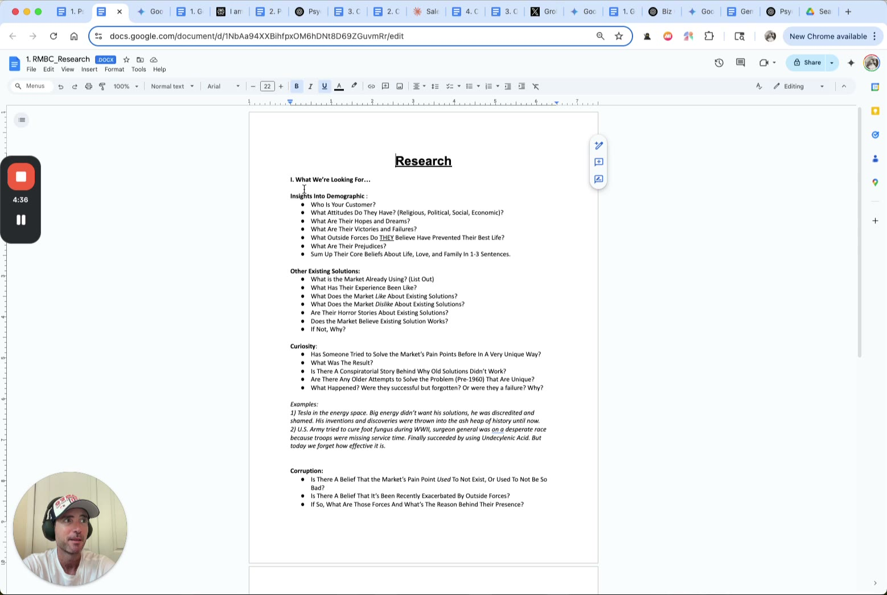
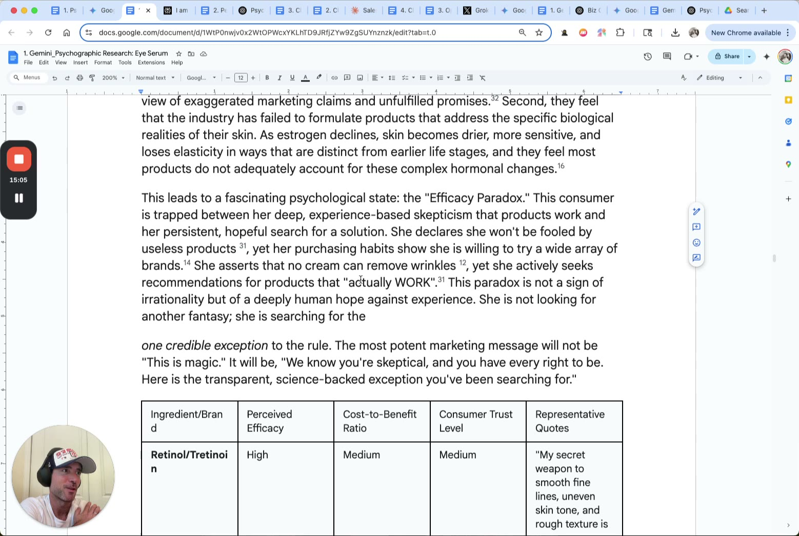
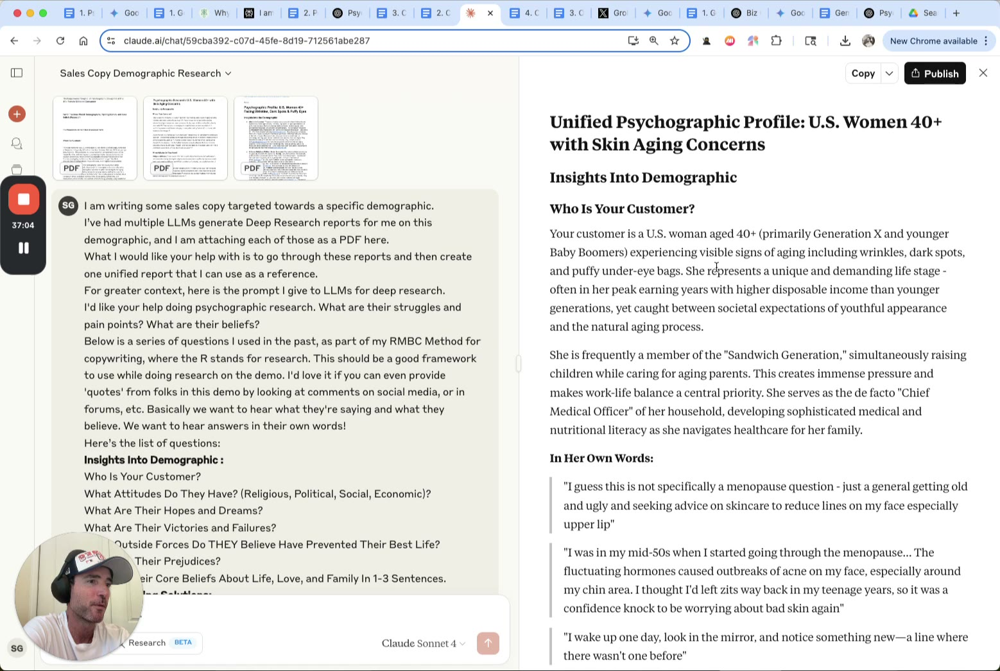
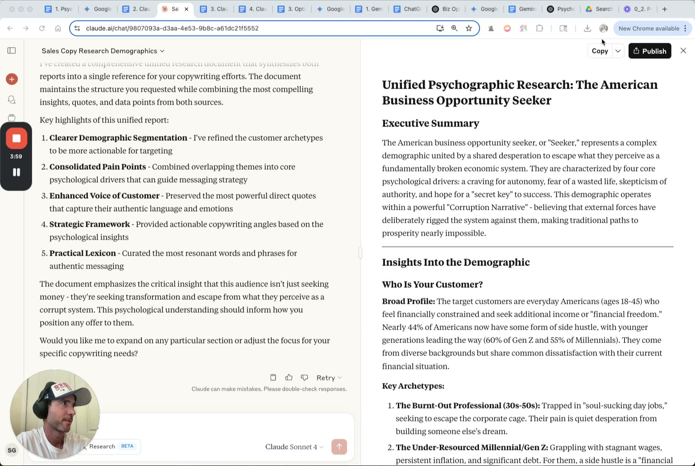
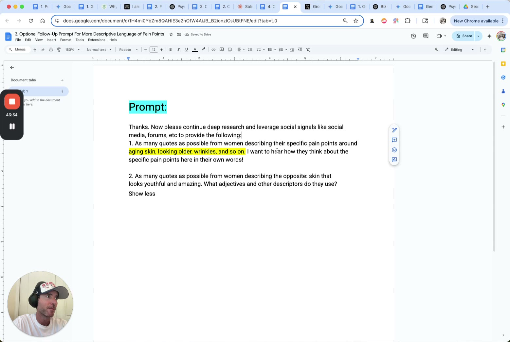

# 2.3 Psychographic Research
> Run a fixed 22-question psychology questionnaire through two or three deep-research LLMs, merge the reports into one Claude document, then mine it for beliefs, enemies, forgotten-cure stories, customer language and angles that product-market-awareness and competitor research cannot give you.

## 🤖 Agent use
- **Use when:** a new product/market has no psychographic profile yet, or before writing any VSL, advertorial, ad set, PDP or email that has to speak to a specific demographic's beliefs. It is the third research input (after [2.1 Product-Market Awareness](02-01-product-market-awareness.md) and [2.2 Competitor Research](02-02-competitor-research-walkthrough-and-examples.md)) that [2.4 Unified Research Process](02-04-unified-research-process.md) merges.
- **Inputs → outputs:** demographic + product problem (one sentence, e.g. "U.S. women 40+ with wrinkles, dark spots or puffy eye bags") → 2–3 raw deep-research reports (Gemini, ChatGPT, optionally Perplexity), saved as PDFs → one unified Claude psychographic report with "In Her Own Words" quotes → optional extra pain-point and desired-outcome quotes → a notes file of angle/hook/story ideas.
- **Rules:**
  - **DO** answer all 22 questions in four blocks (Demographic Insights, Other Existing Solutions, Curiosity, Corruption) and ask for quotes "in their own words". [v2 00:00; 03-1 prompt doc]
  - **DO** run the identical prompt in at least two LLMs; the instructor "typically" runs Gemini and ChatGPT and sometimes adds Perplexity. [v2 35:49]
  - **DO** read the full reports at least once when you are new to a market ("there will always be little insights … that might get missed when you summarize stuff with LLMs"), but skim fast. [v1 01:05–02:33]
  - **DON'T** move slowly. "You cannot move slow anymore." If you are overwhelmed, the Claude merge prompt gets you "99% of what we want". [v1 01:33–02:33; v2 48:14]
  - **DO** keep a separate notes doc open while reading and log every interesting line, story or stat. [v2 36:55]
  - **DO** use the Claude merge prompt generically (leave the niche out); Claude infers the market from the PDFs. [v3 02:41]
  - **DON'T** leave the Curiosity/Corruption examples in the prompt without thinking: the example steers the output (Gemini returned "Ancel Keys" for a skincare brief because the example named him). [v2 23:50–26:33]
  - **IF** one LLM is weak on a section (Perplexity on isolated-tribe stories) **THEN** rely on the other LLM's section; that is the reason to run several. [v2 32:23]
  - **IF** you want richer customer language **THEN** run the follow-up quotes prompt in the same chat and paste the result into a separate doc. [v2 42:40–47:07]
  - **IF** a quote, statistic or historical story will appear in copy **THEN** verify it at its source link first (derived). LLM "quotes" drift between passes, and several stats are unsourced here.
  - **DON'T** copy health, cure-suppression or income claims into copy as stated; they are research leads, not substantiation (see "Compliance flags").
- **See also:** [2.1 Product-Market Awareness](02-01-product-market-awareness.md) · [2.4 Unified Research Process](02-04-unified-research-process.md) · [3.1 Unique Mechanisms Overview](03-01-unique-mechanisms-overview.md) · [Evolve: labels and customer language](../../../evolve/copywriting/concepts/labels-and-customer-language.md) · [Evolve: beliefs](../../../evolve/copywriting/concepts/beliefs.md) · [Customer research stack (Tether Lab)](../../../../frameworks/customer-research-stack.md)

## Key ideas

### Where this sits and the speed-versus-depth rule [v1 00:00–02:33]
- Module order: product-market awareness levels → competitor research → psychographic research → "stacking it all together to create a sort of like meta research document brief" fed to LLMs when writing copy. [v1 00:00]
- Deep-research tools let you "get data really fast", summarise it, "feed it to an LLM, and you don't really even need to read or understand everything". But "in a perfect and ideal world, it is worthwhile for you to read the full deep research reports". [v1 00:28–01:33]
- Failure mode he names: "fact finders" who "get in the weeds and … overthink everything and … find a way to take something incredible like AI and LLMs and still move really slow. And it is really inexcusable at this point." [v1 01:33–02:03]
- Compromise: if you are new to a market, read/skim everything once ("doesn't mean you need to take days"). [v1 02:03–02:33]

### Demographic vs psychographic [v1 02:33–05:30]
- Demographic = "basic … details or characteristics of who your market is … the facts" (e.g. woman 45+, average household income $80,000, married, liberal-leaning, owns vs rents). [v1 02:59–03:30]
- Psychographic = "more about the mind … the psychology of your target market" — hopes, dreams, victories, failures. [v1 04:01]
- The question list is the original "R" of RMBC from RMBC I; he claims he "was really the first person to teach psychographic research as it comes to copy … also the first person to teach unique mechanisms" (instructor claim). [v1 04:31–04:59]
- The first question ("Who is your customer?") is the one that is "sort of traditional demographic". Examples he gives: 45+ women, 50+ men, 18–35 men wanting a side hustle, amateur golfers (50+ rural men). [v1 04:59–05:30]


*The original RMBC I "Research / What We're Looking For" sheet that the 2025 prompt re-uses: Insights Into Demographic, Other Existing Solutions, Curiosity (with the Tesla and WWII foot-fungus examples) and Corruption. [v1 04:36]*

### What each question buys you (instructor's reasoning) [v1 05:30–24:05]
| Question block | Why it matters for copy | Source |
|---|---|---|
| Attitudes (religious, political, social, economic) | Sets the tone and the villain. Biz-op to people who think "billionaires are evil": "level the playing field … the greedy one percent … know this secret". Biz-op to people who think hard work wins: "the same secret that Elon Musk and Steve Jobs … used … anyone can use". Health: a conservative market vs a left market will respond differently to references to current political figures; "you don't have to get that hardcore … but it's just good information to have". | [v1 05:30–08:10] |
| Hopes and dreams | Go "beyond just don't have wrinkles": feeling confident/sexy in your own skin, "loving who you see looking back in your mirror", speaking to a packed room, taking the family to Disney "and not even flinching at the crazy price tag". Tie them to the pain point being solved. | [v1 08:10–09:55] |
| Victories and failures | How they tried to fix it before. Biz-op: victory = stable job and savings; failure = two side businesses that wasted time and money. Skincare: victory = sunscreen early; failure = expensive products still leave wrinkles, or Botox looks unnatural. | [v1 09:55–10:55] |
| Outside forces they blame | Most people with a pain point blame an external culprit: the tax system and the 1%, "big pharma" keeping cures from you, a broken food system, toxins/microplastics ("the deck is stacked against you"). Copy can voice it: "You may feel the deck's stacked against you … I'm going to share what you can do." | [v1 10:55–12:56] |
| Prejudices | Means biases and beliefs, "not … racism". Examples: against big pharma/doctors/government/business; 45+ women against 25-year-old beauty-counter reps who "don't get it"; young biz-op buyers against baby boomers who "got lucky". Decide whether to speak to it in "a long-form sales letter, an advertorial, an ad … a product page". | [v1 12:56–14:22] |
| Core beliefs in 1–3 sentences | A compressed worldview summary. | [v1 14:22] |
| Existing solutions (list, experience, like, dislike, horror stories, do they believe it works) | Weight loss alone spans supplements, workout programs, gyms, GLP-1 drugs, coaching, diets. Horror stories are copy fodder (he cites a Reddit plastic-surgery story as an idea for "an ad or a sales letter or a VSL"). If the market believes a competing solution works (GLP-1), you can still contrast on cost, self-injection, "it's a medication", and adverse events. | [v1 14:22–17:13] |
| Curiosity (unique past attempts, conspiracy, pre-1960) | "Always interesting stuff for copy fodder." Examples: Nikola Tesla's suppressed energy inventions; WWII nail/foot fungus and undecylenic acid ("the nail fungus cure that helped win World War II. It's still a great banger promo", his own compliant test "didn't hit" but he still thinks it could); dust-bowl farmer wives and a forgotten tallow remedy. | [v1 17:13–21:49] |
| Corruption (pain point used not to exist / recently made worse) | "Paradise lost … the Garden of Eden." Example narratives: big-tobacco scientists moved into food in the 1980s; Dr. Ancel Keys and the low-fat era; remote people without the condition (ProDentim-style "2,000-year-old fossilised teeth with no cavities"). "Powerful messaging that can be used in ads, VSLs." | [v1 21:49–24:05] |

- Transferable result: "There's a lot of things that can be generated by the research that we do. Angles, hooks, ideas." [v1 24:05]
- Disclosure he makes: he sells GLP-1 access through a telemedicine platform as a middleman, so he can find the horror stories. [v1 16:47] (He also says he is "not going to over-worry on the compliant claims" in his own biz-op illustration, "Don't at me". [v1 07:40]. That is a hint to apply your own compliance review, not a licence.)

### The prompt in action: eye serum, Gemini [v2 00:00–27:52]
- The prompt is simple: "I am writing some sales copy targeted towards [demo] … questions … I'd love it if you can even provide quotes … in their own words". [v2 00:00] Verbatim version is in "Prompts" below.
- Three runs: eye serum (U.S. women 40+), Airbnb arbitrage biz-op, golf. Three LLMs for eye serum: Gemini, Perplexity, ChatGPT. [v2 00:00–01:24]
- Gemini output structure (docx): Part I Inner World, Part II Crowded Battlefield, Part III Buried Truth (Curiosity), Part IV Modern Betrayal (Corruption). It reads as a title-led report ("The Empowered Skeptic: A Psychographic Blueprint of the 40+ Female Skincare Consumer"). [Gemini eye serum doc, headings]
- Insights he highlights from Gemini (each one is a copy lever):
  - **Life stage and identity.** She is "sandwich generation" and "the de facto chief medical officer of her household", so she reads ingredients through a family-protector lens and distrusts gimmicks; messaging that "respects this expert role will resonate far more" than vanity messaging. [v2 01:24–03:40]
  - **Core tension.** Internally more confident than ever, externally her appearance is declining "in ways that defy her control". Instructor's line to test in an advertorial or sales letter: it is "profoundly unfair" that "just as I start feeling more confident and comfortable in my own skin, that same skin starts to betray me". He flags it as "not perfect to copy". [v2 06:26–07:30]
  - **Blamed forces.** Her own biology (perimenopause/menopause) and a medical community that "dismissed, under-researched" women's health; so a prejudice against being patronised. [v2 07:30–08:46]
  - **Prejudices.** Against gimmicky marketing, influencers, "miracle creams"; belief that Vaseline-simple routines beat expensive products. [v2 08:46]
  - **What she likes.** Texture: "melt in" rather than "sit on the skin"; he draws the copy implication: talk about "it melts into your skin, it absorbs, it doesn't sit on the top". [v2 10:12–11:20]
  - **What she dislikes.** Feeling cheated; heavy greasy "mature skin" formulas that cake in lines; young Sephora associates. He also notes the tension that she dislikes the word "mature" but wants products "for her skin". [v2 11:20–14:03]
  - **Efficacy paradox.** She is "trapped between her deep experience-based skepticism that products work and a persistent, hopeful search for a solution". Gemini's line he endorses: not "This is magic" but "We know you're skeptical, and you have every right to be. Here is the transparent, science-backed exception you've been searching for." [v2 14:03–15:05; Gemini doc]
  - **Ingredient table.** Gemini built a table per ingredient/brand (retinol, vitamin C, hyaluronic acid, …) with perceived efficacy, cost-to-benefit, consumer trust and representative quotes. [v2 15:05]
  - **Forgotten cures.** Madame Récamier's "secret" cream (later exposed as containing cheap ingredients and mercury), Royal Raymond Rife's "beam ray" suppression story (not skincare; "something you could dive deeper into"), mid-century multi-step rituals, Victorian cold creams with lard, bearberry/uva-ursi extract (arbutin). He ties the lard/Victorian story to his tallow brand: "maybe something like the Victorian era secret". [v2 16:21–21:18] (Whisper wrote "Reclemiere", "Reif", "bareberry"; spellings fixed from the Claude summary doc and 03-2 PDF.)
  - **Corruption.** "Chronic inflammation, premature aging … are not an inevitable part of aging but distinctly modern afflictions"; villains: the food supply, a chemical assault (glyphosate is named), the beauty industry itself, social media. Isolated-group proof: Kitavan Islanders and an Amazon tribe (Gemini says "Achuar"; the 03-2 PDF says "Ache") with low acne; the Sápara anecdote (acne after petroleum companies brought processed food). Gemini named the "original sin narrative" unprompted. [v2 21:49–26:33; Claude summary doc]
  - **Citations.** He clicks a Gemini footnote (citation 48) to find the source of the "Ecuadorian jungle, no acne" story and calls it "a cool find from deep research… especially for more of a ClickBank style VSL". [v2 26:33–27:52]
- Curiosity as a trait: "a fundamental quality of really good copywriters is curiosity"; balance being a fact-finder against "embracing rabbit holes". [v2 18:40]


*Gemini eye-serum report: the "Efficacy Paradox" paragraph and the start of the Ingredient/Brand table (perceived efficacy, cost-to-benefit, consumer trust, representative quotes). [v2 15:06]*

### Perplexity and ChatGPT comparison [v2 27:52–35:49]
- **Perplexity:** "shorter, but it's kind of nice"; a "more succinct" summary. Adds political lean ("more left-leaning than men"), stats (e.g. "99% of women over 50 are afraid of aging, yet 22% feel less pressure" — no source verified here), hormonal change, ageism, gender wage gap, caregiving. Weak on indigenous/ancient stories: "doesn't really do a great job … compared to Gemini, so that's where I think it's worthwhile to do multiple LLMs". [v2 27:52–33:32]
- **ChatGPT (o3 Pro per the docx):** best "at pulling quotes"; strong horror stories (botched cosmetic procedures, Botox), Cleopatra, Preparation H under the eyes, snail mucin, retinoids, Victorian recipes, 1920s/1950s Hollywood tricks, tape facial straps, thread lifts. He wonders if there is "a cool Victorian skincare secret angle" and says he will read it fully when he builds the VSL. [v2 33:32–35:49; ChatGPT doc]
- **Grok:** tried for the follow-up quotes and judged "just not very good"; excluded. [v2 47:07]

### Merge into one document with Claude [v2 35:49–42:30; v3 01:05–04:00]
- Problem: three long reports are repetitive "and even if we go to give it to an LLM is that too much information". Solution: upload each report as a PDF to Claude with the merge prompt and ask for "one unified report". [v2 35:49]
- The prompt "literally the exact same" questions are pasted again as context; he deliberately kept it generic so you do not need to type the niche. [v2 36:55; v3 02:41]
- The unified eye-serum output: same headings as the questions, and an "In Her Own Words" quote block under almost every heading, with each quote traceable to the LLM that supplied it (Gemini for "sandwich generation / chief medical officer"; Perplexity for political lean; ChatGPT for many quotes). [v2 36:55–41:58]
- Practical file hygiene (biz-op run): download Gemini's report as PDF; copy ChatGPT's output into a Google Doc and download as PDF; upload the PDFs; it "takes a minute… really long time" because the files are big. [v3 01:05–03:56]
- Then copy Claude's output into a new Google Doc and zoom for reading; "I'm going to share that Claude summary." [v3 03:56]


*Claude chat (model label "Claude Sonnet 4"): three attached PDFs, the merge prompt on the left and the "Unified Psychographic Profile: U.S. Women 40+ with Skin Aging Concerns" artifact on the right. [v2 37:06]*

### Biz-op (Airbnb arbitrage) example in brief [v3 00:00–21:34]
He says he will not re-read everything ("If it was my first time … I would read every single word"), and shows the Claude summary instead. Key structure of the unified doc ("Unified Psychographic Research: The American Business Opportunity Seeker"):
- Executive summary with four psychological drivers: "a craving for autonomy, fear of a wasted life, skepticism of authority, and hope for a secret key to success", inside a "Corruption Narrative" (external forces rigged the system). [v3 03:56; Claude summary doc]
- Archetypes: burnout professional, under-resourced millennial/Gen Z, ambitious student, stay-at-home parent, FIRE adherent. [v3 05:15]
- Attitudes: "American dream is a lie"; "I have to make more money just to have less than what my parents did"; libertarian/populist; "in-group" vs "sheep". Stats quoted in the doc ("nearly 44% … side hustle", "92% … difficult to start a new business") are LLM-sourced and unverified here. [v3 03:56–06:34]
- Failures: wasted ad spend, information overload ("30 Notion pages"), burnout, strained marriage. Outside forces: rigged economy, gatekeeping gurus, big tech algorithms, government, hustle culture. [v3 07:58–09:26]
- Existing solutions include dropshipping, affiliate marketing, MLM, FIRE, coaching/courses, freelancing, "boring" businesses; horror stories for MLM, dropshipping, affiliate. Core unmet need: "not seeking another business opportunity, but a trusted filter" and "protection from scams". [v3 09:26–12:56]
- Curiosity: the "anti-guru guru", "done-for-you" systems, Tim Ferriss's four-hour workweek; conspiracy: "the guru gatekeepers" ("nobody would sell a course revealing how they earn money"). He calls the underlying belief a "bullshit scarcity belief" but "I get it". [v3 12:56–16:49]
- Pre-1960 and corruption: door-to-door sales, mail-order catalogues, the "hustle" in African American vernacular English; nostalgia for single-income households. He suspects co-ops/credit unions came from ChatGPT's report and reads the ChatGPT passage to check, concluding "I would still be intellectually curious consistently". [v3 16:49–21:34]
- Strategic synthesis, copy angles and a "voice of customer lexicon" (pain words, hope words, trust words) appear at the end. The docx shows the same synthesis section inside the Gemini Airbnb report, so it may originate there; he credits Claude. [v3 17:52–18:54; Gemini Airbnb doc, Section 5]
- Aside (instructor opinion): "most copywriting gurus" were not good copywriters and moved into teaching; he says he reviewed their copy. Use only as context on the biz-op "guru" distrust theme. [v3 14:21–16:49]


*Claude's unified biz-op report: "Executive Summary", "Insights Into the Demographic", key archetypes, plus Claude's own highlights list (segmentation, consolidated pain points, preserved voice-of-customer quotes, strategic framework, lexicon). [v3 04:00]*

### Extra pain-point language (optional follow-up) [v2 42:30–48:14]
- If the deep research does not give enough descriptive language, continue the same chat: "leverage social signals like social media, forums" for (1) "as many quotes as possible" describing the specific pain points in their own words and (2) the opposite — descriptors of "skin that looks youthful and amazing". [v2 42:30–43:40]
- Output from Perplexity ("their output was okay" before the follow-up) was pasted into one extra Google Doc along with the ChatGPT and Gemini versions (the unzipped file "5. Descriptive Language of Pain Points and Desired Outcomes"). Sample themes: sudden "overnight" changes; dryness/dullness/"lost its glow"; multiple contradictory issues at once (dryness, acne, wrinkles); emotional impact ("You start to think that you're really falling apart"); frustration with failed products; aspirational descriptors "glowing", "dewy", "plump", "radiant", "supple". [v2 43:23–47:07; descriptive-language doc]
- His implication for moisturising products: "playing up the moisturizing component is really good … retaining moisture, more natural moisture, less dryness". [v2 44:24]
- Quality warning (derived): several "desired outcome" quotes in that doc come from brand blogs and caption lists (e.g. "101 skincare quotes captions for Instagram", positive-word thesauruses) rather than customers; he himself notes one poster "is 25, so she's a little too young". [v2 45:40]
- Recap he gives: why it matters is "understanding their deeper drivers … speak to them in their own language … we can use quotes drastically in copy, and it's pretty genius", plus "ideas and angles and hooks". [v2 48:14]


*The optional follow-up prompt document. Yellow highlight marks the niche-specific text to swap ("aging skin, looking older, wrinkles, and so on"). [v2 43:36]*

## Steps / framework
1. **Define the demo line** in one sentence: who, plus the pain point/result they want. (Examples in "Prompts".) [v2 00:00]
2. **Paste the 22-question prompt** (below) into Gemini Deep Research and ChatGPT Deep Research; add Perplexity if you want a shorter third view. Same prompt each time. [v2 35:49]
3. **Save each report as a clean PDF.** Instructor's troubleshooting habit (from 2.4): paste as plain text to avoid image bloat. [see 02-04]
4. **Read or skim each report once**, logging ideas in a separate notes doc. [v2 36:55]
5. **Merge** with the Claude summary prompt, attach the PDFs, and save the output to a doc. [v2 35:49–36:55]
6. **(Optional) Follow-up prompt** in the same deep-research chat for quotes on pain points and desired-outcome language; paste results into a second doc. [v2 42:30]
7. **Follow your curiosity** on strange leads (tribes, forgotten ingredients, conspiracies) by opening the footnote and reading the source. [v2 18:40; 26:33]
8. **Carry the merged doc forward** into [2.4 Unified Research Process](02-04-unified-research-process.md); for eye serum he also feeds the "additional descriptive language" file. [02-04 07:55]

## Examples
- **Skincare (eye serum), U.S. women 40+.** Unified profile themes: sandwich-generation "chief medical officer"; confidence rising while appearance "betrays"; blame on biology and medical dismissal; efficacy paradox; Sephora-associate alienation; "melt in" textures; Victorian/ancient/forgotten-ingredient lore; "original sin" corruption story with isolated tribes. [v2 01:24–26:33; Claude summary doc]
- **Biz-op (Airbnb arbitrage), U.S. 18–45.** Four drivers, the corruption narrative, the guru-gatekeeper conspiracy, "honest mentor" and "smarter not harder" angles, a lexicon of pain/hope/trust words. [v3 03:56–18:54]
- **Golf (amateurs fixing a slice).** Prompt shown; the deep-research outputs are only linked in the prompt doc. Not included in the course files. [v3 21:34; 03-1 prompt doc]
- **Instructor's live use:** he says a tallow product had a "60 CPA" day and several profitable days in a row after he "shifted the product market awareness" approach (instructor claim, no data shown). [v1 20:37–21:08]

## Structured units

### Angles
Angle rows are source-backed; heuristic tags are derived. Do not reuse the underlying health or income claims as written.

| Angle | Core desire / pain | Heuristic(s) | Best format | Example line | Source |
|---|---|---|---|---|---|
| "My own skin betrays me" (internal/external mismatch) | Feeling more capable than ever yet looking older; identity crisis | Identity, injustice, validation | Advertorial, VSL lead, sales letter | Instructor's test line: "profoundly unfair … just as I start feeling more confident … that same skin starts to betray me" (instructor flagged as not perfect to copy) | [v2 06:26–07:30] |
| Efficacy paradox / "credible exception" | Wants a product that works but has been burned by hope in a jar | Skepticism acknowledgement, honesty | Any; strong for skeptical 40+ buyers | "We know you're skeptical, and you have every right to be. Here is the transparent, science-backed exception you've been searching for." (Gemini's wording, endorsed) | [v2 14:03–15:05] |
| Forgotten remedy rediscovered | Simple old-fashioned solution beats modern gimmicks | Curiosity, nostalgia, lost wisdom | VSL, story-led advertorial | "Dust bowl farmer wives of … Oklahoma in the 1930s who had perfect glowing skin" with a tallow remedy (his illustration; "we can do research to validate this") | [v1 20:37–21:35] |
| Suppressed or discredited solution | Cure existed but the establishment buried it | Conspiracy, authority-contrast | VSL | Tesla / WWII undecylenic acid / Rife patterns. Treat as story structure only | [v1 17:13–21:35; v2 17:31] |
| Paradise lost (corruption) | Pain "used to not exist"; it is not my fault | External attribution, original sin | VSL, advertorial | Big-tobacco food scientists in the 1980s; Ancel Keys and low fat; isolated tribes with clear skin (health claims need substantiation) | [v1 21:49–24:05; v2 21:49–26:33] |
| External-barrier empathy | Feels the deck is stacked (toxins, system) yet wants hope | Empathy, reframe | Ad lead, advertorial | "You may feel the deck's stacked against you … I'm going to share what you can do." | [v1 12:28; 03-1 PDF p.8] |
| Level the playing field vs same secret as billionaires | Biz-op buyers who see wealth as rigged vs earned | Belief-matching | Biz-op ads, VSL | "level the playing field … greedy one percent" vs "the same secret that Elon Musk and Steve Jobs … used" | [v1 06:35–07:40] |
| Honest mentor / no-BS guide | Trust in a sea of guru scams | Authority via vulnerability | Biz-op, any skeptical market | Claude's angle summary: "I wasted thousands on ads … This isn't another get-rich-quick scheme" | [Claude biz-op summary doc, Angle 2] |
| Smarter, not harder | Burnout from hustle culture | Contrast | Biz-op | "Tired of the 24/7 grind?" "Hustle culture is a lie" | [Claude biz-op summary doc, Angle 3] |

### Templates (belief-matched messaging)
| Template | Use for | Example fill | Source |
|---|---|---|---|
| "[Establishment group] have kept [secret] from you; now you can have it too" | Markets that blame elites | "greedy one percent billionaires … know this secret" | [v1 06:35–07:10] |
| "The same [secret] that [admired people] used to [outcome] works for anyone willing to work" | Markets that believe in meritocracy | "same secret that Elon Musk and Steve Jobs … used" | [v1 07:10–07:40] |
| Acknowledge the prejudice, then differentiate | Women 45+ vs young reps (03-1 PDF) | "You're tired of 25-year-old beauty counter reps who don't understand your skin concerns …" | [03-1 PDF p.8; v1 12:56–13:52] |
| "I felt that way too, but there is something you can do" | External-barrier markets | "I look at all the toxins … in my water and food … maybe it's all hopeless. But it's not." | [v1 12:28] |

### Rules of thumb
- **DO** ask the same questions in every market; only the demo line changes. [03-1 prompt doc]
- **DO** capture the market's "like/dislike" language for existing solutions before positioning (e.g. "melt in", "greasy", "sat on the skin"). [v2 10:12–11:20]
- **DON'T** treat LLM statistics as facts. Examples seen: "99% of women over 50 … afraid of aging", "71% of side hustlers earn under $500/month", "92% of American voters believe it's difficult to start a new business" — all unsourced in the course files. [03-2 PDF p.3; Claude summary docs]
- **IF** the market believes a rival solution works **THEN** contrast on its dislikes (cost, injection, "it's a medication") instead of denying efficacy. [v1 16:47–17:43]
- **IF** a story is in the suppressed/forgotten family **THEN** validate the history before using it ("we can do research to validate this"). [v1 21:08]

## Prompts / templates (verbatim)

### Prompt 1: psychographic deep research (03-1 Psychographic Deep Research Prompts.docx, "Prompt #1")
Replace `DEMO/Market Information`. Shown for Gemini, ChatGPT and Perplexity.

```text
I am writing some sales copy targeted towards DEMO/Market Information. I'd like your help doing psychographic research. What are their struggles and pain points? What are their beliefs?

Below is a series of questions I used in the past, as part of my RMBC Method for copywriting, where the R stands for research. This should be a good framework to use while doing research on the demo. I'd love it if you can even provide 'quotes' from folks in this demo by looking at comments on social media, or in forums, etc. Basically we want to hear what they're saying and what they believe. We want to hear answers in their own words!

Here’s the list of questions:

Insights Into Demographic :

Who Is Your Customer?

What Attitudes Do They Have? (Religious, Political, Social, Economic)?

What Are Their Hopes and Dreams?

What Are Their Victories and Failures?

What Outside Forces Do THEY Believe Have Prevented Their Best Life?

What Are Their Prejudices?

Sum Up Their Core Beliefs About Life, Love, and Family In 1-3 Sentences.

Other Existing Solutions:

What is the Market Already Using? (List Out)

What Has Their Experience Been Like?

What Does the Market Like About Existing Solutions?

What Does the Market Dislike About Existing Solutions?

Are Their Horror Stories About Existing Solutions?

Does the Market Believe Existing Solution Works?

If Not, Why?

Curiosity:

Has Someone Tried to Solve the Market’s Pain Points Before In A Very Unique Way?

What Was The Result?

Is There A Conspiratorial Story Behind Why Old Solutions Didn’t Work?

Are There Any Older Attempts to Solve the Problem (Pre-1960) That Are Unique?

What Happened? Were they successful but forgotten? Or were they a failure? Why?

Examples:

1) Nikola Tesla in the energy space. Big energy didn’t want his solutions, he was discredited and shamed. His inventions and discoveries were thrown into the ash heap of history until now.

2) U.S. Army tried to cure foot fungus during WWII, surgeon general was on a desperate race because troops were missing service time. Finally succeeded by using Undecylenic Acid. But today we forget how effective it is.

Corruption:

Is There A Belief That the Market’s Pain Point Used To Not Exist, Or Used To Not Be So Bad?

Is There A Belief That It’s Been Recently Exacerbated By Outside Forces?

If So, What Are Those Forces And What’s The Reason Behind Their Presence?

Examples:

Obesity and diabetes being the result of Dr. Ancil Keyes.

This isolated group of people doesn’t struggle from whatever condition/pain point that most of us do. In America we DO suffer from this pain point. The reason why is that we are exposed to these outside forces while this isolated group isn’t.
```
- Note on the examples block: the template and Example #1 and #3 keep the Tesla, undecylenic-acid and Ancel Keys examples; Example #2 (biz-op) drops the Curiosity examples and the Keys line and keeps only the "isolated group" example. The instructor says examples bias results (Gemini picked Keys because it was in the prompt). Swap or remove examples to match your niche. [03-1 prompt doc; v2 24:06–26:33]

### Demo lines used in the three worked examples
```text
Example 1 (eye serum): U.S. women 40 + who have wrinkles, dark spots, or puffy eye bags.

Example 2 (biz-op): people in the U.S. looking for additional income and financial freedom. This is sometimes referred to as the “biz opp” space.

Example 3 (golf): amateur golfers who want to fix their slice, hit their drives further, and in general post lower scores while enjoying playing golf more due to playing consistently better.
```
Outputs listed in the doc: Example 1 — Gemini 2.5 Pro (Preview), Perplexity, ChatGPT o3 Pro, a Claude summary; Example 2 — Gemini 2.5 Pro (Preview), ChatGPT o3-Pro, Claude summary; Example 3 — Gemini 2.5 Pro (Preview), ChatGPT o3 Pro (links only; text not in the course files).

### Prompt 2: Claude deep-research summary / merge (03-2 Claude Deep Research Summary Prompt.docx)
The instructor highlights "demographic" as the only variable and says it can stay generic. Attach each report as a PDF.

```text
I am writing some sales copy targeted towards a specific demographic.

I’ve had multiple LLMs generate Deep Research reports for me on this demographic, and I am attaching each of those as a PDF here.

What I would like your help with is to go through these reports and then create one unified report that I can use as a reference.

For greater context, here is the prompt I give to LLMs for deep research.

I'd like your help doing psychographic research. What are their struggles and pain points? What are their beliefs?

Below is a series of questions I used in the past, as part of my RMBC Method for copywriting, where the R stands for research. This should be a good framework to use while doing research on the demo. I'd love it if you can even provide 'quotes' from folks in this demo by looking at comments on social media, or in forums, etc. Basically we want to hear what they're saying and what they believe. We want to hear answers in their own words!

Here’s the list of questions:

Insights Into Demographic :

Who Is Your Customer?

What Attitudes Do They Have? (Religious, Political, Social, Economic)?

What Are Their Hopes and Dreams?

What Are Their Victories and Failures?

What Outside Forces Do THEY Believe Have Prevented Their Best Life?

What Are Their Prejudices?

Sum Up Their Core Beliefs About Life, Love, and Family In 1-3 Sentences.

Other Existing Solutions:

What is the Market Already Using? (List Out)

What Has Their Experience Been Like?

What Does the Market Like About Existing Solutions?

What Does the Market Dislike About Existing Solutions?

Are Their Horror Stories About Existing Solutions?

Does the Market Believe Existing Solution Works?

If Not, Why?

Curiosity:

Has Someone Tried to Solve the Market’s Pain Points Before In A Very Unique Way?

What Was The Result?

Is There A Conspiratorial Story Behind Why Old Solutions Didn’t Work?

Are There Any Older Attempts to Solve the Problem (Pre-1960) That Are Unique?

What Happened? Were they successful but forgotten? Or were they a failure? Why?

Examples:

1) Tesla in the energy space. Big energy didn’t want his solutions, he was discredited and shamed. His inventions and discoveries were thrown into the ash heap of history until now.

2) U.S. Army tried to cure foot fungus during WWII, surgeon general was on a desperate race because troops were missing service time. Finally succeeded by using Undecylenic Acid. But today we forget how effective it is.

Corruption:

Is There A Belief That the Market’s Pain Point Used To Not Exist, Or Used To Not Be So Bad?

Is There A Belief That It’s Been Recently Exacerbated By Outside Forces?

If So, What Are Those Forces And What’s The Reason Behind Their Presence?

Examples:

Obesity and diabetes being the result of Dr. Ancil Keyes.

This isolated group of people doesn’t struggle from whatever condition/pain point that most of us do. In America we DO suffer from this pain point. The reason why is that we are exposed to these outside forces while this isolated group isn’t.

========

Please go ahead and create the document now.
```

### Prompt 3: optional follow-up for descriptive language (03-3 Optional Follow-Up Prompt…docx)
Highlighted (variable) text in the source: "aging skin, looking older, wrinkles, and so on.", "women", "skin that looks youthful and amazing". Run in the same chat after the first report. [v2 42:30–43:40]

```text
Thanks. Now please continue deep research and leverage social signals like social media, forums, etc to provide the following:

1. As many quotes as possible from women describing their specific pain points around aging skin, looking older, wrinkles, and so on. I want to hear how they think about the specific pain points here in their own words!

2. As many quotes as possible from women describing the opposite: skin that looks youthful and amazing. What adjectives and other descriptors do they use?
```

### Unified-report output schema (derived from the example Claude summaries)
Use this to check an output is complete: one section per question; an "In Her Own Words" quote block per section; plus, in the biz-op version, Executive Summary, Strategic Synthesis (core drivers), Actionable Copywriting Angles, Voice of Customer Lexicon (pain/hope/trust words) and a Conclusion. [Claude summary docs]

## Screenshots
- Five frames embedded above: RMBC I question sheet, Gemini efficacy-paradox table, Claude merge prompt + unified output, Claude biz-op unified output, follow-up prompt document.
- Frames not kept: other Google-Docs views of the same prompt text (the text is in the verbatim prompts) and talking-head intervals.

## How to apply
- [ ] Write the one-sentence demo line for the product's market (who + problem/outcome).
- [ ] Run Prompt 1 verbatim in Gemini and ChatGPT deep research (add Perplexity if time allows); replace or delete the Tesla/undecylenic/Keys examples so they don't bias results (derived).
- [ ] Export each report as plain-text PDF; read once, logging ideas to a notes doc.
- [ ] Run Prompt 2 in Claude with all PDFs; save the unified output.
- [ ] Run Prompt 3 for the market's pain-point and desired-outcome quotes; discard quotes that came from brand blogs/captions (derived).
- [ ] Verify every quote, statistic, historical claim and "suppressed cure" story at its source before it enters copy (derived).
- [ ] Extract 3–5 angles (blame target, forgotten remedy, efficacy-paradox, prejudice) and pass the merged doc to [2.4](02-04-unified-research-process.md) and to [mechanism ideation](03-01-unique-mechanisms-overview.md).

## Compliance flags (derived)
- The course examples include disease-style and income-style claims: Rife's "beam ray" that "destroy[s] … cancer", the "nail fungus cure that helped win World War II", "tobacco scientists" added addictive additives to food, glyphosate and skin, "passive income", "sure bet", "financial freedom" biz-op promises, and unsubstantiated stats. Meta/FTC rules require substantiation for health and earnings claims. Copy the structure (curiosity, corruption, blame target), never the claims; keep only what you can substantiate for your own product.
- Quotes: the unified docs show the same quote slightly reworded between the Gemini/Perplexity PDFs and the Claude summary (e.g. "I thought I left this way back…" vs "I thought I'd left zits way back…"). Treat as paraphrase leads, not verbatim testimonials; never present them as our customers' reviews.

## Related
- Previous: [2.2 Competitor Research Walkthrough](02-02-competitor-research-walkthrough-and-examples.md) · Next: [2.4 Unified Research Process](02-04-unified-research-process.md)
- Similar ideas elsewhere in the KB: [Evolve: labels and customer language](../../../evolve/copywriting/concepts/labels-and-customer-language.md) (customer-sourced words); [Evolve: beliefs](../../../evolve/copywriting/concepts/beliefs.md); [Evolve: market awareness](../../../evolve/copywriting/concepts/market-awareness.md); [Evolve Start Here: research doc](../../../evolve/start-here/concepts/research-doc.md); [Tether Lab customer research stack](../../../../frameworks/customer-research-stack.md).
- Difference worth noting: Evolve's copywriting course treats customer language as something collected from real reviews/comments; this lesson accepts LLM-gathered "quotes" as the starting point. Verify before use.

## Sources and limitations
- Transcripts: [video 1](<../../../../../raw/stefan-georgi/rmbc-ii/_transcripts/Stefan Georgi - RMBC II (1)/02-DEEP RESEARCH/03-[3] Psychographic Research.txt>) (25:19) · [video 2](<../../../../../raw/stefan-georgi/rmbc-ii/_transcripts/Stefan Georgi - RMBC II (1)/02-DEEP RESEARCH/03-[3] Psychographic Research video2.txt>) (49:32) · [video 3](<../../../../../raw/stefan-georgi/rmbc-ii/_transcripts/Stefan Georgi - RMBC II (1)/02-DEEP RESEARCH/03-[3] Psychographic Research video3.txt>) (22:55). Total 1:37:46.
- Machine transcription (Whisper large-v3-turbo). Fixes applied: "quad"/"clod"→Claude; "undisselenic acid"→undecylenic acid; "Reclemiere"→Récamier; "Reif"→Rife; "bareberry"→bearberry; "Separa"→Sápara; "Ancil Keyes" is the docx spelling, the correct name is Ancel Keys; "Ache/actual tribe"→Gemini's "Achuar" (the 03-2 PDF says "Ache"). The instructor is unsure of a weight-loss product name he cites (heard as "Mitoline"); not used.
- The 03-1 PDF, 03-2 PDF and 03-3 PDF are slide-style study guides (they quote "the presenter"); they restate the videos and also contain one error: the 03-1 PDF (p.8) calls the dust-bowl remedy "talc", while the video says tallow. Treat PDFs as secondary.
- Not in the course files: the full Perplexity eye-serum text is present, but the Airbnb "2. ChatGPT Deep Research" docx contains only a share link; golf psychographic outputs are linked from the prompt doc and not included. The Claude biz-op summary was built from two reports (Gemini and ChatGPT), but only Gemini's text is in the files.
- The two eye-serum zips (083647Z and 083932Z) hold the same five files; only the extraction paths differ.
- Screenshots grabbed from the MEGA video with the keyframe tool; the Claude UI shows model label "Claude Sonnet 4" and a "Welcome, Stefan" greeting, which is the only on-screen name used.
- Stats, quotes and history in the example reports are LLM-sourced and unverified; revenue/CPA remarks are instructor claims.
