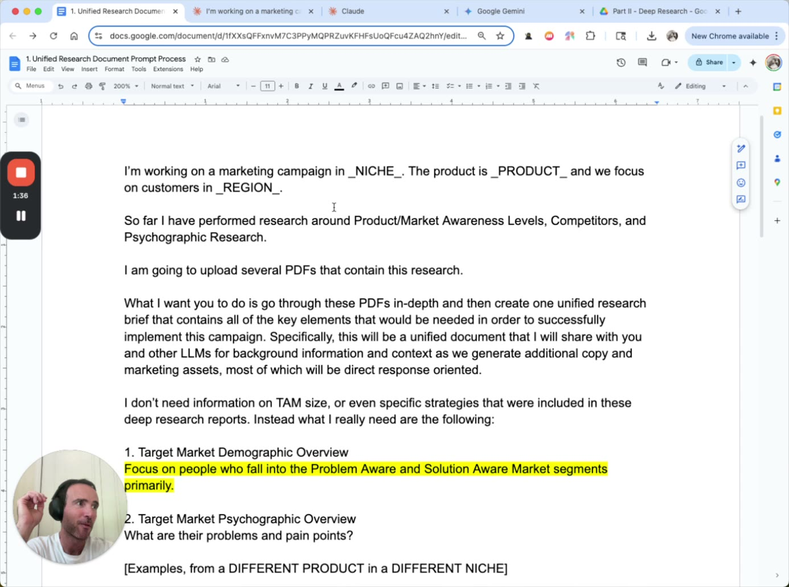
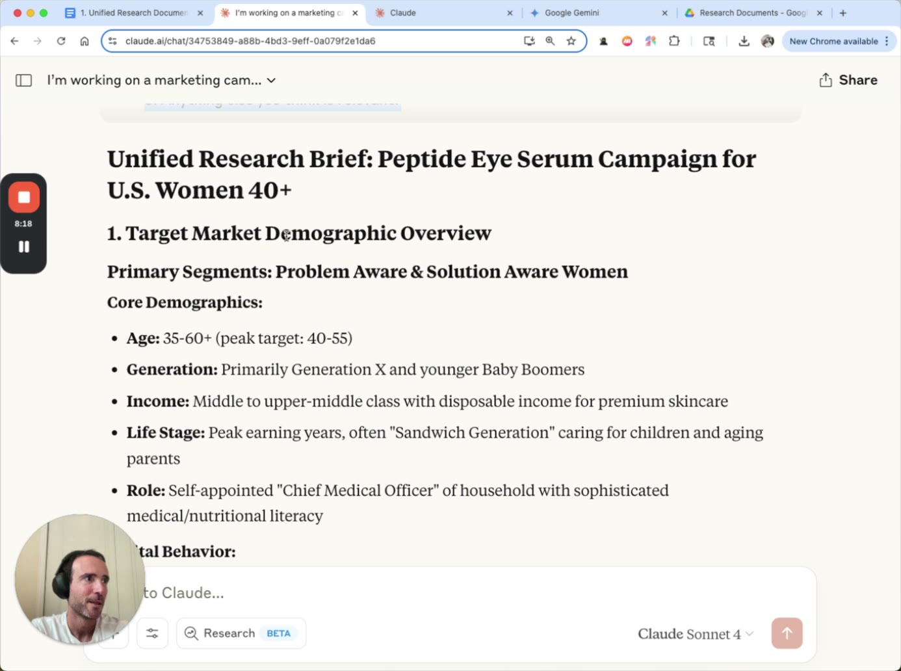
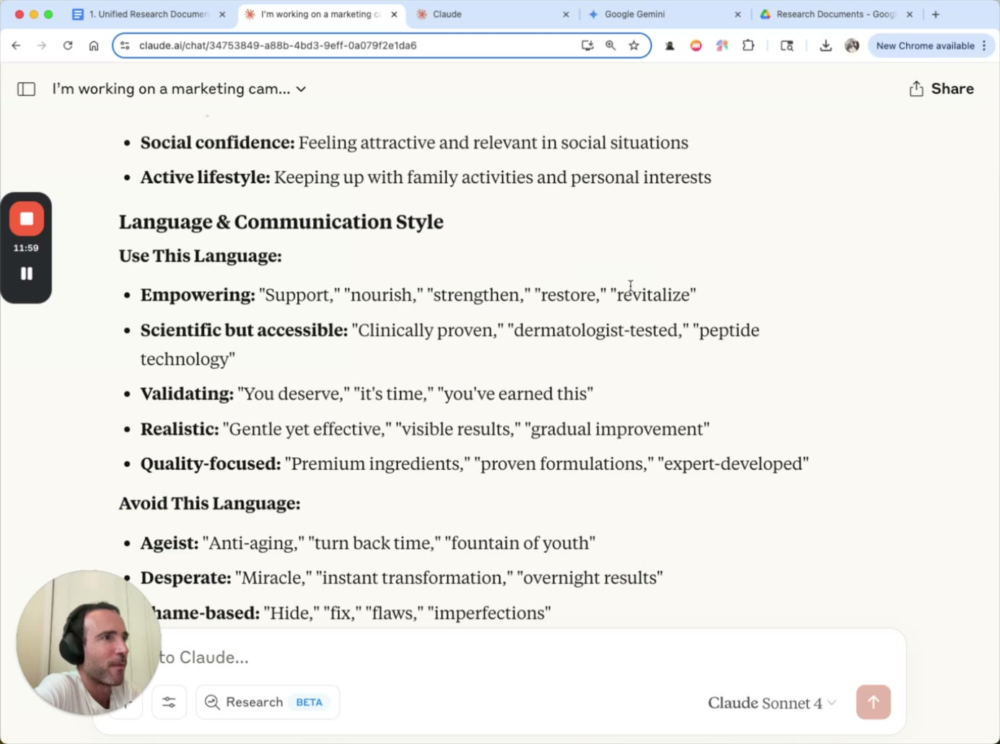
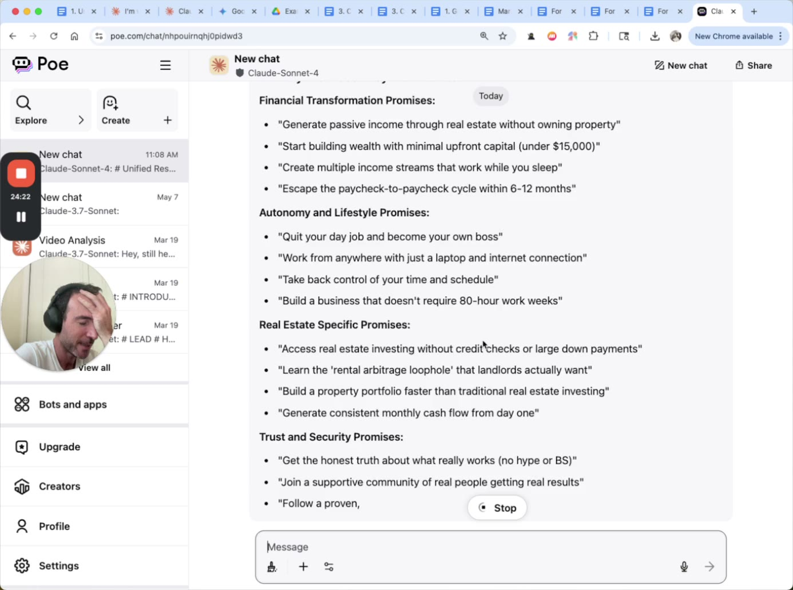

# 2.4 Unified Research Process
> Feed the product-market-awareness, competitor and psychographic reports into Claude with one prompt to get a single short research brief (demographics, pain points, hopes, language to use and avoid, promises, objections, failed alternatives) that you hand to every later copy-generation prompt.

## 🤖 Agent use
- **Use when:** the three Module 2 research outputs exist ([2.1 Product-Market Awareness](02-01-product-market-awareness.md), [2.2 Competitor Research](02-02-competitor-research-walkthrough-and-examples.md), [2.3 Psychographic Research](02-03-psychographic-research.md)) and you need one compact context document to attach to VSL, advertorial, ad, PDP or email prompts later in the course.
- **Inputs → outputs:** four PDFs per niche (product-market-awareness report, competitor summary, Claude-unified psychographic summary, optional extra descriptive-language doc) + niche/product/region line → one "unified research brief" with five numbered sections (below).
- **Rules:**
  - **DO** use the prompt as written; "you can honestly just copy and paste it in as is most of the time", and leaving the `_NICHE_`/`_PRODUCT_`/`_REGION_` placeholders unfilled still worked. [01:25; 07:55–08:20]
  - **DO** tell the model which market-awareness segments to focus on: default "Problem Aware and Solution Aware", but change it per market (GLP-1 meds: solution-aware; biz-op: problem-aware and even unaware). [02:10–03:10]
  - **DON'T** ask for TAM, market size, growth or revenue: his first untuned run returned that and "it's good knowledge … as a marketer, but not for direct response copy". [06:48]
  - **DON'T** add a catch-all "anything else relevant" item; he removed it after testing. [07:17; 16:39]
  - **DO** keep the example lines in the prompt from a different niche (weight loss) and label them "from a DIFFERENT PRODUCT in a DIFFERENT NICHE" so the model copies the format, not the content. [03:10–04:10; docx]
  - **DO** review the output with judgement: avoid-lists and result timelines are starting points. If your product delivers results faster, or is an instant effect, speak to that. [14:03–15:36]
  - **IF** Claude errors (he saw a "maximum image count" error) **THEN** convert each source to plain text: paste with Cmd/Ctrl+Shift+V into a fresh doc, delete the works-cited section, export PDF, re-upload. [16:39–21:42]
  - **IF** Claude still fails or hits limits **THEN** run the same prompt via Poe.com with Claude Sonnet 4 (about $20/month), or retry in an hour or two. [22:21–24:24]
  - **IF** you are modelling a proven VSL/PDP/advertorial **THEN** you can shortcut much of the research (still do it "in a perfect world"). [04:10–05:11]
  - **DON'T** present unified-brief promises as claims for your product; they are LLM-synthesised leads (see "Compliance flags").
- **See also:** [2.3 Psychographic Research](02-03-psychographic-research.md) · [2.5 Ingredient Deep Research](02-05-ingredient-deep-research.md) · [5.1 The Old Brief vs The New Brief](05-01-the-old-brief-vs-the-new-brief-overview.md) · [3.1 Unique Mechanisms Overview](03-01-unique-mechanisms-overview.md) · [Evolve Start Here: research doc](../../../evolve/start-here/concepts/research-doc.md) · [Evolve: market awareness](../../../evolve/copywriting/concepts/market-awareness.md)

## Key ideas

### What the unified document is for [00:00–01:25]
- Take "the different research pieces we've pulled thus far around product and market awareness, competitor research, and psychographic research" and feed them into Claude to create "one very simplified document that we can use as we go to generate various forms of copy with LLMs". [00:00–00:29]
- It will "make sense … as we go through processes for generating copy, and especially longer form copy". [00:29]
- He shows one successful run (eye serum) and one that fails and must be troubleshot (Airbnb arbitrage), because "it might come up for you". [01:01]

### The prompt and why each part is there [01:25–04:40]
- Opening line is a template: marketing campaign in `_NICHE_`, product `_PRODUCT_`, customers in `_REGION_`; "So far I have performed research around product market awareness levels, competitors, and psychographic research. I'm going to upload several PDFs". [01:25]
- Asks for "one unified research brief" that other LLMs will read "for background information and context as we generate additional copy and marketing assets, most of which will be direct response oriented"; explicitly excludes TAM and "specific strategies" in the reports. [01:40]
- Five requested outputs ended up as four after testing (see iteration below):
  1. Target market demographic overview, focusing on Problem Aware and Solution Aware. Segments must be named because the input has "different market segments". [02:10]
  2. Target market psychographic overview: pain points, hopes and dreams (ideal future state), how they view themselves, language to use/avoid, primary promises. Examples come from a weight-loss product "to give Claude the format". He says aggressive wording in the examples doesn't carry over: "it won't be too aggressive for whatever you have". [03:10–04:10]
  3. Biggest objections to the campaign and how to address them. [04:10]
  4. Existing solutions the market has tried and why they are inadequate. [04:10]
- Why existing solutions matter: "In the vast majority of copy, you're kind of talking about alternative solutions and dismissing them as not being adequate"; the obvious objection is "either I tried other products and they didn't work, or … I'm pretty happy. Why should I switch to your product?"; he handles that with a unique mechanism "and … just addressing competitors and then dismissing them". [15:36–16:39]


*The prompt doc: `_NICHE_`, `_PRODUCT_`, `_REGION_` placeholders, section 1 with the yellow-highlighted "Problem Aware and Solution Aware" line (the one to change per market), and the "[Examples, from a DIFFERENT PRODUCT in a DIFFERENT NICHE]" marker. [01:36]*

### Candid note on how he uses the research [04:10–05:40]
- "If you have a thing you're modeling off of, like another VSL or other product pages or advertorials … especially VSLs, you can conceivably shortcut a lot of this research and still get a good copy." In a perfect world he would still do the research to understand the market. [04:10–05:11]
- Usage frequency: he uses the psychographic process "a lot", product-market awareness "recently a lot", competitor research less but increasingly. He did not previously have a unified process; this prompt was created for RMBC II. He says he knows the outputs he needs and "a very proven process for all the copy generation". [05:11–05:40]

### Iteration he did on the prompt [06:10–07:17]
- First version, before items 1–4 were numbered: output contained "TAM … market size … growth … revenue and all this shit that I don't need to write direct response copy". [06:48]
- Fix: add the numbered list and the exclusion sentence. A fifth item "anything else … relevant" was originally there; removed after testing. [06:48–07:17]

### Inputs for the eye-serum run [07:17–08:20]
Four PDFs were uploaded: (1) the product-market-awareness document, (2) the competitor summary from Gemini, (3) the unified psychographic summary Claude made in 2.3, (4) the additional descriptive-language doc from 2.3's follow-up prompt. He left niche/product/region unfilled and it "didn't really matter". [07:17–08:20]

### The eye-serum output, section by section [08:20–16:39]
(All items are LLM-synthesised from the source PDFs; some read as promises/claims, see Compliance flags.)
- **Demographics:** ages 35–60+, peak 40–55; Gen X and younger boomers; middle to upper-middle income; "sandwich generation"; "self-appointed chief medical officer of household"; digital behaviour (problem-aware searches such as "how to get rid of dark circles", solution-aware such as "best eye cream"); Facebook, increasingly TikTok/Instagram; heavy reliance on online reviews, comparison shopping, "value social proof over celebrity endorsements". [08:20–09:18]
- **Why the digital behaviour is useful:** you can write the narrator's journey in the same terms ("I was skeptical, but I saw all their online reviews. I compared it to the competitors … a lot of real people all saying that this product had really helped"). [09:18–09:49]
- **Pain points** are dimensionalised into groups: physical/visual (overnight wrinkles, dryness, loss of glow, routines that stopped working), emotional (shock, identity crisis, loss of confidence, youth-culture pressure, medical dismissal), practical (don't know what to trust, irritation from potent ingredients, time, information overload). [09:49–10:46]
- **Hopes and dreams:** refreshed look, natural radiance, smooth plump skin, bright rested eyes, confidence in bare skin, control over aging, professional relevance, balanced life, effortless routine, "investment in yourself". [10:46–12:12]
- **Language to use / avoid** (see table). [11:43–12:41; screenshot]
- **Primary promises:** efficacy ("visibly reduced crow's feet, fine lines, and under eye puffiness in 4 to 8 weeks", "clinically proven peptide technology that rebuilds collagen from within"), emotional ("look as refreshed and vibrant as you feel inside", "regain confidence in your natural makeup-free skin"), lifestyle ("skip the concealer"). [12:41–13:36]
- **Objections:** "I've tried everything, nothing works" (answer: lead with clinical studies, before/after photos, peptide explanation), too expensive, will irritate, "peptides are marketing and hype", no time for routines, dark circles are genetic. [13:36–14:03]
- **Existing solutions:** mass-market eye creams, prestige department-store brands, "The Ordinary" budget actives, professional treatments, high-end miracle cures, DIY/natural remedies, each with why it is inadequate. [15:07–15:36]


*Claude's output "Unified Research Brief: Peptide Eye Serum Campaign for U.S. Women 40+": section 1 Target Market Demographic Overview with age, generation, income, life stage and role. Claude Sonnet 4 label shown. [08:18]*


*The "Language & Communication Style" section: use-this (empowering, scientific but accessible, validating, realistic, quality-focused) and avoid-this (ageist, desperate, shame-based …) lists. [12:00]*

### Critical-thinking caveats the instructor adds [14:03–15:36]
- "You do need to be a critical thinker still even for LLMs. They get you 99 percent of the way there most of the time, 95 percent of the way there for sure." [14:03]
- The avoid-list says "instant transformation", "overnight results" are desperate. "If you're selling like an instant eye lift … then it would be an instant transformation with overnight results. So I might still speak to that, even if it says to avoid it." [14:33]
- The "4 to 8 weeks" timeline: "if you got faster results, I would talk about faster results" [14:33] (derived: only if your own data supports it).
- "Looking 20 again": "interesting experiment … probably makes sense, but you have to … think about the mental state of who you're selling to"; emotional-states training is promised for later. [15:07]

### Troubleshooting walkthrough (Airbnb arbitrage) [16:39–27:58]
1. Claude returned an error about "maximum image count" when he uploaded the original PDFs; he didn't know why. [16:39]
2. Rebuild each source as plain text. Open the Gemini report, select all, copy; in a new doc paste with Cmd+Shift+V (Ctrl+Shift+V on Windows) "which is … pasting with no images or photos, so it's just plain text"; delete the works-cited links; rename (e.g. "unified research doc, Airbnb arbitrage example, product and market awareness"); download as PDF. [17:13–18:20]
3. Do the same for competitor research (Gemini and ChatGPT; he skipped Perplexity because "I don't think the Perplexity one was that good") and for the Claude psychographic summary (already plain text). Put all four PDFs in a folder, delete the old uploads, re-run. [18:20–21:42]
4. Still erroring; he notes he also tried Gemini with the documents "but the unified document was just not that good". [21:42–23:12]
5. Switch to Poe.com (an aggregator, "I think it's like $20 a month … kind of good to have as a backup"): same prompt, same four documents, model Claude-Sonnet-4. It works. [23:12–24:24]
6. Possible causes he names: documents were too heavy, or "especially with Claude 4" the service is overwhelmed ("you're out of prompts, or you're out of limits"); "usually if you come back in an hour or two and try it, Claude will work". [23:53–24:24]
7. Biz-op output: demographics (middle class, U.S.-based), core archetypes, pain points ("believe I have to make more money just to have less than what my parents did"), hopes (autonomy, quit the job, legacy, time freedom), language to use ("financial freedom, escape the rat race, be your own boss, take back control … proven system, step-by-step blueprint, no BS, hard truth") and to avoid ("get rich quick, guru, secret formula, guaranteed success, easy money, no work required, overnight success"), promises, objections (guru skepticism, hidden costs, landlord permission, market saturation, time/complexity, past failures) and other solutions (coaching programs, DIY courses, traditional real estate, other side hustles). [24:54–26:49]
8. He copies the Poe result into a doc and notes Poe "is just basically pulling from the API feed of Claude Sonnet 4"; the doc is in the course Drive folder and used in later modules. [27:20–27:58]


*Poe.com with Claude-Sonnet-4 generating the Airbnb arbitrage unified brief after Claude.ai failed. The promise lists on screen (e.g. "Escape the paycheck-to-paycheck cycle within 6-12 months", "under $15,000") are LLM output, not verified claims. [24:24]*

## Steps / framework
1. Collect the research artifacts: product-market-awareness report, competitor summary (best single LLM; Gemini used for eye serum), the Claude-unified psychographic summary, and the optional descriptive-language doc. [07:17–07:55]
2. Convert each to plain text (Cmd/Ctrl+Shift+V into a new doc), strip citations/works-cited, export as PDF. Skip a weak report (he skipped Perplexity competitor). [17:13–20:15]
3. Open the prompt doc, set niche/product/region (optional), and set the segment line (Problem/Solution Aware by default; change per market). [01:25–03:10]
4. New Claude chat; paste prompt; attach all PDFs; run. [08:20]
5. If it errors or limits: retry later, or run the same prompt in Poe (Claude Sonnet 4). [22:21–24:24]
6. Read the output critically: edit the avoid-list, timelines and promises against your product's facts; save as the campaign's single research doc. [14:03–15:36; 27:20]
7. Attach this doc, not the raw reports, to later copy prompts (VSL, advertorial, ad, brief). [00:29; 27:20]

## Examples
- **Eye serum (U.S. women 40+):** four PDFs → "Unified Research Brief: Peptide Eye Serum Campaign for U.S. Women 40+" with demographics, pain, hopes, language, promises, objections and failed alternatives. [08:20–16:39]
- **Airbnb arbitrage biz-op:** the first upload failed with an image-count error; sources rebuilt as plain text; Poe run succeeded. [16:39–27:58]
- **Weight-loss "different niche" examples inside the prompt** (pain points and promises) used only as format templates. [03:10–04:10; docx]

## Structured units

### Language to use / avoid (as generated for eye serum; instructor edits noted)
| Use | Avoid | Instructor's caveat | Source |
|---|---|---|---|
| Empowering: support, nourish, strengthen, restore, revitalize | Ageist: anti-aging, turn back time, fountain of youth ("This is questionable") | Depends on the product and the buyer's emotional state | [11:43–12:41] |
| Scientific but accessible: clinically proven, dermatologist tested, peptide technology | Desperate: miracle, instant transformation, overnight results | Speak to instant results if the product is instant (e.g. instant eye lift) | [11:43–12:41; 14:33] |
| Validating: you deserve, it's time, you've earned this | Shame-based: hide, fix, flaws, imperfections | — | [11:43–12:41] |
| Realistic: gentle yet effective, visible results, gradual improvement | Overly clinical: complex chemical names without explanation | Timeline "4–8 weeks": use your faster real result if you have one | [11:43–12:41; 14:33] |
| Quality: premium ingredients, proven formulations, expert developed | Youth-obsessed: looking 20 again, competing with younger women | Interesting experiment; consider mental state | [11:43–12:41; 15:07] |

### Language to use / avoid (Airbnb arbitrage biz-op)
| Use | Avoid | Source |
|---|---|---|
| financial freedom, escape the rat race, be your own boss, take back control, build your own empire, smart money moves, leverage, cash flow, passive income, community of like-minded people, proven system, step-by-step blueprint, no BS, hard truth, authentic, transparent | get rich quick, guru, secret formula, guaranteed success, easy money, no work required, overnight success; overly hype-driven internet-marketing language, corporate jargon, traditional investment terminology | [25:52–26:19] |

### Rules of thumb
- **DO** feed LLMs the unified brief instead of three raw reports. [00:29]
- **DO** exclude strategy and sizing from a direct-response research brief. [06:48]
- **IF** the output "avoid" list conflicts with your actual product mechanism **THEN** override it. [14:33]
- **IF** a model keeps failing on your PDFs **THEN** plain text + a different host (Poe) before abandoning the process. [17:13–24:24]

## Prompts / templates (verbatim)

### Unified research brief prompt (04-1 Unified Research Document Prompt Process.docx)
Placeholders are underscored in the source. The yellow-highlighted line in the doc ("Focus on people who fall into the Problem Aware and Solution Aware Market segments primarily.") is the one he changes per market. The two example blocks are from a weight-loss offer in a different niche and are format guides only.

```text
I’m working on a marketing campaign in _NICHE_. The product is _PRODUCT_ and we focus on customers in _REGION_.

So far I have performed research around Product/Market Awareness Levels, Competitors, and Psychographic Research.

I am going to upload several PDFs that contain this research.

What I want you to do is go through these PDFs in-depth and then create one unified research brief that contains all of the key elements that would be needed in order to successfully implement this campaign. Specifically, this will be a unified document that I will share with you and other LLMs for background information and context as we generate additional copy and marketing assets, most of which will be direct response oriented.

I don’t need information on TAM size, or even specific strategies that were included in these deep research reports. Instead what I really need are the following:

1. Target Market Demographic Overview

Focus on people who fall into the Problem Aware and Solution Aware Market segments primarily.

2. Target Market Psychographic Overview

What are their problems and pain points?

[Examples, from a DIFFERENT PRODUCT in a DIFFERENT NICHE]

Feel embarrassed, ashamed and humiliated about their weight, especially when comparing themselves to thinner women.

- Struggle to lose weight with diet and exercise. Get frustrated when the weight comes back after losing a few pounds.

- Feel like a prisoner in their body and that their weight is destined to keep increasing.

- Experience low self-esteem, lack of confidence, feeling unattractive.

- Health and mobility issues like low energy, trouble moving, joint pain.

- Judged and stared at by others for their weight. Feel they are a burden.

- Clothes don't fit right anymore. Can't fit into "skinny" jeans.

- Fear their partner no longer finds them attractive.

- Can't keep up with kids/grandkids or do activities they enjoy.

What are their hopes and dreams?

(Specifically, what does their ideal future state look like where their problem has been solved. What would that look like? How would they look and feel? When they dream and imagine this future, what else is true about their life at this point?)

How do they view themselves more broadly, what language should we use when speaking to them, and what language should we avoid?

What are the Primary Promises we can make to them, and that they would want to hear, when it comes to solving their pain points?

[Examples, from a DIFFERENT PRODUCT in a DIFFERENT NICHE]

- Experience Rapid fat loss from belly, hips, thighs without extreme diet or exercise.

- Lose up to 71 lbs of fat fast.

- Boost metabolism and burn fat 24/7 by activating "fat cell hypothermia".

- Increase confidence, self-esteem, feeling sexy and vibrant again.

- Fit back into favorite clothes like jeans, dresses, and swimwear.

- Regain independence and stop feeling held back by weight.

- Be admired, desired, and turn heads again.

- Reclaim energy, youthfulness and love life again.

- Free yourself from guilt, shame and worry about your weight.

3. What will their biggest objections be to our marketing campaigns for our product, and how can we address those?

4. What existing solutions has the market tried already? Why are those existing solutions not adequate enough?
```
- On the video he notes the parenthetical under "hopes and dreams" is partly redundant ("I don't really need that parenthesis there"). [03:36]
- The saved prompt contains four numbered items; the earlier fifth "anything else you think is relevant" item was removed. [07:17]
- The study-guide PDF suggests the same prompt works with Claude and ChatGPT ("designed to work effectively with various LLMs"); the video demonstrates only Claude (Claude.ai and Poe). [04-1 PDF p.4]

### Unified brief output schema (derived from the walkthrough)
```text
1. Target Market Demographic Overview (core demographics, life stage, role, digital behaviour: problem-aware vs solution-aware searches, platforms, review/social-proof reliance)
2. Target Market Psychographic Overview
   - Core problems and pain points (physical/visual, emotional/psychological, practical)
   - Hopes and dreams / ideal future state (+ lifestyle vision)
   - Language & communication style: use this / avoid this
   - Primary promises that resonate (efficacy, emotional transformation, lifestyle enhancer)
3. Primary objections and how to address them
4. Existing solutions and their inadequacies
```

## Screenshots
- Four frames embedded above: prompt doc, eye-serum unified brief, language use/avoid section, Poe fallback.
- Frames not kept: the Claude prompt paste screen (same text as the doc), the Google-Docs File menu, and talking-head intervals.

## How to apply
- [ ] Gather four PDFs: product-market awareness, competitor summary, unified psychographic summary (from [2.3](02-03-psychographic-research.md)), optional descriptive-language doc.
- [ ] Convert to plain text and re-export as PDFs; remove citations and images.
- [ ] Edit the segment line for the market's awareness profile (derived from [2.1](02-01-product-market-awareness.md)).
- [ ] Run the prompt in Claude (or Poe/Claude Sonnet 4); read the output once.
- [ ] Rewrite the avoid-list and promises so they match substantiated facts about our product (derived).
- [ ] Save the brief as the one research doc to attach in all later copy prompts.

## Compliance flags (derived)
- The generated brief is not substantiation. Examples from the course outputs that need evidence before use: "Visibly reduced crow's feet … in 4 to 8 weeks", "Clinically proven peptide technology that rebuilds collagen from within", "dermatologist tested", and the biz-op promise lists ("Escape the paycheck-to-paycheck cycle within 6-12 months", "under $15,000", "Generate consistent monthly cash flow from day one"; seen on screen in the Poe output). Do not carry any of these into copy without our own proof.
- The weight-loss example lines inside the prompt ("Lose up to 71 lbs of fat fast", "fat cell hypothermia") are aggressive health claims from someone else's offer; they exist only to show format. Remove or replace them with niche-appropriate, compliant examples.
- Never fabricate reviews or customer quotes to fill a "voice of customer" gap; use real reviews.

## Related
- Previous: [2.3 Psychographic Research](02-03-psychographic-research.md) · Next: [2.5 Ingredient Deep Research](02-05-ingredient-deep-research.md)
- Downstream: [3.1 Unique Mechanisms Overview](03-01-unique-mechanisms-overview.md), [4.1 VSLs Section Overview](04-01-vsls-section-overview.md), [5.1 The Old Brief vs The New Brief](05-01-the-old-brief-vs-the-new-brief-overview.md)
- Compare: Evolve Start Here keeps one "research doc" as a workspace filled by hand ([research doc concept](../../../evolve/start-here/concepts/research-doc.md)); RMBC II generates its equivalent with LLMs and PDFs. Awareness segments: [Evolve: market awareness](../../../evolve/copywriting/concepts/market-awareness.md).

## Sources and limitations
- Transcript: [04-[4] Unified Research Process.txt](<../../../../../raw/stefan-georgi/rmbc-ii/_transcripts/Stefan Georgi - RMBC II (1)/02-DEEP RESEARCH/04-[4] Unified Research Process.txt>) (28:02, fully covered). Prompt doc: [04-1 docx extract](<../../../../../raw/stefan-georgi/rmbc-ii/_extracted/Stefan Georgi - RMBC II (1)/02-DEEP RESEARCH/04-1 Unified Research Document Prompt Process.docx.md>). Study-guide PDF: [04-1 pdf extract](<../../../../../raw/stefan-georgi/rmbc-ii/_extracted/Stefan Georgi - RMBC II (1)/02-DEEP RESEARCH/04-1 Unified Research Document Prompt Process.pdf.md>) (secondary; it restates the video).
- Machine transcription (Whisper large-v3-turbo). Fixes: "quad"/"clod"→Claude; "Colonically proven"→"Clinically proven"; "marking and hype"→"marketing and hype"; "lead of clinical studies"→"lead with clinical studies". He is unsure of the weight-loss product name he cites for the example lines (heard as "Mitoline"); not used.
- The finished unified briefs (eye serum, Airbnb) are described from the video only; the saved output docs are not included in the course files for this lesson, so numbers and wording come from the narration and screen frames.
- Unknown cause of the "maximum image count" error; the instructor does not diagnose it and says it might be "Claude sucking" or an overload.
- Screenshots grabbed from the MEGA video; the Claude UI model label reads "Claude Sonnet 4".
