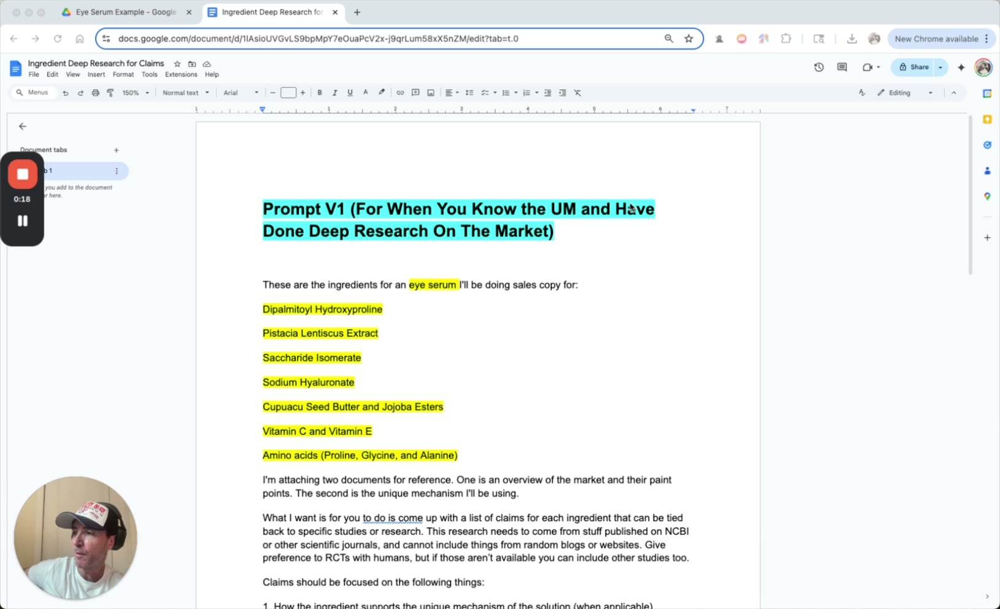
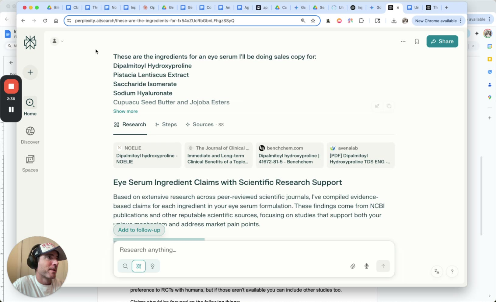
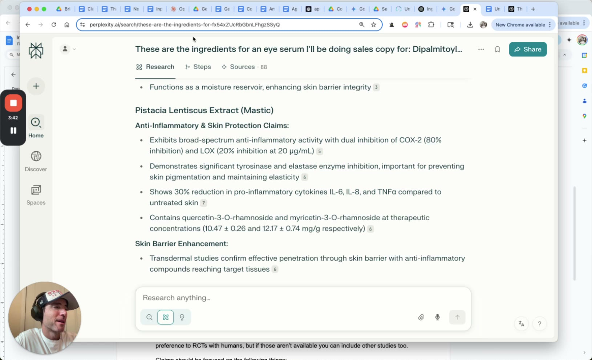
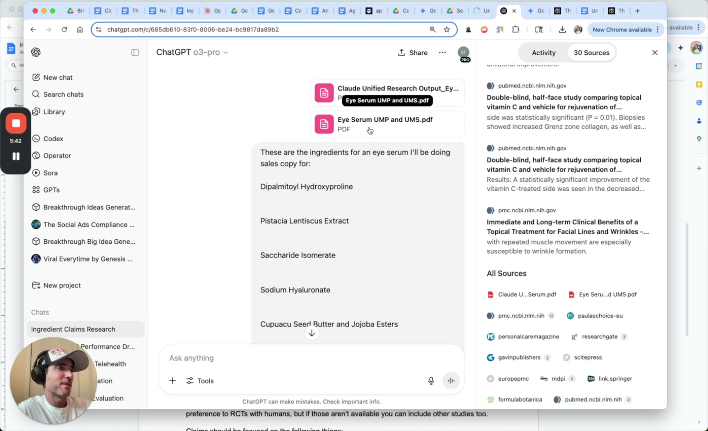
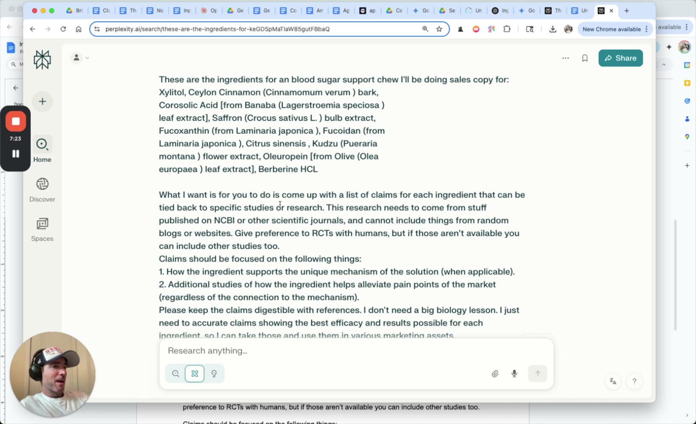

# 2.5 Ingredient Deep Research
> One short prompt, run in Perplexity and/or ChatGPT with the ingredient list plus the market overview and unique mechanism attached, returns study-backed, bite-size efficacy claims per ingredient that feed the brief and every later sales asset, but the output needs source and compliance checking before any claim ships.

## 🤖 Agent use
- **Use when:** the product has an ingredient list (supplement, skincare, topical) and we need study-backed claims for a brief, VSL, advertorial, PDP or ad. Run this after the market-awareness overview and the unique mechanism exist.
- **Inputs → outputs:** ingredient list + (a) market overview with pain points (the product-market awareness / unified research output) + (b) the unique mechanism we will use → one claim list per ingredient, each tied to a named study, split into (1) mechanism-supporting claims and (2) pain-point claims, with efficacy numbers. Output is a research doc that goes into the brief generator as an input. [00:00–01:02; 03:39–04:43]
- **Rules:**
  - **DO** paste the ingredient list first, attach the market overview and the mechanism, then ask for claims "tied back to specific studies or research". [00:00–01:02]
  - **DO** restrict sources to "stuff published on NCBI … or other scientific journals" and exclude "random blogs or websites". Prefer RCTs with humans, fall back to other studies. [01:02]
  - **DO** ask for two claim types: (1) how the ingredient supports the unique mechanism, when applicable; (2) other studies showing it relieves the market's pain points, regardless of the mechanism. [01:02]
  - **DO** demand "digestible" claims with references: "I don't need a big biology lesson." The wanted output is "accurate claims showing the best efficacy and results possible" for reuse in "various marketing assets". [01:02]
  - **IF** there is no mechanism yet **THEN** run the same prompt without the mechanism attachment: "you just wouldn't have a mechanism." [01:59]
  - **DO** run it twice, once without and once with mechanism context, then merge both outputs into one document (turn it into a PDF for Claude). The with-mechanism run dropped a headline stat (32% wrinkle reduction) that the other two runs contained. [06:13–07:19]
  - **DO** use Perplexity as the default for ingredient research: "I actually perplexied the most for the ingredient research." It is fast and returns "really digestible little chunks". [02:32–03:39; 07:51]
  - **DO** use ChatGPT when you want claims tied back to the mechanism (attach the unified research output and the mechanism PDF). [04:43–06:13]
  - **DON'T** assume the model obeyed the source rule. The Perplexity example output still cites brand blogs and supplier pages; the instructor shrugs this off for one case ("coming from the company that makes the peptide, but I know that's fine") and dislikes a Personal Care Magazine citation. [02:32; 04:43]
  - **DON'T** ship a claim because the tool produced it. Open the cited source and check dose, population, product match and whether it is human data (derived; see Compliance flags).
- **See also:** [02.04 Unified Research Process](02-04-unified-research-process.md) · [02.01 Product-Market Awareness](02-01-product-market-awareness.md) · [03.01 Unique Mechanisms Overview](03-01-unique-mechanisms-overview.md) · [05.02 Brief Generator with Claude Project (Unity Eye Serum)](05-02-the-brief-generator-with-claude-project-unity-eye-serum-exam.md) · [Customer research stack](../../../../frameworks/customer-research-stack.md)

## Key ideas

### 1. Ingredient research is the fast part of the research module [00:00–01:02]
- "The reason I say quickly isn't because I'm trying to skip through this section, it's because it's honestly pretty fast and easy here." [00:00] The whole lesson is one prompt and two tools.
- Worked example: the skincare eye serum (the instructor says "the UD Eye Serum"; the captions say the same; the screen and file names show it is the **Unity Eye Revive Serum** / "Unity Eye Serum", so "UD" is a spoken shorthand). Input is its seven-line ingredient list. [00:00; screen 0:18]
- Two documents are attached to the prompt: "an overview of the market and their pain points" and "the unique mechanism I'll be using". [00:00] (Transcript mishears the opening as "ice cream … psilocybin"; the captions and prompt doc read "eye serum I'll be doing sales copy for".)


*Google Doc titled "Prompt V1 (For When You Know the UM and Have Done Deep Research On The Market)", with the eye-serum ingredient list highlighted. [00:18]*

### 2. Source rules and what the prompt asks for [01:02–01:59]
- Sources: NCBI ("basically like the government's registry of studies") or other scientific journals; no random blogs or websites. [01:02]
- Preference order: RCTs ("Random Controlled Trials with Humans"), otherwise "other studies too". [01:02]
- Claim focus 1: how the ingredient "supports the unique mechanism of the solution when applicable". Claim focus 2: "additional studies of how the ingredient helps alleviate pain points of the market, regardless of the connection to the mechanism". [01:02]
- Format: digestible with references, no biology lesson, "the best efficacy and results possible for each ingredient". [01:02]
- Version 2 of the prompt (no mechanism) is "basically the same prompt"; mechanism is simply "not applicable". [01:59]

### 3. Perplexity: fastest, most bite-size, not tied to the mechanism [02:32–03:39]
- Instructor ran Perplexity first and "forgot to include the mechanism in the research". He still liked it because it was "really fast". [02:32]
- Example outputs he reads aloud: the peptide (dipalmitoyl hydroxyproline) "clinical studies demonstrate up to 32% reduction in wrinkles and 14% increase in skin firmness" with a link; "tissue inhibitors of metalloproteinases … reducing collagen-degrading enzyme activity by approximately 33% for trypsin and 22% for elastase"; "at 0.5% concentration shows measurable improvement in wrinkle depth". [02:32–03:08]
- He notes the 32% figure's link "is coming from the company that makes the peptide, but I know that's fine." [02:32] (The file shows that link is a brand blog; see Compliance flags.)
- Why the chunking matters: the output becomes an input for the brief generator (see [05.02](05-02-the-brief-generator-with-claude-project-unity-eye-serum-exam.md)). [03:39]


*Perplexity in Research mode: the same ingredient prompt, answer header "Eye Serum Ingredient Claims with Scientific Research Support", "Sources 88". [02:36]*


*Perplexity answer for Pistacia Lentiscus Extract: bullets grouped under "Anti-Inflammatory & Skin Protection Claims", each with a numbered source. [03:42]*

### 4. How the research flows into the brief [03:39–04:43]
- Plan for the next module: "the unified research brief" plus "the unique mechanism, which you'll see in the next training after R" plus "a list of the studies" are the inputs. He gave the generator only the website plus these and it produced the full brief set. [03:39–04:43] (He shows the generator on screen; its content is covered in module 5, not here.)
- He combined Perplexity and ChatGPT outputs into one PDF for Claude. That file is in the zip as "Combined Ingredient Research_Unity Eye Serum", starting with a note to the LLM: "This is research on ingredients from two LLMs. As a result, you may see the same study data point twice." [04:11; Combined doc header]

### 5. ChatGPT: good, ties to mechanism, weaker sources [04:43–06:48]
- Verdict: "ChatGPT was pretty good too, but did reference Personal Care Magazine. I don't like that reference as much"; Gavin Publishers "is not the worst … coming from a publishing place of studies". [04:43]
- For ChatGPT he attached both the unified research output (so it "knows what the pain points are") and the mechanism. [04:43–05:43]
- Result: studies framed against the mechanism, e.g. "by curbing these collagen breakdown enzymes, [the peptide] preserves the dermal matrix and promotes a tighter re-woven collagen architecture for firmer skin", which maps to the mechanism used in the examples. [05:43]
- Trade-off: Perplexity was "the most bite size, but it wasn't tied to the mechanism"; ChatGPT with the mechanism was tied in "but" missed the 32% wrinkle stat that both earlier runs had. [06:13–06:48]
- Conclusion: "you might want to run it once without the context of the mechanism and once with it because you might get slightly different studies." Combine into one PDF for Claude. [06:48]


*ChatGPT (o3-pro) with two attached PDFs, the Claude unified research output for the eye serum and "Eye Serum UMP and UMS.pdf", followed by the same ingredient prompt; sources panel shows PubMed/PMC, Personal Care Magazine, Gavin Publishers and others. [05:42]*

### 6. Second example: blood sugar support chew [07:19–08:49]
- Ingredient list "copy and pasted … from a private label catalog I had", exact same prompt. [07:19]
- Output he reads: xylitol "significantly improved glucose tolerance in humans and animal studies"; "reduced fasting blood glucose by 29.3% in type 2 diabetic rats"; "73% lower risk of prediabetes progression … in humans with elevated baseline xylitol levels"; Ceylon cinnamon "meta-analysis of 10 randomized controlled trials … fasting plasma glucose". [07:19–07:51]
- His take: "if you know supplement copy, you know this is like great … it did it for each and every ingredient." Closing: the prompt run "where the ingredients are" gets "your research done for you". You can always ask follow-ups, but "this is pretty damn good". [07:51]


*Perplexity input for the blood sugar support chew: ingredient list (xylitol, Ceylon cinnamon, corosolic acid, saffron, fucoxanthin, fucoidan, Citrus sinensis, kudzu, oleuropein, berberine HCL) then the identical claims prompt. [07:24]*

## Steps / framework
1. Collect the full ingredient list from the label or the supplier spec.
2. Have the market overview with pain points (product-market awareness output) and the unique mechanism ready as PDFs/docs. [00:00]
3. Run Prompt V1 in Perplexity (Research mode) with the ingredient list and the mechanism attached if it exists; run it again without the mechanism. Optionally run it in ChatGPT with both attachments. [01:59; 06:48]
4. Merge all outputs into one document. Put a one-line note at the top for the downstream LLM that data points may repeat across tools. [Combined doc header]
5. Verify the key claims against the cited sources (open each; check human vs animal, dose, product match). Mark unverified claims in brackets (derived).
6. Feed the merged research doc into the brief generator with the unified research and the mechanism. [03:39–04:43]

The lesson PDF "05-1 Ingredient Deep Research for Claims" states the same process as: Gather ingredients, Run AI research, Compile claims; and best practices "Run multiple searches (with and without mechanism context)", "Combine results", "Verify key claims (double-check important statistics and efficacy percentages across multiple sources)", "Organize by ingredient". [05-1 PDF pp. 2, 8]

## Examples

### Eye serum (the Unity serum)
Ingredient list used in the prompt (05-2 docx):
Dipalmitoyl Hydroxyproline · Pistacia Lentiscus Extract · Saccharide Isomerate · Sodium Hyaluronate · Cupuacu Seed Butter and Jojoba Esters · Vitamin C and Vitamin E · Amino acids (Proline, Glycine, and Alanine).

Perplexity output structure (Perplexity Output Example.docx): per ingredient, 1-2 bold subheads ("Collagen Synthesis & Protection Claims", "Hydration & Barrier Support", "Anti-Inflammatory & Skin Protection Claims" …), 2-4 one-line bullets each with a numbered citation, 36 numbered references at the end.

ChatGPT output structure (ChatGPT Deep Research Example.docx): per ingredient, 1-2 bold-lead bullets of 2-4 sentences each that mention the mechanism ("protects and reorganizes collagen structure"), inline links, closing line framing the combined ingredient set as "Structural Renewal" of the eye area. It covers seven headings (it merges Cupuacu with Jojoba and Vitamin C with E, and has no separate amino-acid section).

### Blood sugar support chew (zip folder named "Weight Loss Example")
The folder is named "05-4 Weight Loss Example" but contains "Research-Based Claims for Blood Sugar Support Chew". Ten ingredients each get 2 sections of 3 bullets with bracketed reference numbers [1]-[48]. Sections are titled by outcome ("Glucose Control", "Postprandial Glucose Management", "Pancreatic Protection", "Mechanistic Actions").

## Structured units

### Claim formats produced (as shown in the lesson files; not vetted by us)
| Ingredient | Claim as output | Evidence type stated in output | Where cited | Flag for our use (derived) |
|---|---|---|---|---|
| Dipalmitoyl Hydroxyproline (peptide) | "up to 32% reduction in wrinkles and 14% increase in skin firmness" | "clinical studies" | Perplexity ref [1], a brand blog (noelie.com) | Brand-blog source; do not use until traced to the study. ChatGPT gives the same 32% as "32% decrease in wrinkle depth compared to placebo" for a 1% DPHP cream, cited to personalcaremagazine.com. The two tools describe the stat differently. |
| Dipalmitoyl Hydroxyproline | TIMP production "reducing collagen-degrading enzyme activity by approximately 33% for trypsin and 22% for elastase" | study-level | Perplexity refs [2] (PMC2923951), [3] (benchchem supplier page) | One NCBI source plus a supplier page. |
| Saccharide Isomerate | "instant hydration lasting up to 72 hours with 55% increase in skin hydration as measured by corneometry" | clinical | Perplexity ref [8] (PMC8322246) | The same PMC8322246 is also cited by both tools for sodium hyaluronate numbers, so check which product the study actually tested. |
| Sodium Hyaluronate | "134% immediate increase in skin water content, with sustained 55% improvement after 6 weeks" | clinical | Perplexity ref [8] | ChatGPT cites the same paper for "63% increase in skin hydration" and "fine line depth reduced by ~30%". Different numbers from the same source: verify. |
| Jojoba Esters | "reduces LPS-induced inflammation by approximately 30% for IL-6, IL-8, and TNFα" | ex-vivo / cell model | Perplexity ref [24] | In vitro. ChatGPT rephrases this as "comparable to a mild NSAID effect in skin", a drug-style claim; do not copy. |
| Vitamin C + E | "4-8 fold increase in UV protection" (ChatGPT) | not stated | ChatGPT cites PMC2923951 (the same paper it cites for the peptide TIMP claim) | The same URL supports two unrelated claims: likely mis-citation. Verify or drop. |
| Xylitol | "Reduced fasting blood glucose by 29.3% in Type 2 diabetic rats" | rats | blood sugar doc ref [1] | Animal data. Not a human claim. |
| Xylitol | "73% lower risk of prediabetes progression to diabetes in humans with elevated baseline xylitol levels" | human, observational wording | ref [4] | Association with blood levels, not an effect of eating a supplement. |
| Ceylon Cinnamon | "Meta-analysis of 10 RCTs showed significant reduction in fasting plasma glucose (-24.59 mg/dL) in Type 2 diabetes patients" | meta-analysis of RCTs | ref [7] | Disease population (type 2 diabetes); dose in the study was 1-6 g/day per the doc, not our product dose. |
| Berberine HCL | "effectiveness comparable to metformin in Type 2 diabetes" | RCTs | ref [44] | Drug-comparison and disease claim: not usable in compliant supplement copy. |
| Olive leaf (oleuropein) | "controlled blood glucose levels comparable to metformin" | not stated | refs [42][43] | Same: drug-comparison claim. |

### Source audit of the Perplexity eye-serum output (derived by counting its 36 footnotes)
| Source type | Count | Examples |
|---|---|---|
| NCBI / PubMed (pmc.ncbi.nlm.nih.gov, pubmed.ncbi.nlm.nih.gov) | 20 | PMC2923951, PMC8322246, PMC4495740 |
| Everything else | 16 | brand/retailer blogs (noelie.com, skinsculptskincare.com, korelu.de), supplier pages (benchchem.com, avenalab.com TDS), trade news (personalcareinsights.com, cosmeticsandtoiletries.com), one journal on a non-NCBI domain (mdpi.com), a poster PDF and a university PDF |

So the prompt rule "cannot include things from random blogs or websites" was only partly followed in the example the instructor calls "pretty solid". [04:43]

## Prompts / templates (verbatim)

### Prompt V1: ingredient claims, mechanism known (05-2 Ingredient Deep Research Prompt.docx)
Source typos kept ("paint points", "I just need to accurate claims").
```text
Prompt V1 (For When You Know the UM and Have Done Deep Research On The Market)

These are the ingredients for an eye serum I'll be doing sales copy for:

Dipalmitoyl Hydroxyproline

Pistacia Lentiscus Extract

Saccharide Isomerate

Sodium Hyaluronate

Cupuacu Seed Butter and Jojoba Esters

Vitamin C and Vitamin E

Amino acids (Proline, Glycine, and Alanine)

I'm attaching two documents for reference. One is an overview of the market and their paint points. The second is the unique mechanism I'll be using.

What I want for you to do is come up with a list of claims for each ingredient that can be tied back to specific studies or research. This research needs to come from stuff published on NCBI or other scientific journals, and cannot include things from random blogs or websites. Give preference to RCTs with humans, but if those aren't available you can include other studies too.

Claims should be focused on the following things:

1. How the ingredient supports the unique mechanism of the solution (when applicable).

2. Additional studies of how the ingredient helps alleviate pain points of the market (regardless of the connection to the mechanism).

Please keep the claims digestible with references. I don't need a big biology lesson. I just need accurate claims showing the best efficacy and results possible for each ingredient, so I can take those and use them in various marketing assets.
```

### Example fill: blood sugar support chew (same file, "Example:")
```text
These are the ingredients for an blood sugar support chew I'll be doing sales copy for:

Xylitol, Ceylon Cinnamon (Cinnamomum verum ) bark,

Corosolic Acid [from Banaba (Lagerstroemia speciosa )

leaf extract], Saffron (Crocus sativus L. ) bulb extract,

Fucoxanthin (from Laminaria japonica ), Fucoidan (from

Laminaria japonica ), Citrus sinensis , Kudzu (Pueraria

montana ) flower extract, Oleuropein [from Olive (Olea

europaea ) leaf extract], Berberine HCL

What I want is for you to do is come up with a list of claims for each ingredient that can be tied back to specific studies or research. [... identical body to Prompt V1 from "This research needs to come from stuff published on NCBI" through "... use them in various marketing assets."]
```
(The doc repeats the full body; only the product line and ingredient list change. The video's version of the prompt is spoken with the same wording; no other prompt variants are shown.)

### Merge header for the combined research file (Combined Ingredient Research_Unity Eye Serum.docx, top of file)
```text
Note for Claude or other LLMs:

This is research on ingredients from two LLMs. As a result, you may see the same study data point twice.
```
Then a "Perplexity" section followed by a "ChatGPT" section.

### Prompt V2 (no mechanism)
Not a separate file. The instructor says it is "basically the same prompt" without the mechanism attachment and with claim type 1 "not applicable". [01:59]

## Screenshots
Five frames are embedded above: prompt doc [00:18], Perplexity run [02:36], Perplexity bullets [03:42], ChatGPT with attachments [05:42], blood sugar prompt in Perplexity [07:24].

## How to apply
- [ ] Assemble ingredient list, market overview (pain points) and unique mechanism as files before prompting.
- [ ] Run Prompt V1 in Perplexity Research mode without the mechanism.
- [ ] Run it again with the mechanism attached (Perplexity or ChatGPT with both PDFs).
- [ ] Merge outputs into one doc; add the "two LLMs, repeated data points" note on top.
- [ ] For each claim we plan to use: open the source; record study type (human RCT / observational / animal / in vitro), dose, duration and whether it tested our ingredient form. Bracket anything unconfirmed.
- [ ] Drop claims that compare to drugs, name a disease treated, or rely on a supplier or brand blog.
- [ ] Attach the verified research doc to the brief generator with the unified research doc and mechanism.

## Compliance flags (derived; not in the lesson)
- The lesson's blood sugar output includes disease and drug-comparison language (type 2 diabetes outcomes, "comparable to metformin", HbA1c). That kind of claim would need substantiation and would fall outside Meta and FTC/FDA rules for a supplement. Copy the research method, never the claims.
- Eye-serum outputs include cosmetic claims worded as drug effects ("comparable to a mild NSAID effect", anti-inflammatory COX-2 inhibition). Keep to appearance language.
- Animal and cell-culture results (rats, mice, adipocytes, fibroblasts) cannot be presented as human efficacy of our product.
- A study of an ingredient at a given dose does not substantiate our finished product at its dose. The instructor does not address this; it is our rule.

## Related
- Previous: [02.04 Unified Research Process](02-04-unified-research-process.md)
- Next module: [03.01 Unique Mechanisms Overview](03-01-unique-mechanisms-overview.md)
- [Market awareness (Evolve Copywriting)](../../../evolve/copywriting/concepts/market-awareness.md) · [Product overview and mechanism (Evolve Start Here)](../../../evolve/start-here/concepts/product-overview-and-mechanism.md) · [Research doc (Evolve Start Here)](../../../evolve/start-here/concepts/research-doc.md)

## Sources and limitations
- Transcript: [05-[5] Ingredient Deep Research.txt](<../../../../../raw/stefan-georgi/rmbc-ii/_transcripts/Stefan Georgi - RMBC II (1)/02-DEEP RESEARCH/05-[5] Ingredient Deep Research.txt>). The lesson has a second file "05-[5] Ingredient Deep Research._converted.mp4", a re-encode marked as duplicate; its transcript was not used.
- Documents: [05-2 prompt](<../../../../../raw/stefan-georgi/rmbc-ii/_extracted/Stefan Georgi - RMBC II (1)/02-DEEP RESEARCH/05-2 Ingredient Deep Research Prompt.docx.md>) · [05-1 PDF](<../../../../../raw/stefan-georgi/rmbc-ii/_extracted/Stefan Georgi - RMBC II (1)/02-DEEP RESEARCH/05-1 Ingredient Deep Research for Claims.pdf.md>) · zip examples under `_extracted/_unzipped/02-DEEP RESEARCH/05-3 …` and `05-4 …`.
- Machine transcription (Whisper large-v3-turbo). Fixes made from the `.srt` captions: "ice cream … psilocybin" is "eye serum … sales copy"; "Chatsy PT" is ChatGPT; "Perpuxy"/"perplexied" is Perplexity; "Gavin Publishers" is a real publisher name; "UD Eye Serum" is spoken as "UD" in the audio and captions, the product on screen is Unity Eye Revive Serum.
- The 05-1 PDF (a generated summary of this lesson) states "tethered, rewoven collagen" where ChatGPT's output reads "tighter, 're-woven' collagen"; the transcript's "tethered" mishearing matches neither exactly. We use the ChatGPT wording.
- The product name of the brand on screen is "Opal" (Unity Eye Revive Serum page); the lesson never states a brand; no customer data appears in the frames used.
- All efficacy numbers above are the LLMs' outputs as shown in the course files. We did not verify any of them against the cited studies.
- No hard results (conversion, revenue) are given in this lesson. "Pretty damn good" is the instructor's judgment of output quality (instructor claim).
