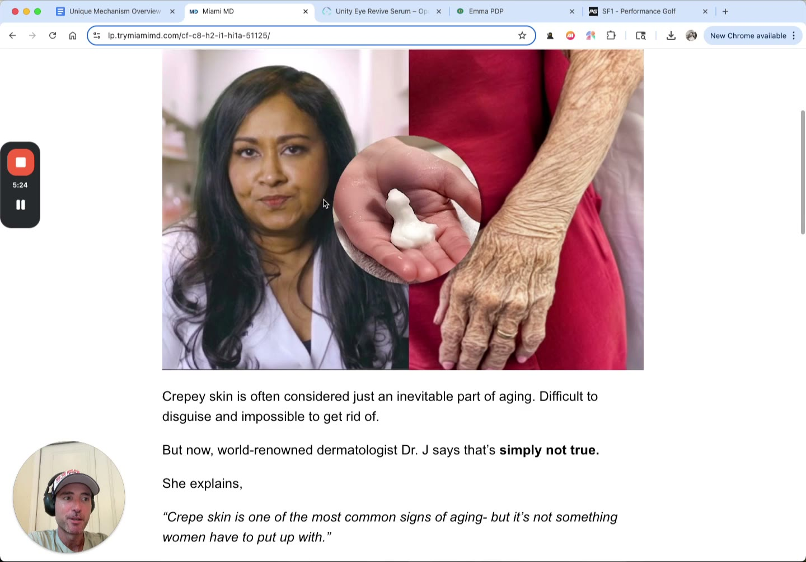
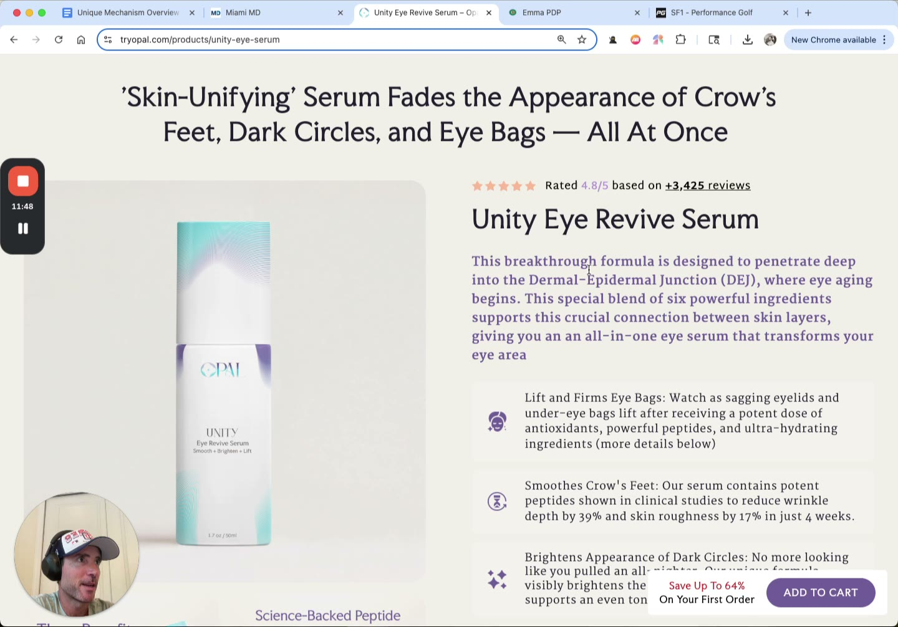
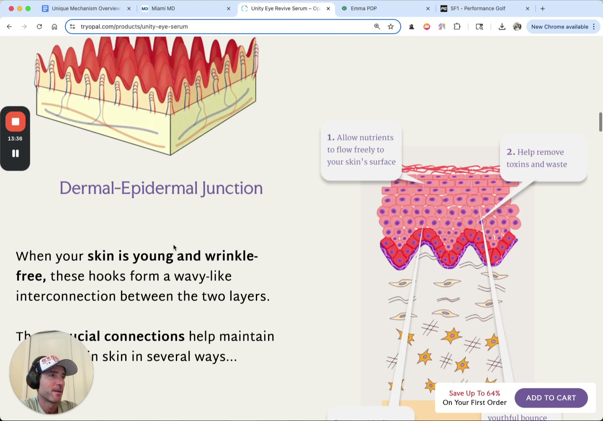
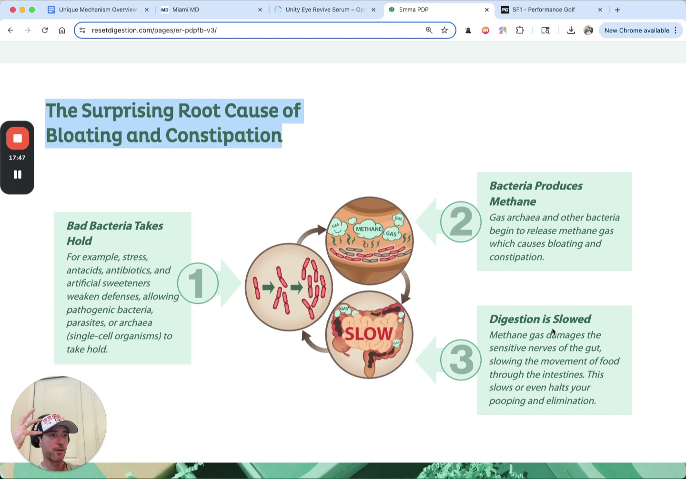
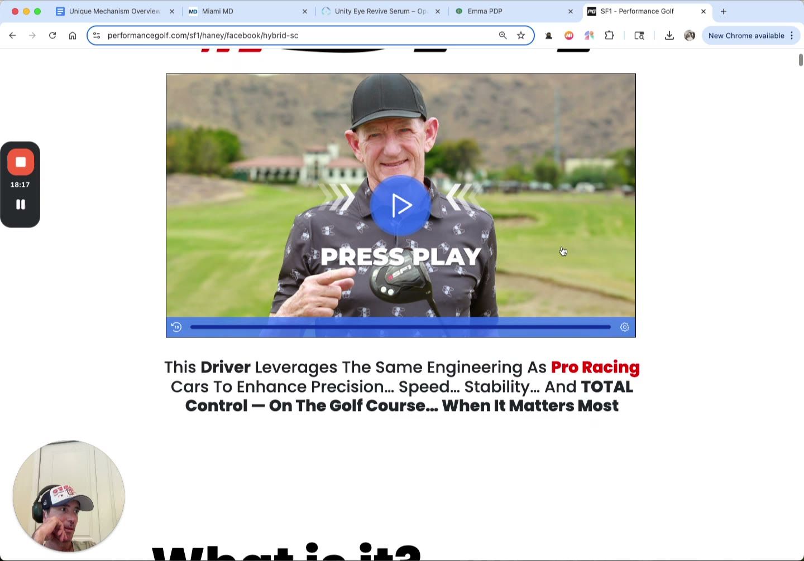

# 3.1 Unique Mechanisms Overview
> A unique mechanism is a two-part logical connection (the real cause of the prospect's problem, the UMP, and the real reason our solution fixes it, the UMS) that closes a "knowledge gap" and has to be pitched at the prospect's awareness level; this refresher uses four live pages (advertorial, product page, PDP, golf driver page) to show how short a working mechanism can be.

## 🤖 Agent use
- **Use when:** before ideating, evaluating or writing any mechanism (VSL, advertorial, PDP, ad, email); when auditing a page to find "where is the UMP and UMS?"; when a mechanism sounds smart but may be aimed at the wrong awareness segment.
- **Inputs → outputs:** product facts + the market's past solutions + the target awareness level (from the product-market awareness work) → one UMP sentence set ("the missing 1%") and one UMS sentence set, each short enough to live in a product-page paragraph or advertorial lead.
- **Rules:**
  - **DO** write a mechanism as two linked parts: the unique mechanism behind the problem (UMP) and behind the solution (UMS). "It's important to identify the unique mechanism behind both the problem AND the solution." [02:01; docx]
  - **DO** use the UMP to explain why the prospect failed before, and the UMS to make them believe our product will succeed "where other alternatives have failed". [02:01; docx]
  - **DO** frame it as a knowledge gap: the prospect is "missing ONE CRUCIAL PIECE OF INFORMATION". The instructor calls it "this missing 1%". [02:01; 09:47]
  - **DO** pick the mechanism for the awareness segment we target: "even as we do unique mechanisms, we're going to be keeping in mind where our prospect is on their journey." [03:22]
  - **DO** keep it simple. "It's really just problem, solution … it's not rocket science. It doesn't have to be." [10:50; 22:29]
  - **DON'T** over-explain the mechanism in an advertorial that sells the click to a VSL. It "doesn't need to give you every single detail"; it needs the missing 1% to sell a qualified click. [08:44–09:47]
  - **IF** the page is health or consumer wellness **THEN** do not call the cause "the root cause". "You're really not compliance-wise supposed to call saying the root cause … that's a diagnostic thing. Pretty much everyone does it in health … but you're not supposed to." [18:46] (Instructor aside; golf, in his words, does not carry that restriction.)
  - **IF** the audience is solution-aware and already knows the cause **THEN** do not rename the cause. Concede it, then reframe why other solutions fail (golf example). [20:14]
  - **IF** you are already experienced with the RMBC mechanism material **THEN** the instructor says this video can be skipped, but "I would not skip the subsequent videos" with the LLM processes. [00:00]
- **See also:** [03.02 UMP Ideation With LLMs](03-02-ump-ideation-with-llms.md) · [03.03 UMP Evaluation Prompt and Process](03-03-ump-evaluation-prompt-and-process-airbnb-arbitrage.md) · [02.01 Product-Market Awareness](02-01-product-market-awareness.md) · [04.04 VSL Background Stories and Unique Mechanisms](04-04-vsl-background-stories-and-unique-mechanisms.md) · [Unique mechanism (Evolve Copywriting)](../../../evolve/copywriting/concepts/unique-mechanism.md)

## Key ideas

### 1. Preface: what this video is and is not [00:00–01:01]
- Broad-level reminder only: "what UMPs are, UMSs are, and some examples". Examples are "mostly health and one golf thing". [00:00]
- The next videos give "really specific processes that we can leverage and utilize with AI to come up with a lot of different unique mechanism ideas". They show how "that unified research brief and the product market awareness" feed mechanism selection. [00:00–01:01]
- "Unique mechanisms are something that I really am the one who kind of popularized back in 2018-19." (instructor claim) He presumes the viewer does not know them. [01:01]

### 2. The definition [01:01–03:22]
- Nutshell (docx and speech): the unique mechanism explains *why* our prospect is struggling or suffering to achieve a goal, and *how* they can overcome that problem. [01:01; docx]
- "At its core, the unique mechanism is a two-part logical connection": (1) the mechanism behind the problem the prospect faces (UMP), (2) the mechanism behind the solution (UMS). [02:01]
- Why it matters: by the time they reach us they have tried many solutions that "may have not worked at all … worked partially, or worked fully for a period of time (before they stopped working)". [02:01; docx]
- The copywriter's job is to "educate our prospect about the REAL reason why past solutions didn't bring them permanent results" by showing their knowledge about the problem is incomplete. [02:01; docx]
- Function of each part:
  - UMP: "you get the prospect to understand why they've failed in the past." [03:22; docx]
  - UMS: "you get the prospect to believe that our product will bring them success where other alternatives have failed." [03:22; docx]


*Frame from the first live example: the Miami MD advertorial that opens "Crepey skin is often considered just an inevitable part of aging… But now, world-renowned dermatologist Dr. J says that's simply not true." [05:24]*

### 3. Awareness changes which mechanism you pick [03:22–04:55]
- Mechanism work "does tie into the product market awareness stuff … solution aware, problem aware, and so on". [03:22]
- Peptide eye serum: a market segment that "knows about a bunch of peptide eye serums and has used a bunch of them" needs a different mechanism from one that is only vaguely tired. [03:22]
- NAD+ example: a small segment already familiar with NAD+ that tried it without results gets a different mechanism from "somebody who is feeling tired a lot, has low energy, feels like they look old and tired" and wants more energy and longevity support. [03:22]
- "Flavoring really everything we're doing": awareness colours mechanism choice. Levels are detailed in the next video. [03:22–04:55]

### 4. Example A: Miami MD crepey-skin advertorial [04:55–10:50]
- Context given: Miami MD is a long-running skincare brand; the instructor worked with the founders early on and says one is still in his community (CA Pro, as named in the captions). [04:55]
- Headline read aloud: "Harvard Dermatologist Reveals … The hidden cause of crepey skin is not collagen loss." [04:55] (transcript heard; the headline wording is read from screen.)
- UMP in the copy: "Everyone likes to tell us the loss of collagen causes thin, crepey skin, says Dr. J, but it's actually your failing fibroblasts that cause the skin structure to collapse and become crepey." Fibroblasts are "like your skin's interior designers". They live in the dermis; "as we age, they start to get lazy". [06:18]
- UMS in the copy: "Once you recharge your fibroblasts, they can work their very best again, allowing your skin to become smoother, tighter, and firmer." [06:18]
- Instructor labels the missing 1%: "you thought it was collagen, it's actually fibroblasts. Fibroblasts get lazy." [07:43; 09:47]
- Honest assessment: "Do I know if this is an incredible mechanism that is crushing? No. Do I actually like this mechanism a lot? Not really, but it doesn't matter." The point is only to identify the structure. [06:18–07:43]
- Why it is short: an advertorial's job (if it leads to a VSL) is typically "to sell the click … the qualified click". Detail sits in the VSL. [08:44–09:47]
- Logical connection spelled out: problem = lazy fibroblasts loosen the structure, saggy, crepey; solution = recharge them, skin smoother, tighter, firmer. [09:47–10:50]

### 5. Example B: the instructor's own eye serum product page [10:50–15:32]
- It is a product page, "not an advertorial. It's not a VSL"; an advertorial like Example A could lead to a page like this instead of a VSL. [10:50]
- Mechanism "is actually working pretty well, but I do want to test other mechanisms for this." [10:50]
- Short form near the top: formula "designed to penetrate deep into the dermal-epidermal junction where eye aging begins", "supports this crucial connection between skin layers". Instructor: "this right here is like a really micro summary of what the UMP and UMS is." [11:54]
- Longer form below ("the hidden reason why your eyes may be aging faster … and why most eye serums fail"): skin layers separate at the dermal-epidermal junction (DEJ); healthy skin = "two pieces of fabric joined by microscopic hooks"; as we age "those hooks disappear"; consequences listed: nutrients cannot reach the surface, dark circles show, skin collapses into wrinkles/crow's feet, fluid accumulates as bags. [11:54–13:26]
- Solution: the formula "penetrates deep into the dermal-epidermal junction, supporting the crucial connection between your skin layers", with the ingredients listed. Instructor's summary: "if you can sort of redo the hooks, reconnect your skin layers, then there's not this chasm". [14:28–15:32]
- He says he has "ideas or things we could do differently" and that "we can say it more clearly on this page", a test he may run. [14:28–15:32]
- Mobile note: "pretty much all of our traffic is mobile", which explains the formatting. [11:54]


*The instructor's own Unity Eye Revive Serum page. The intro paragraph already carries the UMS in micro form (DEJ, "crucial connection between skin layers"). [11:48]*


*The same page's "Dermal-Epidermal Junction" visual: layered skin cross-section plus the four benefits of "crucial connections". [13:36]*

### 6. Example C: Emma Relief PDP (bloating and constipation) [15:32–17:37]
- A "really nice" e-commerce page with a three-step cause diagram titled "The surprising root cause of bloating and constipation". [15:32]
- UMP chain: (1) bad bacteria take hold (stress, antacids, antibiotics, artificial sweeteners weaken defenses so pathogenic bacteria, parasites or archaea take hold); (2) bacteria produce methane gas, which causes bloating and constipation; (3) digestion is slowed because methane damages the sensitive gut nerves. [15:32–16:36]
- UMS: "Emma stops the production of methane gas at the source" in three ways: increases motility, clears out the bacteria that cause methane, calms the nerves and relaxes tight muscles. [16:36]
- Instructor's missing-1% read: people know bad bacteria is bad; "what's not as well known is that it creates methane gas", which causes the constipation and slow digestion. [16:36–17:37]
- (Instructor claim) They are "not like crazy hard" on the mechanism; it "is shared through a few different places" on the page. [15:32]


*Emma page diagram: 1 Bad Bacteria Takes Hold, 2 Bacteria Produces Methane, 3 Digestion Is Slowed, drawn as a loop. [17:48]*

### 7. Example D: Performance Golf driver "caveman" page [17:37–22:29]
- The page is "like a glorified FAQ page" the company calls a "caveman page", for a slice-fixing driver (the lesson earlier references golf-driver research examples). [17:37]
- UMP as written: "An open face relative to the path is the one and only reason you hit a slice. The real root cause." [18:46] Instructor notes the "root cause" wording is common but, in health, "you're really not compliance-wise supposed to" use it. [18:46]
- Crucial awareness point: "Most players know that." So the UMP is not new. The mechanism differs on the solution side: all slice-fix training, draw-bias clubs and training aids "attempt to do the same thing. Square your club face … This new driver squares the face for you without needing any training." [18:46]
- Offset-driver objection built into the copy: a closed face aimed left makes players naturally readjust and open the face, so "your chances of getting it back to square at impact are damn near zero". [18:46]
- Instructor's reading: audience is "solution aware". The implicit point is that other solutions fail because they require the golfer to do the thing, and "when you try to do what you know how to do, you end up doing mistakes", so "the solution is don't try to do anything. The club just does it automatically." [20:14–21:21]
- The rest of the page lists features/benefits and FAQ answers on "the technical components that enable it to fulfill its promise of doing it for you". [22:29]


*Top of the golf driver page (video sales message plus "What is it?" section) from which the caveman-page text is read. [18:18]*

### 8. The wrap-up rule [22:29–23:58]
- "It's really just like, what's the real reason they haven't found a solution yet? What's the real cause of their problem?... If that's the real cause, what's the solution? Well, the solution is to address the real cause." [22:29]
- Mechanisms are used in "any VSL, TSL, textiles that are PDP … advertorials, you know, often will, ads often will", i.e. "pretty universally applicable to anything you're doing for getting something from point A to point B, from a prospect to a buyer". [22:29] (Whisper garbled "textiles"; it is likely "text sales letters / advertorials"; meaning kept.)
- Next video: LLM prompts and processes "to get a ton of UMP ideas", then evaluating them. [22:29–23:52]

## Steps / framework (derived from the lesson)
1. **Name the knowledge gap.** What does the prospect currently believe causes the problem? (Miami MD: collagen loss.) What is the real cause we will show? (Failing fibroblasts.) [07:43]
2. **Write the UMP**: "You thought X; it's actually Y." Add a one-sentence plain-language explanation of Y (the "interior designers" explanation of fibroblasts). [06:18]
3. **Write the UMS**: the single action of our product on Y ("recharge", "reconnect the hooks", "stop methane at the source", "square the face for you"). [06:18; 14:28; 16:36; 18:46]
4. **Check awareness fit**: does the prospect already know Y? If yes (golf), the novelty must come from why other solutions fail to fix Y. If no, lead with Y as the reveal. [20:14]
5. **Fit the length to the page**: one paragraph in an advertorial or at the top of a product page; the long form with the diagram further down or in the VSL. [08:44; 11:54]
6. **Compliance pass** for health/wellness: replace "root cause" and diagnostic wording; keep claims substantiated (derived from the instructor's aside at 18:46).

## Examples

### Ad teardowns (mechanism-focused)
| Brand / product (niche) | Format | Hook / opening | What works | What fails | Fix suggested | Principle | Source |
|---|---|---|---|---|---|---|---|
| Miami MD (crepey skin, skincare) | Advertorial leading to a VSL | "Harvard Dermatologist Reveals… The hidden cause of crepey skin is not collagen loss" | Clear missing 1% (it's not collagen, it's fibroblasts); simple analogy ("interior designers"); good news line ("recharge your fibroblasts") | Instructor does not love the mechanism itself ("Not really, but it doesn't matter") | None stated | Advertorial sells the qualified click, so give the gap, not the full detail | [04:55–10:50] |
| Instructor's eye serum (skincare, product page) | Shopify PDP, mobile-first | "The hidden reason why your eyes may be aging faster than you want and why most eye serums fail" | Intro paragraph carries a micro UMP/UMS (DEJ); "hooks"/velcro visual is easy to picture | Instructor says it can be said "more clearly" and wants to test other mechanisms | Test alternative mechanisms and a clearer explanation | Mechanism can sit on a PDP, not only in a VSL | [10:50–15:32] |
| Emma Relief (digestive supplement, PDP) | PDP with 3-step diagram | "The surprising root cause of bloating and constipation" | Visual chain of cause; one new fact (methane) layered on known cause (bad bacteria) | (Not critiqued) "root cause" phrasing is the one flagged generally at 18:46 | n/a | Add one unknown link to a known cause | [15:32–17:37] |
| Performance Golf driver (golf equipment, caveman page) | FAQ-style page | "An open face relative to the path is the one and only reason you hit a slice" | Cause is conceded as known; mechanism is "does it for you without training", a clear contrast with training/offset clubs | (Not critiqued) | n/a | Solution-aware audience: reframe why other solutions fail | [17:37–22:29] |

### UMP / UMS pairs from the lesson
| Product | What prospect believes (gap) | UMP (real cause) | UMS (how product fixes it) | Awareness fit | Source |
|---|---|---|---|---|---|
| Crepey-skin product | Collagen loss thins the skin | Fibroblasts get lazy and the structure collapses | Recharge fibroblasts so skin is smoother, tighter, firmer | broad skincare | [06:18; 09:47] |
| Eye serum | Moisturize the surface | Skin layers separate at the DEJ; the "hooks" disappear | Penetrate to the DEJ and support the connection between layers | solution-aware (eye serums) | [11:54–15:32] |
| Emma Relief | Constipation is just slow gut or bad bacteria | Bacteria produce methane that damages gut nerves and slows digestion | Stop methane at the source; improve motility, clear bacteria, calm nerves | problem-to-solution aware | [15:32–17:37] |
| Slice-fix driver | Fix the slice by training the swing | Open face relative to path at impact | The driver squares the face for you | solution aware (golfers know the cause) | [18:46–21:21] |

### Rules of thumb
- **DO** give the prospect a reason their past attempts failed before pitching why ours won't. [02:01]
- **DO** use an analogy a layperson can picture ("interior designers", "pieces of fabric joined by hooks", "wavy velcro"). [06:18; 13:26–14:28]
- **DON'T** build the mechanism around a fact the target already knows without adding a new twist (golf). [20:14]
- **IF** a mechanism targets a small ultra-aware segment (NAD+ users) **THEN** expect it to be wrong for a broad cold audience. [03:22]

## Prompts / templates (verbatim)

### The handout text (01-1 Unique Mechanism Overview.docx)
This same text is pasted into the LLM prompt in the next lesson.
```text
Unique Mechanisms

In a Nutshell:

The unique mechanism explains why our prospect is struggling or suffering to achieve a goal…

And how they can overcome that problem.

At its core, the unique mechanism is always a two-part logical connection.

The Reason It's Important:

Typically by the time our prospect comes to us, they've tried numerous solutions to their problem already. In the past, these other solutions may have not worked at all, worked partially, or worked fully for a period of time (before they stopped working).

Our job as a copywriter is to educate our prospect about the REAL reason why past solutions didn't bring them permanent results. We do this by explaining that their knowledge about the problem is incomplete. They've been missing ONE CRUCIAL PIECE OF INFORMATION, and this "knowledge gap" is what's been holding them back.

There are two parts to the unique mechanism:

1. Unique Mechanism Behind the Problem (UMP) our Prospect Faces.

2. Unique Mechanism Behind the Solution (UMS) to that Problem.

It's important to identify the unique mechanism behind both the problem AND the solution.

By showing the unique mechanism behind the problem, you get the prospect to understand why they've failed in the past.

By showing the unique mechanism behind the solution, you get the prospect to believe that our product will bring them success where other alternatives have failed.
```

### Fill-in template (derived, not from the course)
```text
You've been told/thought that [common belief about the cause].
The real reason you [struggle with goal] is [UMP: specific cause, one plain-language analogy].
That is why [past solutions] [didn't work / only worked for a while].
What fixes it is [UMS: what our product does to that cause], so that [result].
```

## Screenshots
Embedded above: Miami MD advertorial [05:24], eye serum page [11:48], DEJ diagram [13:36], Emma diagram [17:48], golf page [18:18]. The doc-intro frame at 1:24 was skipped (its text is quoted in full above).

## How to apply
- [ ] Before writing, state in one line each: what the prospect believes (gap), the UMP, the UMS.
- [ ] State the awareness segment the mechanism targets and whether it already knows the UMP.
- [ ] Match depth to the asset (click-seller advertorial vs. product page vs. VSL).
- [ ] Remove "root cause" and diagnostic phrasing from health copy; check every cause/effect statement is substantiated.
- [ ] Use a picturable analogy for the UMP.
- [ ] Move to [03.02](03-02-ump-ideation-with-llms.md) to generate several candidates, then evaluate.

## Related
- Next: [03.02 UMP Ideation With LLMs](03-02-ump-ideation-with-llms.md)
- **Where this differs from Evolve Copywriting:** Evolve defines the mechanism's job as to "inspire hope" and sorts mechanisms into new / unspoken / renamed, with "it doesn't have to be better, it just has to be new" ([Unique mechanism](../../../evolve/copywriting/concepts/unique-mechanism.md), L14/L19). Stefan's RMBC frame is a problem-plus-solution logic chain that closes a knowledge gap and depends on the awareness level. They are compatible (the new/unspoken/renamed typing can describe the UMS or UMP), but this lesson never says "it only has to be new", and it warns that a mechanism can fail simply by being aimed at the wrong awareness segment.
- [Market awareness (Evolve Copywriting)](../../../evolve/copywriting/concepts/market-awareness.md) · [Market awareness levels (Evolve Start Here)](../../../evolve/start-here/concepts/market-awareness-levels.md)

## Sources and limitations
- Transcript: [01-1 Unique Mechanisms Overview.txt](<../../../../../raw/stefan-georgi/rmbc-ii/_transcripts/Stefan Georgi - RMBC II (1)/03-UNIQUE MECHANISMS/01-1 Unique Mechanisms Overview.txt>) · Handout: [01-1 Unique Mechanism Overview.docx.md](<../../../../../raw/stefan-georgi/rmbc-ii/_extracted/Stefan Georgi - RMBC II (1)/03-UNIQUE MECHANISMS/01-1 Unique Mechanism Overview.docx.md>)
- Machine transcription (Whisper large-v3-turbo); full recording covered (23:58). Fixes from the captions: "MiamiMD" is the brand name; "UDI serum" is the Unity eye serum; "Dr. J" is the abbreviation used on the page; "CA Pro" is written that way in the captions. Whisper wrote "fiberglass" and "fibroblasts" inconsistently; the page text says fibroblasts. The instructor's phrase "textiles" is likely a mishearing.
- The Miami MD headline uses "Harvard Dermatologist" and the page names a doctor; we cannot verify that authority claim and the course does not. Treat as a structure example only; do not copy the credential, the headline or the claims.
- The Emma and Performance Golf pages are read from screen share; no copy of those pages is in the course files. Emma's methane/nerve-damage chain is a health claim shown as an example of structure, not as a substantiated fact.
- The instructor says Miami MD founders were in his community; this is context, not proof of results. No performance figures are given for any example. "Working pretty well" about his own eye serum page is an instructor claim.
