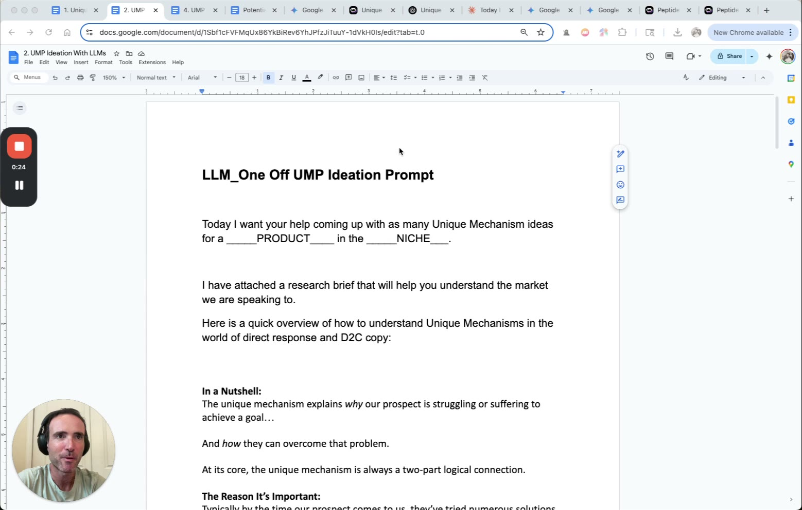
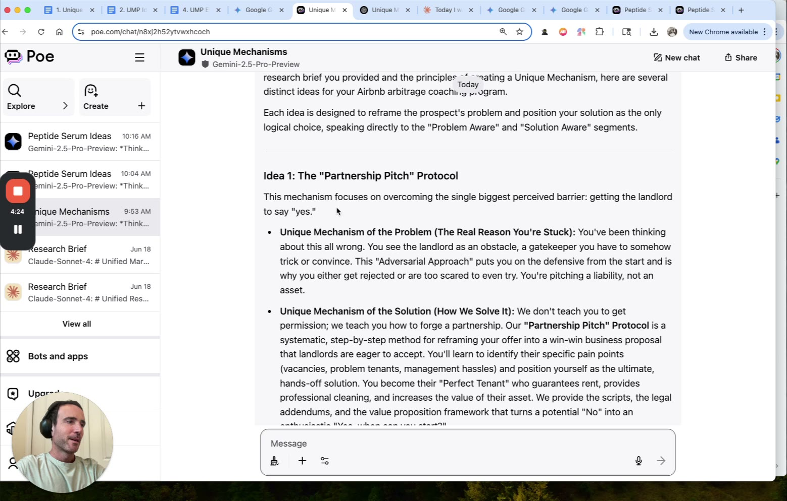
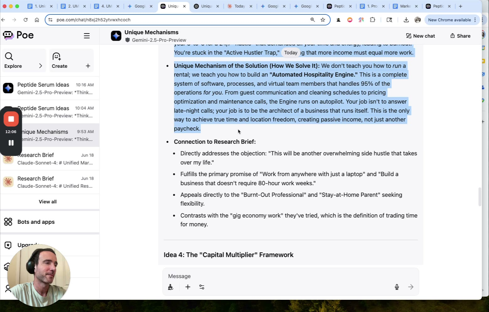
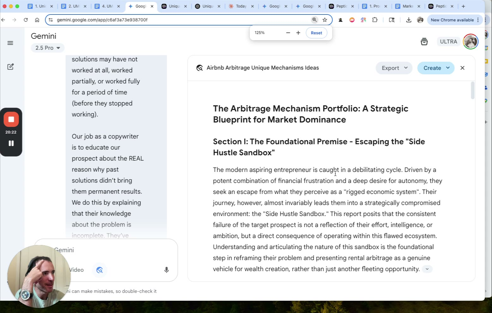
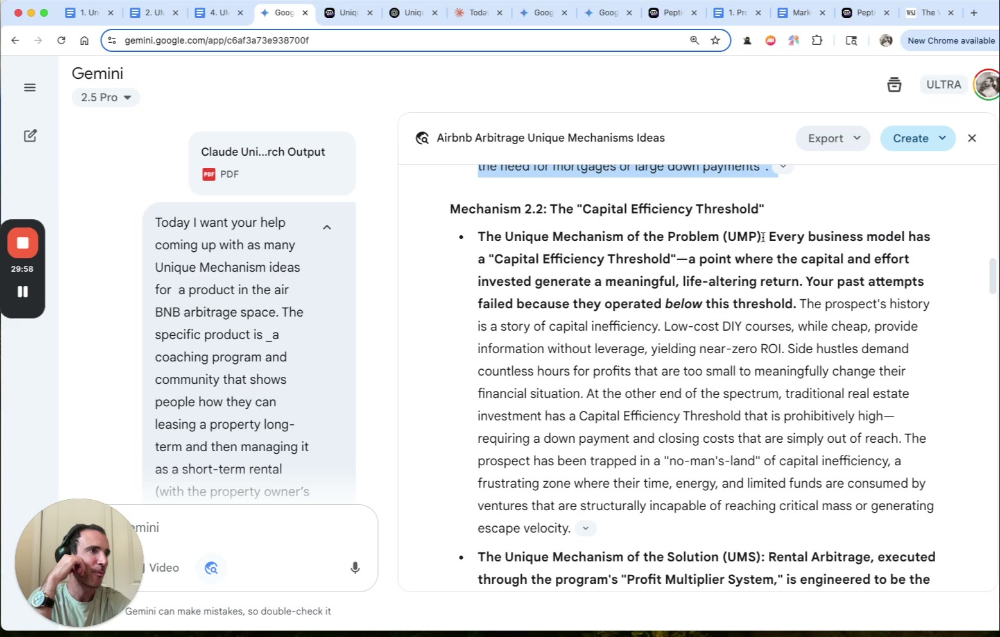
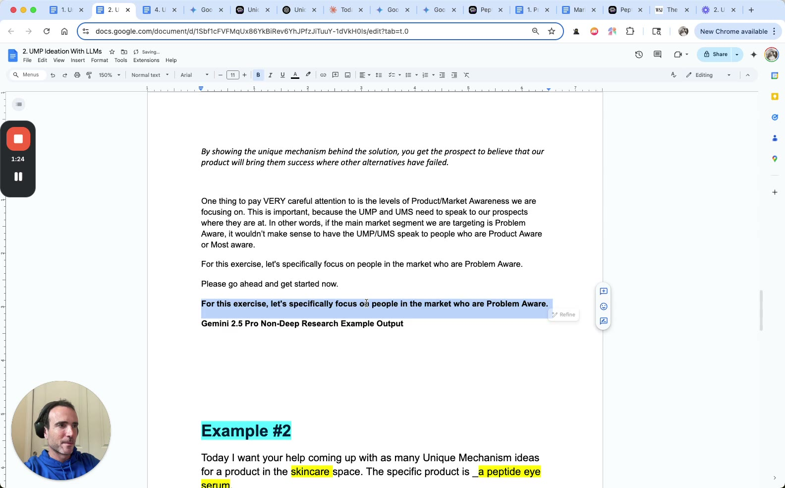
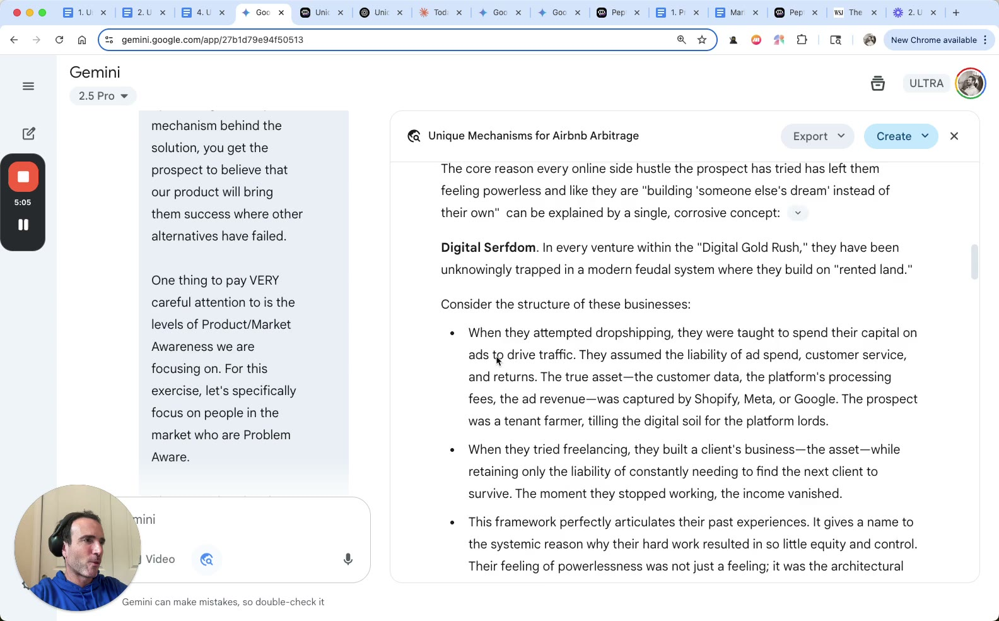

# 3.2 UMP Ideation With LLMs
> A one-off prompt (product + niche + unique-mechanism primer + target awareness level + the unified research doc) run through Gemini, ChatGPT and Claude generates dozens of unique-mechanism ideas, and the real skill is the screen: dropping the clever ones that speak to the wrong awareness segment and saving only those that meet the broad problem-aware prospect where they are.

## 🤖 Agent use
- **Use when:** we have the unified research doc and need many candidate unique mechanisms (UMP + UMS pairs) for a product before choosing one for a VSL, advertorial, PDP or ad.
- **Inputs → outputs:** product description + niche + chosen awareness segment + unified research doc (PDF) + the mechanism primer text from [03.01](03-01-unique-mechanisms-overview.md) → a long list of named mechanisms from several LLMs, screened into a short "potential mechanisms" doc that goes to the evaluation prompt in [03.03](03-03-ump-evaluation-prompt-and-process-airbnb-arbitrage.md).
- **Rules:**
  - **DO** attach the unified research document: it is "that's where this is going to help shine". [01:04]
  - **DO** name the awareness segment explicitly in the prompt ("For this exercise, let's specifically focus on people in the market who are Problem Aware."). The first run left it open and the outputs drifted toward product-aware people; he added the line and re-ran. [02:07; 40:16; v2 00:00]
  - **DO** run the same prompt in several tools and compare. In this lesson Gemini (2.5 Pro and Deep Research) gave the best outputs; ChatGPT and Claude deep research gave "cute nicknames for really basic stuff". [03:10; 41:50–43:09]
  - **DO** read all outputs and "reserve your judgment" until you have seen them, then screen each against awareness fit. [04:18]
  - **DO** paste keepers into a running "potential mechanisms" doc with dividers; do not trust the model's own ranking. [11:04–12:06; 29:02]
  - **DON'T** keep a mechanism that speaks to people who are already product aware or most aware when we target the broad problem-aware market. "That's too far along in the mental journey of where your prospect is at." [05:55]
  - **DON'T** over-weight cute names. The test is whether the UMS is tangible ("this is why it'll be different") and not only "we're gonna help you through". [38:45–40:16]
  - **IF** a mechanism is smart but only works for a niche segment (FIRE-movement followers, guru-aware buyers) **THEN** leave it out unless that segment is our deliberate target. [31:19–34:11]
  - **IF** an idea would force you to teach or build something other than the product ("Capital Multiplier": acquire a portfolio of properties) **THEN** flag the mismatch before saving it. [13:32]
  - **IF** the follow-up prompt "give me more like number three" returns weaker, over-similar ideas **THEN** abandon it and re-run the base prompt with a tighter awareness instruction. [17:09–20:18; v2 00:00]
  - **DO** use the mechanism evaluation prompt (next lesson) to rank saved ideas. [44:22]
- **See also:** [03.01 Unique Mechanisms Overview](03-01-unique-mechanisms-overview.md) · [03.03 UMP Evaluation Prompt and Process](03-03-ump-evaluation-prompt-and-process-airbnb-arbitrage.md) · [03.04 Ideation, Validation and Expansion Walkthrough (Eye Serum)](03-04-ideation-validation-and-expansion-walkthrough-eye-serum-exam.md) · [03.05 Creating a Claude Project for Unique Mechanisms](03-05-creating-a-claude-project-for-unique-mechanisms.md) · [02.04 Unified Research Process](02-04-unified-research-process.md)

## Key ideas

### 1. The method and the prompt [v1 00:00–03:10]
- Claude Projects used to be his main way ("still cool and still a viable way of doing it") but there are now "other options … also pretty cool and powerful". [00:00]
- The prompt (verbatim in the template section): "come up with as many unique mechanism ideas for a product in the ___ space", then the product ("a coaching program and community that shows people how they can lease a property long-term and then manage it as a short-term rental with the property owner's consent"), the attached research brief, the mechanism primer, and the awareness warning. [00:00–02:07]
- "It's going to be our unified research document that we created with Claude" if you followed the earlier research modules in order (product-market awareness, competitor, psychographic, unified doc). [01:04]
- Awareness warning is essential: "the UMP and UMS need to speak to our prospects where they are at." [02:07]
- He ran it in multiple LLMs and keeps the screen small "so that if people watch on mobile they're not … not able to read anything". [02:07]


*"LLM_One Off UMP Ideation Prompt": "Today I want your help coming up with as many Unique Mechanism ideas for a ___PRODUCT___ in the ___NICHE___." then "I have attached a research brief…". [00:24]*

### 2. Test run on Gemini 2.5 Pro via Poe: five ideas [v1 03:10–17:09]
Setup: he uploaded the Claude unified research output for Airbnb arbitrage and ran the prompt in Gemini Deep Research and, simultaneously, regular Gemini 2.5 Pro in Poe. [03:10] Reserve judgment, then he judges anyway. [04:18]

- **Idea 1: "The Partnership Pitch Protocol"** (landlord is the barrier). UMP: "You see the landlord as an obstacle … You're pitching a liability, not an asset." UMS: a method to reframe the offer so landlords say yes (scripts, legal addendums). [04:18]
  - Verdict: skip. "Despite what I said, it's really talking to people who are highly product aware." Using the research output's own numbers, only about 10-15% of the market is product aware and perhaps 15-25% total know the strategy (figures from the unified research as he cites them, not independently verified); biz-opp is "probably really more up here in this sort of problem aware space". "You've been thinking about it all wrong is too far along in the mental journey." [05:55]
- **Idea 2: "The Cash Flow Oasis Method"** (find untapped micro-markets near hospitals, event venues, corporate housing). UMP: "you're looking for opportunities in the wrong place … red oceans". [07:03]
  - Verdict: same awareness problem. Nuance: it could be reworked for a problem-aware speaker (e.g. address saturation after raising "you've probably heard of Airbnb hosting"), but "it still wouldn't necessarily get into meeting the market where they're at". [08:31–09:39]
- **Idea 3: "The Automated Hospitality Engine"** (fear of another time-consuming job). UMP: "Every side hustle you tried failed … it wasn't a business. It was just another job … the Active Hustler Trap." UMS: a system of software, processes and virtual team members that "handles 95% of operations for you". [09:39]
  - Verdict: **saved**, his favourite: "I really like this name, by the way. It's actually quite good." Why: biz-op mechanisms "usually [aren't] complex … not because of the market … It's because of where the market's at on that product awareness scale." [09:39–12:06]
- **Idea 4: "The Capital Multiplier Framework"** (control, not ownership; start under $15,000 then roll cash flow into more properties). [12:06]
  - Verdict: objection ("you're not really teaching a pure Airbnb arbitrage strategy … building up a portfolio of properties"), but "interesting enough, I'm going to add it to this document as well." [13:32–14:53]
- **Idea 5: "Community Due Diligence System"** (lone-wolf approach fails; submit your plan to a community of operators). [14:53]
  - Verdict: "not terrible"; speaks to people wanting community but is "very much product or product aware"; if the product doesn't have that built, "I have to build all this out"; "not a bad idea but I'm not really going to count it as a great mechanism". [14:53–15:54]


*Poe chat "Unique Mechanisms" on Gemini-2.5-Pro-Preview. The model claims to speak to "Problem Aware and Solution Aware" segments; the instructor judges idea 1 product aware anyway. [04:24]*


*Idea 3 is highlighted for copying into the "potential mechanisms" doc; the model also lists which research-brief objections and personas it addresses ("Connection to Research Brief"). [12:06]*

### 3. Follow-on prompt: "give me more like number three" [v1 15:54–20:18]
- He told the model he liked number three most because it speaks most to problem-aware people, the others to product-aware, a smaller segment, and asked for more along the lines of three. [15:54–17:09]
- He saves the follow-up as an "optional follow-on" in the doc (a variant: "as I like number three the most, give me more like number three"). [17:09]
- Result: "Cash Flow Asset Blueprint" reframes earning more money as building assets; he says it is "okay, but it's sort of not really that unique … trying too hard to make them too much like number three." "I don't really like it that much." [19:13–20:18] In video 2 he repeats: "I didn't like this follow-up prompt … That ended up not really working. This is a very fluid, dynamic thing." [v2 00:00]

### 4. Gemini Deep Research, round 1: a long report with mechanism categories [v1 20:18–40:16]
- Same prompt with Deep Research on: more background, a conceptual "foundational premise" then categories of mechanisms with a summary table at the end. [20:18]
- **Section 1, "Escaping the Side Hustle Sandbox"**: past attempts (dropshipping, affiliate, MLM, freelancing, gig work) are "low leverage activities" where the person is a "disposable, replaceable cog" in someone else's platform; the sandbox is "hyper-saturation, unstable income, and intense competition" with no moat; repeated failures produce "entrepreneurial trauma" and risk aversion that sends people back to the sandbox. [21:24–23:58] The "activity versus assets" distinction: income stops when activity stops; rental arbitrage is framed as "the first accessible pathway to controlling a cash-flowing asset". [23:58–25:26] He loves the writing ("I know this is very formal, but I think it's amazing"). [23:58]
- **2.1 "The Asset Gap vs. the Income Gap"**: UMP "you've been trying to solve an asset gap problem with an income gap solution"; UMS "the Asset Control Method". Verdict: "This is so good because it's like meeting them where they're at" (problem aware and slightly product aware, since most have tried side hustles). **Saved.** [25:26–29:02] He cites an article that Americans "are side hustling like we're in a recession" as proof of how many have side hustles (instructor anecdote, source not shown). [26:52]
- **2.2 "The Capital Efficiency Threshold"**: every model has a threshold where capital and effort yield a life-altering return; past attempts operated below it; arbitrage is the sweet spot between the "side hustle sandbox" and traditional ownership; UMS "Profit Multiplier System", under $15,000 controlling an asset worth hundreds of thousands. Verdict: "I like that mechanism too. Let's go ahead and save it." [29:02–31:19]
- **FIRE-movement accelerant** (unnamed subheader): they love FIRE's outcome and hate its slow path; position arbitrage as the "turbocharger". Verdict: cool but "too niche": a "hyper-aware … solution-aware segment"; anyone who doesn't know FIRE won't connect. **Not saved.** [31:19–33:30]
- **Section 3, "Guru-Induced Decision Deficit"**: skimmed and skipped because "it's also going to be speaking to someone who's too highly aware of … gurus". [33:30–34:11]
  - Business-growth aside (instructor claim): many businesses reach "1 million to 2 million, 3 million" by speaking to people further along the awareness scale, but "to get to 10 million, 20 million, 30 million, 50 million, you're going to speak to people up here" (broader, less aware). He tells copywriters that shifting who the copy speaks to is a way to "be consultative and help a business to expand and grow". [34:11–35:15]
- **3.2 "The Implementation Chasm of DIY Learning"**: knowing vs doing with real money and legal agreements at stake; guided implementation. Verdict: too far along in awareness; he does not read it all. Also a landlord-objection mechanism: "another liability, like a landlord thing … probably too advanced". [35:15–36:15]
  - Tip: "doing the same prompt, the unified thing, and also including the product market awareness breakdown saying, focus on this segment". (Transcript says "public market awareness"; read as product market awareness.) [36:15]
- **"Franchise in a Box"**: copied into the doc although "I wouldn't personally select this one"; can be used for a broad problem-aware segment. [36:15–37:34]
- **"The Automation Stack That Buys You Time"**: fear that arbitrage is a 24/7 job; UMS is a proprietary automation stack. He agrees with the report's summary recommendations for problem-aware and solution-aware prospects. Observes the sandbox idea is good but the UMS "is a little weak … not really as tangible", and could be combined with the asset-gap idea. [37:34–40:16]


*Gemini 2.5 Pro Deep Research report "Airbnb Arbitrage Unique Mechanisms Ideas", Section I "The Foundational Premise: Escaping the 'Side Hustle Sandbox'", next to the pasted prompt and attached PDF. [20:24]*


*Mechanism 2.2 "The Capital Efficiency Threshold" with the explicit UMP / UMS bullet structure the prompt induces. [30:00]*

### 5. Other models and the re-run [v1 40:16–46:18]
- Re-run in a new chat telling it to "specifically focus on people in the market who are problem aware". [40:16–41:50]
- ChatGPT deep research (after its usual clarifying questions): "all the chat GPT ones were sort of too basic … cute nicknames for really basic stuff": "The Asset Ownership Trap", "the landlord permission thing", "the Guru Trap". [41:50]
- Claude deep research (first use): similar, "anti-guru arbitrage authority … a bunch of cute nicknames that aren't actually that substantial"; only "controlling vs owning" was interesting. [41:50–43:09]
- Conclusion: "I think Gemini is going to be the best outputs for this section as well." [43:09]
- Preview of the next step: after ideas are saved, a prompt that gives the model the unified research doc plus the mechanism list and asks it to evaluate and rank by "potential for connecting to our target market and persuad[ing] them to buy". He pauses; the full process is in [03.03](03-03-ump-evaluation-prompt-and-process-airbnb-arbitrage.md). [44:22–45:22]
- He suggests revising the base prompt "to further hone in on the specific market segment I want" and may update it in another video. [45:22]

### 6. Video 2: closing the loop on the problem-aware Gemini run [v2 00:00–16:13]
- Prompt update: the template now explicitly says "for this exercise, let's specifically focus on people in the market who are problem aware." [v2 00:00]
- Observation on structure: the Deep Research output builds a "conceptual framework" (a "flawed opportunity map") that "doesn't feel concrete enough", but the mechanism categories are good. [v2 01:13]
- **Category 1: System mechanisms.**
  - **"The Asset-Liability Inversion"**: UMP "Digital Serfdom" ("Nobody wants to be a serf"): online side hustles mean building on rented land; dropshipping assumes ad spend and returns while platforms (Shopify, Meta, Google) capture the data and fees; freelancers build the client's asset and keep only the liability of finding the next client. UMS "Asset Control Arbitrage": separate control from ownership, fixed rent as the known liability and uncapped short-term-rental upside. Verdict: "cool name … It sounds legit … not actually complicated." **Added.** [v2 01:13–05:08]
  - **"The Permission-Based Income Trap"** (UMP) / **"The Permissionless Cash Flow System"** (UMS): all income depends on someone's permission (boss, gig algorithm, client, ad platform); arbitrage needs one permission, the lease and arbitrage addendum, then "no boss can fire them from their property". Verdict: "This is [very] good" because it speaks to autonomy and a "rebel archetype". He also notes one line ("no algorithm can suddenly deprioritize their listing") is "questionable, but it would probably be believable". **Added.** [v2 05:08–08:02]
- **Category 2: Effort mechanisms.**
  - **"Active-to-Passive Decay Rate"** (UMP: near-100% income decay when effort stops) / **"Compounding Hospitality Engine"** (UMS: front-loaded build then semi-passive, reviews act as a flywheel): "not as good as the other [hospitality engine]… but it's not bad". [v2 08:02–10:06]
  - **"Competitive Saturation Paradox"** (UMP: ease of entry is inversely proportional to success; global competition) / **"Hyper-Local Monopoly Strategy"** (UMS: compete on three blocks around a convention center or hospital, not the internet). He flags it may be "a little bit too complex" yet calls it "pretty cool and good" and adds it; it also defuses the "everyone's doing this" objection. [v2 10:06–12:30]
  - **"Guru Blindspot"**: skipped (still not for problem aware; "a way of just saying something obvious in a fancy way"). [v2 12:30]
  - **"Information vs. Transformation Fallacy"** / **"Transformation Ecosystem"** (blueprint, community, mentorship): not included: "not enough actual substance" and "more solution aware than problem aware". [v2 12:30–14:57]
- He defers the selection framework: "we will get into the selection criteria or a framework for selecting them shortly. I don't want to bury it in this video." [v2 08:02]
- Close: he has a Claude Project for unique mechanisms, taught as a bonus in another course; some Gemini ideas overlap; he will share it later in this section (see [03.05](03-05-creating-a-claude-project-for-unique-mechanisms.md)). [v2 14:57–16:00]


*Video 2: the prompt doc with the highlighted line "For this exercise, let's specifically focus on people in the market who are Problem Aware." appended to Example #1. [v2 01:24]*


*Round-2 report "Unique Mechanisms for Airbnb Arbitrage", Digital Serfdom with the dropshipping and freelancing breakdown. [v2 05:06]*

## Steps / framework
1. Prepare the research PDF (unified research doc; for biz-op the instructor attaches the same). [01:04]
2. Fill the prompt blanks: product, niche, and the awareness segment sentence (Problem Aware for the broad market). For a skincare product with ingredients, add the ingredient list and choose Solution Aware, as in Example #2. [docx]
3. Run in 2-4 LLMs (regular and deep-research modes). Gemini produced the best output here. [03:10; 43:09]
4. Read each output end to end; for each mechanism ask: who is this written for on the awareness scale; is the UMS tangible; does it need us to teach or build something other than the product? [05:55; 13:32; 15:54; 38:45]
5. Paste keepers (and borderline ones with notes) into one doc under the heading "potential mechanisms", with dividers. [12:06; 29:02]
6. Optionally ask for "more like [number]" but expect weak results; instead re-run with a tighter segment. [17:09; v2 00:00]
7. Hand the doc to the evaluation prompt for a ranked list ([03.03](03-03-ump-evaluation-prompt-and-process-airbnb-arbitrage.md)), then validate and expand ([03.04](03-04-ideation-validation-and-expansion-walkthrough-eye-serum-exam.md)).

## Examples

### Mechanism ideas screened in this lesson (Airbnb rental arbitrage coaching, biz-opp)
These came from an LLM for a hypothetical coaching product; names are course examples, not facts about any real company. Verdicts are the instructor's.

| # | Mechanism (UMP → UMS) | Awareness fit as judged | Verdict | Source |
|---|---|---|---|---|
| 1 | Landlord-as-gatekeeper → "Partnership Pitch Protocol" | Product aware | Skip | [v1 04:18–07:03] |
| 2 | Looking in the wrong (saturated) places → "Cash Flow Oasis Method" | Product aware | Skip (reworkable) | [v1 07:03–09:39] |
| 3 | "Active Hustler Trap" → "Automated Hospitality Engine" | Problem aware | **Saved, favourite** | [v1 09:39–12:06] |
| 4 | Ownership fallacy → "Capital Multiplier Framework" | Mixed | Saved with objection (teaches portfolio building, not pure arbitrage) | [v1 12:06–14:53] |
| 5 | Lone-wolf failure → "Community Due Diligence System" | Product aware | Not counted as great | [v1 14:53–15:54] |
| 6 | Income treadmill → "Cash Flow Asset Blueprint" (from follow-up) | n/a | Disliked, "not that unique" | [v1 19:13–20:18] |
| 7 | Asset gap vs income gap → "Asset Control Method" | Problem aware / slightly product aware | **Saved ("so good")** | [v1 25:26–29:02] |
| 8 | Capital Efficiency Threshold → "Profit Multiplier System" | Problem aware | **Saved** | [v1 29:02–31:19] |
| 9 | FIRE movement too slow → arbitrage as accelerant | Hyper-aware niche | Not saved (too niche) | [v1 31:19–33:30] |
| 10 | Guru-induced decision deficit | Too aware of gurus | Skipped | [v1 33:30–34:11] |
| 11 | Implementation chasm of DIY learning | Further along | Skipped (not read in full) | [v1 35:15–36:15] |
| 12 | "Franchise in a Box" | Broad problem aware | Copied but "wouldn't personally select" | [v1 36:15–37:34] |
| 13 | Automation stack that buys time | Problem and solution aware | Agrees with report; UMS "a little weak" | [v1 37:34–40:16] |
| 14 | Digital serfdom → "Asset Control Arbitrage" | Problem aware | **Added** | [v2 01:13–05:08] |
| 15 | Permission-based income trap → "Permissionless Cash Flow System" | Problem aware | **Added** ("very good") | [v2 05:08–08:02] |
| 16 | Active-to-passive decay rate → "Compounding Hospitality Engine" | Problem aware | Acceptable, weaker than #3 | [v2 08:02–10:06] |
| 17 | Competitive saturation paradox → "Hyper-Local Monopoly Strategy" | Problem aware | **Added** | [v2 10:06–12:30] |
| 18 | Guru blindspot | Problem aware? | Skipped ("obvious in a fancy way") | [v2 12:30] |
| 19 | Information vs transformation fallacy → "Transformation Ecosystem" | Solution aware | Not included | [v2 12:30–14:57] |

### Screening criteria the instructor used (stated in the lesson; he promises a formal framework later)
- Awareness fit with the broad target (problem aware): [05:55; 11:04; 26:52; 31:19; v2 14:57]
- Tangibility of the solution mechanism: [38:45–40:16]
- Fidelity to the actual product: [13:32; 15:54]
- Substance beyond a clever name: [41:50–43:09; v2 12:30]
- Strong emotional archetype or reframe ("rebel", "serf", "paradigm shift"): [v2 05:08; 26:52]

### Compliance and copying notes (derived)
- This is biz-opp / income-claim territory. LLM outputs include "handles 95% of operations", "under $15,000 to control an asset worth hundreds of thousands", "generating significant monthly cash flow from day one", "keeps 99% of people from ever receiving true financial freedom" and "passive income". These are unsubstantiated numbers and earnings-style claims. Copy the mechanism pattern (cause reframe plus system), never the numbers or income promises, unless substantiated and compliant for the platform and for FTC earnings-claim rules.
- Arbitrage depends on property-owner consent and local short-term-rental law; any ad built on these mechanisms must not imply otherwise.
- The disparaging of "gurus" and named platforms (Meta, Shopify, Uber, DoorDash) is generated text for a hypothetical product; do not use real brands as villains without review.

## Prompts / templates (verbatim)

### LLM One-Off UMP Ideation Prompt (template; 02-2 UMP Ideation With LLMs.docx)
```text
Today I want your help coming up with as many Unique Mechanism ideas for a _____PRODUCT____ in the _____NICHE___.

I have attached a research brief that will help you understand the market we are speaking to.

Here is a quick overview of how to understand Unique Mechanisms in the world of direct response and D2C copy:

In a Nutshell:

The unique mechanism explains why our prospect is struggling or suffering to achieve a goal…

And how they can overcome that problem.

At its core, the unique mechanism is always a two-part logical connection.

The Reason It's Important:

Typically by the time our prospect comes to us, they've tried numerous solutions to their problem already. In the past, these other solutions may have not worked at all, worked partially, or worked fully for a period of time (before they stopped working).

Our job as a copywriter is to educate our prospect about the REAL reason why past solutions didn't bring them permanent results. We do this by explaining that their knowledge about the problem is incomplete. They've been missing ONE CRUCIAL PIECE OF INFORMATION, and this "knowledge gap" is what's been holding them back.

There are two parts to the unique mechanism:

1. Unique Mechanism Behind the Problem our Prospect Faces.

2. Unique Mechanism Behind the Solution to that Problem.

It's important to identify the unique mechanism behind both the problem AND the solution.

By showing the unique mechanism behind the problem, you get the prospect to understand why they've failed in the past.

By showing the unique mechanism behind the solution, you get the prospect to believe that our product will bring them success where other alternatives have failed.

======

One thing to pay VERY careful attention to is the levels of Product/Market Awareness we are focusing on. This is important, because the UMP and UMS need to speak to our prospects where they are at. In other words, if the main market segment we are targeting is Problem Aware, it wouldn't make sense to have the UMP/UMS speak to people who are Product Aware or Most aware.

For this exercise, let's specifically focus on people in the market who are Problem Aware.

Please go ahead and get started now.
```
(In the docx "Problem Aware" is highlighted as the variable to swap, e.g. Solution Aware in Example #2.)

### Example #1 fill (Airbnb arbitrage): the only lines that change
```text
Today I want your help coming up with as many Unique Mechanism ideas for a product in the air BNB arbitrage space. The specific product is _a coaching program and community that shows people how they can lease a property long-term and then manage it as a short-term rental (with the property owner's consent) _

I have attached a research brief that will help you understand the market we are speaking to.

[... identical primer, "In a Nutshell" through "...success where other alternatives have failed.", then the awareness paragraph ...]

For this exercise, let's specifically focus on people in the market who are Problem Aware.

Please go ahead and get started now.
```
The docx links three Gemini outputs for this example (Gemini 2.5 Pro non-deep, Deep Research round 1, Deep Research round 2) as Google Docs URLs; their content is not in the course files except as read aloud in the video.

### Example #2 fill (skincare peptide eye serum, Solution Aware, with ingredients)
```text
Today I want your help coming up with as many Unique Mechanism ideas as possible for a product in the skincare space. The specific product is _a peptide eye serum.

I have attached a research brief that will help you understand the market we are speaking to.

[... identical primer and awareness paragraph ...]

For this exercise, let's specifically focus on people in the market who are Solution Aware.

Additionally, I have included a list of product ingredients for your consideration:

Dipalmitoyl Hydroxyproline

Pistacia Lentiscus Extract

Saccharide Isomerate

Sodium Hyaluronate

Cupuacu Seed Butter and Jojoba Esters

Vitamin C and Vitamin E

Amino acids (Proline, Glycine, and Alanine)

Please go ahead and get started now.
```
(Example #2 is not run in this lesson; its eye-serum walkthrough is in [03.04](03-04-ideation-validation-and-expansion-walkthrough-eye-serum-exam.md).)

### Follow-up prompt, "more like number three" (as spoken, from Whisper transcript [15:54–17:09]; phrasing approximate)
```text
Great, I like number three the most. The reason why is because this one speaks the most to problem-aware people versus most of the other ideas you shared, which speak more to product-aware folks, a smaller market segment, so I'd rather focus more on problem-aware people than anyone. With that being said, can you please provide some more unique mechanism ideas along the lines of number three.
```
Instructor's verdict: weak results, abandoned. [19:13–20:18; v2 00:00]

### Preview of the evaluation prompt (as spoken [44:22], partial; full version in 03.03)
"I'm working on some direct response sales copy that will sell a product to [niche]. I'm gonna share a few documents with you. The first is a unified research document. The second has a bunch of unique mechanisms. Remind [me] of what a unique mechanism is. Here's what I want you to do. Evaluate each mechanism based on their potential for connecting to our target market and persuad[ing] them to buy the product we are selling. [Rank] them most likely to succeed to least likely to succeed." (Transcript has "Make them"; read as "Rank them".)

## Screenshots
Seven frames are embedded above: prompt doc [00:24], Poe ideas 1 and 3 [04:24; 12:06], Deep Research [20:24; 30:00], video 2 prompt [v2 01:24], digital serfdom [v2 05:06].

## How to apply
- [ ] Gather: unified research PDF, product line, niche, the awareness segment we want (default problem aware for broad reach).
- [ ] Fill the prompt; keep the primer text unchanged.
- [ ] Run in Gemini (regular and Deep Research) and at least one other LLM; save each output.
- [ ] Read fully, then screen each mechanism: awareness fit, tangible UMS, product fidelity, substance.
- [ ] Create a "potential mechanisms" doc: paste keepers plus one-line reasons for borderlines; leave out FIRE-type niche ideas.
- [ ] Mark any numbers, income or earnings language in the outputs as unverified before using.
- [ ] Re-run with a stricter segment line if outputs skew product aware.
- [ ] Move to the evaluation prompt in [03.03](03-03-ump-evaluation-prompt-and-process-airbnb-arbitrage.md).

## Related
- Previous: [03.01 Unique Mechanisms Overview](03-01-unique-mechanisms-overview.md) · Next: [03.03 UMP Evaluation Prompt and Process](03-03-ump-evaluation-prompt-and-process-airbnb-arbitrage.md)
- Later use of the chosen mechanism: [04.04 VSL Background Stories and Unique Mechanisms](04-04-vsl-background-stories-and-unique-mechanisms.md) · [05.03 Airbnb Arbitrage Example](05-03-airbnb-arbitrage-example.md)
- **Where this relates to Evolve Copywriting:** Evolve's [unique mechanism concept](../../../evolve/copywriting/concepts/unique-mechanism.md) advises leading with a new mechanism when the market is product aware or sophisticated (stage 3-4); Stefan's lesson screens out mechanisms aimed at product-aware people when the target is the broad problem-aware market. These are consistent only if you first choose the awareness segment: Evolve states the rule for a specific segment, Stefan chooses the segment first (for scale). Also see [Market awareness (Evolve)](../../../evolve/copywriting/concepts/market-awareness.md) and [AI in copywriting (Evolve)](../../../evolve/copywriting/concepts/ai-in-copywriting.md).

## Sources and limitations
- Transcripts: [video 1 (46:18)](<../../../../../raw/stefan-georgi/rmbc-ii/_transcripts/Stefan Georgi - RMBC II (1)/03-UNIQUE MECHANISMS/02-[2] UMP Ideation With LLMs.txt>) · [video 2 (16:13)](<../../../../../raw/stefan-georgi/rmbc-ii/_transcripts/Stefan Georgi - RMBC II (1)/03-UNIQUE MECHANISMS/02-[2] UMP Ideation With LLMs video2.txt>) · Document: [02-2 UMP Ideation With LLMs.docx.md](<../../../../../raw/stefan-georgi/rmbc-ii/_extracted/Stefan Georgi - RMBC II (1)/03-UNIQUE MECHANISMS/02-2 UMP Ideation With LLMs.docx.md>). Captions used for spelling: `02-21 … Part 1.srt` and `02-22 … Part 2.srt`.
- Machine transcription (Whisper large-v3-turbo); both videos fully covered. Mishearings fixed: "Poe" (the multi-model chat app), "Gemini", "serf/digital serfdom", "permissionless cash flow system" (transcript "cashless"), "public market awareness" read as product market awareness, "textiles" etc. Quotes of LLM output are as read aloud; some are paraphrased by the speaker mid-reading. Where the transcript has profanity as emphasis, it is omitted.
- The three Google Docs with the full Gemini outputs are linked in the docx but are not in the course files; mechanism details come from what he reads on screen and the frames. Parts of the long reports he skims (sections 3.x) are not captured.
- The "10-15% product aware / 15-25% know the strategy" figures and the "Americans side hustling" article are quoted by the instructor from LLM research and a news item respectively; neither is sourced in the files.
- Revenue-tier remarks ("1 million to 2 million… 10 million, 20 million, 30 million, 50 million") are instructor claims, not evidence.
- The evaluation prompt, the expansion/validation process and the Claude Project mentioned at the end belong to lessons 03.03-03.05 and are only previewed here.
